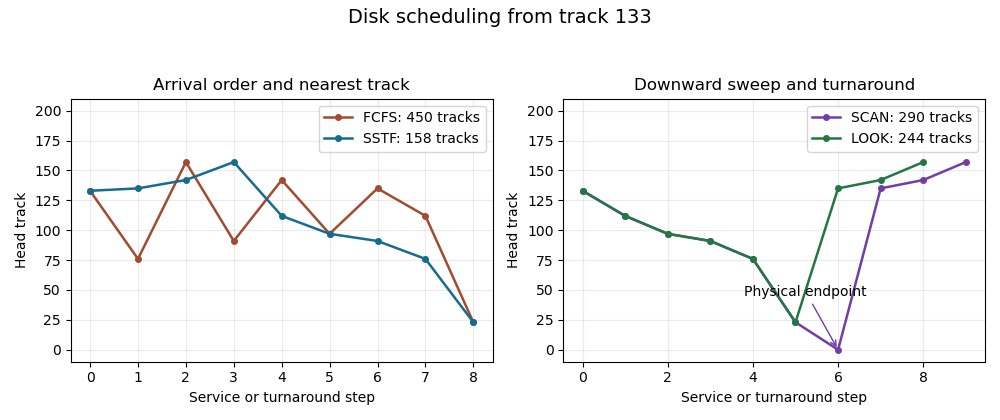

<h1 id="3/b/iii/solution">Solution</h1>

↑ **Parent:** [Iii](../iii.md)

The previous motion from 135 to 133 fixes the initial direction as downward. Under [SCAN disk scheduling](../../../../../../scan-disk-scheduling.md), the head continues to the physical endpoint 0 before reversing:
```
133 -> 112 -> 97 -> 91 -> 76 -> 23 -> 0 -> 135 -> 142 -> 157
```
Thus **SCAN crosses $133+157=290$ tracks**, stopping once the final pending request has been served.

If “elevator” means [LOOK disk scheduling](../../../../../../look-disk-scheduling.md), reversal occurs at the lowest pending request, 23, rather than track 0. Its route omits 0, and the total is **$(133-23)+(157-23)=244$ tracks**. Stating the turnaround convention is necessary to make the numerical answer unambiguous.

<a id="3/b/iii/image-disk-scheduling-service-paths-and-the-scan-look-turnaround-distinction"></a>


**[Figure 3](#3/b/iii/image-disk-scheduling-service-paths-and-the-scan-look-turnaround-distinction). Disk scheduling service paths and the SCAN–LOOK turnaround distinction**. Original paths from the given starting position. The extra zero-track endpoint in SCAN is a movement step rather than a serviced request. Totals measure absolute track displacement.

## ↑ Ancestors (13)

1. [Iii](../iii.md)
2. [B](../../b.md)
3. [3](../../../3.md)
4. [Digital systems, linear algebra, introduction to formal proof (resit)](../../../../digital-systems-linear-algebra-introduction-to-formal-proof-resit-split.md)
5. [2016](../../../../split.md)
6. [Past exam of the year 1 of the computer science course of the University of Oxford](../../../../../split.md)
7. [Year 1 of the computer science course of the University of Oxford](../../../../../../year-1-of-the-computer-science-course-of-the-university-of-oxford.md)
8. [Computer science course of the University of Oxford](../../../../../../computer-science-course-of-the-university-of-oxford.md)
9. [Undergraduate course of the University of Oxford](../../../../../../undergraduate-course-of-the-university-of-oxford.md)
10. [Course of the University of Oxford](../../../../../../course-of-the-university-of-oxford.md)
11. [University of Oxford](../../../../../../university-of-oxford-split.md)
12. [List of universities](../../../../../../list-of-universities.md)
13. [Codex Wiki](../../../../../../split.md)
