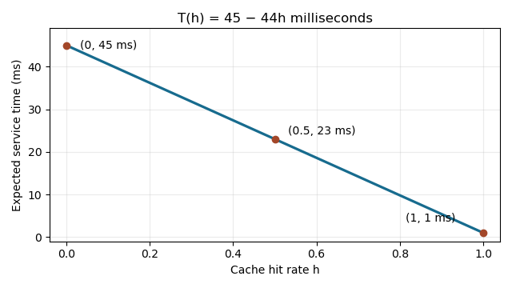

<h1 id="3/c/solution">Solution</h1>

↑ **Parent:** [C](../c.md)

Conditioning on a [cache hit](../../../../../cache-hit.md) or [cache miss](../../../../../cache-miss.md), the [expected latency](../../../../../expected-latency.md) is

$$
\boxed{T(h)=h\cdot1+(1-h)\cdot45=45-44h\text{ ms},\qquad0\leq h\leq1.}
$$

This is a straight line from $(0,45)$ to $(1,1)$; at hit rate $1/2$, the mean is 23 ms. The 45 ms is already the complete miss-service time in the question, so another cache-lookup millisecond is not added to it.

**[Figure 4](#3/c/image-mean-service-time-as-a-function-of-cache-hit-rate). Mean service time as a function of cache hit rate**. Original plot of $T(h)=45-44h$ milliseconds, including the endpoint and midpoint values.

## ↑ Ancestors (12)

1. [C](../c.md)
2. [3](../../3.md)
3. [Digital systems, linear algebra, introduction to formal proof (resit)](../../../digital-systems-linear-algebra-introduction-to-formal-proof-resit-split.md)
4. [2016](../../../split.md)
5. [Past exam of the year 1 of the computer science course of the University of Oxford](../../../../split.md)
6. [Year 1 of the computer science course of the University of Oxford](../../../../../year-1-of-the-computer-science-course-of-the-university-of-oxford.md)
7. [Computer science course of the University of Oxford](../../../../../computer-science-course-of-the-university-of-oxford.md)
8. [Undergraduate course of the University of Oxford](../../../../../undergraduate-course-of-the-university-of-oxford.md)
9. [Course of the University of Oxford](../../../../../course-of-the-university-of-oxford.md)
10. [University of Oxford](../../../../../university-of-oxford-split.md)
11. [List of universities](../../../../../list-of-universities.md)
12. [Codex Wiki](../../../../../split.md)
