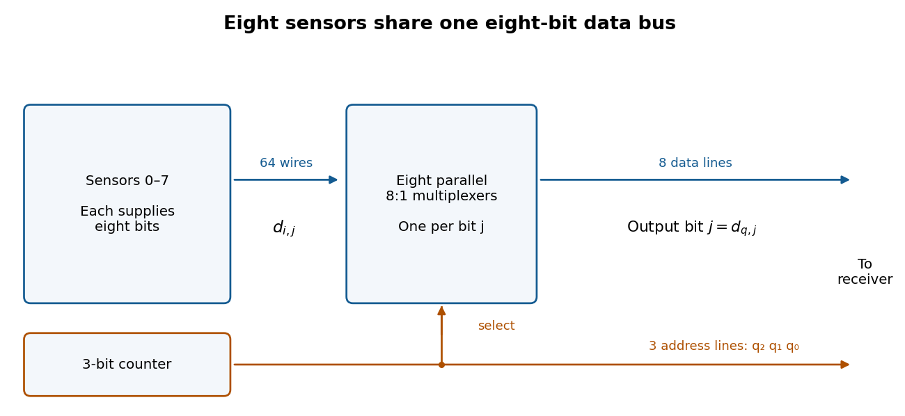
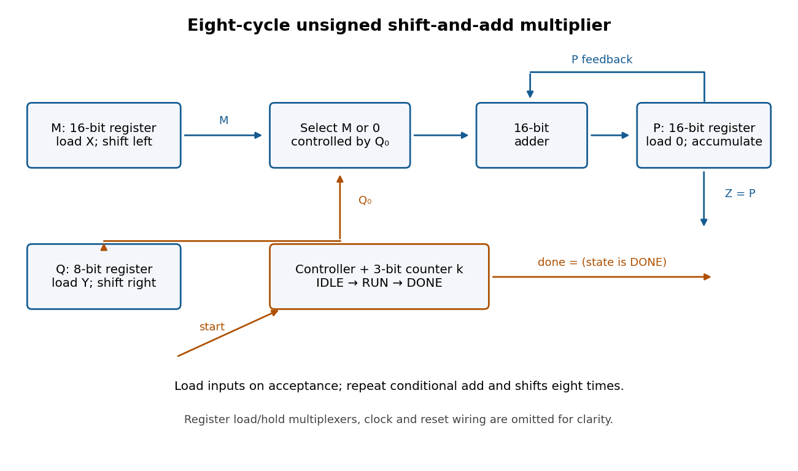

# Digital systems, linear algebra, introduction to formal proof

↑ **Parent:** [2016](../2016.md)

Source paper: [released examination archive](https://www.whatdotheyknow.com/request/ba_computer_science_past_papers/response/2577745/attach/2/202402%20183%20CS%20Papers.zip?cookie_passthrough=1), member `2015/T/a10101w1.pdf`; original cover dated 2016-06-16. The cover establishes the examination year despite the archive directory name.

**Table of contents**

- [1](#1)
  - [a](#1/a)
    - [Solution](#1/a/solution)
  - [b](#1/b)
    - [Solution](#1/b/solution)
  - [c](#1/c)
    - [Solution](#1/c/solution)
  - [d](#1/d)
    - [Solution](#1/d/solution)
- [2](#2)
  - [a](#2/a)
    - [Solution](#2/a/solution)
  - [b](#2/b)
    - [Solution](#2/b/solution)
  - [c](#2/c)
    - [Solution](#2/c/solution)
- [3](#3)
  - [a](#3/a)
    - [Solution](#3/a/solution)
  - [b](#3/b)
    - [Solution](#3/b/solution)
  - [c](#3/c)
    - [Solution](#3/c/solution)
  - [d](#3/d)
    - [Solution](#3/d/solution)
  - [e](#3/e)
    - [Solution](#3/e/solution)
- [4](#4)
  - [a](#4/a)
    - [Solution](#4/a/solution)
  - [b](#4/b)
    - [Solution](#4/b/solution)
  - [c](#4/c)
    - [Solution](#4/c/solution)
- [5](#5)
  - [a](#5/a)
    - [Solution](#5/a/solution)
  - [b](#5/b)
    - [Solution](#5/b/solution)
  - [c](#5/c)
    - [Solution](#5/c/solution)
  - [d](#5/d)
    - [Solution](#5/d/solution)
  - [e](#5/e)
    - [Solution](#5/e/solution)
- [6](#6)
  - [a](#6/a)
    - [Solution](#6/a/solution)
  - [b](#6/b)
    - [Solution](#6/b/solution)
  - [c](#6/c)
    - [Solution](#6/c/solution)
  - [d](#6/d)
    - [Solution](#6/d/solution)
  - [e](#6/e)
    - [Solution](#6/e/solution)
- [7](#7)
  - [a](#7/a)
    - [Solution](#7/a/solution)
  - [b](#7/b)
    - [Solution](#7/b/solution)
  - [c](#7/c)
    - [Solution](#7/c/solution)
  - [d](#7/d)
    - [i](#7/d/i)
      - [Solution](#7/d/i/solution)
    - [ii](#7/d/ii)
      - [Solution](#7/d/ii/solution)
- [8](#8)
  - [a](#8/a)
    - [i](#8/a/i)
      - [Solution](#8/a/i/solution)
    - [ii](#8/a/ii)
      - [Solution](#8/a/ii/solution)
  - [b](#8/b)
    - [Solution](#8/b/solution)
  - [c](#8/c)
    - [i](#8/c/i)
      - [Solution](#8/c/i/solution)
    - [ii](#8/c/ii)
      - [Solution](#8/c/ii/solution)
    - [iii](#8/c/iii)
      - [Solution](#8/c/iii/solution)

## 1

↑ **Parent:** [Digital systems, linear algebra, introduction to formal proof](digital-systems-linear-algebra-introduction-to-formal-proof.md)

<h3 id="1/a">a</h3>

↑ **Parent:** [1](#1)

<h4 id="1/a/solution">Solution</h4>

↑ **Parent:** [A](#1/a)

Use a synchronous [binary counter](../../electrical-engineering.md#binary-counter) with three positive-edge-triggered [D flip-flops](../../electrical-engineering.md#d-flip-flop), all driven by the same [clock signal](../../electrical-engineering.md#clock-signal). Write their outputs $q_2q_1q_0$, with $q_0$ the [least significant bit](../../integer.md#least-significant-bit). The next-state [Boolean functions](../../analysis-of-boolean-functions.md#boolean-function) are

$$
\boxed{D_0=\neg q_0,\qquad D_1=q_1\oplus q_0,\qquad D_2=q_2\oplus(q_1\land q_0).}
$$

Implement these with one [NOT gate](../../theoretical-computer-science.md#not-gate), two [exclusive or](../../theoretical-computer-science.md#exclusive-or) gates, and one [AND gate](../../mathematical-logic.md#and-gate). Connect each $D_i$ to its corresponding [D flip-flop](../../electrical-engineering.md#d-flip-flop); its output $q_i$ is address line $i$. A reset input clears all three [flip-flops](../../electrical-engineering.md#flip-flop) to zero, so the first selected sensor is sensor zero.

The state sequence is

$$
000\to001\to010\to011\to100\to101\to110\to111\to000.
$$

The low [bit](../../information-theory.md#bit) toggles at every [clock edge](../../computer-science.md#clock-edge), the middle [bit](../../information-theory.md#bit) toggles exactly when the old low [bit](../../information-theory.md#bit) is one, and the high [bit](../../information-theory.md#bit) toggles exactly when both old lower [bits](../../information-theory.md#bit) are one. These are precisely the [carry](../../arithmetic.md#carry-arithmetic) conditions for incrementing a three-[bit](../../information-theory.md#bit) [binary representation](../../arithmetic.md#binary-number). Every possible state belongs to the cycle, so there is no unused state requiring recovery. Choose a [clock period](../../electrical-engineering.md#clock-period) allowing the [combinational logic](../../theoretical-computer-science.md#combinational-logic) to settle before the next capture.

<h3 id="1/b">b</h3>

↑ **Parent:** [1](#1)

<h4 id="1/b/solution">Solution</h4>

↑ **Parent:** [B](#1/b)

For data inputs $d_0,\ldots,d_7$ and selection [bits](../../information-theory.md#bit) $s_2s_1s_0$, use a three-to-eight [binary decoder](../../theoretical-computer-science.md#binary-decoder). Its output $e_i$ is the [minterm](../../mathematical-logic.md#minterm) that is one exactly when the selection equals the three-[bit](../../information-theory.md#bit) [binary representation](../../arithmetic.md#binary-number) of $i$. For example,

$$
e_0=\neg s_2\land\neg s_1\land\neg s_0,\quad e_1=\neg s_2\land\neg s_1\land s_0,\quad e_7=s_2\land s_1\land s_0.
$$

Gate each data input with its decoded selection using an [AND gate](../../mathematical-logic.md#and-gate), then combine all eight results with an [OR gate](../../mathematical-logic.md#or-gate):

$$
\boxed{z=\bigvee_{i=0}^7(e_i\land d_i).}
$$

Exactly one $e_i$ is asserted, so $z=d_i$ for the selected $i$, regardless of the other data inputs. A direct implementation uses three shared [NOT gates](../../theoretical-computer-science.md#not-gate), eight three-input [AND gates](../../mathematical-logic.md#and-gate) for the [binary decoder](../../theoretical-computer-science.md#binary-decoder), eight two-input [AND gates](../../mathematical-logic.md#and-gate) for the data, and one eight-input [OR gate](../../mathematical-logic.md#or-gate). Equivalently, combine each decoder term with its data input in one four-input [AND gate](../../mathematical-logic.md#and-gate). Larger [logic gates](../../theoretical-computer-science.md#logic-gate) may be built from two-input ones.

<h3 id="1/c">c</h3>

↑ **Parent:** [1](#1)

<h4 id="1/c/solution">Solution</h4>

↑ **Parent:** [C](#1/c)

Use **eight parallel 8:1 [multiplexers](../../theoretical-computer-science.md#multiplexer) and one shared three-[bit](../../information-theory.md#bit) [binary counter](../../electrical-engineering.md#binary-counter)**. If $d_{i,j}$ is [bit](../../information-theory.md#bit) $j$ from sensor $i$, connect $d_{0,j},\ldots,d_{7,j}$ to [multiplexer](../../theoretical-computer-science.md#multiplexer) $j$. Connect all selection inputs to the [binary counter](../../electrical-engineering.md#binary-counter) outputs. Then data line $j$ carries $d_{q,j}$, so all eight data lines belong to the same selected sensor. Send the three counter outputs to the receiver as the address lines as well.

<a id="1/c/image-one-shared-binary-counter-selects-the-same-sensor-in-eight-parallel-multiplexers"></a>


**[Figure 1](#1/c/image-one-shared-binary-counter-selects-the-same-sensor-in-eight-parallel-multiplexers). One shared binary counter selects the same sensor in eight parallel multiplexers**.

After reset the receiver sees sensors $0,1,\ldots,7,0,\ldots$, one per [clock period](../../electrical-engineering.md#clock-period). Sample the data and address only after the [binary counter](../../electrical-engineering.md#binary-counter) and [multiplexers](../../theoretical-computer-science.md#multiplexer) have settled, for example on the opposite [clock edge](../../computer-science.md#clock-edge) with a sufficiently long [clock period](../../electrical-engineering.md#clock-period). Changing addresses can otherwise cause transient [logic hazards](../../theoretical-computer-science.md#hazard-logic). The transmitter uses **eleven signal lines**, apart from any shared clock or reset connection.

<h3 id="1/d">d</h3>

↑ **Parent:** [1](#1)

<h4 id="1/d/solution">Solution</h4>

↑ **Parent:** [D](#1/d)

Use **an eight-[bit](../../information-theory.md#bit) modulo-256 [binary counter](../../electrical-engineering.md#binary-counter), eight 256:1 [multiplexers](../../theoretical-computer-science.md#multiplexer), eight data lines and eight address lines**. Thus there are **sixteen signal lines**, apart from clock and reset, and a full scan takes 256 [clock periods](../../electrical-engineering.md#clock-period). The counter next-state equations generalize to

$$
D_0=\neg q_0,\qquad D_i=q_i\oplus\bigwedge_{j=0}^{i-1}q_j\quad(1\leq i\leq7).
$$

A 256:1 [multiplexer](../../theoretical-computer-science.md#multiplexer) for one data [bit](../../information-theory.md#bit) can be made hierarchically: 32 first-stage 8:1 [multiplexers](../../theoretical-computer-science.md#multiplexer) select within eight-sensor groups using $q_2q_1q_0$; four second-stage 8:1 [multiplexers](../../theoretical-computer-science.md#multiplexer) select groups using $q_5q_4q_3$; one final 4:1 [multiplexer](../../theoretical-computer-science.md#multiplexer) selects using $q_7q_6$. A final 8:1 [multiplexer](../../theoretical-computer-science.md#multiplexer) also works if one select input is fixed to zero and only four data inputs are used. Repeat this network eight times, sharing all selection lines. Allow for the extra [propagation delay](../../theoretical-computer-science.md#propagation-delay) when choosing the [clock period](../../electrical-engineering.md#clock-period).

## 2

↑ **Parent:** [Digital systems, linear algebra, introduction to formal proof](digital-systems-linear-algebra-introduction-to-formal-proof.md)

<h3 id="2/a">a</h3>

↑ **Parent:** [2](#2)

<h4 id="2/a/solution">Solution</h4>

↑ **Parent:** [A](#2/a)

Generate four partial-product [bits](../../information-theory.md#bit) with [AND gates](../../mathematical-logic.md#and-gate):

$$
p_{00}=x_0y_0,\quad p_{10}=x_1y_0,\quad p_{01}=x_0y_1,\quad p_{11}=x_1y_1.
$$

The [binary multiplication](../../arithmetic.md#binary-multiplication) expansion is $XY=p_{00}+2(p_{10}+p_{01})+4p_{11}$. Add the two weight-two [bits](../../information-theory.md#bit) with a [half adder](../../theoretical-computer-science.md#half-adder), then add its [carry](../../arithmetic.md#carry-arithmetic) to $p_{11}$ with a second [half adder](../../theoretical-computer-science.md#half-adder). The complete [combinational logic](../../theoretical-computer-science.md#combinational-logic) is

$$
\begin{aligned}
z_0&=p_{00},&z_1&=p_{10}\oplus p_{01},&c&=p_{10}\land p_{01},\\
z_2&=p_{11}\oplus c,&z_3&=p_{11}\land c.
\end{aligned}
$$

Thus **four [AND gates](../../mathematical-logic.md#and-gate) for the partial products and two [half adders](../../theoretical-computer-science.md#half-adder) suffice**. Each [half adder](../../theoretical-computer-science.md#half-adder) contains one [exclusive or](../../theoretical-computer-science.md#exclusive-or) gate and one [AND gate](../../mathematical-logic.md#and-gate). In the largest case $3\times3=9$, these equations produce $1001$, including the necessary fourth output [bit](../../information-theory.md#bit).

<h3 id="2/b">b</h3>

↑ **Parent:** [2](#2)

<h4 id="2/b/solution">Solution</h4>

↑ **Parent:** [B](#2/b)

Split the four-[bit](../../information-theory.md#bit) unsigned inputs into two-[bit](../../information-theory.md#bit) halves: $X=4X_H+X_L$ and $Y=4Y_H+Y_L$. Use four copies of the two-[bit](../../information-theory.md#bit) [binary multiplier](../../electrical-engineering.md#binary-multiplier) to compute $P_{LL}=X_LY_L$, $P_{HL}=X_HY_L$, $P_{LH}=X_LY_H$, and $P_{HH}=X_HY_H$. Then

$$
\boxed{XY=P_{LL}+4P_{HL}+4P_{LH}+16P_{HH}.}
$$

The extreme terms occupy disjoint output positions: $P_{LL}$ uses positions zero to three and $16P_{HH}$ uses positions four to seven. Form $W$ by concatenating their four-[bit](../../information-theory.md#bit) outputs, with $P_{HH}$ in the upper half and $P_{LL}$ in the lower half. This needs wiring alone, so $W=16P_{HH}+P_{LL}$ without an [adder](../../theoretical-computer-science.md#adder).

Use the first eight-[bit](../../information-theory.md#bit) [adder](../../theoretical-computer-science.md#adder) to form $R=P_{HL}+P_{LH}$ after zero-extension, and the second to form $Z=W+(R\ll2)$. Thus **four two-[bit](../../information-theory.md#bit) [binary multipliers](../../electrical-engineering.md#binary-multiplier) and two eight-[bit](../../information-theory.md#bit) [adders](../../theoretical-computer-science.md#adder) suffice**. The fixed [left bit shift](../../programming-language.md#left-bit-shift) is also wiring alone.

The middle sum can reach $9+9=18$, so preserve all five of its potentially nonzero [bits](../../information-theory.md#bit); retaining only four would be wrong. Its shifted value is at most 72. The final result is at most $15\times15=225$, so both additions fit in eight [bits](../../information-theory.md#bit). Concatenating the disjoint extreme terms is what saves an addition.

<h3 id="2/c">c</h3>

↑ **Parent:** [2](#2)

<h4 id="2/c/solution">Solution</h4>

↑ **Parent:** [C](#2/c)

Use unsigned inputs as in the preceding parts. Store a 16-[bit](../../information-theory.md#bit) accumulator $P$, a 16-[bit](../../information-theory.md#bit) shifted multiplicand $M$, an eight-[bit](../../information-theory.md#bit) multiplier $Q$, and a three-[bit](../../information-theory.md#bit) iteration [binary counter](../../electrical-engineering.md#binary-counter) $k$. The [sequential circuit](../../electrical-engineering.md#sequential-logic) has one 16-[bit](../../information-theory.md#bit) [adder](../../theoretical-computer-science.md#adder), a 16-[bit](../../information-theory.md#bit) [multiplexer](../../theoretical-computer-science.md#multiplexer) selecting $M$ or zero from $Q_0$, fixed one-place [bit shifts](../../programming-language.md#bit-shift), and load/hold selection for the [digital registers](../../electrical-engineering.md#digital-register). The input values are captured when `start` is accepted, so later input changes cannot alter the operation.

<a id="2/c/image-the-shift-and-add-binary-multiplier-reuses-one-16-bit-adder-for-eight-iterations"></a>


**[Figure 2](#2/c/image-the-shift-and-add-binary-multiplier-reuses-one-16-bit-adder-for-eight-iterations). The shift-and-add binary multiplier reuses one 16-bit adder for eight iterations**.

Use three control states with the following synchronous transition table. All assignments in a row use the old [digital register](../../electrical-engineering.md#digital-register) values and occur together at the active [clock edge](../../computer-science.md#clock-edge).

| State | Condition | Register updates | Next state | IDLE | `start = 0` | Hold all [digital registers](../../electrical-engineering.md#digital-register) | IDLE | IDLE | `start = 1` | $P\gets0$, $M\gets\operatorname{zeroextend}_{16}(X)$, $Q\gets Y$, $k\gets0$ | RUN | RUN | $k<7$ | $P\gets P+(Q_0?M:0)$, $M\gets M\ll1$, $Q\gets Q\gg1$, $k\gets k+1$ | RUN | RUN | $k=7$ | $P\gets P+(Q_0?M:0)$, $M\gets M\ll1$, $Q\gets Q\gg1$; hold $k$ | DONE | DONE | `start = 1` | Hold all [digital registers](../../electrical-engineering.md#digital-register) | DONE | DONE | `start = 0` | Hold all [digital registers](../../electrical-engineering.md#digital-register) | IDLE |
| --- | --- | --- | --- | --- | --- | --- | --- | --- | --- | --- | --- | --- | --- | --- | --- | --- | --- | --- | --- | --- | --- | --- | --- | --- | --- | --- | --- |

Reset selects IDLE and clears the [digital registers](../../electrical-engineering.md#digital-register). Set **$Z=P$ and `done = 1` exactly in DONE**. A `start` pulse in IDLE launches one multiplication; further pulses during RUN are ignored. Holding `start` high cannot repeatedly launch operations: DONE waits for it to go low before rearming. The product remains stored while waiting and through the following IDLE state. There are **eight RUN [clock edges](../../computer-science.md#clock-edge) after the loading edge**; the last addition is captured before `done` becomes high.

For correctness, let $X_0,Y_0$ denote the captured values. After $i$ iterations, for $0\leq i\leq8$, the [loop invariant](../../algorithm.md#loop-invariant) is

$$
P_i=X_0(Y_0\bmod2^i),\quad M_i=2^iX_0,\quad Q_i=\lfloor Y_0/2^i\rfloor,
$$

so $P_i+M_iQ_i=X_0Y_0$. Writing $Q_i=2q+b$, the next accumulation adds $bM_i$, the [left bit shift](../../programming-language.md#left-bit-shift) doubles $M_i$, and the [logical right shift](../../programming-language.md#logical-right-shift) changes $Q_i$ to $q$. Hence the invariant is preserved. At $i=8$, $Q_i=0$, giving **$Z=P_8=X_0Y_0$**. The largest product is $255^2=65025<2^{16}$, so the accumulator fits. Even the final shifted multiplicand is $256X_0\leq65280$, so it also fits.

## 3

↑ **Parent:** [Digital systems, linear algebra, introduction to formal proof](digital-systems-linear-algebra-introduction-to-formal-proof.md)

<h3 id="3/a">a</h3>

↑ **Parent:** [3](#3)

<h4 id="3/a/solution">Solution</h4>

↑ **Parent:** [A](#3/a)

The [calling convention](../../programming-language.md#calling-convention) passes the integer argument in **`$a0`**, returns the result in **`$v0`**, and uses **`jal` with `$ra`** for a call and its [return address](../../programming-language.md#return-address). The callee returns using `jr $ra`. Its [stack frame](../../data-structure.md#stack-frame) grows downwards from `$sp` and must be removed before returning, restoring the caller's [stack pointer](../../computer-science.md#stack-pointer).

The `$s` [processor registers](../../computer-science.md#processor-register) are [callee-saved registers](../../programming-language.md#callee-saved-register): a callee that uses `$s0` or `$s1` must restore their incoming values. The `$a`, `$v`, and `$t` [processor registers](../../computer-science.md#processor-register) are [caller-saved registers](../../programming-language.md#caller-saved-register); a caller must preserve any of their values that it needs after a call. Consequently `foo` keeps its own argument in `$s0` and the first call's result in `$s1`, where nested calls preserve them. Because a nested `jal` overwrites `$ra`, `foo` also saves its incoming [return address](../../programming-language.md#return-address). Every recursive activation has its own [stack frame](../../data-structure.md#stack-frame).

The supplied [MIPS instructions](../../computer-science.md#mips-instruction) use the paper's simplified convention: [pseudoinstructions](../../programming-language.md#pseudoinstruction) such as `subi` are accepted, and control transfers have no [branch delay slot](../../computer-science.md#branch-delay-slot). The completed code below follows that convention. A hardware implementation with delayed control transfers requires suitable scheduling or `nop` instructions throughout the supplied code as well.

<h3 id="3/b">b</h3>

↑ **Parent:** [3](#3)

<h4 id="3/b/solution">Solution</h4>

↑ **Parent:** [B](#3/b)

The entry sequence creates one 12-byte [stack frame](../../data-structure.md#stack-frame), then preserves the [return address](../../programming-language.md#return-address) and both used [callee-saved registers](../../programming-language.md#callee-saved-register):
```
subi $sp, $sp, 12    # allocate three four-byte words
sw   $ra, 0($sp)     # save return address of this activation
sw   $s0, 4($sp)     # save caller's s0
sw   $s1, 8($sp)     # save caller's s1
```
The closing sequence reverses these effects:
```
lw   $ra, 0($sp)     # recover return address of this activation
lw   $s0, 4($sp)     # restore caller's s0
lw   $s1, 8($sp)     # restore caller's s1
addi $sp, $sp, 12    # deallocate the frame
jr   $ra            # return to the caller
```
Loads must precede deallocation because their offsets refer to the current [stack frame](../../data-structure.md#stack-frame). The [return value](../../programming-language.md#return-value) in `$v0` is deliberately retained. Saving `$ra` is essential even though it is not an `$s` [processor register](../../computer-science.md#processor-register): otherwise the second nested call would destroy the address to which this activation must return.

<h3 id="3/c">c</h3>

↑ **Parent:** [3](#3)

<h4 id="3/c/solution">Solution</h4>

↑ **Parent:** [C](#3/c)

The missing [MIPS instructions](../../computer-science.md#mips-instruction), in order, are
```
bne  $t0, $0, fooRet1
subi $a0, $s0, 3
add  $v0, $s1, $v0
```
The comparison `slti $t0, $s0, 3` makes `$t0` nonzero exactly when $y<3$, so the first instruction selects the base case. The second forms $y-3$ from the saved argument, rather than relying on `$a0` surviving the first call. After the second call, `$s1` holds `bar(y-2)` and `$v0` holds `bar(y-3)`; the final addition puts **their sum in `$v0`**, as required by the [calling convention](../../programming-language.md#calling-convention).

<h3 id="3/d">d</h3>

↑ **Parent:** [3](#3)

<h4 id="3/d/solution">Solution</h4>

↑ **Parent:** [D](#3/d)

The blanks are **`x < 2`** and **`return x - foo(x + 1)`**. The compiled `slti` and `bne` select the first branch exactly for $x<2$. Otherwise `addi` forms $x+1$, `jal foo` returns its value in `$v0`, and `sub $v0, $s0, $v0` subtracts that value from the preserved $x$. Thus the complete high-level implementation is
```
proc bar(val x : int) : int
begin if x < 2 then
          return 1
      else
          return x - foo(x + 1)
      end
end
```
Although the immediate call increases the argument, substitution into `foo`'s two recursive calls decreases the corresponding `bar` arguments to $x-1$ and $x-2$ whenever the recursive branch is entered. The mutual [recursion](../../algorithm.md#recursion-computer-science) therefore terminates on ordinary integer inputs, assuming sufficient [stack](../../data-structure.md#stack-data-structure) space and no machine arithmetic overflow.

<h3 id="3/e">e</h3>

↑ **Parent:** [3](#3)

<h4 id="3/e/solution">Solution</h4>

↑ **Parent:** [E](#3/e)

Keep both the limit and current argument in [callee-saved registers](../../programming-language.md#callee-saved-register), so a call to `foo` preserves them. Under the same no-delay-slot convention, use
```
li   $s0, n
li   $s1, 1
slti $t0, $s0, 1
bne  $t0, $0, testEnd
testLoop:
move $a0, $s1
jal  foo
break 1
beq  $s1, $s0, testEnd
addi $s1, $s1, 1
b    testLoop
testEnd:
break 0
b    testEnd
```
At every **`break 1`**, `$s1` is the tested value and `$v0` is its result. Resuming after the breakpoint continues to the next value; after $n$ the program reaches its separate final stop. The initial guard handles $n<1$ with no calls. Testing equality before incrementing also avoids overflowing the loop variable after the final call when $n$ is the largest positive machine integer. As with the supplied procedures, evaluating all calls assumes enough [stack](../../data-structure.md#stack-data-structure) space and representable arithmetic results.

## 4

↑ **Parent:** [Digital systems, linear algebra, introduction to formal proof](digital-systems-linear-algebra-introduction-to-formal-proof.md)

<h3 id="4/a">a</h3>

↑ **Parent:** [4](#4)

<h4 id="4/a/solution">Solution</h4>

↑ **Parent:** [A](#4/a)

The third left-hand side is three times the first minus the second. Consistency of this [linear system](../../linear-algebra.md#system-of-linear-equations) therefore requires $2=3a-a^2$, or

$$
a^2-3a+2=(a-1)(a-2)=0.
$$

This is also sufficient: the first two rows are [linearly independent](../../vector-space.md#linear-independence), and on setting the free variable $x_3=t$ they give

$$
\boxed{a\in\{1,2\},\qquad (x_1,x_2,x_3)=(a-t,\ a^2-2a-3t,\ t),\quad t\in\mathbb R.}
$$

Substitution into the third equation gives $3a-a^2=2$ for either allowed $a$. Explicitly the solution families are $(1-t,-1-3t,t)$ and $(2-t,-3t,t)$. For every other $a$, the same row relation gives an immediate inconsistency.

<h3 id="4/b">b</h3>

↑ **Parent:** [4](#4)

<h4 id="4/b/solution">Solution</h4>

↑ **Parent:** [B](#4/b)

Denote the columns by $c_1,\ldots,c_4$. The first two are [linearly independent](../../vector-space.md#linear-independence), because the top two coordinates have [determinant](../../multilinear-algebra.md#determinant) $3\cdot2-(-1)\cdot1=7$. Direct calculation gives

$$
c_3=\frac17c_1-\frac47c_2,\qquad c_4=\frac57c_1+\frac17c_2.
$$

Thus a [column-space basis](../../vector-space.md#column-space-basis) is **$\{(3,1,9)^T,(-1,2,4)^T\}$**, and

$$
\boxed{\operatorname{Col}(A)=\operatorname{span}\{c_1,c_2\}=\{(u,v,2u+3v)^T:u,v\in\mathbb R\}.}
$$

For the last description, the third row equals twice the first row plus three times the second, so every column lies in that plane. Since the two independent columns already span a two-dimensional [vector subspace](../../vector-space.md#vector-subspace), they fill the plane.

The target vector satisfies $5=2(-2)+3(3)$, so it is in the [column space](../../vector-space.md#column-space). An especially simple [linear combination](../../vector-space.md#linear-combination) is

$$
\boxed{\mathbf b=c_2-c_3=(-1,2,4)^T-(1,-1,-1)^T=(-2,3,5)^T.}
$$

In terms of the displayed [basis](../../vector-space.md#basis), the same vector is $-c_1/7+11c_2/7$. The [column space](../../vector-space.md#column-space) itself is unique; the freedom is in choosing its [basis](../../vector-space.md#basis).

<h3 id="4/c">c</h3>

↑ **Parent:** [4](#4)

<h4 id="4/c/solution">Solution</h4>

↑ **Parent:** [C](#4/c)

**No.** Take the one-by-one [matrices](../../vector-space.md#matrix) $A=[1]$, $B=[-1]$. Both [column spaces](../../vector-space.md#column-space) are $C=\mathbb R$, whereas $A+B=[0]$ has [column space](../../vector-space.md#column-space) $\{0\}$. More generally, taking $B=-A$ cancels any nonzero [column space](../../vector-space.md#column-space). One always has $\operatorname{Col}(A+B)\subseteq C$, because each sum column lies in the [vector subspace](../../vector-space.md#vector-subspace) $C$, but equality can fail through cancellation.

## 5

↑ **Parent:** [Digital systems, linear algebra, introduction to formal proof](digital-systems-linear-algebra-introduction-to-formal-proof.md)

<h3 id="5/a">a</h3>

↑ **Parent:** [5](#5)

<h4 id="5/a/solution">Solution</h4>

↑ **Parent:** [A](#5/a)

For square [matrices](../../vector-space.md#matrix) of the same size,

$$
\boxed{\det(AB)=\det(A)\det(B).}
$$

For an upper or lower [triangular matrix](../../linear-algebra.md#triangular-matrix) $T$, its [determinant](../../multilinear-algebra.md#determinant) is the product of its diagonal entries:

$$
\boxed{\det(T)=\prod_{i=1}^n t_{ii}.}
$$

These formulas include [singular matrices](../../linear-algebra.md#singular-matrix) and zero diagonal entries.

<h3 id="5/b">b</h3>

↑ **Parent:** [5](#5)

<h4 id="5/b/solution">Solution</h4>

↑ **Parent:** [B](#5/b)

Let $e_i$ be standard coordinate columns. The required [elementary matrix](../../numerical-linear-algebra.md#elementary-matrix) is

$$
\boxed{E=I_n+\alpha e_je_i^T,\qquad EA:\ R_j\gets R_j+\alpha R_i.}
$$

It is the [identity matrix](../../vector-space.md#identity-matrix) with the extra entry $\alpha$ in position $(j,i)$. Left [matrix multiplication](../../vector-space.md#matrix-multiplication) implements the row operation: all other rows are unchanged. Since $j>i$, $E$ is a lower [triangular matrix](../../linear-algebra.md#triangular-matrix) with every diagonal entry one. Part (a) therefore gives $\det(E)=1$ and

$$
\boxed{\det(EA)=\det(E)\det(A)=\det(A).}
$$

Hence adding a multiple of one row to another leaves the [determinant](../../multilinear-algebra.md#determinant) unchanged, even if $A$ is singular.

<h3 id="5/c">c</h3>

↑ **Parent:** [5](#5)

<h4 id="5/c/solution">Solution</h4>

↑ **Parent:** [C](#5/c)

Use $-A=(-I_n)A$. The [diagonal matrix](../../linear-algebra.md#diagonal-matrix) $-I_n$ has $n$ diagonal entries equal to $-1$, so the product and [triangular matrix](../../linear-algebra.md#triangular-matrix) formulas from part (a) give

$$
\boxed{\det(-A)=\det(-I_n)\det(A)=(-1)^n\det(A).}
$$

Equivalently, multiplying each of the $n$ rows by $-1$ supplies one factor $-1$ per row.

<h3 id="5/d">d</h3>

↑ **Parent:** [5](#5)

<h4 id="5/d/solution">Solution</h4>

↑ **Parent:** [D](#5/d)

Write the [determinant](../../multilinear-algebra.md#determinant) in its [Leibniz formula for determinants](../../multilinear-algebra.md#leibniz-formula-for-determinants), where $S_n$ is the set of [permutations](../../combinatorics.md#permutation) of $\{1,\ldots,n\}$:

$$
\det(A)=\sum_{\sigma\in S_n}\operatorname{sgn}(\sigma)\prod_{i=1}^n a_{i,\sigma(i)}.
$$

The [permutation sign](../../finite-group-theory.md#sign-of-a-permutation) is justified by the given row-interchange property: a [permutation matrix](../../vector-space.md#permutation-matrix) is obtained from the [identity matrix](../../vector-space.md#identity-matrix) by row interchanges, and every interchange changes its [determinant](../../multilinear-algebra.md#determinant) by a factor $-1$. Reversing a sequence of interchanges constructs the inverse [permutation](../../combinatorics.md#permutation) with the same number of interchanges. Consequently $\operatorname{sgn}(\sigma^{-1})=\operatorname{sgn}(\sigma)$. The [Leibniz formula for determinants](../../multilinear-algebra.md#leibniz-formula-for-determinants) can itself be obtained by expanding the rows multilinearly in the [standard basis](../../vector-space.md#standard-basis): repeated selected coordinate rows contribute zero, and the remaining terms are precisely these signed [permutation matrices](../../vector-space.md#permutation-matrix).

Since $(A^T)_{ij}=a_{ji}$, the same formula gives

$$
\det(A^T)=\sum_{\sigma\in S_n}\operatorname{sgn}(\sigma)\prod_{i=1}^n a_{\sigma(i),i}.
$$

Reindex the product with $j=\sigma(i)$ and reindex the sum with $\tau=\sigma^{-1}$. Both reindexings are bijections, so

$$
\det(A^T)=\sum_{\tau\in S_n}\operatorname{sgn}(\tau)\prod_{j=1}^n a_{j,\tau(j)}=\det(A).
$$

Thus **$\det(A)=\det(A^T)$** for every real square [matrix](../../vector-space.md#matrix), including [singular matrices](../../linear-algebra.md#singular-matrix). This proof does not assume the analogous column-operation rules in order to establish the [transpose](../../vector-space.md#transpose) identity.

<h3 id="5/e">e</h3>

↑ **Parent:** [5](#5)

<h4 id="5/e/solution">Solution</h4>

↑ **Parent:** [E](#5/e)

For a [skew-symmetric matrix](../../linear-algebra.md#skew-symmetric-matrix), $A^T=-A$. By parts (c) and (d),

$$
\det(A)=\det(A^T)=\det(-A)=(-1)^n\det(A).
$$

If $n$ is odd, $\det(A)=-\det(A)$, hence $2\det(A)=0$ over $\mathbb R$. Therefore **$\det(A)=0$, so $A$ is a [singular matrix](../../linear-algebra.md#singular-matrix)**. The conclusion depends on odd dimension: in dimension two, $\begin{pmatrix}0&1\\-1&0\end{pmatrix}$ is [skew-symmetric](../../linear-algebra.md#skew-symmetric-matrix) and has [determinant](../../multilinear-algebra.md#determinant) one.

## 6

↑ **Parent:** [Digital systems, linear algebra, introduction to formal proof](digital-systems-linear-algebra-introduction-to-formal-proof.md)

<h3 id="6/a">a</h3>

↑ **Parent:** [6](#6)

<h4 id="6/a/solution">Solution</h4>

↑ **Parent:** [A](#6/a)

An [eigenvalue](../../linear-operator-theory.md#eigenvalue) and [eigenvector](../../linear-operator-theory.md#eigenvector) pair $(\lambda,v)$ for a square [matrix](../../vector-space.md#matrix) $A$ satisfies

$$
\boxed{Av=\lambda v,\qquad v\ne0.}
$$

The [scalar](../../vector-space.md#scalar) $\lambda$ and the coordinates of $v$ belong to the chosen [field](../../algebra.md#field), usually $\mathbb R$ or $\mathbb C$. The nonzero condition is essential: the zero [vector](../../vector-space.md#vector) satisfies the equation for every $\lambda$ and therefore cannot define an [eigenvalue](../../linear-operator-theory.md#eigenvalue).

<h3 id="6/b">b</h3>

↑ **Parent:** [6](#6)

<h4 id="6/b/solution">Solution</h4>

↑ **Parent:** [B](#6/b)

The [vectors](../../vector-space.md#vector) $v_1,\ldots,v_n$ are [linearly independent](../../vector-space.md#linear-independence) if

$$
\alpha_1v_1+\cdots+\alpha_nv_n=0\quad\Longrightarrow\quad\alpha_1=\cdots=\alpha_n=0.
$$

They are [linearly dependent](../../vector-space.md#linear-dependence) if some such relation has **at least one nonzero coefficient**. All coefficients lie in the underlying [field](../../algebra.md#field). Thus [linear independence](../../vector-space.md#linear-independence) means that only the trivial [linear combination](../../vector-space.md#linear-combination) gives zero; [linear dependence](../../vector-space.md#linear-dependence) means that a nontrivial one does.

<h3 id="6/c">c</h3>

↑ **Parent:** [6](#6)

<h4 id="6/c/solution">Solution</h4>

↑ **Parent:** [C](#6/c)

Apply $A$ to the stated [linear combination](../../vector-space.md#linear-combination) and use each [eigenvector](../../linear-operator-theory.md#eigenvector) equation:

$$
\lambda_{k+1}z_{k+1}=Az_{k+1}=\sum_{i=1}^k\alpha_iAz_i=\sum_{i=1}^k\alpha_i\lambda_i z_i.
$$

Subtract $\lambda_{k+1}$ times the original relation. This gives

$$
\sum_{i=1}^k\alpha_i(\lambda_i-\lambda_{k+1})z_i=0.
$$

The assumed [linear independence](../../vector-space.md#linear-independence) implies $\alpha_i(\lambda_i-\lambda_{k+1})=0$ separately for every $i$. Since the [eigenvector](../../linear-operator-theory.md#eigenvector) $z_{k+1}$ is nonzero, not all $\alpha_i$ can vanish. Choose any $i$ with $\alpha_i\ne0$; division by that coefficient gives **$\lambda_i=\lambda_{k+1}$**. In fact every nonzero coefficient is attached to that same [eigenvalue](../../linear-operator-theory.md#eigenvalue).

<h3 id="6/d">d</h3>

↑ **Parent:** [6](#6)

<h4 id="6/d/solution">Solution</h4>

↑ **Parent:** [D](#6/d)

Interpret “distinct [eigenvalues](../../linear-operator-theory.md#eigenvalue)” as **$n$ pairwise distinct [eigenvalues](../../linear-operator-theory.md#eigenvalue) in the chosen [field](../../algebra.md#field)**. Select a nonzero [eigenvector](../../linear-operator-theory.md#eigenvector) $z_i$ for each. A single nonzero [vector](../../vector-space.md#vector) is [linearly independent](../../vector-space.md#linear-independence). Suppose inductively that $z_1,\ldots,z_k$ are [linearly independent](../../vector-space.md#linear-independence). If adding $z_{k+1}$ made the set [linearly dependent](../../vector-space.md#linear-dependence), its nontrivial relation would have a nonzero coefficient of $z_{k+1}$, since otherwise it would contradict the induction hypothesis. Solving for $z_{k+1}$ would place it in the [linear span](../../vector-space.md#linear-span) of the first $k$ [eigenvectors](../../linear-operator-theory.md#eigenvector).

Part (c) would then force $\lambda_{k+1}=\lambda_i$ for some $i\leq k$, contradicting pairwise distinctness. [Mathematical induction](../../foundations-of-mathematics.md#mathematical-induction) therefore proves that **all $n$ selected [eigenvectors](../../linear-operator-theory.md#eigenvector) are [linearly independent](../../vector-space.md#linear-independence)**, forming a [basis](../../vector-space.md#basis). If the [field](../../algebra.md#field) is $\mathbb R$, the assertion requires $n$ real [eigenvalues](../../linear-operator-theory.md#eigenvalue); a real [matrix](../../vector-space.md#matrix) can instead have nonreal [eigenvalues](../../linear-operator-theory.md#eigenvalue) and a [eigenvector](../../linear-operator-theory.md#eigenvector) basis over the [complex numbers](../../complex-analysis.md#complex-number).

<h3 id="6/e">e</h3>

↑ **Parent:** [6](#6)

<h4 id="6/e/solution">Solution</h4>

↑ **Parent:** [E](#6/e)

For $A$, the [triangular matrix](../../linear-algebra.md#triangular-matrix) formula gives the [characteristic polynomial](../../linear-operator-theory.md#characteristic-polynomial)

$$
\det(tI-A)=(t-1)(t-3)(t-2).
$$

The three [eigenvalues](../../linear-operator-theory.md#eigenvalue) are distinct, so part (d) already proves the existence of an [eigenvector](../../linear-operator-theory.md#eigenvector) [basis](../../vector-space.md#basis). Explicit choices, ordered by [eigenvalues](../../linear-operator-theory.md#eigenvalue) $1,3,2$, are

$$
\boxed{(1,0,0)^T,\quad(1,1,0)^T,\quad(2,-1,1)^T.}
$$

Their column [matrix](../../vector-space.md#matrix) has [determinant](../../multilinear-algebra.md#determinant) one, and direct multiplication gives respectively one, three and two times the indicated [vector](../../vector-space.md#vector).

For $B$, expansion along the last row gives

$$
\det(tI-B)=(t-3)((t-3)^2-1)=(t-3)(t-4)(t-2).
$$

Again the three [eigenvalues](../../linear-operator-theory.md#eigenvalue) are distinct. An explicit [eigenvector](../../linear-operator-theory.md#eigenvector) [basis](../../vector-space.md#basis), ordered by [eigenvalues](../../linear-operator-theory.md#eigenvalue) $4,2,3$, is

$$
\boxed{(1,1,0)^T,\quad(1,-1,0)^T,\quad(0,-1,1)^T.}
$$

Its column [matrix](../../vector-space.md#matrix) has [determinant](../../multilinear-algebra.md#determinant) $-2\ne0$. In particular, $B$'s diagonal entries are not its [eigenvalues](../../linear-operator-theory.md#eigenvalue): it is not a [triangular matrix](../../linear-algebra.md#triangular-matrix).

Finally $C=I_3$, so every nonzero [vector](../../vector-space.md#vector) is an [eigenvector](../../linear-operator-theory.md#eigenvector) with [eigenvalue](../../linear-operator-theory.md#eigenvalue) one. Choose **the [standard basis](../../vector-space.md#standard-basis) $e_1,e_2,e_3$**. These are [linearly independent](../../vector-space.md#linear-independence) even though their [eigenvalues](../../linear-operator-theory.md#eigenvalue) coincide. Distinct [eigenvalues](../../linear-operator-theory.md#eigenvalue) are sufficient for an [eigenvector](../../linear-operator-theory.md#eigenvector) [basis](../../vector-space.md#basis), and are not necessary.

## 7

↑ **Parent:** [Digital systems, linear algebra, introduction to formal proof](digital-systems-linear-algebra-introduction-to-formal-proof.md)

<h3 id="7/a">a</h3>

↑ **Parent:** [7](#7)

<h4 id="7/a/solution">Solution</h4>

↑ **Parent:** [A](#7/a)

The [implication introduction rule](../../mathematical-logic.md#implication-introduction-rule) opens a [subproof](../../mathematical-logic.md#subproof) with a [temporary assumption](../../mathematical-logic.md#temporary-assumption) $\phi$, derives $\psi$, and discharges that assumption to conclude **$\phi\to\psi$**. The [negation introduction rule](../../mathematical-logic.md#negation-introduction-rule) opens a [subproof](../../mathematical-logic.md#subproof) with a [temporary assumption](../../mathematical-logic.md#temporary-assumption) $\phi$, derives [logical falsity](../../mathematical-logic.md#logical-falsity) $\bot$, and discharges it to conclude **$\neg\phi$**.

The boxes record the scopes and dependencies of the [temporary assumptions](../../mathematical-logic.md#temporary-assumption). A result derived inside a box cannot be used outside it without the appropriate discharge rule; it may depend on the boxed assumption. Other, surrounding assumptions remain in force. This is how the [natural deduction](../../mathematical-logic.md#natural-deduction) rules distinguish a conditional derivation from an unconditional assertion.

<h3 id="7/b">b</h3>

↑ **Parent:** [7](#7)

<h4 id="7/b/solution">Solution</h4>

↑ **Parent:** [B](#7/b)

Let $H=(P\land Q)\lor(P\land R)$. In the following [natural deduction](../../mathematical-logic.md#natural-deduction) proofs, indentation and vertical bars mark assumption scopes. Rule names are the introduction and elimination rules supplied by the paper.

First work backwards from the premise using [disjunction elimination](../../mathematical-logic.md#disjunction-elimination-rule), proving the whole desired [logical conjunction](../../mathematical-logic.md#logical-conjunction) in each case:
```
1  H               premise
 2  | P ∧ Q        assumption
 3  | P            ∧-elim-L 2
 4  | Q            ∧-elim-R 2
 5  | Q ∨ R        ∨-intro-L 4
 6  | P ∧ (Q ∨ R)  ∧-intro 3,5
 7  | P ∧ R        assumption (new case)
 8  | P            ∧-elim-L 7
 9  | R            ∧-elim-R 7
10  | Q ∨ R        ∨-intro-R 9
11  | P ∧ (Q ∨ R)  ∧-intro 8,10
12  P ∧ (Q ∨ R)    ∨-elim 1,2–6,7–11
```
Alternatively, first transform the goal by [conjunction introduction](../../mathematical-logic.md#conjunction-introduction-rule), obtaining $P$ and $Q\lor R$ by separate [disjunction elimination](../../mathematical-logic.md#disjunction-elimination-rule) proofs:
```
1  H             premise
 2  | P ∧ Q      assumption
 3  | P          ∧-elim-L 2
 4  | P ∧ R      assumption (new case)
 5  | P          ∧-elim-L 4
 6  P            ∨-elim 1,2–3,4–5
 7  | P ∧ Q      assumption
 8  | Q          ∧-elim-R 7
 9  | Q ∨ R      ∨-intro-L 8
10  | P ∧ R      assumption (new case)
11  | R          ∧-elim-R 10
12  | Q ∨ R      ∨-intro-R 11
13  Q ∨ R        ∨-elim 1,7–9,10–12
14  P ∧ (Q ∨ R)  ∧-intro 6,13
```
The essential difference is the final rule: the first proof splits the premise once, while the second splits the goal first and then analyzes the premise twice. Counting only rule applications, **both displayed proofs take nine inference steps**. The first uses four [conjunction elimination](../../mathematical-logic.md#conjunction-elimination-rule) steps, two [disjunction introduction](../../mathematical-logic.md#disjunction-introduction-rule) steps, two [conjunction introduction](../../mathematical-logic.md#conjunction-introduction-rule) steps and one [disjunction elimination](../../mathematical-logic.md#disjunction-elimination-rule); the second replaces one [conjunction introduction](../../mathematical-logic.md#conjunction-introduction-rule) with a second [disjunction elimination](../../mathematical-logic.md#disjunction-elimination-rule). If assumption lines are counted as displayed proof lines, the second is longer, 14 rather than 12, because it opens four case assumptions rather than two. Thus a raw line count and an inference-step count need not agree.

<h3 id="7/c">c</h3>

↑ **Parent:** [7](#7)

<h4 id="7/c/solution">Solution</h4>

↑ **Parent:** [C](#7/c)

[Proof by contradiction](../../foundations-of-mathematics.md#reductio-ad-absurdum), or [reductio ad absurdum](../../foundations-of-mathematics.md#reductio-ad-absurdum), has the form

$$
\boxed{\frac{\Gamma,\neg\phi\vdash\bot}{\Gamma\vdash\phi}\quad\mathrm{RAA},}
$$

discharging the assumption $\neg\phi$. This is the classical rule that concludes $\phi$ directly, as opposed to the [negation introduction rule](../../mathematical-logic.md#negation-introduction-rule), which concludes a negation.

To derive [double-negation elimination](../../mathematical-logic.md#double-negation-elimination) using RAA without assuming [double-negation elimination](../../mathematical-logic.md#double-negation-elimination) itself, use
```
1  ¬¬φ   premise
2  | ¬φ  assumption
3  | ⊥   ¬-elim 2,1
4  φ     RAA 2–3
```
Here line 1 is the negation of line 2. Thus only [negation elimination rule](../../mathematical-logic.md#negation-elimination-rule) inside the [subproof](../../mathematical-logic.md#subproof), followed by RAA, is needed.

<h3 id="7/d">d</h3>

↑ **Parent:** [7](#7)

<h4 id="7/d/i">i</h4>

↑ **Parent:** [D](#7/d)

<h5 id="7/d/i/solution">Solution</h5>

↑ **Parent:** [I](#7/d/i)

Abbreviate $H=(\neg P)\to Q$ and $K=(\neg P)\to\neg Q$. Use the primitive [natural deduction](../../mathematical-logic.md#natural-deduction) rules, including [double-negation elimination](../../mathematical-logic.md#double-negation-elimination):
```
1  H             premise
 2  | H          assumption
 3  | | K        assumption
 4  | | | ¬P     assumption
 5  | | | Q      →-elim 2,4
 6  | | | ¬Q     →-elim 3,4
 7  | | | ⊥      ¬-elim 5,6
 8  | | ¬¬P      ¬-intro 4–7
 9  | | P        ¬¬-elim 8
10  | K → P      →-intro 3–9
11  H → (K → P)  →-intro 2–10
```
The outer premise is redundant: the proof uses the locally assumed $H$, so the conclusion is already a theorem. Keeping the redundant premise is allowed. The successive discharges give **$((\neg P)\to Q)\to(((\neg P)\to\neg Q)\to P)$** with exactly the requested assumption scopes.

<h4 id="7/d/ii">ii</h4>

↑ **Parent:** [D](#7/d)

<h5 id="7/d/ii/solution">Solution</h5>

↑ **Parent:** [Ii](#7/d/ii)

First derive $A$ by [double-negation elimination](../../mathematical-logic.md#double-negation-elimination), then derive $\neg B$ by [negation introduction](../../mathematical-logic.md#negation-introduction-rule). The [logical falsity elimination rule](../../mathematical-logic.md#logical-falsity-elimination-rule) is used only inside the attempt to derive $A$.
```
1  ¬(A → B)  premise
 2  | ¬A     assumption
 3  | | A    assumption
 4  | | ⊥    ¬-elim 3,2
 5  | | B    ⊥-elim 4
 6  | A → B  →-intro 3–5
 7  | ⊥      ¬-elim 6,1
 8  ¬¬A      ¬-intro 2–7
 9  A        ¬¬-elim 8
10  | B      assumption
11  | | A    assumption
12  | | B    reiteration 10
13  | A → B  →-intro 11–12
14  | ⊥      ¬-elim 13,1
15  ¬B       ¬-intro 10–14
16  A ∧ ¬B   ∧-intro 9,15
```
Reiteration at line 12 merely uses an assumption that remains in scope. The final **$A\land\neg B$** follows by [conjunction introduction](../../mathematical-logic.md#conjunction-introduction-rule). This explicitly supplies the classical step needed to obtain $A$ rather than just $\neg\neg A$.

## 8

↑ **Parent:** [Digital systems, linear algebra, introduction to formal proof](digital-systems-linear-algebra-introduction-to-formal-proof.md)

<h3 id="8/a">a</h3>

↑ **Parent:** [8](#8)

<h4 id="8/a/i">i</h4>

↑ **Parent:** [A](#8/a)

<h5 id="8/a/i/solution">Solution</h5>

↑ **Parent:** [I](#8/a/i)

Use [negation introduction](../../mathematical-logic.md#negation-introduction-rule) on the unwanted [existential quantification](../../mathematical-logic.md#existential-quantification), and [existential quantifier elimination rule](../../mathematical-logic.md#existential-quantifier-elimination-rule) with a fresh witness $a$:
```
1  ∀x. ¬P(x)    premise
2  | ∃x. P(x)   assumption
3  | | P(a)     assumption, a fresh
4  | | ¬P(a)    ∀-elim 1
5  | | ⊥        ¬-elim 3,4
6  | ⊥          ∃-elim 2,3–5
7  ¬(∃x. P(x))  ¬-intro 2–6
```
The witness name occurs neither in the surrounding assumptions nor in the conclusion $\bot$ of its [subproof](../../mathematical-logic.md#subproof). This satisfies the [eigenvariable condition](../../mathematical-logic.md#eigenvariable-condition); it is not an arbitrarily chosen fixed element assumed to witness the [existential quantification](../../mathematical-logic.md#existential-quantification). The result is **$\neg\exists x\,P(x)$**.

<h4 id="8/a/ii">ii</h4>

↑ **Parent:** [A](#8/a)

<h5 id="8/a/ii/solution">Solution</h5>

↑ **Parent:** [Ii](#8/a/ii)

Choose a fresh parameter $a$. The [universal quantifier elimination rule](../../mathematical-logic.md#universal-quantifier-elimination-rule) supplies both the implication and its premise at that same parameter:
```
1  ∀x. (P(x) → Q(x))        premise
2  | ∀x. P(x)               assumption
3  | P(a)                   ∀-elim 2
4  | P(a) → Q(a)            ∀-elim 1
5  | Q(a)                   →-elim 4,3
6  | ∀x. Q(x)               ∀-intro 5, a fresh
7  (∀x. P(x)) → (∀x. Q(x))  →-intro 2–6
```
The [eigenvariable condition](../../mathematical-logic.md#eigenvariable-condition) holds because $a$ is absent from both undischarged assumptions at line 6. Hence **the universally quantified implication is proved**.

The proposed version with merely $P(x)$ in the antecedent is **not derivable**. For a [counterexample](../../foundations-of-mathematics.md#counterexample), take a two-element domain $\{0,1\}$ with $P$ and $Q$ both true precisely at zero. The universal premise holds. Under the assignment $x=0$, $P(x)$ is true but $\forall x\,Q(x)$ is false. By [soundness](../../mathematical-logic.md#soundness), a formal proof cannot exist. Attempting the previous derivation would fail exactly at [universal quantifier introduction rule](../../mathematical-logic.md#universal-quantifier-introduction-rule): the parameter would occur in the undischarged assumption $P(x)$, so it would not be fresh.

<h3 id="8/b">b</h3>

↑ **Parent:** [8](#8)

<h4 id="8/b/solution">Solution</h4>

↑ **Parent:** [B](#8/b)

Write $H(t)=\forall p\,((S(t,p)\to\neg S(p,p))\land(\neg S(p,p)\to S(t,p)))$. Use [negation introduction](../../mathematical-logic.md#negation-introduction-rule) on the existential claim. For its fresh witness $b$, instantiate $p=b$; the resulting self-application says both $S(b,b)\to\neg S(b,b)$ and its reverse. The given [law of excluded middle](../../mathematical-logic.md#law-of-excluded-middle) then provides the two cases.
```
1  ∀x. ∀y. (S(x,y) ∨ ¬S(x,y))                    premise
 2  | ∃b. H(b)                                   assumption
 3  | | H(b)                                     assumption, b fresh
 4  | | (S(b,b) → ¬S(b,b)) ∧ (¬S(b,b) → S(b,b))  ∀-elim 3, p := b
 5  | | S(b,b) → ¬S(b,b)                         ∧-elim-L 4
 6  | | ¬S(b,b) → S(b,b)                         ∧-elim-R 4
 7  | | ∀y. (S(b,y) ∨ ¬S(b,y))                   ∀-elim 1, x := b
 8  | | S(b,b) ∨ ¬S(b,b)                         ∀-elim 7, y := b
 9  | | | S(b,b)                                 assumption
10  | | | ¬S(b,b)                                →-elim 5,9
11  | | | ⊥                                      ¬-elim 9,10
12  | | | ¬S(b,b)                                assumption (new case)
13  | | | S(b,b)                                 →-elim 6,12
14  | | | ⊥                                      ¬-elim 13,12
15  | | ⊥                                        ∨-elim 8,9–11,12–14
16  | ⊥                                          ∃-elim 2,3–15
17  ¬∃b. H(b)                                    ¬-intro 2–16
```
Both case assumptions are discharged at line 15; the witness assumption is discharged at line 16. Since $b$ is absent from the surrounding premise and the exported conclusion $\bot$, [existential quantifier elimination rule](../../mathematical-logic.md#existential-quantifier-elimination-rule) is valid. Line 17 is **the required negated existential**. This is the diagonal self-application underlying the [barber paradox](../../set-theory.md#barber-paradox).

<h3 id="8/c">c</h3>

↑ **Parent:** [8](#8)

<h4 id="8/c/i">i</h4>

↑ **Parent:** [C](#8/c)

<h5 id="8/c/i/solution">Solution</h5>

↑ **Parent:** [I](#8/c/i)

[Equality introduction rule](../../mathematical-logic.md#equality-introduction-rule) is reflexivity; [equality elimination rule](../../mathematical-logic.md#equality-elimination-rule) permits substitution of equals in a formula:

$$
\boxed{\frac{}{\Gamma\vdash t=t}\ (=\mathrm I),\qquad\frac{\Gamma\vdash s=t\quad\Gamma\vdash\phi(s)}{\Gamma\vdash\phi(t)}\ (=\mathrm E).}
$$

Terms substituted into $\phi$ must be [free for substitution](../../mathematical-logic.md#free-for-substitution), so no variable becomes captured. The notation $\phi(s),\phi(t)$ means substitution into the same designated free variable positions of one formula; other occurrences may remain fixed. These rules express [first-order equality](../../mathematical-logic.md#logical-equality) without assuming symmetry or transitivity as additional axioms.

<h4 id="8/c/ii">ii</h4>

↑ **Parent:** [C](#8/c)

<h5 id="8/c/ii/solution">Solution</h5>

↑ **Parent:** [Ii](#8/c/ii)

For transitivity of [first-order equality](../../mathematical-logic.md#logical-equality), take the substitution formula $\phi(u)\equiv(T_1=u)$:
```
1  T₁ = T₂  premise
2  T₂ = T₃  premise
3  T₁ = T₃  =-elim 2,1; φ(u) := (T₁ = u)
```
For symmetry, use reflexivity and $\psi(u)\equiv(u=T_1)$:
```
1  T₁ = T₂  premise
2  T₁ = T₁  =-intro
3  T₂ = T₁  =-elim 1,2; ψ(u) := (u = T₁)
```
Thus **both transitivity and symmetry follow from the two equality rules**. In the symmetry proof, only the designated first occurrence in $T_1=T_1$ is replaced; the second remains fixed.

<h4 id="8/c/iii">iii</h4>

↑ **Parent:** [C](#8/c)

<h5 id="8/c/iii/solution">Solution</h5>

↑ **Parent:** [Iii](#8/c/iii)

Choose distinct fresh parameters $a,b$. Within the assumption $a=b$, [equality elimination rule](../../mathematical-logic.md#equality-elimination-rule) gives the forward implication directly. Derive the reverse equality explicitly before using it for the reverse implication:
```
1  | a = b                                           assumption
 2  | | P(a)                                         assumption
 3  | | P(b)                                         =-elim 1,2
 4  | P(a) → P(b)                                    →-intro 2–3
 5  | a = a                                          =-intro
 6  | b = a                                          =-elim 1,5; φ(u) := (u = a)
 7  | | P(b)                                         assumption
 8  | | P(a)                                         =-elim 6,7
 9  | P(b) → P(a)                                    →-intro 7–8
10  | (P(a) → P(b)) ∧ (P(b) → P(a))                  ∧-intro 4,9
11  a = b → ((P(a) → P(b)) ∧ (P(b) → P(a)))          →-intro 1–10
12  ∀y. a = y → ((P(a) → P(y)) ∧ (P(y) → P(a)))      ∀-intro 11, b fresh
13  ∀x. ∀y. x = y → ((P(x) → P(y)) ∧ (P(y) → P(x)))  ∀-intro 12, a fresh
```
The equality assumption is discharged before either [universal quantifier introduction rule](../../mathematical-logic.md#universal-quantifier-introduction-rule). There are then no undischarged assumptions, so both [eigenvariable condition](../../mathematical-logic.md#eigenvariable-condition) requirements hold. The final **universal theorem** expresses that equal arguments are interchangeable in the [predicate](../../analysis-of-boolean-functions.md#predicate) $P$ in both directions.

## ↑ Ancestors (9)

1. [2016](../2016.md)
2. [Past exam of the year 1 of the computer science course of the University of Oxford](../../past-exam-of-the-year-1-of-the-computer-science-course-of-the-university-of-oxford.md)
3. [Year 1 of the computer science course of the University of Oxford](../../university-of-oxford.md#year-1-of-the-computer-science-course-of-the-university-of-oxford)
4. [Computer science course of the University of Oxford](../../university-of-oxford.md#computer-science-course-of-the-university-of-oxford)
5. [Undergraduate course of the University of Oxford](../../university-of-oxford.md#undergraduate-course-of-the-university-of-oxford)
6. [Course of the University of Oxford](../../university-of-oxford.md#course-of-the-university-of-oxford)
7. [University of Oxford](../../university-of-oxford.md)
8. [List of universities](../../README.md#list-of-universities)
9. [Codex Wiki](../../README.md)
