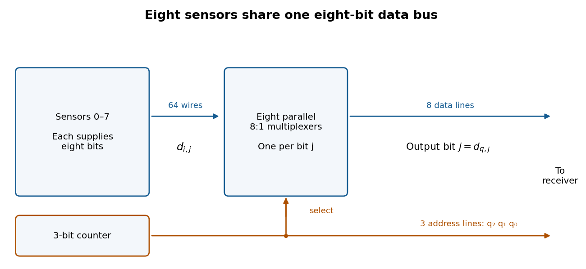

<h1 id="1/c/solution">Solution</h1>

↑ **Parent:** [C](../c.md)

Use **eight parallel 8:1 [multiplexers](../../../../../multiplexer.md) and one shared three-[bit](../../../../../bit.md) [binary counter](../../../../../binary-counter.md)**. If $d_{i,j}$ is [bit](../../../../../bit.md) $j$ from sensor $i$, connect $d_{0,j},\ldots,d_{7,j}$ to [multiplexer](../../../../../multiplexer.md) $j$. Connect all selection inputs to the [binary counter](../../../../../binary-counter.md) outputs. Then data line $j$ carries $d_{q,j}$, so all eight data lines belong to the same selected sensor. Send the three counter outputs to the receiver as the address lines as well.

**[Figure 1](#1/c/image-one-shared-binary-counter-selects-the-same-sensor-in-eight-parallel-multiplexers). One shared binary counter selects the same sensor in eight parallel multiplexers**.

After reset the receiver sees sensors $0,1,\ldots,7,0,\ldots$, one per [clock period](../../../../../clock-period.md). Sample the data and address only after the [binary counter](../../../../../binary-counter.md) and [multiplexers](../../../../../multiplexer.md) have settled, for example on the opposite [clock edge](../../../../../clock-edge.md) with a sufficiently long [clock period](../../../../../clock-period.md). Changing addresses can otherwise cause transient [logic hazards](../../../../../hazard-logic.md). The transmitter uses **eleven signal lines**, apart from any shared clock or reset connection.

## ↑ Ancestors (12)

1. [C](../c.md)
2. [1](../../1.md)
3. [Digital systems, linear algebra, introduction to formal proof](../../../digital-systems-linear-algebra-introduction-to-formal-proof-split.md)
4. [2016](../../../split.md)
5. [Past exam of the year 1 of the computer science course of the University of Oxford](../../../../split.md)
6. [Year 1 of the computer science course of the University of Oxford](../../../../../year-1-of-the-computer-science-course-of-the-university-of-oxford.md)
7. [Computer science course of the University of Oxford](../../../../../computer-science-course-of-the-university-of-oxford.md)
8. [Undergraduate course of the University of Oxford](../../../../../undergraduate-course-of-the-university-of-oxford.md)
9. [Course of the University of Oxford](../../../../../course-of-the-university-of-oxford.md)
10. [University of Oxford](../../../../../university-of-oxford-split.md)
11. [List of universities](../../../../../list-of-universities.md)
12. [Codex Wiki](../../../../../split.md)
