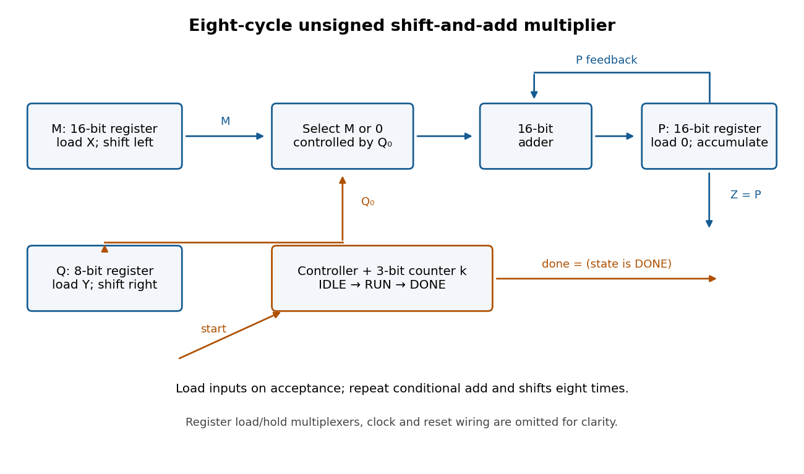

<h1 id="2/c/solution">Solution</h1>

↑ **Parent:** [C](../c.md)

Use unsigned inputs as in the preceding parts. Store a 16-[bit](../../../../../bit.md) accumulator $P$, a 16-[bit](../../../../../bit.md) shifted multiplicand $M$, an eight-[bit](../../../../../bit.md) multiplier $Q$, and a three-[bit](../../../../../bit.md) iteration [binary counter](../../../../../binary-counter.md) $k$. The [sequential circuit](../../../../../sequential-logic.md) has one 16-[bit](../../../../../bit.md) [adder](../../../../../adder.md), a 16-[bit](../../../../../bit.md) [multiplexer](../../../../../multiplexer.md) selecting $M$ or zero from $Q_0$, fixed one-place [bit shifts](../../../../../bit-shift.md), and load/hold selection for the [digital registers](../../../../../digital-register.md). The input values are captured when `start` is accepted, so later input changes cannot alter the operation.

**[Figure 2](#2/c/image-the-shift-and-add-binary-multiplier-reuses-one-16-bit-adder-for-eight-iterations). The shift-and-add binary multiplier reuses one 16-bit adder for eight iterations**.

Use three control states with the following synchronous transition table. All assignments in a row use the old [digital register](../../../../../digital-register.md) values and occur together at the active [clock edge](../../../../../clock-edge.md).

| State | Condition | Register updates | Next state | IDLE | `start = 0` | Hold all [digital registers](../../../../../digital-register.md) | IDLE | IDLE | `start = 1` | $P\gets0$, $M\gets\operatorname{zeroextend}_{16}(X)$, $Q\gets Y$, $k\gets0$ | RUN | RUN | $k<7$ | $P\gets P+(Q_0?M:0)$, $M\gets M\ll1$, $Q\gets Q\gg1$, $k\gets k+1$ | RUN | RUN | $k=7$ | $P\gets P+(Q_0?M:0)$, $M\gets M\ll1$, $Q\gets Q\gg1$; hold $k$ | DONE | DONE | `start = 1` | Hold all [digital registers](../../../../../digital-register.md) | DONE | DONE | `start = 0` | Hold all [digital registers](../../../../../digital-register.md) | IDLE |
| --- | --- | --- | --- | --- | --- | --- | --- | --- | --- | --- | --- | --- | --- | --- | --- | --- | --- | --- | --- | --- | --- | --- | --- | --- | --- | --- | --- |

Reset selects IDLE and clears the [digital registers](../../../../../digital-register.md). Set **$Z=P$ and `done = 1` exactly in DONE**. A `start` pulse in IDLE launches one multiplication; further pulses during RUN are ignored. Holding `start` high cannot repeatedly launch operations: DONE waits for it to go low before rearming. The product remains stored while waiting and through the following IDLE state. There are **eight RUN [clock edges](../../../../../clock-edge.md) after the loading edge**; the last addition is captured before `done` becomes high.

For correctness, let $X_0,Y_0$ denote the captured values. After $i$ iterations, for $0\leq i\leq8$, the [loop invariant](../../../../../loop-invariant.md) is

$$
P_i=X_0(Y_0\bmod2^i),\quad M_i=2^iX_0,\quad Q_i=\lfloor Y_0/2^i\rfloor,
$$

so $P_i+M_iQ_i=X_0Y_0$. Writing $Q_i=2q+b$, the next accumulation adds $bM_i$, the [left bit shift](../../../../../left-bit-shift.md) doubles $M_i$, and the [logical right shift](../../../../../logical-right-shift.md) changes $Q_i$ to $q$. Hence the invariant is preserved. At $i=8$, $Q_i=0$, giving **$Z=P_8=X_0Y_0$**. The largest product is $255^2=65025<2^{16}$, so the accumulator fits. Even the final shifted multiplicand is $256X_0\leq65280$, so it also fits.

## ↑ Ancestors (12)

1. [C](../c.md)
2. [2](../../2.md)
3. [Digital systems, linear algebra, introduction to formal proof](../../../digital-systems-linear-algebra-introduction-to-formal-proof-split.md)
4. [2016](../../../split.md)
5. [Past exam of the year 1 of the computer science course of the University of Oxford](../../../../split.md)
6. [Year 1 of the computer science course of the University of Oxford](../../../../../year-1-of-the-computer-science-course-of-the-university-of-oxford.md)
7. [Computer science course of the University of Oxford](../../../../../computer-science-course-of-the-university-of-oxford.md)
8. [Undergraduate course of the University of Oxford](../../../../../undergraduate-course-of-the-university-of-oxford.md)
9. [Course of the University of Oxford](../../../../../course-of-the-university-of-oxford.md)
10. [University of Oxford](../../../../../university-of-oxford-split.md)
11. [List of universities](../../../../../list-of-universities.md)
12. [Codex Wiki](../../../../../split.md)
