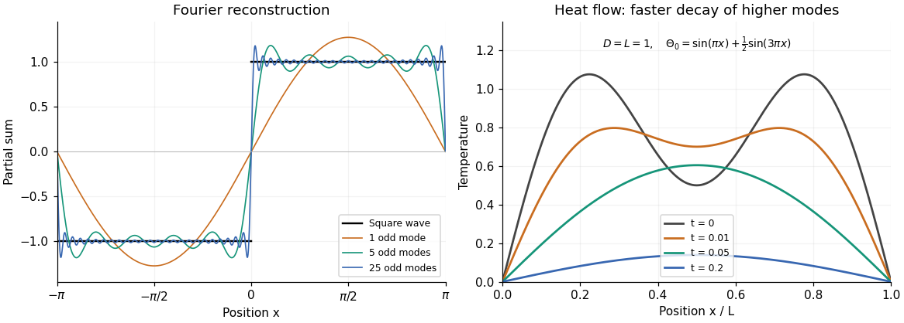

# Discrete mathematics, continuous mathematics and probability (resit)

↑ **Parent:** [2016](../2016.md)

Source paper: [released examination archive](https://www.whatdotheyknow.com/request/past_exam_papers_for_1st_year_of/response/1398416/attach/2/Fakour%20Zip%20Final%201.zip?cookie_passthrough=1), member `a10100w1-2.pdf`; original cover dated 2016-09-14.

**Table of contents**

- [1](#1)
  - [a](#1/a)
    - [i](#1/a/i)
      - [Solution](#1/a/i/solution)
    - [ii](#1/a/ii)
      - [Solution](#1/a/ii/solution)
  - [b](#1/b)
    - [Solution](#1/b/solution)
  - [c](#1/c)
    - [Solution](#1/c/solution)
  - [d](#1/d)
    - [i](#1/d/i)
      - [Solution](#1/d/i/solution)
    - [ii](#1/d/ii)
      - [Solution](#1/d/ii/solution)
    - [iii](#1/d/iii)
      - [Solution](#1/d/iii/solution)
  - [e](#1/e)
    - [i](#1/e/i)
      - [Solution](#1/e/i/solution)
    - [ii](#1/e/ii)
      - [Solution](#1/e/ii/solution)
- [2](#2)
  - [a](#2/a)
    - [Solution](#2/a/solution)
  - [b](#2/b)
    - [Solution](#2/b/solution)
  - [c](#2/c)
    - [i](#2/c/i)
      - [Solution](#2/c/i/solution)
    - [ii](#2/c/ii)
      - [Solution](#2/c/ii/solution)
  - [d](#2/d)
    - [Solution](#2/d/solution)
  - [e](#2/e)
    - [i](#2/e/i)
      - [Solution](#2/e/i/solution)
    - [ii](#2/e/ii)
      - [Solution](#2/e/ii/solution)
- [3](#3)
  - [a](#3/a)
    - [Solution](#3/a/solution)
  - [b](#3/b)
    - [Solution](#3/b/solution)
  - [c](#3/c)
    - [Solution](#3/c/solution)
  - [d](#3/d)
    - [i](#3/d/i)
      - [Solution](#3/d/i/solution)
    - [ii](#3/d/ii)
      - [Solution](#3/d/ii/solution)
  - [e](#3/e)
    - [i](#3/e/i)
      - [Solution](#3/e/i/solution)
    - [ii](#3/e/ii)
      - [Solution](#3/e/ii/solution)
- [4](#4)
  - [a](#4/a)
    - [Solution](#4/a/solution)
  - [b](#4/b)
    - [Solution](#4/b/solution)
  - [c](#4/c)
    - [Solution](#4/c/solution)
  - [d](#4/d)
    - [Solution](#4/d/solution)
- [5](#5)
  - [a](#5/a)
    - [Solution](#5/a/solution)
  - [b](#5/b)
    - [Solution](#5/b/solution)
  - [c](#5/c)
    - [i](#5/c/i)
      - [Solution](#5/c/i/solution)
    - [ii](#5/c/ii)
      - [Solution](#5/c/ii/solution)
- [6](#6)
  - [a](#6/a)
    - [Solution](#6/a/solution)
  - [b](#6/b)
    - [Solution](#6/b/solution)
  - [c](#6/c)
    - [Solution](#6/c/solution)
  - [d](#6/d)
    - [Solution](#6/d/solution)
  - [e](#6/e)
    - [Solution](#6/e/solution)
  - [f](#6/f)
    - [Solution](#6/f/solution)
- [7](#7)
  - [a](#7/a)
    - [i](#7/a/i)
      - [Solution](#7/a/i/solution)
    - [ii](#7/a/ii)
      - [Solution](#7/a/ii/solution)
    - [iii](#7/a/iii)
      - [Solution](#7/a/iii/solution)
  - [b](#7/b)
    - [i](#7/b/i)
      - [Solution](#7/b/i/solution)
    - [ii](#7/b/ii)
      - [Solution](#7/b/ii/solution)
    - [iii](#7/b/iii)
      - [Solution](#7/b/iii/solution)
- [8](#8)
  - [a](#8/a)
    - [i](#8/a/i)
      - [Solution](#8/a/i/solution)
    - [ii](#8/a/ii)
      - [Solution](#8/a/ii/solution)
  - [b](#8/b)
    - [i](#8/b/i)
      - [Solution](#8/b/i/solution)
    - [ii](#8/b/ii)
      - [Solution](#8/b/ii/solution)
    - [iii](#8/b/iii)
      - [Solution](#8/b/iii/solution)
- [9](#9)
  - [a](#9/a)
    - [i](#9/a/i)
      - [Solution](#9/a/i/solution)
    - [ii](#9/a/ii)
      - [Solution](#9/a/ii/solution)
    - [iii](#9/a/iii)
      - [Solution](#9/a/iii/solution)
  - [b](#9/b)
    - [i](#9/b/i)
      - [Solution](#9/b/i/solution)
    - [ii](#9/b/ii)
      - [Solution](#9/b/ii/solution)
    - [iii](#9/b/iii)
      - [Solution](#9/b/iii/solution)
    - [iv](#9/b/iv)
      - [Solution](#9/b/iv/solution)

## 1

↑ **Parent:** [Discrete mathematics, continuous mathematics and probability (resit)](discrete-mathematics-continuous-mathematics-and-probability-resit.md)

<h3 id="1/a">a</h3>

↑ **Parent:** [1](#1)

<h4 id="1/a/i">i</h4>

↑ **Parent:** [A](#1/a)

<h5 id="1/a/i/solution">Solution</h5>

↑ **Parent:** [I](#1/a/i)

Write $C^c=\mathcal U\setminus C$. The rules for [set difference](../../set.md#set-difference), [set intersection](../../set.md#set-intersection), and [complement of a set](../../set.md#complement-of-a-set) give

$$
\begin{aligned}
(A\cap B)\setminus(A\cap C)
&=(A\cap B)\cap(A\cap C)^c\\
&=(A\cap B)\cap(A^c\cup C^c)\\
&=(A\cap B\cap A^c)\cup(A\cap B\cap C^c)\\
&=\varnothing\cup\bigl(A\cap(B\cap C^c)\bigr)\\
&=\boxed{A\cap(B\setminus C)}.
\end{aligned}
$$

The second step is [De Morgan's laws](../../theoretical-computer-science.md#de-morgan-s-laws); the third distributes [set intersection](../../set.md#set-intersection) over [set union](../../set.md#set-union). The fourth uses $A\cap A^c=\varnothing$.

<h4 id="1/a/ii">ii</h4>

↑ **Parent:** [A](#1/a)

<h5 id="1/a/ii/solution">Solution</h5>

↑ **Parent:** [Ii](#1/a/ii)

Using [set difference](../../set.md#set-difference) as intersection with a [complement of a set](../../set.md#complement-of-a-set), then [De Morgan's laws](../../theoretical-computer-science.md#de-morgan-s-laws) and distribution, gives

$$
\begin{aligned}
(A\cup B)\setminus(C\setminus A)
&=(A\cup B)\cap(C\cap A^c)^c\\
&=(A\cup B)\cap(C^c\cup A)\\
&=A\cup(B\cap C^c)\\
&=\boxed{A\cup(B\setminus C)}.
\end{aligned}
$$

For the third equality, expand the two [set unions](../../set.md#set-union): the terms $A\cap C^c$ and $A\cap B$ are absorbed by $A$, and $A\cap A=A$. This proves the required identity entirely by [set](../../set.md) algebra.

<h3 id="1/b">b</h3>

↑ **Parent:** [1](#1)

<h4 id="1/b/solution">Solution</h4>

↑ **Parent:** [B](#1/b)

By definition the [symmetric difference](../../set.md#symmetric-difference) is $A\oplus B=(A\setminus B)\cup(B\setminus A)$. Put $D=A\oplus B$ and $E=A\cap B$. Distribution of [set intersection](../../set.md#set-intersection) over [set union](../../set.md#set-union) gives

$$
D\cap E=(A\cap B^c\cap A\cap B)\cup(B\cap A^c\cap A\cap B)=\varnothing.
$$

For disjoint [sets](../../set.md), [set difference](../../set.md#set-difference) removes nothing, so $D\oplus E=(D\setminus E)\cup(E\setminus D)=D\cup E$. Consequently

$$
\begin{aligned}
(A\oplus B)\oplus(A\cap B)
&=(A\cap B^c)\cup(B\cap A^c)\cup(A\cap B)\\
&=A\cup(B\cap A^c)\\
&=(A\cup B)\cap(A\cup A^c)\\
&=\boxed{A\cup B}.
\end{aligned}
$$

Here the second equality combines $A\cap B^c$ with $A\cap B$; the last uses $A\cup A^c=\mathcal U$.

<h3 id="1/c">c</h3>

↑ **Parent:** [1](#1)

<h4 id="1/c/solution">Solution</h4>

↑ **Parent:** [C](#1/c)

A [function](../../function.md) $f:A\to B$ is **onto**, or a [surjective function](../../algebra.md#surjective-function), when every $b\in B$ has a preimage: $\forall b\in B\ \exists a\in A:\ f(a)=b$. It is **one-to-one**, or an [injective function](../../algebra.md#injective-function), when $f(a)=f(a')$ implies $a=a'$ for all $a,a'\in A$. It is **bijective**, a [bijection](../../function.md#bijection), when both properties hold.

An [inverse function](../../function.md#inverse-function) is a [function](../../function.md) $f^{-1}:B\to A$ satisfying

$$
\boxed{f^{-1}\circ f=\operatorname{id}_A,\qquad f\circ f^{-1}=\operatorname{id}_B}.
$$

For a [bijection](../../function.md#bijection), $f^{-1}(b)$ is the unique $a$ with $f(a)=b$: existence follows from [surjectivity](../../algebra.md#surjective-function) and uniqueness from [injectivity](../../algebra.md#injective-function). This is a two-sided [inverse function](../../function.md#inverse-function), rather than just a left or right inverse.

<h3 id="1/d">d</h3>

↑ **Parent:** [1](#1)

<h4 id="1/d/i">i</h4>

↑ **Parent:** [D](#1/d)

<h5 id="1/d/i/solution">Solution</h5>

↑ **Parent:** [I](#1/d/i)

The [function composition](../../function.md#function-composition) $g\circ f:A\to C$ is defined by $(g\circ f)(a)=g(f(a))$. Suppose $f(a)=f(a')$. Applying $g$ gives $(g\circ f)(a)=(g\circ f)(a')$. Since the composite is an [injective function](../../algebra.md#injective-function), $a=a'$. Thus **$f$ is an [injective function](../../algebra.md#injective-function)**.

<h4 id="1/d/ii">ii</h4>

↑ **Parent:** [D](#1/d)

<h5 id="1/d/ii/solution">Solution</h5>

↑ **Parent:** [Ii](#1/d/ii)

For each $c\in C$, [surjectivity](../../algebra.md#surjective-function) of the [function composition](../../function.md#function-composition) gives $a\in A$ such that $g(f(a))=c$. Taking $b=f(a)\in B$ supplies a preimage of $c$ under $g$. Thus **$g$ is a [surjective function](../../algebra.md#surjective-function)**.

<h4 id="1/d/iii">iii</h4>

↑ **Parent:** [D](#1/d)

<h5 id="1/d/iii/solution">Solution</h5>

↑ **Parent:** [Iii](#1/d/iii)

Let $h:B\to A$ be a two-sided [inverse function](../../function.md#inverse-function) of $f$. If $f(a)=f(a')$, apply $h$ and use $h\circ f=\operatorname{id}_A$ to obtain $a=a'$, proving [injectivity](../../algebra.md#injective-function). For any $b\in B$, the other identity gives $b=f(h(b))$, proving [surjectivity](../../algebra.md#surjective-function). Therefore **$f$ is a [bijection](../../function.md#bijection)**. Both inverse identities matter: a one-sided inverse alone would establish only the corresponding one of these two properties.

<h3 id="1/e">e</h3>

↑ **Parent:** [1](#1)

<h4 id="1/e/i">i</h4>

↑ **Parent:** [E](#1/e)

<h5 id="1/e/i/solution">Solution</h5>

↑ **Parent:** [I](#1/e/i)

Replace $x$ by $1/x$, which stays in the domain of the [functional equation](../../analysis.md#functional-equation). Writing $u=f(x)$ and $v=f(1/x)$ gives the [linear system](../../linear-algebra.md#system-of-linear-equations)

$$
u+2v=x,\qquad 2u+v=\frac1x.
$$

Twice the second equation minus the first gives $3u=2/x-x$, so the only possible [function](../../function.md) is

$$
\boxed{f(x)=\frac{2/x-x}{3}\quad(x>0)}.
$$

To check existence as well as uniqueness, substitute this expression: $f(x)+2f(1/x)=(2/x-x+4x-2/x)/3=x$.

<h4 id="1/e/ii">ii</h4>

↑ **Parent:** [E](#1/e)

<h5 id="1/e/ii/solution">Solution</h5>

↑ **Parent:** [Ii](#1/e/ii)

The algebraic identity

$$
x^3+x^{-3}=(x+x^{-1})^3-3(x+x^{-1})
$$

suggests **$f(t)=t^3-3t$ for every $t>0$**, and substitution verifies the [functional equation](../../analysis.md#functional-equation).

In fact $x+1/x\geq2$, since $(x-1)^2/x\geq0$. Conversely, for each $t\geq2$, the [quadratic equation](../../polynomial.md#quadratic-equation) $x^2-tx+1=0$ has a positive root $(t+\sqrt{t^2-4})/2$. Thus the [functional equation](../../analysis.md#functional-equation) forces $f(t)=t^3-3t$ exactly on $[2,\infty)$; its values on $(0,2)$ are arbitrary. The displayed [function](../../function.md) is one convenient choice on the full required domain.

## 2

↑ **Parent:** [Discrete mathematics, continuous mathematics and probability (resit)](discrete-mathematics-continuous-mathematics-and-probability-resit.md)

<h3 id="2/a">a</h3>

↑ **Parent:** [2](#2)

<h4 id="2/a/solution">Solution</h4>

↑ **Parent:** [A](#2/a)

A [binary relation](../../set-theory.md#binary-relation) $R$ on $A$ is an [equivalence relation](../../set-theory.md#equivalence-relation) exactly when it is [reflexive](../../set-theory.md#reflexive-relation), [symmetric](../../set-theory.md#symmetric-relation), and [transitive](../../set-theory.md#transitive-relation):

$$
\begin{gathered}
aRa\quad(a\in A),\\
aRb\Longrightarrow bRa\quad(a,b\in A),\\
aRb\text{ and }bRc\Longrightarrow aRc\quad(a,b,c\in A).
\end{gathered}
$$

The [equivalence class](../../set-theory.md#equivalence-class) of $a\in A$ is **$[a]_R=\{b\in A:aRb\}$**. The [equivalence classes](../../set-theory.md#equivalence-class) partition $A$: every element belongs to its own class, and two classes are either equal or disjoint.

<h3 id="2/b">b</h3>

↑ **Parent:** [2](#2)

<h4 id="2/b/solution">Solution</h4>

↑ **Parent:** [B](#2/b)

For positive integer pairs, [reflexivity](../../set-theory.md#reflexive-relation) is $ab=ba$. If $ad=bc$, reversing the equality gives $cb=da$, establishing [symmetry](../../physics.md#symmetry-physics). For [transitivity](../../set-theory.md#transitive-relation), suppose $(a,b)R(c,d)$ and $(c,d)R(e,f)$. Then $ad=bc$ and $cf=de$, whence

$$
adf=bcf=bde.
$$

Since $d>0$, cancellation gives $af=be$. Thus $(a,b)R(e,f)$, and $R$ is an [equivalence relation](../../set-theory.md#equivalence-relation).

Membership in the [equivalence class](../../set-theory.md#equivalence-class) of $(4,6)$ means $4b=6a$, or $2b=3a$. Since $2$ and $3$ are [coprime](../../divisibility.md#coprime-integers), $a=2r$ and $b=3r$ for a positive integer $r$. Conversely every such pair satisfies the equality. Therefore

$$
\boxed{[(4,6)]_R=\{(2r,3r):r\in\mathbb Z_+\}}.
$$

These pairs are precisely the positive numerator-denominator representations of the [rational number](../../number-theory.md#rational-number) $2/3$.

<h3 id="2/c">c</h3>

↑ **Parent:** [2](#2)

<h4 id="2/c/i">i</h4>

↑ **Parent:** [C](#2/c)

<h5 id="2/c/i/solution">Solution</h5>

↑ **Parent:** [I](#2/c/i)

Use [mathematical induction](../../foundations-of-mathematics.md#mathematical-induction), starting at $n=1$. Since $F_0=0$ and $F_1=1$, the sum is $-1=(-1)^1F_0-1$.

Suppose the formula holds at $n\geq1$. Adding the next [Fibonacci number](../../sequence-and-series.md#fibonacci-number) with its sign and using the [Fibonacci recurrence](../../sequence-and-series.md#fibonacci-recurrence) gives

$$
\begin{aligned}
\sum_{k=0}^{n+1}(-1)^kF_k
&=(-1)^nF_{n-1}-1+(-1)^{n+1}F_{n+1}\\
&=(-1)^{n+1}(F_{n+1}-F_{n-1})-1\\
&=(-1)^{n+1}F_n-1.
\end{aligned}
$$

This is the required successor case. Thus

$$
\boxed{\sum_{k=0}^{n}(-1)^kF_k=(-1)^nF_{n-1}-1\quad(n\geq1)}.
$$

<h4 id="2/c/ii">ii</h4>

↑ **Parent:** [C](#2/c)

<h5 id="2/c/ii/solution">Solution</h5>

↑ **Parent:** [Ii](#2/c/ii)

Fix $n\geq1$ and use [mathematical induction](../../foundations-of-mathematics.md#mathematical-induction) on $m$ with two initial cases, as appropriate for the second-order [Fibonacci recurrence](../../sequence-and-series.md#fibonacci-recurrence). At $m=0$, the right side is $F_{n-1}F_0+F_nF_1=F_n$. At $m=1$, it is $F_{n-1}+F_n=F_{n+1}$.

If the identity holds at $m$ and $m+1$, then

$$
\begin{aligned}
F_{n+m+2}
&=F_{n+m+1}+F_{n+m}\\
&=F_{n-1}(F_{m+1}+F_m)+F_n(F_{m+2}+F_{m+1})\\
&=F_{n-1}F_{m+2}+F_nF_{m+3}.
\end{aligned}
$$

Hence the [induction](../../foundations-of-mathematics.md#mathematical-induction) establishes

$$
\boxed{F_{n+m}=F_{n-1}F_m+F_nF_{m+1}\quad(n\geq1,\ m\geq0)}.
$$

<h3 id="2/d">d</h3>

↑ **Parent:** [2](#2)

<h4 id="2/d/solution">Solution</h4>

↑ **Parent:** [D](#2/d)

Fix $m\geq0$, using the convention for [binomial coefficients](../../binomial-coefficient.md) that $\binom{k}{m}=0$ when $m>k$. At $n=0$, both $\binom0m$ and $\binom1{m+1}$ equal $1$ if $m=0$ and $0$ otherwise.

For the successor step, apply the [induction hypothesis](../../foundations-of-mathematics.md#induction-hypothesis), then [Pascal's rule](../../binomial-coefficient.md#pascal-s-rule):

$$
\sum_{k=0}^{n+1}\binom{k}{m}
=\binom{n+1}{m+1}+\binom{n+1}{m}
=\binom{n+2}{m+1}.
$$

Thus [mathematical induction](../../foundations-of-mathematics.md#mathematical-induction) proves the [hockey-stick identity](../../binomial-coefficient.md#hockey-stick-identity)

$$
\boxed{\sum_{k=0}^{n}\binom{k}{m}=\binom{n+1}{m+1}\quad(m,n\geq0)}.
$$

The zero convention also covers the case $n<m$, without a separate starting index.

<h3 id="2/e">e</h3>

↑ **Parent:** [2](#2)

<h4 id="2/e/i">i</h4>

↑ **Parent:** [E](#2/e)

<h5 id="2/e/i/solution">Solution</h5>

↑ **Parent:** [I](#2/e/i)

The stated identity $k\binom nk=n\binom{n-1}{k-1}$ has an even right side because $n$ is even. Its left side is an odd integer $k$ times the integer [binomial coefficient](../../binomial-coefficient.md) $\binom nk$. An odd multiplier preserves [integer parity](../../integer.md#parity-mathematics), so that coefficient must be even. Equivalently, reducing the identity in [modular arithmetic](../../modular-arithmetic.md) gives

$$
\boxed{\binom nk\equiv0\pmod2}.
$$

<h4 id="2/e/ii">ii</h4>

↑ **Parent:** [E](#2/e)

<h5 id="2/e/ii/solution">Solution</h5>

↑ **Parent:** [Ii](#2/e/ii)

Write $n=2r$ and $k=2s$. Partition an $n$-element [set](../../set.md) into $r$ distinguished pairs, and let $\tau$ interchange the two elements of every pair. It induces an [involution](../../group-theory.md#involution) on the $k$-element subsets. Every nonfixed subset is paired with its distinct image, so nonfixed subsets contribute an even number to the [binomial coefficient](../../binomial-coefficient.md) $\binom{2r}{2s}$.

A fixed subset contains either both or neither of the elements of each distinguished pair. Since it contains $2s$ elements, it consists of exactly $s$ whole pairs. There are $\binom rs$ such fixed subsets. Counting modulo $2$ therefore gives

$$
\boxed{\binom nk\equiv\binom{n/2}{k/2}\pmod2}.
$$

The same [involution](../../group-theory.md#involution) explains part (i): a fixed subset cannot have odd size.

## 3

↑ **Parent:** [Discrete mathematics, continuous mathematics and probability (resit)](discrete-mathematics-continuous-mathematics-and-probability-resit.md)

<h3 id="3/a">a</h3>

↑ **Parent:** [3](#3)

<h4 id="3/a/solution">Solution</h4>

↑ **Parent:** [A](#3/a)

A [preorder](../../set.md#preorder) is a [binary relation](../../set-theory.md#binary-relation) that is [reflexive](../../set-theory.md#reflexive-relation) and [transitive](../../set-theory.md#transitive-relation): $a\preceq a$, and $a\preceq b\preceq c$ implies $a\preceq c$.

A [partial order](../../set.md#partially-ordered-set) is a [preorder](../../set.md#preorder) that is also an [antisymmetric relation](../../set-theory.md#antisymmetric-relation): $a\preceq b$ and $b\preceq a$ together imply $a=b$.

A [linear order](../../algebra.md#linear-order), also called a [total order](../../set.md#total-order), is a [partial order](../../set.md#partially-ordered-set) in which every two elements are comparable: **$a\preceq b$ or $b\preceq a$ for all $a,b\in A$**.

<h3 id="3/b">b</h3>

↑ **Parent:** [3](#3)

<h4 id="3/b/solution">Solution</h4>

↑ **Parent:** [B](#3/b)

This is the [pointwise order](../../set.md#pointwise-order) on a [function space](../../functional-analysis.md#function-space). Each of the three [partial order](../../set.md#partially-ordered-set) axioms follows from the corresponding axiom in $B$.

For [reflexivity](../../set-theory.md#reflexive-relation), $f(x)\preceq_B f(x)$ for every $x$, so $f\preceq_{\mathcal F}f$. For [antisymmetry](../../set-theory.md#antisymmetry), if $f\preceq_{\mathcal F}g$ and $g\preceq_{\mathcal F}f$, then $f(x)=g(x)$ for every $x\in A$; equality of [functions](../../function.md) therefore gives $f=g$. For [transitivity](../../set-theory.md#transitive-relation), if $f\preceq_{\mathcal F}g\preceq_{\mathcal F}h$, then $f(x)\preceq_B g(x)\preceq_B h(x)$ for every $x$, so $f\preceq_{\mathcal F}h$.

Thus **$(\mathcal F,\preceq_{\mathcal F})$ is a [partially ordered set](../../set.md#partially-ordered-set)**. The argument also covers an empty domain $A$, since then there is exactly one [function](../../function.md) $A\to B$.

<h3 id="3/c">c</h3>

↑ **Parent:** [3](#3)

<h4 id="3/c/solution">Solution</h4>

↑ **Parent:** [C](#3/c)

Interpret $\mathbb R_+$ as the strictly positive reals, as in the domain $x>0$ in question 1(e). A bound valid for every $n$ is immediately an eventual bound, by taking $m=0$ (or the least natural number under the other convention).

Conversely, suppose the eventual [big O notation](../../real-analysis.md#big-o-notation) bound holds with constants $m,c$. Since $g(j)>0$, all the finitely many ratios $|f(j)|/|g(j)|$ with $j<m$ are finite. Choose

$$
C=\max\left(1,c,\left\{\frac{|f(j)|}{|g(j)|}:j<m\right\}\right),
$$

omitting the set of ratios when it is empty. For $n<m$ the definition of $C$ gives $|f(n)|\leq C|g(n)|$, and for $n\geq m$ the original bound does so. Hence **the two definitions are equivalent for the stated strictly positive codomain**.

Strict positivity matters. If $\mathbb R_+$ were instead intended to include zero, an eventual bound need not extend to all indices: $g(0)=0$, $f(0)=1$, and $f(n)=g(n)=1$ for $n\geq1$ give a counterexample. More generally, extension is possible exactly when each initial zero of $g$ is also a zero of $f$.

<h3 id="3/d">d</h3>

↑ **Parent:** [3](#3)

<h4 id="3/d/i">i</h4>

↑ **Parent:** [D](#3/d)

<h5 id="3/d/i/solution">Solution</h5>

↑ **Parent:** [I](#3/d/i)

Use [natural logarithms](../../calculus.md#natural-logarithm); the same argument works for any fixed base greater than $1$. The [function](../../function.md) $\log\log x$ is increasing for $x>1$, since its [derivative](../../calculus.md#derivative) is $1/(x\log x)>0$. With natural logs the sole negative summand is at $i=2$. Put $C_0=|\log\log2|$.

For all sufficiently large $n$ with $\log\log n\geq1$, monotonicity and the [triangle inequality](../../topological-analysis.md#triangle-inequality) give

$$
\left|\sum_{i=2}^n\log\log i\right|
\leq C_0+\sum_{i=3}^n\log\log i
\leq C_0+n\log\log n
\leq(1+C_0)n\log\log n.
$$

These are fixed constants and an eventual bound, proving

$$
\boxed{\sum_{i=2}^n\log\log i=O(n\log\log n)}.
$$

For another fixed logarithm base there are still only finitely many negative initial terms, which are absorbed in $C_0$.

<h4 id="3/d/ii">ii</h4>

↑ **Parent:** [D](#3/d)

<h5 id="3/d/ii/solution">Solution</h5>

↑ **Parent:** [Ii](#3/d/ii)

For [natural logarithms](../../calculus.md#natural-logarithm) and sufficiently large $n$, take the [logarithm](../../calculus.md#logarithm) of the positive expression:

$$
\log\left((\log n)^{\log\log n}\right)=(\log\log n)^2.
$$

Set $t=\log\log n$. Then $\log n=e^t$. The [exponential function](../../calculus.md#exponential-function) grows faster than $t^2$: for example, its power series gives $e^t\geq t^3/6$ for $t>0$, so $t^2/e^t\leq6/t\to0$. In particular, eventually $(\log\log n)^2\leq\log n$. Exponentiating yields

$$
\boxed{(\log n)^{\log\log n}\leq n\text{ eventually},\qquad (\log n)^{\log\log n}=O(n)}.
$$

For logarithms to a fixed base $b>1$, the natural logarithm of the left side is $(\log\log n-\log\log b)^2/\log b$, still smaller than $\log n$ eventually. The [big O notation](../../real-analysis.md#big-o-notation) conclusion is therefore independent of that base choice.

<h3 id="3/e">e</h3>

↑ **Parent:** [3](#3)

<h4 id="3/e/i">i</h4>

↑ **Parent:** [E](#3/e)

<h5 id="3/e/i/solution">Solution</h5>

↑ **Parent:** [I](#3/e/i)

Unroll the [recurrence relation](../../sequence-and-series.md#recurrence-relation) down to its [initial condition](../../differential-equation.md#initial-condition):

$$
T(n)=T(0)+\sum_{j=1}^{n}j=1+\frac{n(n+1)}2.
$$

Thus

$$
\boxed{T(n)=1+\frac{n(n+1)}2=O(n^2)}.
$$

Indeed $T(n)/n^2\to1/2$, so the sharper growth classification is $\Theta(n^2)$ in [big theta notation](../../real-analysis.md#big-theta-notation).

<h4 id="3/e/ii">ii</h4>

↑ **Parent:** [E](#3/e)

<h5 id="3/e/ii/solution">Solution</h5>

↑ **Parent:** [Ii](#3/e/ii)

Multiplying the [recurrence relation](../../sequence-and-series.md#recurrence-relation) by $n$ removes the average:

$$
nT(n)=\sum_{i=0}^{n-1}T(i)+n^2.
$$

For $n\geq2$, subtract the same identity at $n-1$:

$$
nT(n)-(n-1)T(n-1)=T(n-1)+n^2-(n-1)^2.
$$

Rearranging gives $T(n)=T(n-1)+2-1/n$. This also holds at $n=1$, because the original [recurrence relation](../../sequence-and-series.md#recurrence-relation) gives $T(1)=1$ and $T(0)=0$. Summing the differences therefore yields

$$
\boxed{T(n)=2n-H_n=O(n)},\qquad H_n=\sum_{j=1}^{n}\frac1j,\quad H_0=0.
$$

Here $H_n$ is a [harmonic number](../../analytic-number-theory.md#harmonic-number). Since $H_n\leq n$, we have $n\leq T(n)\leq2n$ for $n\geq1$, also establishing $\Theta(n)$ in [big theta notation](../../real-analysis.md#big-theta-notation).

## 4

↑ **Parent:** [Discrete mathematics, continuous mathematics and probability (resit)](discrete-mathematics-continuous-mathematics-and-probability-resit.md)

<h3 id="4/a">a</h3>

↑ **Parent:** [4](#4)

<h4 id="4/a/solution">Solution</h4>

↑ **Parent:** [A](#4/a)

Write $Y(t)=y(e^t)$, so $x=e^t>0$. The [chain rule](../../calculus.md#chain-rule) gives

$$
Y'(t)=xy'(x),\qquad Y''(t)=xy'(x)+x^2y''(x).
$$

Hence $x^2y''=Y''-Y'$ and the [Cauchy-Euler equation](../../linear-ordinary-differential-equation.md#cauchy-euler-equation) becomes

$$
\boxed{Y''+3Y'+2Y=0}.
$$

Its [characteristic equation](../../linear-ordinary-differential-equation.md#characteristic-equation-of-a-constant-coefficient-differential-equation) is $r^2+3r+2=(r+1)(r+2)=0$. The distinct roots give $Y(t)=Ae^{-t}+Be^{-2t}$. Returning to the original independent variable gives

$$
\boxed{y(x)=\frac A x+\frac B{x^2}\quad(x>0)}.
$$

The same form holds on any negative interval avoiding $0$, using $t=\log|x|$; the stated substitution covers the positive interval. At $x=0$ the [differential equation](../../differential-equation.md) is singular, so crossing it is a separate extension problem.

<h3 id="4/b">b</h3>

↑ **Parent:** [4](#4)

<h4 id="4/b/solution">Solution</h4>

↑ **Parent:** [B](#4/b)

Seek a [particular solution](../../linear-ordinary-differential-equation.md#particular-solution) $y_p=ax+b$. Substitution into the [linear ordinary differential equation](../../linear-ordinary-differential-equation.md) gives $6ax+2b=6x+2$, so $a=b=1$. Add the [complementary solution](../../linear-ordinary-differential-equation.md#homogeneous-solution) from part (a):

$$
y=x+1+\frac A x+\frac B{x^2}.
$$

The two prescribed values yield $A+B=5$ and $A/2+B/4=3/2$. Thus $2A+B=6$, so $A=1$ and $B=4$. Therefore

$$
\boxed{y(x)=x+1+\frac1x+\frac4{x^2}\quad(x>0)}.
$$

Direct substitution gives $y(1)=7$ and $y(2)=9/2$, and the [homogeneous solution](../../linear-ordinary-differential-equation.md#homogeneous-solution) contributes zero to the left-hand differential operator.

<h3 id="4/c">c</h3>

↑ **Parent:** [4](#4)

<h4 id="4/c/solution">Solution</h4>

↑ **Parent:** [C](#4/c)

On an interval avoiding $x=0$, divide by $x$ to obtain the first-order [linear ordinary differential equation](../../linear-ordinary-differential-equation.md)

$$
y'-\frac2x y=x^3\cos x.
$$

An [integrating factor](../../linear-ordinary-differential-equation.md#integrating-factor) is $\mu(x)=\exp\!\left(\int-2/x\,dx\right)=x^{-2}$. Multiplying through and using the [product rule](../../calculus.md#product-rule) gives

$$
\frac{d}{dx}(x^{-2}y)=x\cos x.
$$

By [integration by parts](../../calculus.md#integration-by-parts), $\int x\cos x\,dx=x\sin x+\cos x+C$. Consequently

$$
\boxed{y(x)=x^2\bigl(x\sin x+\cos x+C\bigr)}.
$$

The formula differentiates back to the original equation. Although division excluded $x=0$, this formula has a smooth extension there with $y(0)=0$, satisfying the original equation at zero as well.

<h3 id="4/d">d</h3>

↑ **Parent:** [4](#4)

<h4 id="4/d/solution">Solution</h4>

↑ **Parent:** [D](#4/d)

The substitution $y=xv$ gives $y'=v+xv'$. Cancelling $x^3v$ on both sides of the [differential equation](../../differential-equation.md), for $x>0$, gives

$$
\boxed{xv'=v^3}.
$$

The [initial condition](../../differential-equation.md#initial-condition) is $v(1)=1$. This selects a positive solution locally, so [separation of variables](../../partial-differential-equation.md#separation-of-variables) gives

$$
\int v^{-3}\,dv=\int x^{-1}\,dx,
\qquad -\frac1{2v^2}=\log x+C.
$$

Using $v(1)=1$ gives $C=-1/2$, and continuity selects the positive square root:

$$
v=\frac1{\sqrt{1-2\log x}},\qquad
\boxed{y=\frac{x}{\sqrt{1-2\log x}}=\sqrt{\frac{x^2}{1-\log(x^2)}},\quad m=2}.
$$

The real solution containing $x=1$ has maximal positive domain **$0<x<\sqrt e$**. Its denominator tends to zero and $y\to+\infty$ as $x\uparrow\sqrt e$, a [finite-time blow-up of an ordinary differential equation](../../dynamical-systems.md#finite-time-blow-up-of-an-ordinary-differential-equation) in the independent variable $x$. Thus the source's wording “for $x>0$” needs this domain restriction; the prescribed initial value admits no real solution on the whole positive half-line. The division by $v^3$ loses the separate solution $v=0$, but that solution does not meet the [initial condition](../../differential-equation.md#initial-condition).

## 5

↑ **Parent:** [Discrete mathematics, continuous mathematics and probability (resit)](discrete-mathematics-continuous-mathematics-and-probability-resit.md)

<h3 id="5/a">a</h3>

↑ **Parent:** [5](#5)

<h4 id="5/a/solution">Solution</h4>

↑ **Parent:** [A](#5/a)

Divide $[a,b]$ into $N$ equal subintervals of width $h=(b-a)/N$, with $x_j=a+jh$. Linear interpolation between adjacent values of $f$ gives a trapezoid of signed area $h(f(x_{j-1})+f(x_j))/2$. Adding these areas produces the [composite trapezoidal rule](../../runge-kutta-method.md#composite-trapezoidal-rule)

$$
\boxed{T_N=h\left(\frac{f(a)+f(b)}2+\sum_{j=1}^{N-1}f(x_j)\right)\approx\int_a^bf(x)\,dx}.
$$

For continuous $f$, this tends to the [integral](../../integral.md) as $h\to0$; if $f$ has a bounded continuous second [derivative](../../calculus.md#derivative), the error is at most $(b-a)h^2\max|f''|/12$.

The original PDF prints $n\to\infty$ while using $n$ as the bound summation index and $N$ as the upper limit. Literally this does not specify a varying upper limit. Interpreting the intended limit as **$N\to\infty$**, and relabelling the summation index $j$, gives the [right Riemann sum](../../real-analysis.md#right-riemann-sum)

$$
S_N=\frac1N\sum_{j=1}^N\left(\frac jN\right)^4=\frac1{N^5}\sum_{j=1}^Nj^4.
$$

For $f(x)=x^4$, $a=0$, and $b=1$, the only difference from the [composite trapezoidal rule](../../runge-kutta-method.md#composite-trapezoidal-rule) is the endpoint weighting: $S_N=T_N+1/(2N)$. Hence

$$
\boxed{\lim_{N\to\infty}\frac1{N^5}\sum_{j=1}^Nj^4=\int_0^1x^4\,dx=\frac15}.
$$

<h3 id="5/b">b</h3>

↑ **Parent:** [5](#5)

<h4 id="5/b/solution">Solution</h4>

↑ **Parent:** [B](#5/b)

The given [square wave](../../fourier-series.md#square-wave) agrees almost everywhere with an [odd function](../../calculus.md#odd-function) on $(-\pi,\pi)$; its assigned value at the single point $0$ does not affect any [Fourier coefficient](../../fourier-series.md#fourier-coefficient). Thus $a_0=a_n=0$, while

$$
b_n=\frac2\pi\int_0^\pi\sin(nx)\,dx
=\frac{2(1-(-1)^n)}{\pi n}
=\begin{cases}4/(\pi n),&n\text{ odd},\\0,&n\text{ even}.\end{cases}
$$

The [Fourier series](../../fourier-series.md) is therefore

$$
\boxed{f(x)=\frac4\pi\sum_{r=0}^{\infty}\frac{\sin((2r+1)x)}{2r+1}\quad(-\pi<x<0\text{ or }0<x<\pi)}.
$$

The [Dirichlet convergence theorem for Fourier series](../../fourier-series.md#dirichlet-s-theorem-on-fourier-series) applies because the periodic extension is piecewise smooth. It gives $f(x)$ at each continuity point and the midpoint $0$ at the jumps, including $x=0$; it does not reproduce the assigned value $f(0)=-1$ there.

At the continuity point $x=\pi/2$, $\sin((2r+1)\pi/2)=(-1)^r$ and $f(\pi/2)=1$. Thus

$$
\boxed{1-\frac13+\frac15-\frac17+\cdots=\frac\pi4}.
$$

No evaluation at a discontinuity or rearrangement of the conditionally convergent series is involved.

<h3 id="5/c">c</h3>

↑ **Parent:** [5](#5)

<h4 id="5/c/i">i</h4>

↑ **Parent:** [C](#5/c)

<h5 id="5/c/i/solution">Solution</h5>

↑ **Parent:** [I](#5/c/i)

A [Fourier sine series](../../fourier-series.md#fourier-sine-series) automatically meets the zero-temperature [boundary conditions](../../differential-equation.md#boundary-condition) because $\sin0=\sin(n\pi)=0$. Equivalently, extend $\Theta_0$ oddly from $(0,L)$ to $(-L,L)$ and then periodically with period $2L$. Its [Fourier series](../../fourier-series.md) has only sine terms, with

$$
\boxed{k_n=\frac{n\pi}{L},\qquad b_n=\frac2L\int_0^L\Theta_0(x)\sin\!\left(\frac{n\pi x}{L}\right)dx\quad(n\geq1)}.
$$

The coefficient formula follows from the [orthogonality](../../inner-product.md#orthogonal-vectors) identity

$$
\int_0^L\sin(k_nx)\sin(k_mx)\,dx=\frac L2\delta_{nm}.
$$

For piecewise smooth initial data the series equals $\Theta_0$ at interior continuity points and the average of its one-sided values at interior jumps. More general square-integrable data have convergence in [L2 norm convergence](../../normed-vector-space.md#l2-norm-convergence). A classical solution continuous at the initial corners additionally requires $\Theta_0(0)=\Theta_0(L)=0$, in agreement with the prescribed [boundary conditions](../../differential-equation.md#boundary-condition).

<h4 id="5/c/ii">ii</h4>

↑ **Parent:** [C](#5/c)

<h5 id="5/c/ii/solution">Solution</h5>

↑ **Parent:** [Ii](#5/c/ii)

Substitute the proposed [Fourier sine series](../../fourier-series.md#fourier-sine-series) into the [heat equation](../../diffusion-equation.md#heat-equation):

$$
\sum_{n\geq1}b_nT_n'(t)\sin(k_nx)
=-D\sum_{n\geq1}b_nk_n^2T_n(t)\sin(k_nx).
$$

Projecting onto each sine using [orthogonality](../../inner-product.md#orthogonal-vectors) gives $T_n'=-Dk_n^2T_n$ for every mode with $b_n\ne0$. The [initial condition](../../differential-equation.md#initial-condition) fixes $T_n(0)=1$, since $b_n$ already describes the initial amplitude. Hence

$$
\boxed{T_n(t)=e^{-Dk_n^2t},\qquad
\Theta(x,t)=\sum_{n=1}^{\infty}b_n e^{-D(n\pi/L)^2t}\sin\!\left(\frac{n\pi x}{L}\right)}.
$$

For a mode with $b_n=0$, the value of $T_n$ is immaterial and the same convention is convenient. The positive [thermal diffusivity](../../heat.md#thermal-diffusivity) $D$ damps every mode, with higher frequencies decaying faster. For square-integrable initial data the damping justifies termwise differentiation for $t>0$ and recovery of the initial data in [L2 norm convergence](../../normed-vector-space.md#l2-norm-convergence) as $t\downarrow0$.

**[Figure 1](#5/c/ii/image-odd-fourier-modes-reconstruct-a-square-wave-while-heat-diffusion-damps-short-spatial-scales-first). Odd Fourier modes reconstruct a square wave, while heat diffusion damps short spatial scales first**.

The left panel illustrates the [Fourier series](../../fourier-series.md) in part (b). The right panel is a self-generated example with $D=L=1$ and $\Theta_0(x)=\sin(\pi x)+\tfrac12\sin(3\pi x)$, showing the two [normal modes](../../wave-equation.md#normal-mode) decaying at rates $\pi^2$ and $9\pi^2$.

## 6

↑ **Parent:** [Discrete mathematics, continuous mathematics and probability (resit)](discrete-mathematics-continuous-mathematics-and-probability-resit.md)

<h3 id="6/a">a</h3>

↑ **Parent:** [6](#6)

<h4 id="6/a/solution">Solution</h4>

↑ **Parent:** [A](#6/a)

The [critical points](../../analysis.md#critical-point) satisfy both first [partial derivatives](../../multivariable-calculus.md#partial-derivative) equal to zero:

$$
h_x=2x+y=0,\qquad h_y=x+3y^2=0.
$$

Substitute $x=-y/2$ into the second equation to get $y(3y-1/2)=0$. Thus the candidates are $(0,0)$ and $(-1/12,1/6)$.

The [Hessian matrix](../../multivariable-calculus.md#hessian-matrix) and its determinant are

$$
H=\begin{pmatrix}2&1\\1&6y\end{pmatrix},\qquad \det H=12y-1.
$$

At $(0,0)$ the determinant is $-1$, so the [Hessian matrix](../../multivariable-calculus.md#hessian-matrix) is indefinite and the point is a **[saddle point](../../analysis.md#saddle-point)**. At $(-1/12,1/6)$ the determinant is $1$ and $h_{xx}=2>0$, so the [Hessian matrix](../../multivariable-calculus.md#hessian-matrix) is positive definite and the point is a **strict [local minimum](../../analysis.md#local-minimum)**, with value

$$
\boxed{h(-1/12,1/6)=-\frac1{432}}.
$$

There is no local maximum. Along $x=0$, $h(0,y)=y^3$ is unbounded above and below, so there are no global extrema either.

<h3 id="6/b">b</h3>

↑ **Parent:** [6](#6)

<h4 id="6/b/solution">Solution</h4>

↑ **Parent:** [B](#6/b)

The constraint is a [compact set](../../topology.md#compact-space), so the continuous objective attains both extrema by the [extreme value theorem](../../real-analysis.md#extreme-value-theorem). Use [Lagrange multipliers](../../mathematical-optimization.md#lagrange-multiplier) with $q(x,y)=9x^2+y^2$:

$$
(4,1)=\lambda(18x,2y).
$$

Since the second component makes $\lambda\ne0$, the two equations give $4/(18x)=1/(2y)$, or $y=9x/4$. Substitution into the constraint yields

$$
\frac{225}{16}x^2=36,\qquad x=\pm\frac85,\quad y=\pm\frac{18}5,
$$

with matching signs. The objective values are therefore

$$
\boxed{\max(4x+y)=10\text{ at }(8/5,18/5),\qquad
\min(4x+y)=-10\text{ at }(-8/5,-18/5)}.
$$

The constraint gradient never vanishes on the ellipse, so these are all the possible extrema. As a direct check, set $u=3x$, $v=y$; then $u^2+v^2=36$ and the [Cauchy-Schwarz inequality](../../probability-and-statistics.md#cauchy-schwarz-inequality) gives $|4u/3+v|\leq6\sqrt{16/9+1}=10$, with equality at the same points.

<h3 id="6/c">c</h3>

↑ **Parent:** [6](#6)

<h4 id="6/c/solution">Solution</h4>

↑ **Parent:** [C](#6/c)

Rewrite the [rational function](../../isolated-singularity.md#rational-function) as

$$
g(x)=\frac12\left(1-\frac1{x-1}\right).
$$

If $x>2$, then $x-1>1$, so $0<1/(x-1)<1$. Subtracting from $1$ and dividing by $2$ proves

$$
\boxed{0<g(x)<\frac12\quad(x>2)}.
$$

<h3 id="6/d">d</h3>

↑ **Parent:** [6](#6)

<h4 id="6/d/solution">Solution</h4>

↑ **Parent:** [D](#6/d)

The tangent line to $f$ at $x_n$ is $y=f(x_n)+f'(x_n)(x-x_n)$. Its intersection with the horizontal axis gives [Newton's method](../../mathematical-optimization.md#newton-s-method-in-optimization):

$$
\boxed{x_{n+1}=x_n-\frac{f(x_n)}{f'(x_n)}}.
$$

Each step requires $f'(x_n)\ne0$. Convergence to a [zero of a function](../../polynomial.md#zero-of-a-function) additionally depends on the starting point and the local behavior of $f$; the update formula alone is not a convergence guarantee.

<h3 id="6/e">e</h3>

↑ **Parent:** [6](#6)

<h4 id="6/e/solution">Solution</h4>

↑ **Parent:** [E](#6/e)

Since $f'(x)=2x-2$, [Newton's method](../../mathematical-optimization.md#newton-s-method-in-optimization) becomes

$$
\boxed{x_{n+1}=x_n-\frac{x_n(x_n-2)}{2(x_n-1)}=\frac{x_n^2}{2(x_n-1)}}\qquad(x_n\ne1).
$$

For $x_n>2$, subtraction from $2$ gives

$$
x_{n+1}-2=\frac{(x_n-2)^2}{2(x_n-1)}>0.
$$

Also $x_n-x_{n+1}=x_n(x_n-2)/(2(x_n-1))>0$. Hence **$2<x_{n+1}<x_n$**. Equivalently, the positive excess above $2$ is multiplied by the [function](../../function.md) from part (c): $x_{n+1}-2=g(x_n)(x_n-2)$, with $0<g(x_n)<1/2$.

Thus the iterates form a decreasing [sequence](../../sequence-and-series.md#sequence) bounded below by $2$. By the [monotone convergence theorem for sequences](../../sequence-and-series.md#bounded-monotone-sequence-theorem) they have a limit $\ell\geq2$. Passing to the limit in the continuous update gives $2\ell(\ell-1)=\ell^2$, or $\ell(\ell-2)=0$. Therefore **$x_n\to2$**. The exact error formula also shows [quadratic convergence](../../numerical-analysis.md#quadratic-convergence) near this root.

<h3 id="6/f">f</h3>

↑ **Parent:** [6](#6)

<h4 id="6/f/solution">Solution</h4>

↑ **Parent:** [F](#6/f)

For $1<x_0<2$, the same [Newton's method](../../mathematical-optimization.md#newton-s-method-in-optimization) formula gives

$$
x_1-2=\frac{(x_0-2)^2}{2(x_0-1)}>0.
$$

Thus the first step **overshoots the root to $x_1>2$**. Part (e) then applies from index $1$: the remaining [sequence](../../sequence-and-series.md#sequence) decreases to $2$. The first step can be very large when $x_0$ is close to $1$, where the derivative vanishes, but every starting value strictly between $1$ and $2$ still gives **convergence to $2$**. The entire sequence is not decreasing, since $x_1>2>x_0$.

## 7

↑ **Parent:** [Discrete mathematics, continuous mathematics and probability (resit)](discrete-mathematics-continuous-mathematics-and-probability-resit.md)

<h3 id="7/a">a</h3>

↑ **Parent:** [7](#7)

<h4 id="7/a/i">i</h4>

↑ **Parent:** [A](#7/a)

<h5 id="7/a/i/solution">Solution</h5>

↑ **Parent:** [I](#7/a/i)

For a nonnegative integer-valued [random variable](../../random-variable.md), its [expectation](../../expected-value.md) is the probability-weighted sum

$$
\boxed{\mathbb E(X)=\sum_{j=0}^{\infty}j\,\mathbb P(X=j)}.
$$

All terms are nonnegative, so this is always defined as an extended nonnegative number, possibly $+\infty$.

<h4 id="7/a/ii">ii</h4>

↑ **Parent:** [A](#7/a)

<h5 id="7/a/ii/solution">Solution</h5>

↑ **Parent:** [Ii](#7/a/ii)

Because the $B_i$ partition the [sample space](../../probability-space.md#sample-space), the events $A\cap B_i$ are disjoint and their union is $A$. Finite additivity and the definition of [conditional probability](../../probability-theory.md#conditional-probability) give the [law of total probability](../../probability-space.md#law-of-total-probability)

$$
\boxed{\mathbb P(A)=\sum_{i=1}^{k}\mathbb P(A\mid B_i)\mathbb P(B_i)}.
$$

The assumption $\mathbb P(B_i)>0$ ensures that each conditional probability is defined.

<h4 id="7/a/iii">iii</h4>

↑ **Parent:** [A](#7/a)

<h5 id="7/a/iii/solution">Solution</h5>

↑ **Parent:** [Iii](#7/a/iii)

The [conditional expectation](../../measure-theory.md#conditional-expectation) given an event of positive probability is

$$
\boxed{\mathbb E(X\mid B_i)=\sum_{j=0}^{\infty}j\,\mathbb P(X=j\mid B_i)}.
$$

Apply the [law of total probability](../../probability-space.md#law-of-total-probability) to each event $\{X=j\}$:

$$
\begin{aligned}
\mathbb E(X)
&=\sum_{j=0}^{\infty}j\sum_{i=1}^{k}\mathbb P(X=j\mid B_i)\mathbb P(B_i)\\
&=\sum_{i=1}^{k}\mathbb P(B_i)\sum_{j=0}^{\infty}j\,\mathbb P(X=j\mid B_i)\\
&=\boxed{\sum_{i=1}^{k}\mathbb P(B_i)\mathbb E(X\mid B_i)}.
\end{aligned}
$$

This is the [law of total expectation](../../measure-theory.md#law-of-total-expectation). Interchanging the sums is justified by nonnegative terms, for example by [Tonelli theorem](../../measure-theory.md#tonelli-theorem), so it remains valid when the expectation is infinite.

<h3 id="7/b">b</h3>

↑ **Parent:** [7](#7)

<h4 id="7/b/i">i</h4>

↑ **Parent:** [B](#7/b)

<h5 id="7/b/i/solution">Solution</h5>

↑ **Parent:** [I](#7/b/i)

Put $q=(1-\alpha)(1-\beta)$, the probability of surviving a full day, and $p=1-q=\alpha+\beta-\alpha\beta$. These lie in $(0,1)$. Let $M$ be the event that the first breakdown is in the morning. By [independence](../../random-variable.md#independent-random-variables), surviving $d-1$ complete days and then failing in the morning of day $d$ has probability $q^{d-1}\alpha$.

These events are disjoint, so summing the [geometric series](../../sequence-and-series.md#geometric-series) gives

$$
\boxed{\mathbb P(M)=\sum_{d=1}^{\infty}\alpha q^{d-1}=\frac\alpha{\alpha+\beta-\alpha\beta}}.
$$

There is no missing probability of never breaking down: survival for $d$ days has probability $q^d\to0$.

<h4 id="7/b/ii">ii</h4>

↑ **Parent:** [B](#7/b)

<h5 id="7/b/ii/solution">Solution</h5>

↑ **Parent:** [Ii](#7/b/ii)

Let $J$ count successful journeys before the first breakdown. The probability of surviving the first $r$ journeys is the [tail probability](../../probability-theory.md#tail-probability) $\mathbb P(J\geq r)$. For $d\geq0$, [independence](../../random-variable.md#independent-random-variables) gives

$$
\mathbb P(J\geq2d+1)=q^d(1-\alpha),\qquad
\mathbb P(J\geq2d+2)=q^{d+1},
$$

where again $q=(1-\alpha)(1-\beta)$. For a nonnegative integer-valued [random variable](../../random-variable.md), the [tail-sum formula](../../expected-value.md#tail-sum-formula) follows by writing $J=\sum_{r\geq1}\mathbf1_{\{J\geq r\}}$ and interchanging nonnegative sums. Therefore

$$
\begin{aligned}
\mathbb E(J)
&=\sum_{d=0}^{\infty}\left(q^d(1-\alpha)+q^{d+1}\right)\\
&=\boxed{\frac{(1-\alpha)+q}{1-q}=\frac{(1-\alpha)(2-\beta)}{\alpha+\beta-\alpha\beta}}.
\end{aligned}
$$

As a separate first-day check using the [law of total expectation](../../measure-theory.md#law-of-total-expectation), if $E=\mathbb E(J)$, then $E=\alpha\cdot0+(1-\alpha)\beta\cdot1+q(2+E)$. Solving gives the same finite value. This counts only successful journeys, excluding the failed journey.

<h4 id="7/b/iii">iii</h4>

↑ **Parent:** [B](#7/b)

<h5 id="7/b/iii/solution">Solution</h5>

↑ **Parent:** [Iii](#7/b/iii)

Let $D$ be the number of days up to and including the first breakdown, and $M$ the event of a morning first breakdown. For $d=1,2,\ldots$, [conditional probability](../../probability-theory.md#conditional-probability) gives

$$
\mathbb P(D=d\mid M)=\frac{\alpha q^{d-1}}{\alpha/(1-q)}=(1-q)q^{d-1}.
$$

Thus

$$
\boxed{D\mid M\sim\operatorname{Geom}(\alpha+\beta-\alpha\beta)\text{ on }\{1,2,\ldots\}}.
$$

This [geometric distribution](../../discrete-probability-distribution.md#geometric-distribution) counts the day on which the first breakdown occurs. Its parameter is the probability of at least one breakdown during a day, rather than the morning breakdown probability $\alpha$ alone.

## 8

↑ **Parent:** [Discrete mathematics, continuous mathematics and probability (resit)](discrete-mathematics-continuous-mathematics-and-probability-resit.md)

<h3 id="8/a">a</h3>

↑ **Parent:** [8](#8)

<h4 id="8/a/i">i</h4>

↑ **Parent:** [A](#8/a)

<h5 id="8/a/i/solution">Solution</h5>

↑ **Parent:** [I](#8/a/i)

The [exponential series](../../calculus.md#exponential-series) gives $\sum_{n=0}^{\infty}\lambda^n/n!=e^\lambda$. Thus the normalization constant for the [Poisson distribution](../../discrete-probability-distribution.md#poisson-distribution) is

$$
\boxed{c_\lambda=e^{-\lambda}}.
$$

Every value $e^{-\lambda}\lambda^n/n!$ is nonnegative, and their sum is $e^{-\lambda}e^\lambda=1$. Hence this is a valid [probability mass function](../../probability-distribution.md#probability-mass-function).

<h4 id="8/a/ii">ii</h4>

↑ **Parent:** [A](#8/a)

<h5 id="8/a/ii/solution">Solution</h5>

↑ **Parent:** [Ii](#8/a/ii)

By definition, the [probability generating function](../../probability-distribution.md#probability-generating-function) is

$$
G_X(s)=\mathbb E(s^X)=\sum_{n=0}^{\infty}s^n\mathbb P(X=n).
$$

Substituting the [Poisson distribution](../../discrete-probability-distribution.md#poisson-distribution) and evaluating the [exponential series](../../calculus.md#exponential-series) gives

$$
\boxed{G_X(s)=e^{-\lambda}\sum_{n=0}^{\infty}\frac{(\lambda s)^n}{n!}=e^{\lambda(s-1)}}.
$$

The series converges for every finite complex $s$; in particular it gives the [probability generating function](../../probability-distribution.md#probability-generating-function) on $0\leq s\leq1$.

<h3 id="8/b">b</h3>

↑ **Parent:** [8](#8)

<h4 id="8/b/i">i</h4>

↑ **Parent:** [B](#8/b)

<h5 id="8/b/i/solution">Solution</h5>

↑ **Parent:** [I](#8/b/i)

For [independent random variables](../../random-variable.md#independent-random-variables), the [probability generating function of an independent sum](../../probability-distribution.md#probability-generating-function-of-an-independent-sum) is the product of the individual [probability generating functions](../../probability-distribution.md#probability-generating-function). Thus

$$
G_{X+Y}(s)=e^{\lambda(s-1)}e^{\mu(s-1)}=e^{(\lambda+\mu)(s-1)}.
$$

Expanding this last expression as $e^{-(\lambda+\mu)}\sum_{r\geq0}(\lambda+\mu)^rs^r/r!$ identifies each probability coefficient. Therefore

$$
\boxed{X+Y\sim\operatorname{Poisson}(\lambda+\mu)}.
$$

<h4 id="8/b/ii">ii</h4>

↑ **Parent:** [B](#8/b)

<h5 id="8/b/ii/solution">Solution</h5>

↑ **Parent:** [Ii](#8/b/ii)

For $0\leq k\leq n$, the event $\{X=k,X+Y=n\}$ is $\{X=k,Y=n-k\}$. Use [independence](../../random-variable.md#independent-random-variables) in its numerator and the [Poisson distribution](../../discrete-probability-distribution.md#poisson-distribution) of the sum in its denominator:

$$
\begin{aligned}
\mathbb P(X=k\mid X+Y=n)
&=\frac{e^{-\lambda}\lambda^k/k!\;e^{-\mu}\mu^{n-k}/(n-k)!}{e^{-(\lambda+\mu)}(\lambda+\mu)^n/n!}\\
&=\boxed{\binom nk\left(\frac\lambda{\lambda+\mu}\right)^k\left(\frac\mu{\lambda+\mu}\right)^{n-k}}.
\end{aligned}
$$

Outside $0\leq k\leq n$ the conditional probability is zero. Consequently

$$
\boxed{X\mid(X+Y=n)\sim\operatorname{Bin}\!\left(n,\frac\lambda{\lambda+\mu}\right)}.
$$

This [binomial distribution](../../discrete-probability-distribution.md#binomial-distribution) includes $n=0$, when it is concentrated at zero. Conditioning on the total converts the independent counts into an allocation of that total between the two rates.

<h4 id="8/b/iii">iii</h4>

↑ **Parent:** [B](#8/b)

<h5 id="8/b/iii/solution">Solution</h5>

↑ **Parent:** [Iii](#8/b/iii)

For $n\geq2$, $X_2+\cdots+X_n$ is independent of $X_1$ and has a [Poisson distribution](../../discrete-probability-distribution.md#poisson-distribution) with parameter $(n-1)\lambda$. Part (ii) therefore gives

$$
X_1\mid(X_1+\cdots+X_n=n)\sim\operatorname{Bin}(n,1/n).
$$

Its probability at zero is

$$
\boxed{\mathbb P(X_1=0\mid X_1+\cdots+X_n=n)=\left(1-\frac1n\right)^n\quad(n\geq1)}.
$$

For $n=1$ the event being conditioned on is $X_1=1$, so the answer is $0$, also matching the displayed expression. The cancellation of $\lambda$ reflects the equal rates of all $n$ counts, not an approximation or large-$n$ limit.

## 9

↑ **Parent:** [Discrete mathematics, continuous mathematics and probability (resit)](discrete-mathematics-continuous-mathematics-and-probability-resit.md)

<h3 id="9/a">a</h3>

↑ **Parent:** [9](#9)

<h4 id="9/a/i">i</h4>

↑ **Parent:** [A](#9/a)

<h5 id="9/a/i/solution">Solution</h5>

↑ **Parent:** [I](#9/a/i)

The [cumulative distribution function](../../probability-distribution.md#cumulative-distribution-function) is

$$
\boxed{F_X(x)=\mathbb P(X\leq x)}.
$$

For an [absolutely continuous probability distribution](../../continuous-probability-distribution.md#absolutely-continuous-probability-distribution), the [probability density function](../../continuous-probability-distribution.md#probability-density-function) is a nonnegative integrable [function](../../function.md) $f_X$ with

$$
\boxed{F_X(x)=\int_{-\infty}^{x}f_X(u)\,du,\qquad\int_{-\infty}^{\infty}f_X(u)\,du=1}.
$$

Thus interval probabilities are [integrals](../../integral.md) of $f_X$, and $F_X'=f_X$ almost everywhere, in particular at continuity points of $f_X$.

The word “continuous” in the source is understood in this density sense. A merely continuous [cumulative distribution function](../../probability-distribution.md#cumulative-distribution-function) need not possess a [probability density function](../../continuous-probability-distribution.md#probability-density-function); it can instead describe a [singular continuous distribution](../../continuous-probability-distribution.md#singular-continuous-distribution).

<h4 id="9/a/ii">ii</h4>

↑ **Parent:** [A](#9/a)

<h5 id="9/a/ii/solution">Solution</h5>

↑ **Parent:** [Ii](#9/a/ii)

For an [absolutely continuous probability distribution](../../continuous-probability-distribution.md#absolutely-continuous-probability-distribution), its [expectation](../../expected-value.md) is

$$
\boxed{\mathbb E(X)=\int_{-\infty}^{\infty}x f_X(x)\,dx}.
$$

This is finite when $\int_{-\infty}^{\infty}|x|f_X(x)\,dx<\infty$. More generally it is an extended real value if only one of the positive and negative parts diverges; it is undefined if both diverge. For nonnegative $X$ it always exists in $[0,\infty]$.

<h4 id="9/a/iii">iii</h4>

↑ **Parent:** [A](#9/a)

<h5 id="9/a/iii/solution">Solution</h5>

↑ **Parent:** [Iii](#9/a/iii)

Let $S(x)=\mathbb P(X>x)=1-F_X(x)$ for $x\geq0$. Since $f_X=0$ on the negative half-line, $X\geq0$ almost surely. We have $S'=-f_X$ almost everywhere. On a finite interval, [integration by parts](../../calculus.md#integration-by-parts) gives

$$
\int_0^R x f_X(x)\,dx
=-\int_0^R xS'(x)\,dx
=-RS(R)+\int_0^R S(x)\,dx.
$$

The lower endpoint contributes zero. The stated hypothesis gives $RS(R)\to0$ as $R\to\infty$. Taking the increasing limits of the two nonnegative [integrals](../../integral.md) proves the [tail-integral identity](../../expected-value.md#tail-integral-formula-for-expectation)

$$
\boxed{\mathbb E(X)=\int_0^{\infty}\mathbb P(X>x)\,dx}.
$$

The equality allows the value $+\infty$; the boundary hypothesis alone does not force a finite expectation. In fact the formula for nonnegative $X$ also follows directly from [Tonelli theorem](../../measure-theory.md#tonelli-theorem), without that additional boundary hypothesis, by integrating $x=\int_0^{\infty}\mathbf1_{\{t<x\}}\,dt$ against the [probability density function](../../continuous-probability-distribution.md#probability-density-function).

<h3 id="9/b">b</h3>

↑ **Parent:** [9](#9)

<h4 id="9/b/i">i</h4>

↑ **Parent:** [B](#9/b)

<h5 id="9/b/i/solution">Solution</h5>

↑ **Parent:** [I](#9/b/i)

Translate the inequality inside the [cumulative distribution function](../../probability-distribution.md#cumulative-distribution-function):

$$
F_Y(y)=\mathbb P(1+X\leq y)=\mathbb P(X\leq y-1)=\boxed{F_X(y-1)}.
$$

Differentiating with the [chain rule](../../calculus.md#chain-rule) gives the [probability density function](../../continuous-probability-distribution.md#probability-density-function)

$$
\boxed{f_Y(y)=f_X(y-1)}
$$

almost everywhere. Translation shifts the [probability distribution](../../probability-distribution.md) without changing its shape or its total probability.

<h4 id="9/b/ii">ii</h4>

↑ **Parent:** [B](#9/b)

<h5 id="9/b/ii/solution">Solution</h5>

↑ **Parent:** [Ii](#9/b/ii)

Reversing sign reverses the inequality. Since $X$ has a [probability density function](../../continuous-probability-distribution.md#probability-density-function), it has no point masses, so

$$
F_Y(y)=\mathbb P(X\geq-y)=1-\mathbb P(X<-y)=\boxed{1-F_X(-y)}.
$$

Differentiating the [cumulative distribution function](../../probability-distribution.md#cumulative-distribution-function) gives

$$
\boxed{f_Y(y)=f_X(-y)}
$$

almost everywhere: the minus sign outside $F_X$ cancels the minus sign from the [chain rule](../../calculus.md#chain-rule). If point masses were allowed, the [cumulative distribution function](../../probability-distribution.md#cumulative-distribution-function) would instead require the left limit $1-F_X((-y)^-)$.

<h4 id="9/b/iii">iii</h4>

↑ **Parent:** [B](#9/b)

<h5 id="9/b/iii/solution">Solution</h5>

↑ **Parent:** [Iii](#9/b/iii)

Since a square is nonnegative, $F_Y(y)=0$ for $y<0$. For $y\geq0$, the event $X^2\leq y$ is $-\sqrt y\leq X\leq\sqrt y$. As $X$ has no point masses,

$$
\boxed{F_Y(y)=\begin{cases}
0,&y<0,\\
F_X(\sqrt y)-F_X(-\sqrt y),&y\geq0.
\end{cases}}
$$

Differentiating for $y>0$ gives the contributions of the two inverse branches:

$$
\boxed{f_Y(y)=\begin{cases}
\dfrac{f_X(\sqrt y)+f_X(-\sqrt y)}{2\sqrt y},&y>0,\\
0,&y<0.
\end{cases}}
$$

The value assigned to the [probability density function](../../continuous-probability-distribution.md#probability-density-function) at $y=0$ is arbitrary. It can be unbounded near $0$, but there is no atom there because $\mathbb P(X=0)=0$. Both positive and negative preimages must be included; keeping just one would generally lose probability.

<h4 id="9/b/iv">iv</h4>

↑ **Parent:** [B](#9/b)

<h5 id="9/b/iv/solution">Solution</h5>

↑ **Parent:** [Iv](#9/b/iv)

For any real $y$, put $k=\lfloor y\rfloor$. Since $Y$ is integer-valued,

$$
\{Y\leq y\}=\{\lfloor X\rfloor\leq k\}=\{X<k+1\}.
$$

Continuity of the [cumulative distribution function](../../probability-distribution.md#cumulative-distribution-function) of $X$ therefore gives

$$
\boxed{F_Y(y)=F_X(\lfloor y\rfloor+1)}.
$$

The strict inequality $X<k+1$ matters before using the absence of point masses. The resulting [probability distribution](../../probability-distribution.md) is discrete, with [probability mass function](../../probability-distribution.md#probability-mass-function)

$$
\boxed{\mathbb P(Y=k)=F_X(k+1)-F_X(k)\quad(k\in\mathbb Z)}.
$$

Thus **$Y$ has no ordinary [probability density function](../../continuous-probability-distribution.md#probability-density-function)** with respect to length on the real line. Its [cumulative distribution function](../../probability-distribution.md#cumulative-distribution-function) is a step function; its derivative is zero almost everywhere and does not recover its probabilities. The [floor function](../../calculus.md#floor-function) has converted a density into masses on the integers.

## ↑ Ancestors (9)

1. [2016](../2016.md)
2. [Past exam of the year 1 of the computer science course of the University of Oxford](../../past-exam-of-the-year-1-of-the-computer-science-course-of-the-university-of-oxford.md)
3. [Year 1 of the computer science course of the University of Oxford](../../university-of-oxford.md#year-1-of-the-computer-science-course-of-the-university-of-oxford)
4. [Computer science course of the University of Oxford](../../university-of-oxford.md#computer-science-course-of-the-university-of-oxford)
5. [Undergraduate course of the University of Oxford](../../university-of-oxford.md#undergraduate-course-of-the-university-of-oxford)
6. [Course of the University of Oxford](../../university-of-oxford.md#course-of-the-university-of-oxford)
7. [University of Oxford](../../university-of-oxford.md)
8. [List of universities](../../README.md#list-of-universities)
9. [Codex Wiki](../../README.md)
