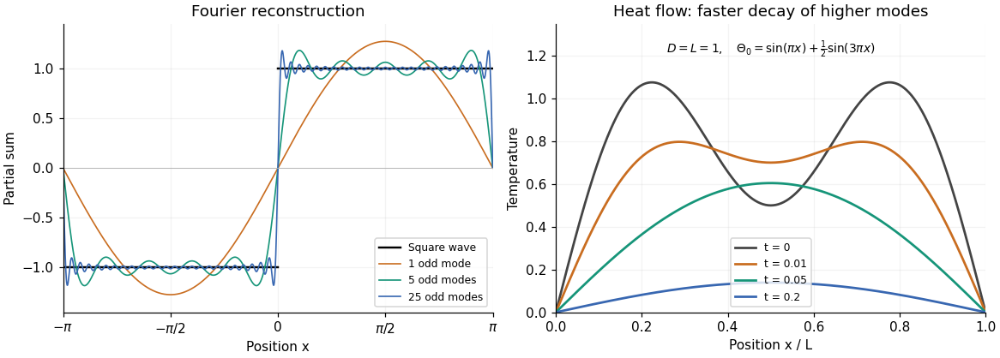

<h1 id="5/c/ii/solution">Solution</h1>

↑ **Parent:** [Ii](../ii.md)

Substitute the proposed [Fourier sine series](../../../../../../fourier-sine-series.md) into the [heat equation](../../../../../../heat-equation.md):

$$
\sum_{n\geq1}b_nT_n'(t)\sin(k_nx)
=-D\sum_{n\geq1}b_nk_n^2T_n(t)\sin(k_nx).
$$

Projecting onto each sine using [orthogonality](../../../../../../orthogonal-vectors.md) gives $T_n'=-Dk_n^2T_n$ for every mode with $b_n\ne0$. The [initial condition](../../../../../../initial-condition.md) fixes $T_n(0)=1$, since $b_n$ already describes the initial amplitude. Hence

$$
\boxed{T_n(t)=e^{-Dk_n^2t},\qquad
\Theta(x,t)=\sum_{n=1}^{\infty}b_n e^{-D(n\pi/L)^2t}\sin\!\left(\frac{n\pi x}{L}\right)}.
$$

For a mode with $b_n=0$, the value of $T_n$ is immaterial and the same convention is convenient. The positive [thermal diffusivity](../../../../../../thermal-diffusivity.md) $D$ damps every mode, with higher frequencies decaying faster. For square-integrable initial data the damping justifies termwise differentiation for $t>0$ and recovery of the initial data in [L2 norm convergence](../../../../../../l2-norm-convergence.md) as $t\downarrow0$.

**[Figure 1](#5/c/ii/image-odd-fourier-modes-reconstruct-a-square-wave-while-heat-diffusion-damps-short-spatial-scales-first). Odd Fourier modes reconstruct a square wave, while heat diffusion damps short spatial scales first**.

The left panel illustrates the [Fourier series](../../../../../../fourier-series-split.md) in part (b). The right panel is a self-generated example with $D=L=1$ and $\Theta_0(x)=\sin(\pi x)+\tfrac12\sin(3\pi x)$, showing the two [normal modes](../../../../../../normal-mode.md) decaying at rates $\pi^2$ and $9\pi^2$.

## ↑ Ancestors (13)

1. [Ii](../ii.md)
2. [C](../../c.md)
3. [5](../../../5.md)
4. [Discrete mathematics, continuous mathematics and probability (resit)](../../../../discrete-mathematics-continuous-mathematics-and-probability-resit-split.md)
5. [2016](../../../../split.md)
6. [Past exam of the year 1 of the computer science course of the University of Oxford](../../../../../split.md)
7. [Year 1 of the computer science course of the University of Oxford](../../../../../../year-1-of-the-computer-science-course-of-the-university-of-oxford.md)
8. [Computer science course of the University of Oxford](../../../../../../computer-science-course-of-the-university-of-oxford.md)
9. [Undergraduate course of the University of Oxford](../../../../../../undergraduate-course-of-the-university-of-oxford.md)
10. [Course of the University of Oxford](../../../../../../course-of-the-university-of-oxford.md)
11. [University of Oxford](../../../../../../university-of-oxford-split.md)
12. [List of universities](../../../../../../list-of-universities.md)
13. [Codex Wiki](../../../../../../split.md)
