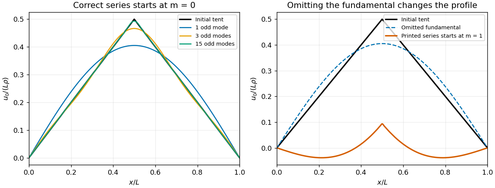

# Discrete mathematics, continuous mathematics and probability

↑ **Parent:** [2016](../2016.md)

Source paper: [released examination archive](https://www.whatdotheyknow.com/request/past_exam_papers_for_1st_year_of/response/1398416/attach/2/Fakour%20Zip%20Final%201.zip?cookie_passthrough=1), member `a10100w1-3.pdf`; original cover dated 2016-06-23.

**Table of contents**

- [1](#1)
  - [a](#1/a)
    - [i](#1/a/i)
      - [Solution](#1/a/i/solution)
    - [ii](#1/a/ii)
      - [Solution](#1/a/ii/solution)
    - [iii](#1/a/iii)
      - [Solution](#1/a/iii/solution)
  - [b](#1/b)
    - [i](#1/b/i)
      - [Solution](#1/b/i/solution)
    - [ii](#1/b/ii)
      - [Solution](#1/b/ii/solution)
  - [c](#1/c)
    - [Solution](#1/c/solution)
  - [d](#1/d)
    - [i](#1/d/i)
      - [Solution](#1/d/i/solution)
    - [ii](#1/d/ii)
      - [Solution](#1/d/ii/solution)
  - [e](#1/e)
    - [i](#1/e/i)
      - [Solution](#1/e/i/solution)
    - [ii](#1/e/ii)
      - [Solution](#1/e/ii/solution)
    - [iii](#1/e/iii)
      - [Solution](#1/e/iii/solution)
    - [iv](#1/e/iv)
      - [Solution](#1/e/iv/solution)
- [2](#2)
  - [a](#2/a)
    - [Solution](#2/a/solution)
  - [b](#2/b)
    - [i](#2/b/i)
      - [Solution](#2/b/i/solution)
    - [ii](#2/b/ii)
      - [Solution](#2/b/ii/solution)
    - [iii](#2/b/iii)
      - [Solution](#2/b/iii/solution)
  - [c](#2/c)
    - [i](#2/c/i)
      - [Solution](#2/c/i/solution)
    - [ii](#2/c/ii)
      - [Solution](#2/c/ii/solution)
  - [d](#2/d)
    - [Solution](#2/d/solution)
- [3](#3)
  - [a](#3/a)
    - [Solution](#3/a/solution)
  - [b](#3/b)
    - [Solution](#3/b/solution)
  - [c](#3/c)
    - [Solution](#3/c/solution)
  - [d](#3/d)
    - [Solution](#3/d/solution)
  - [e](#3/e)
    - [i](#3/e/i)
      - [Solution](#3/e/i/solution)
    - [ii](#3/e/ii)
      - [Solution](#3/e/ii/solution)
    - [iii](#3/e/iii)
      - [Solution](#3/e/iii/solution)
    - [iv](#3/e/iv)
      - [Solution](#3/e/iv/solution)
  - [f](#3/f)
    - [i](#3/f/i)
      - [Solution](#3/f/i/solution)
    - [ii](#3/f/ii)
      - [Solution](#3/f/ii/solution)
- [4](#4)
  - [a](#4/a)
    - [Solution](#4/a/solution)
  - [b](#4/b)
    - [Solution](#4/b/solution)
  - [c](#4/c)
    - [Solution](#4/c/solution)
  - [d](#4/d)
    - [Solution](#4/d/solution)
- [5](#5)
  - [a](#5/a)
    - [i](#5/a/i)
      - [Solution](#5/a/i/solution)
    - [ii](#5/a/ii)
      - [Solution](#5/a/ii/solution)
  - [b](#5/b)
    - [Solution](#5/b/solution)
  - [c](#5/c)
    - [Solution](#5/c/solution)
- [6](#6)
  - [a](#6/a)
    - [Solution](#6/a/solution)
  - [b](#6/b)
    - [i](#6/b/i)
      - [Solution](#6/b/i/solution)
    - [ii](#6/b/ii)
      - [Solution](#6/b/ii/solution)
  - [c](#6/c)
    - [i](#6/c/i)
      - [Solution](#6/c/i/solution)
    - [ii](#6/c/ii)
      - [Solution](#6/c/ii/solution)
  - [d](#6/d)
    - [i](#6/d/i)
      - [Solution](#6/d/i/solution)
    - [ii](#6/d/ii)
      - [Solution](#6/d/ii/solution)
    - [iii](#6/d/iii)
      - [Solution](#6/d/iii/solution)
  - [e](#6/e)
    - [Solution](#6/e/solution)
- [7](#7)
  - [a](#7/a)
    - [i](#7/a/i)
      - [Solution](#7/a/i/solution)
    - [ii](#7/a/ii)
      - [Solution](#7/a/ii/solution)
    - [iii](#7/a/iii)
      - [Solution](#7/a/iii/solution)
  - [b](#7/b)
    - [Solution](#7/b/solution)
  - [c](#7/c)
    - [i](#7/c/i)
      - [Solution](#7/c/i/solution)
    - [ii](#7/c/ii)
      - [Solution](#7/c/ii/solution)
- [8](#8)
  - [a](#8/a)
    - [i](#8/a/i)
      - [Solution](#8/a/i/solution)
    - [ii](#8/a/ii)
      - [Solution](#8/a/ii/solution)
  - [b](#8/b)
    - [i](#8/b/i)
      - [Solution](#8/b/i/solution)
    - [ii](#8/b/ii)
      - [Solution](#8/b/ii/solution)
  - [c](#8/c)
    - [i](#8/c/i)
      - [Solution](#8/c/i/solution)
    - [ii](#8/c/ii)
      - [Solution](#8/c/ii/solution)
- [9](#9)
  - [a](#9/a)
    - [i](#9/a/i)
      - [Solution](#9/a/i/solution)
    - [ii](#9/a/ii)
      - [Solution](#9/a/ii/solution)
    - [iii](#9/a/iii)
      - [Solution](#9/a/iii/solution)
  - [b](#9/b)
    - [i](#9/b/i)
      - [Solution](#9/b/i/solution)
    - [ii](#9/b/ii)
      - [Solution](#9/b/ii/solution)
    - [iii](#9/b/iii)
      - [Solution](#9/b/iii/solution)

## 1

↑ **Parent:** [Discrete mathematics, continuous mathematics and probability](discrete-mathematics-continuous-mathematics-and-probability.md)

<h3 id="1/a">a</h3>

↑ **Parent:** [1](#1)

<h4 id="1/a/i">i</h4>

↑ **Parent:** [A](#1/a)

<h5 id="1/a/i/solution">Solution</h5>

↑ **Parent:** [I](#1/a/i)

We prove both [set inclusions](../../set.md#set-inclusion), as required by a [double inclusion proof](../../set.md#double-inclusion-proof). If $x\in A\setminus(B\cup C)$, then $x\in A$ and $x\notin B\cup C$. Thus $x\notin B$ and $x\notin C$, so $x\in A\setminus B$ and $x\in A\setminus C$. This proves the forward [set inclusion](../../set.md#set-inclusion).

Conversely, if $x\in(A\setminus B)\cap(A\setminus C)$, then $x\in A$, $x\notin B$, and $x\notin C$. Hence $x\notin B\cup C$, giving $x\in A\setminus(B\cup C)$. Therefore

$$
\boxed{A\setminus(B\cup C)=(A\setminus B)\cap(A\setminus C).}
$$

<h4 id="1/a/ii">ii</h4>

↑ **Parent:** [A](#1/a)

<h5 id="1/a/ii/solution">Solution</h5>

↑ **Parent:** [Ii](#1/a/ii)

For the first [set inclusion](../../set.md#set-inclusion), take $x\in(A\cap B)\setminus C$. Membership in the [intersection](../../set.md#set-intersection) gives $x\in A$ and $x\in B$, while the [set difference](../../set.md#set-difference) gives $x\notin C$. Consequently $x\in(A\setminus C)\cap(B\setminus C)$.

For the reverse [set inclusion](../../set.md#set-inclusion), an element of $(A\setminus C)\cap(B\setminus C)$ belongs to both $A$ and $B$ and does not belong to $C$. It therefore belongs to $(A\cap B)\setminus C$. By [double inclusion proof](../../set.md#double-inclusion-proof),

$$
\boxed{(A\cap B)\setminus C=(A\setminus C)\cap(B\setminus C).}
$$

<h4 id="1/a/iii">iii</h4>

↑ **Parent:** [A](#1/a)

<h5 id="1/a/iii/solution">Solution</h5>

↑ **Parent:** [Iii](#1/a/iii)

Complements are relative to the same [universal set](../../set.md#universal-set) $\mathcal U$. Suppose $A\subseteq B$ and $x\in\overline B$. Then $x\in\mathcal U$ and $x\notin B$. If $x$ belonged to $A$, the assumed [set inclusion](../../set.md#set-inclusion) would imply $x\in B$, a contradiction. Thus $x\notin A$ and $x\in\overline A$, proving

$$
\boxed{A\subseteq B\ \Longrightarrow\ \overline B\subseteq\overline A.}
$$

There is only one [set inclusion](../../set.md#set-inclusion) in this conclusion; a reverse inclusion is neither needed nor generally true. The request for double inclusion applies to the equalities in (i) and (ii).

<h3 id="1/b">b</h3>

↑ **Parent:** [1](#1)

<h4 id="1/b/i">i</h4>

↑ **Parent:** [B](#1/b)

<h5 id="1/b/i/solution">Solution</h5>

↑ **Parent:** [I](#1/b/i)

Use the definition $A\oplus B=(A\setminus B)\cup(B\setminus A)$ of [symmetric difference](../../set.md#symmetric-difference). The algebraic laws for [set difference](../../set.md#set-difference) and the [empty set](../../set.md#empty-set) give

$$
A\oplus\varnothing=(A\setminus\varnothing)\cup(\varnothing\setminus A)=A\cup\varnothing=\boxed A,
$$

and

$$
A\oplus A=(A\setminus A)\cup(A\setminus A)=\varnothing\cup\varnothing=\boxed\varnothing.
$$

<h4 id="1/b/ii">ii</h4>

↑ **Parent:** [B](#1/b)

<h5 id="1/b/ii/solution">Solution</h5>

↑ **Parent:** [Ii](#1/b/ii)

Because $A\subseteq\mathcal U$, the [set difference](../../set.md#set-difference) $A\setminus\mathcal U$ is empty and $\mathcal U\setminus A=\overline A$. Therefore the [symmetric difference](../../set.md#symmetric-difference) satisfies

$$
A\oplus\mathcal U=(A\setminus\mathcal U)\cup(\mathcal U\setminus A)=\varnothing\cup\overline A=\boxed{\overline A}.
$$

The [disjoint sets](../../set.md#disjoint-sets) $A$ and $\overline A$ have [union](../../set.md#set-union) $\mathcal U$, so

$$
A\oplus\overline A=(A\setminus\overline A)\cup(\overline A\setminus A)=A\cup\overline A=\boxed{\mathcal U}.
$$

<h3 id="1/c">c</h3>

↑ **Parent:** [1](#1)

<h4 id="1/c/solution">Solution</h4>

↑ **Parent:** [C](#1/c)

Apply [symmetric difference](../../set.md#symmetric-difference) with $C$ to both sides, then use its [associativity](../../algebraic-operation.md#associative-property) and the identities in (b)(i):

$$
(A\oplus C)\oplus C=(B\oplus C)\oplus C
\quad\Longrightarrow\quad
A\oplus(C\oplus C)=B\oplus(C\oplus C)
\quad\Longrightarrow\quad
A\oplus\varnothing=B\oplus\varnothing.
$$

The final identity gives **$A=B$**. This is cancellation by applying the same operation twice.

<h3 id="1/d">d</h3>

↑ **Parent:** [1](#1)

<h4 id="1/d/i">i</h4>

↑ **Parent:** [D](#1/d)

<h5 id="1/d/i/solution">Solution</h5>

↑ **Parent:** [I](#1/d/i)

Fix one distinguished element $a$ of the $n$-element [set](../../set.md). Every [partition of a set](../../set.md#partition-of-a-set) into $l$ blocks belongs to exactly one of two cases. If $\{a\}$ is a block, removing it leaves an $(l-1)$-block [partition of a set](../../set.md#partition-of-a-set) of the other $n-1$ elements, giving $S(n-1,l-1)$ possibilities. Otherwise remove $a$ from its block; that block remains nonempty, so the result has $l$ blocks. Conversely choose any of the $S(n-1,l)$ such partitions and insert $a$ in any one of its $l$ blocks. This gives $lS(n-1,l)$ possibilities.

These cases are disjoint and exhaustive, proving the [Stirling numbers of the second kind](../../combinatorics.md#stirling-numbers-of-the-second-kind) recurrence

$$
\boxed{S(n,l)=lS(n-1,l)+S(n-1,l-1).}
$$

Use $S(0,0)=1$, $S(n,0)=0$ for $n>0$, and $S(n,l)=0$ for $l>n$; these conventions include the boundary cases $n=1$ and $l=1$.

<h4 id="1/d/ii">ii</h4>

↑ **Parent:** [D](#1/d)

<h5 id="1/d/ii/solution">Solution</h5>

↑ **Parent:** [Ii](#1/d/ii)

Starting from $n$ singleton blocks, a [partition of a set](../../set.md#partition-of-a-set) into $n-1$ nonempty blocks has exactly one block of size two and all other blocks of size one: the sum of the block sizes exceeds the number of blocks by exactly one. Choosing that pair determines the partition uniquely. Hence

$$
\boxed{S(n,n-1)=\binom n2,\qquad k=2.}
$$

This fixed value of $k$ works for every $n\geq2$. It is forced already by $n=2$: $S(2,1)=1$, whereas for positive $k$ the only $\binom2k$ equal to one is $\binom22$.

<h3 id="1/e">e</h3>

↑ **Parent:** [1](#1)

<h4 id="1/e/i">i</h4>

↑ **Parent:** [E](#1/e)

<h5 id="1/e/i/solution">Solution</h5>

↑ **Parent:** [I](#1/e/i)

Each of the $m$ elements of $A$ independently receives one of $n$ images in $B$. The [multiplication principle](../../combinatorics.md#rule-of-product) therefore gives **$n^m$ functions**. In particular an [empty set](../../set.md#empty-set) domain has exactly one function to any $B$, so here $0^0$ is interpreted as $1$; a nonempty domain has no function to an [empty set](../../set.md#empty-set) codomain.

<h4 id="1/e/ii">ii</h4>

↑ **Parent:** [E](#1/e)

<h5 id="1/e/ii/solution">Solution</h5>

↑ **Parent:** [Ii](#1/e/ii)

A [bijection](../../function.md#bijection) between [finite sets](../../set.md#finite-set) requires equal [cardinality](../../cardinal-number.md#cardinality). When $m=n$, list the elements of $A$ and choose their distinct images in $n,n-1,\ldots,1$ ways. Thus

$$
\boxed{\#\{\text{bijections }A\to B\}=\begin{cases}n!&m=n,\\0&m\ne n.\end{cases}}
$$

The [factorial](../../combinatorics.md#factorial) convention $0!=1$ includes the unique [bijection](../../function.md#bijection) from the [empty set](../../set.md#empty-set) to itself.

<h4 id="1/e/iii">iii</h4>

↑ **Parent:** [E](#1/e)

<h5 id="1/e/iii/solution">Solution</h5>

↑ **Parent:** [Iii](#1/e/iii)

For a [surjection](../../algebra.md#surjective-function), the nonempty [fibres](../../function.md#fiber-of-a-function) $f^{-1}(b)$ form a [partition of a set](../../set.md#partition-of-a-set) $A$ into exactly $n$ blocks. Choose these unlabelled blocks in $S(m,n)$ ways, then assign the $n$ distinct elements of $B$ to them in $n!$ ways. Consequently

$$
\boxed{\#\{\text{surjections }A\to B\}=n!S(m,n).}
$$

It is zero when $m<n$. With $S(0,0)=1$ and $S(m,0)=0$ for $m>0$, the same formula also handles an [empty set](../../set.md#empty-set) codomain.

<h4 id="1/e/iv">iv</h4>

↑ **Parent:** [E](#1/e)

<h5 id="1/e/iv/solution">Solution</h5>

↑ **Parent:** [Iv](#1/e/iv)

Choose the [image of a function](../../set-theory.md#image-of-a-function) as a $j$-element [subset](../../set.md#subset) of $B$, then choose a [surjection](../../algebra.md#surjective-function) onto that selected image as in (iii). Therefore

$$
\boxed{\#\{f:A\to B:|\operatorname{Im}f|=j\}=\binom nj j!S(m,j)\quad(0\leq j\leq\min(m,n)).}
$$

The answer is zero when $j>n$. If $j=0$, it is one for $m=0$ and zero for $m>0$, as the [Stirling numbers of the second kind](../../combinatorics.md#stirling-numbers-of-the-second-kind) conventions require.

## 2

↑ **Parent:** [Discrete mathematics, continuous mathematics and probability](discrete-mathematics-continuous-mathematics-and-probability.md)

<h3 id="2/a">a</h3>

↑ **Parent:** [2](#2)

<h4 id="2/a/solution">Solution</h4>

↑ **Parent:** [A](#2/a)

Count pairs $(M,K)$ of [subsets](../../set.md#subset) of an $n$-element candidate [set](../../set.md) with $K\subseteq M$, $|M|=m$, and $|K|=k$. Choosing the whole team $M$ first and then the special-role players $K$ gives $\binom nm\binom mk$. Alternatively choose $K$ first, then choose the other $m-k$ players from the $n-k$ candidates outside $K$, giving $\binom nk\binom{n-k}{m-k}$. Each construction specifies the same pair uniquely. Thus [double counting](../../combinatorics.md#double-counting-proof-technique) proves

$$
\boxed{\binom nm\binom mk=\binom nk\binom{n-k}{m-k}.}
$$

<h3 id="2/b">b</h3>

↑ **Parent:** [2](#2)

<h4 id="2/b/i">i</h4>

↑ **Parent:** [B](#2/b)

<h5 id="2/b/i/solution">Solution</h5>

↑ **Parent:** [I](#2/b/i)

Using the wiki convention that paths follow the written order of the [binary relations](../../set-theory.md#binary-relation), [composition of relations](../../set-theory.md#composition-of-relations) is

$$
\boxed{R\circ S=\{(x,z)\in A\times A:\exists y\in A,\ (x,y)\in R\text{ and }(y,z)\in S\}.}
$$

Some treatments reverse the naming convention; stating it explicitly avoids ambiguity. The powers of the single relation $R$ below are the same under either convention.

<h4 id="2/b/ii">ii</h4>

↑ **Parent:** [B](#2/b)

<h5 id="2/b/ii/solution">Solution</h5>

↑ **Parent:** [Ii](#2/b/ii)

A pair belongs to $R\circ R$ exactly when two successive $R$ steps connect its endpoints. The chain $a\to b\to c\to d$ has two such length-two paths, $a\to b\to c$ and $b\to c\to d$. Hence

$$
\boxed{R\circ R=\{(a,c),(b,d)\}.}
$$

This applies [composition of relations](../../set-theory.md#composition-of-relations) directly; no other middle element gives a pair.

<h4 id="2/b/iii">iii</h4>

↑ **Parent:** [B](#2/b)

<h5 id="2/b/iii/solution">Solution</h5>

↑ **Parent:** [Iii](#2/b/iii)

The [relation powers](../../set-theory.md#power-of-a-relation) are $R^2=\{(a,c),(b,d)\}$, $R^3=\{(a,d)\}$, and $R^i=\varnothing$ for $i\geq4$. For $k=1$, $(a,b),(b,c)\in T$ but $(a,c)\notin T$, so [transitivity](../../set-theory.md#transitive-relation) fails. For $k=2$, $(a,c),(c,d)\in T$ but $(a,d)\notin T$, so it still fails.

For $k=3$, $T$ consists of every pair in which the first endpoint precedes the second in $a,b,c,d$. Composing any two such pairs again gives such a pair, so $T$ is [transitive](../../set-theory.md#transitive-relation). Thus **the smallest $k$ is $3$**; this $T$ is the [transitive closure of a relation](../../set-theory.md#transitive-closure-relation) $R$.

<h3 id="2/c">c</h3>

↑ **Parent:** [2](#2)

<h4 id="2/c/i">i</h4>

↑ **Parent:** [C](#2/c)

<h5 id="2/c/i/solution">Solution</h5>

↑ **Parent:** [I](#2/c/i)

In the [partially ordered set](../../set.md#partially-ordered-set) $(A,\preceq)$, the assertion $m=\operatorname{lub}(S)$ means both

$$
\boxed{(\forall s\in S,\ s\preceq m)\quad\text{and}\quad
(\forall u\in A,\ [\forall s\in S,\ s\preceq u]\Rightarrow m\preceq u).}
$$

The first condition makes $m$ an [upper bound](../../set.md#upper-bound-in-a-partially-ordered-set); the second makes it the [least upper bound](../../set.md#least-upper-bound-in-a-partially-ordered-set). Both conditions are necessary, and [antisymmetry](../../set-theory.md#antisymmetry) makes such an element unique.

<h4 id="2/c/ii">ii</h4>

↑ **Parent:** [C](#2/c)

<h5 id="2/c/ii/solution">Solution</h5>

↑ **Parent:** [Ii](#2/c/ii)

Suppose $m$ is the [greatest lower bound](../../set.md#greatest-lower-bound-in-a-partially-ordered-set) of the [set](../../set.md) $X$ of all [upper bounds](../../set.md#upper-bound-in-a-partially-ordered-set) of $S$. Every $s\in S$ satisfies $s\preceq x$ for every $x\in X$, so each such $s$ is a [lower bound](../../set.md#lower-bound-in-a-partially-ordered-set) of $X$. Since $m$ is the greatest of those [lower bounds](../../set.md#lower-bound-in-a-partially-ordered-set), $s\preceq m$ for every $s\in S$. Thus $m$ itself is an [upper bound](../../set.md#upper-bound-in-a-partially-ordered-set) of $S$, meaning $m\in X$.

Also $m$, being a [lower bound](../../set.md#lower-bound-in-a-partially-ordered-set) of $X$, satisfies $m\preceq x$ for every $x\in X$. It is therefore an [upper bound](../../set.md#upper-bound-in-a-partially-ordered-set) of $S$ below every other [upper bound](../../set.md#upper-bound-in-a-partially-ordered-set), which proves **$m=\operatorname{lub}(S)$**. The argument also covers empty $S$ or $X$ whenever the assumed [greatest lower bound](../../set.md#greatest-lower-bound-in-a-partially-ordered-set) exists.

<h3 id="2/d">d</h3>

↑ **Parent:** [2](#2)

<h4 id="2/d/solution">Solution</h4>

↑ **Parent:** [D](#2/d)

Put $H_n=\sum_{k=0}^{\lfloor n/2\rfloor}\binom{n-k}{k}$; the other summands in the printed sum vanish. The initial values are $H_0=1=F_1$ and $H_1=1=F_2$. For $n\geq2$, [Pascal's identity](../../binomial-coefficient.md#pascal-s-rule) gives

$$
H_n=\sum_{k=0}^{\lfloor n/2\rfloor}\binom{n-1-k}{k}
+\sum_{k=1}^{\lfloor n/2\rfloor}\binom{n-1-k}{k-1}
=H_{n-1}+H_{n-2}.
$$

For the first sum, when $n$ is even its final term is zero; otherwise its range already agrees with $H_{n-1}$. In the second sum put $j=k-1$, obtaining $\binom{n-2-j}{j}$ for $0\leq j\leq\lfloor(n-2)/2\rfloor$. Thus both range identifications hold without negative upper arguments in a [binomial coefficient](../../binomial-coefficient.md).

Now [strong induction](../../foundations-of-mathematics.md#strong-induction) gives $H_n=F_n+F_{n-1}=F_{n+1}$ from the two preceding cases and the [Fibonacci recurrence](../../sequence-and-series.md#fibonacci-recurrence). Hence

$$
\boxed{\sum_{k=0}^n\binom{n-k}{k}=F_{n+1}\quad(n\geq0).}
$$

## 3

↑ **Parent:** [Discrete mathematics, continuous mathematics and probability](discrete-mathematics-continuous-mathematics-and-probability.md)

<h3 id="3/a">a</h3>

↑ **Parent:** [3](#3)

<h4 id="3/a/solution">Solution</h4>

↑ **Parent:** [A](#3/a)

We prove the [contrapositive](../../mathematical-logic.md#contrapositive). If $3\nmid a$, [Euclidean division](../../integer.md#euclidean-division) gives $a=3q+1$ or $a=3q+2$ for an [integer](../../integer.md) $q$. Squaring gives respectively $a^2=3(3q^2+2q)+1$ or $a^2=3(3q^2+4q+1)+1$. Both have remainder $1$ upon division by $3$, so $3\nmid a^2$. Taking the [contrapositive](../../mathematical-logic.md#contrapositive) yields **$3\mid a^2\Rightarrow3\mid a$**.

<h3 id="3/b">b</h3>

↑ **Parent:** [3](#3)

<h4 id="3/b/solution">Solution</h4>

↑ **Parent:** [B](#3/b)

For a [proof by contradiction](../../foundations-of-mathematics.md#reductio-ad-absurdum), suppose $\sqrt3=a/b$ for positive [integers](../../integer.md) $a,b$ in lowest terms, so $\gcd(a,b)=1$. Squaring gives $a^2=3b^2$, and part (a) implies $3\mid a$. Write $a=3c$; then $9c^2=3b^2$, hence $b^2=3c^2$, and part (a) again implies $3\mid b$. This contradicts the coprimality of $a,b$. Therefore **$\sqrt3$ is an [irrational number](../../algebra.md#irrational-number)**.

<h3 id="3/c">c</h3>

↑ **Parent:** [3](#3)

<h4 id="3/c/solution">Solution</h4>

↑ **Parent:** [C](#3/c)

The fifty [disjoint sets](../../set.md#disjoint-sets) $\{1,100\},\{2,99\},\ldots,\{50,51\}$ form a [partition of a set](../../set.md#partition-of-a-set) $\{1,\ldots,100\}$. If a chosen [subset](../../set.md#subset) met each pair at most once, it would contain at most fifty elements. The [pigeonhole principle](../../combinatorics.md#pigeonhole-principle) therefore forces a $51$-element [subset](../../set.md#subset) to contain both elements of at least one pair. **Those two distinct elements sum to $101$.**

<h3 id="3/d">d</h3>

↑ **Parent:** [3](#3)

<h4 id="3/d/solution">Solution</h4>

↑ **Parent:** [D](#3/d)

Assume $n\geq1$ and list the elements of $X$ as $a_1,\ldots,a_n$. Define the [partial sums](../../sequence-and-series.md#partial-sum) $s_j=a_1+\cdots+a_j$ for $1\leq j\leq n$. If one is divisible by $n$, its corresponding nonempty prefix is a suitable $Y$.

Otherwise the $n$ [partial sums](../../sequence-and-series.md#partial-sum) have remainders in the $n-1$ nonzero [residue classes](../../modular-arithmetic.md#residue-class). The [pigeonhole principle](../../combinatorics.md#pigeonhole-principle) gives $i<j$ with $s_i\equiv s_j\pmod n$. Thus $s_j-s_i=a_{i+1}+\cdots+a_j$ is divisible by $n$, giving a nonempty [subset](../../set.md#subset) $Y=\{a_{i+1},\ldots,a_j\}$.

Therefore **a nonempty $Y$ exists**. This strengthens the literal assertion, which would otherwise allow the trivial [empty set](../../set.md#empty-set) with sum zero.

<h3 id="3/e">e</h3>

↑ **Parent:** [3](#3)

<h4 id="3/e/i">i</h4>

↑ **Parent:** [E](#3/e)

<h5 id="3/e/i/solution">Solution</h5>

↑ **Parent:** [I](#3/e/i)

Since $h(n)=\max\{f(n),g(n)\}$, both $f(n)\leq h(n)$ and $g(n)\leq h(n)$. Therefore $f(n)+g(n)\leq2h(n)$ for every positive $n$. The definition of [big O notation](../../real-analysis.md#big-o-notation) is satisfied with constant $2$ and threshold $1$. **True: $f+g=O(h)$.**

<h4 id="3/e/ii">ii</h4>

↑ **Parent:** [E](#3/e)

<h5 id="3/e/ii/solution">Solution</h5>

↑ **Parent:** [Ii](#3/e/ii)

Positivity gives $\max\{f(n),g(n)\}\leq f(n)+g(n)$. Thus $h(n)\leq f(n)+g(n)$ for every positive $n$, meeting [big O notation](../../real-analysis.md#big-o-notation) with constant $1$ and threshold $1$. **True: $h=O(f+g)$.**

<h4 id="3/e/iii">iii</h4>

↑ **Parent:** [E](#3/e)

<h5 id="3/e/iii/solution">Solution</h5>

↑ **Parent:** [Iii](#3/e/iii)

Take $f(n)=g(n)=n^2$, so $h(n)=n^2$ but $(f\circ g)(n)=n^4$. The ratio $(f\circ g)(n)/h(n)=n^2$ is unbounded, precluding any eventual constant upper bound in [big O notation](../../real-analysis.md#big-o-notation). **False: in general $f\circ g\ne O(h)$.** This is a [counterexample](../../foundations-of-mathematics.md#counterexample) involving [function composition](../../function.md#function-composition), not pointwise addition.

<h4 id="3/e/iv">iv</h4>

↑ **Parent:** [E](#3/e)

<h5 id="3/e/iv/solution">Solution</h5>

↑ **Parent:** [Iv](#3/e/iv)

For each fixed positive [integer](../../integer.md) $k$, part (i) gives $(f(n)+g(n))^k\leq(2h(n))^k=2^kh(n)^k$. This meets [big O notation](../../real-analysis.md#big-o-notation) with constant $2^k$ and threshold $1$. **True: $(f+g)^k=O(h^k)$ for fixed $k$.** The constant may depend on $k$; no claim uniform in a varying $k$ is required.

<h3 id="3/f">f</h3>

↑ **Parent:** [3](#3)

<h4 id="3/f/i">i</h4>

↑ **Parent:** [F](#3/f)

<h5 id="3/f/i/solution">Solution</h5>

↑ **Parent:** [I](#3/f/i)

Prove the explicit bound $n!\leq2^{n^2}$ by [mathematical induction](../../foundations-of-mathematics.md#mathematical-induction). At $n=1$, $1\leq2$. For the step, note that $n+1\leq2^n$ for $n\geq1$: this auxiliary inequality has base $2=2$ and follows at the next index from $n+2\leq2(n+1)$. Hence, using the [induction hypothesis](../../foundations-of-mathematics.md#induction-hypothesis),

$$
(n+1)!\leq(n+1)2^{n^2}\leq2^{n^2+n}\leq2^{(n+1)^2}.
$$

Thus **$n!=O((2^n)^n)$**, with constant $1$ and threshold $1$ in [big O notation](../../real-analysis.md#big-o-notation).

<h4 id="3/f/ii">ii</h4>

↑ **Parent:** [F](#3/f)

<h5 id="3/f/ii/solution">Solution</h5>

↑ **Parent:** [Ii](#3/f/ii)

We prove the stronger explicit bound $n!\leq n^n/2^{n-1}$ by [mathematical induction](../../foundations-of-mathematics.md#mathematical-induction). The case $n=1$ is equality. The [binomial theorem](../../binomial-coefficient.md#binomial-theorem) gives $(1+1/n)^n\geq1+n/n=2$, so $(n+1)^n\geq2n^n$. Consequently the [induction hypothesis](../../foundations-of-mathematics.md#induction-hypothesis) yields

$$
(n+1)!\leq\frac{(n+1)n^n}{2^{n-1}}\leq\frac{(n+1)^{n+1}}{2^n}.
$$

Therefore **$n!=O(n^n/2^n)$**, with constant $2$ and threshold $1$.

The second bound is **asymptotically tighter**. Using $n\leq2^n$,

$$
\frac{n^n/2^n}{2^{n^2}}=\left(\frac{n}{2^{n+1}}\right)^n\leq2^{-n}\longrightarrow0.
$$

Thus its bounding function is negligible relative to the first in [little o notation](../../real-analysis.md#little-o-notation); this compares the bounds without needing [Stirling's formula](../../real-analysis.md#stirling-formula).

## 4

↑ **Parent:** [Discrete mathematics, continuous mathematics and probability](discrete-mathematics-continuous-mathematics-and-probability.md)

<h3 id="4/a">a</h3>

↑ **Parent:** [4](#4)

<h4 id="4/a/solution">Solution</h4>

↑ **Parent:** [A](#4/a)

Use [partial fraction decomposition](../../isolated-singularity.md#partial-fraction-decomposition):

$$
\frac1{x^2(x^2-4)}=-\frac1{4x^2}+\frac1{4(x^2-4)}
=-\frac1{4x^2}+\frac1{16}\left(\frac1{x-2}-\frac1{x+2}\right).
$$

Integrating each term gives the [antiderivative](../../integral.md#antiderivative)

$$
\boxed{\int\frac{dx}{x^2(x^2-4)}=\frac1{4x}+\frac1{16}\log\left|\frac{x-2}{x+2}\right|+C.}
$$

This holds on any interval avoiding $-2,0,2$; the constant may differ between these intervals. [Differentiation](../../calculus.md#differentiation) of the logarithm recovers $1/[4(x^2-4)]$, providing a direct check.

<h3 id="4/b">b</h3>

↑ **Parent:** [4](#4)

<h4 id="4/b/solution">Solution</h4>

↑ **Parent:** [B](#4/b)

The [characteristic equation of a constant-coefficient differential equation](../../linear-ordinary-differential-equation.md#characteristic-equation-of-a-constant-coefficient-differential-equation) here is $r^2-3r+2=(r-1)(r-2)=0$. Its [homogeneous solution](../../linear-ordinary-differential-equation.md#homogeneous-solution) is $C_1e^x+C_2e^{2x}$. Because the forcing $e^x$ is already a homogeneous mode, the [method of undetermined coefficients](../../linear-ordinary-differential-equation.md#method-of-undetermined-coefficients) requires $y_p=Axe^x$ rather than $Ae^x$.

Here $y_p'=A(x+1)e^x$ and $y_p''=A(x+2)e^x$, so $y_p''-3y_p'+2y_p=-Ae^x$. Thus $A=-1$, and the [general solution](../../linear-ordinary-differential-equation.md#general-solution) is

$$
\boxed{y(x)=C_1e^x+C_2e^{2x}-xe^x.}
$$

<h3 id="4/c">c</h3>

↑ **Parent:** [4](#4)

<h4 id="4/c/solution">Solution</h4>

↑ **Parent:** [C](#4/c)

The [gradient](../../multivariable-calculus.md#gradient) vanishes when $4x+3y-1=0$ and $3x+2y-1=0$. Subtracting these equations gives $x+y=0$, so the unique [critical point](../../analysis.md#critical-point) is $\boxed{(x,y)=(1,-1)}$, with $f(1,-1)=0$.

The [Hessian matrix](../../multivariable-calculus.md#hessian-matrix) is

$$
H=\begin{pmatrix}4&3\\3&2\end{pmatrix},\qquad \det H=8-9=-1<0.
$$

It is indefinite, so the [critical point](../../analysis.md#critical-point) is a **[saddle point](../../analysis.md#saddle-point)**. Explicitly, around that point the change is exactly $2u^2+3uv+v^2$: it is positive for $v=0,u\ne0$ and negative for $v=-3u/2,u\ne0$. Thus arbitrarily close points have both larger and smaller values.

<h3 id="4/d">d</h3>

↑ **Parent:** [4](#4)

<h4 id="4/d/solution">Solution</h4>

↑ **Parent:** [D](#4/d)

On the unit circle the constraint [gradient](../../multivariable-calculus.md#gradient) $(2x,2y)$ never vanishes. The [Lagrange multiplier](../../mathematical-optimization.md#lagrange-multiplier) equations are

$$
8x-3y=2\lambda x,\qquad -3x=2\lambda y,\qquad x^2+y^2=1.
$$

A nonzero solution of the first two equations requires

$$
\det\begin{pmatrix}8-2\lambda&-3\\-3&-2\lambda\end{pmatrix}
=4\lambda^2-16\lambda-9=0,
$$

so $\lambda=9/2$ or $\lambda=-1/2$. Multiplying the first equation by $x$, the second by $y$, and adding shows $2f=2\lambda(x^2+y^2)=2\lambda$. Thus each candidate value of $f$ equals its multiplier.

For $\lambda=9/2$, $y=-x/3$, giving $(x,y)=\pm(3,-1)/\sqrt{10}$. For $\lambda=-1/2$, $y=3x$, giving $(x,y)=\pm(1,3)/\sqrt{10}$. Since a continuous function attains its extrema on the [compact set](../../topology.md#compact-space) given by the [unit circle](../../complex-analysis.md#complex-unit-circle) and these exhaust the [Lagrange multiplier](../../mathematical-optimization.md#lagrange-multiplier) candidates,

$$
\boxed{f_{\max}=\frac92\text{ at }\pm\frac{(3,-1)}{\sqrt{10}},\qquad
f_{\min}=-\frac12\text{ at }\pm\frac{(1,3)}{\sqrt{10}}.}
$$

Each $\pm$ changes both coordinates together.

## 5

↑ **Parent:** [Discrete mathematics, continuous mathematics and probability](discrete-mathematics-continuous-mathematics-and-probability.md)

<h3 id="5/a">a</h3>

↑ **Parent:** [5](#5)

<h4 id="5/a/i">i</h4>

↑ **Parent:** [A](#5/a)

<h5 id="5/a/i/solution">Solution</h5>

↑ **Parent:** [I](#5/a/i)

The [chain rule](../../calculus.md#chain-rule) gives $\frac{d}{dx}\cos(\mu x)=-\mu\sin(\mu x)$. Dividing by the nonzero constant $-\mu$ gives the [antiderivative](../../integral.md#antiderivative)

$$
\boxed{\int\sin(\mu x)\,dx=-\frac{\cos(\mu x)}\mu+C.}
$$

<h4 id="5/a/ii">ii</h4>

↑ **Parent:** [A](#5/a)

<h5 id="5/a/ii/solution">Solution</h5>

↑ **Parent:** [Ii](#5/a/ii)

Apply [integration by parts](../../calculus.md#integration-by-parts) with $u=x$ and $dv=\sin(\mu x)\,dx$. Part (i) gives $v=-\cos(\mu x)/\mu$, so

$$
\int x\sin(\mu x)\,dx=-\frac{x\cos(\mu x)}\mu+\frac1\mu\int\cos(\mu x)\,dx
=\boxed{-\frac{x\cos(\mu x)}\mu+\frac{\sin(\mu x)}{\mu^2}+C.}
$$

<h3 id="5/b">b</h3>

↑ **Parent:** [5](#5)

<h4 id="5/b/solution">Solution</h4>

↑ **Parent:** [B](#5/b)

For the [Fourier sine series](../../fourier-series.md#fourier-sine-series) write $u_0(x)=\sum_{n\geq1}b_n\sin(n\pi x/L)$. [Orthogonality of trigonometric functions](../../fourier-series.md#orthogonality-of-trigonometric-functions) gives

$$
b_n=\frac2L\int_0^L u_0(x)\sin\frac{n\pi x}L\,dx.
$$

In the second half of the integral put $z=L-x$; then $u_0(L-z)=\rho z$ and $\sin[n\pi(L-z)/L]=(-1)^{n+1}\sin(n\pi z/L)$. Hence

$$
b_n=\frac{2\rho}L[1+(-1)^{n+1}]\int_0^{L/2}x\sin\frac{n\pi x}L\,dx.
$$

Every even coefficient is zero. For odd $n$, part (a) or the supplied integral yields

$$
b_n=\frac{4L\rho}{n^2\pi^2}\sin\frac{n\pi}2.
$$

Putting $n=2m+1$ therefore gives

$$
\boxed{u_0(x)=\sum_{m=0}^{\infty}F_m\sin\frac{(2m+1)\pi x}L,\qquad
F_m=(-1)^m\frac{4L\rho}{(2m+1)^2\pi^2}.}
$$

This is the [Fourier sine series of a symmetric tent](../../fourier-series.md#fourier-sine-series-of-a-symmetric-tent). The absolute values of its terms are uniformly bounded by a summable sequence, giving [absolute convergence](../../sequence-and-series.md#absolute-convergence) and [uniform convergence](../../sequence-and-series.md#uniform-convergence); the piecewise smooth odd extension and the [Dirichlet convergence theorem for Fourier series](../../fourier-series.md#dirichlet-s-theorem-on-fourier-series) identify its value with the continuous $u_0$, including the zero endpoints and the peak.

**The printed lower limit $m=1$ is an error.** The original PDF visibly has this lower limit. It omits the nonzero fundamental coefficient $F_0=4L\rho/\pi^2$. In particular, the printed series equals $u_0(x)-F_0\sin(\pi x/L)$, rather than $u_0(x)$. At $x=L/2$ it gives $L\rho/2-4L\rho/\pi^2$ instead of $L\rho/2$. The corrected lower limit is displayed explicitly above.

**[Figure 1](#5/b/image-the-tent-fourier-series-requires-its-fundamental-mode). The tent Fourier series requires its fundamental mode**.

<h3 id="5/c">c</h3>

↑ **Parent:** [5](#5)

<h4 id="5/c/solution">Solution</h4>

↑ **Parent:** [C](#5/c)

Apply [separation of variables](../../partial-differential-equation.md#separation-of-variables) to each mode of the [damped wave equation](../../wave-equation.md#damped-wave-equation) $u_{tt}+2k^2u_t=c^2u_{xx}$, assuming $L,c>0$. The spatial [ordinary differential equation](../../differential-equation.md#ordinary-differential-equation) is $X_n''+(\lambda_n/c)^2X_n=0$. Its general solution is $C\sin(\lambda_n x/c)+D\cos(\lambda_n x/c)$. The boundary condition at $0$ gives $D=0$; a nonzero mode at $L$ requires

$$
\boxed{\lambda_n=\frac{n\pi c}L,\quad n=1,2,\ldots,\qquad X_n(x)=\sin\frac{n\pi x}L.}
$$

Only odd $n=2m+1$ occur in the initial [Fourier sine series](../../fourier-series.md#fourier-sine-series). Put $\omega_m=(2m+1)\pi c/L$ and $d_m=\sqrt{k^4-\omega_m^2}$. The temporal equation $T_m''+2k^2T_m'+\omega_m^2T_m=0$ has roots $-k^2\pm d_m$. Define

$$
\boxed{\alpha_m=k^2-d_m,\qquad\beta_m=k^2+d_m.}
$$

For distinct roots, let the full amplitude be $q_m(t)=A_me^{-\alpha_mt}+B_me^{-\beta_mt}$. The initial displacement and zero initial velocity impose $A_m+B_m=F_m$ and $\alpha_mA_m+\beta_mB_m=0$. Solving gives

$$
\boxed{A_m=\frac{\beta_mF_m}{\beta_m-\alpha_m},\qquad
B_m=-\frac{\alpha_mF_m}{\beta_m-\alpha_m}.}
$$

Thus the physically consistent superposition is

$$
\boxed{u(x,t)=\sum_{m=0}^\infty q_m(t)\sin\frac{(2m+1)\pi x}L.}
$$

For $\omega_m<k^2$ there is [overdamping](../../wave-equation.md#overdamping), with two real decaying exponentials. For $\omega_m>k^2$ there is [underdamping](../../wave-equation.md#underdamping); set $\nu_m=\sqrt{\omega_m^2-k^4}$; the equivalent real expression is

$$
q_m(t)=F_me^{-k^2t}\left(\cos(\nu_mt)+\frac{k^2}{\nu_m}\sin(\nu_mt)\right).
$$

At [critical damping](../../wave-equation.md#critical-damping), the repeated-root case $\omega_m=k^2$, take the limit, giving $q_m(t)=F_m(1+k^2t)e^{-k^2t}$. These formulas all satisfy $q_m(0)=F_m$ and $q_m'(0)=0$.

Three source qualifications matter. First, the sum must start at $m=0$, for the same reason as in (b). Second, the printed $X(x)=u_0(x)$ cannot hold for a single separated mode: the tent has $X''=0$ on each open linear segment but $X\ne0$, contradicting $X''=-(\lambda_n/c)^2X$ for positive $\lambda_n$, and its peak is not twice differentiable. Separation applies mode by mode, with the initial tent recovered by superposition. Third, no finite “large” $k$ makes every mode overdamped, because $\omega_m\to\infty$. The two-exponential expression permits complex conjugate roots, while a repeated root requires its displayed limiting form. The tent initial data are naturally interpreted through the convergent modal solution, rather than as a single smooth separated product.

## 6

↑ **Parent:** [Discrete mathematics, continuous mathematics and probability](discrete-mathematics-continuous-mathematics-and-probability.md)

<h3 id="6/a">a</h3>

↑ **Parent:** [6](#6)

<h4 id="6/a/solution">Solution</h4>

↑ **Parent:** [A](#6/a)

Under the hypotheses of [Taylor's theorem with Lagrange remainder](../../calculus.md#taylor-theorem-with-lagrange-remainder), for example $f\in C^{n+1}$ on an interval containing $x$ and $x+h$, there is a point $\xi$ between them such that

$$
\boxed{f(x+h)=\sum_{r=0}^n\frac{f^{(r)}(x)}{r!}h^r+\frac{f^{(n+1)}(\xi)}{(n+1)!}h^{n+1}.}
$$

The [Lagrange remainder](../../calculus.md#lagrange-remainder) makes this an exact equality, rather than just a truncated [Taylor polynomial](../../calculus.md#taylor-polynomial). For $h=0$ the equality is immediate.

<h3 id="6/b">b</h3>

↑ **Parent:** [6](#6)

<h4 id="6/b/i">i</h4>

↑ **Parent:** [B](#6/b)

<h5 id="6/b/i/solution">Solution</h5>

↑ **Parent:** [I](#6/b/i)

Set $h=(b-a)/n$ and $x_i=a+ih$. Summing the areas of the $n$ endpoint trapezia gives the [composite trapezoidal rule](../../runge-kutta-method.md#composite-trapezoidal-rule)

$$
\boxed{T_n=h\left[\frac{f(x_0)+f(x_n)}2+\sum_{i=1}^{n-1}f(x_i)\right].}
$$

Every interior value is shared by two adjacent strips; the two endpoint values occur only once with half weight. Evenness of $n$ is not needed for this rule.

<h4 id="6/b/ii">ii</h4>

↑ **Parent:** [B](#6/b)

<h5 id="6/b/ii/solution">Solution</h5>

↑ **Parent:** [Ii](#6/b/ii)

For the same uniform grid and even $n$, the [composite Simpson's rule](../../numerical-integration.md#composite-simpson-s-rule) integrates a quadratic interpolant over each successive pair of strips:

$$
\boxed{S_n=\frac h3\left[f(x_0)+f(x_n)+4\sum_{j=1}^{n/2}f(x_{2j-1})+2\sum_{j=1}^{n/2-1}f(x_{2j})\right].}
$$

The weights are $1,4,2,4,\ldots,2,4,1$, which explains the even number of strips.

<h3 id="6/c">c</h3>

↑ **Parent:** [6](#6)

<h4 id="6/c/i">i</h4>

↑ **Parent:** [C](#6/c)

<h5 id="6/c/i/solution">Solution</h5>

↑ **Parent:** [I](#6/c/i)

Two strips give $h=\pi/4$, with cosine values $1,1/\sqrt2,0$. The [trapezoidal rule](../../runge-kutta-method.md#trapezoidal-rule) therefore gives

$$
T_2=\frac\pi8(1+\sqrt2)=0.948059\ldots=\boxed{0.948}.
$$

The exact integral is $1$, so the estimate is low, consistent with the concavity of cosine on this interval. The table can be used as $T_2=\tfrac12(0.7854)+0.5554$ before rounding.

<h4 id="6/c/ii">ii</h4>

↑ **Parent:** [C](#6/c)

<h5 id="6/c/ii/solution">Solution</h5>

↑ **Parent:** [Ii](#6/c/ii)

With the same three cosine values, [Simpson's rule](../../numerical-integration.md#simpson-s-rule) gives

$$
S_2=\frac\pi{12}\left(1+\frac4{\sqrt2}+0\right)
=\frac\pi{12}(1+2\sqrt2)=1.002279\ldots=\boxed{1.002}.
$$

Using the table's $n=12$ row gives $0.2618+4(0.1851)=1.0022$, with the same final rounding. That table row refers to the prefactor $\pi/12$; it does not change the specified number of strips.

<h3 id="6/d">d</h3>

↑ **Parent:** [6](#6)

<h4 id="6/d/i">i</h4>

↑ **Parent:** [D](#6/d)

<h5 id="6/d/i/solution">Solution</h5>

↑ **Parent:** [I](#6/d/i)

Write the derivative equation as $f'(x)=\Phi(x,f(x))$ with initial approximation $y_0$. The [forward Euler method](../../numerical-analysis.md#euler-method) uses the slope at the start of the step:

$$
\boxed{y_{i+1}=y_i+h\Phi(x_i,y_i),\qquad0\leq i<n.}
$$

If the derivative is a known function of $x$ alone, this is $y_{i+1}=y_i+hf'(x_i)$.

<h4 id="6/d/ii">ii</h4>

↑ **Parent:** [D](#6/d)

<h5 id="6/d/ii/solution">Solution</h5>

↑ **Parent:** [Ii](#6/d/ii)

For $f'=\Phi(x,f)$, the [Backward Euler method](../../numerical-analysis.md#backward-euler-method) uses the slope at the end of the step:

$$
\boxed{y_{i+1}=y_i+h\Phi(x_{i+1},y_{i+1}).}
$$

This generally requires solving an implicit equation for $y_{i+1}$. For a derivative depending only on $x$, it reduces to $y_{i+1}=y_i+hf'(x_{i+1})$.

<h4 id="6/d/iii">iii</h4>

↑ **Parent:** [D](#6/d)

<h5 id="6/d/iii/solution">Solution</h5>

↑ **Parent:** [Iii](#6/d/iii)

For $f'=\Phi(x,f)$, the standard explicit [midpoint method](../../numerical-analysis.md#midpoint-method) is

$$
\boxed{\widetilde y_{i+1/2}=y_i+\frac h2\Phi(x_i,y_i),\qquad
y_{i+1}=y_i+h\Phi(x_i+h/2,\widetilde y_{i+1/2}).}
$$

The [implicit midpoint rule](../../runge-kutta-method.md#implicit-midpoint-rule) instead uses $y_{i+1}=y_i+h\Phi(x_i+h/2,(y_i+y_{i+1})/2)$. When the derivative depends only on $x$, both give $y_{i+1}=y_i+hf'(x_i+h/2)$.

The endpoint-only request in (e) suggests another possible convention: averaging the endpoint slopes, $y_{i+1}=y_i+\tfrac h2[\Phi(x_i,y_i)+\Phi(x_{i+1},y_{i+1})]$. This is the [trapezoidal rule](../../runge-kutta-method.md#trapezoidal-rule), and generally differs from the [implicit midpoint rule](../../runge-kutta-method.md#implicit-midpoint-rule). A further use of “midpoint” is the two-step [explicit midpoint linear multistep method](../../linear-multistep-method.md#explicit-midpoint-linear-multistep-method), $y_{i+1}=y_{i-1}+2h\Phi(x_i,y_i)$, which needs a second starting value. The printed question supplies no convention to distinguish these meanings; (e) spells out the resulting alternatives.

<h3 id="6/e">e</h3>

↑ **Parent:** [6](#6)

<h4 id="6/e/solution">Solution</h4>

↑ **Parent:** [E](#6/e)

Put $h=(b-a)/n$, $g_i=g(x_i)$, and $z_0=0$. Under the endpoint-slope convention suggested by the requested connection, the recurrence is $z_{i+1}=z_i+\tfrac h2(g_i+g_{i+1})$. Summing telescopes, so

$$
\boxed{z_n=\frac{b-a}{n}\left[\frac{g_0+g_n}2+\sum_{i=1}^{n-1}g_i\right]=T_n(g).}
$$

Since $G(b)=\int_a^b g(x)\,dx$ by the [fundamental theorem of calculus](../../calculus.md#fundamental-theorem-of-calculus), this recurrence gives exactly the [composite trapezoidal rule](../../runge-kutta-method.md#composite-trapezoidal-rule). It replaces the average derivative over each strip by the arithmetic mean of its endpoint derivatives.

**For the standard [midpoint method](../../numerical-analysis.md#midpoint-method), the literal endpoint-only request is not valid for general $g$.** Both the explicit and implicit one-step midpoint formulas here give instead

$$
\boxed{z_n=h\sum_{i=0}^{n-1}g(x_i+h/2)=M_n(g),}
$$

the [composite midpoint quadrature rule](../../numerical-analysis.md#composite-midpoint-quadrature-rule). It requires half-grid samples. These samples cannot be recovered exactly from $g_0,\ldots,g_n$ for arbitrary smooth $g$: the zero function and $g(x)=\prod_{j=0}^n(x-x_j)^2$ have identical grid values but different midpoint sums. For a smooth $g$, replacing each half-grid sample by $(g_i+g_{i+1})/2$ is an additional approximation, giving $T_n$ with an $O(h^2)$ total difference, rather than an identity. A precise useful relation, obtained by splitting the finer trapezoidal sum into old nodes and midpoints, is

$$
\boxed{T_{2n}(g)=\tfrac12[T_n(g)+M_n(g)],\qquad M_n(g)=2T_{2n}(g)-T_n(g).}
$$

Here $T_{2n}$ uses the finer half-grid, so it does not eliminate the missing data.

If “Mid-Point Method” means the two-step [explicit midpoint linear multistep method](../../linear-multistep-method.md#explicit-midpoint-linear-multistep-method), the recurrence is $z_{i+1}=z_{i-1}+2hg_i$. It gives $z_{2r}=2h\sum_{j=1}^{r}g_{2j-1}$ and $z_{2r+1}=z_1+2h\sum_{j=1}^{r}g_{2j}$, so an odd final index additionally needs a starting value $z_1$. For even $n=2r$, the result is the midpoint quadrature on $r$ double-width strips; equivalently $z_n=2T_n-T_{n/2}$. The question specifies neither even $n$ nor a starter. Thus the trapezoidal expression above is the natural endpoint-average interpretation, while the other common midpoint meanings require the qualifications just given. The ambiguity is present in the original PDF.

## 7

↑ **Parent:** [Discrete mathematics, continuous mathematics and probability](discrete-mathematics-continuous-mathematics-and-probability.md)

<h3 id="7/a">a</h3>

↑ **Parent:** [7](#7)

<h4 id="7/a/i">i</h4>

↑ **Parent:** [A](#7/a)

<h5 id="7/a/i/solution">Solution</h5>

↑ **Parent:** [I](#7/a/i)

The $X_i$ are independent [Bernoulli random variables](../../discrete-probability-distribution.md#bernoulli-distribution) with success parameter $p$. Their sum has the **[binomial distribution](../../discrete-probability-distribution.md#binomial-distribution) $S_n\sim\operatorname{Bin}(n,p)$**, whose [probability mass function](../../probability-distribution.md#probability-mass-function) is

$$
\boxed{\mathbb P(S_n=k)=\binom nk p^k(1-p)^{n-k},\qquad k=0,\ldots,n.}
$$

Choose the $k$ successful events in $\binom nk$ ways; [independence](../../random-variable.md#independent-random-variables) gives the same product probability for each choice. At $p=0$ or $p=1$, interpret the formula by its degenerate distribution or by continuity.

<h4 id="7/a/ii">ii</h4>

↑ **Parent:** [A](#7/a)

<h5 id="7/a/ii/solution">Solution</h5>

↑ **Parent:** [Ii](#7/a/ii)

An [indicator random variable](../../expected-value.md#indicator-random-variable) equals $1$ with probability $p$ and $0$ with probability $1-p$, so $\mathbb E(X_i)=1\cdot p+0\cdot(1-p)=p$. Also $X_i^2=X_i$ pointwise, whence

$$
\boxed{\mathbb E(X_i)=\mathbb E(X_i^2)=p.}
$$

<h4 id="7/a/iii">iii</h4>

↑ **Parent:** [A](#7/a)

<h5 id="7/a/iii/solution">Solution</h5>

↑ **Parent:** [Iii](#7/a/iii)

By [linearity of expectation](../../expected-value.md#linearity-of-expectation), $\mathbb E(S_n)=\sum_{i=1}^n p=np$. Part (ii) gives $\operatorname{Var}(X_i)=\mathbb E(X_i^2)-[\mathbb E(X_i)]^2=p-p^2$. [Independent random variables](../../random-variable.md#independent-random-variables) have zero pairwise [covariance](../../variance.md#covariance), so the [variance](../../variance.md) of their sum is the sum of their [variances](../../variance.md). Therefore

$$
\boxed{\mathbb E(S_n)=np,\qquad\operatorname{Var}(S_n)=np(1-p).}
$$

<h3 id="7/b">b</h3>

↑ **Parent:** [7](#7)

<h4 id="7/b/solution">Solution</h4>

↑ **Parent:** [B](#7/b)

For $0<p<1$, [independence](../../random-variable.md#independent-random-variables) of the remaining indicators gives

$$
\mathbb P(E_1\cap\{S_n=k\})=\binom{n-1}{k-1}p^k(1-p)^{n-k}
=\frac kn\mathbb P(S_n=k).
$$

Because $0<k<n$, the latter probability is positive for interior $p$. The two events are [independent events](../../probability-theory.md#independent-events) exactly when their joint probability equals $p\mathbb P(S_n=k)$, which is equivalent to $p=k/n$.

At $p=0$ or $p=1$, the event $\{S_n=k\}$ is null, and a null event is independent of every event. Therefore the full answer, including the degenerate endpoints, is

$$
\boxed{p\in\left\{0,\frac kn,1\right\}.}
$$

<h3 id="7/c">c</h3>

↑ **Parent:** [7](#7)

<h4 id="7/c/i">i</h4>

↑ **Parent:** [C](#7/c)

<h5 id="7/c/i/solution">Solution</h5>

↑ **Parent:** [I](#7/c/i)

Summing the [probability mass function](../../probability-distribution.md#probability-mass-function) of the [binomial distribution](../../discrete-probability-distribution.md#binomial-distribution) up to the largest permitted integer gives

$$
\boxed{\sum_{0\leq k\leq\alpha n}\binom nkp^k(1-p)^{n-k}
=\mathbb P(S_n\leq\lfloor\alpha n\rfloor)
=\mathbb P(S_n/n\leq\alpha).}
$$

The floor is implicit in the original integer-indexed sum.

<h4 id="7/c/ii">ii</h4>

↑ **Parent:** [C](#7/c)

<h5 id="7/c/ii/solution">Solution</h5>

↑ **Parent:** [Ii](#7/c/ii)

The [weak law of large numbers](../../convergence-of-random-variables.md#weak-law-of-large-numbers) gives $S_n/n\to p$ in probability. If $\alpha<p$, the event $S_n/n\leq\alpha$ implies $|S_n/n-p|\geq p-\alpha$, whose probability tends to zero. If $\alpha>p$, its complement $S_n/n>\alpha$ implies $|S_n/n-p|>\alpha-p$, whose probability also tends to zero. Thus

$$
\boxed{\lim_{n\to\infty}\mathbb P(S_n/n\leq\alpha)=\begin{cases}0&\alpha<p,\\1&\alpha>p.\end{cases}}
$$

For an explicit independent bound, [Chebyshev's inequality](../../probability-inequality.md#chebyshev-s-inequality) bounds either unwanted probability by $p(1-p)/[n(\alpha-p)^2]$. The boundary $\alpha=p$ is outside the two requested cases and is not decided by the [weak law of large numbers](../../convergence-of-random-variables.md#weak-law-of-large-numbers) alone.

## 8

↑ **Parent:** [Discrete mathematics, continuous mathematics and probability](discrete-mathematics-continuous-mathematics-and-probability.md)

<h3 id="8/a">a</h3>

↑ **Parent:** [8](#8)

<h4 id="8/a/i">i</h4>

↑ **Parent:** [A](#8/a)

<h5 id="8/a/i/solution">Solution</h5>

↑ **Parent:** [I](#8/a/i)

A [partition of a set](../../set.md#partition-of-a-set) $\Omega$ is a collection of nonempty [subsets](../../set.md#subset) $B_i$ such that $B_i\cap B_j=\varnothing$ for $i\ne j$ and $\bigcup_{i\in I}B_i=\Omega$. Thus **every outcome lies in exactly one cell**. For a probability-space partition the cells must also be measurable [events](../../probability-space.md#event). Nonempty cells may nevertheless have probability zero.

<h4 id="8/a/ii">ii</h4>

↑ **Parent:** [A](#8/a)

<h5 id="8/a/ii/solution">Solution</h5>

↑ **Parent:** [Ii](#8/a/ii)

For an [integrable random variable](../../expected-value.md#integrable-random-variable) $X$, the [law of total expectation](../../measure-theory.md#law-of-total-expectation) on the finite or countable measurable partition is

$$
\boxed{\mathbb E(X)=\sum_{i:\,\mathbb P(B_i)>0}\mathbb P(B_i)\mathbb E(X\mid B_i).}
$$

Here $\mathbb E(X\mid B_i)=\mathbb E[X\mathbf1_{B_i}]/\mathbb P(B_i)$ for positive-probability cells; null cells contribute zero and need no conditional value. The series is absolutely convergent since its absolute terms sum to at most $\mathbb E|X|$. For a nonnegative $X$, the same identity is valid with possible value $+\infty$.

<h3 id="8/b">b</h3>

↑ **Parent:** [8](#8)

<h4 id="8/b/i">i</h4>

↑ **Parent:** [B](#8/b)

<h5 id="8/b/i/solution">Solution</h5>

↑ **Parent:** [I](#8/b/i)

For a nonnegative integer-valued [random variable](../../random-variable.md) $X$, its [probability generating function](../../probability-distribution.md#probability-generating-function) is

$$
\boxed{G_X(s)=\mathbb E(s^X)=\sum_{j=0}^\infty\mathbb P(X=j)s^j,\qquad0\leq s\leq1.}
$$

At $s=0$, use $0^0=1$ so $G_X(0)=\mathbb P(X=0)$. The series also converges absolutely for complex $|s|\leq1$; for $s$ near zero, its coefficients recover the [probability mass function](../../probability-distribution.md#probability-mass-function).

<h4 id="8/b/ii">ii</h4>

↑ **Parent:** [B](#8/b)

<h5 id="8/b/ii/solution">Solution</h5>

↑ **Parent:** [Ii](#8/b/ii)

Summing a [geometric series](../../sequence-and-series.md#geometric-series) gives the [probability generating function](../../probability-distribution.md#probability-generating-function) of the zero-based [geometric distribution](../../discrete-probability-distribution.md#geometric-distribution):

$$
\boxed{G_N(s)=\sum_{j=0}^\infty p(1-p)^js^j=\frac p{1-(1-p)s}.}
$$

The series converges for $|(1-p)s|<1$, in particular on $[0,1]$. At $p=1/2$, $G_N(s)=1/(2-s)$, $G_N'(s)=(2-s)^{-2}$, and $G_N''(s)=2(2-s)^{-3}$. The [factorial moment](../../continuous-time-markov-chain.md#factorial-moment) identities give $\mathbb E(N)=G_N'(1)=1$ and $\mathbb E[N(N-1)]=G_N''(1)=2$. Thus

$$
\boxed{\mathbb E(N)=1,\qquad\operatorname{Var}(N)=G_N''(1)+G_N'(1)-[G_N'(1)]^2=2.}
$$

<h3 id="8/c">c</h3>

↑ **Parent:** [8](#8)

<h4 id="8/c/i">i</h4>

↑ **Parent:** [C](#8/c)

<h5 id="8/c/i/solution">Solution</h5>

↑ **Parent:** [I](#8/c/i)

Use the measurable partition $B_n=\{N=n\}$ for $n\geq0$, omitting any null cells. For $0\leq s\leq1$, the [random variable](../../random-variable.md) $s^X$ is bounded, so the [law of total expectation](../../measure-theory.md#law-of-total-expectation) applies without moment assumptions. Conditional on $N=n$, the sum contains exactly $n$ terms. Independence of $N$ from the whole sequence preserves their joint law under this conditioning; independence of the $Y_k$ then gives

$$
\mathbb E(s^X\mid N=n)=\mathbb E\left(\prod_{k=1}^n s^{Y_k}\right)
=\prod_{k=1}^n\mathbb E(s^{Y_k})=[G_Y(s)]^n.
$$

For $n=0$ the [empty sum](../../arithmetic.md#empty-sum) is zero and the [empty product](../../arithmetic.md#empty-product) is one, in agreement with the formula. Therefore the [probability generating function of an independent random sum](../../probability-distribution.md#probability-generating-function-of-an-independent-random-sum) is

$$
\boxed{G_X(s)=\sum_{n=0}^\infty\mathbb P(N=n)[G_Y(s)]^n=G_N(G_Y(s)).}
$$

<h4 id="8/c/ii">ii</h4>

↑ **Parent:** [C](#8/c)

<h5 id="8/c/ii/solution">Solution</h5>

↑ **Parent:** [Ii](#8/c/ii)

A [Bernoulli random variable](../../discrete-probability-distribution.md#bernoulli-distribution) with parameter $1/2$ has $G_Y(s)=(1+s)/2$. Part (i) and the [geometric distribution](../../discrete-probability-distribution.md#geometric-distribution) formula give

$$
G_X(s)=\frac1{2-(1+s)/2}=\frac2{3-s}
=\frac23\sum_{j=0}^\infty\left(\frac s3\right)^j.
$$

Comparing coefficients in the [probability generating function](../../probability-distribution.md#probability-generating-function) identifies

$$
\boxed{\mathbb P(X=j)=\frac23\left(\frac13\right)^j,\quad j=0,1,\ldots.}
$$

Thus **$X$ has the zero-based [geometric distribution](../../discrete-probability-distribution.md#geometric-distribution) with success parameter $2/3$**. The probabilities sum to one, and its mean $1/2$ agrees with the random-sum mean $\mathbb E(N)\mathbb E(Y_1)=1\cdot1/2$.

## 9

↑ **Parent:** [Discrete mathematics, continuous mathematics and probability](discrete-mathematics-continuous-mathematics-and-probability.md)

<h3 id="9/a">a</h3>

↑ **Parent:** [9](#9)

<h4 id="9/a/i">i</h4>

↑ **Parent:** [A](#9/a)

<h5 id="9/a/i/solution">Solution</h5>

↑ **Parent:** [I](#9/a/i)

For the [continuous uniform distribution](../../continuous-probability-distribution.md#continuous-uniform-distribution) on $[0,1]$, the [probability density function](../../continuous-probability-distribution.md#probability-density-function) is

$$
\boxed{f_X(x)=\begin{cases}1&0\leq x\leq1,\\0&\text{otherwise}.\end{cases}}
$$

Changing the values at the endpoints does not change any probabilities, because individual points have zero probability.

<h4 id="9/a/ii">ii</h4>

↑ **Parent:** [A](#9/a)

<h5 id="9/a/ii/solution">Solution</h5>

↑ **Parent:** [Ii](#9/a/ii)

The [law of the unconscious statistician](../../expected-value.md#law-of-the-unconscious-statistician) gives the improper integral

$$
\mathbb E(X^p)=\int_0^1x^p\,dx
=\lim_{\varepsilon\downarrow0}\frac{1-\varepsilon^{p+1}}{p+1}
=\boxed{\frac1{p+1}}\qquad(p>-1).
$$

In particular $\mathbb E(X)=1/2$ and $\mathbb E(X^2)=1/3$, so

$$
\boxed{\operatorname{Var}(X)=\frac13-\frac14=\frac1{12}.}
$$

For $p=-1$, $\int_\varepsilon^1x^{-1}dx=-\log\varepsilon\to+\infty$; for $p<-1$, the power integral also tends to $+\infty$. Thus **$\mathbb E(X^p)=+\infty$ for $p\leq-1$**, so there is no finite [expected value](../../expected-value.md). Negative powers need only be defined almost surely on $X>0$; the null event $X=0$ has no effect on this conclusion.

<h4 id="9/a/iii">iii</h4>

↑ **Parent:** [A](#9/a)

<h5 id="9/a/iii/solution">Solution</h5>

↑ **Parent:** [Iii](#9/a/iii)

Use the [covariance](../../variance.md#covariance) identity and the [moments](../../expected-value.md#moment) from (ii):

$$
\operatorname{Cov}(X,X^2)=\mathbb E(X^3)-\mathbb E(X)\mathbb E(X^2)
=\frac14-\frac12\cdot\frac13=\boxed{\frac1{12}}.
$$

The positive value is consistent with both $X$ and $X^2$ increasing together on $[0,1]$.

<h3 id="9/b">b</h3>

↑ **Parent:** [9](#9)

<h4 id="9/b/i">i</h4>

↑ **Parent:** [B](#9/b)

<h5 id="9/b/i/solution">Solution</h5>

↑ **Parent:** [I](#9/b/i)

First $\mu>0$. If a nonnegative [random variable](../../random-variable.md) had zero [expected value](../../expected-value.md), it would equal zero almost surely, which is impossible for a distribution having a [probability density function](../../continuous-probability-distribution.md#probability-density-function) on $[0,\infty)$: a singleton has probability zero. Thus the given division by $\mu$ is legitimate.

Because $x\geq0$ and $f(x)\geq0$, $g(x)=xf(x)/\mu\geq0$. Moreover

$$
\int_0^\infty g(x)\,dx=\frac1\mu\int_0^\infty xf(x)\,dx=\frac\mu\mu=1.
$$

Extend $g$ by zero for negative $x$. **It is a [probability density function](../../continuous-probability-distribution.md#probability-density-function)**, defining the [size-biased distribution](../../probability-theory.md#size-biased-distribution) of $X$: larger observations receive weight proportional to their value.

<h4 id="9/b/ii">ii</h4>

↑ **Parent:** [B](#9/b)

<h5 id="9/b/ii/solution">Solution</h5>

↑ **Parent:** [Ii](#9/b/ii)

The [law of the unconscious statistician](../../expected-value.md#law-of-the-unconscious-statistician) and the finite [variance](../../variance.md) give

$$
\mathbb E(Y)=\int_0^\infty xg(x)\,dx
=\frac1\mu\int_0^\infty x^2f(x)\,dx
=\frac{\mathbb E(X^2)}\mu
=\boxed{\mu+\frac{\sigma^2}\mu}.
$$

Thus [size bias](../../probability-theory.md#size-bias) increases the [mean](../../expected-value.md) by $\sigma^2/\mu$, in accord with preferentially selecting larger values.

<h4 id="9/b/iii">iii</h4>

↑ **Parent:** [B](#9/b)

<h5 id="9/b/iii/solution">Solution</h5>

↑ **Parent:** [Iii](#9/b/iii)

Write $F_X(x)=\mathbb P(X\leq x)$ and $F_Y(x)=\mathbb P(Y\leq x)$. For $0\leq x\leq\mu$, the factor $t/\mu$ is at most one throughout $0\leq t\leq x$, so

$$
F_Y(x)=\int_0^x\frac t\mu f(t)\,dt\leq\int_0^x f(t)\,dt=F_X(x).
$$

For $x>\mu$, compare the tails instead: $t/\mu\geq1$ throughout $t\geq x$, giving

$$
1-F_Y(x)=\int_x^\infty\frac t\mu f(t)\,dt\geq\int_x^\infty f(t)\,dt=1-F_X(x).
$$

Rearranging proves

$$
\boxed{\mathbb P(Y\leq x)\leq\mathbb P(X\leq x)\quad(x\geq0).}
$$

This is [stochastic domination](../../probability-and-statistics.md#stochastic-domination-of-probability-measures) of $X$ by its [size-biased distribution](../../probability-theory.md#size-biased-distribution). The proof needs only the finite positive [mean](../../expected-value.md), not the finite [variance](../../variance.md) assumed in (ii).

## ↑ Ancestors (9)

1. [2016](../2016.md)
2. [Past exam of the year 1 of the computer science course of the University of Oxford](../../past-exam-of-the-year-1-of-the-computer-science-course-of-the-university-of-oxford.md)
3. [Year 1 of the computer science course of the University of Oxford](../../university-of-oxford.md#year-1-of-the-computer-science-course-of-the-university-of-oxford)
4. [Computer science course of the University of Oxford](../../university-of-oxford.md#computer-science-course-of-the-university-of-oxford)
5. [Undergraduate course of the University of Oxford](../../university-of-oxford.md#undergraduate-course-of-the-university-of-oxford)
6. [Course of the University of Oxford](../../university-of-oxford.md#course-of-the-university-of-oxford)
7. [University of Oxford](../../university-of-oxford.md)
8. [List of universities](../../README.md#list-of-universities)
9. [Codex Wiki](../../README.md)
