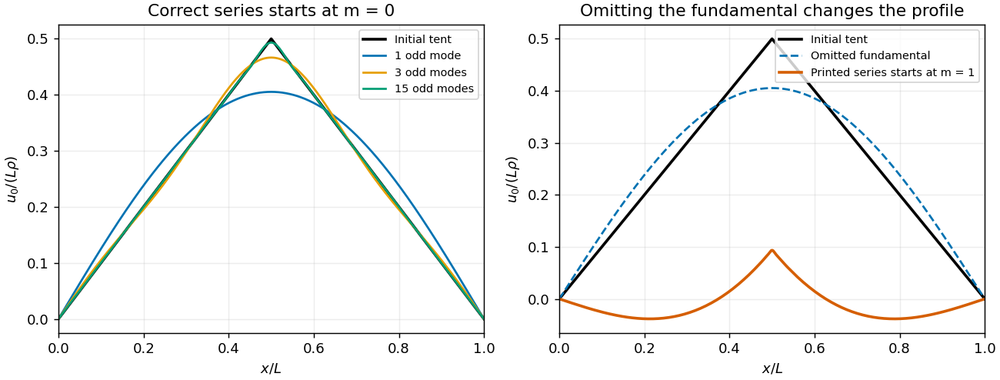

<h1 id="5/b/solution">Solution</h1>

↑ **Parent:** [B](../b.md)

For the [Fourier sine series](../../../../../fourier-sine-series.md) write $u_0(x)=\sum_{n\geq1}b_n\sin(n\pi x/L)$. [Orthogonality of trigonometric functions](../../../../../orthogonality-of-trigonometric-functions.md) gives

$$
b_n=\frac2L\int_0^L u_0(x)\sin\frac{n\pi x}L\,dx.
$$

In the second half of the integral put $z=L-x$; then $u_0(L-z)=\rho z$ and $\sin[n\pi(L-z)/L]=(-1)^{n+1}\sin(n\pi z/L)$. Hence

$$
b_n=\frac{2\rho}L[1+(-1)^{n+1}]\int_0^{L/2}x\sin\frac{n\pi x}L\,dx.
$$

Every even coefficient is zero. For odd $n$, part (a) or the supplied integral yields

$$
b_n=\frac{4L\rho}{n^2\pi^2}\sin\frac{n\pi}2.
$$

Putting $n=2m+1$ therefore gives

$$
\boxed{u_0(x)=\sum_{m=0}^{\infty}F_m\sin\frac{(2m+1)\pi x}L,\qquad
F_m=(-1)^m\frac{4L\rho}{(2m+1)^2\pi^2}.}
$$

This is the [Fourier sine series of a symmetric tent](../../../../../fourier-sine-series-of-a-symmetric-tent.md). The absolute values of its terms are uniformly bounded by a summable sequence, giving [absolute convergence](../../../../../absolute-convergence.md) and [uniform convergence](../../../../../uniform-convergence.md); the piecewise smooth odd extension and the [Dirichlet convergence theorem for Fourier series](../../../../../dirichlet-s-theorem-on-fourier-series.md) identify its value with the continuous $u_0$, including the zero endpoints and the peak.

**The printed lower limit $m=1$ is an error.** The original PDF visibly has this lower limit. It omits the nonzero fundamental coefficient $F_0=4L\rho/\pi^2$. In particular, the printed series equals $u_0(x)-F_0\sin(\pi x/L)$, rather than $u_0(x)$. At $x=L/2$ it gives $L\rho/2-4L\rho/\pi^2$ instead of $L\rho/2$. The corrected lower limit is displayed explicitly above.

**[Figure 1](#5/b/image-the-tent-fourier-series-requires-its-fundamental-mode). The tent Fourier series requires its fundamental mode**.

## ↑ Ancestors (12)

1. [B](../b.md)
2. [5](../../5.md)
3. [Discrete mathematics, continuous mathematics and probability](../../../discrete-mathematics-continuous-mathematics-and-probability-split.md)
4. [2016](../../../split.md)
5. [Past exam of the year 1 of the computer science course of the University of Oxford](../../../../split.md)
6. [Year 1 of the computer science course of the University of Oxford](../../../../../year-1-of-the-computer-science-course-of-the-university-of-oxford.md)
7. [Computer science course of the University of Oxford](../../../../../computer-science-course-of-the-university-of-oxford.md)
8. [Undergraduate course of the University of Oxford](../../../../../undergraduate-course-of-the-university-of-oxford.md)
9. [Course of the University of Oxford](../../../../../course-of-the-university-of-oxford.md)
10. [University of Oxford](../../../../../university-of-oxford-split.md)
11. [List of universities](../../../../../list-of-universities.md)
12. [Codex Wiki](../../../../../split.md)
