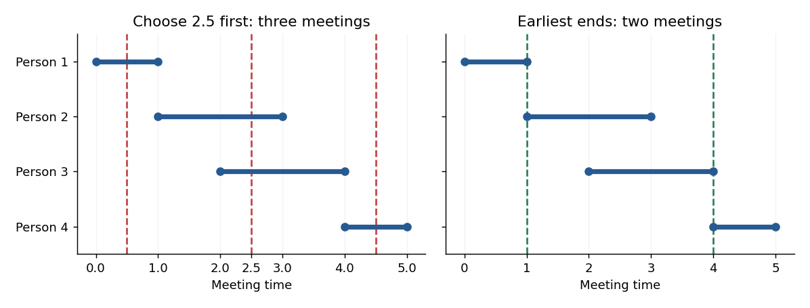

# Functional programming, design and analysis of algorithms

↑ **Parent:** [2016](../2016.md)

Source paper: [released examination archive](https://www.whatdotheyknow.com/request/ba_computer_science_past_papers/response/2577745/attach/2/202402%20183%20CS%20Papers.zip?cookie_passthrough=1), member `2015/T/a10097w1.pdf`; original cover dated 2016-06-14. The archive directory is not the examination year.

**Table of contents**

- [1](#1)
  - [a](#1/a)
    - [Solution](#1/a/solution)
  - [b](#1/b)
    - [Solution](#1/b/solution)
  - [c](#1/c)
    - [Solution](#1/c/solution)
- [2](#2)
  - [a](#2/a)
    - [Solution](#2/a/solution)
  - [b](#2/b)
    - [Solution](#2/b/solution)
  - [c](#2/c)
    - [Solution](#2/c/solution)
  - [d](#2/d)
    - [Solution](#2/d/solution)
- [3](#3)
  - [a](#3/a)
    - [Solution](#3/a/solution)
  - [b](#3/b)
    - [Solution](#3/b/solution)
  - [c](#3/c)
    - [Solution](#3/c/solution)
  - [d](#3/d)
    - [Solution](#3/d/solution)
  - [e](#3/e)
    - [Solution](#3/e/solution)
- [4](#4)
  - [a](#4/a)
    - [i](#4/a/i)
      - [Solution](#4/a/i/solution)
    - [ii](#4/a/ii)
      - [Solution](#4/a/ii/solution)
  - [b](#4/b)
    - [i](#4/b/i)
      - [Solution](#4/b/i/solution)
    - [ii](#4/b/ii)
      - [Solution](#4/b/ii/solution)
  - [c](#4/c)
    - [Solution](#4/c/solution)
  - [d](#4/d)
    - [Solution](#4/d/solution)
- [5](#5)
  - [a](#5/a)
    - [Solution](#5/a/solution)
  - [b](#5/b)
    - [Solution](#5/b/solution)
  - [c](#5/c)
    - [Solution](#5/c/solution)
  - [d](#5/d)
    - [Solution](#5/d/solution)
- [6](#6)
  - [a](#6/a)
    - [Solution](#6/a/solution)
  - [b](#6/b)
    - [Solution](#6/b/solution)
  - [c](#6/c)
    - [Solution](#6/c/solution)
  - [d](#6/d)
    - [Solution](#6/d/solution)
  - [e](#6/e)
    - [Solution](#6/e/solution)
- [7](#7)
  - [a](#7/a)
    - [Solution](#7/a/solution)
  - [b](#7/b)
    - [Solution](#7/b/solution)
  - [c](#7/c)
    - [Solution](#7/c/solution)
  - [d](#7/d)
    - [Solution](#7/d/solution)
  - [e](#7/e)
    - [Solution](#7/e/solution)
- [8](#8)
  - [a](#8/a)
    - [Solution](#8/a/solution)
  - [b](#8/b)
    - [Solution](#8/b/solution)
  - [c](#8/c)
    - [Solution](#8/c/solution)
  - [d](#8/d)
    - [Solution](#8/d/solution)
  - [e](#8/e)
    - [Solution](#8/e/solution)

## 1

↑ **Parent:** [Functional programming, design and analysis of algorithms](functional-programming-design-and-analysis-of-algorithms.md)

<h3 id="1/a">a</h3>

↑ **Parent:** [1](#1)

<h4 id="1/a/solution">Solution</h4>

↑ **Parent:** [A](#1/a)

Use [structural induction](../../foundations-of-mathematics.md#structural-induction) on the finite [list](../../data-structure.md#list-abstract-data-type) `xs`, with the assertion quantified over every accumulator `e` and every [list](../../data-structure.md#list-abstract-data-type) `ys`. The equations of the [left fold](../../programming-language.md#left-fold) are `foldl f e [] = e` and `foldl f e (x:xs) = foldl f (f e x) xs`.

For `xs = []`, both sides reduce to `foldl f e ys`. For the constructor case, [equational reasoning](../../foundations-of-mathematics.md#equational-reasoning) gives
```
foldl f e ((x:xs) ++ ys)
= foldl f e (x : (xs ++ ys))
= foldl f (f e x) (xs ++ ys)
= foldl f (foldl f (f e x) xs) ys
= foldl f (foldl f e (x:xs)) ys
```
The third equality uses the [induction hypothesis](../../foundations-of-mathematics.md#induction-hypothesis) with accumulator `f e x`. Hence **the stated identity holds**. No inspection of `ys` was required: in [Haskell](../../programming-language.md#haskell) this equality also permits infinite or partially defined `ys`, with both expressions denoting the same possibly undefined result.

<h3 id="1/b">b</h3>

↑ **Parent:** [1](#1)

<h4 id="1/b/solution">Solution</h4>

↑ **Parent:** [B](#1/b)

Again use [structural induction](../../foundations-of-mathematics.md#structural-induction) on the finite [list](../../data-structure.md#list-abstract-data-type). At `[]`, both the [right fold](../../programming-language.md#list-fold) and the [left fold](../../programming-language.md#left-fold) return `e`. For `x:xs`, use `reverse (x:xs) = reverse xs ++ [x]`, part (a), and the definition of `flip`:
```
foldl (flip f) e (reverse (x:xs))
= foldl (flip f) e (reverse xs ++ [x])
= foldl (flip f) (foldl (flip f) e (reverse xs)) [x]
= flip f (foldl (flip f) e (reverse xs)) x
= f x (foldl (flip f) e (reverse xs))
= f x (foldr f e xs)
= foldr f e (x:xs)
```
The penultimate equality uses the [induction hypothesis](../../foundations-of-mathematics.md#induction-hypothesis). Thus **`foldr f e xs = foldl (flip f) e (reverse xs)`**. Finiteness matters: reversing an infinite [list](../../data-structure.md#list-abstract-data-type) does not produce its first element, whereas some [right folds](../../programming-language.md#list-fold) do.

<h3 id="1/c">c</h3>

↑ **Parent:** [1](#1)

<h4 id="1/c/solution">Solution</h4>

↑ **Parent:** [C](#1/c)

Use the [right fold](../../programming-language.md#list-fold) definition `xs ++ ys = foldr (:) ys xs`, the right-identity law `xs ++ [] = xs`, and the finite-[list](../../data-structure.md#list-abstract-data-type) involution law `reverse (reverse xs) = xs`. The last two laws are the additional results used here. Part (b) now gives
```
xs ++ ys
= foldr (:) ys xs
= foldl (flip (:)) ys (reverse xs)
```
Set `ys = []` to obtain `xs = foldl (flip (:)) [] (reverse xs)`. Substitute `reverse xs` for `xs` and simplify the double reversal:
```
reverse xs
= foldl (flip (:)) [] (reverse (reverse xs))
= foldl (flip (:)) [] xs
```
The derived [Haskell](../../programming-language.md#haskell) definition is therefore
```
reverse :: [a] -> [a]
reverse = foldl (flip (:)) []
```
**Each step prepends the next element to the accumulator.** This is a [left fold](../../programming-language.md#left-fold) derivation from [list concatenation](../../data-structure.md#list-concatenation), rather than merely a proposed implementation.

## 2

↑ **Parent:** [Functional programming, design and analysis of algorithms](functional-programming-design-and-analysis-of-algorithms.md)

<h3 id="2/a">a</h3>

↑ **Parent:** [2](#2)

<h4 id="2/a/solution">Solution</h4>

↑ **Parent:** [A](#2/a)

A [tree fold](../../programming-language.md#tree-fold) first folds every child [rose tree](../../tree-graph-theory.md#rose-tree), then supplies the resulting [list](../../data-structure.md#list-abstract-data-type) and the current label to the combining function:
```
foldRTree :: (a -> [b] -> b) -> RTree a -> b
foldRTree f (Node x children) =
  f x (map (foldRTree f) children)
```
The label type `a` and result type `b` are independent, so the [polymorphic type](../../programming-language.md#polymorphic-type) needs no class constraint. With `f x ys = x + sum ys`, every label is counted exactly once; the illustrated labels sum to **28**.

The printed source gives the signature `exampleRTree` but binds `exampleRTRee`, with different capitalization. They are different [Haskell](../../programming-language.md#haskell) names; the demonstration requires using one spelling consistently. This typo does not affect the [tree fold](../../programming-language.md#tree-fold) definition.

<h3 id="2/b">b</h3>

↑ **Parent:** [2](#2)

<h4 id="2/b/solution">Solution</h4>

↑ **Parent:** [B](#2/b)

Compute either the common depth of the [leaves of a rooted tree](../../tree-graph-theory.md#leaf-of-a-rooted-tree), or failure when the depths differ. A [tree fold](../../programming-language.md#tree-fold) can return a `Maybe Integer`: `Just h` means that the [rose tree](../../tree-graph-theory.md#rose-tree) is a [perfect rose tree](../../tree-graph-theory.md#perfect-rose-tree) with all leaves at depth $h$ relative to its root; `Nothing` means it is not perfect.
```
perfect :: RTree a -> Bool
perfect t =
  case foldRTree step t of
    Nothing -> False
    Just _  -> True
  where
    step :: a -> [Maybe Integer] -> Maybe Integer
    step _ [] = Just 0
    step _ (Nothing : _) = Nothing
    step _ (Just h : hs)
      | all (== Just h) hs = Just (h + 1)
      | otherwise        = Nothing
```
A leaf has depth zero. An internal [vertex](../../graph.md#vertex-graph-theory) has equally deep leaves exactly when every child [rose tree](../../tree-graph-theory.md#rose-tree) is perfect and their returned depths agree; adding one accounts for the edge to each child. This proves the stated meaning of the result by [structural induction](../../foundations-of-mathematics.md#structural-induction). In particular, unary branching is allowed, and a single leaf is perfect. **`perfect` returns precisely the required Boolean.** Its [time complexity](../../theoretical-computer-science.md#time-complexity) is linear in the number of [vertices](../../graph.md#vertex-graph-theory), assuming unit-cost depth arithmetic; labels are never compared or evaluated.

<h3 id="2/c">c</h3>

↑ **Parent:** [2](#2)

<h4 id="2/c/solution">Solution</h4>

↑ **Parent:** [C](#2/c)

Use `concat [] = []`, `concat (ys:yss) = ys ++ concat yss`, the corresponding equations for `map`, [associativity](../../algebraic-operation.md#associative-property) of [list concatenation](../../data-structure.md#list-concatenation), and `(r:ys) ++ zs = r:(ys ++ zs)`. For an empty forest,
```
flatten2 [] xs
= concat (map flatten []) ++ xs
= [] ++ xs
= xs
```
For a nonempty forest, write its first [rose tree](../../tree-graph-theory.md#rose-tree) as `Node r children`:
```
flatten2 (Node r children : trees) xs
= (flatten (Node r children) ++ concat (map flatten trees)) ++ xs
= (r : concat (map flatten children))
    ++ (concat (map flatten trees) ++ xs)
= r : (concat (map flatten children) ++ flatten2 trees xs)
= r : flatten2 children (flatten2 trees xs)
```
Thus the recursive [Haskell](../../programming-language.md#haskell) definition is
```
flatten2 :: [RTree a] -> [a] -> [a]
flatten2 [] xs = xs
flatten2 (Node r children : trees) xs =
  r : flatten2 children (flatten2 trees xs)
```
The nested call supplies the continuation of the [preorder traversal](../../tree-graph-theory.md#preorder-traversal) as a suffix. **Each label is emitted once**, without repeated [list concatenation](../../data-structure.md#list-concatenation) of an already flattened subtree. For a finite forest, constructing its entire contribution takes linear time in its number of [vertices](../../graph.md#vertex-graph-theory), without traversing the supplied suffix `xs`.

<h3 id="2/d">d</h3>

↑ **Parent:** [2](#2)

<h4 id="2/d/solution">Solution</h4>

↑ **Parent:** [D](#2/d)

Measure the work of producing the entire output [list](../../data-structure.md#list-abstract-data-type), with constant-cost labels. Count height in levels, so a leaf has height one and $h=0$. A [perfect ternary tree](../../tree-graph-theory.md#perfect-ternary-tree) with $h+1$ levels has

$$
N_h=1+3+\cdots+3^h=\frac{3^{h+1}-1}{2}
$$

[vertices](../../graph.md#vertex-graph-theory). This is the [finite geometric series](../../sequence-and-series.md#finite-geometric-series) formula, used without a new proof.

The three recursive calls cost $3T(h-1)$. Ordinary `concat = foldr (++) []` copies each immediate child result once, and each result has $N_{h-1}$ elements. Consequently the nonrecursive work is $\Theta(3N_{h-1}+1)=\Theta(3^h)$, giving

$$
T(0)=\Theta(1),\qquad T(h)=3T(h-1)+\Theta(3^h)\quad(h\geq1).
$$

Unroll this [recurrence relation](../../sequence-and-series.md#recurrence-relation). At level $j$, the cost is $3^j\Theta(3^{h-j})=\Theta(3^h)$, and there are $h$ internal levels, followed by $3^h$ leaves. Therefore

$$
\boxed{T(\mathrm{flatten})(h)=\Theta((h+1)3^h)}.
$$

For $h\geq1$ this is conventionally written $\Theta(h3^h)$; in terms of total size it is $\Theta(N_h\log N_h)$. The extra height factor comes from copying labels at successive ancestors, even under [lazy evaluation](../../programming-language.md#lazy-evaluation) when the whole output is demanded. Merely producing its first constructor is a different cost question. If height instead counts edges, the source's height $h+1$ means $h+2$ levels; shifting the index by one leaves the boxed asymptotic bound unchanged. Part (c)'s suffix-passing implementation avoids this repeated copying.

## 3

↑ **Parent:** [Functional programming, design and analysis of algorithms](functional-programming-design-and-analysis-of-algorithms.md)

<h3 id="3/a">a</h3>

↑ **Parent:** [3](#3)

<h4 id="3/a/solution">Solution</h4>

↑ **Parent:** [A](#3/a)

Only the first constructor needs to be inspected:
```
headZig :: Zig a b -> a
headZig (Cins x _) = x
headZig Nil = error "headZig: empty input"

headZag :: Zag a b -> a
headZag (Cans x _) = x
headZag Nal = error "headZag: empty input"
```
The first [type parameter](../../programming-language.md#type-parameter) is the type of the first element in either [algebraic data type](../../programming-language.md#algebraic-data-type). The source examples therefore return **`1` and `"C"`**, respectively. These functions are partial at empty inputs, as allowed by the stated nonempty-input requirement.

<h3 id="3/b">b</h3>

↑ **Parent:** [3](#3)

<h4 id="3/b/solution">Solution</h4>

↑ **Parent:** [B](#3/b)

The constructors `ZigType` and `ZagType` record which of the two alternating positions contains the last element. The tail types swap the two [type parameters](../../programming-language.md#type-parameter), so the return type of `lastZag` swaps them back:
```
lastZig :: Zig a b -> ZigOrZagType a b
lastZig Nil = error "lastZig: empty input"
lastZig (Cins x Nal) = ZigType x
lastZig (Cins _ zs) = lastZag zs

lastZag :: Zag a b -> ZigOrZagType b a
lastZag Nal = error "lastZag: empty input"
lastZag (Cans x Nil) = ZagType x
lastZag (Cans _ zs) = lastZig zs
```
For example, `lastZig` passes a tail of type `Zag b a` to `lastZag`, whose result then has type `ZigOrZagType a b`, exactly as required. Conversely, `lastZag` passes a `Zig b a` tail to `lastZig`. A singleton returns its element in the appropriate constructor; a longer input discards one element and uses [mutual recursion](../../algorithm.md#mutual-recursion) on the shorter tail. This proves correctness by [structural induction](../../foundations-of-mathematics.md#structural-induction) on the finite alternating sequence. The three source examples give **`ZigType 2`, `ZagType "D"`, and `ZigType True`**.

<h3 id="3/c">c</h3>

↑ **Parent:** [3](#3)

<h4 id="3/c/solution">Solution</h4>

↑ **Parent:** [C](#3/c)

The three outcomes, in printed order, are **`ZagType 'A'`**, **`ZigType undefined`**, and **a static type error**.

In the first expression, [pattern matching](../../programming-language.md#pattern-matching) discovers that the first tail is nonempty, so the ignored first label, the [bottom value](../../programming-language.md#bottom-value) $\bot$, is never demanded. The singleton `Cans 'A' Nil` returns `ZagType 'A'`.

In the second expression the tail is `Nal`, so the result is `ZigType` applied to the [bottom value](../../programming-language.md#bottom-value). Under [lazy evaluation](../../programming-language.md#lazy-evaluation) this has a defined outer constructor and an undefined field: `case lastZig (Cins undefined Nal) of ZigType _ -> True` yields `True`, whereas extracting or fully printing the payload fails. Thus the result is $\operatorname{ZigType}(\bot)$, not a wholly undefined outer value.

The original PDF really prints `Nil` in the third expression. `Cins` requires a tail of type `Zag b a`, whereas `Nil` has type `Zig c d`. These distinct [type constructors](../../programming-language.md#type-constructor) cannot be unified. **There is no well-typed expression to evaluate**, regardless of the undefined first label; replacing `Nil` by `Nal` would change the question.

<h3 id="3/d">d</h3>

↑ **Parent:** [3](#3)

<h4 id="3/d/solution">Solution</h4>

↑ **Parent:** [D](#3/d)

Map each current first-position value with the first function, then swap the functions when descending to the other [algebraic data type](../../programming-language.md#algebraic-data-type):
```
mapZig :: (a -> c) -> (b -> d) -> Zig a b -> Zig c d
mapZig _ _ Nil = Nil
mapZig f g (Cins x zs) = Cins (f x) (mapZag g f zs)

mapZag :: (a -> c) -> (b -> d) -> Zag a b -> Zag c d
mapZag _ _ Nal = Nal
mapZag f g (Cans x zs) = Cans (f x) (mapZig g f zs)
```
All four [type variables](../../programming-language.md#type-variable) are independent: mapping may change both element types. There is no `Enum` or numeric constraint on the mapping functions themselves; constraints arise only from particular arguments such as `succ` or `(+2)`. The [mutual recursion](../../algorithm.md#mutual-recursion) preserves every constructor and applies the intended function at each alternating position. The results are **`Cins 3 (Cans 'B' (Cins 4 Nal))`** and **`Cans "D" (Cins True (Cans "E" Nil))`**, respectively.

<h3 id="3/e">e</h3>

↑ **Parent:** [3](#3)

<h4 id="3/e/solution">Solution</h4>

↑ **Parent:** [E](#3/e)

Use the symmetric [tree fold](../../programming-language.md#tree-fold) equations for the other [algebraic data type](../../programming-language.md#algebraic-data-type):
```
foldZag (fZag,eZag) (fZig,eZig) Nal = eZag
foldZag (fZag,eZag) (fZig,eZig) (Cans x z) =
  fZag x (foldZig (fZig,eZig) (fZag,eZag) z)
```
The most general [type signatures](../../programming-language.md#type-signature), using the same schematic variable names independently for each function, are
```
foldZig :: (a -> s -> r, r) -> (b -> r -> s, s)
        -> Zig a b -> r
foldZag :: (a -> s -> r, r) -> (b -> r -> s, s)
        -> Zag a b -> r
```
For `foldZig`, the first empty value has type `r`, so the first combining function must return `r`. Its label argument has type `a`. The recursively folded tail has some independent result type `s`, giving `a -> s -> r`. The second combining function consumes a `b` label and an `r` result and returns `s`, giving `b -> r -> s`. The second empty value has type `s`. Swapping the two handler pairs and the label types makes the recursive call well-typed. The identical argument applies to `foldZag`.

**The two result types need not coincide.** For example, one handler can return an [integer](../../integer.md) and the other a [list](../../data-structure.md#list-abstract-data-type); forcing both results to have one type would lose [parametric polymorphism](../../programming-language.md#parametric-polymorphism) allowed by the definitions.

## 4

↑ **Parent:** [Functional programming, design and analysis of algorithms](functional-programming-design-and-analysis-of-algorithms.md)

<h3 id="4/a">a</h3>

↑ **Parent:** [4](#4)

<h4 id="4/a/i">i</h4>

↑ **Parent:** [A](#4/a)

<h5 id="4/a/i/solution">Solution</h5>

↑ **Parent:** [I](#4/a/i)

Use the source's `type Matrix a = [[a]]`. For its nonempty rectangular [matrices](../../vector-space.md#matrix), the number of rows and the first row's length determine the dimensions:
```
dimensions :: Matrix a -> (Int,Int)
dimensions rows = (length rows, length (head rows))

addMat :: Num a => Matrix a -> Matrix a -> Matrix a
addMat a b
  | dimensions a /= dimensions b = error "addMat: incompatible sizes"
  | otherwise = [[x + y | (x,y) <- zip r s]
                         | (r,s) <- zip a b]
```
The outer [list comprehension](../../programming-language.md#list-comprehension) pairs corresponding rows; the inner one pairs corresponding entries. Checking both dimensions before using `zip` prevents silent truncation. Thus **the result has entries $c_{ij}=a_{ij}+b_{ij}$**, the definition of [matrix addition](../../vector-space.md#matrix-addition). The `Num` constraint supplies the addition operation.

<h4 id="4/a/ii">ii</h4>

↑ **Parent:** [A](#4/a)

<h5 id="4/a/ii/solution">Solution</h5>

↑ **Parent:** [Ii](#4/a/ii)

With `dimensions` as in part (i), the alternative definition is
```
addMat :: Num a => Matrix a -> Matrix a -> Matrix a
addMat a b
  | dimensions a /= dimensions b = error "addMat: incompatible sizes"
  | otherwise = zipWith (zipWith (+)) a b
```
The inner `zipWith` adds corresponding entries; the outer one applies that row operation to corresponding rows. **This computes the same [matrix addition](../../vector-space.md#matrix-addition)**, with the same rejection of unequal dimensions. Under the valid-input assumptions, either implementation takes $\Theta(mn)$ unit-cost arithmetic work for $m\times n$ inputs.

<h3 id="4/b">b</h3>

↑ **Parent:** [4](#4)

<h4 id="4/b/i">i</h4>

↑ **Parent:** [B](#4/b)

<h5 id="4/b/i/solution">Solution</h5>

↑ **Parent:** [I](#4/b/i)

A recursive [transpose](../../vector-space.md#transpose) removes the first column, then transposes the remaining columns:
```
transpose :: Matrix a -> Matrix a
transpose [] = []
transpose ([] : _) = []
transpose rows = map head rows : transpose (map tail rows)
```
The internal recursive calls eventually reach rows of length zero, even though the original input has positive dimensions; the second equation handles this terminating case. Rectangularity ensures that the rows become empty together, so no `head` or `tail` is applied to an empty row in the third equation. The output is **an $n\times m$ [matrix](../../vector-space.md#matrix) with entry $b_{ji}=a_{ij}$**. The element type is unrestricted.

<h4 id="4/b/ii">ii</h4>

↑ **Parent:** [B](#4/b)

<h5 id="4/b/ii/solution">Solution</h5>

↑ **Parent:** [Ii](#4/b/ii)

Build columns by prepending the first row's entries to the columns obtained from the remaining rows:
```
transpose :: Matrix a -> Matrix a
transpose [] = []
transpose [row] = map (:[]) row
transpose (row : rows) = zipWith (:) row (transpose rows)
```
The singleton case turns each entry into a one-element column. In the recursive case, `transpose rows` has exactly as many columns as `row` has entries, so `zipWith (:)` extends every column once. [Structural induction](../../foundations-of-mathematics.md#structural-induction) on the number of rows proves that **each output column contains the corresponding input entries in order**. This uses [list zip](../../data-structure.md#list-zip) to implement the [transpose](../../vector-space.md#transpose), without requiring `Num a`.

<h3 id="4/c">c</h3>

↑ **Parent:** [4](#4)

<h4 id="4/c/solution">Solution</h4>

↑ **Parent:** [C](#4/c)

Reuse `dimensions` and either [transpose](../../vector-space.md#transpose) definition above:
```
multMat :: Num a => Matrix a -> Matrix a -> Matrix a
multMat a b
  | colsA /= rowsB = error "multMat: incompatible sizes"
  | otherwise = [[sum (zipWith (*) row col) | col <- columnsB]
                                           | row <- a]
  where
    (_,colsA) = dimensions a
    (rowsB,_) = dimensions b
    columnsB = transpose b
```
For $A$ of size $m\times n$ and $B$ of size $n\times p$, every selected row and column has length $n$. Their [dot product](../../inner-product.md#dot-product) is

$$
\boxed{(AB)_{ij}=\sum_{k=1}^{n}a_{ik}b_{kj}}.
$$

The two [list comprehensions](../../programming-language.md#list-comprehension) place this entry in row $i$, column $j$ of an $m\times p$ result. The dimension guard checks exactly the compatibility condition for [matrix multiplication](../../vector-space.md#matrix-multiplication). The shared `columnsB` avoids recomputing the [transpose](../../vector-space.md#transpose) for each row; the arithmetic cost is $\Theta(mnp)$ in the unit-cost model.

<h3 id="4/d">d</h3>

↑ **Parent:** [4](#4)

<h4 id="4/d/solution">Solution</h4>

↑ **Parent:** [D](#4/d)

Generate successive [matrix powers](../../vector-space.md#matrix-power) and take cumulative sums using [matrix addition](../../vector-space.md#matrix-addition):
```
seriesMat :: Num a => Matrix a -> [Matrix a]
seriesMat m = scanl1 addMat (iterate (multMat m) m)
```
For the stipulated [square matrix](../../vector-space.md#square-matrix), `iterate (multMat m) m` produces `m`, `m*m`, `m*(m*m)`, and so on. [Associativity](../../algebraic-operation.md#associative-property) of exact [matrix multiplication](../../vector-space.md#matrix-multiplication) identifies these as $M,M^2,M^3,\ldots$. The [left scan](../../programming-language.md#left-scan) `scanl1 addMat` then returns

$$
\boxed{\left[M,\ M+M^2,\ M+M^2+M^3,\ldots\right]}.
$$

All dimensions remain compatible. The infinite outer [list](../../data-structure.md#list-abstract-data-type) is available a finite prefix at a time under [lazy evaluation](../../programming-language.md#lazy-evaluation); no convergence of the [matrix geometric series](../../linear-algebra.md#matrix-geometric-series) is needed. With floating-point entries, the expression specifies this particular multiplication and addition order, since machine arithmetic need not obey the exact algebraic laws.

## 5

↑ **Parent:** [Functional programming, design and analysis of algorithms](functional-programming-design-and-analysis-of-algorithms.md)

<h3 id="5/a">a</h3>

↑ **Parent:** [5](#5)

<h4 id="5/a/solution">Solution</h4>

↑ **Parent:** [A](#5/a)

A [divide-and-conquer algorithm](../../algorithm.md#divide-and-conquer-algorithm) **divides an input into smaller instances, solves those instances recursively, and combines their answers**. Directly solvable base cases terminate the [recursion](../../algorithm.md#recursion-computer-science). The total [time complexity](../../theoretical-computer-science.md#time-complexity) includes both the recursive work and the work of dividing and combining; balanced sizes alone do not determine the running time.

<h3 id="5/b">b</h3>

↑ **Parent:** [5](#5)

<h4 id="5/b/solution">Solution</h4>

↑ **Parent:** [B](#5/b)

For one element, return it as both extrema without a comparison. Otherwise compare consecutive pairs once, put each smaller element in a candidate [array](../../data-structure.md#array-data-structure) $L$ and each larger element in a candidate [array](../../data-structure.md#array-data-structure) $H$. If one element is unpaired, put it in both candidate arrays. This [simultaneous minimum and maximum](../../algorithm.md#simultaneous-minimum-and-maximum) construction computes the minimum of $L$ and maximum of $H$ by balanced [divide-and-conquer algorithms](../../algorithm.md#divide-and-conquer-algorithm): split the candidate array, recursively find the desired extremum in each half, and compare the two returned values. These extremum routines use one comparison per merge and therefore $r-1$ comparisons on $r$ candidates.

Every element excluded from $L$ is at least its paired element, so a global minimum remains in $L$; likewise a global maximum remains in $H$. The recursive extremum routines are correct by [structural induction](../../foundations-of-mathematics.md#structural-induction). For even $n=2m$, there are $m$ pair comparisons and two searches on $m$ candidates, giving

$$
C(2m)=m+2(m-1)=3m-2.
$$

For odd $n=2m+1\geq3$, there are $m$ pair comparisons and two searches on $m+1$ candidates, giving

$$
C(2m+1)=m+2m=3m.
$$

Together with $C(1)=0$, both cases give

$$
\boxed{C(n)\leq\left\lceil\frac{3n}{2}\right\rceil-2}.
$$

For powers of two, the equivalent direct [divide-and-conquer algorithm](../../algorithm.md#divide-and-conquer-algorithm) returns the ordered pair of extrema for each half, then combines the two minima with one comparison and the two maxima with one comparison. Its base cases must include $C(2)=1$, rather than performing two unnecessary comparisons on a pair. The [recurrence relation](../../sequence-and-series.md#recurrence-relation) is $C(n)=2C(n/2)+2$ for $n\geq4$, whence $C(n)=3n/2-2$. Arbitrary near-equal splitting without the initial pairing can exceed the desired comparison bound for other values of $n$; the pairing construction above handles every positive size.

<h3 id="5/c">c</h3>

↑ **Parent:** [5](#5)

<h4 id="5/c/solution">Solution</h4>

↑ **Parent:** [C](#5/c)

Put $\alpha=\log_b a$. With a nonnegative toll bounded by $O(n^d)$, the [Master theorem](../../sequence-and-series.md#master-theorem) gives the upper bounds

$$
\boxed{
T(n)=\begin{cases}
O(n^\alpha),&d<\alpha,\\
O(n^d\log n),&d=\alpha,\\
O(n^d),&d>\alpha.
\end{cases}}
$$

If the base cost is $\Theta(1)$ and the toll is $\Theta(n^d)$, these become the usual tight $\Theta$ bounds. The printed $O$ toll by itself does not imply those lower bounds; for example, the toll could vanish.

For the two requested proofs, let $n=b^k$ as permitted. Expanding the [recurrence relation](../../sequence-and-series.md#recurrence-relation) through $k$ levels gives

$$
T(n)=a^kT(1)+\sum_{j=0}^{k-1}a^j O\!\left((n/b^j)^d\right)
=O(n^\alpha)+O\!\left(n^d\sum_{j=0}^{k-1}(a/b^d)^j\right).
$$

When $d=\alpha$, the ratio is one. The sum has $k=\log_b n$ terms, so $T(n)=O(n^d\log n)$. With matching positive lower bounds on each level's work, the same expansion gives $\Theta(n^d\log n)$.

When $d>\alpha$, the ratio $r=a/b^d$ is strictly below one. The [geometric series](../../sequence-and-series.md#geometric-series) is at most $1/(1-r)$, so the internal work is $O(n^d)$; the leaf term $O(n^\alpha)$ is also $O(n^d)$. A $\Theta(n^d)$ root toll supplies the matching lower bound in the tight version. This proves both requested cases.

There is a small termination qualification in the printed generality: if $1<b<2$, the literal base case only at $n=1$ may leave `ceil(n/b) = n` at a small integer, for example $n=2,b=3/2$. The standard rounded [Master theorem](../../sequence-and-series.md#master-theorem) assumes a sufficiently large fixed base-case cutoff so that recursive sizes decrease. The allowed unrounded powers-of-$b$ proof above does not use that problematic rounded step. Also, a literal number of recursive calls is integral, though the algebraic recurrence expansion remains meaningful for positive real $a$.

<h3 id="5/d">d</h3>

↑ **Parent:** [5](#5)

<h4 id="5/d/solution">Solution</h4>

↑ **Parent:** [D](#5/d)

Maintain an inclusive interval $[lo,hi]$ with these [recursion invariants](../../algorithm.md#recursion-invariant): if $lo>0$, then $A[lo]>A[lo-1]$; if $hi<n-1$, then $A[hi]>A[hi+1]$. The original full interval satisfies both conditions vacuously.
```
LocalMaximum(A):
    require length(A) >= 1
    return Peak(0, length(A)-1)

Peak(lo, hi):
    m = floor((lo+hi)/2)
    if m > lo and A[m-1] > A[m]:
        return Peak(lo, m-1)
    if m < hi and A[m+1] > A[m]:
        return Peak(m+1, hi)
    return m
```
In the left-recursion branch, the new right endpoint satisfies $A[m-1]>A[m]$ and the old left boundary is retained. The right-recursion branch is symmetric. Thus both [recursion invariants](../../algorithm.md#recursion-invariant) persist.

If neither branch is taken, $A[m]$ exceeds its neighbours within the current interval because all entries are distinct. If $m$ is an endpoint of that interval and there is a neighbour outside, the boundary [recursion invariant](../../algorithm.md#recursion-invariant) supplies the missing strict inequality. Hence the returned index is an **[array local maximum](../../algorithm.md#array-local-maximum) with respect to the original array**, not just the restricted interval. Every branch shortens the interval, so termination is guaranteed; this also establishes existence, including the singleton case.

Each call performs at most two comparisons, and a recursive interval has at most half as many elements, up to rounding. Thus $T(n)\leq T(\lceil n/2\rceil)+O(1)$ and

$$
\boxed{T(n)=O(1+\log n)}.
$$

The conventional bound is $O(\log n)$ for $n\geq2$, with constant work for a singleton. Distinctness is essential to this proof of a strict local maximum.

## 6

↑ **Parent:** [Functional programming, design and analysis of algorithms](functional-programming-design-and-analysis-of-algorithms.md)

<h3 id="6/a">a</h3>

↑ **Parent:** [6](#6)

<h4 id="6/a/solution">Solution</h4>

↑ **Parent:** [A](#6/a)

[Dynamic programming](../../mathematical-optimization.md#dynamic-programming) **solves a problem by storing solutions to overlapping subproblems and combining them according to a recurrence**. Each [dynamic programming state](../../mathematical-optimization.md#dynamic-programming-state) describes all information needed by subsequent choices. Evaluating states in an order where their dependencies are already available avoids recomputing the same subproblem. A typical optimization recurrence chooses the best transition; a decision recurrence instead combines feasible transitions with Boolean disjunction.

<h3 id="6/b">b</h3>

↑ **Parent:** [6](#6)

<h4 id="6/b/solution">Solution</h4>

↑ **Parent:** [B](#6/b)

Use [subset dynamic programming for a Hamiltonian path](../../mathematical-optimization.md#subset-dynamic-programming-for-a-hamiltonian-path), with a Boolean [dynamic programming state](../../mathematical-optimization.md#dynamic-programming-state) $D[S,v]$ for each nonempty [subset](../../set.md#subset) $S\subseteq V$ and $v\in S$. It is true exactly when there is a [graph path](../../graph-theory.md#path-in-a-graph) using every [vertex](../../graph.md#vertex-graph-theory) of $S$ once, using no other [vertices](../../graph.md#vertex-graph-theory), and ending at $v$. The base and transition are

$$
D[\{v\},v]=\mathrm{true},\qquad
D[S,v]=\bigvee_{u\in S\setminus\{v\}}
\bigl(D[S\setminus\{v\},u]\land A[u,v]\bigr)
\quad(|S|\geq2),
$$

where $A$ is the [adjacency matrix of a directed graph](../../graph-theory.md#adjacency-matrix-of-a-directed-graph).
```
HamiltonianExists(A):
    initialize every D[S,v] to false
    for v in V:
        D[{v},v] = true
    for k = 2,...,n:
        for S subset of V with |S| = k:
            for v in S:
                D[S,v] = any(D[S-{v},u] and A[u,v]
                             for u in S-{v})
    return any(D[V,v] for v in V)
```
For correctness, a valid path ending at $v$ has some penultimate [vertex](../../graph.md#vertex-graph-theory) $u$; removing $v$ yields exactly a path recorded by the corresponding predecessor state. Conversely, extending any true predecessor state by the edge $(u,v)$ produces a path visiting precisely $S$ once. [Mathematical induction](../../foundations-of-mathematics.md#mathematical-induction) on $|S|$ proves the meaning of every state. Therefore **the final disjunction is true exactly when a [Hamiltonian path](../../graph-theory.md#hamiltonian-path) exists**.

There are $n2^{n-1}$ possible states and at most $n-1$ predecessor checks per state. More exactly, the full set of ordered predecessor checks has size $n(n-1)2^{n-2}$ for $n\geq2$. With constant-time [adjacency matrix](../../graph-theory.md#adjacency-matrix) access and ordinary subset-indexed table access,

$$
\boxed{\text{time }O(n^2 2^n),\qquad\text{space }O(n2^n)}.
$$

The graph is normally assumed nonempty here. If the empty graph is admitted, return the chosen convention for its empty [Hamiltonian path](../../graph-theory.md#hamiltonian-path) separately; it does not affect the bound.

<h3 id="6/c">c</h3>

↑ **Parent:** [6](#6)

<h4 id="6/c/solution">Solution</h4>

↑ **Parent:** [C](#6/c)

A [topological sort](../../combinatorics.md#topological-sorting) is **a linear ordering of all [vertices](../../graph.md#vertex-graph-theory) of a [Directed acyclic graph](../../combinatorics.md#directed-acyclic-graph) in which every directed edge points from an earlier vertex to a later one**. For example, with $V=\{a,b,c\}$ and $E=\{(a,c),(b,c)\}$, both $(a,b,c)$ and $(b,a,c)$ are [topological sorts](../../combinatorics.md#topological-sorting). They differ because neither edge nor directed path constrains the relative order of $a$ and $b$.

<h3 id="6/d">d</h3>

↑ **Parent:** [6](#6)

<h4 id="6/d/solution">Solution</h4>

↑ **Parent:** [D](#6/d)

Suppose a [Directed acyclic graph](../../combinatorics.md#directed-acyclic-graph) has a [Hamiltonian path](../../graph-theory.md#hamiltonian-path) $(w_1,\ldots,w_n)$. Every edge $(w_j,w_{j+1})$ forces $w_j$ to precede $w_{j+1}$ in every [topological sort](../../combinatorics.md#topological-sorting). Transitivity forces the entire order $(w_1,\ldots,w_n)$, so the [topological sort](../../combinatorics.md#topological-sorting) is unique and every consecutive pair is joined by the requisite edge. No edge can point backwards in this path order, since that edge together with part of the path would form a [directed cycle](../../graph-theory.md#directed-cycle).

Conversely, if a [topological sort](../../combinatorics.md#topological-sorting) $(w_1,\ldots,w_n)$ has an edge from every entry to the next, those edges form a [graph path](../../graph-theory.md#path-in-a-graph) through all [vertices](../../graph.md#vertex-graph-theory) exactly once. Thus **the displayed order is itself a [Hamiltonian path](../../graph-theory.md#hamiltonian-path)**.

The [unique topological ordering criterion](../../combinatorics.md#unique-topological-ordering-criterion) says that uniqueness alone already forces the consecutive-edge condition. If $(w_j,w_{j+1})$ were absent, swapping these adjacent entries would preserve every edge constraint: only their mutual order changes, and a reverse edge is already forbidden by the original [topological sort](../../combinatorics.md#topological-sorting). This would produce a second order. Consequently, for a [Directed acyclic graph](../../combinatorics.md#directed-acyclic-graph), **having a [Hamiltonian path](../../graph-theory.md#hamiltonian-path), having a unique [topological sort](../../combinatorics.md#topological-sorting), and having consecutive edges in a [topological sort](../../combinatorics.md#topological-sorting) are equivalent**. The source's $>$ notation is read as “appears earlier”, consistent with its explicitly directed edges.

<h3 id="6/e">e</h3>

↑ **Parent:** [6](#6)

<h4 id="6/e/solution">Solution</h4>

↑ **Parent:** [E](#6/e)

Compute any [topological sort](../../combinatorics.md#topological-sorting) $(w_1,\ldots,w_n)$ using a standard algorithm, then check its consecutive entries in the [adjacency matrix](../../graph-theory.md#adjacency-matrix):
```
DAGHamiltonianPath(A):
    order = TopologicalSort(A)
    for j = 1,...,n-1:
        if not A[order[j],order[j+1]]:
            return "no Hamiltonian path"
    return order
```
If all checks pass, the returned ordering is a [Hamiltonian path](../../graph-theory.md#hamiltonian-path). If a check fails but a [Hamiltonian path](../../graph-theory.md#hamiltonian-path) existed, part (d) would force the computed [topological sort](../../combinatorics.md#topological-sorting) to equal the unique path order, whose consecutive edges all exist. This contradiction proves the negative answer correct.

A standard [topological sort](../../combinatorics.md#topological-sorting) scans all matrix rows and therefore takes $O(n^2)$ time with this input representation; the subsequent $n-1$ edge checks take $O(n)$. The answer is consequently **$O(n^2)$ time**, with $O(n)$ auxiliary storage beyond the input matrix. An $O(|V|+|E|)$ bound for an [adjacency list](../../data-structure.md#adjacency-list) must not be substituted for the stipulated [adjacency matrix](../../graph-theory.md#adjacency-matrix) bound.

## 7

↑ **Parent:** [Functional programming, design and analysis of algorithms](functional-programming-design-and-analysis-of-algorithms.md)

<h3 id="7/a">a</h3>

↑ **Parent:** [7](#7)

<h4 id="7/a/solution">Solution</h4>

↑ **Parent:** [A](#7/a)

The active prefix of the [array](../../data-structure.md#array-data-structure) must represent a complete $d$-ary tree, filled in the prescribed order, and must obey [heap order](../../data-structure.md#heap-order):

$$
\boxed{A[\operatorname{Parent}(i)]\leq A[i]
\quad\text{for every }1\leq i<A.\text{heap-size}}.
$$

Equivalently, every parent is no larger than each existing child. Repeatedly following parents shows that the root contains a global minimum. The array representation already provides the complete-tree shape; it is not enough to check only that the root is a minimum, since the inequality must hold throughout the [d-ary min-heap](../../data-structure.md#d-ary-min-heap). Assume integral $d\geq2$ throughout the heap operations.

<h3 id="7/b">b</h3>

↑ **Parent:** [7](#7)

<h4 id="7/b/solution">Solution</h4>

↑ **Parent:** [B](#7/b)

Save the root, move the last active entry to the root, shrink the active prefix, then restore [heap order](../../data-structure.md#heap-order) by [heapify down](../../data-structure.md#sift-down):
```
ExtractMin(A):
    if A.heap_size == 0:
        error "empty heap"
    answer = A[0]
    A[0] = A[A.heap_size-1]
    A.heap_size = A.heap_size-1
    if A.heap_size > 0:
        SiftDown(A,0)
    return answer

SiftDown(A,i):
    while true:
        best = i
        for j = 0,...,d-1:
            c = Child(i,j)
            if c >= A.heap_size:
                break
            if A[c] < A[best]:
                best = c
        if best == i:
            return
        swap A[i], A[best]
        i = best
```
Only edges descending from the moved entry can violate [heap order](../../data-structure.md#heap-order). If the entry is no larger than every child, the entire heap is valid. Otherwise swapping with a minimum child restores the order at the old position: that child is no larger than the old entry or any sibling. Its original subtree was already ordered, so only the moved entry's new outgoing edges can remain invalid. This is the [loop invariant](../../algorithm.md#loop-invariant) of `SiftDown`. Each swap moves it down one level, proving termination and correctness.

For $2\leq d\leq n$, the height is $O(\log_d n)$, and selecting a minimum child costs at most $d$ comparisons per level. Thus **`ExtractMin` takes $O(d\log_d n)$ time**, with $O(1)$ auxiliary storage. Empty and singleton heaps take constant time. For $d>n$, there is at most one nonroot level and the loop examines at most $n-1$ actual children, taking $O(n)$; this also lies within $O(d\log_d n)$ for $n\geq2$. The coarser uniform expression $O(1+d(1+\log_d n))$ safely includes all small sizes.

<h3 id="7/c">c</h3>

↑ **Parent:** [7](#7)

<h4 id="7/c/solution">Solution</h4>

↑ **Parent:** [C](#7/c)

A decreased key can violate [heap order](../../data-structure.md#heap-order) only against its parent. An inserted entry begins at the next free position and uses the same repair:
```
DecreaseKey(A,i,key):
    if i < 0 or i >= A.heap_size:
        error "invalid index"
    if key > A[i]:
        error "key increased"
    A[i] = key
    while i > 0:
        p = Parent(i)
        if A[p] <= A[i]:
            return
        swap A[p], A[i]
        i = p

Insert(A,key):
    ensure capacity for A.heap_size+1 entries
    i = A.heap_size
    A.heap_size = A.heap_size+1
    A[i] = +infinity
    DecreaseKey(A,i,key)
```
Here $+\infty$ is a sentinel at least as large as every permitted key. One can equivalently write `key` directly into the new entry and run the upward loop, avoiding any sentinel representation.

At every upward swap, the smaller key moves above its larger parent; the displaced parent remains no larger than the entries below it, as follows from the old [heap order](../../data-structure.md#heap-order). Thus only the new parent edge can be invalid. At most one parent comparison is needed per level, with no scan of siblings. Both operations take **$O(\log_d n)$ time in the usual $2\leq d\leq n$ range**, or $O(1+\log_d(n+1))$ uniformly including tiny heaps and large $d$.

The heap-operation bound assumes space for the inserted entry. A capacity expansion in a [dynamic array](../../data-structure.md#dynamic-array) can cost $O(n)$ for that individual insertion; sufficient preallocation avoids it, while geometric capacity growth adds only constant amortized allocation cost per insertion.

<h3 id="7/d">d</h3>

↑ **Parent:** [7](#7)

<h4 id="7/d/solution">Solution</h4>

↑ **Parent:** [D](#7/d)

[Dijkstra's algorithm](../../shortest-path-problem.md#dijkstra-algorithm) solves **the single-source [shortest path problem](../../shortest-path-problem.md) in a finite weighted graph with nonnegative edge weights**. Given a source $s$, it computes for every [vertex](../../graph.md#vertex-graph-theory) $v$ the minimum sum of edge weights on a path from $s$ to $v$, reporting $+\infty$ if $v$ is unreachable. Keeping a [shortest-path predecessor](../../shortest-path-problem.md#shortest-path-predecessor) also recovers the corresponding paths. Directed graphs are allowed; an undirected graph can be represented by two oppositely directed edges. Negative edge weights are outside the algorithm's standard correctness assumptions, while zero weights are allowed.

<h3 id="7/e">e</h3>

↑ **Parent:** [7](#7)

<h4 id="7/e/solution">Solution</h4>

↑ **Parent:** [E](#7/e)

Use an [indexed priority queue](../../data-structure.md#indexed-priority-queue) of unsettled [vertices](../../graph.md#vertex-graph-theory), keyed by their [tentative distances](../../shortest-path-problem.md#tentative-distance). Initialize the source to zero and other keys to $+\infty$. Each `ExtractMin` settles the currently closest [vertex](../../graph.md#vertex-graph-theory). Scan its outgoing edges; whenever [edge relaxation](../../shortest-path-problem.md#edge-relaxation) improves a neighbour's [tentative distance](../../shortest-path-problem.md#tentative-distance), update that neighbour with `DecreaseKey`. Already settled [vertices](../../graph.md#vertex-graph-theory) need no further update, by the correctness of [Dijkstra's algorithm](../../shortest-path-problem.md#dijkstra-algorithm) for nonnegative weights.

There are at most $|V|$ extractions and at most $|E|$ successful decreases. The [indexed priority queue](../../data-structure.md#indexed-priority-queue) maintains each [vertex](../../graph.md#vertex-graph-theory)'s current array position and updates this index table on every swap, so locating a key for `DecreaseKey` costs $O(1)$. Preallocate capacity $|V|$. Repeated insertion costs $O(|V|(1+\log_d|V|))$, or [bottom-up heap construction](../../data-structure.md#bottom-up-heap-construction) initializes the queue in $O(|V|)$ time. Scanning [adjacency lists](../../data-structure.md#adjacency-list) costs $O(|V|+|E|)$ in total.

For $|V|\geq2$ and $2\leq d\leq|V|$, the heap-operation contributions are therefore

$$
O(|V|d\log_d|V|)\quad\text{and}\quad O(|E|\log_d|V|),
$$

and the overall bound is

$$
\boxed{O\!\left((d|V|+|E|)\log_d|V|\right)}.
$$

A uniform bound including larger arity and tiny graphs is $O((d|V|+|E|)(1+\log_d(\max(2,|V|))))$. Arity greater than the number of [vertices](../../graph.md#vertex-graph-theory) offers no useful extra heap levels. These bounds assume [adjacency lists](../../data-structure.md#adjacency-list); with an [adjacency matrix](../../graph-theory.md#adjacency-matrix), scanning neighbours contributes $O(|V|^2)$ instead. No rebuilding of the heap is required after each decrease.

## 8

↑ **Parent:** [Functional programming, design and analysis of algorithms](functional-programming-design-and-analysis-of-algorithms.md)

<h3 id="8/a">a</h3>

↑ **Parent:** [8](#8)

<h4 id="8/a/solution">Solution</h4>

↑ **Parent:** [A](#8/a)

A [greedy algorithm](../../algorithm.md#greedy-algorithm) **commits to a locally best available choice and then continues on the remaining problem without revising earlier choices**. Correctness requires proving that such choices can belong to an optimal solution; local attractiveness alone is insufficient.

[Kruskal's algorithm](../../tree-graph-theory.md#kruskal-s-algorithm) processes the edges of an undirected weighted graph in nondecreasing weight order. It accepts the next edge exactly when its endpoints lie in different components of the currently chosen forest, thereby preserving the absence of a [cycle](../../finite-group-theory.md#permutation-cycle). This is greedy because it always chooses a cheapest available edge compatible with the forest constraint and never retracts an accepted edge.

The [Kruskal safe edge](../../tree-graph-theory.md#kruskal-safe-edge) argument explains why the choice works: if a minimum [spanning tree](../../tree-graph-theory.md#spanning-tree) extending the current forest lacks the chosen edge, adding that edge creates a [cycle](../../finite-group-theory.md#permutation-cycle); an edge on that cycle crossing the same component boundary can be removed without decreasing connectivity. Such a crossing edge cannot be lighter than the chosen eligible edge, so the exchange does not increase total weight. The new minimum [spanning tree](../../tree-graph-theory.md#spanning-tree) includes the greedy choice. For a disconnected graph the same construction yields a minimum spanning forest rather than a single [spanning tree](../../tree-graph-theory.md#spanning-tree).

<h3 id="8/b">b</h3>

↑ **Parent:** [8](#8)

<h4 id="8/b/solution">Solution</h4>

↑ **Parent:** [B](#8/b)

Four [closed intervals](../../real-analysis.md#closed-real-interval) suffice:

$$
I_1=[0,1],\qquad I_2=[1,3],\qquad
I_3=[2,4],\qquad I_4=[4,5].
$$

No time belongs to three intervals, so the maximum number of attendees at one meeting is two. Strategy 1 is allowed to choose $t=5/2$, which meets $I_2$ and $I_3$. The remaining intervals $I_1$ and $I_4$ are disjoint, requiring two further meetings. This run therefore uses three meetings.

However, times $1$ and $4$ meet everyone: $1\in I_1\cap I_2$ and $4\in I_3\cap I_4$. One meeting is impossible because $I_1\cap I_4=\varnothing$. Thus **the optimum is two, while strategy 1 can use three**. The counterexample deliberately uses an allowed tie between maximum-attendance choices: the instruction to pick “any” such time would require every tie choice to be safe.

<a id="8/b/image-four-availability-intervals-a-permitted-maximum-attendance-choice-at-2-5-leaves-two-extra-meetings-while-the-endpoints-1-and-4-suffice"></a>


**[Figure 1](#8/b/image-four-availability-intervals-a-permitted-maximum-attendance-choice-at-2-5-leaves-two-extra-meetings-while-the-endpoints-1-and-4-suffice). Four availability intervals: a permitted maximum-attendance choice at 2.5 leaves two extra meetings, while the endpoints 1 and 4 suffice**.

<h3 id="8/c">c</h3>

↑ **Parent:** [8](#8)

<h4 id="8/c/solution">Solution</h4>

↑ **Parent:** [C](#8/c)

The earliest end is $1$, so strategy 2 first meets at **$t_1=1$**, removing $I_1$ and $I_2$. Among the remaining intervals the earliest end is $4$, so it next meets at **$t_2=4$**, removing $I_3$ and $I_4$. This is the two-meeting optimum proved in part (b). The closed endpoints are essential: attendance at exactly an interval's endpoint is permitted.

<h3 id="8/d">d</h3>

↑ **Parent:** [8](#8)

<h4 id="8/d/solution">Solution</h4>

↑ **Parent:** [D](#8/d)

Let $I_i=[s_i,t_i]$ be an interval whose earliest end triggers greedy meeting $i$. After that meeting, every remaining interval starts strictly after $t_i$: its end is at least $t_i$, and otherwise it would contain $t_i$ and be removed. Hence

$$
s_{i+1}>t_i,\qquad t_1<t_2<\cdots<t_k.
$$

The witness intervals $I_1,\ldots,I_k$ are therefore pairwise disjoint. Every feasible schedule needs a distinct meeting in each one, yielding a lower bound of $k$. The greedy schedule uses exactly $k$ meetings and covers everyone, so **it is optimal**. This is an optimality certificate for the [interval stabbing problem](../../algorithm.md#interval-stabbing-problem).

To follow the source's suggested contradiction explicitly, suppose a schedule $u_1<\cdots<u_j$ with $j<k$ covered everyone. Since $I_1$ ends at $t_1$, some $u_\ell\leq t_1$, so $u_1\leq t_1$. If $u_i\leq t_i$ and $i<j$, then none of the first $i$ alternative meetings can hit $I_{i+1}$, which starts after $t_i$. A later meeting must hit it by its end $t_{i+1}$, implying $u_{i+1}\leq t_{i+1}$. [Mathematical induction](../../foundations-of-mathematics.md#mathematical-induction) gives $u_i\leq t_i$ for $1\leq i\leq j$. But $I_{j+1}$ starts after $t_j\geq u_j$, later than every alternative meeting. It is uncovered, a contradiction. For $j=0$ a nonempty family is immediately uncovered. The source's hint starts at index zero without defining $u_0,t_0$; the proof above starts at the actual first meetings instead.

<h3 id="8/e">e</h3>

↑ **Parent:** [8](#8)

<h4 id="8/e/solution">Solution</h4>

↑ **Parent:** [E](#8/e)

Sort once by nondecreasing end time, then retain the most recent meeting:
```
Meetings(intervals):
    sort intervals by nondecreasing end
    result = []
    haveMeeting = false
    for (s,e) in intervals:
        if not haveMeeting or s > lastMeeting:
            lastMeeting = e
            append e to result
            haveMeeting = true
    return result
```
When an interval is inspected, $\texttt{lastMeeting}\leq e$ because of the sorted end order. Therefore the interval is already covered exactly when $s\leq\texttt{lastMeeting}$; otherwise it is the earliest-ending uncovered interval and the algorithm chooses its end. This proves that the scan implements greedy strategy 2. The strict test `s > lastMeeting` correctly treats equality as covered for [closed intervals](../../real-analysis.md#closed-real-interval).

The [sorting](../../algorithm.md#sorting) costs $O(n\log n)$ comparisons, and the scan costs $O(n)$, with $O(k)$ space for the output and constant scan state. Including an empty input, the overall bound is **$O(n\log(n+1))$ time**, conventionally $O(n\log n)$ for $n\geq2$. Additional sorting space depends on the selected [sorting algorithm](../../algorithm.md#sorting-algorithm). Part (d) proves that the returned number of meetings is minimum.

## ↑ Ancestors (9)

1. [2016](../2016.md)
2. [Past exam of the year 1 of the computer science course of the University of Oxford](../../past-exam-of-the-year-1-of-the-computer-science-course-of-the-university-of-oxford.md)
3. [Year 1 of the computer science course of the University of Oxford](../../university-of-oxford.md#year-1-of-the-computer-science-course-of-the-university-of-oxford)
4. [Computer science course of the University of Oxford](../../university-of-oxford.md#computer-science-course-of-the-university-of-oxford)
5. [Undergraduate course of the University of Oxford](../../university-of-oxford.md#undergraduate-course-of-the-university-of-oxford)
6. [Course of the University of Oxford](../../university-of-oxford.md#course-of-the-university-of-oxford)
7. [University of Oxford](../../university-of-oxford.md)
8. [List of universities](../../README.md#list-of-universities)
9. [Codex Wiki](../../README.md)
