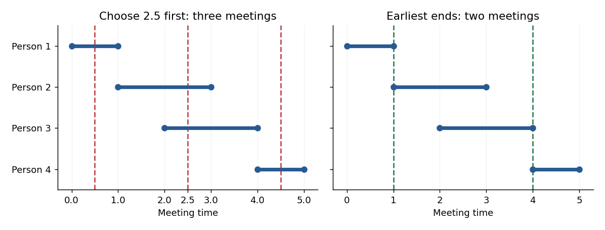

<h1 id="8/b/solution">Solution</h1>

↑ **Parent:** [B](../b.md)

Four [closed intervals](../../../../../closed-real-interval.md) suffice:

$$
I_1=[0,1],\qquad I_2=[1,3],\qquad
I_3=[2,4],\qquad I_4=[4,5].
$$

No time belongs to three intervals, so the maximum number of attendees at one meeting is two. Strategy 1 is allowed to choose $t=5/2$, which meets $I_2$ and $I_3$. The remaining intervals $I_1$ and $I_4$ are disjoint, requiring two further meetings. This run therefore uses three meetings.

However, times $1$ and $4$ meet everyone: $1\in I_1\cap I_2$ and $4\in I_3\cap I_4$. One meeting is impossible because $I_1\cap I_4=\varnothing$. Thus **the optimum is two, while strategy 1 can use three**. The counterexample deliberately uses an allowed tie between maximum-attendance choices: the instruction to pick “any” such time would require every tie choice to be safe.

**[Figure 1](#8/b/image-four-availability-intervals-a-permitted-maximum-attendance-choice-at-2-5-leaves-two-extra-meetings-while-the-endpoints-1-and-4-suffice). Four availability intervals: a permitted maximum-attendance choice at 2.5 leaves two extra meetings, while the endpoints 1 and 4 suffice**.

## ↑ Ancestors (12)

1. [B](../b.md)
2. [8](../../8.md)
3. [Functional programming, design and analysis of algorithms](../../../functional-programming-design-and-analysis-of-algorithms-split.md)
4. [2016](../../../split.md)
5. [Past exam of the year 1 of the computer science course of the University of Oxford](../../../../split.md)
6. [Year 1 of the computer science course of the University of Oxford](../../../../../year-1-of-the-computer-science-course-of-the-university-of-oxford.md)
7. [Computer science course of the University of Oxford](../../../../../computer-science-course-of-the-university-of-oxford.md)
8. [Undergraduate course of the University of Oxford](../../../../../undergraduate-course-of-the-university-of-oxford.md)
9. [Course of the University of Oxford](../../../../../course-of-the-university-of-oxford.md)
10. [University of Oxford](../../../../../university-of-oxford-split.md)
11. [List of universities](../../../../../list-of-universities.md)
12. [Codex Wiki](../../../../../split.md)
