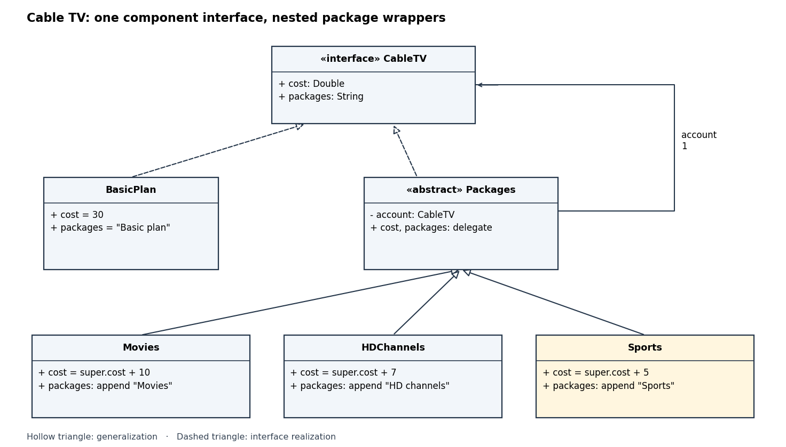
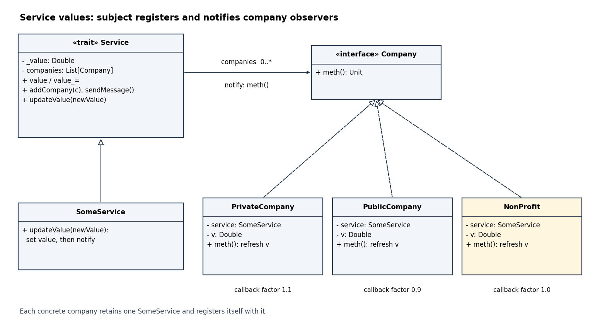

# Imperative programming (resit)

↑ **Parent:** [2016](../2016.md)

Source paper: [released examination archive](https://www.whatdotheyknow.com/request/past_exam_papers_for_1st_year_of/response/1398416/attach/2/Fakour%20Zip%20Final%201.zip?cookie_passthrough=1), member `a10098w1-3.pdf`; original cover dated 2016-09-15.

**Table of contents**

- [1](#1)
  - [a](#1/a)
    - [Solution](#1/a/solution)
  - [b](#1/b)
    - [Solution](#1/b/solution)
  - [c](#1/c)
    - [Solution](#1/c/solution)
  - [d](#1/d)
    - [Solution](#1/d/solution)
  - [e](#1/e)
    - [Solution](#1/e/solution)
- [2](#2)
  - [a](#2/a)
    - [Solution](#2/a/solution)
  - [b](#2/b)
    - [Solution](#2/b/solution)
  - [c](#2/c)
    - [Solution](#2/c/solution)
  - [d](#2/d)
    - [Solution](#2/d/solution)
- [3](#3)
  - [a](#3/a)
    - [Solution](#3/a/solution)
  - [b](#3/b)
    - [Solution](#3/b/solution)
  - [c](#3/c)
    - [Solution](#3/c/solution)
  - [d](#3/d)
    - [Solution](#3/d/solution)
  - [e](#3/e)
    - [Solution](#3/e/solution)
  - [f](#3/f)
    - [Solution](#3/f/solution)
- [4](#4)
  - [a](#4/a)
    - [Solution](#4/a/solution)
  - [b](#4/b)
    - [Solution](#4/b/solution)
  - [c](#4/c)
    - [Solution](#4/c/solution)
  - [d](#4/d)
    - [Solution](#4/d/solution)
  - [e](#4/e)
    - [Solution](#4/e/solution)
- [5](#5)
  - [a](#5/a)
    - [Solution](#5/a/solution)
  - [b](#5/b)
    - [Solution](#5/b/solution)
  - [c](#5/c)
    - [Solution](#5/c/solution)
  - [d](#5/d)
    - [Solution](#5/d/solution)
- [6](#6)
  - [a](#6/a)
    - [Solution](#6/a/solution)
  - [b](#6/b)
    - [Solution](#6/b/solution)
  - [c](#6/c)
    - [Solution](#6/c/solution)
  - [d](#6/d)
    - [Solution](#6/d/solution)
- [7](#7)
  - [a](#7/a)
    - [Solution](#7/a/solution)
  - [b](#7/b)
    - [Solution](#7/b/solution)
  - [c](#7/c)
    - [Solution](#7/c/solution)
  - [d](#7/d)
    - [Solution](#7/d/solution)
  - [e](#7/e)
    - [Solution](#7/e/solution)
- [8](#8)
  - [a](#8/a)
    - [Solution](#8/a/solution)
  - [b](#8/b)
    - [Solution](#8/b/solution)
  - [c](#8/c)
    - [Solution](#8/c/solution)
  - [d](#8/d)
    - [Solution](#8/d/solution)
  - [e](#8/e)
    - [i](#8/e/i)
      - [Solution](#8/e/i/solution)
    - [ii](#8/e/ii)
      - [Solution](#8/e/ii/solution)
    - [iii](#8/e/iii)
      - [Solution](#8/e/iii/solution)
    - [iv](#8/e/iv)
      - [Solution](#8/e/iv/solution)

## 1

↑ **Parent:** [Imperative programming (resit)](imperative-programming-resit.md)

<h3 id="1/a">a</h3>

↑ **Parent:** [1](#1)

<h4 id="1/a/solution">Solution</h4>

↑ **Parent:** [A](#1/a)

Because $b>1$, [exponentiation](../../arithmetic.md#exponentiation) to base $b$ is strictly increasing. The definition of the [floor function](../../calculus.md#floor-function) gives $i\leq\log_b n<i+1$, so the equivalent characterization of the [integer logarithm](../../calculus.md#integer-logarithm) is

$$
\boxed{b^i\leq n<b^{i+1}.}
$$

Here $i$ is a [nonnegative integer](../../arithmetic.md#natural-number); $n=1$ gives $i=0$.

<h3 id="1/b">b</h3>

↑ **Parent:** [1](#1)

<h4 id="1/b/solution">Solution</h4>

↑ **Parent:** [B](#1/b)

Keep both the exponent and its power. This [Oberon](../../programming-language.md#oberon-programming-language) procedure uses only the permitted arithmetic:
```
PROCEDURE IntLog(b, n: INTEGER): INTEGER;
VAR i, p: INTEGER;
BEGIN
  i := 0; p := 1;
  WHILE p*b <= n DO
    p := p*b; i := i+1
  END;
  RETURN i
END IntLog;
```
The [loop invariant](../../algorithm.md#loop-invariant) is $i\geq0$ and $p=b^i\leq n$. It holds initially because $n>0$. A successful guard permits the next power, and the two assignments preserve the relation between $p$ and $i$. At exit, $p\leq n<pb$, which is exactly part (a). Each iteration increases $i$, and only finitely many powers of $b\geq2$ are at most $n$, proving [algorithm termination](../../algorithm.md#algorithm-termination). **The returned value is $\lfloor\log_b n\rfloor$.** Its [running time](../../algorithm.md#running-time) is $\Theta(1+\log_b n)$ arithmetic operations; [integer overflow](../../programming-language.md#integer-overflow) is deferred to part (e).

<h3 id="1/c">c</h3>

↑ **Parent:** [1](#1)

<h4 id="1/c/solution">Solution</h4>

↑ **Parent:** [C](#1/c)

Use [repeated squaring](../../number-theory.md#exponentiation-by-squaring), including index zero:
```
b2[0] := b; top := 0;
WHILE b2[top]*b2[top] <= n DO
  b2[top+1] := b2[top]*b2[top];
  top := top+1
END;
```
The [loop invariant](../../algorithm.md#loop-invariant) is $b_2[j]=b^{2^j}$ for $0\leq j\leq\mathrm{top}$, with $b_2[j]\leq n$ for every stored entry except possibly the initial entry when $b>n$. Squaring $b^{2^j}$ gives $b^{2^{j+1}}$, proving preservation. The first failed guard identifies the first larger power outside the range. If $b>n$, no power with $k\geq1$ needs storing.

**Index zero is deliberately included.** The original paper asks for indices $k\geq1$ but then claims that their products represent every allowable power. Taken without $b_2[0]=b$, that claim fails for odd exponents, since every available exponent would be even. The extra initialized entry makes the intended [binary expansion](../../arithmetic.md#binary-expansion) argument valid without changing the requested entries.

Let $M$ be the largest representable positive [integer](../../integer.md). The worst case is $b=2$, requiring indices through $\lfloor\log_2\lfloor\log_2 M\rfloor\rfloor$. Thus **`enough = 5` for signed 32-bit integers, or `6` for signed 64-bit integers**, suffices for stored powers that fit; a larger convenient constant is harmless. This counts slots starting at zero and does not reserve a slot for an out-of-range sentinel. The multiplication in the guard can still suffer [integer overflow](../../programming-language.md#integer-overflow), independently of this [array](../../data-structure.md#array-data-structure) capacity bound.

<h3 id="1/d">d</h3>

↑ **Parent:** [1](#1)

<h4 id="1/d/solution">Solution</h4>

↑ **Parent:** [D](#1/d)

Store a second [array](../../data-structure.md#array-data-structure) `weight` with `weight[k] = 2^k`. Descending through the [binary digits](../../integer.md#binary-digit) of the answer gives this [greedy algorithm](../../algorithm.md#greedy-algorithm):
```
PROCEDURE FastLog(b, n: INTEGER): INTEGER;
VAR b2, weight: ARRAY enough OF INTEGER;
    top, k, i, p: INTEGER;
BEGIN
  b2[0] := b; weight[0] := 1; top := 0;
  WHILE b2[top]*b2[top] <= n DO
    b2[top+1] := b2[top]*b2[top];
    weight[top+1] := weight[top]+weight[top];
    top := top+1
  END;
  i := 0; p := 1; k := top;
  WHILE k >= 0 DO
    IF p*b2[k] <= n THEN
      p := p*b2[k]; i := i+weight[k]
    END;
    k := k-1
  END;
  RETURN i
END FastLog;
```
For the second loop, write $L=\lfloor\log_b n\rfloor$. Immediately before processing $k$, its [loop invariant](../../algorithm.md#loop-invariant) is

$$
p=b^i\leq n,\qquad i\leq L<i+2^{k+1}.
$$

Initially the failed squaring guard gives $L<2^{\mathrm{top}+1}$; this also holds when $b>n$, since then $L=0$. The test succeeds exactly when $i+2^k\leq L$. If successful, adding $2^k$ selects that [binary digit](../../integer.md#binary-digit); otherwise the upper bound tightens to $L<i+2^k$. Either way the invariant holds for the next smaller $k$. At $k=-1$, $i\leq L<i+1$, so **`i = L`**.

There are $O(1+\log(1+\log_b n))$ squarings and descending tests. For fixed $b$, this is **$O(1+\log\log n)$ arithmetic operations**, hence logarithmic in the [bit length](../../arithmetic.md#bit-length) of $n$, and also within the weaker $O(\log n)$ bound. This counts arithmetic operations on [integers](../../integer.md) as unit cost; [bit complexity](../../theoretical-computer-science.md#bit-complexity) would also charge for the growing operands. No division is used.

<h3 id="1/e">e</h3>

↑ **Parent:** [1](#1)

<h4 id="1/e/solution">Solution</h4>

↑ **Parent:** [E](#1/e)

Let $M$ be the maximum positive machine [integer](../../integer.md). A positive product $xy$ suffers [integer overflow](../../programming-language.md#integer-overflow) when $x>M\mathbin{\mathrm{DIV}}y$. The vulnerable expressions are `p*b` in part (b), `b2[top]*b2[top]` in the table guard, and `p*b2[k]` in the descending search. Even a rejected candidate must be evaluated before its comparison with $n$.

The table guard becomes dangerous as soon as its current entry exceeds $\sqrt M$: approximately $46340$ for signed 32-bit [integers](../../integer.md), or $3.04\times10^9$ for signed 64-bit [integers](../../integer.md). These are thresholds for the intermediate power, not for $n$ alone. For example, with 32-bit arithmetic, $b=2$ and $n=65536$ reach the stored power $65536$ and then try its overflowing square $2^{32}$. If $b>46340$, even the initial square may overflow for a tiny $n$. In part (b), the final test can overflow when the next power above $n$ exceeds $M$; at $b=2$, this already happens for $n\geq2^{30}$.

For positive operands, [integer division](../../arithmetic.md#integer-division) gives the exact equivalence $xy\leq n\iff x\leq n\mathbin{\mathrm{DIV}}y$. Therefore replace the three guards respectively by
```
p <= n DIV b
b2[top] <= n DIV b2[top]
p <= n DIV b2[k]
```
and perform each multiplication only after its guard succeeds. Every accepted product is then at most $n\leq M$. **With these guarded products and sufficient table capacity, the algorithms work throughout $2\leq b\leq M$, $1\leq n\leq M$.** The stored exponents and weights also fit in those machine ranges. Checking for overflow after multiplying would be too late.

## 2

↑ **Parent:** [Imperative programming (resit)](imperative-programming-resit.md)

<h3 id="2/a">a</h3>

↑ **Parent:** [2](#2)

<h4 id="2/a/solution">Solution</h4>

↑ **Parent:** [A](#2/a)

Separate [integer partitions](../../combinatorics.md#integer-partition) according to whether they contain a part equal to $i$. Removing one such part is a [bijection](../../function.md#bijection) to partitions of $n-i$ whose parts are at most $i$. The alternatives are disjoint, giving

$$
\boxed{p(i,n)=p(i-1,n)+p(i,n-i)\quad(i\geq1,\ n\geq1).}
$$

Use $p(i,0)=1$, because the empty [integer partition](../../combinatorics.md#integer-partition) is counted once, and $p(0,n)=0$ for $n>0$, with $p(i,n)=0$ for $n<0$. This [Oberon](../../programming-language.md#oberon-programming-language) implementation avoids negative recursive arguments:
```
PROCEDURE P(i, n: INTEGER): INTEGER;
VAR answer: INTEGER;
BEGIN
  IF n = 0 THEN answer := 1
  ELSIF i = 0 THEN answer := 0
  ELSIF i > n THEN answer := P(i-1, n)
  ELSE answer := P(i-1, n) + P(i, n-i)
  END;
  RETURN answer
END P;

PROCEDURE Partitions(n: INTEGER): INTEGER;
BEGIN
  RETURN P(n, n)
END Partitions;
```
The [precondition](../../algorithm.md#precondition) is $i,n\geq0$. Each [recursive call](../../algorithm.md#recursive-call) reduces $i+n$, proving [algorithm termination](../../algorithm.md#algorithm-termination). Every positive part of a partition of $n$ is at most $n$, so **the required one-argument count is $P(n,n)$**. Counts require a sufficiently wide [integer](../../integer.md) representation.

<h3 id="2/b">b</h3>

↑ **Parent:** [2](#2)

<h4 id="2/b/solution">Solution</h4>

↑ **Parent:** [B](#2/b)

For [partitions into distinct parts](../../combinatorics.md#partition-into-distinct-parts), using a part $i$ prevents using it again. Hence

$$
\boxed{d(i,n)=d(i-1,n)+d(i-1,n-i)}
$$

when $1\leq i\leq n$, with $d(i,0)=1$, $d(0,n)=0$ for $n>0$, and $d(i,n)=0$ for $n<0$. When $i>n$, use $d(i,n)=d(i-1,n)$. Thus change the second call in the final branch of `P` to `D(i-1, n-i)` and rename all calls to `D`. The same split into two disjoint classes proves correctness; its second class removes its unique largest allowed part. **The answer is $D(n,n)$**, giving $D(4,4)=2$, from $4$ and $3+1$.

<h3 id="2/c">c</h3>

↑ **Parent:** [2](#2)

<h4 id="2/c/solution">Solution</h4>

↑ **Parent:** [C](#2/c)

Write parts in nonincreasing order. The [array](../../data-structure.md#array-data-structure) `part` stores the current prefix, and `Emit(i,r,len)` completes it using parts at most $i$ with remaining sum $r$. With `Out` as the [Oberon](../../programming-language.md#oberon-programming-language) output module:
```
VAR part: ARRAY MaxParts OF INTEGER;

PROCEDURE Emit(i, r, len: INTEGER);
VAR j: INTEGER;
BEGIN
  IF r = 0 THEN
    j := 0;
    WHILE j < len DO
      IF j > 0 THEN Out.Char("+") END;
      Out.Int(part[j], 0); j := j+1
    END;
    Out.Ln
  ELSIF i > 0 THEN
    IF i <= r THEN
      part[len] := i;
      Emit(i, r-i, len+1)
    END;
    Emit(i-1, r, len)
  END
END Emit;

PROCEDURE PrintPartitions(n: INTEGER);
BEGIN
  Emit(n, n, 0)
END PrintPartitions;
```
The [recursion invariant](../../algorithm.md#recursion-invariant) is that `part[0..len)` is nonincreasing, has sum $n-r$, and every further part must be at most $i$ and at most the last existing part. The first branch includes the next part $i$; the second excludes it. These alternatives partition all completions, so each [integer partition](../../combinatorics.md#integer-partition) is printed exactly once. A [recursive call](../../algorithm.md#recursive-call) reduces $i+r$; the printing loop's [loop invariant](../../algorithm.md#loop-invariant) is that the first $j$ entries have been printed with exactly the necessary separators.

For $n>0$, no partition has more than $n$ parts, and the all-ones partition has exactly $n$. Thus **the fixed [array](../../data-structure.md#array-data-structure) requires $0\leq n\leq\texttt{MaxParts}$** to handle every partition. When a write occurs, $r>0$ and therefore `len < n`, so this bound prevents an out-of-range write. Zero prints one empty line, representing the empty [integer partition](../../combinatorics.md#integer-partition). Available [call stack](../../data-structure.md#call-stack) space imposes a further practical limit.

<h3 id="2/d">d</h3>

↑ **Parent:** [2](#2)

<h4 id="2/d/solution">Solution</h4>

↑ **Parent:** [D](#2/d)

Use [dynamic programming](../../mathematical-optimization.md#dynamic-programming) in increasing order of the maximum permitted part and then of the remaining sum. Let `Count` be a sufficiently wide [integer](../../integer.md) type and let `table` have dimensions `(MaxN+1)` by `(MaxN+1)`:
```
PROCEDURE CountPartitions(n: INTEGER): Count;
VAR i, j: INTEGER;
    table: ARRAY MaxN+1, MaxN+1 OF Count;
BEGIN
  table[0,0] := 1; j := 1;
  WHILE j <= n DO table[0,j] := 0; j := j+1 END;
  i := 1;
  WHILE i <= n DO
    table[i,0] := 1; j := 1;
    WHILE j <= n DO
      table[i,j] := table[i-1,j];
      IF j >= i THEN
        table[i,j] := table[i,j] + table[i,j-i]
      END;
      j := j+1
    END;
    i := i+1
  END;
  RETURN table[n,n]
END CountPartitions;
```
Require $0\leq n\leq\texttt{MaxN}$. The outer [loop invariant](../../algorithm.md#loop-invariant) says all rows below $i$ equal $p(\cdot,\cdot)$. The inner [loop invariant](../../algorithm.md#loop-invariant) additionally says entries before column $j$ in the current row are correct. Its dependencies are the previous row and the earlier column $j-i$, so no future entry is read. **Each state is evaluated once, giving $\Theta(n^2)$ arithmetic operations and $\Theta(n^2)$ stored counts.** A [memoization](../../algorithm.md#memoization) table around part (a)'s recursion is another valid way to share states; its entries need a separate “computed” flag because zero is a legitimate answer. Growing count sizes affect [bit complexity](../../theoretical-computer-science.md#bit-complexity) and can cause [integer overflow](../../programming-language.md#integer-overflow) in a fixed-width `Count`.

## 3

↑ **Parent:** [Imperative programming (resit)](imperative-programming-resit.md)

<h3 id="3/a">a</h3>

↑ **Parent:** [3](#3)

<h4 id="3/a/solution">Solution</h4>

↑ **Parent:** [A](#3/a)

A [trie](../../data-structure.md#trie) node needs a terminal flag as well as its children: a stored word can also be the prefix of a longer stored word.
```
TYPE Trie = POINTER TO Node;
     Node = RECORD
       terminal: BOOLEAN;
       child: ARRAY 26 OF Trie
     END;
```
Index zero denotes `a`, index 25 denotes `z`; [null pointers](../../computer-memory.md#null-pointer) denote absent branches. The [set](../../set.md) represented by a nonnull node consists of the empty [string](../../foundations-of-mathematics.md#string) if `terminal` is true, together with every child's words prefixed by that child's letter. **Represent the empty [set](../../set.md) by `NIL`.** The singleton containing the empty [string](../../foundations-of-mathematics.md#string) instead has a terminal root and no children.

**The declarations alone do not force a unique representation.** A nonterminal leaf, or a whole branch without terminal descendants, contributes no word. To obtain uniqueness up to pointer addresses, impose a [representation invariant](../../computer-science.md#representation-invariant): the structure is a finite [rooted tree](../../tree-graph-theory.md#rooted-tree), and each allocated node lies on a path to a terminal node. Then precisely the prefixes of stored words exist, all flags are determined, and the empty [set](../../set.md) has only the `NIL` representation. The insertion procedures below preserve this invariant when starting with such a [trie](../../data-structure.md#trie).

<h3 id="3/b">b</h3>

↑ **Parent:** [3](#3)

<h4 id="3/b/solution">Solution</h4>

↑ **Parent:** [B](#3/b)

For the paper's 26-letter alphabet, use the [Oberon](../../programming-language.md#oberon-programming-language) `CAP` operation and contiguous character codes:
```
PROCEDURE Index(c: CHAR): INTEGER;
BEGIN
  RETURN ORD(CAP(c)) - ORD("A")
END Index;
```
Both cases of a letter map to the same uppercase letter before subtraction, so **the result lies in `0..25`**. This relies on the ordinary Latin `A`–`Z` and `a`–`z` character encoding used by [Oberon](../../programming-language.md#oberon-programming-language); it is not a Unicode case-folding algorithm. The stipulated letter-only [precondition](../../algorithm.md#precondition) avoids any need to reject punctuation.

<h3 id="3/c">c</h3>

↑ **Parent:** [3](#3)

<h4 id="3/c/solution">Solution</h4>

↑ **Parent:** [C](#3/c)

Perform a [depth-first traversal](../../algorithm.md#depth-first-search), retaining the path's letters in a buffer. A terminal node must be printed before its children, so a word precedes its proper extensions in [lexicographic order](../../extremal-set-theory.md#lexicographic-order).
```
VAR word: ARRAY N OF CHAR;

PROCEDURE Visit(t: Trie; depth: INTEGER);
VAR j, c: INTEGER;
BEGIN
  IF t # NIL THEN
    IF t.terminal THEN
      j := 0;
      WHILE j < depth DO
        Out.Char(word[j]); j := j+1
      END;
      Out.Ln
    END;
    c := 0;
    WHILE c < 26 DO
      IF t.child[c] # NIL THEN
        word[depth] := CHR(ORD("a")+c);
        Visit(t.child[c], depth+1)
      END;
      c := c+1
    END
  END
END Visit;

PROCEDURE PrintTrie(t: Trie);
BEGIN
  Visit(t, 0)
END PrintTrie;
```
The [recursion invariant](../../algorithm.md#recursion-invariant) is that `word[0..depth)` spells the path to `t`. The child loop's [loop invariant](../../algorithm.md#loop-invariant) says children with indices below `c` have been completely printed. Each edge appends its lowercase label; each terminal flag prints exactly one represented [string](../../foundations-of-mathematics.md#string). All words therefore appear once, in lowercase. The output loop prints precisely the prefix of length `depth`; no terminating zero needs storing in this buffer.

**An `N`-character buffer suffices for words of length at most `N`.** At depth `N` there can be no child, so `word[N]` is never accessed. A terminal root prints an empty line; a `NIL` root prints nothing. The [running time](../../algorithm.md#running-time) is linear in allocated nodes plus the number of printed characters, since the alphabet size is fixed at 26.

<h3 id="3/d">d</h3>

↑ **Parent:** [3](#3)

<h4 id="3/d/solution">Solution</h4>

↑ **Parent:** [D](#3/d)

Allocate nodes only as required, explicitly initializing every field:
```
PROCEDURE Make(VAR t: Trie);
VAR c: INTEGER;
BEGIN
  NEW(t); t.terminal := FALSE; c := 0;
  WHILE c < 26 DO t.child[c] := NIL; c := c+1 END
END Make;

PROCEDURE AddTail(VAR t: Trie; s: ARRAY OF CHAR; i: INTEGER);
BEGIN
  IF t = NIL THEN Make(t) END;
  IF s[i] = 0X THEN
    t.terminal := TRUE
  ELSE
    AddTail(t.child[Index(s[i])], s, i+1)
  END
END AddTail;

PROCEDURE Add(VAR t: Trie; s: ARRAY OF CHAR);
BEGIN
  AddTail(t, s, 0)
END Add;
```
Here `0X` is the zero character, and `s` must contain its terminator within its [array](../../data-structure.md#array-data-structure) bounds. `Make` establishes that the first `c` child fields are `NIL` as its [loop invariant](../../algorithm.md#loop-invariant). Passing `t` by reference lets the base allocation replace a missing root or child pointer.

For correctness, use [induction](../../foundations-of-mathematics.md#mathematical-induction) on the number of characters before the terminator. At length zero, setting `terminal` adds exactly the empty suffix. Otherwise the chosen child stores exactly words with the required next letter, and the [induction hypothesis](../../foundations-of-mathematics.md#induction-hypothesis) adds the remaining suffix while preserving all other words. Thus **the resulting [set](../../set.md) is the old [set](../../set.md) union the supplied word, ignoring case**. Repeated insertion changes no word membership. A newly allocated path reaches the newly terminal node, preserving the canonical [representation invariant](../../computer-science.md#representation-invariant) after the procedure finishes. The [running time](../../algorithm.md#running-time) is $O(1+\ell)$ for a word of length $\ell$, using $O(1+\ell)$ [call stack](../../data-structure.md#call-stack) space without optimization.

<h3 id="3/e">e</h3>

↑ **Parent:** [3](#3)

<h4 id="3/e/solution">Solution</h4>

↑ **Parent:** [E](#3/e)

**A directly self-recursive procedure can be replaced by a simple loop when every recursive call is a [tail call](../../programming-language.md#tail-call).** This is [tail recursion](../../algorithm.md#tail-recursion): no operation, including an update or cleanup action, remains to be performed after the call returns. The loop tests the same cases, performs the same nonrecursive work, and replaces the current parameters by the next call's arguments. Argument values must be computed before assignments if their expressions depend on old parameter values; by-reference bindings also need preserving.

A traversal that must return to explore another child is not in this form. It can still be implemented iteratively with an explicit [stack](../../data-structure.md#stack-data-structure), but that is a different transformation and generally retains the deferred work.

<h3 id="3/f">f</h3>

↑ **Parent:** [3](#3)

<h4 id="3/f/solution">Solution</h4>

↑ **Parent:** [F](#3/f)

`AddTail` in part (d) is already [tail-recursive](../../algorithm.md#tail-recursion): the recursive call is the final action of its branch. The following loop follows a separate cursor so that the caller's root pointer is preserved:
```
PROCEDURE AddIter(VAR t: Trie; s: ARRAY OF CHAR);
VAR u: Trie; i, c: INTEGER;
BEGIN
  IF t = NIL THEN Make(t) END;
  u := t; i := 0;
  WHILE s[i] # 0X DO
    c := Index(s[i]);
    IF u.child[c] = NIL THEN Make(u.child[c]) END;
    u := u.child[c]; i := i+1
  END;
  u.terminal := TRUE
END AddIter;
```
The [loop invariant](../../algorithm.md#loop-invariant) is that `u` points to the node reached by the first `i` letters, all necessary nodes along that path exist, and no previously terminal node has lost its flag. Each iteration advances one character. At the terminator, marking `u` inserts exactly the desired [string](../../foundations-of-mathematics.md#string). Using `t := t.child[c]` as the cursor update would instead overwrite the caller's root through the `VAR` parameter. **This version has $O(1+\ell)$ [running time](../../algorithm.md#running-time) and constant auxiliary space**, apart from newly allocated nodes in the result.

## 4

↑ **Parent:** [Imperative programming (resit)](imperative-programming-resit.md)

<h3 id="4/a">a</h3>

↑ **Parent:** [4](#4)

<h4 id="4/a/solution">Solution</h4>

↑ **Parent:** [A](#4/a)

For a proposed [loop invariant](../../algorithm.md#loop-invariant) $I$, initial condition $P$, guard $B$, body $S$, and [postcondition](../../algorithm.md#postcondition) $Q$, establish these [Hoare logic](../../programming-language.md#hoare-logic) obligations:

$$
P\Rightarrow I,\qquad \{I\land B\}\ S\ \{I\},\qquad
I\land\neg B\Rightarrow Q.
$$

The first establishes $I$ before the loop; the second preserves it after each iteration; the third derives the desired result when the guard is false. Together they prove **[partial correctness](../../algorithm.md#partial-correctness)**. For **[total correctness](../../algorithm.md#total-correctness)**, also prove [algorithm termination](../../algorithm.md#algorithm-termination), for example by a nonnegative [integer](../../integer.md) [loop variant](../../algorithm.md#loop-variant) that strictly decreases whenever the body executes. The [loop invariant](../../algorithm.md#loop-invariant) need not be the [postcondition](../../algorithm.md#postcondition): it generally describes completed and unfinished work together.

<h3 id="4/b">b</h3>

↑ **Parent:** [4](#4)

<h4 id="4/b/solution">Solution</h4>

↑ **Parent:** [B](#4/b)

Let $A$ denote the original [array](../../data-structure.md#array-data-structure), used only in the proof. Save its first entry before overwriting it:
```
PROCEDURE LeftOne;
VAR saved: T; i: INTEGER;
BEGIN
  saved := a[0]; i := 0;
  WHILE i < N-1 DO
    a[i] := a[i+1]; i := i+1
  END;
  a[N-1] := saved
END LeftOne;
```
The [loop invariant](../../algorithm.md#loop-invariant) is `saved = A[0]`, $a[j]=A[j+1]$ for $0\leq j<i$, and $a[j]=A[j]$ for $i\leq j<N$. Thus the next source is untouched, and the assignment extends the completed prefix. At exit, the saved entry supplies the last position. The [loop variant](../../algorithm.md#loop-variant) is $N-1-i$. **The result is $a[j]=A[(j+1)\bmod N]$.** This also handles $N=1$, and uses exactly $N$ element reads and $N$ element writes, counting the saved read and final write, with one extra value of type `T`.

<h3 id="4/c">c</h3>

↑ **Parent:** [4](#4)

<h4 id="4/c/solution">Solution</h4>

↑ **Parent:** [C](#4/c)

Save the last entry and shift in decreasing index order, so no source is overwritten before being used:
```
PROCEDURE RightOne;
VAR saved: T; i: INTEGER;
BEGIN
  saved := a[N-1]; i := N-1;
  WHILE i > 0 DO
    a[i] := a[i-1]; i := i-1
  END;
  a[0] := saved
END RightOne;
```
The [loop invariant](../../algorithm.md#loop-invariant) is `saved = A[N-1]`, $a[j]=A[j]$ for $0\leq j\leq i$, and $a[j]=A[j-1]$ for $i<j<N$. The decreasing [loop variant](../../algorithm.md#loop-variant) is $i$. At exit the untouched saved value fills index zero. **The result is $a[j]=A[(j-1)\bmod N]$**, again with $N$ reads, $N$ writes, and one extra value of type `T`. Applying this after part (b) restores every original entry.

<h3 id="4/d">d</h3>

↑ **Parent:** [4](#4)

<h4 id="4/d/solution">Solution</h4>

↑ **Parent:** [D](#4/d)

Normalize the amount to $r=k\bmod N$, with $0\leq r<N$; negative $k$ then naturally denotes a right rotation. When $r=0$, return without touching the elements. Otherwise the map $j\mapsto(j+r)\bmod N$ has $g=\gcd(N,r)$ disjoint [permutation cycles](../../finite-group-theory.md#permutation-cycle), each of length $N/g$. Use representatives $0,\ldots,g-1$:
```
PROCEDURE RotateLeft(k: INTEGER);
VAR r, g, x, y, h, s, j, next: INTEGER; saved: T;
BEGIN
  r := k MOD N;
  IF r # 0 THEN
    x := N; y := r;
    WHILE y # 0 DO h := x MOD y; x := y; y := h END;
    g := x; s := 0;
    WHILE s < g DO
      saved := a[s]; j := s;
      IF j >= N-r THEN next := j-(N-r) ELSE next := j+r END;
      WHILE next # s DO
        a[j] := a[next]; j := next;
        IF j >= N-r THEN next := j-(N-r) ELSE next := j+r END
      END;
      a[j] := saved; s := s+1
    END
  END
END RotateLeft;
```
The conditional calculation of `next` implements addition modulo $N$ without first forming a possibly overflowing `j+r`. [Oberon](../../programming-language.md#oberon-programming-language)'s `MOD` with positive divisor supplies the nonnegative remainder. The first loop is the [Euclidean algorithm](../../number-theory.md#euclidean-algorithm), with [loop invariant](../../algorithm.md#loop-invariant) $\gcd(x,y)=\gcd(N,r)$ and decreasing nonzero remainder.

For the outer loop, cycles with representatives below `s` are complete and every other cycle retains its original values. In one cycle, write $c_t=(s+tr)\bmod N$. The inner [loop invariant](../../algorithm.md#loop-invariant) is `saved = A[s]`, $j=c_t$, and $a[c_u]=A[c_{u+1}]$ for $0\leq u<t$, with the remaining sources still untouched. When the next index returns to `s`, the saved value closes the cycle. The cycle length is $N/g$: writing $N=gN'$ and $r=gr'$ with $\gcd(N',r')=1$, the least positive $t$ with $tr\equiv0\pmod N$ is $N'$. Each residue class modulo $g$ is one cycle, justifying the chosen representatives.

**Every element is read once and written once: $2N$ element accesses**, compared with $2Nk$ for $k>1$ repetitions of part (b). The zero rotation uses none. The [running time](../../algorithm.md#running-time) is $O(N)$ and auxiliary space is constant; the original [array](../../data-structure.md#array-data-structure) $A$ is proof notation, not a copy made by the program.

<h3 id="4/e">e</h3>

↑ **Parent:** [4](#4)

<h4 id="4/e/solution">Solution</h4>

↑ **Parent:** [E](#4/e)

Use the convention **$a_{\mathrm{new}}[j]=A[p[j]]$**, as required by the paper's rotation example. Follow each [permutation cycle](../../finite-group-theory.md#permutation-cycle) once. Temporarily encode a visited value $v\in[0,N)$ as $-v-1$, and restore the whole permutation before returning:
```
PROCEDURE Permute(VAR p: ARRAY OF INTEGER);
VAR s, j, next: INTEGER; saved: T;
BEGIN
  s := 0;
  WHILE s < N DO
    IF p[s] >= 0 THEN
      IF p[s] = s THEN
        p[s] := -p[s]-1
      ELSE
        saved := a[s]; j := s;
        next := p[j]; p[j] := -next-1;
        WHILE next # s DO
          a[j] := a[next]; j := next;
          next := p[j]; p[j] := -next-1
        END;
        a[j] := saved
      END
    END;
    s := s+1
  END;
  s := 0;
  WHILE s < N DO p[s] := -p[s]-1; s := s+1 END
END Permute;
```
Require `LEN(p) >= N` and that `p[0..N)` is the stipulated [permutation](../../combinatorics.md#permutation). Its cells must be writable and distinct from the data [array](../../data-structure.md#array-data-structure). The marking map is reversible and fits whenever the original valid indices and $N$ fit in the signed [integer](../../integer.md) type.

At each outer test, all marked indices belong to fully completed cycles; all unmarked cycles still contain their original data and permutation entries. Within a cycle the same shifting [loop invariant](../../algorithm.md#loop-invariant) as part (d) applies, with successor given by the original `p`: all previously filled positions have their final values, and `saved` preserves the overwritten first source. A [permutation](../../combinatorics.md#permutation) has no path into a different cycle, so every new successor is unmarked until it returns to `s`; no encoded negative value is used as a source index. At outer-loop exit every index is marked and correct. The restoration loop has decoded precisely the indices below `s`.

**The procedure uses one extra value of type `T`, $O(N)$ time, and at most $N$ data reads plus $N$ data writes**, with no data access for fixed points. It returns `p` unchanged, though it marks it temporarily. If `p` must remain read-only even during execution, test whether each index is its cycle's smallest member by traversing `p` before moving that cycle. That preserves constant space and the same optimal data accesses, but can require $O(N^2)$ index-array accesses.

## 5

↑ **Parent:** [Imperative programming (resit)](imperative-programming-resit.md)

<h3 id="5/a">a</h3>

↑ **Parent:** [5](#5)

<h4 id="5/a/solution">Solution</h4>

↑ **Parent:** [A](#5/a)

The output is **`BADDCD`**, without a newline. [Method overloading](../../programming-language.md#method-overloading) chooses a signature using [static types](../../programming-language.md#static-type), including the instantiated class [type parameter](../../programming-language.md#type-parameter); [numeric widening](../../programming-language.md#numeric-widening) can make a `Double` parameter applicable to an `Int` argument.

- `a.m(o1)` chooses `m(Int)`, which is more specific than the polymorphic method: `B`.
- `a.m(o2)` uses `m[Double](Double)`: `A`.
- `b.m(o1)` compares `m(Any)` and `m(Double)`. `Int` can widen to `Double`, and `Double` is more specific than `Any`: `D`.
- `b.m(o2)` chooses `m(Double)` over `m(Any)`: `D`.
- `c.m(o1)` compares the instantiated `m(Int)` with `m(Double)` and chooses `m(Int)`: `C`.
- `c.m(o2)` can use only `m(Double)`: `D`.

The third call is the subtle one: the existence of `m(Any)` does not prevent the more specific numeric overload from winning. These are Scala 2 [method overloading](../../programming-language.md#method-overloading) and [numeric widening](../../programming-language.md#numeric-widening) rules. [Overloading Resolution and Numeric Widening](../../computer-science-bibliography.md#scala-2-11-expressions-specification)

<h3 id="5/b">b</h3>

↑ **Parent:** [5](#5)

<h4 id="5/b/solution">Solution</h4>

↑ **Parent:** [B](#5/b)

The output is **`YXWX`**, without a newline. Apply [overload selection followed by dynamic dispatch](../../programming-language.md#overload-selection-followed-by-dynamic-dispatch) separately to each call:

- `c.m(a)` selects the `m(A)` signature because the argument's [static type](../../programming-language.md#static-type) is `A`. The receiver is a `D` at runtime, so its override prints `Y`.
- `d.m(b)` selects `m(B)`. `D.m(B)` explicitly calls the inherited implementation with `super.m(o)`, giving `X`.
- `e.m(a)` selects `C.m(A)`, giving `W`.
- `e.m(b)` selects `C.m(B)`, giving `X`.

Although `a` actually refers to a `B`, that [runtime type](../../programming-language.md#runtime-type) does not select another overload. [Dynamic dispatch](../../programming-language.md#dynamic-dispatch) chooses the implementation of the already selected signature on the receiver.

<h3 id="5/c">c</h3>

↑ **Parent:** [5](#5)

<h4 id="5/c/solution">Solution</h4>

↑ **Parent:** [C](#5/c)

Read each [Scala trait linearization](../../programming-language.md#scala-trait-linearization) from the most specific implementation toward the base. For a declaration with parents $P_1,\ldots,P_r$, concatenate their linearizations from right to left, deleting a duplicate from a left operand when it already occurs in the right operand. This can move a repeated ancestor later than a superficial “rightmost trait first” scan suggests. Omitting the common `AnyRef, Any` suffix, the answers are
```
C, Y, H, N, L, I, E
B, Y, H, N, L, D, I, E
A, N, O, Y, S, H, T, L, D, I, E
```
For example, `T` contributes `T,L,D,I,E`, while `O` contributes `O,Y,S,H,E`. In `A`, the separately mentioned `Y` also appears in the later merge with `O`, and `N`'s ancestors also occur in `T`; resolving these duplicates yields the final order displayed above. **The inherited trait orders are the displayed lists after removing their leading class names.** [Class Linearization](../../computer-science-bibliography.md#scala-2-11-classes-and-objects-specification)

<h3 id="5/d">d</h3>

↑ **Parent:** [5](#5)

<h4 id="5/d/solution">Solution</h4>

↑ **Parent:** [D](#5/d)

Each implementation first evaluates `super.meth` and then appends its own name. Consequently the contributions appear in reverse order of the defining traits in the [Scala trait linearization](../../programming-language.md#scala-trait-linearization). The four printed lines are
```
E I L N H Y 
E I D L N H Y 
E I D L T H S Y O N 
E I D L T H S Y O N 
```
There is a trailing space before each newline. **The third and fourth lines are identical**: the declared type `D` of `o4` permits the call but does not change the actual `A` object's [dynamic dispatch](../../programming-language.md#dynamic-dispatch) or its `super` chain. Within `N`, for example, `super.meth` in an `A` follows the next implementation in `A`'s full linearization rather than simply using `L` as its isolated textual parent.

## 6

↑ **Parent:** [Imperative programming (resit)](imperative-programming-resit.md)

<h3 id="6/a">a</h3>

↑ **Parent:** [6](#6)

<h4 id="6/a/solution">Solution</h4>

↑ **Parent:** [A](#6/a)

The output is **`ABC`**, without a newline. The relevant [Scala trait linearization](../../programming-language.md#scala-trait-linearization) is `D,C,B,A`. Calling `d.m` starts with `C.m`, whose `super.m` continues to `B.m`, then to `A.m`. The latter prints `A`; returning through the two method bodies then prints `B` followed by `C`. The braces keep each final `print` inside that [object method](../../programming-language.md#object-method).

<h3 id="6/b">b</h3>

↑ **Parent:** [6](#6)

<h4 id="6/b/solution">Solution</h4>

↑ **Parent:** [B](#6/b)

The output becomes **`BCA`**, without a newline. Here each method body consists only of `super.m`; the semicolon ends that definition. The following `print("B")` or `print("C")` is a separate statement in the [trait](../../programming-language.md#trait) body, so it executes during construction.

Creating `new D` initializes the shared base and then the `B` and `C` [mixins](../../programming-language.md#mixin), printing `BC`. The subsequent `d.m` still forwards along `C,B,A`, but only `A.m` now prints anything, appending `A`. Thus it is the placement of the construction-time statements, not a changed [Scala trait linearization](../../programming-language.md#scala-trait-linearization), that changes the output. [Template Evaluation](../../computer-science-bibliography.md#scala-2-11-classes-and-objects-specification)

<h3 id="6/c">c</h3>

↑ **Parent:** [6](#6)

<h4 id="6/c/solution">Solution</h4>

↑ **Parent:** [C](#6/c)

[Class inheritance](../../programming-language.md#class-inheritance) defines a [software class](../../programming-language.md#class-programming) by extending another [software class](../../programming-language.md#class-programming), inheriting its available operations and optionally adding members or providing [method overriding](../../programming-language.md#method-overriding). In languages supporting it, [traits](../../programming-language.md#trait) and [mixins](../../programming-language.md#mixin) can contribute reusable behavior as well.

**Use inheritance for a sound specialization whose instances can satisfy the superclass's contract wherever its instances are expected.** For example, every specific gate in part (d) is usable through the common gate [object interface](../../programming-language.md#object-interface). [Subtyping](../../programming-language.md#subtyping) supports this substitution and [dynamic dispatch](../../programming-language.md#dynamic-dispatch) selects the specialized calculation. Merely noticing shared code does not establish the required behavioral relationship; [object composition](../../programming-language.md#object-composition) is often better for a replaceable component or policy that an object contains. A subclass must preserve the superclass's promised behavior, rather than just sharing its field names.

<h3 id="6/d">d</h3>

↑ **Parent:** [6](#6)

<h4 id="6/d/solution">Solution</h4>

↑ **Parent:** [D](#6/d)

The two writable inputs and Boolean query belong to an [abstract class](../../programming-language.md#abstract-class); each concrete [logic gate](../../theoretical-computer-science.md#logic-gate) overrides just that query:
```
abstract class Gate {
  var inp1: Boolean = false
  var inp2: Boolean = false
  def evalGate: Boolean
}

class OrG extends Gate {
  override def evalGate: Boolean = inp1 || inp2
}

class AndG extends Gate {
  override def evalGate: Boolean = inp1 && inp2
}

class XorG extends Gate {
  override def evalGate: Boolean = inp1 ^ inp2
}
```
All three subclasses satisfy the same [object interface](../../programming-language.md#object-interface), so the `Gate` declarations in the supplied simulator still allow access to inputs and invoke the correct [Boolean function](../../analysis-of-boolean-functions.md#boolean-function) through [dynamic dispatch](../../programming-language.md#dynamic-dispatch). Boolean `^` is [exclusive or](../../theoretical-computer-science.md#exclusive-or); `||` is [Boolean disjunction](../../mathematical-logic.md#logical-disjunction) and `&&` is [Boolean conjunction](../../mathematical-logic.md#logical-conjunction).

The program first sets both inputs of `y`, so $y=\mathrm{true}\land\mathrm{true}=\mathrm{true}$. It sets $z=\mathrm{false}\mathbin{\mathrm{xor}}\mathrm{false}=\mathrm{false}$. Therefore $x=y\lor z=\mathrm{true}$ and $w=z\land\mathrm{true}=\mathrm{false}$, giving
```
x: true
w: false
```
**Those are the two output lines.** This is a simulation of [combinational logic](../../theoretical-computer-science.md#combinational-logic) in an order where each gate's inputs have already been calculated; the Boolean assignments copy values rather than create live wire connections.

## 7

↑ **Parent:** [Imperative programming (resit)](imperative-programming-resit.md)

<h3 id="7/a">a</h3>

↑ **Parent:** [7](#7)

<h4 id="7/a/solution">Solution</h4>

↑ **Parent:** [A](#7/a)

The **[Prototype pattern](../../programming-language.md#prototype-pattern) is a [creational pattern](../../programming-language.md#creational-pattern) that creates new [software objects](../../programming-language.md#software-object) by copying an existing configured object through a common cloning [object interface](../../programming-language.md#object-interface)**. A client keeps or selects a prototype and requests a copy, without naming the concrete [software class](../../programming-language.md#class-programming) or repeating its construction recipe.

It is useful when the concrete type is selected at runtime, when many objects share a configuration, or when reconstructing an initialized object is expensive. For example, a drawing application can duplicate a configured graphical object through the same interface for many shape classes. The contract must specify what is copied: nested mutable state may require a [deep copy](../../computer-memory.md#deep-copy), whereas a shallow copy would retain [reference aliasing](../../computer-memory.md#reference-aliasing). A copy should preserve the intended configuration while allowing independent changes where promised.

<h3 id="7/b">b</h3>

↑ **Parent:** [7](#7)

<h4 id="7/b/solution">Solution</h4>

↑ **Parent:** [B](#7/b)

**This is the [Decorator pattern](../../programming-language.md#decorator-pattern), a [structural pattern](../../programming-language.md#structural-pattern).** `Packages` is a [decorator object](../../programming-language.md#decorator-object): it implements `CableTV` while holding another `CableTV`, to which its default queries delegate. `Movies` and `HDChannels` extend the price and description of the wrapped account. Because a wrapper itself satisfies `CableTV`, another wrapper can surround it; features combine without declaring a new [software class](../../programming-language.md#class-programming) for each possible package combination.

<h3 id="7/c">c</h3>

↑ **Parent:** [7](#7)

<h4 id="7/c/solution">Solution</h4>

↑ **Parent:** [C](#7/c)

In this [UML class diagram](../../computer-science.md#class-diagram), hollow triangles point toward the more general type; dashed lines denote realization of the `CableTV` [object interface](../../programming-language.md#object-interface). The plain association records that `Packages` retains one wrapped account, without claiming exclusive lifetime ownership.

<a id="7/c/image-decorator-pattern-for-the-cable-television-account-extended-with-sports"></a>


**[Figure 1](#7/c/image-decorator-pattern-for-the-cable-television-account-extended-with-sports). Decorator pattern for the cable television account, extended with Sports**.

Add the following [software class](../../programming-language.md#class-programming) and client application to the supplied declarations. The inherited result type gives `BasicPlan.cost` an expected `Double` type, so its literal `30` is widened appropriately; no source change is needed.
```
class Sports(account: CableTV) extends Packages(account) {
  override def cost: Double = super.cost + 5.0
  override def packages: String = super.packages + ", Sports"
}

object CheckCableTV {
  def show(account: CableTV): Unit =
    println(account.packages + ": GBP " + account.cost)

  def main(args: Array[String]): Unit = {
    val basic: CableTV = new BasicPlan
    val movies: CableTV = new Movies(basic)
    val hd: CableTV = new HDChannels(movies)
    val sports: CableTV = new Sports(hd)
    show(basic)
    show(movies)
    show(hd)
    show(sports)
    assert(sports.cost == 52.0)
    assert(sports.packages == "Basic plan, Movies, HD channels, Sports")
  }
}
```
The printed accounts have costs `30.0`, `40.0`, `47.0`, and `52.0`, with each description extending the preceding one. **The fully decorated account is `Basic plan, Movies, HD channels, Sports`, costing £52.** The intermediate accounts remain available because wrapping constructs a new [software object](../../programming-language.md#software-object). [methodSig and typesFromOverridden: inherited return type supplies the expected type while typing an overriding body](../../computer-science-bibliography.md#scala-2-11-12-method-type-inference-implementation)

<h3 id="7/d">d</h3>

↑ **Parent:** [7](#7)

<h4 id="7/d/solution">Solution</h4>

↑ **Parent:** [D](#7/d)

The [Decorator pattern](../../programming-language.md#decorator-pattern) participants are:

- `CableTV`: the component [object interface](../../programming-language.md#object-interface), declaring the price and package description visible to clients.
- `BasicPlan`: the concrete component, supplying the initial £30 account and its description.
- `Packages`: the abstract [decorator object](../../programming-language.md#decorator-object), storing one component and forwarding its queries.
- `Movies` and `HDChannels`, and the extension `Sports`: concrete [decorator objects](../../programming-language.md#decorator-object), adding respectively £10, £7, and £5 and appending their labels.

The checking application is the client that chooses and nests these participants. **The common `CableTV` interface makes a decorated account usable wherever a basic account is usable**, while the nested [object composition](../../programming-language.md#object-composition) determines its accumulated behavior.

<h3 id="7/e">e</h3>

↑ **Parent:** [7](#7)

<h4 id="7/e/solution">Solution</h4>

↑ **Parent:** [E](#7/e)

A **[sequence diagram](../../computer-science.md#sequence-diagram)** describes an interaction among participants using lifelines and ordered messages; time normally runs downward. Calls, replies, and execution intervals show a scenario such as the client asking a Sports wrapper for its cost, then that wrapper delegating through the inner packages to `BasicPlan` and adding charges on return. Alternatives or loops can describe more than one trace.

A **[state diagram](../../computer-science.md#state-diagram)** describes states of an object or system and transitions triggered by events, possibly guarded by conditions and accompanied by actions. An account might move from active to suspended on a failed-payment event and back to active on payment. It describes allowed lifecycle behavior rather than the order of messages in one chosen interaction. Both are behavioral diagrams in [UML](../../computer-science.md#unified-modeling-language).

## 8

↑ **Parent:** [Imperative programming (resit)](imperative-programming-resit.md)

<h3 id="8/a">a</h3>

↑ **Parent:** [8](#8)

<h4 id="8/a/solution">Solution</h4>

↑ **Parent:** [A](#8/a)

The **[Strategy pattern](../../programming-language.md#strategy-pattern) is a [behavioral pattern](../../programming-language.md#behavioral-pattern) that encapsulates alternative algorithms behind a shared [object interface](../../programming-language.md#object-interface)**. A context holds a strategy and delegates the relevant operation to it, letting the chosen algorithm vary independently of its caller.

Use it when the same task has interchangeable policies, such as alternative pricing or route-selection algorithms. Supplying a different strategy changes the policy without expanding a chain of type tests in the context, and each policy can be checked independently. [Object composition](../../programming-language.md#object-composition) makes the selected strategy replaceable; clients rely on its contract rather than on one concrete implementation.

<h3 id="8/b">b</h3>

↑ **Parent:** [8](#8)

<h4 id="8/b/solution">Solution</h4>

↑ **Parent:** [B](#8/b)

**This is the [Observer pattern](../../programming-language.md#observer-pattern), a [behavioral pattern](../../programming-language.md#behavioral-pattern).** `Service` stores subscribers through the `Company` [object interface](../../programming-language.md#object-interface). `SomeService.updateValue` first changes the underlying value and then sends a notification to every registered company; each company's `meth()` queries the new value and computes its own response. This is a pull-style notification: the message announces the change, while the observer reads the data from its retained subject reference.

<h3 id="8/c">c</h3>

↑ **Parent:** [8](#8)

<h4 id="8/c/solution">Solution</h4>

↑ **Parent:** [C](#8/c)

The [UML class diagram](../../computer-science.md#class-diagram) shows the subject's collection of observers and the added concrete observer. Each concrete company also retains the `SomeService` reference shown in its attributes; notifications call `meth()` through `Company`.

<a id="8/c/image-observer-pattern-for-service-values-extended-with-a-nonprofit-company"></a>


**[Figure 2](#8/c/image-observer-pattern-for-service-values-extended-with-a-nonprofit-company). Observer pattern for service values, extended with a NonProfit company**.

Use an unscaled value both initially and in every callback:
```
class NonProfit(service: SomeService) extends Company {
  private var v: Double = service.value
  service.addCompany(this)

  override def meth(): Unit = {
    v = service.value
    printf("New service value: %f\n", v)
  }
}
```
Initializing `v` before registration prevents a callback from observing an uninitialized field if registration is later extended to notify immediately. For a service initially valued at `100.0`, this initializes `v` to `100.0`; after `updateValue(125.0)`, the callback sets `v` to `125.0` and prints `New service value: 125.000000` under a decimal-point locale. **The NonProfit update uses factor one.**

The word “always” requires a qualification in the supplied design. In the intended single-threaded notification protocol, $v=\texttt{service.value}$ holds after construction and after a completed `SomeService.updateValue`. However, the printed public `value_=` setter changes the subject without calling `sendMessage()`. Calling `service.value = ...` can therefore leave every cached observer value stale. No implementation that merely caches `v` in `meth()` can guarantee literal equality after that unannounced change. If equality on every query is required, replace the field by `private def v: Double = service.value`, retaining registration and the same printing callback; alternatively every mutation route must notify observers. The source's distinct private/public company multipliers are not changed.

<h3 id="8/d">d</h3>

↑ **Parent:** [8](#8)

<h4 id="8/d/solution">Solution</h4>

↑ **Parent:** [D](#8/d)

The [Observer pattern](../../programming-language.md#observer-pattern) participants are:

- `Service`: the subject abstraction, owning the current value and registered `Company` references, and providing registration and notification operations.
- `SomeService`: the concrete subject, making `updateValue` notify after establishing the new subject state.
- `Company`: the observer [object interface](../../programming-language.md#object-interface), declaring the `meth()` callback.
- `PrivateCompany` and `PublicCompany`, together with the extension `NonProfit`: concrete observers, registering themselves, retaining their subject, and updating their own values on notification.

The printed `PrivateCompany` starts with factor $1$ but uses factor $1.1$ in its callback; `PublicCompany` starts with factor $0.8$ but later uses $0.9$. These are the actual source behaviors, not a uniform pricing rule inferred from their names. The subject stores a [list](../../data-structure.md#list-abstract-data-type) and prepends new subscriptions, so notification occurs in reverse registration order. **Dependence on the `Company` interface lets the subject notify new observer types without naming their concrete classes.** The omitted `...` portions in the printed figure do not prevent identifying these roles or implementing the added observer.

<h3 id="8/e">e</h3>

↑ **Parent:** [8](#8)

<h4 id="8/e/i">i</h4>

↑ **Parent:** [E](#8/e)

<h5 id="8/e/i/solution">Solution</h5>

↑ **Parent:** [I](#8/e/i)

**True.** A named [software design pattern](../../programming-language.md#software-design-pattern) supplies shared vocabulary for recurring arrangements of responsibilities and interactions. Saying “observer” can identify subject registration and callbacks without first reproducing every implementation detail, provided developers still agree on the actual contract.

<h4 id="8/e/ii">ii</h4>

↑ **Parent:** [E](#8/e)

<h5 id="8/e/ii/solution">Solution</h5>

↑ **Parent:** [Ii](#8/e/ii)

**False as a general claim.** An appropriately chosen [software design pattern](../../programming-language.md#software-design-pattern) can make expected variation easier: a new strategy or decorator can be supplied through an existing [object interface](../../programming-language.md#object-interface). An unnecessary pattern can add indirection and make some changes harder, so applying one is not an automatic guarantee of flexibility either.

<h4 id="8/e/iii">iii</h4>

↑ **Parent:** [E](#8/e)

<h5 id="8/e/iii/solution">Solution</h5>

↑ **Parent:** [Iii](#8/e/iii)

**True.** A small proof-of-concept implementation makes the participants, delegation, and extension points of a [software design pattern](../../programming-language.md#software-design-pattern) concrete. Trying a second strategy, an extra decorator, or another observer tests what changes locally and what assumptions remain. This supports learning when the arrangement is useful; it does not establish that every production system needs it.

<h4 id="8/e/iv">iv</h4>

↑ **Parent:** [E](#8/e)

<h5 id="8/e/iv/solution">Solution</h5>

↑ **Parent:** [Iv](#8/e/iv)

**True.** [Refactoring](../../computer-science.md#refactoring) an existing implementation toward a [software design pattern](../../programming-language.md#software-design-pattern) can be preferable once repeated structure and actual variation are visible. Existing behavior supplies a concrete contract to preserve, and tests can check that preservation. Starting from a pattern is appropriate when its problem is already established, but the pattern's name alone is not evidence that its extra structure is needed.

## ↑ Ancestors (9)

1. [2016](../2016.md)
2. [Past exam of the year 1 of the computer science course of the University of Oxford](../../past-exam-of-the-year-1-of-the-computer-science-course-of-the-university-of-oxford.md)
3. [Year 1 of the computer science course of the University of Oxford](../../university-of-oxford.md#year-1-of-the-computer-science-course-of-the-university-of-oxford)
4. [Computer science course of the University of Oxford](../../university-of-oxford.md#computer-science-course-of-the-university-of-oxford)
5. [Undergraduate course of the University of Oxford](../../university-of-oxford.md#undergraduate-course-of-the-university-of-oxford)
6. [Course of the University of Oxford](../../university-of-oxford.md#course-of-the-university-of-oxford)
7. [University of Oxford](../../university-of-oxford.md)
8. [List of universities](../../README.md#list-of-universities)
9. [Codex Wiki](../../README.md)
