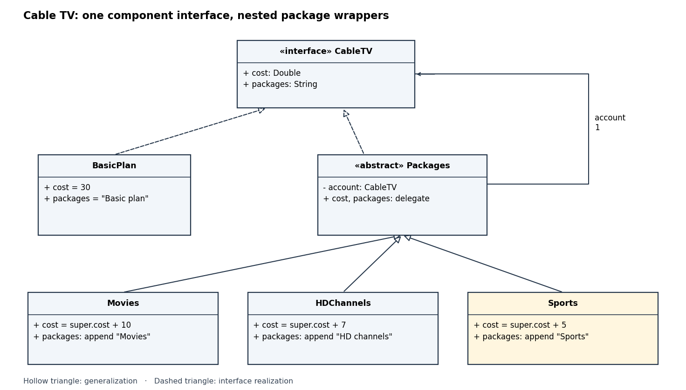

<h1 id="7/c/solution">Solution</h1>

↑ **Parent:** [C](../c.md)

In this [UML class diagram](../../../../../class-diagram.md), hollow triangles point toward the more general type; dashed lines denote realization of the `CableTV` [object interface](../../../../../object-interface.md). The plain association records that `Packages` retains one wrapped account, without claiming exclusive lifetime ownership.

<a id="7/c/image-decorator-pattern-for-the-cable-television-account-extended-with-sports"></a>


**[Figure 1](#7/c/image-decorator-pattern-for-the-cable-television-account-extended-with-sports). Decorator pattern for the cable television account, extended with Sports**.

Add the following [software class](../../../../../class-programming.md) and client application to the supplied declarations. The inherited result type gives `BasicPlan.cost` an expected `Double` type, so its literal `30` is widened appropriately; no source change is needed.
```
class Sports(account: CableTV) extends Packages(account) {
  override def cost: Double = super.cost + 5.0
  override def packages: String = super.packages + ", Sports"
}

object CheckCableTV {
  def show(account: CableTV): Unit =
    println(account.packages + ": GBP " + account.cost)

  def main(args: Array[String]): Unit = {
    val basic: CableTV = new BasicPlan
    val movies: CableTV = new Movies(basic)
    val hd: CableTV = new HDChannels(movies)
    val sports: CableTV = new Sports(hd)
    show(basic)
    show(movies)
    show(hd)
    show(sports)
    assert(sports.cost == 52.0)
    assert(sports.packages == "Basic plan, Movies, HD channels, Sports")
  }
}
```
The printed accounts have costs `30.0`, `40.0`, `47.0`, and `52.0`, with each description extending the preceding one. **The fully decorated account is `Basic plan, Movies, HD channels, Sports`, costing £52.** The intermediate accounts remain available because wrapping constructs a new [software object](../../../../../software-object.md). [methodSig and typesFromOverridden: inherited return type supplies the expected type while typing an overriding body](../../../../../scala-2-11-12-method-type-inference-implementation.md)

## ↑ Ancestors (12)

1. [C](../c.md)
2. [7](../../7.md)
3. [Imperative programming (resit)](../../../imperative-programming-resit-split.md)
4. [2016](../../../split.md)
5. [Past exam of the year 1 of the computer science course of the University of Oxford](../../../../split.md)
6. [Year 1 of the computer science course of the University of Oxford](../../../../../year-1-of-the-computer-science-course-of-the-university-of-oxford.md)
7. [Computer science course of the University of Oxford](../../../../../computer-science-course-of-the-university-of-oxford.md)
8. [Undergraduate course of the University of Oxford](../../../../../undergraduate-course-of-the-university-of-oxford.md)
9. [Course of the University of Oxford](../../../../../course-of-the-university-of-oxford.md)
10. [University of Oxford](../../../../../university-of-oxford-split.md)
11. [List of universities](../../../../../list-of-universities.md)
12. [Codex Wiki](../../../../../split.md)
