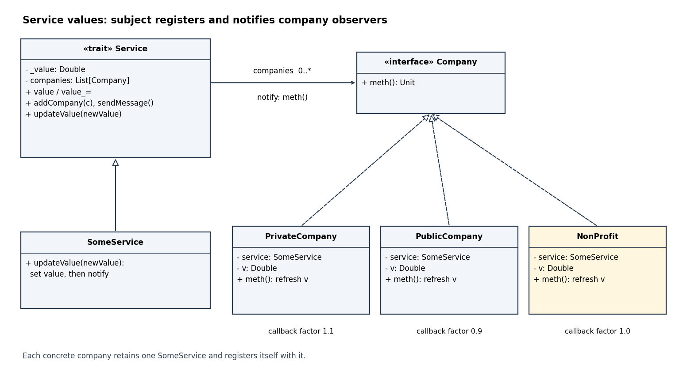

<h1 id="8/c/solution">Solution</h1>

↑ **Parent:** [C](../c.md)

The [UML class diagram](../../../../../class-diagram.md) shows the subject's collection of observers and the added concrete observer. Each concrete company also retains the `SomeService` reference shown in its attributes; notifications call `meth()` through `Company`.

<a id="8/c/image-observer-pattern-for-service-values-extended-with-a-nonprofit-company"></a>


**[Figure 2](#8/c/image-observer-pattern-for-service-values-extended-with-a-nonprofit-company). Observer pattern for service values, extended with a NonProfit company**.

Use an unscaled value both initially and in every callback:
```
class NonProfit(service: SomeService) extends Company {
  private var v: Double = service.value
  service.addCompany(this)

  override def meth(): Unit = {
    v = service.value
    printf("New service value: %f\n", v)
  }
}
```
Initializing `v` before registration prevents a callback from observing an uninitialized field if registration is later extended to notify immediately. For a service initially valued at `100.0`, this initializes `v` to `100.0`; after `updateValue(125.0)`, the callback sets `v` to `125.0` and prints `New service value: 125.000000` under a decimal-point locale. **The NonProfit update uses factor one.**

The word “always” requires a qualification in the supplied design. In the intended single-threaded notification protocol, $v=\texttt{service.value}$ holds after construction and after a completed `SomeService.updateValue`. However, the printed public `value_=` setter changes the subject without calling `sendMessage()`. Calling `service.value = ...` can therefore leave every cached observer value stale. No implementation that merely caches `v` in `meth()` can guarantee literal equality after that unannounced change. If equality on every query is required, replace the field by `private def v: Double = service.value`, retaining registration and the same printing callback; alternatively every mutation route must notify observers. The source's distinct private/public company multipliers are not changed.

## ↑ Ancestors (12)

1. [C](../c.md)
2. [8](../../8.md)
3. [Imperative programming (resit)](../../../imperative-programming-resit-split.md)
4. [2016](../../../split.md)
5. [Past exam of the year 1 of the computer science course of the University of Oxford](../../../../split.md)
6. [Year 1 of the computer science course of the University of Oxford](../../../../../year-1-of-the-computer-science-course-of-the-university-of-oxford.md)
7. [Computer science course of the University of Oxford](../../../../../computer-science-course-of-the-university-of-oxford.md)
8. [Undergraduate course of the University of Oxford](../../../../../undergraduate-course-of-the-university-of-oxford.md)
9. [Course of the University of Oxford](../../../../../course-of-the-university-of-oxford.md)
10. [University of Oxford](../../../../../university-of-oxford-split.md)
11. [List of universities](../../../../../list-of-universities.md)
12. [Codex Wiki](../../../../../split.md)
