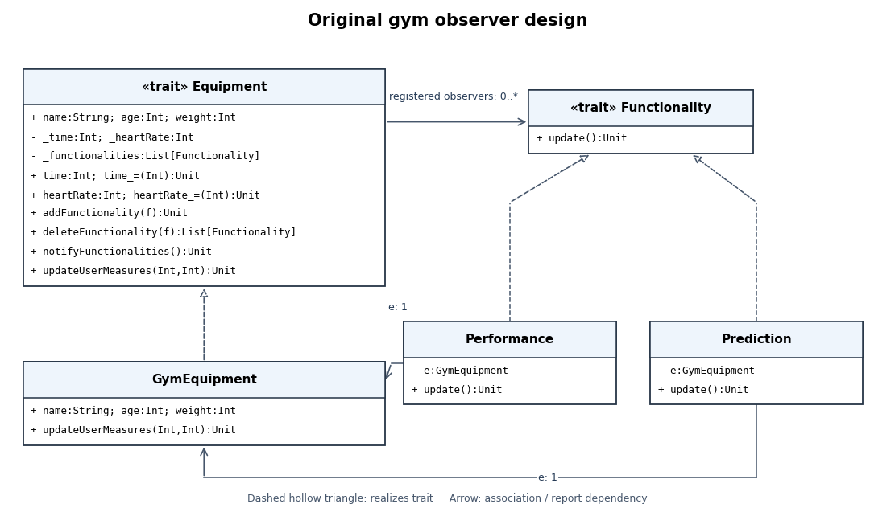

<h1 id="7/b/solution">Solution</h1>

↑ **Parent:** [B](../b.md)

The [UML class diagram](../../../../../class-diagram.md) below uses dashed hollow-triangle arrows for [trait](../../../../../trait.md) realization and ordinary arrows for stored references or navigable associations. Visibility is `+` for public and `-` for private.

**[Figure 1](#7/b/image-gym-equipment-classes-and-observer-associations). Gym equipment classes and observer associations**.

`GymEquipment` implements `Equipment`. `Performance` and `Prediction` implement `Functionality`, each retaining one `GymEquipment` reference and registering itself with that equipment. Each equipment keeps a [list](../../../../../list-abstract-data-type.md) of zero or more `Functionality` references; one functionality can in principle be registered with multiple equipment objects through the public method, although the supplied constructors register it only with their own equipment. Hence the generic registration association does not imply exclusive ownership or [composition in UML](../../../../../composition-in-uml.md).

**There are two [traits](../../../../../trait.md), one concrete equipment [software class](../../../../../class-programming.md), and two concrete observer [software classes](../../../../../class-programming.md).** `GymEquipment` implements `name`, `age`, and `weight` as read-only values and overrides `updateUserMeasures`; the mutable measurement state and observer list are defined privately in `Equipment`. The diagram reflects the source, including `deleteFunctionality` returning a new list rather than mutating the stored list.

## ↑ Ancestors (12)

1. [B](../b.md)
2. [7](../../7.md)
3. [Imperative programming](../../../imperative-programming-split.md)
4. [2016](../../../split.md)
5. [Past exam of the year 1 of the computer science course of the University of Oxford](../../../../split.md)
6. [Year 1 of the computer science course of the University of Oxford](../../../../../year-1-of-the-computer-science-course-of-the-university-of-oxford.md)
7. [Computer science course of the University of Oxford](../../../../../computer-science-course-of-the-university-of-oxford.md)
8. [Undergraduate course of the University of Oxford](../../../../../undergraduate-course-of-the-university-of-oxford.md)
9. [Course of the University of Oxford](../../../../../course-of-the-university-of-oxford.md)
10. [University of Oxford](../../../../../university-of-oxford-split.md)
11. [List of universities](../../../../../list-of-universities.md)
12. [Codex Wiki](../../../../../split.md)
