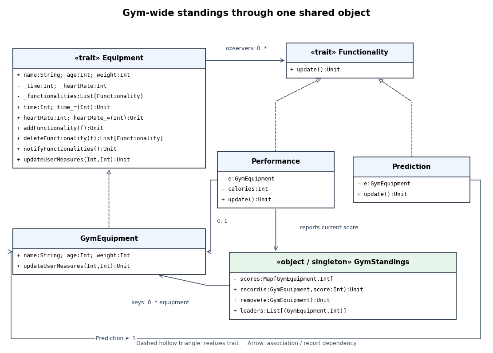

<h1 id="7/d/solution">Solution</h1>

↑ **Parent:** [D](../d.md)

Introduce one shared `GymStandings` [singleton object](../../../../../singleton-object.md). It stores the latest current-performance score for every participating `GymEquipment`, using the equipment reference as key, and returns every equipment object tied for the maximum score. `Performance.update` sends each freshly computed score to this object. The previous [observer pattern](../../../../../observer-pattern.md) and its prediction observer remain in use.

**[Figure 2](#7/d/image-observer-system-extended-with-a-singleton-for-gym-wide-standings). Observer system extended with a singleton for gym-wide standings**.

The added `Performance -> GymStandings` dependency means “reports to,” while `GymStandings -> GymEquipment` represents the equipment keys in its stored score [map](../../../../../function-class.md). `GymStandings` is an [software object](../../../../../software-object.md), so clients share its unique instance instead of constructing one standings object per machine. **The [singleton pattern](../../../../../singleton-pattern.md) centralizes the current scores and the maximum-score query.** Equipment objects, rather than user names, are the keys because two users can have the same name. Scores are current readings, not an accumulation of all historical notifications; the largest reported score wins, with all ties retained.

## ↑ Ancestors (12)

1. [D](../d.md)
2. [7](../../7.md)
3. [Imperative programming](../../../imperative-programming-split.md)
4. [2016](../../../split.md)
5. [Past exam of the year 1 of the computer science course of the University of Oxford](../../../../split.md)
6. [Year 1 of the computer science course of the University of Oxford](../../../../../year-1-of-the-computer-science-course-of-the-university-of-oxford.md)
7. [Computer science course of the University of Oxford](../../../../../computer-science-course-of-the-university-of-oxford.md)
8. [Undergraduate course of the University of Oxford](../../../../../undergraduate-course-of-the-university-of-oxford.md)
9. [Course of the University of Oxford](../../../../../course-of-the-university-of-oxford.md)
10. [University of Oxford](../../../../../university-of-oxford-split.md)
11. [List of universities](../../../../../list-of-universities.md)
12. [Codex Wiki](../../../../../split.md)
