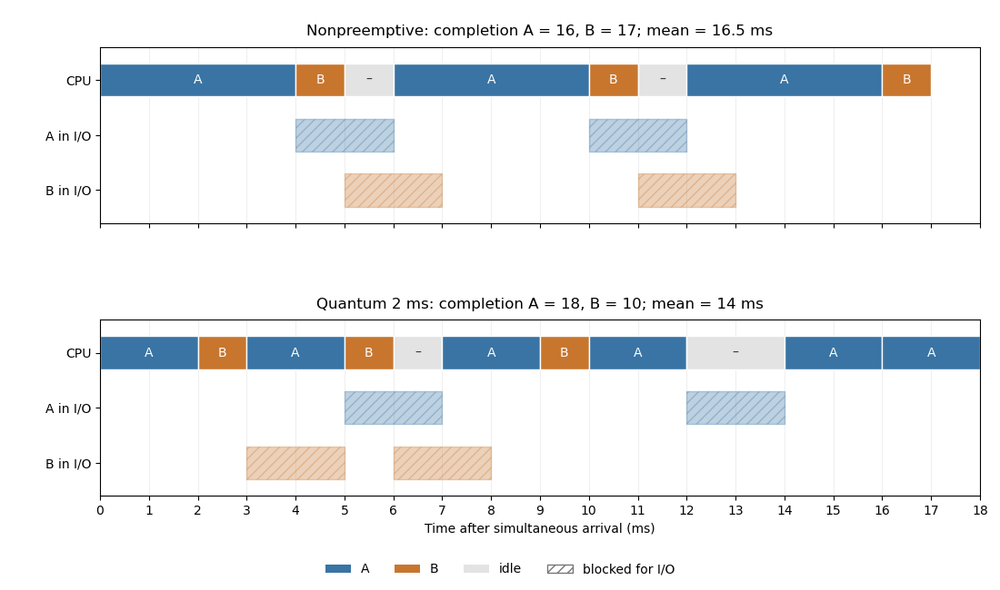
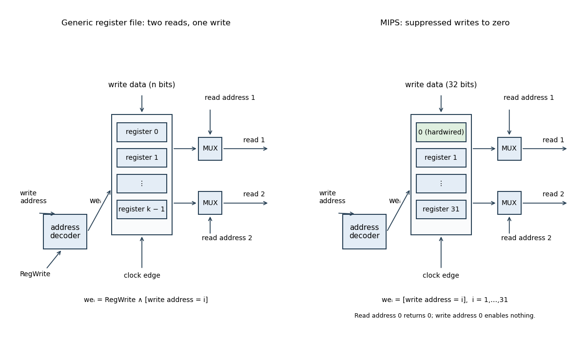

# Digital systems, linear algebra, introduction to formal proof

↑ **Parent:** [2017](../2017.md)

Solutions to the 15 June 2017 preliminary examination, with all 46 printed subparts answered. Source: [released examination archive](https://www.whatdotheyknow.com/request/past_exam_papers_for_1st_year_of/response/1398416/attach/2/Fakour%20Zip%20Final%201.zip?cookie_passthrough=1), member `a10101w1-1.pdf`.

**Table of contents**

- [1](#1)
  - [a](#1/a)
    - [Solution](#1/a/solution)
  - [b](#1/b)
    - [Solution](#1/b/solution)
  - [c](#1/c)
    - [Solution](#1/c/solution)
  - [d](#1/d)
    - [Solution](#1/d/solution)
- [2](#2)
  - [a](#2/a)
    - [Solution](#2/a/solution)
  - [b](#2/b)
    - [Solution](#2/b/solution)
  - [c](#2/c)
    - [Solution](#2/c/solution)
  - [d](#2/d)
    - [Solution](#2/d/solution)
  - [e](#2/e)
    - [Solution](#2/e/solution)
  - [f](#2/f)
    - [Solution](#2/f/solution)
- [3](#3)
  - [a](#3/a)
    - [Solution](#3/a/solution)
  - [b](#3/b)
    - [i](#3/b/i)
      - [Solution](#3/b/i/solution)
    - [ii](#3/b/ii)
      - [Solution](#3/b/ii/solution)
    - [iii](#3/b/iii)
      - [Solution](#3/b/iii/solution)
- [4](#4)
  - [a](#4/a)
    - [Solution](#4/a/solution)
  - [b](#4/b)
    - [Solution](#4/b/solution)
  - [c](#4/c)
    - [Solution](#4/c/solution)
  - [d](#4/d)
    - [Solution](#4/d/solution)
  - [e](#4/e)
    - [Solution](#4/e/solution)
  - [f](#4/f)
    - [Solution](#4/f/solution)
  - [g](#4/g)
    - [Solution](#4/g/solution)
- [5](#5)
  - [a](#5/a)
    - [i](#5/a/i)
      - [Solution](#5/a/i/solution)
    - [ii](#5/a/ii)
      - [Solution](#5/a/ii/solution)
  - [b](#5/b)
    - [Solution](#5/b/solution)
  - [c](#5/c)
    - [i](#5/c/i)
      - [Solution](#5/c/i/solution)
    - [ii](#5/c/ii)
      - [Solution](#5/c/ii/solution)
  - [d](#5/d)
    - [i](#5/d/i)
      - [Solution](#5/d/i/solution)
    - [ii](#5/d/ii)
      - [Solution](#5/d/ii/solution)
    - [iii](#5/d/iii)
      - [Solution](#5/d/iii/solution)
- [6](#6)
  - [a](#6/a)
    - [i](#6/a/i)
      - [Solution](#6/a/i/solution)
    - [ii](#6/a/ii)
      - [Solution](#6/a/ii/solution)
  - [b](#6/b)
    - [i](#6/b/i)
      - [Solution](#6/b/i/solution)
    - [ii](#6/b/ii)
      - [Solution](#6/b/ii/solution)
    - [iii](#6/b/iii)
      - [Solution](#6/b/iii/solution)
    - [iv](#6/b/iv)
      - [Solution](#6/b/iv/solution)
- [7](#7)
  - [a](#7/a)
    - [i](#7/a/i)
      - [Solution](#7/a/i/solution)
    - [ii](#7/a/ii)
      - [Solution](#7/a/ii/solution)
    - [iii](#7/a/iii)
      - [Solution](#7/a/iii/solution)
    - [iv](#7/a/iv)
      - [Solution](#7/a/iv/solution)
    - [v](#7/a/v)
      - [Solution](#7/a/v/solution)
  - [b](#7/b)
    - [i](#7/b/i)
      - [Solution](#7/b/i/solution)
    - [ii](#7/b/ii)
      - [Solution](#7/b/ii/solution)
- [8](#8)
  - [a](#8/a)
    - [Solution](#8/a/solution)
  - [b](#8/b)
    - [Solution](#8/b/solution)
  - [c](#8/c)
    - [Solution](#8/c/solution)
  - [d](#8/d)
    - [Solution](#8/d/solution)

## 1

↑ **Parent:** [Digital systems, linear algebra, introduction to formal proof](digital-systems-linear-algebra-introduction-to-formal-proof.md)

<h3 id="1/a">a</h3>

↑ **Parent:** [1](#1)

<h4 id="1/a/solution">Solution</h4>

↑ **Parent:** [A](#1/a)

Use four request [bits](../../information-theory.md#bit) $r_0,r_1,r_2,r_3$ and four grant bits $g_0,g_1,g_2,g_3$. A high $r_i$ requests service for the coming allocation period, and a high $g_i$ identifies the requester granted the resource during the current period. At most one grant may be high. An all-zero grant vector means idle. The [synchronous sequential circuit](../../foundations-of-mathematics.md#synchronous-sequential-circuit) also has a [clock](../../classical-mechanics.md#clock) and an initialization signal.

Requests are sampled at a [clock edge](../../computer-science.md#clock-edge); the resulting allocation appears during the following cycle. This fixes the [Moore machine](../../foundations-of-mathematics.md#moore-machine) timing convention: current grants depend on the stored state, rather than combinationally on requests that can change within the cycle.

<h3 id="1/b">b</h3>

↑ **Parent:** [1](#1)

<h4 id="1/b/solution">Solution</h4>

↑ **Parent:** [B](#1/b)

Store **three state bits**: a two-bit index $L\in\{0,1,2,3\}$ identifying the most recent recipient, and a valid bit $V$ indicating whether that recipient is receiving service in the current cycle. Then

$$
g_i=V\land[L=i].
$$

When no requests are present at a decision edge, clear $V$ but preserve $L$. Preserving $L$ implements [round-robin arbitration with idle memory](../../electrical-engineering.md#round-robin-arbitration-with-idle-memory). Four possible last recipients each have an active and an idle state, giving eight states. The four idle states have equal outputs but different future priorities, so they cannot all be merged. One valid reset is $L=3,V=0$, which gives requester zero first priority at startup.

<h3 id="1/c">c</h3>

↑ **Parent:** [1](#1)

<h4 id="1/c/solution">Solution</h4>

↑ **Parent:** [C](#1/c)

All requester indices in the following expressions are interpreted [modulo](../../modular-arithmetic.md#modulo-operation) four. Let $h_{\ell,j}$ mean that requester $j$ is the first asserted request after last recipient $\ell$:

$$
h_{\ell,\ell+d}=r_{\ell+d}\land\bigwedge_{t=1}^{d-1}\neg r_{\ell+t},\qquad d=1,2,3,4.
$$

An empty [logical conjunction](../../mathematical-logic.md#logical-conjunction) is true. Decode the remembered index and combine the four priority orders:

$$
w_j=\bigvee_{\ell=0}^3([L=\ell]\land h_{\ell,j}),\qquad H=\bigvee_{j=0}^3r_j.
$$

Exactly one $w_j$ is high when any request is high. Write $L$ as bits $L_1L_0$. The [next-state function](../../foundations-of-mathematics.md#next-state-function) and [Moore machine](../../foundations-of-mathematics.md#moore-machine) outputs are

$$
\boxed{\begin{aligned}
V^+&=H,\\
L_1^+&=(\neg H\land L_1)\lor w_2\lor w_3,\\
L_0^+&=(\neg H\land L_0)\lor w_1\lor w_3,\\
g_j&=V\land[L=j].
\end{aligned}}
$$

Thus an idle step preserves the priority memory. The $w_j$ are combinational selection signals, not the current-cycle grants: exposing them directly as outputs would change the design into a [Mealy machine](../../foundations-of-mathematics.md#mealy-machine). If a requester remains continuously asserted, each intervening successful grant advances the circular order, so it receives service after at most four grant decisions.

<h3 id="1/d">d</h3>

↑ **Parent:** [1](#1)

<h4 id="1/d/solution">Solution</h4>

↑ **Parent:** [D](#1/d)

For a single [read-only memory](../../computer-memory.md#read-only-memory) implementing both the next-state and output equations, the address has four request bits plus three present-state bits. Each word contains three next-state bits and four grant bits. Hence

$$
\boxed{2^7\text{ words}\times7\text{ bits}=128\times7=896\text{ bits}.}
$$

Three [D flip-flops](../../electrical-engineering.md#d-flip-flop) store the state outside this combinational ROM. This is the direct truth-table implementation for the encoding above. A smaller factored implementation exploits the independence of the next-state equations from $V$: a $64\times3$ next-state ROM and an $8\times4$ output ROM use $224$ stored bits in total, or the output decoder can be ordinary logic. These are different implementation organizations, not different state counts.

## 2

↑ **Parent:** [Digital systems, linear algebra, introduction to formal proof](digital-systems-linear-algebra-introduction-to-formal-proof.md)

<h3 id="2/a">a</h3>

↑ **Parent:** [2](#2)

<h4 id="2/a/solution">Solution</h4>

↑ **Parent:** [A](#2/a)

An **[input-output-bound process](../../operating-system.md#i-o-bound-process)** spends much of its time waiting for [input-output](../../computer-science.md#input-output), often with short [CPU bursts](../../operating-system.md#cpu-burst) between waits. A **[CPU-bound process](../../operating-system.md#cpu-bound-process)** spends most of its time doing useful [CPU](../../computer-science.md#central-processing-unit) computation, with comparatively little blocking. These descriptions concern the bottleneck in the workload; an I/O-bound process still needs CPU time.

<h3 id="2/b">b</h3>

↑ **Parent:** [2](#2)

<h4 id="2/b/solution">Solution</h4>

↑ **Parent:** [B](#2/b)

With [nonpreemptive scheduling](../../operating-system.md#nonpreemptive-scheduling), a running process retains the processor until it finishes its current [CPU burst](../../operating-system.md#cpu-burst), blocks or voluntarily yields. With [preemptive scheduling](../../operating-system.md#preemptive-scheduling), the operating system may suspend a runnable process and select another one.

Time-slice preemption needs a **[hardware timer](../../foundations-of-mathematics.md#hardware-timer) delivering an [interrupt](../../operating-system.md#interrupt)** after bounded execution time, so control returns to the scheduler even if the running program never yields. Saving and restoring the [execution context](../../operating-system.md#execution-context) then lets the interrupted process resume later. The timer mechanism should remain under operating-system control.

<h3 id="2/c">c</h3>

↑ **Parent:** [2](#2)

<h4 id="2/c/solution">Solution</h4>

↑ **Parent:** [C](#2/c)

Assume both processes are available at time zero and run the listed order, A followed by B, with no overlap even during [input-output](../../computer-science.md#input-output). A takes $12+4=16$ ms; B then takes $3+4=7$ ms. Thus

$$
\boxed{\text{elapsed time}=23\text{ ms},\qquad\text{mean turnaround}=\frac{16+23}{2}=19.5\text{ ms}.}
$$

The [scheduling turnaround time](../../operating-system.md#scheduling-turnaround-time) includes the time waiting before a process first runs. Reversing the serial order would leave the total at 23 ms but change completion times to 7 and 23 ms, with mean 15 ms. If arrivals were instead delayed until each serial launch, that would define a different turnaround measurement; the simultaneous-arrival convention is used for comparing the schedulers below.

<h3 id="2/d">d</h3>

↑ **Parent:** [2](#2)

<h4 id="2/d/solution">Solution</h4>

↑ **Parent:** [D](#2/d)

With the given ready-order rule and A first, the [CPU](../../computer-science.md#central-processing-unit) timeline in milliseconds is

$$
\begin{array}{c|rrrrrrrr}
\text{interval}&0\!:\!4&4\!:\!5&5\!:\!6&6\!:\!10&10\!:\!11&11\!:\!12&12\!:\!16&16\!:\!17\\
\text{CPU}&A&B&\text{idle}&A&B&\text{idle}&A&B
\end{array}
$$

A performs [input-output](../../computer-science.md#input-output) during $[4,6)$ and $[10,12)$; B does so during $[5,7)$ and $[11,13)$. In particular, B becoming ready at time 7 does not interrupt A's ongoing nonpreemptive burst. The completion times are $C_A=16$ and $C_B=17$, giving

$$
\boxed{\text{elapsed time}=17\text{ ms},\qquad\text{mean turnaround}=16.5\text{ ms}.}
$$

There are 15 ms of useful CPU execution and 2 ms of idle time on this particular timeline.

**[Figure 1](#2/d/image-cpu-timelines-and-i-o-waits-for-the-two-scheduling-policies). CPU timelines and I/O waits for the two scheduling policies**. Both processes arrive at zero. Readiness determines queue order; A wins initial ties. The displayed completion times give mean turnarounds 16.5 ms without preemption and 14 ms with a two-millisecond quantum.

<h3 id="2/e">e</h3>

↑ **Parent:** [2](#2)

<h4 id="2/e/solution">Solution</h4>

↑ **Parent:** [E](#2/e)

Use [round-robin scheduling](../../operating-system.md#round-robin-scheduling) with [scheduling quantum](../../operating-system.md#scheduling-quantum) 2 ms. A's first burst is split by B, and A's second burst is also interrupted once. The resulting CPU intervals are

$$
\begin{array}{c|rrrrrrrrrrr}
\text{interval}&0\!:\!2&2\!:\!3&3\!:\!5&5\!:\!6&6\!:\!7&7\!:\!9&9\!:\!10&10\!:\!12&12\!:\!14&14\!:\!16&16\!:\!18\\
\text{CPU}&A&B&A&B&\text{idle}&A&B&A&\text{idle}&A&A
\end{array}
$$

A blocks for input-output during $[5,7)$ and $[12,14)$; B blocks during $[3,5)$ and $[6,8)$. At time 8, B joins the [ready queue](../../operating-system.md#ready-queue) while A uses the remainder of its current quantum; B runs at time 9. No other process is runnable during A's final four milliseconds, so A can continue across the time-16 quantum boundary. Consequently

$$
\boxed{C_B=10,\quad C_A=18,\quad\text{elapsed time}=18\text{ ms},\quad\text{mean turnaround}=14\text{ ms}.}
$$

<h3 id="2/f">f</h3>

↑ **Parent:** [2](#2)

<h4 id="2/f/solution">Solution</h4>

↑ **Parent:** [F](#2/f)

The preemptive policy improves B's [scheduling turnaround time](../../operating-system.md#scheduling-turnaround-time) from 17 to 10 ms and the mean from 16.5 to 14 ms. A finishes later, at 18 rather than 16 ms, and the total completion time rises from 17 to 18 ms. Thus **preemption improves mean turnaround here; nonpreemption gives the shorter makespan here**.

The result illustrates different scheduling objectives, not a universal winner. These calculations assume negligible [context switch](../../operating-system.md#context-switch) overhead; charging for the additional switches could change the comparison. Both policies perform the same 15 ms of useful [CPU](../../computer-science.md#central-processing-unit) work.

## 3

↑ **Parent:** [Digital systems, linear algebra, introduction to formal proof](digital-systems-linear-algebra-introduction-to-formal-proof.md)

<h3 id="3/a">a</h3>

↑ **Parent:** [3](#3)

<h4 id="3/a/solution">Solution</h4>

↑ **Parent:** [A](#3/a)

Use $k$ clocked [processor registers](../../computer-science.md#processor-register), each storing an $n$-bit word, two independent combinational read ports and one synchronous write port. Each address requires $a=\lceil\log_2k\rceil$ bits. The read addresses select two $k$-to-one [multiplexers](../../theoretical-computer-science.md#multiplexer), each $n$ bits wide. A write-address [binary decoder](../../theoretical-computer-science.md#binary-decoder) combines its selected line with the global write enable to form the individual enables:

$$
we_i=\mathrm{RegWrite}\land[\mathrm{wa}=i].
$$

At the active [clock edge](../../computer-science.md#clock-edge), register $i$ captures the common write data if $we_i=1$, otherwise retaining its word. Reads return the currently stored words selected by their respective addresses. For non-power-of-two $k$, unused address codes need a specified harmless implementation. A simultaneous read and write of one address follows the chosen edge/read timing; an additional forwarding circuit would be needed if a different bypass convention were required.

**[Figure 2](#3/a/image-two-read-port-register-file-with-a-single-synchronous-write-port). Two-read-port register file with a single synchronous write port**. The left panel uses a global write enable; the right shows the MIPS alternative with writes to index zero suppressed. Both read multiplexers select independently, and the alternative returns a hardwired zero for address zero.

<h3 id="3/b">b</h3>

↑ **Parent:** [3](#3)

<h4 id="3/b/i">i</h4>

↑ **Parent:** [B](#3/b)

<h5 id="3/b/i/solution">Solution</h5>

↑ **Parent:** [I](#3/b/i)

Keep storage only for registers 1 through 31, return a hardwired all-zero word on either read port when its address is zero, and set

$$
\boxed{we_i=[\mathrm{wa}=i],\qquad i=1,\ldots,31.}
$$

There is no enable for register zero and no global RegWrite input to this [register file](../../computer-science.md#register-file). The right-hand diagram above shows this change. Every clock edge may select a write address; choosing zero suppresses all physical register enables. Consequently the [MIPS zero register](../../computer-science.md#mips-zero-register) acts as a [write-suppression destination](../../computer-science.md#write-suppression-destination).

<h4 id="3/b/ii">ii</h4>

↑ **Parent:** [B](#3/b)

<h5 id="3/b/ii/solution">Solution</h5>

↑ **Parent:** [Ii](#3/b/ii)

Move the no-write decision into the destination-address path. If the original destination selection produced $d$ and the original write-enable decision was $W$, drive the new register file with

$$
\boxed{\mathrm{wa}=\begin{cases}d,&W=1,\\0,&W=0.\end{cases}}
$$

A five-bit two-input [multiplexer](../../theoretical-computer-science.md#multiplexer) after the existing destination selector implements this, or the decoder can directly select among zero, the instruction's destination fields and register 31. Its control still distinguishes writing and non-writing instructions: removing the register-file enable pin does not remove that logical decision.

Read-address selection and the result-data path can remain unchanged. Instructions that formerly disabled RegWrite now select destination zero; their write data is irrelevant. Instructions writing an actual destination preserve the same address and data. Since writes to the [MIPS zero register](../../computer-science.md#mips-zero-register) were already discarded, the architectural behaviour is unchanged for that case as well.

<h4 id="3/b/iii">iii</h4>

↑ **Parent:** [B](#3/b)

<h5 id="3/b/iii/solution">Solution</h5>

↑ **Parent:** [Iii](#3/b/iii)

For **`add`**, select `rd` and the [arithmetic logic unit](../../computer-science.md#arithmetic-logic-unit) result. For **`sw`**, select destination zero while retaining the memory-store controls and source-register reads. For **`jal`**, select register 31 and the return-address data. These are the same actual register writes as before, with `sw` using destination zero in place of disabling RegWrite.

The link value is determined by the particular [MIPS architecture](../../computer-science.md#mips-architecture) datapath convention: $\mathrm{PC}+4$ for the usual teaching datapath without a delay slot, or $\mathrm{PC}+8$ for classic delayed-branch MIPS. This write-enable change does not alter whichever link convention the original machine implements.

## 4

↑ **Parent:** [Digital systems, linear algebra, introduction to formal proof](digital-systems-linear-algebra-introduction-to-formal-proof.md)

<h3 id="4/a">a</h3>

↑ **Parent:** [4](#4)

<h4 id="4/a/solution">Solution</h4>

↑ **Parent:** [A](#4/a)

**No: the only solution is the zero vector.** Subtract the fourth row equation from the first to get $2x_3=0$. Subtract the third from the fourth to get $2x_2=0$. With $x_2=x_3=0$, any row then gives $x_1=0$. Thus this [homogeneous linear system](../../linear-algebra.md#homogeneous-linear-system) has trivial [null space](../../kernel-of-a-linear-map.md).

<h3 id="4/b">b</h3>

↑ **Parent:** [4](#4)

<h4 id="4/b/solution">Solution</h4>

↑ **Parent:** [B](#4/b)

The columns are **[linearly independent](../../vector-space.md#linear-independence)**. A [linear combination](../../vector-space.md#linear-combination) of them with coefficients $x_1,x_2,x_3$ is exactly $Ax$. Part (a) shows that this vanishes only when all three coefficients vanish, which is the definition of column independence. Hence $A$ has [column rank](../../vector-space.md#column-rank) three.

<h3 id="4/c">c</h3>

↑ **Parent:** [4](#4)

<h4 id="4/c/solution">Solution</h4>

↑ **Parent:** [C](#4/c)

Writing the columns as $a_1,a_2,a_3$, [matrix multiplication](../../vector-space.md#matrix-multiplication) gives

$$
c=Ay=y_1a_1+y_2a_2+y_3a_3.
$$

The [column space](../../vector-space.md#column-space) is the [linear span](../../vector-space.md#linear-span) of these columns, so this particular linear combination belongs to it. The assertion holds for every vector of coefficients $y$.

<h3 id="4/d">d</h3>

↑ **Parent:** [4](#4)

<h4 id="4/d/solution">Solution</h4>

↑ **Parent:** [D](#4/d)

If $Ax=b$ has a solution, the multiplication identity from part (c) expresses $b$ as a [linear combination](../../vector-space.md#linear-combination) of the columns, so $b\in\operatorname{Col}(A)$.

Conversely, if $b$ lies in that [column space](../../vector-space.md#column-space), its definition supplies scalars $x_1,x_2,x_3$ with $b=x_1a_1+x_2a_2+x_3a_3$. Put those scalars into the column vector $x$. Then $Ax=b$. This proves both directions of the claimed equivalence.

<h3 id="4/e">e</h3>

↑ **Parent:** [4](#4)

<h4 id="4/e/solution">Solution</h4>

↑ **Parent:** [E](#4/e)

The [Gram-Schmidt process](../../inner-product.md#gram-schmidt-process) first gives $u_1=a_1=(1,1,1,1)^T$, of norm two. Next $a_1^Ta_2/(a_1^Ta_1)=2$, so

$$
u_2=a_2-2u_1=(1,-1,-1,1)^T.
$$

For the third column, both coefficients onto $u_1,u_2$ equal one, giving

$$
u_3=a_3-u_1-u_2=(1,-1,1,-1)^T.
$$

These three nonzero vectors are mutually [orthogonal](../../inner-product.md#orthogonal-vectors) and each has norm two. The resulting [orthonormal basis](../../inner-product.md#orthonormal-basis) is

$$
\boxed{q_1=\frac12\begin{pmatrix}1\\1\\1\\1\end{pmatrix},\quad
q_2=\frac12\begin{pmatrix}1\\-1\\-1\\1\end{pmatrix},\quad
q_3=\frac12\begin{pmatrix}1\\-1\\1\\-1\end{pmatrix}.}
$$

<h3 id="4/f">f</h3>

↑ **Parent:** [4](#4)

<h4 id="4/f/solution">Solution</h4>

↑ **Parent:** [F](#4/f)

Collect the orthonormal vectors as columns and compute $R=Q^TA$. This gives the thin [QR decomposition](../../inner-product.md#qr-decomposition)

$$
\boxed{Q=\frac12\begin{pmatrix}1&1&1\\1&-1&-1\\1&-1&1\\1&1&-1\end{pmatrix},\qquad
R=\begin{pmatrix}2&4&2\\0&2&2\\0&0&2\end{pmatrix}.}
$$

The [inner products](../../inner-product.md) in part (e) prove $Q^TQ=I_3$; the column identities $a_1=2q_1$, $a_2=4q_1+2q_2$, $a_3=2q_1+2q_2+2q_3$ prove $A=QR$.

<h3 id="4/g">g</h3>

↑ **Parent:** [4](#4)

<h4 id="4/g/solution">Solution</h4>

↑ **Parent:** [G](#4/g)

Substitute the [QR decomposition](../../inner-product.md#qr-decomposition) into the [normal equations](../../normal-linear-model.md#normal-equation):

$$
R^TRy=R^TQ^Tb.
$$

The diagonal of $R$ is nonzero, so $R^T$ is invertible. Cancel it algebraically to obtain

$$
\boxed{Ry=Q^Tb.}
$$

Compute the three [inner products](../../inner-product.md) in $Q^Tb$, then use [back substitution](../../linear-algebra.md#back-substitution) in this [upper triangular matrix](../../linear-algebra.md#upper-triangular-matrix). There is no need to form an inverse or explicitly construct $A^TA$. The [orthogonal projection](../../hilbert-space.md#orthogonal-projection) of $b$ onto the column space is $QQ^Tb$; its orthogonal residual proves that this solution minimizes $\|Ay-b\|_2$.

## 5

↑ **Parent:** [Digital systems, linear algebra, introduction to formal proof](digital-systems-linear-algebra-introduction-to-formal-proof.md)

<h3 id="5/a">a</h3>

↑ **Parent:** [5](#5)

<h4 id="5/a/i">i</h4>

↑ **Parent:** [A](#5/a)

<h5 id="5/a/i/solution">Solution</h5>

↑ **Parent:** [I](#5/a/i)

The required [elementary matrix](../../numerical-linear-algebra.md#elementary-matrix) is

$$
\boxed{E=\begin{pmatrix}0&0&1\\0&1&0\\1&0&0\end{pmatrix},\qquad E^{-1}=E.}
$$

Left multiplication exchanges the two rows. Applying the same exchange twice restores every row, so $E^2=I_3$.

<h4 id="5/a/ii">ii</h4>

↑ **Parent:** [A](#5/a)

<h5 id="5/a/ii/solution">Solution</h5>

↑ **Parent:** [Ii](#5/a/ii)

The elementary row operation and its reverse are

$$
\boxed{F=\begin{pmatrix}1&0&0\\0&1&0\\0&-3&1\end{pmatrix},\qquad
F^{-1}=\begin{pmatrix}1&0&0\\0&1&0\\0&3&1\end{pmatrix}.}
$$

Thus $FA$ replaces row three by row three minus three times row two. The inverse adds those three copies back.

<h3 id="5/b">b</h3>

↑ **Parent:** [5](#5)

<h4 id="5/b/solution">Solution</h4>

↑ **Parent:** [B](#5/b)

Use multiplicativity of the [determinant](../../multilinear-algebra.md#determinant) and the determinant criterion for an [invertible matrix](../../linear-algebra.md#invertible-matrix):

$$
0\ne\det A=\det L\det U.
$$

Neither factor can therefore be zero, so both matrices are nonsingular. The determinant of a [triangular matrix](../../linear-algebra.md#triangular-matrix) is the product of its diagonal entries:

$$
\det L=\prod_{i=1}^N L_{ii},\qquad\det U=\prod_{i=1}^N U_{ii}.
$$

Each product is nonzero, forcing every diagonal factor to be nonzero. These explicitly stated determinant properties justify both conclusions.

<h3 id="5/c">c</h3>

↑ **Parent:** [5](#5)

<h4 id="5/c/i">i</h4>

↑ **Parent:** [C](#5/c)

<h5 id="5/c/i/solution">Solution</h5>

↑ **Parent:** [I](#5/c/i)

First subtract row one from row two, using $E_1$; then subtract four times the updated row two from row three, using $E_2$:

$$
E_1=\begin{pmatrix}1&0&0\\-1&1&0\\0&0&1\end{pmatrix},\qquad
E_2=\begin{pmatrix}1&0&0\\0&1&0\\0&-4&1\end{pmatrix}.
$$

The updated second row is $(0,1,2)$ and the final third row is $(0,0,-4)$. Hence $E_2E_1A=U$ and $L=E_1^{-1}E_2^{-1}$. The resulting [LU decomposition](../../numerical-linear-algebra.md#lu-decomposition) is

$$
\boxed{L=\begin{pmatrix}1&0&0\\1&1&0\\0&4&1\end{pmatrix},\qquad
U=\begin{pmatrix}1&1&1\\0&1&2\\0&0&-4\end{pmatrix},\qquad A=LU.}
$$

Reversing the order when undoing the elementary operations is essential.

<h4 id="5/c/ii">ii</h4>

↑ **Parent:** [C](#5/c)

<h5 id="5/c/ii/solution">Solution</h5>

↑ **Parent:** [Ii](#5/c/ii)

Introduce $z=Ux$. Solve $Lz=b$ by [forward substitution](../../numerical-linear-algebra.md#forward-substitution) and then $Ux=z$ by [back substitution](../../linear-algebra.md#back-substitution). For these factors, the recurrences are

$$
z_1=b_1,\quad z_2=b_2-z_1,\quad z_3=b_3-4z_2,
$$

followed by

$$
x_3=-z_3/4,\quad x_2=z_2-2x_3,\quad x_1=z_1-x_2-x_3.
$$

The nonzero diagonal entries make both triangular solves well-defined. No matrix inverse is calculated.

<h3 id="5/d">d</h3>

↑ **Parent:** [5](#5)

<h4 id="5/d/i">i</h4>

↑ **Parent:** [D](#5/d)

<h5 id="5/d/i/solution">Solution</h5>

↑ **Parent:** [I](#5/d/i)

With column-vector [homogeneous coordinates](../../projective-space.md#homogeneous-coordinate), the translation matrix is

$$
\boxed{T(a,b)=\begin{pmatrix}1&0&a\\0&1&b\\0&0&1\end{pmatrix}.}
$$

It maps $(x,y,1)^T$ to $(x+a,y+b,1)^T$. The final coordinate incorporates the constant displacement into [matrix multiplication](../../vector-space.md#matrix-multiplication).

<h4 id="5/d/ii">ii</h4>

↑ **Parent:** [D](#5/d)

<h5 id="5/d/ii/solution">Solution</h5>

↑ **Parent:** [Ii](#5/d/ii)

Reflection in $x=0$ sends $(x,y)$ to $(-x,y)$. Therefore its homogeneous-coordinate matrix is

$$
\boxed{J=\begin{pmatrix}-1&0&0\\0&1&0\\0&0&1\end{pmatrix}.}
$$

Its square is the identity, as required for applying the same [reflection](../../linear-algebra.md#reflection-mathematics) twice.

<h4 id="5/d/iii">iii</h4>

↑ **Parent:** [D](#5/d)

<h5 id="5/d/iii/solution">Solution</h5>

↑ **Parent:** [Iii](#5/d/iii)

Translate the mirror line to zero, reflect there, then translate back. Under the column-vector convention the rightmost operation acts first:

$$
\boxed{T(2,0)JT(-2,0)=\begin{pmatrix}-1&0&4\\0&1&0\\0&0&1\end{pmatrix}.}
$$

This [composition of affine transformations](../../geometry-and-topology.md#composition-of-affine-transformations) maps $(x,y)$ to $(4-x,y)$, fixing exactly the points with $x=2$.

## 6

↑ **Parent:** [Digital systems, linear algebra, introduction to formal proof](digital-systems-linear-algebra-introduction-to-formal-proof.md)

<h3 id="6/a">a</h3>

↑ **Parent:** [6](#6)

<h4 id="6/a/i">i</h4>

↑ **Parent:** [A](#6/a)

<h5 id="6/a/i/solution">Solution</h5>

↑ **Parent:** [I](#6/a/i)

Since $B$ is [upper triangular](../../linear-algebra.md#upper-triangular-matrix), its [eigenvalues](../../linear-operator-theory.md#eigenvalue) are its diagonal entries. Equivalently, its [characteristic polynomial](../../linear-operator-theory.md#characteristic-polynomial) is $\lambda(\lambda-3/8)$. Hence

$$
\boxed{\lambda_1=0,\qquad\lambda_2=3/8.}
$$

<h4 id="6/a/ii">ii</h4>

↑ **Parent:** [A](#6/a)

<h5 id="6/a/ii/solution">Solution</h5>

↑ **Parent:** [Ii](#6/a/ii)

For eigenvalue zero take $s_1=(1,0)^T$. For eigenvalue $3/8$, the first row of $(B-3I/8)s_2=0$ gives $x=-2y$, so take $s_2=(-2,1)^T$. These are [linearly independent](../../vector-space.md#linear-independence) [eigenvectors](../../linear-operator-theory.md#eigenvector), giving

$$
\boxed{S=\begin{pmatrix}1&-2\\0&1\end{pmatrix},\quad
S^{-1}=\begin{pmatrix}1&2\\0&1\end{pmatrix},\quad
D=\begin{pmatrix}0&0\\0&3/8\end{pmatrix}.}
$$

The identities $Bs_i=\lambda_i s_i$ give $BS=SD$, hence the required [diagonalization](../../linear-operator-theory.md#diagonalization-of-a-matrix) $S^{-1}BS=D$.

<h3 id="6/b">b</h3>

↑ **Parent:** [6](#6)

<h4 id="6/b/i">i</h4>

↑ **Parent:** [B](#6/b)

<h5 id="6/b/i/solution">Solution</h5>

↑ **Parent:** [I](#6/b/i)

The [Gauss-Seidel method](../../numerical-linear-algebra.md#gauss-seidel-method) solves each component using the already updated components from the same iteration. In the splitting $A=D-L-U$, those updated diagonal and lower-triangular terms stay on the left, while upper-triangular terms use the previous iterate. Thus

$$
\boxed{(D-L)x_n=Ux_{n-1}+b.}
$$

Here $D-L$ is lower triangular with nonzero diagonal, so each new iterate is obtained by [forward substitution](../../numerical-linear-algebra.md#forward-substitution), starting from the specified zero vector.

<h4 id="6/b/ii">ii</h4>

↑ **Parent:** [B](#6/b)

<h5 id="6/b/ii/solution">Solution</h5>

↑ **Parent:** [Ii](#6/b/ii)

As $x_0=0$, solve $(D-L)x_1=b$. Its first row gives $4(x_1)_1=1$; its second gives $(x_1)_1+2(x_1)_2=-1$. Therefore

$$
\boxed{x_1=\begin{pmatrix}1/4\\-5/8\end{pmatrix}.}
$$

The second component uses the new first component $1/4$, distinguishing [Gauss-Seidel iteration](../../numerical-linear-algebra.md#gauss-seidel-method) from [Jacobi iteration](../../numerical-linear-algebra.md#jacobi-method).

<h4 id="6/b/iii">iii</h4>

↑ **Parent:** [B](#6/b)

<h5 id="6/b/iii/solution">Solution</h5>

↑ **Parent:** [Iii](#6/b/iii)

The exact solution obeys $(D-L)x=Ux+b$. Subtract this from the iteration to get $(D-L)e_n=Ue_{n-1}$. Hence the [stationary iteration matrix](../../numerical-linear-algebra.md#iteration-matrix) is

$$
\boxed{G=(D-L)^{-1}U
=\begin{pmatrix}1/4&0\\-1/8&1/2\end{pmatrix}
\begin{pmatrix}0&-3\\0&0\end{pmatrix}
=\begin{pmatrix}0&-3/4\\0&3/8\end{pmatrix},\qquad e_n=Ge_{n-1}.}
$$

This is exactly the matrix $B$ from part (a); the sign follows the given $A=D-L-U$ convention.

<h4 id="6/b/iv">iv</h4>

↑ **Parent:** [B](#6/b)

<h5 id="6/b/iv/solution">Solution</h5>

↑ **Parent:** [Iv](#6/b/iv)

**Yes.** Part (a) diagonalizes $G=B$, whose [spectral radius](../../analysis.md#spectral-radius) is $3/8<1$. Thus

$$
G^n=S\operatorname{diag}(0^n,(3/8)^n)S^{-1}\longrightarrow0\qquad(n\geq1),
$$

and every initial error converges to zero. For the specified initial vector, solving $Ax=b$ gives $x=(1,-1)^T$ and $e_0=(-1,1)^T$. In fact,

$$
\boxed{e_n=(3/8)^n\begin{pmatrix}-2\\1\end{pmatrix},\quad
x_n=\begin{pmatrix}1-2(3/8)^n\\-1+(3/8)^n\end{pmatrix}\quad(n\geq1).}
$$

The special formula is not asserted for $n=0$, because the zero-eigenvalue component disappears only after the first step.

## 7

↑ **Parent:** [Digital systems, linear algebra, introduction to formal proof](digital-systems-linear-algebra-introduction-to-formal-proof.md)

<h3 id="7/a">a</h3>

↑ **Parent:** [7](#7)

<h4 id="7/a/i">i</h4>

↑ **Parent:** [A](#7/a)

<h5 id="7/a/i/solution">Solution</h5>

↑ **Parent:** [I](#7/a/i)

Use [conjunction elimination](../../mathematical-logic.md#conjunction-elimination-rule) to obtain both premises needed for a contradiction under a temporary implication assumption. The following [natural deduction](../../mathematical-logic.md#natural-deduction) derivation discharges precisely assumption 4:

$$
\begin{array}{rll}
1&Q\land P&\text{premise}\\
2&P&\land E\ 1\\
3&Q&\land E\ 1\\
4&\quad P\to\neg Q&\text{assumption}\\
5&\quad\neg Q&\to E\ 4,2\\
6&\quad\bot&\neg E\ 3,5\\
7&\neg(P\to\neg Q)&\neg I\ 4\text{--}6
\end{array}
$$

Here $\to E$ is the [implication elimination rule](../../mathematical-logic.md#implication-elimination-rule) and $\neg I$ is [negation introduction](../../mathematical-logic.md#negation-introduction-rule). The original conjunction remains the only undischarged premise.

<h4 id="7/a/ii">ii</h4>

↑ **Parent:** [A](#7/a)

<h5 id="7/a/ii/solution">Solution</h5>

↑ **Parent:** [Ii](#7/a/ii)

[Proof by contradiction](../../foundations-of-mathematics.md#reductio-ad-absurdum) is the derived rule

$$
\boxed{\frac{\Gamma,\neg A\vdash\bot}{\Gamma\vdash A}\quad\mathrm{RAA}.}
$$

Given the subproof under $\neg A$, first discharge it by [negation introduction](../../mathematical-logic.md#negation-introduction-rule) to get $\Gamma\vdash\neg\neg A$. Apply [double-negation elimination](../../mathematical-logic.md#double-negation-elimination) to obtain $A$. This justification uses the stated classical rules; unrestricted RAA would not follow from intuitionistic rules alone.

<h4 id="7/a/iii">iii</h4>

↑ **Parent:** [A](#7/a)

<h5 id="7/a/iii/solution">Solution</h5>

↑ **Parent:** [Iii](#7/a/iii)

Put $H=\neg(P\to\neg Q)$. First derive $Q$, then $P$, using the derived [proof by contradiction](../../foundations-of-mathematics.md#reductio-ad-absurdum) rule. Indentation records the [subproofs](../../mathematical-logic.md#subproof):

$$
\begin{array}{rll}
1&H&\text{premise}\\
2&\quad\neg Q&\text{assumption}\\
3&\qquad P&\text{assumption}\\
4&\qquad\neg Q&\text{reiterate }2\\
5&\quad P\to\neg Q&\to I\ 3\text{--}4\\
6&\quad\bot&\neg E\ 1,5\\
7&Q&\mathrm{RAA}\ 2\text{--}6\\
8&\quad\neg P&\text{assumption}\\
9&\qquad P&\text{assumption}\\
10&\qquad\bot&\neg E\ 9,8\\
11&\qquad\neg Q&\bot E\ 10\\
12&\quad P\to\neg Q&\to I\ 9\text{--}11\\
13&\quad\bot&\neg E\ 1,12\\
14&P&\mathrm{RAA}\ 8\text{--}13\\
15&Q\land P&\land I\ 7,14
\end{array}
$$

Line 11 uses [explosion](../../mathematical-logic.md#logical-falsity-elimination-rule); lines 5 and 12 discharge only their inner assumptions. Each RAA step can be expanded into [negation introduction](../../mathematical-logic.md#negation-introduction-rule) followed by [double-negation elimination](../../mathematical-logic.md#double-negation-elimination), as in part (ii).

<h4 id="7/a/iv">iv</h4>

↑ **Parent:** [A](#7/a)

<h5 id="7/a/iv/solution">Solution</h5>

↑ **Parent:** [Iv](#7/a/iv)

Use a [biconditional introduction rule](../../mathematical-logic.md#biconditional-introduction-rule) that discharges the two displayed temporary assumptions:

$$
\boxed{\frac{\Gamma,A\vdash B\qquad\Gamma,B\vdash A}{\Gamma\vdash A\leftrightarrow B}.}
$$

Suitable elimination rules are

$$
\boxed{\frac{\Gamma\vdash A\leftrightarrow B\qquad\Gamma\vdash A}{\Gamma\vdash B},\qquad
\frac{\Gamma\vdash A\leftrightarrow B\qquad\Gamma\vdash B}{\Gamma\vdash A}.}
$$

These are equivalent to using the [biconditional elimination rule](../../mathematical-logic.md#biconditional-elimination-rule) to extract the two implications and then applying [modus ponens rule](../../mathematical-logic.md#implication-elimination-rule). Together they express both directions, with no extra arbitrary assumption retained after introduction.

<h4 id="7/a/v">v</h4>

↑ **Parent:** [A](#7/a)

<h5 id="7/a/v/solution">Solution</h5>

↑ **Parent:** [V](#7/a/v)

Apply the [biconditional introduction rule](../../mathematical-logic.md#biconditional-introduction-rule) from part (iv) to the two already established derivations:

$$
\frac{\neg(P\to\neg Q)\vdash Q\land P\qquad Q\land P\vdash\neg(P\to\neg Q)}
{\vdash\neg(P\to\neg Q)\leftrightarrow(Q\land P)}.
$$

The left numerator is part (iii), the right is part (i). Introduction discharges both displayed assumptions, so the result has no premises.

<h3 id="7/b">b</h3>

↑ **Parent:** [7](#7)

<h4 id="7/b/i">i</h4>

↑ **Parent:** [B](#7/b)

<h5 id="7/b/i/solution">Solution</h5>

↑ **Parent:** [I](#7/b/i)

Assume the two implications in turn, then derive a contradiction from $\neg P$. The [natural deduction](../../mathematical-logic.md#natural-deduction) proof is

$$
\begin{array}{rll}
1&\quad\neg P\to Q&\text{assumption}\\
2&\qquad\neg P\to\neg Q&\text{assumption}\\
3&\qquad\quad\neg P&\text{assumption}\\
4&\qquad\quad Q&\to E\ 1,3\\
5&\qquad\quad\neg Q&\to E\ 2,3\\
6&\qquad\quad\bot&\neg E\ 4,5\\
7&\qquad P&\mathrm{RAA}\ 3\text{--}6\\
8&\quad(\neg P\to\neg Q)\to P&\to I\ 2\text{--}7\\
9&(\neg P\to Q)\to((\neg P\to\neg Q)\to P)&\to I\ 1\text{--}8
\end{array}
$$

Here RAA is the derived [proof by contradiction](../../foundations-of-mathematics.md#reductio-ad-absurdum) rule. The last two [assumption discharge](../../mathematical-logic.md#assumption-discharge) steps establish the requested right-associated implication as a theorem.

<h4 id="7/b/ii">ii</h4>

↑ **Parent:** [B](#7/b)

<h5 id="7/b/ii/solution">Solution</h5>

↑ **Parent:** [Ii](#7/b/ii)

Under the negation of the desired disjunction, derive both negated propositions and contradict the premise. The [natural deduction](../../mathematical-logic.md#natural-deduction) derivation is

$$
\begin{array}{rll}
1&\neg(\neg P\land\neg Q)&\text{premise}\\
2&\quad\neg(P\lor Q)&\text{assumption}\\
3&\qquad P&\text{assumption}\\
4&\qquad P\lor Q&\lor I\ 3\\
5&\qquad\bot&\neg E\ 4,2\\
6&\quad\neg P&\neg I\ 3\text{--}5\\
7&\qquad Q&\text{assumption}\\
8&\qquad P\lor Q&\lor I\ 7\\
9&\qquad\bot&\neg E\ 8,2\\
10&\quad\neg Q&\neg I\ 7\text{--}9\\
11&\quad\neg P\land\neg Q&\land I\ 6,10\\
12&\quad\bot&\neg E\ 11,1\\
13&P\lor Q&\mathrm{RAA}\ 2\text{--}12
\end{array}
$$

The proof uses [disjunction introduction](../../mathematical-logic.md#disjunction-introduction-rule), [conjunction introduction](../../mathematical-logic.md#conjunction-introduction-rule) and the classical RAA rule; it does not silently replace the required derivation by a truth-table check.

## 8

↑ **Parent:** [Digital systems, linear algebra, introduction to formal proof](digital-systems-linear-algebra-introduction-to-formal-proof.md)

<h3 id="8/a">a</h3>

↑ **Parent:** [8](#8)

<h4 id="8/a/solution">Solution</h4>

↑ **Parent:** [A](#8/a)

On a finite domain $\{d_1,\ldots,d_m\}$, $\exists x\,\phi(x)$ says that at least one of $\phi(d_1),\ldots,\phi(d_m)$ holds. A derivation from a fresh generic witness shows how to obtain the same conclusion $\kappa$ whichever witness works, just as [disjunction elimination](../../mathematical-logic.md#disjunction-elimination-rule) handles all cases. If empty domains were allowed, the existential premise would be false there; ordinary first-order semantics normally assumes a nonempty domain.

Writing the other open assumptions as $\Gamma$, the [existential elimination](../../mathematical-logic.md#existential-quantifier-elimination-rule) rule in sequent form is

$$
\frac{\Gamma,\phi(v)\vdash\kappa}{\Gamma,\exists x\,\phi(x)\vdash\kappa}.
$$

Combining this with a derivation of the existential premise gives the displayed natural-deduction version. The [eigenvariable condition](../../mathematical-logic.md#eigenvariable-condition) requires $v$ to occur free in neither $\Gamma$ nor $\kappa$, with capture-free substitution in $\phi(v)$. It is a temporary name for an unspecified witness, not information about a chosen object. Without freshness, the invalid inference $\exists x\,P(x)\vdash P(v)$ would identify an arbitrary named object with that witness. The [witness escape](../../mathematical-logic.md#witness-escape) restriction prevents this error.

<h3 id="8/b">b</h3>

↑ **Parent:** [8](#8)

<h4 id="8/b/solution">Solution</h4>

↑ **Parent:** [B](#8/b)

The two proofs differ in whether [existential elimination](../../mathematical-logic.md#existential-quantifier-elimination-rule) is outside or inside [negation introduction](../../mathematical-logic.md#negation-introduction-rule). For the first proof, choose fresh $a$, derive the negation inside the witness subproof, and then discharge the witness:

$$
\begin{array}{rll}
1&\exists x\,\neg P(x)&\text{premise}\\
2&\quad\neg P(a)&\text{fresh witness assumption}\\
3&\qquad\forall y\,P(y)&\text{assumption}\\
4&\qquad P(a)&\forall E\ 3\\
5&\qquad\bot&\neg E\ 4,2\\
6&\quad\neg\forall y\,P(y)&\neg I\ 3\text{--}5\\
7&\neg\forall y\,P(y)&\exists E\ 1,2\text{--}6
\end{array}
$$

The conclusion at line 6 contains no free $a$. For the second proof, open the universal assumption first, eliminate the existential to derive falsity, and then discharge the universal assumption:

$$
\begin{array}{rll}
1&\exists x\,\neg P(x)&\text{premise}\\
2&\quad\forall y\,P(y)&\text{assumption}\\
3&\qquad\neg P(a)&\text{fresh witness assumption}\\
4&\qquad P(a)&\forall E\ 2\\
5&\qquad\bot&\neg E\ 4,3\\
6&\quad\bot&\exists E\ 1,3\text{--}5\\
7&\neg\forall y\,P(y)&\neg I\ 2\text{--}6
\end{array}
$$

At line 6 of the second proof, neither the exported conclusion $\bot$ nor the other open assumptions contains $a$ free, satisfying the [eigenvariable condition](../../mathematical-logic.md#eigenvariable-condition). Neither proof needs RAA or [double-negation elimination](../../mathematical-logic.md#double-negation-elimination).

<h3 id="8/c">c</h3>

↑ **Parent:** [8](#8)

<h4 id="8/c/solution">Solution</h4>

↑ **Parent:** [C](#8/c)

**The displayed proof is invalid:** its existential-elimination step exports $Q(x_0)$ while $x_0$ is still free in that conclusion. This is [witness escape](../../mathematical-logic.md#witness-escape). Existential introduction afterwards cannot repair the invalid intermediate step.

Instead introduce the existential while the witness assumption is still open:

$$
\begin{array}{rll}
1&\forall x\,(P(x)\to Q(x))&\text{premise}\\
2&\exists x\,P(x)&\text{premise}\\
3&\quad P(a)&\text{fresh witness assumption}\\
4&\quad P(a)\to Q(a)&\forall E\ 1\\
5&\quad Q(a)&\to E\ 4,3\\
6&\quad\exists x\,Q(x)&\exists I\ 5\\
7&\exists x\,Q(x)&\exists E\ 2,3\text{--}6
\end{array}
$$

The [existential quantifier introduction rule](../../mathematical-logic.md#existential-quantifier-introduction-rule) at line 6 removes the free witness from the exported statement, so the final [existential elimination](../../mathematical-logic.md#existential-quantifier-elimination-rule) satisfies its [eigenvariable condition](../../mathematical-logic.md#eigenvariable-condition).

<h3 id="8/d">d</h3>

↑ **Parent:** [8](#8)

<h4 id="8/d/solution">Solution</h4>

↑ **Parent:** [D](#8/d)

Write $H=\exists y\,\forall x\,R(x,y)$. For the first proof, eliminate the common witness before introducing the universal quantifier. Choose fresh $b$ and a further fresh arbitrary $a$:

$$
\begin{array}{rll}
1&H&\text{premise}\\
2&\quad\forall x\,R(x,b)&\text{fresh witness assumption}\\
3&\quad R(a,b)&\forall E\ 2\\
4&\quad\exists y\,R(a,y)&\exists I\ 3\\
5&\quad\forall x\,\exists y\,R(x,y)&\forall I\ 4\\
6&\forall x\,\exists y\,R(x,y)&\exists E\ 1,2\text{--}5
\end{array}
$$

At line 5, $a$ occurs free in neither $H$ nor the witness assumption, so [universal introduction](../../mathematical-logic.md#universal-quantifier-introduction-rule) is valid. At line 6, $b$ is absent from the conclusion and other open assumptions.

For the second proof, reserve arbitrary $a$, eliminate the common witness only as far as the particular existential, close that subproof, and then generalize:

$$
\begin{array}{rll}
1&H&\text{premise}\\
2&\quad\forall x\,R(x,b)&\text{fresh witness assumption}\\
3&\quad R(a,b)&\forall E\ 2\\
4&\quad\exists y\,R(a,y)&\exists I\ 3\\
5&\exists y\,R(a,y)&\exists E\ 1,2\text{--}4\\
6&\forall x\,\exists y\,R(x,y)&\forall I\ 5
\end{array}
$$

At line 5 the exported formula contains no free $b$; at line 6 the only open assumption $H$ contains no free $a$. These different orders of [assumption discharge](../../mathematical-logic.md#assumption-discharge) both respect the [eigenvariable condition](../../mathematical-logic.md#eigenvariable-condition).

**The converse is not valid.** On the domain $\{0,1\}$, interpret $R(x,y)$ as $x=y$. Each $x$ has a witness $y=x$, so $\forall x\,\exists y\,R(x,y)$ holds, but no single $y$ equals both elements. Thus $\exists y\,\forall x\,R(x,y)$ is false. This is precisely the distinction in [quantifier order and uniform witness](../../mathematical-logic.md#quantifier-order-and-uniform-witness).

## ↑ Ancestors (9)

1. [2017](../2017.md)
2. [Past exam of the year 1 of the computer science course of the University of Oxford](../../past-exam-of-the-year-1-of-the-computer-science-course-of-the-university-of-oxford.md)
3. [Year 1 of the computer science course of the University of Oxford](../../university-of-oxford.md#year-1-of-the-computer-science-course-of-the-university-of-oxford)
4. [Computer science course of the University of Oxford](../../university-of-oxford.md#computer-science-course-of-the-university-of-oxford)
5. [Undergraduate course of the University of Oxford](../../university-of-oxford.md#undergraduate-course-of-the-university-of-oxford)
6. [Course of the University of Oxford](../../university-of-oxford.md#course-of-the-university-of-oxford)
7. [University of Oxford](../../university-of-oxford.md)
8. [List of universities](../../README.md#list-of-universities)
9. [Codex Wiki](../../README.md)
