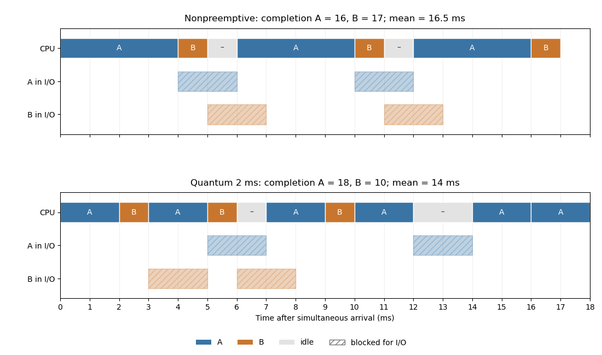

<h1 id="2/d/solution">Solution</h1>

↑ **Parent:** [D](../d.md)

With the given ready-order rule and A first, the [CPU](../../../../../central-processing-unit.md) timeline in milliseconds is

$$
\begin{array}{c|rrrrrrrr}
\text{interval}&0\!:\!4&4\!:\!5&5\!:\!6&6\!:\!10&10\!:\!11&11\!:\!12&12\!:\!16&16\!:\!17\\
\text{CPU}&A&B&\text{idle}&A&B&\text{idle}&A&B
\end{array}
$$

A performs [input-output](../../../../../input-output.md) during $[4,6)$ and $[10,12)$; B does so during $[5,7)$ and $[11,13)$. In particular, B becoming ready at time 7 does not interrupt A's ongoing nonpreemptive burst. The completion times are $C_A=16$ and $C_B=17$, giving

$$
\boxed{\text{elapsed time}=17\text{ ms},\qquad\text{mean turnaround}=16.5\text{ ms}.}
$$

There are 15 ms of useful CPU execution and 2 ms of idle time on this particular timeline.

**[Figure 1](#2/d/image-cpu-timelines-and-i-o-waits-for-the-two-scheduling-policies). CPU timelines and I/O waits for the two scheduling policies**. Both processes arrive at zero. Readiness determines queue order; A wins initial ties. The displayed completion times give mean turnarounds 16.5 ms without preemption and 14 ms with a two-millisecond quantum.

## ↑ Ancestors (12)

1. [D](../d.md)
2. [2](../../2.md)
3. [Digital systems, linear algebra, introduction to formal proof](../../../digital-systems-linear-algebra-introduction-to-formal-proof-split.md)
4. [2017](../../../split.md)
5. [Past exam of the year 1 of the computer science course of the University of Oxford](../../../../split.md)
6. [Year 1 of the computer science course of the University of Oxford](../../../../../year-1-of-the-computer-science-course-of-the-university-of-oxford.md)
7. [Computer science course of the University of Oxford](../../../../../computer-science-course-of-the-university-of-oxford.md)
8. [Undergraduate course of the University of Oxford](../../../../../undergraduate-course-of-the-university-of-oxford.md)
9. [Course of the University of Oxford](../../../../../course-of-the-university-of-oxford.md)
10. [University of Oxford](../../../../../university-of-oxford-split.md)
11. [List of universities](../../../../../list-of-universities.md)
12. [Codex Wiki](../../../../../split.md)
