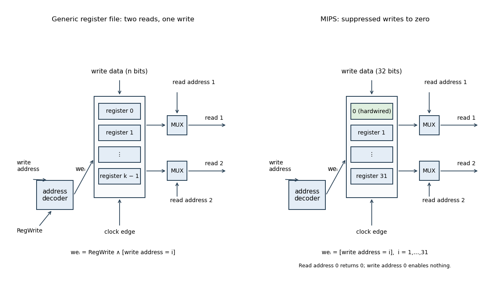

<h1 id="3/a/solution">Solution</h1>

↑ **Parent:** [A](../a.md)

Use $k$ clocked [processor registers](../../../../../processor-register.md), each storing an $n$-bit word, two independent combinational read ports and one synchronous write port. Each address requires $a=\lceil\log_2k\rceil$ bits. The read addresses select two $k$-to-one [multiplexers](../../../../../multiplexer.md), each $n$ bits wide. A write-address [binary decoder](../../../../../binary-decoder.md) combines its selected line with the global write enable to form the individual enables:

$$
we_i=\mathrm{RegWrite}\land[\mathrm{wa}=i].
$$

At the active [clock edge](../../../../../clock-edge.md), register $i$ captures the common write data if $we_i=1$, otherwise retaining its word. Reads return the currently stored words selected by their respective addresses. For non-power-of-two $k$, unused address codes need a specified harmless implementation. A simultaneous read and write of one address follows the chosen edge/read timing; an additional forwarding circuit would be needed if a different bypass convention were required.

**[Figure 2](#3/a/image-two-read-port-register-file-with-a-single-synchronous-write-port). Two-read-port register file with a single synchronous write port**. The left panel uses a global write enable; the right shows the MIPS alternative with writes to index zero suppressed. Both read multiplexers select independently, and the alternative returns a hardwired zero for address zero.

## ↑ Ancestors (12)

1. [A](../a.md)
2. [3](../../3.md)
3. [Digital systems, linear algebra, introduction to formal proof](../../../digital-systems-linear-algebra-introduction-to-formal-proof-split.md)
4. [2017](../../../split.md)
5. [Past exam of the year 1 of the computer science course of the University of Oxford](../../../../split.md)
6. [Year 1 of the computer science course of the University of Oxford](../../../../../year-1-of-the-computer-science-course-of-the-university-of-oxford.md)
7. [Computer science course of the University of Oxford](../../../../../computer-science-course-of-the-university-of-oxford.md)
8. [Undergraduate course of the University of Oxford](../../../../../undergraduate-course-of-the-university-of-oxford.md)
9. [Course of the University of Oxford](../../../../../course-of-the-university-of-oxford.md)
10. [University of Oxford](../../../../../university-of-oxford-split.md)
11. [List of universities](../../../../../list-of-universities.md)
12. [Codex Wiki](../../../../../split.md)
