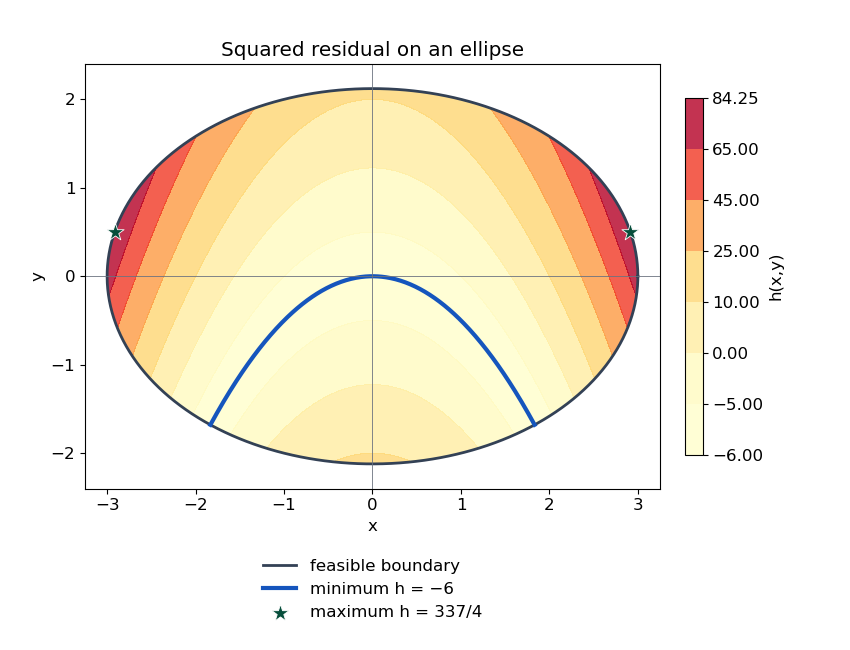
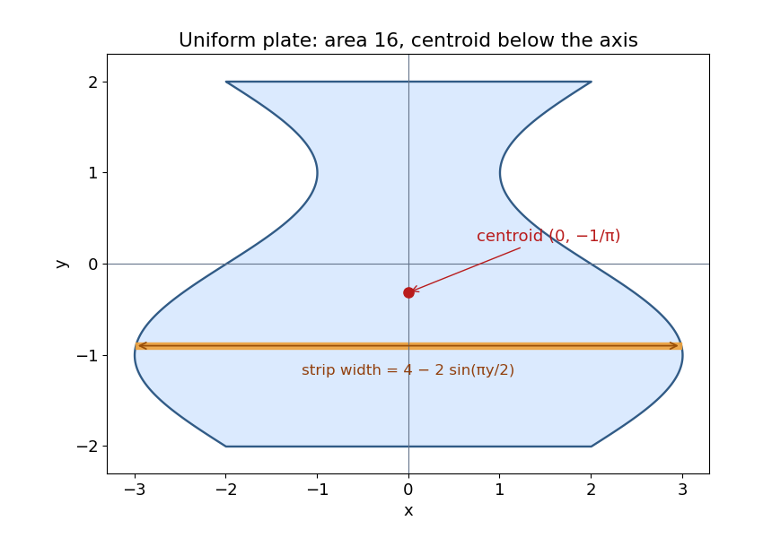
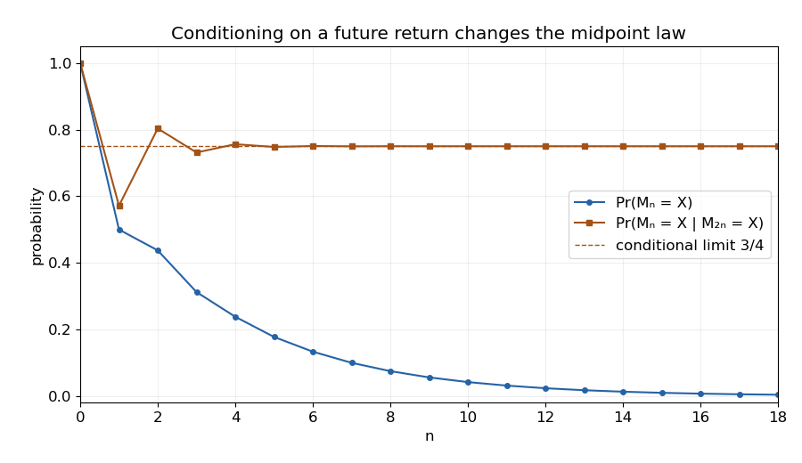

# Discrete mathematics, continuous mathematics and probability

↑ **Parent:** [2017](../2017.md)

This is the 22 June 2017 preliminary examination. All 54 printed subparts are answered, including the continuation of Question 2(d) across a page break. Source paper: [released examination archive](https://www.whatdotheyknow.com/request/past_exam_papers_for_1st_year_of/response/1398416/attach/2/Fakour%20Zip%20Final%201.zip?cookie_passthrough=1), member `a10100w1-1.pdf`.

**Table of contents**

- [1](#1)
  - [a](#1/a)
    - [Solution](#1/a/solution)
  - [b](#1/b)
    - [i](#1/b/i)
      - [Solution](#1/b/i/solution)
    - [ii](#1/b/ii)
      - [Solution](#1/b/ii/solution)
  - [c](#1/c)
    - [i](#1/c/i)
      - [Solution](#1/c/i/solution)
    - [ii](#1/c/ii)
      - [Solution](#1/c/ii/solution)
    - [iii](#1/c/iii)
      - [Solution](#1/c/iii/solution)
  - [d](#1/d)
    - [Solution](#1/d/solution)
  - [e](#1/e)
    - [Solution](#1/e/solution)
- [2](#2)
  - [a](#2/a)
    - [i](#2/a/i)
      - [Solution](#2/a/i/solution)
    - [ii](#2/a/ii)
      - [Solution](#2/a/ii/solution)
  - [b](#2/b)
    - [Solution](#2/b/solution)
  - [c](#2/c)
    - [Solution](#2/c/solution)
  - [d](#2/d)
    - [i](#2/d/i)
      - [Solution](#2/d/i/solution)
    - [ii](#2/d/ii)
      - [Solution](#2/d/ii/solution)
  - [e](#2/e)
    - [Solution](#2/e/solution)
- [3](#3)
  - [a](#3/a)
    - [Solution](#3/a/solution)
  - [b](#3/b)
    - [i](#3/b/i)
      - [Solution](#3/b/i/solution)
    - [ii](#3/b/ii)
      - [Solution](#3/b/ii/solution)
  - [c](#3/c)
    - [Solution](#3/c/solution)
  - [d](#3/d)
    - [Solution](#3/d/solution)
  - [e](#3/e)
    - [i](#3/e/i)
      - [Solution](#3/e/i/solution)
    - [ii](#3/e/ii)
      - [Solution](#3/e/ii/solution)
- [4](#4)
  - [a](#4/a)
    - [Solution](#4/a/solution)
  - [b](#4/b)
    - [Solution](#4/b/solution)
  - [c](#4/c)
    - [Solution](#4/c/solution)
- [5](#5)
  - [a](#5/a)
    - [Solution](#5/a/solution)
  - [b](#5/b)
    - [Solution](#5/b/solution)
  - [c](#5/c)
    - [Solution](#5/c/solution)
  - [d](#5/d)
    - [Solution](#5/d/solution)
- [6](#6)
  - [a](#6/a)
    - [Solution](#6/a/solution)
  - [b](#6/b)
    - [Solution](#6/b/solution)
  - [c](#6/c)
    - [i](#6/c/i)
      - [Solution](#6/c/i/solution)
    - [ii](#6/c/ii)
      - [Solution](#6/c/ii/solution)
  - [d](#6/d)
    - [Solution](#6/d/solution)
- [7](#7)
  - [a](#7/a)
    - [i](#7/a/i)
      - [Solution](#7/a/i/solution)
    - [ii](#7/a/ii)
      - [Solution](#7/a/ii/solution)
    - [iii](#7/a/iii)
      - [Solution](#7/a/iii/solution)
    - [iv](#7/a/iv)
      - [Solution](#7/a/iv/solution)
  - [b](#7/b)
    - [i](#7/b/i)
      - [Solution](#7/b/i/solution)
    - [ii](#7/b/ii)
      - [Solution](#7/b/ii/solution)
    - [iii](#7/b/iii)
      - [Solution](#7/b/iii/solution)
- [8](#8)
  - [a](#8/a)
    - [i](#8/a/i)
      - [Solution](#8/a/i/solution)
    - [ii](#8/a/ii)
      - [Solution](#8/a/ii/solution)
  - [b](#8/b)
    - [i](#8/b/i)
      - [Solution](#8/b/i/solution)
    - [ii](#8/b/ii)
      - [Solution](#8/b/ii/solution)
    - [iii](#8/b/iii)
      - [Solution](#8/b/iii/solution)
    - [iv](#8/b/iv)
      - [Solution](#8/b/iv/solution)
- [9](#9)
  - [a](#9/a)
    - [i](#9/a/i)
      - [Solution](#9/a/i/solution)
    - [ii](#9/a/ii)
      - [Solution](#9/a/ii/solution)
    - [iii](#9/a/iii)
      - [Solution](#9/a/iii/solution)
  - [b](#9/b)
    - [i](#9/b/i)
      - [Solution](#9/b/i/solution)
    - [ii](#9/b/ii)
      - [Solution](#9/b/ii/solution)
  - [c](#9/c)
    - [i](#9/c/i)
      - [Solution](#9/c/i/solution)
    - [ii](#9/c/ii)
      - [Solution](#9/c/ii/solution)

## 1

↑ **Parent:** [Discrete mathematics, continuous mathematics and probability](discrete-mathematics-continuous-mathematics-and-probability.md)

<h3 id="1/a">a</h3>

↑ **Parent:** [1](#1)

<h4 id="1/a/solution">Solution</h4>

↑ **Parent:** [A](#1/a)

The [relative complement](../../set.md#set-difference) consists of the elements of the first set absent from the second, while the [symmetric difference](../../set.md#symmetric-difference) consists of elements in exactly one set:

$$
\boxed{A\setminus B=\{x:x\in A,\ x\notin B\},\qquad A\oplus B=(A\setminus B)\cup(B\setminus A).}
$$

The two parts of the symmetric difference are [disjoint sets](../../set.md#disjoint-sets).

<h3 id="1/b">b</h3>

↑ **Parent:** [1](#1)

<h4 id="1/b/i">i</h4>

↑ **Parent:** [B](#1/b)

<h5 id="1/b/i/solution">Solution</h5>

↑ **Parent:** [I](#1/b/i)

For the first [set inclusion](../../set.md#set-inclusion), take $x\in A\setminus(A\setminus B)$. Then $x\in A$ but $x\notin A\setminus B$. Since membership in $A$ is already known, failure to lie in that [relative complement](../../set.md#set-difference) forces $x\in B$. Hence $x\in A\cap B$.

Conversely, if $x\in A\cap B$, then $x\in A$ and its membership in $B$ excludes it from $A\setminus B$. Therefore $x\in A\setminus(A\setminus B)$. The two inclusions prove the stated equality with the [set intersection](../../set.md#set-intersection).

<h4 id="1/b/ii">ii</h4>

↑ **Parent:** [B](#1/b)

<h5 id="1/b/ii/solution">Solution</h5>

↑ **Parent:** [Ii](#1/b/ii)

If $x\in A\oplus B$, the definition of [symmetric difference](../../set.md#symmetric-difference) puts it in exactly one of $A,B$. It is therefore in their [set union](../../set.md#set-union) and outside their [set intersection](../../set.md#set-intersection), giving $x\in(A\cup B)\setminus(A\cap B)$.

Conversely, an element of $(A\cup B)\setminus(A\cap B)$ lies in at least one of the two sets but not both. It consequently belongs to $A\setminus B$ or to $B\setminus A$, and hence to $A\oplus B$. Both [set inclusions](../../set.md#set-inclusion) hold.

<h3 id="1/c">c</h3>

↑ **Parent:** [1](#1)

<h4 id="1/c/i">i</h4>

↑ **Parent:** [C](#1/c)

<h5 id="1/c/i/solution">Solution</h5>

↑ **Parent:** [I](#1/c/i)

The outermost braces form a [singleton set](../../set.md#singleton-mathematics), regardless of how its one element is nested. Its [cardinality](../../cardinal-number.md#cardinality) is therefore **$1$**. A set containing the [empty set](../../set.md#empty-set) is different from the empty set itself.

<h4 id="1/c/ii">ii</h4>

↑ **Parent:** [C](#1/c)

<h5 id="1/c/ii/solution">Solution</h5>

↑ **Parent:** [Ii](#1/c/ii)

A [Cartesian product](../../set-theory.md#cartesian-product) with the [empty set](../../set.md#empty-set) is empty: there is no possible second coordinate. Thus the requested [cardinality](../../cardinal-number.md#cardinality) is **$0$**, independently of the first factor's [power set](../../set.md#power-set).

<h4 id="1/c/iii">iii</h4>

↑ **Parent:** [C](#1/c)

<h5 id="1/c/iii/solution">Solution</h5>

↑ **Parent:** [Iii](#1/c/iii)

The [singleton set](../../set.md#singleton-mathematics) $\{\varnothing\}$ has cardinality one, so its [power set](../../set.md#power-set) has cardinality two. Taking the [Cartesian product](../../set-theory.md#cartesian-product) with the singleton $\{\varnothing\}$ leaves that cardinality equal to two. The outer power set therefore has **$2^2=4$** elements.

<h3 id="1/d">d</h3>

↑ **Parent:** [1](#1)

<h4 id="1/d/solution">Solution</h4>

↑ **Parent:** [D](#1/d)

One example is **the identity function**, $f(n)=n$. A second is the [permutation](../../combinatorics.md#permutation)

$$
\boxed{f(1)=2,\quad f(2)=3,\quad f(3)=1,\quad f(n)=n\ \text{otherwise}.}
$$

Both are [bijections](../../function.md#bijection) of $\mathbb N$, whichever convention includes or excludes zero. For the second, applying $f$ three times returns every input to itself. Thus $f^3=\operatorname{id}$, and composing with the [inverse function](../../function.md#inverse-function) gives $f^2=f^{-1}$. This [permutation cube identity criterion](../../combinatorics.md#permutation-cube-identity-criterion) also shows why three-cycles work whereas a nontrivial two-cycle would not.

<h3 id="1/e">e</h3>

↑ **Parent:** [1](#1)

<h4 id="1/e/solution">Solution</h4>

↑ **Parent:** [E](#1/e)

Use the convention that $R\circ S$ applies $S$ first. Reflexivity inserts an identity step: if $aRb$, use $aSa$ to obtain $(a,b)\in R\circ S$; if $aSb$, use $bRb$ for the same conclusion. Thus $R\cup S\subseteq R\circ S$. By [monotonicity of relation composition](../../set-theory.md#monotonicity-of-relation-composition),

$$
(R\cup S)\circ(R\cup S)\subseteq(R\circ S)\circ(R\circ S).
$$

For strictness, take $A=\{0,1,2,3\}$ and let $R=S$ consist of the identity pairs together with $(0,1),(1,2),(2,3)$. Both are [reflexive relations](../../set-theory.md#reflexive-relation). The left side permits at most two forward chain steps, so does not contain $(0,3)$. The right side permits four steps, including $0\to1\to2\to3\to3$, so does contain it. Equality therefore need not hold.

## 2

↑ **Parent:** [Discrete mathematics, continuous mathematics and probability](discrete-mathematics-continuous-mathematics-and-probability.md)

<h3 id="2/a">a</h3>

↑ **Parent:** [2](#2)

<h4 id="2/a/i">i</h4>

↑ **Parent:** [A](#2/a)

<h5 id="2/a/i/solution">Solution</h5>

↑ **Parent:** [I](#2/a/i)

Use [modular arithmetic](../../modular-arithmetic.md) modulo eight: $801\equiv1$, $32\cdot19\equiv0$, and $29\cdot13\equiv5\cdot5\equiv1$. The squared difference is consequently congruent to one, giving the remainder

$$
\boxed{2.}
$$

<h4 id="2/a/ii">ii</h4>

↑ **Parent:** [A](#2/a)

<h5 id="2/a/ii/solution">Solution</h5>

↑ **Parent:** [Ii](#2/a/ii)

Modulo seven, $19\equiv-2$ and $(-2)^3=-8\equiv-1$. Therefore $19^9\equiv(-1)^3\equiv-1\equiv6\pmod7$. The remainder is **$6$**, using [modular exponentiation](../../number-theory.md#modular-exponentiation).

<h3 id="2/b">b</h3>

↑ **Parent:** [2](#2)

<h4 id="2/b/solution">Solution</h4>

↑ **Parent:** [B](#2/b)

For integers $a,b$ not both zero, replace them first by their [absolute values](../../real-analysis.md#absolute-value), then repeat [integer division](../../arithmetic.md#integer-division):

```
while b != 0:
    (a,b) := (b, a mod b)
return a
```

This is the [Euclidean algorithm](../../number-theory.md#euclidean-algorithm). Its [loop invariant](../../algorithm.md#loop-invariant) is that $\gcd(a,b)$ equals the original [greatest common divisor](../../divisibility.md#greatest-common-divisor). When $b>0$, the new remainder lies in $[0,b)$, so $b$ is a strictly decreasing nonnegative [loop variant](../../algorithm.md#loop-variant). At termination, $\gcd(a,0)=a$, proving correctness, including the case where one original input is zero.

<h3 id="2/c">c</h3>

↑ **Parent:** [2](#2)

<h4 id="2/c/solution">Solution</h4>

↑ **Parent:** [C](#2/c)

The [Euclidean algorithm](../../number-theory.md#euclidean-algorithm) gives

$$
1394=4(306)+170,\quad306=170+136,\quad170=136+34,\quad136=4(34).
$$

Thus the [greatest common divisor](../../divisibility.md#greatest-common-divisor) is $34$. Back-substitution, as in the [extended Euclidean algorithm](../../number-theory.md#extended-euclidean-algorithm), gives

$$
34=170-136=2(170)-306=2(1394)-9(306).
$$

Hence **$\gcd(306,1394)=34$, with $x=2$ and $y=-9$**.

<h3 id="2/d">d</h3>

↑ **Parent:** [2](#2)

<h4 id="2/d/i">i</h4>

↑ **Parent:** [D](#2/d)

<h5 id="2/d/i/solution">Solution</h5>

↑ **Parent:** [I](#2/d/i)

For one colour, the box occupancies form a [weak composition](../../combinatorics.md#weak-composition-of-an-integer) of $k$ into $n$ nonnegative parts. For $n\geq1$, [stars and bars](../../combinatorics.md#stars-and-bars-combinatorics) gives $\binom{k+n-1}{n-1}$ choices. The three colours' occupancies can be selected independently, so the number is

$$
\boxed{\binom{k+n-1}{n-1}^{\!3}.}
$$

Boxes are labelled, while equal-colour balls contribute only occupancy counts; no extra factorial for permuting such balls is appropriate.

<h4 id="2/d/ii">ii</h4>

↑ **Parent:** [D](#2/d)

<h5 id="2/d/ii/solution">Solution</h5>

↑ **Parent:** [Ii](#2/d/ii)

There are $6^3=216$ unrestricted placements, since one colour has $\binom42=6$ occupancy vectors. For any specified empty box, the two remaining boxes admit $3^3=27$ placements. For any specified pair of empty boxes, the one remaining box admits one placement. All three boxes cannot be empty.

The [inclusion-exclusion principle](../../combinatorics.md#inclusion-exclusion-principle) therefore gives

$$
\boxed{216-3(27)+\binom32(1)=138.}
$$

The empty-box events are not [disjoint events](../../probability-space.md#disjoint-events), so subtracting their counts without restoring their pairwise overlaps would be incorrect.

<h3 id="2/e">e</h3>

↑ **Parent:** [2](#2)

<h4 id="2/e/solution">Solution</h4>

↑ **Parent:** [E](#2/e)

The base cases are $13=3(2)+7(1)$, $14=3(0)+7(2)$ and $15=3(5)+7(0)$. Suppose a counterexample exists and choose the least integer $n\geq13$ failing the claim. It is not one of these base cases, so $n\geq16$ and $n-3\geq13$.

Minimality supplies nonnegative integers $x,y$ with $n-3=3x+7y$. Then $n=3(x+1)+7y$, a contradiction. This [proof by minimal counterexample](../../arithmetic.md#proof-by-minimal-counterexample) establishes the claim. Three consecutive base cases are needed because the reduction subtracts three.

## 3

↑ **Parent:** [Discrete mathematics, continuous mathematics and probability](discrete-mathematics-continuous-mathematics-and-probability.md)

<h3 id="3/a">a</h3>

↑ **Parent:** [3](#3)

<h4 id="3/a/solution">Solution</h4>

↑ **Parent:** [A](#3/a)

As $x\to+\infty$, [big O notation](../../real-analysis.md#big-o-notation) means

$$
\boxed{f=O(g)\iff\exists C>0\ \exists x_0\ \forall x\geq x_0:\ |f(x)|\leq C|g(x)|.}
$$

The same constant must work on the entire sufficiently large tail. Absolute values accommodate signed functions. A two-sided convention at infinity would replace $x\geq x_0$ by $|x|\geq x_0$; the positive-integer arguments in the later parts use the positive-tail convention.

<h3 id="3/b">b</h3>

↑ **Parent:** [3](#3)

<h4 id="3/b/i">i</h4>

↑ **Parent:** [B](#3/b)

<h5 id="3/b/i/solution">Solution</h5>

↑ **Parent:** [I](#3/b/i)

Choose constants $C_1,C_2>0$ and a common threshold beyond which $f_1\leq C_1g_1$ and $f_2\leq C_2g_2$. Positivity permits multiplication:

$$
|f_1f_2|=f_1f_2\leq C_1C_2g_1g_2.
$$

The fixed constant $C_1C_2$ proves **$f_1f_2=O(g_1g_2)$** by the definition of [big O notation](../../real-analysis.md#big-o-notation).

<h4 id="3/b/ii">ii</h4>

↑ **Parent:** [B](#3/b)

<h5 id="3/b/ii/solution">Solution</h5>

↑ **Parent:** [Ii](#3/b/ii)

Beyond the same common threshold, the [triangle inequality](../../topological-analysis.md#triangle-inequality) gives

$$
|f_1-f_2|\leq f_1+f_2\leq C_1g_1+C_2g_2\leq\max(C_1,C_2)(g_1+g_2).
$$

Thus **$f_1-f_2=O(g_1+g_2)$**. The absolute value matters because the difference need not itself be positive, even though the four original functions are.

<h3 id="3/c">c</h3>

↑ **Parent:** [3](#3)

<h4 id="3/c/solution">Solution</h4>

↑ **Parent:** [C](#3/c)

Take

$$
f_1(n)=2n,\quad g_1(n)=n,\quad f_2(n)=g_2(n)=2^n.
$$

The premises hold with constants two and one. But

$$
\frac{f_2(f_1(n))}{g_2(g_1(n))}=\frac{2^{2n}}{2^n}=2^n\longrightarrow\infty.
$$

No fixed bounding constant can satisfy the proposed conclusion. This proves the [failure of unrestricted Big O composition](../../real-analysis.md#failure-of-unrestricted-big-o-composition): a constant factor in an inner argument can become an unbounded factor after applying an exponential.

<h3 id="3/d">d</h3>

↑ **Parent:** [3](#3)

<h4 id="3/d/solution">Solution</h4>

↑ **Parent:** [D](#3/d)

A stronger exact formula makes the [induction](../../foundations-of-mathematics.md#mathematical-induction) explicit:

$$
\boxed{S_n=1+m\bigl(1+\lfloor\log_2n\rfloor\bigr),\qquad n\geq1.}
$$

For $n=1$, the recurrence gives $S_1=S_0+m=1+m$. For $n\geq2$, set $j=\lfloor n/2\rfloor$, so $1\leq j<n$. In the relevant binary interval, $\lfloor\log_2j\rfloor=\lfloor\log_2n\rfloor-1$. The [strong induction](../../foundations-of-mathematics.md#strong-induction) hypothesis gives

$$
S_n=S_j+m=1+m\bigl(1+\lfloor\log_2j\rfloor\bigr)+m
=1+m\bigl(1+\lfloor\log_2n\rfloor\bigr).
$$

For $n\geq2$, $S_n\leq1+m+m\log_2n\leq(1+2m)\log_2n$. Hence $S_n=O(\log_2n)$. This is an [integer-halving recurrence with constant toll](../../sequence-and-series.md#integer-halving-recurrence-with-constant-toll); the separately defined $n=0$ case does not require evaluating $\log0$.

<h3 id="3/e">e</h3>

↑ **Parent:** [3](#3)

<h4 id="3/e/i">i</h4>

↑ **Parent:** [E](#3/e)

<h5 id="3/e/i/solution">Solution</h5>

↑ **Parent:** [I](#3/e/i)

A [preorder](../../set.md#preorder) is **reflexive and transitive**: $xRx$ for every element, and $xRy,yRz$ imply $xRz$. A [partial order](../../set.md#partially-ordered-set) additionally requires **[antisymmetry](../../set-theory.md#antisymmetry)**: $xRy$ and $yRx$ imply $x=y$. It need not compare every pair of distinct elements.

<h4 id="3/e/ii">ii</h4>

↑ **Parent:** [E](#3/e)

<h5 id="3/e/ii/solution">Solution</h5>

↑ **Parent:** [Ii](#3/e/ii)

**No.** On $\{0,1,2\}$ take $R=\{(0,1),(1,2),(2,0)\}$. This is an [antisymmetric relation](../../set-theory.md#antisymmetric-relation) because it contains no opposite pair of distinct elements. Its [reflexive transitive closure](../../set-theory.md#reflexive-transitive-closure) contains every ordered pair: following the directed three-cycle reaches any vertex from any other. In particular it contains both $(0,1)$ and $(1,0)$, violating antisymmetry.

This illustrates the [reachability preorder](../../set.md#reachability-preorder): collapsing mutually reachable vertices into [strongly connected components](../../graph-theory.md#strongly-connected-component) yields a partial order, but retaining all original vertices need not.

## 4

↑ **Parent:** [Discrete mathematics, continuous mathematics and probability](discrete-mathematics-continuous-mathematics-and-probability.md)

<h3 id="4/a">a</h3>

↑ **Parent:** [4](#4)

<h4 id="4/a/solution">Solution</h4>

↑ **Parent:** [A](#4/a)

The [gradient](../../multivariable-calculus.md#gradient) equations are

$$
f_x=3x^2+2xy-10x-9=0,\qquad f_y=x^2-9=0.
$$

Thus $x=3$ gives $y=2$, while $x=-3$ gives $y=8$. The [Hessian matrix](../../multivariable-calculus.md#hessian-matrix) is

$$
H=\begin{pmatrix}6x+2y-10&2x\\2x&0\end{pmatrix},\qquad\det H=-4x^2.
$$

At both critical points the determinant is $-36<0$, so the Hessian is indefinite and the [second-derivative test](../../multivariable-calculus.md#second-derivative-test) classifies both as [saddle points](../../analysis.md#saddle-point). Direct substitution gives

$$
\boxed{(3,2),\ (-3,8)\text{ are saddle points, and }f(3,2)=f(-3,8)=-30.}
$$

The factorization $f+30=(x^2-9)(x+y-5)$ also shows the crossing level-set branches through each saddle.

<h3 id="4/b">b</h3>

↑ **Parent:** [4](#4)

<h4 id="4/b/solution">Solution</h4>

↑ **Parent:** [B](#4/b)

Write $\dot x=dx/du$, $\ddot x=d^2x/du^2$, $A_v=dA/dv$, $A_{vv}=d^2A/dv^2$, and $y_w=dy/dw$, $y_{ww}=d^2y/dw^2$. Put $S=A+A^T$. The [product rule](../../calculus.md#product-rule) and [chain rule](../../calculus.md#chain-rule) give

$$
\boxed{\begin{aligned}
f_u&=\dot x^TSx,\\
f_v&=x^TA_vx+w' y_w^Tb,\\
f_{uu}&=\ddot x^TSx+\dot x^TS\dot x,\\
f_{uv}&=\dot x^T(A_v+A_v^T)x,\\
f_{vv}&=x^TA_{vv}x+\bigl((w')^2y_{ww}+w''y_w\bigr)^Tb.
\end{aligned}}
$$

Here $w',w''$ are derivatives with respect to $v$. In the first derivative, $x^TA\dot x=\dot x^TA^Tx$ because the expression is scalar. Likewise $\dot x^TS\dot x=2\dot x^TA\dot x$ if desired. This [differentiation of a parameter-dependent quadratic form](../../quadratic-form.md#differentiation-of-a-parameter-dependent-quadratic-form) does not assume that $A$ is symmetric. The positive linear term $y^Tb$ contributes the positive chain-rule terms in the $v$ derivatives; it is independent of $u$.

<h3 id="4/c">c</h3>

↑ **Parent:** [4](#4)

<h4 id="4/c/solution">Solution</h4>

↑ **Parent:** [C](#4/c)

Complete the square:

$$
h=(x^2+2y)^2-6.
$$

The [minimum locus of a squared function](../../mathematical-optimization.md#minimum-locus-of-a-squared-function) occurs where its residual vanishes. Hence the minimum is $-6$ on $y=-x^2/2$, provided these points lie in the ellipse. Setting $t=x^2$ in the constraint gives $t+t^2/2\leq9$, or $0\leq t\leq\sqrt{19}-1$. Thus

$$
\boxed{\min_R h=-6,\quad\text{at }\left\{(x,-x^2/2):|x|\leq\sqrt{\sqrt{19}-1}\right\}.}
$$

For the maximum, let $q=x^2+2y$. The ellipse gives

$$
q\leq9-2y^2+2y=\frac{19}{2}-2\left(y-\frac12\right)^2\leq\frac{19}{2}.
$$

Also $q\geq2y\geq-3\sqrt2$, whose absolute value is less than $19/2$. Therefore $q^2\leq(19/2)^2$. Equality is attained at $y=1/2$, $x^2=17/2$, giving

$$
\boxed{\max_R h=\frac{337}{4}=84\frac14,\quad\text{at }(x,y)=\left(\pm\sqrt{17/2},\frac12\right).}
$$

These attained bounds are global, not merely stationary-point tests. The minimizing locus is a parabola segment.

<a id="4/c/image-global-extrema-of-the-squared-residual-quartic-on-an-ellipse"></a>


**[Figure 1](#4/c/image-global-extrema-of-the-squared-residual-quartic-on-an-ellipse). Global extrema of the squared-residual quartic on an ellipse**. Contours show h inside the feasible ellipse. The blue parabola segment is the entire minimum set h = -6; the two marked boundary points attain the maximum 337/4.

## 5

↑ **Parent:** [Discrete mathematics, continuous mathematics and probability](discrete-mathematics-continuous-mathematics-and-probability.md)

<h3 id="5/a">a</h3>

↑ **Parent:** [5](#5)

<h4 id="5/a/solution">Solution</h4>

↑ **Parent:** [A](#5/a)

Use [partial fraction decomposition](../../isolated-singularity.md#partial-fraction-decomposition):

$$
\frac1{4-x^2}=\frac14\left(\frac1{2+x}+\frac1{2-x}\right).
$$

Integrating gives

$$
\boxed{I(x)=\frac14\log\left|\frac{2+x}{2-x}\right|+C.}
$$

This real [antiderivative](../../integral.md#antiderivative) is valid on each interval avoiding $x=\pm2$, with its own integration constant. In particular, $I(1)-I(0)=\frac14\log3$.

<h3 id="5/b">b</h3>

↑ **Parent:** [5](#5)

<h4 id="5/b/solution">Solution</h4>

↑ **Parent:** [B](#5/b)

For positive bounds, [integration by parts](../../calculus.md#integration-by-parts) with $u=\log x$ and $dv=x^2dx$ gives

$$
\boxed{F(a,b)=\left[\frac{x^3}{3}\log x-\frac{x^3}{9}\right]_{a}^{b}.}
$$

For negative bounds, specify the [complex logarithm on the negative real axis](../../analysis.md#complex-logarithm-on-the-negative-real-axis). With argument $\pi$, namely the upper-bank boundary value of the [principal logarithm](../../analysis.md#principal-complex-logarithm), $\log x=\log(-x)+i\pi$. Substitute $t=-x$ in the real part:

$$
\boxed{\int_c^d x^2\log x\,dx=F(-d,-c)+\frac{i\pi}{3}(d^3-c^3).}
$$

More generally, a continuous branch taking argument $(2k+1)\pi$ replaces $i\pi$ by $(2k+1)i\pi$. The imaginary part depends on that choice. The analytic principal branch excludes the negative axis itself, so the boundary-value convention is part of this interpretation.

<h3 id="5/c">c</h3>

↑ **Parent:** [5](#5)

<h4 id="5/c/solution">Solution</h4>

↑ **Parent:** [C](#5/c)

A horizontal strip at height $y$ has width $4-2\sin(\pi y/2)$. The sine term is odd, so the [area](../../differential-geometry.md#surface-area) is

$$
\boxed{|A|=\int_{-2}^{2}\left(4-2\sin\frac{\pi y}{2}\right)dy=16.}
$$

Reflection symmetry in the $y$-axis gives $\bar x=0$. For uniform density, the constant density cancels from the [center of mass](../../classical-mechanics.md#center-of-mass) ratio. Its first moment in the vertical coordinate is

$$
\begin{aligned}
\int_A y\,dA
&=-4\int_0^2 y\sin\frac{\pi y}{2}\,dy\\
&=-4\left[-\frac{2y}{\pi}\cos\frac{\pi y}{2}+\frac4{\pi^2}\sin\frac{\pi y}{2}\right]_0^2
=-\frac{16}{\pi}.
\end{aligned}
$$

Consequently

$$
\boxed{(\bar x,\bar y)=\left(0,-\frac1\pi\right).}
$$

The wider part below the horizontal axis accounts for the negative vertical coordinate.

<a id="5/c/image-uniform-density-plate-with-area-16-and-centroid-at-0-1-pi"></a>


**[Figure 2](#5/c/image-uniform-density-plate-with-area-16-and-centroid-at-0-1-pi). Uniform-density plate with area 16 and centroid at (0, -1/π)** Original plot of the strip-defined region. The marked centroid lies below the horizontal axis; the highlighted sample strip illustrates the width used in the area and moment integrals.

<h3 id="5/d">d</h3>

↑ **Parent:** [5](#5)

<h4 id="5/d/solution">Solution</h4>

↑ **Parent:** [D](#5/d)

For $h=1/N$, the [composite trapezoidal rule](../../runge-kutta-method.md#composite-trapezoidal-rule) is

$$
T_N(f)=\frac1N\left(\frac{f(0)}2+\sum_{m=1}^{N-1}f(m/N)+\frac{f(1)}2\right).
$$

With $f(x)=1/(4-x^2)$ this becomes

$$
T_N=\frac{7}{24N}+\sum_{m=1}^{N-1}\frac{N}{4N^2-m^2}.
$$

Write the requested right [Riemann sum](../../real-analysis.md#riemann-sum) as $S_N$. The [trapezoidal endpoint correction for a right Riemann sum](../../runge-kutta-method.md#trapezoidal-endpoint-correction-for-a-right-riemann-sum) gives

$$
S_N-T_N=\frac{f(1)-f(0)}{2N}=\frac1{24N}.
$$

The integrand is continuous on $[0,1]$, so the trapezoidal values converge to its definite integral; the endpoint correction tends to zero. Therefore

$$
\boxed{\lim_{N\to\infty}\sum_{m=1}^N\frac{N}{4N^2-m^2}=\frac14\log3.}
$$

## 6

↑ **Parent:** [Discrete mathematics, continuous mathematics and probability](discrete-mathematics-continuous-mathematics-and-probability.md)

<h3 id="6/a">a</h3>

↑ **Parent:** [6](#6)

<h4 id="6/a/solution">Solution</h4>

↑ **Parent:** [A](#6/a)

The [characteristic polynomial](../../linear-operator-theory.md#characteristic-polynomial) of this [constant-coefficient differential equation](../../linear-ordinary-differential-equation.md#constant-coefficient-differential-equation) is $r^2-r-2=(r-2)(r+1)$. Its distinct roots give

$$
\boxed{y(x)=C_1e^{2x}+C_2e^{-x}.}
$$

<h3 id="6/b">b</h3>

↑ **Parent:** [6](#6)

<h4 id="6/b/solution">Solution</h4>

↑ **Parent:** [B](#6/b)

For the forcing $8e^{-2x}$, the [method of undetermined coefficients](../../linear-ordinary-differential-equation.md#method-of-undetermined-coefficients) gives the particular term $2e^{-2x}$. The term $e^{-x}$ is resonant with a homogeneous solution, so use $axe^{-x}$ for its forcing; substitution gives $a=1$.

Thus $y=C_1e^{2x}+C_2e^{-x}+2e^{-2x}+xe^{-x}$. The two initial conditions reduce to $C_1+C_2=3$ and $2C_1-C_2=0$, so $C_1=1$, $C_2=2$. The solution of the [initial value problem](../../differential-equation.md#initial-value-problem) is

$$
\boxed{y(x)=e^{2x}+(x+2)e^{-x}+2e^{-2x}.}
$$

The extra factor $x$ in the resonant particular solution is essential.

<h3 id="6/c">c</h3>

↑ **Parent:** [6](#6)

<h4 id="6/c/i">i</h4>

↑ **Parent:** [C](#6/c)

<h5 id="6/c/i/solution">Solution</h5>

↑ **Parent:** [I](#6/c/i)

The [Forward Euler method](../../numerical-analysis.md#euler-method) uses the current slope:

$$
\boxed{x_{n+1}=x_n+h,\qquad y_{n+1}=y_n+h f(x_n,y_n).}
$$

Here $x_n=x_0+nh$ and the initial approximation normally equals the given initial value. Each step takes a tangent-line increment of width $h$.

<h4 id="6/c/ii">ii</h4>

↑ **Parent:** [C](#6/c)

<h5 id="6/c/ii/solution">Solution</h5>

↑ **Parent:** [Ii](#6/c/ii)

Define the one-step [local truncation error](../../numerical-analysis.md#local-truncation-error) as the defect obtained by inserting the exact solution into an update:

$$
\delta_{n+1}=y(x_n+h)-y(x_n)-h f(x_n,y(x_n)).
$$

For a smooth solution, [Taylor's theorem](../../calculus.md#taylor-s-theorem) and $y'=f(x,y)$ give

$$
\boxed{\delta_{n+1}=\frac{h^2}{2}y''(x_n)+O(h^3)=O(h^2).}
$$

Thus **$m=2$ for the one-step defect convention**. The leading derivative can also be written $y''=f_x+f_yf$ by the chain rule.

Some conventions instead call $\tau_{n+1}=\delta_{n+1}/h$ the truncation error. That [normalized local truncation error](../../numerical-analysis.md#normalized-local-truncation-error) is $O(h)$, so **$m=1$ under the normalized convention**. Both describe the same [Euler one-step defect](../../numerical-analysis.md#euler-one-step-defect); neither should be confused with an unqualified global error claim.

<h3 id="6/d">d</h3>

↑ **Parent:** [6](#6)

<h4 id="6/d/solution">Solution</h4>

↑ **Parent:** [D](#6/d)

Factor the right side as $(x-1)^2(x-3)$. On $-1<x<1$, division by $x^2-1$ gives a [first-order linear differential equation](../../linear-ordinary-differential-equation.md#first-order-linear-differential-equation) with [integrating factor](../../linear-ordinary-differential-equation.md#integrating-factor)

$$
\mu(x)=\frac{1+x}{1-x},\qquad \frac{\mu'}\mu=-\frac2{x^2-1}.
$$

Multiplication makes the equation $(\mu y)'=3-x$, so $\mu y=3x-x^2/2+C$. At zero, $\mu(0)y(0)=1$, hence $C=1$. Simplifying gives

$$
\boxed{y(x)=\frac{1-x}{1+x}\left(1+3x-\frac{x^2}{2}\right)=\frac{x^2}{2}-4x+6-\frac5{x+1}.}
$$

Its derivative is

$$
y'(x)=x-4+\frac5{(x+1)^2},\qquad\boxed{y'(0)=1.}
$$

The derivation solves the initial-value problem on $(-1,1)$. The simplified expression also extends smoothly through $x=1$ and satisfies the original undivided equation there, giving a solution on all $x>-1$; its pole prevents continuation through $x=-1$.

## 7

↑ **Parent:** [Discrete mathematics, continuous mathematics and probability](discrete-mathematics-continuous-mathematics-and-probability.md)

<h3 id="7/a">a</h3>

↑ **Parent:** [7](#7)

<h4 id="7/a/i">i</h4>

↑ **Parent:** [A](#7/a)

<h5 id="7/a/i/solution">Solution</h5>

↑ **Parent:** [I](#7/a/i)

The variable has positive-integer support, so $\mathbb P(X>0)=1$. Subtract consecutive values of the [survival function](../../survival-analysis.md#survival-function):

$$
\boxed{\mathbb P(X=k)=\mathbb P(X>k-1)-\mathbb P(X>k)=p(1-p)^{k-1},\quad k\geq1.}
$$

This is the positive-support convention for the [geometric distribution](../../discrete-probability-distribution.md#geometric-distribution).

<h4 id="7/a/ii">ii</h4>

↑ **Parent:** [A](#7/a)

<h5 id="7/a/ii/solution">Solution</h5>

↑ **Parent:** [Ii](#7/a/ii)

Summing a [geometric series](../../sequence-and-series.md#geometric-series) gives the [probability generating function](../../probability-distribution.md#probability-generating-function)

$$
\boxed{G_X(s)=\sum_{k\geq1}p(1-p)^{k-1}s^k=\frac{ps}{1-(1-p)s}.}
$$

The series converges absolutely for $|s|<1/(1-p)$. Differentiating the rational expression yields

$$
\boxed{G_X'(s)=\frac{p}{(1-(1-p)s)^2}=\frac p{(1-s+ps)^2}.}
$$

<h4 id="7/a/iii">iii</h4>

↑ **Parent:** [A](#7/a)

<h5 id="7/a/iii/solution">Solution</h5>

↑ **Parent:** [Iii](#7/a/iii)

The [expected value](../../expected-value.md) is the derivative of the [probability generating function](../../probability-distribution.md#probability-generating-function) at one. The expression from part (ii) gives

$$
\boxed{\mathbb EX=G_X'(1)=\frac p{p^2}=\frac1p.}
$$

Its finiteness also follows directly from the exponentially decaying geometric probabilities.

<h4 id="7/a/iv">iv</h4>

↑ **Parent:** [A](#7/a)

<h5 id="7/a/iv/solution">Solution</h5>

↑ **Parent:** [Iv](#7/a/iv)

By [independence](../../random-variable.md#independent-random-variables), for $k\geq0$,

$$
\mathbb P(W>k)=\mathbb P(X_1>k,X_2>k)=(1-p)^{2k}.
$$

This is the [geometric minimum law](../../discrete-probability-distribution.md#geometric-minimum-law), giving

$$
\boxed{W\sim\operatorname{Geom}\bigl(1-(1-p)^2\bigr)=\operatorname{Geom}(2p-p^2).}
$$

The support remains the positive integers; this parameter is a success probability, not a mean.

<h3 id="7/b">b</h3>

↑ **Parent:** [7](#7)

<h4 id="7/b/i">i</h4>

↑ **Parent:** [B](#7/b)

<h5 id="7/b/i/solution">Solution</h5>

↑ **Parent:** [I](#7/b/i)

Since $Y\geq1$, its finite [expected value](../../expected-value.md) satisfies $1\leq\mu<\infty$. Every $q_k=kp_k/\mu$ is nonnegative and

$$
\sum_{k\geq1}q_k=\frac1\mu\sum_{k\geq1}kp_k=\frac{\mathbb EY}{\mu}=1.
$$

Thus these values are a [probability mass function](../../probability-distribution.md#probability-mass-function). They define the [size-biased distribution](../../probability-theory.md#size-biased-distribution) of $Y$: larger values receive proportionally more weight.

<h4 id="7/b/ii">ii</h4>

↑ **Parent:** [B](#7/b)

<h5 id="7/b/ii/solution">Solution</h5>

↑ **Parent:** [Ii](#7/b/ii)

For $0\leq s<1$, differentiate the [probability generating function](../../probability-distribution.md#probability-generating-function) term by term and multiply by $s/\mu$:

$$
\boxed{G_{\widetilde Y}(s)=\sum_{k\geq1}\frac{kp_k}{\mu}s^k
=\frac s\mu\sum_{k\geq1}kp_ks^{k-1}=\frac s\mu G_Y'(s).}
$$

This is the [size-biased probability generating function](../../probability-theory.md#size-biased-probability-generating-function) identity. At $s=1$, the finite-mean assumption gives the limiting value one on both sides; at zero, positive support gives value zero.

<h4 id="7/b/iii">iii</h4>

↑ **Parent:** [B](#7/b)

<h5 id="7/b/iii/solution">Solution</h5>

↑ **Parent:** [Iii](#7/b/iii)

For $Y\sim\operatorname{Geom}(p)$, its mean is $1/p$, so the [size-biased probability generating function](../../probability-theory.md#size-biased-probability-generating-function) is

$$
G_{\widetilde Y}(s)=\frac{p^2s}{(1-(1-p)s)^2}.
$$

Choose **$X_1,X_2$ independent with distribution $\operatorname{Geom}(p)$**. Their shifted sum has generating function, initially for $s>0$,

$$
G_{X_1+X_2-1}(s)=\frac1s\left(\frac{ps}{1-(1-p)s}\right)^2=G_{\widetilde Y}(s),
$$

with both sides continuous and zero at $s=0$. Equality of [probability generating functions](../../probability-distribution.md#probability-generating-function) proves

$$
\boxed{\widetilde Y\overset d=X_1+X_2-1.}
$$

Equivalently, $X_1+X_2=k+1$ has $k$ possible positive summand pairs, each of probability $p^2(1-p)^{k-1}$, matching the [size-biased geometric distribution](../../probability-theory.md#size-biased-geometric-distribution) probabilities.

## 8

↑ **Parent:** [Discrete mathematics, continuous mathematics and probability](discrete-mathematics-continuous-mathematics-and-probability.md)

<h3 id="8/a">a</h3>

↑ **Parent:** [8](#8)

<h4 id="8/a/i">i</h4>

↑ **Parent:** [A](#8/a)

<h5 id="8/a/i/solution">Solution</h5>

↑ **Parent:** [I](#8/a/i)

A [partition of a set](../../set.md#partition-of-a-set) consists of nonempty subsets that are pairwise disjoint and whose union is the whole set. Here

$$
\boxed{B_i\ne\varnothing,\quad B_i\cap B_j=\varnothing\ (i\ne j),\quad\bigcup_{i\in I}B_i=\Omega.}
$$

Thus every outcome belongs to exactly one cell. The probability calculation additionally requires the cells to be measurable events.

<h4 id="8/a/ii">ii</h4>

↑ **Parent:** [A](#8/a)

<h5 id="8/a/ii/solution">Solution</h5>

↑ **Parent:** [Ii](#8/a/ii)

For a finite or countable measurable partition, the [law of total probability](../../probability-space.md#law-of-total-probability) is

$$
\boxed{\mathbb P(A)=\sum_{i:\,\mathbb P(B_i)>0}\mathbb P(A\mid B_i)\mathbb P(B_i).}
$$

Indeed, $A$ is the disjoint union of $A\cap B_i$, and the [conditional probability](../../probability-theory.md#conditional-probability) formula gives each positive-probability term. Zero-probability cells contribute zero; their conditionals need not be defined by a ratio. If all cells have positive probability, the sum simply runs over every $i\in I$.

<h3 id="8/b">b</h3>

↑ **Parent:** [8](#8)

<h4 id="8/b/i">i</h4>

↑ **Parent:** [B](#8/b)

<h5 id="8/b/i/solution">Solution</h5>

↑ **Parent:** [I](#8/b/i)

Starting at $X$, the two possible two-step returns are $X\to X\to X$ and $X\to Y\to X$. They are [disjoint events](../../probability-space.md#disjoint-events), with probabilities $1/4$ and $3/16$. Therefore

$$
\boxed{p_2=\frac14+\frac3{16}=\frac7{16}.}
$$

Each path probability uses the specified [Markov property](../../markov-chain.md#markov-property) to multiply its successive transition probabilities.

<h4 id="8/b/ii">ii</h4>

↑ **Parent:** [B](#8/b)

<h5 id="8/b/ii/solution">Solution</h5>

↑ **Parent:** [Ii](#8/b/ii)

Let $q_j=\mathbb P(M_j=Y)$. By the [law of total probability](../../probability-space.md#law-of-total-probability),

$$
p_n=\frac12p_{n-1}+\frac38q_{n-1}.
$$

There is no return contribution from the [absorbing state](../../markov-chain.md#absorbing-state) $Z$. Since $Y$ can be entered only from $X$, $q_{n-1}=\frac12p_{n-2}$ for $n\geq2$. Substitution yields

$$
\boxed{16p_n=8p_{n-1}+3p_{n-2},\qquad n\geq2.}
$$

No independence between successive positions is assumed; the conditional transitions give the recurrence.

<h4 id="8/b/iii">iii</h4>

↑ **Parent:** [B](#8/b)

<h5 id="8/b/iii/solution">Solution</h5>

↑ **Parent:** [Iii](#8/b/iii)

The initial values are $p_0=1$ and $p_1=1/2$. The [characteristic polynomial](../../linear-operator-theory.md#characteristic-polynomial) of the [linear recurrence](../../algebra.md#linear-recurrence-relation) is

$$
16r^2-8r-3=(4r-3)(4r+1),
$$

with roots $3/4$ and $-1/4$. Hence $p_n=a(3/4)^n+b(-1/4)^n$. The initial conditions give $a+b=1$, $3a-b=2$, so $a=3/4$, $b=1/4$. Therefore

$$
\boxed{p_n=\frac34\left(\frac34\right)^n+\frac14\left(-\frac14\right)^n
=\frac{3^{n+1}+(-1)^n}{4^{n+1}},\qquad n\geq0.}
$$

<h4 id="8/b/iv">iv</h4>

↑ **Parent:** [B](#8/b)

<h5 id="8/b/iv/solution">Solution</h5>

↑ **Parent:** [Iv](#8/b/iv)

The [Markov property](../../markov-chain.md#markov-property) and time homogeneity give

$$
\mathbb P(M_n=X,M_{2n}=X)=p_n\mathbb P(M_{2n}=X\mid M_n=X)=p_n^2.
$$

Since $p_{2n}>0$, [conditional probability](../../probability-theory.md#conditional-probability) yields the [Markov chain return bridge](../../markov-chain.md#markov-chain-return-bridge) expression

$$
\boxed{\mathbb P(M_n=X\mid M_{2n}=X)=\frac{p_n^2}{p_{2n}}
=\frac{(3^{n+1}+(-1)^n)^2}{4(3^{2n+1}+1)}.}
$$

The explicit formula gives $p_n\sim\frac34(3/4)^n$, so

$$
\boxed{\lim_{n\to\infty}\mathbb P(M_n=X\mid M_{2n}=X)=\frac34.}
$$

The conditioning event has positive probability at each finite time even though those return probabilities tend to zero. Taking an undefined conditional on an infinite-time zero-probability event is not needed.

<a id="8/b/iv/image-unconditional-returns-decay-while-midpoint-return-conditioning-tends-to-3-4"></a>


**[Figure 3](#8/b/iv/image-unconditional-returns-decay-while-midpoint-return-conditioning-tends-to-3-4). Unconditional returns decay while midpoint return conditioning tends to 3/4**. Exact values from the two-root recurrence. The conditional midpoint probabilities oscillate toward 3/4, even as the unconditioned probability of being at X decreases to zero.

## 9

↑ **Parent:** [Discrete mathematics, continuous mathematics and probability](discrete-mathematics-continuous-mathematics-and-probability.md)

<h3 id="9/a">a</h3>

↑ **Parent:** [9](#9)

<h4 id="9/a/i">i</h4>

↑ **Parent:** [A](#9/a)

<h5 id="9/a/i/solution">Solution</h5>

↑ **Parent:** [I](#9/a/i)

The rate-one [exponential distribution](../../continuous-probability-distribution.md#exponential-distribution) has density $e^{-t}$ for $t\geq0$. [Integration by parts](../../calculus.md#integration-by-parts) gives $\mathbb ET=1$ and $\mathbb E[T^2]=2$, so

$$
\boxed{\mathbb ET=1,\qquad\operatorname{Var}(T)=2-1^2=1.}
$$

<h4 id="9/a/ii">ii</h4>

↑ **Parent:** [A](#9/a)

<h5 id="9/a/ii/solution">Solution</h5>

↑ **Parent:** [Ii](#9/a/ii)

Because $T$ and $U$ are [independent random variables](../../random-variable.md#independent-random-variables), their product's [expected value](../../expected-value.md) factors:

$$
\boxed{\mathbb E[TU]=\mathbb ET\,\mathbb EU=1.}
$$

The original independence assumption is essential to this factorization.

<h4 id="9/a/iii">iii</h4>

↑ **Parent:** [A](#9/a)

<h5 id="9/a/iii/solution">Solution</h5>

↑ **Parent:** [Iii](#9/a/iii)

For the overlapping products, factor using the independence of $T,U,V$:

$$
\operatorname{Cov}(TU,UV)=\mathbb E[TU^2V]-\mathbb E[TU]\mathbb E[UV]
=1\cdot2\cdot1-1\cdot1=1.
$$

This is the [covariance of overlapping independent products](../../variance.md#covariance-of-overlapping-independent-products): the shared $U$ contributes its second moment. In contrast, $TU$ and $VW$ use disjoint independent factors and are themselves independent, giving

$$
\boxed{\operatorname{Cov}(TU,UV)=1,\qquad\operatorname{Cov}(TU,VW)=0.}
$$

<h3 id="9/b">b</h3>

↑ **Parent:** [9](#9)

<h4 id="9/b/i">i</h4>

↑ **Parent:** [B](#9/b)

<h5 id="9/b/i/solution">Solution</h5>

↑ **Parent:** [I](#9/b/i)

Assume finite second moments and write $Z_i=X_i-\mathbb EX_i$. Expanding the squared centered sum gives

$$
\begin{aligned}
\operatorname{Var}(X_1+X_2)
&=\mathbb E[(Z_1+Z_2)^2]\\
&=\mathbb E[Z_1^2]+\mathbb E[Z_2^2]+2\mathbb E[Z_1Z_2]\\
&=\operatorname{Var}(X_1)+\operatorname{Var}(X_2)+2\operatorname{Cov}(X_1,X_2).
\end{aligned}
$$

This [variance of a sum](../../variance.md#variance-of-a-sum) identity does not require independence; the [covariance](../../variance.md#covariance) term records the contribution that would otherwise be lost.

<h4 id="9/b/ii">ii</h4>

↑ **Parent:** [B](#9/b)

<h5 id="9/b/ii/solution">Solution</h5>

↑ **Parent:** [Ii](#9/b/ii)

For finite second moments, the general [variance of a sum](../../variance.md#variance-of-a-sum) formula is

$$
\boxed{\operatorname{Var}\left(\sum_{i=1}^nX_i\right)
=\sum_{i=1}^n\operatorname{Var}(X_i)+2\sum_{1\leq i<j\leq n}\operatorname{Cov}(X_i,X_j).}
$$

Each distinct unordered pair appears once in the second sum and twice when the full square is expanded. No independence assumption is needed.

<h3 id="9/c">c</h3>

↑ **Parent:** [9](#9)

<h4 id="9/c/i">i</h4>

↑ **Parent:** [C](#9/c)

<h5 id="9/c/i/solution">Solution</h5>

↑ **Parent:** [I](#9/c/i)

Put $Z_i=Y_{i-1}Y_i$ for $1\leq i\leq n$. Independence of the underlying exponentials gives $\mathbb EZ_i=1$ and

$$
\operatorname{Var}(Z_i)=\mathbb E[Y_{i-1}^2]\mathbb E[Y_i^2]-1=4-1=3.
$$

By the [covariance of overlapping independent products](../../variance.md#covariance-of-overlapping-independent-products), adjacent terms have covariance one. Terms separated by at least two indices use disjoint independent factors, so their covariance is zero. There are $n-1$ adjacent pairs. [Linearity of expectation](../../expected-value.md#linearity-of-expectation) and the [variance of a sum](../../variance.md#variance-of-a-sum) formula therefore yield

$$
\boxed{\mathbb ES_n=n,\qquad\operatorname{Var}(S_n)=3n+2(n-1)=5n-2,\qquad n\geq1.}
$$

In particular, the products themselves are not independent merely because the original $Y_i$ are.

<h4 id="9/c/ii">ii</h4>

↑ **Parent:** [C](#9/c)

<h5 id="9/c/ii/solution">Solution</h5>

↑ **Parent:** [Ii](#9/c/ii)

The normalized sum has mean one and variance $(5n-2)/n^2$. For every fixed $\epsilon>0$, the [Chebyshev inequality](../../probability-inequality.md#chebyshev-s-inequality) gives

$$
0\leq\mathbb P\left(\frac{S_n}{n}>1+\epsilon\right)
\leq\mathbb P\left(\left|\frac{S_n}{n}-1\right|>\epsilon\right)
\leq\frac{5n-2}{n^2\epsilon^2}\longrightarrow0.
$$

This proves the requested limit, and in fact proves [convergence in probability](../../convergence-of-random-variables.md#convergence-in-probability) of $S_n/n$ to one. It is a [finite covariance range weak law](../../convergence-of-random-variables.md#finite-covariance-range-weak-law): adjacent dependence is harmless here because only linearly many covariance terms survive.

## ↑ Ancestors (9)

1. [2017](../2017.md)
2. [Past exam of the year 1 of the computer science course of the University of Oxford](../../past-exam-of-the-year-1-of-the-computer-science-course-of-the-university-of-oxford.md)
3. [Year 1 of the computer science course of the University of Oxford](../../university-of-oxford.md#year-1-of-the-computer-science-course-of-the-university-of-oxford)
4. [Computer science course of the University of Oxford](../../university-of-oxford.md#computer-science-course-of-the-university-of-oxford)
5. [Undergraduate course of the University of Oxford](../../university-of-oxford.md#undergraduate-course-of-the-university-of-oxford)
6. [Course of the University of Oxford](../../university-of-oxford.md#course-of-the-university-of-oxford)
7. [University of Oxford](../../university-of-oxford.md)
8. [List of universities](../../README.md#list-of-universities)
9. [Codex Wiki](../../README.md)
