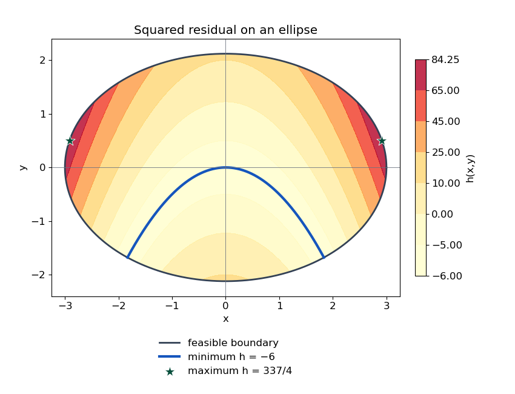

<h1 id="4/c/solution">Solution</h1>

↑ **Parent:** [C](../c.md)

Complete the square:

$$
h=(x^2+2y)^2-6.
$$

The [minimum locus of a squared function](../../../../../minimum-locus-of-a-squared-function.md) occurs where its residual vanishes. Hence the minimum is $-6$ on $y=-x^2/2$, provided these points lie in the ellipse. Setting $t=x^2$ in the constraint gives $t+t^2/2\leq9$, or $0\leq t\leq\sqrt{19}-1$. Thus

$$
\boxed{\min_R h=-6,\quad\text{at }\left\{(x,-x^2/2):|x|\leq\sqrt{\sqrt{19}-1}\right\}.}
$$

For the maximum, let $q=x^2+2y$. The ellipse gives

$$
q\leq9-2y^2+2y=\frac{19}{2}-2\left(y-\frac12\right)^2\leq\frac{19}{2}.
$$

Also $q\geq2y\geq-3\sqrt2$, whose absolute value is less than $19/2$. Therefore $q^2\leq(19/2)^2$. Equality is attained at $y=1/2$, $x^2=17/2$, giving

$$
\boxed{\max_R h=\frac{337}{4}=84\frac14,\quad\text{at }(x,y)=\left(\pm\sqrt{17/2},\frac12\right).}
$$

These attained bounds are global, not merely stationary-point tests. The minimizing locus is a parabola segment.

**[Figure 1](#4/c/image-global-extrema-of-the-squared-residual-quartic-on-an-ellipse). Global extrema of the squared-residual quartic on an ellipse**. Contours show h inside the feasible ellipse. The blue parabola segment is the entire minimum set h = -6; the two marked boundary points attain the maximum 337/4.

## ↑ Ancestors (12)

1. [C](../c.md)
2. [4](../../4.md)
3. [Discrete mathematics, continuous mathematics and probability](../../../discrete-mathematics-continuous-mathematics-and-probability-split.md)
4. [2017](../../../split.md)
5. [Past exam of the year 1 of the computer science course of the University of Oxford](../../../../split.md)
6. [Year 1 of the computer science course of the University of Oxford](../../../../../year-1-of-the-computer-science-course-of-the-university-of-oxford.md)
7. [Computer science course of the University of Oxford](../../../../../computer-science-course-of-the-university-of-oxford.md)
8. [Undergraduate course of the University of Oxford](../../../../../undergraduate-course-of-the-university-of-oxford.md)
9. [Course of the University of Oxford](../../../../../course-of-the-university-of-oxford.md)
10. [University of Oxford](../../../../../university-of-oxford-split.md)
11. [List of universities](../../../../../list-of-universities.md)
12. [Codex Wiki](../../../../../split.md)
