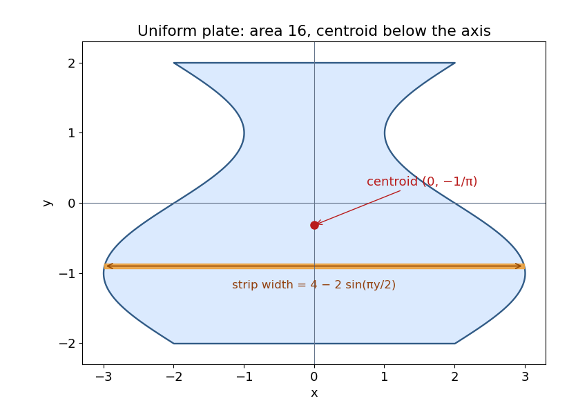

<h1 id="5/c/solution">Solution</h1>

↑ **Parent:** [C](../c.md)

A horizontal strip at height $y$ has width $4-2\sin(\pi y/2)$. The sine term is odd, so the [area](../../../../../surface-area.md) is

$$
\boxed{|A|=\int_{-2}^{2}\left(4-2\sin\frac{\pi y}{2}\right)dy=16.}
$$

Reflection symmetry in the $y$-axis gives $\bar x=0$. For uniform density, the constant density cancels from the [center of mass](../../../../../center-of-mass.md) ratio. Its first moment in the vertical coordinate is

$$
\begin{aligned}
\int_A y\,dA
&=-4\int_0^2 y\sin\frac{\pi y}{2}\,dy\\
&=-4\left[-\frac{2y}{\pi}\cos\frac{\pi y}{2}+\frac4{\pi^2}\sin\frac{\pi y}{2}\right]_0^2
=-\frac{16}{\pi}.
\end{aligned}
$$

Consequently

$$
\boxed{(\bar x,\bar y)=\left(0,-\frac1\pi\right).}
$$

The wider part below the horizontal axis accounts for the negative vertical coordinate.

**[Figure 2](#5/c/image-uniform-density-plate-with-area-16-and-centroid-at-0-1-pi). Uniform-density plate with area 16 and centroid at (0, -1/π)** Original plot of the strip-defined region. The marked centroid lies below the horizontal axis; the highlighted sample strip illustrates the width used in the area and moment integrals.

## ↑ Ancestors (12)

1. [C](../c.md)
2. [5](../../5.md)
3. [Discrete mathematics, continuous mathematics and probability](../../../discrete-mathematics-continuous-mathematics-and-probability-split.md)
4. [2017](../../../split.md)
5. [Past exam of the year 1 of the computer science course of the University of Oxford](../../../../split.md)
6. [Year 1 of the computer science course of the University of Oxford](../../../../../year-1-of-the-computer-science-course-of-the-university-of-oxford.md)
7. [Computer science course of the University of Oxford](../../../../../computer-science-course-of-the-university-of-oxford.md)
8. [Undergraduate course of the University of Oxford](../../../../../undergraduate-course-of-the-university-of-oxford.md)
9. [Course of the University of Oxford](../../../../../course-of-the-university-of-oxford.md)
10. [University of Oxford](../../../../../university-of-oxford-split.md)
11. [List of universities](../../../../../list-of-universities.md)
12. [Codex Wiki](../../../../../split.md)
