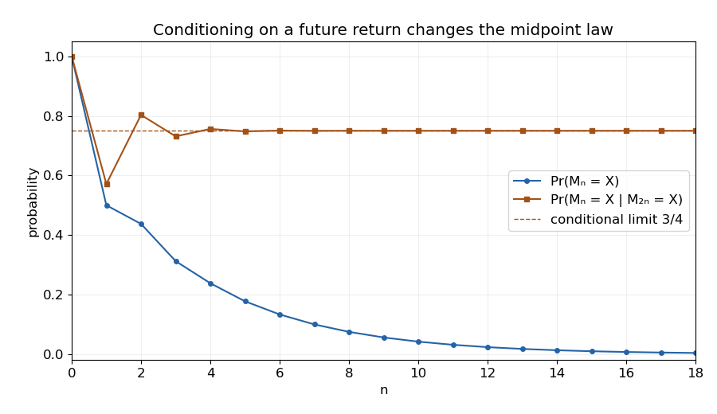

<h1 id="8/b/iv/solution">Solution</h1>

↑ **Parent:** [Iv](../iv.md)

The [Markov property](../../../../../../markov-property.md) and time homogeneity give

$$
\mathbb P(M_n=X,M_{2n}=X)=p_n\mathbb P(M_{2n}=X\mid M_n=X)=p_n^2.
$$

Since $p_{2n}>0$, [conditional probability](../../../../../../conditional-probability.md) yields the [Markov chain return bridge](../../../../../../markov-chain-return-bridge.md) expression

$$
\boxed{\mathbb P(M_n=X\mid M_{2n}=X)=\frac{p_n^2}{p_{2n}}
=\frac{(3^{n+1}+(-1)^n)^2}{4(3^{2n+1}+1)}.}
$$

The explicit formula gives $p_n\sim\frac34(3/4)^n$, so

$$
\boxed{\lim_{n\to\infty}\mathbb P(M_n=X\mid M_{2n}=X)=\frac34.}
$$

The conditioning event has positive probability at each finite time even though those return probabilities tend to zero. Taking an undefined conditional on an infinite-time zero-probability event is not needed.

**[Figure 3](#8/b/iv/image-unconditional-returns-decay-while-midpoint-return-conditioning-tends-to-3-4). Unconditional returns decay while midpoint return conditioning tends to 3/4**. Exact values from the two-root recurrence. The conditional midpoint probabilities oscillate toward 3/4, even as the unconditioned probability of being at X decreases to zero.

## ↑ Ancestors (13)

1. [Iv](../iv.md)
2. [B](../../b.md)
3. [8](../../../8.md)
4. [Discrete mathematics, continuous mathematics and probability](../../../../discrete-mathematics-continuous-mathematics-and-probability-split.md)
5. [2017](../../../../split.md)
6. [Past exam of the year 1 of the computer science course of the University of Oxford](../../../../../split.md)
7. [Year 1 of the computer science course of the University of Oxford](../../../../../../year-1-of-the-computer-science-course-of-the-university-of-oxford.md)
8. [Computer science course of the University of Oxford](../../../../../../computer-science-course-of-the-university-of-oxford.md)
9. [Undergraduate course of the University of Oxford](../../../../../../undergraduate-course-of-the-university-of-oxford.md)
10. [Course of the University of Oxford](../../../../../../course-of-the-university-of-oxford.md)
11. [University of Oxford](../../../../../../university-of-oxford-split.md)
12. [List of universities](../../../../../../list-of-universities.md)
13. [Codex Wiki](../../../../../../split.md)
