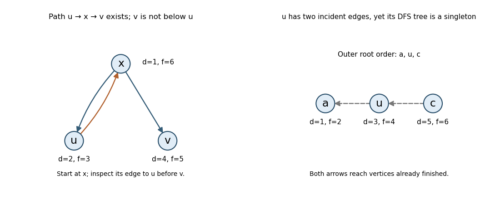

# Functional programming, design and analysis of algorithms (resit)

↑ **Parent:** [2017](../2017.md)

Solutions to the readable material from the 12 September 2017 resit: 24 printed subparts in Questions 4–8. Source: [released examination archive](https://www.whatdotheyknow.com/request/ba_computer_science_past_papers/response/2577745/attach/2/202402%20183%20CS%20Papers.zip?cookie_passthrough=1), member `2016/L/a10097w1.pdf`. The cover establishes the 2017 date despite the archive directory name.

TODO: Printed pages 2–3, containing Questions 1–3, are absent or unrenderable in the held source. Their contents and subpart labels cannot be recovered from the different June examination.

**Table of contents**

- [1](#1)
  - [Solution](#1/solution)
- [2](#2)
  - [Solution](#2/solution)
- [3](#3)
  - [Solution](#3/solution)
- [4](#4)
  - [a](#4/a)
    - [Solution](#4/a/solution)
  - [b](#4/b)
    - [Solution](#4/b/solution)
  - [c](#4/c)
    - [Solution](#4/c/solution)
  - [d](#4/d)
    - [Solution](#4/d/solution)
  - [e](#4/e)
    - [Solution](#4/e/solution)
  - [f](#4/f)
    - [Solution](#4/f/solution)
- [5](#5)
  - [a](#5/a)
    - [Solution](#5/a/solution)
  - [b](#5/b)
    - [Solution](#5/b/solution)
  - [c](#5/c)
    - [Solution](#5/c/solution)
  - [d](#5/d)
    - [Solution](#5/d/solution)
- [6](#6)
  - [a](#6/a)
    - [Solution](#6/a/solution)
  - [b](#6/b)
    - [Solution](#6/b/solution)
  - [c](#6/c)
    - [Solution](#6/c/solution)
- [7](#7)
  - [a](#7/a)
    - [Solution](#7/a/solution)
  - [b](#7/b)
    - [Solution](#7/b/solution)
  - [c](#7/c)
    - [i](#7/c/i)
      - [Solution](#7/c/i/solution)
    - [ii](#7/c/ii)
      - [Solution](#7/c/ii/solution)
    - [iii](#7/c/iii)
      - [Solution](#7/c/iii/solution)
    - [iv](#7/c/iv)
      - [Solution](#7/c/iv/solution)
- [8](#8)
  - [a](#8/a)
    - [Solution](#8/a/solution)
  - [b](#8/b)
    - [Solution](#8/b/solution)
  - [c](#8/c)
    - [Solution](#8/c/solution)
  - [d](#8/d)
    - [Solution](#8/d/solution)
  - [e](#8/e)
    - [Solution](#8/e/solution)

## 1

↑ **Parent:** [Functional programming, design and analysis of algorithms (resit)](functional-programming-design-and-analysis-of-algorithms-resit.md)

<h3 id="1/solution">Solution</h3>

↑ **Parent:** [1](#1)

TODO: Question 1 is on the unavailable printed pages 2–3. No statement, subpart structure or solution is inferred from a different paper.

## 2

↑ **Parent:** [Functional programming, design and analysis of algorithms (resit)](functional-programming-design-and-analysis-of-algorithms-resit.md)

<h3 id="2/solution">Solution</h3>

↑ **Parent:** [2](#2)

TODO: Question 2 is on the unavailable printed pages 2–3. No statement, subpart structure or solution is inferred from a different paper.

## 3

↑ **Parent:** [Functional programming, design and analysis of algorithms (resit)](functional-programming-design-and-analysis-of-algorithms-resit.md)

<h3 id="3/solution">Solution</h3>

↑ **Parent:** [3](#3)

TODO: Question 3 is on the unavailable printed pages 2–3. No statement, subpart structure or solution is inferred from a different paper.

## 4

↑ **Parent:** [Functional programming, design and analysis of algorithms (resit)](functional-programming-design-and-analysis-of-algorithms-resit.md)

<h3 id="4/a">a</h3>

↑ **Parent:** [4](#4)

<h4 id="4/a/solution">Solution</h4>

↑ **Parent:** [A](#4/a)

The most general [polymorphic type](../../programming-language.md#polymorphic-type) is

```
unfold :: (s -> Bool) -> (s -> a) -> (s -> s) -> s -> [a]
```

The stopping [predicate](../../analysis-of-boolean-functions.md#predicate) consumes a state, the output function turns that state into one list element, and the transition function supplies another state of the same type. The state type and output type need not coincide. This is a [list unfold](../../programming-language.md#list-unfold) with separate stopping, output and transition arguments.

<h3 id="4/b">b</h3>

↑ **Parent:** [4](#4)

<h4 id="4/b/solution">Solution</h4>

↑ **Parent:** [B](#4/b)

The standard [Haskell](../../programming-language.md#haskell) definition and principal type are

```
iterate :: (a -> a) -> a -> [a]
iterate f x = x : iterate f (f x)
```

Under [lazy evaluation](../../programming-language.md#lazy-evaluation), this produces successive states $x,f(x),f(f(x)),\ldots$ as demanded. An infinite spine does not require all elements to be evaluated at once; [productivity](../../data-structure.md#stream-productivity) still depends on the demanded computations terminating.

<h3 id="4/c">c</h3>

↑ **Parent:** [4](#4)

<h4 id="4/c/solution">Solution</h4>

↑ **Parent:** [C](#4/c)

The required [function composition](../../function.md#function-composition) is

```
unfold p f g = map f . takeWhile (not . p) . iterate g
```

`iterate g` supplies the successive states, `takeWhile (not . p)` retains precisely those before the first stopping state, and `map f` produces their outputs. If the initial state satisfies the stopping predicate, both sides return the empty list. Otherwise both emit the same head and repeat from `g x`; the same argument applies to every demanded finite prefix of an infinite result.

<h3 id="4/d">d</h3>

↑ **Parent:** [4](#4)

<h4 id="4/d/solution">Solution</h4>

↑ **Parent:** [D](#4/d)

Using the specified [list unfold](../../programming-language.md#list-unfold), the definitions are

```
map f     = unfold null (f . head) tail
iterate f = unfold (const False) id f
```

For `map`, the current state is the remaining input list. `null` prevents `head` and `tail` from being evaluated on an empty list. For `iterate`, the stop predicate is always false and the output is the current state itself. Its transition is `f`, so the original seed is emitted before the first application of `f`.

<h3 id="4/e">e</h3>

↑ **Parent:** [4](#4)

<h4 id="4/e/solution">Solution</h4>

↑ **Parent:** [E](#4/e)

Store two consecutive [Fibonacci numbers](../../sequence-and-series.md#fibonacci-number) as the state:

```
fibs :: [Integer]
fibs = unfold (const False) fst step (0,1)
  where
    step (a,b) = (b,a+b)
```

The invariant is that the state is $(F_n,F_{n+1})$, with $F_0=0,F_1=1$. Emitting its first component and updating the pair therefore produces **$0,1,1,2,3,5,8,\ldots$**. `Integer` avoids fixed-width overflow; the bit cost of adding increasingly large integers is separate from the number of unfold steps.

<h3 id="4/f">f</h3>

↑ **Parent:** [4](#4)

<h4 id="4/f/solution">Solution</h4>

↑ **Parent:** [F](#4/f)

Arrange that each state already begins with the next passing element, or is empty:

```
filter p = unfold null head next . seek
  where
    seek = dropWhile (not . p)
    next = seek . tail
```

The initial `seek` skips the rejected prefix. After an element is emitted, `next` removes it and skips the following rejected run. Thus `null` guards both partial list operations and the [filtering a list by unfolding](../../programming-language.md#filtering-a-list-by-unfolding) invariant is preserved.

For a finite input of length $n$ and constant-cost predicate evaluation, each input element is tested once and each list cell is passed a bounded number of times: the total work is **$O(n)$**, as for the usual recursive [list filter](../../programming-language.md#list-filter). This version may have different constant overhead. Recomputing `dropWhile` independently in the stopping, output and transition expressions could repeat scans; keeping the already-filtered suffix as state avoids that. On an infinite rejected tail, finding another output diverges, just as the standard lazy filter does.

## 5

↑ **Parent:** [Functional programming, design and analysis of algorithms (resit)](functional-programming-design-and-analysis-of-algorithms-resit.md)

<h3 id="5/a">a</h3>

↑ **Parent:** [5](#5)

<h4 id="5/a/solution">Solution</h4>

↑ **Parent:** [A](#5/a)

Initialize $d[s]=0$ and every other tentative distance to infinity. The [Bellman-Ford algorithm](../../shortest-path-problem.md#bellman-ford-algorithm) repeatedly relaxes every directed edge:

```
for v in V: d[v] = infinity; parent[v] = none
d[s] = 0
repeat |V|-1 times:
    changed = false
    for each edge (u,v) of weight w:
        if d[u] != infinity and d[u] + w < d[v]:
            d[v] = d[u] + w
            parent[v] = u
            changed = true
    if not changed: break
for each edge (u,v) of weight w:
    if d[u] != infinity and d[u] + w < d[v]:
        report a reachable negative-weight cycle
```

An unreachable vertex retains infinity. A reachable negative-weight cycle prevents finite shortest-walk distances for vertices reachable from that cycle, so the detection case must not be reported as an ordinary finite answer. With edge-list scans the worst-case work is **$O(|V||E|+|V|)$**, conventionally stated as $O(|V||E|)$, and the auxiliary storage is $O(|V|)$ beyond the graph.

<h3 id="5/b">b</h3>

↑ **Parent:** [5](#5)

<h4 id="5/b/solution">Solution</h4>

↑ **Parent:** [B](#5/b)

Every finite distance label is the weight of a discovered [directed walk](../../graph-theory.md#directed-walk), so it can never underestimate a finite shortest-path distance. After $k$ complete passes, each label is at most the cost of every source-to-vertex path using at most $k$ edges. To prove that assertion, consider such a path's last edge $u\to v$: after the previous pass, $u$ already has a label no greater than the prefix cost, and the current pass relaxes that last edge. In-place improvements can only make the label smaller, preserving the assertion.

When no negative-weight cycle is reachable, any repeated-vertex portion of an optimal walk can be removed without increasing its cost. Some shortest path therefore has at most $|V|-1$ edges. The two bounds meet after that many passes, proving correctness. If a complete pass makes no change, all [edge relaxation](../../shortest-path-problem.md#edge-relaxation) inequalities already hold and further passes cannot improve anything. A further strict relaxation after $|V|-1$ passes implies a reachable negative cycle by the same simple-path bound.

<h3 id="5/c">c</h3>

↑ **Parent:** [5](#5)

<h4 id="5/c/solution">Solution</h4>

↑ **Parent:** [C](#5/c)

**Bellman–Ford permits negative edge weights**, and can detect a reachable negative-weight cycle. The usual settled-label [Dijkstra's algorithm](../../shortest-path-problem.md#dijkstra-algorithm) requires nonnegative weights for its correctness argument. Negative edges are not themselves a problem for Bellman–Ford when no relevant negative cycle exists.

<h3 id="5/d">d</h3>

↑ **Parent:** [5](#5)

<h4 id="5/d/solution">Solution</h4>

↑ **Parent:** [D](#5/d)

Use [minimum-hop shortest paths](../../shortest-path-problem.md#minimum-hop-shortest-paths) by minimizing the [lexicographic order](../../extremal-set-theory.md#lexicographic-order) pair $(d,h)$: total weight first, number of edges second. Extend a pair across an edge of weight $w$ by adding $(w,1)$, and compare the full pair in both the [priority queue](../../data-structure.md#priority-queue) and relaxation:

```
for v in V: key[v] = (infinity,infinity)
key[s] = (0,0)
Q = indexed min-priority-queue containing all vertices, keyed by key
while Q is not empty:
    u = extract-min(Q)
    if key[u].distance == infinity: break
    for each edge (u,v) of weight w with v still in Q:
        candidate = (key[u].distance + w, key[u].hops + 1)
        if candidate <lex key[v]:
            key[v] = candidate
            decrease-key(Q,v,candidate)
for v in V: best[v] = key[v].hops
```

All weights are positive, so extending a path strictly increases its first component. The usual [Dijkstra's algorithm](../../shortest-path-problem.md#dijkstra-algorithm) settled-label proof therefore applies to these ordered pairs: no path through a not-yet-settled vertex can later improve an extracted minimum. Among equal minimum weights, the secondary component selects the fewest edges. Merely breaking extraction ties by vertex name would not implement this objective.

With a [binary heap](../../data-structure.md#binary-heap) and [adjacency lists](../../data-structure.md#adjacency-list), the bound is **$O((|V|+|E|)\log |V|)$**, with $O(|V|)$ extra storage. Unreachable vertices have `best = infinity`. In the paper's example, the resulting pairs in order $s,a,b,c,d,e,f$ are $(0,0),(2,1),(2,1),(4,1),(5,2),(5,2),(6,3)$, so the requested edge counts are **$0,1,1,1,2,2,3$**.

## 6

↑ **Parent:** [Functional programming, design and analysis of algorithms (resit)](functional-programming-design-and-analysis-of-algorithms-resit.md)

<h3 id="6/a">a</h3>

↑ **Parent:** [6](#6)

<h4 id="6/a/solution">Solution</h4>

↑ **Parent:** [A](#6/a)

[Dynamic programming](../../mathematical-optimization.md#dynamic-programming) defines subproblem optima and combines their stored answers through a recurrence. It is useful when [optimal substructure](../../mathematical-optimization.md#optimal-substructure) and [overlapping subproblems](../../algorithm.md#overlapping-subproblems) allow repeated work to be shared. Several alternative choices can be compared before an optimum is selected.

A [greedy algorithm](../../algorithm.md#greedy-algorithm) instead commits to a locally selected choice and does not later reconsider it. To be correct, its choice needs a justification such as an [exchange argument](../../algorithm.md#exchange-argument) or a safe-cut property, beyond merely having optimal substructure. Neither method is automatically applicable to every optimization problem. [Prim's algorithm](../../tree-graph-theory.md#prim-s-algorithm) illustrates a justified greedy choice; the maximum-segment recurrence below illustrates dynamic programming.

<h3 id="6/b">b</h3>

↑ **Parent:** [6](#6)

<h4 id="6/b/solution">Solution</h4>

↑ **Parent:** [B](#6/b)

For a connected, weighted, undirected graph, grow a tree from any root $r$. For every vertex outside the tree, store the cheapest edge currently connecting it to the tree, not its source-path distance:

```
for v in V: key[v] = infinity; parent[v] = none
key[r] = 0
Q = indexed min-priority-queue containing all vertices
while Q is not empty:
    u = extract-min(Q)
    if parent[u] != none: output edge (parent[u],u)
    for each edge {u,v} of weight w with v still in Q:
        if w < key[v]:
            key[v] = w
            parent[v] = u
            decrease-key(Q,v,w)
```

The maintained key chooses the minimum-weight edge crossing the cut between the tree and remaining vertices. The [minimum spanning tree cut property](../../tree-graph-theory.md#minimum-spanning-tree-cut-property) makes that edge safe; induction therefore preserves the existence of a minimum spanning tree containing all selected edges. This proves why [Prim's algorithm](../../tree-graph-theory.md#prim-s-algorithm) is greedy and correct. With adjacency lists and a binary heap its time is $O((|V|+|E|)\log |V|)$. For a disconnected graph, starting another component when the minimum key is infinity produces a [minimum spanning forest](../../tree-graph-theory.md#minimum-spanning-forest) instead of claiming that a spanning tree exists.

<h3 id="6/c">c</h3>

↑ **Parent:** [6](#6)

<h4 id="6/c/solution">Solution</h4>

↑ **Parent:** [C](#6/c)

Let $e_i$ be the best sum of a segment ending at position $i$, allowing the empty segment with sum zero. The [maximum subarray problem](../../algorithm.md#maximum-subarray-problem) recurrence is

$$
\boxed{e_0=0,\qquad e_i=\max(0,e_{i-1}+a_i),\qquad B_i=\max(B_{i-1},e_i),\ B_0=0.}
$$

An optimal nonempty segment ending at $i$ extends the best suffix ending at $i-1$, or starts fresh; a negative suffix cannot help. Keep its start index and record endpoints whenever a new overall best is found:

```
suffix = 0; best = 0
start = 0; bestLeft = 0; bestRight = 0
for i = 0,...,n-1:
    suffix = suffix + A[i]
    if suffix < 0:
        suffix = 0; start = i+1
    if suffix > best:
        best = suffix
        bestLeft = start; bestRight = i+1
return A[bestLeft:bestRight]
```

The half-open endpoint interval is empty initially, so empty input and all-negative input correctly return an empty segment. The invariant identifies the best nonnegative suffix and the best segment in the scanned prefix, proving correctness. This is [Kadane's algorithm](../../algorithm.md#kadane-s-algorithm), using **$O(n)$ time and $O(1)$ auxiliary space**, excluding the returned slice. The displayed example yields **sum $55$**, from the segment $10,-5,40,10$.

## 7

↑ **Parent:** [Functional programming, design and analysis of algorithms (resit)](functional-programming-design-and-analysis-of-algorithms-resit.md)

<h3 id="7/a">a</h3>

↑ **Parent:** [7](#7)

<h4 id="7/a/solution">Solution</h4>

↑ **Parent:** [A](#7/a)

Maintain white, gray and black colors for undiscovered, active and completed vertices. A single traversal clock records [DFS discovery and finishing times](../../algorithm.md#dfs-discovery-and-finishing-times):

```
for v in V: color[v] = white; parent[v] = none
time = 0
visit(u):
    time = time+1; d[u] = time; color[u] = gray
    for v in adjacency[u]:
        if color[v] == white:
            parent[v] = u
            visit(v)
    color[u] = black; time = time+1; f[u] = time
for u in V:
    if color[u] == white: visit(u)
```

The outer loop makes a [depth-first search](../../algorithm.md#depth-first-search) forest even when the directed graph is disconnected. Each vertex is entered once and each directed adjacency entry is inspected once. Thus an [adjacency list](../../data-structure.md#adjacency-list) representation gives **$O(|V|+|E|)$ time** and $O(|V|)$ auxiliary storage, including the worst-case recursive stack. Sorting neighbors to impose a particular visit order would be additional work.

<h3 id="7/b">b</h3>

↑ **Parent:** [7](#7)

<h4 id="7/b/solution">Solution</h4>

↑ **Parent:** [B](#7/b)

Relative to the resulting [DFS edge classification](../../algorithm.md#dfs-edge-classification), a **[tree edge in depth-first search](../../algorithm.md#tree-edge-in-depth-first-search)** discovers a white vertex and becomes its parent edge. A **[forward edge in depth-first search](../../algorithm.md#forward-edge-in-depth-first-search)** goes to a proper descendant but is not that descendant's discovery edge. A **[back edge in depth-first search](../../algorithm.md#back-edge-in-depth-first-search)** goes to an active ancestor, with a self-loop also counted as a back edge when such edges are allowed. A **[cross edge in depth-first search](../../algorithm.md#cross-edge-in-depth-first-search)** joins vertices with no ancestor-descendant relationship in the forest, such as different completed branches or different trees.

The definitions refer to directed edges; an undirected graph is normally classified only with tree and back edges, accounting for the reverse copy of a parent edge separately.

<h3 id="7/c">c</h3>

↑ **Parent:** [7](#7)

<h4 id="7/c/i">i</h4>

↑ **Parent:** [C](#7/c)

<h5 id="7/c/i/solution">Solution</h5>

↑ **Parent:** [I](#7/c/i)

**False.** Use vertices $x,u,v$, edges $x\to u$, $u\to x$, $x\to v$, and start [depth-first search](../../algorithm.md#depth-first-search) at $x$, scanning $u$ before $v$. The times are

$$
\boxed{d(x)=1,\ d(u)=2,\ f(u)=3,\ d(v)=4,\ f(v)=5,\ f(x)=6.}
$$

There is a directed path $u\to x\to v$ and $d(u)<d(v)$, but $u$ and $v$ are separate children of $x$. Thus $v$ is not a descendant of $u$. The path leaves $u$ through an already gray ancestor; its later branch need not be explored inside $u$'s recursive call. This is consistent with the [DFS parenthesis property](../../algorithm.md#depth-first-search-parenthesis-property).

<a id="7/c/i/image-dfs-counterexamples-distinguish-reachability-from-tree-ancestry"></a>


**[Figure 1](#7/c/i/image-dfs-counterexamples-distinguish-reachability-from-tree-ancestry). DFS counterexamples distinguish reachability from tree ancestry**. Left: the path from u through its ancestor x reaches a later sibling v, after u has finished. Right: root order a,u,c makes three singleton DFS trees, though u has an incoming and an outgoing edge.

<h4 id="7/c/ii">ii</h4>

↑ **Parent:** [C](#7/c)

<h5 id="7/c/ii/solution">Solution</h5>

↑ **Parent:** [Ii](#7/c/ii)

**False.** The same ordered traversal gives a path $u\to x\to v$, but

$$
\boxed{d(v)=4>3=f(u).}
$$

A path from $u$ can pass through an already discovered ancestor, whose remaining edges are scanned only after $u$ finishes. A [reachability](../../graph.md#reachability-in-a-graph) statement alone therefore does not impose the claimed finishing-time bound.

<h4 id="7/c/iii">iii</h4>

↑ **Parent:** [C](#7/c)

<h5 id="7/c/iii/solution">Solution</h5>

↑ **Parent:** [Iii](#7/c/iii)

**True for a directed cycle.** Suppose there were no back edges. On examining an edge $u\to v$, its target would either be white, in which case its recursive call finishes before $u$; or black, in which case it has already finished. A gray target would be an active ancestor and hence give a back edge, contrary to the supposition. Therefore every edge would satisfy $f(v)<f(u)$.

Applying those strict inequalities around a directed cycle would imply $f(u)<f(u)$, a contradiction. Thus some [back edge in depth-first search](../../algorithm.md#back-edge-in-depth-first-search) must exist in the search's edge classification. Such an edge is classified relative to the DFS forest; it is not one of the forest's tree edges.

<h4 id="7/c/iv">iv</h4>

↑ **Parent:** [C](#7/c)

<h5 id="7/c/iv/solution">Solution</h5>

↑ **Parent:** [Iv](#7/c/iv)

**False.** Take edges $u\to a$ and $c\to u$, and let the outer DFS loop try vertices in order $a,u,c$. The first call finishes $a$ immediately. The next discovers $u$, whose only outgoing edge reaches already black $a$, so its tree contains only $u$. Finally $c$ sees already black $u$.

Vertex $u$ has both an incoming edge from $c$ and an outgoing edge to $a$, yet is the sole vertex of its DFS tree. Nonzero incoming and outgoing degrees do not require either edge to become a [tree edge in depth-first search](../../algorithm.md#tree-edge-in-depth-first-search).

## 8

↑ **Parent:** [Functional programming, design and analysis of algorithms (resit)](functional-programming-design-and-analysis-of-algorithms-resit.md)

<h3 id="8/a">a</h3>

↑ **Parent:** [8](#8)

<h4 id="8/a/solution">Solution</h4>

↑ **Parent:** [A](#8/a)

Build a [max-heap](../../data-structure.md#max-heap), then repeatedly swap its root with the last element of the active prefix, shrink that prefix and restore [heap order](../../data-structure.md#heap-order) by [heapify down](../../data-structure.md#sift-down). A zero-based implementation is

```
for i = floor(n/2)-1,...,0:
    siftDown(A,i,n)
for end = n-1,...,1:
    swap A[0],A[end]
    siftDown(A,0,end)
```

`siftDown(A,i,end)` repeatedly exchanges entry `i` with its larger child while the child lies below `end` and has a larger key. The suffix beyond `end` is already sorted and never touched again. For the specified input, key stages of [heapsort](../../algorithm.md#heapsort) are

| Stage | Active max heap | Sorted suffix |
| --- | --- | --- |
| Bottom-up heap construction | $[5,4,3,1,2]$ | $[]$ |
| Extract 5, repair | $[4,2,3,1]$ | $[5]$ |
| Extract 4, repair | $[3,2,1]$ | $[4,5]$ |
| Extract 3, repair | $[2,1]$ | $[3,4,5]$ |
| Extract 2 | $[1]$ | $[2,3,4,5]$ |

The final array is **$[1,2,3,4,5]$**. Bottom-up construction takes $O(n)$ time because there are progressively fewer nodes at each greater subtree height; the extractions give worst-case $O(n\log n)$ time and constant auxiliary storage for iterative sifting.

<h3 id="8/b">b</h3>

↑ **Parent:** [8](#8)

<h4 id="8/b/solution">Solution</h4>

↑ **Parent:** [B](#8/b)

A deterministic [comparison sort](../../algorithm.md#comparison-sort) on $n$ distinct keys must distinguish $n!$ possible initial orders. Its binary comparison [decision tree](../../theoretical-computer-science.md#decision-tree) therefore has at least $n!$ leaves: a leaf fixes one output ordering and cannot be correct for two different strict orders of the original records.

A binary tree of height $h$ has at most $2^h$ leaves, hence

$$
\boxed{h\geq\lceil\log_2(n!)\rceil=\Omega(n\log n).}
$$

This is the [comparison sorting lower bound](../../algorithm.md#comparison-sorting-lower-bound) on the worst-case number of comparisons. Distinct keys have only two possible comparison outcomes, even if an implementation's comparator also supports equality. Algorithms exploiting numeric key values, such as counting sort, fall outside this model.

<h3 id="8/c">c</h3>

↑ **Parent:** [8](#8)

<h4 id="8/c/solution">Solution</h4>

↑ **Parent:** [C](#8/c)

The printed split uses $n$ while naming the current length $m=j-i$. For the intended [stooge sort](../../algorithm.md#stooge-sort), read that split as $k=\lfloor m/3\rfloor$ at every recursive call. Keeping one fixed original $n$ instead is not the standard algorithm and does not generally sort correctly.

The three recursive calls then each have length $m-\lfloor m/3\rfloor=\lceil2m/3\rceil$, and all other work is constant. Thus

$$
\boxed{T(m)=3T(\lceil2m/3\rceil)+\Theta(1)\quad(m>2),\qquad T(m)=\Theta(1)\quad(m\leq2).}
$$

A version of the [master theorem](../../sequence-and-series.md#master-theorem) sufficient here states: if $T(n)=aT(\lceil n/b\rceil)+f(n)$ with constants $a\geq1,b>1$, fixed-size base cases and $f(n)=O(n^{\log_b a-\epsilon})$ for some $\epsilon>0$, then $T(n)=\Theta(n^{\log_b a})$, provided the recursive sizes shrink above the base threshold. Apply it with $a=3,b=3/2,f=\Theta(1)$ to obtain

$$
\boxed{T(n)=\Theta\!\left(n^{\log_{3/2}3}\right),\qquad \log_{3/2}3\approx2.7095.}
$$

The rounded size is important for correctness; it does not change this asymptotic exponent.

<h3 id="8/d">d</h3>

↑ **Parent:** [8](#8)

<h4 id="8/d/solution">Solution</h4>

↑ **Parent:** [D](#8/d)

**Prefer the alternatives for large unrestricted arrays.** [Merge sort](../../algorithm.md#merge-sort) and [heapsort](../../algorithm.md#heapsort) have $O(n\log n)$ worst-case time, while [insertion sort](../../algorithm.md#insertion-sort) has $O(n^2)$ worst-case time and can be much faster on nearly sorted data. The intended [stooge sort](../../algorithm.md#stooge-sort) has worst-case $\Theta(n^{2.7095\ldots})$, so even insertion sort has the better worst-case exponent.

The first two give the stronger general asymptotic guarantee. Choices between them can depend on storage and [stable sorting](../../algorithm.md#stable-sorting) requirements; these considerations do not rescue Stooge sort's much larger work count.

<h3 id="8/e">e</h3>

↑ **Parent:** [8](#8)

<h4 id="8/e/solution">Solution</h4>

↑ **Parent:** [E](#8/e)

**No: Stooge sort is not stable.** Give equal keys distinct record identities and start with

$$
[2_a,2_b,1].
$$

The initial endpoint swap gives $[1,2_b,2_a]$. The later two-element calls either see increasing keys or equal keys, so they make no swap. The two records with key 2 have reversed their original order, contradicting [stable sorting](../../algorithm.md#stable-sorting). The example uses length three, where the intended current-length split is unambiguous.

## ↑ Ancestors (9)

1. [2017](../2017.md)
2. [Past exam of the year 1 of the computer science course of the University of Oxford](../../past-exam-of-the-year-1-of-the-computer-science-course-of-the-university-of-oxford.md)
3. [Year 1 of the computer science course of the University of Oxford](../../university-of-oxford.md#year-1-of-the-computer-science-course-of-the-university-of-oxford)
4. [Computer science course of the University of Oxford](../../university-of-oxford.md#computer-science-course-of-the-university-of-oxford)
5. [Undergraduate course of the University of Oxford](../../university-of-oxford.md#undergraduate-course-of-the-university-of-oxford)
6. [Course of the University of Oxford](../../university-of-oxford.md#course-of-the-university-of-oxford)
7. [University of Oxford](../../university-of-oxford.md)
8. [List of universities](../../README.md#list-of-universities)
9. [Codex Wiki](../../README.md)
