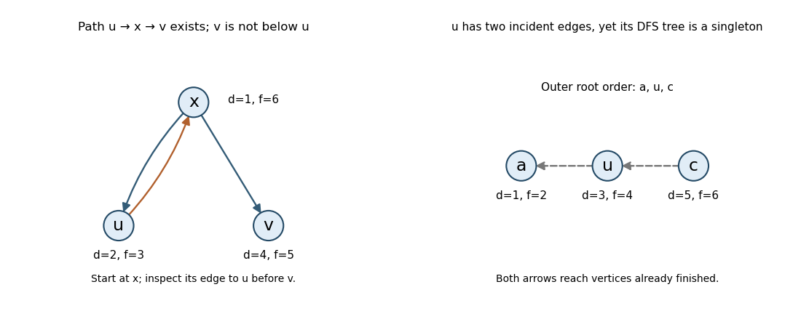

<h1 id="7/c/i/solution">Solution</h1>

↑ **Parent:** [I](../i.md)

**False.** Use vertices $x,u,v$, edges $x\to u$, $u\to x$, $x\to v$, and start [depth-first search](../../../../../../depth-first-search.md) at $x$, scanning $u$ before $v$. The times are

$$
\boxed{d(x)=1,\ d(u)=2,\ f(u)=3,\ d(v)=4,\ f(v)=5,\ f(x)=6.}
$$

There is a directed path $u\to x\to v$ and $d(u)<d(v)$, but $u$ and $v$ are separate children of $x$. Thus $v$ is not a descendant of $u$. The path leaves $u$ through an already gray ancestor; its later branch need not be explored inside $u$'s recursive call. This is consistent with the [DFS parenthesis property](../../../../../../depth-first-search-parenthesis-property.md).

**[Figure 1](#7/c/i/image-dfs-counterexamples-distinguish-reachability-from-tree-ancestry). DFS counterexamples distinguish reachability from tree ancestry**. Left: the path from u through its ancestor x reaches a later sibling v, after u has finished. Right: root order a,u,c makes three singleton DFS trees, though u has an incoming and an outgoing edge.

## ↑ Ancestors (13)

1. [I](../i.md)
2. [C](../../c.md)
3. [7](../../../7.md)
4. [Functional programming, design and analysis of algorithms (resit)](../../../../functional-programming-design-and-analysis-of-algorithms-resit-split.md)
5. [2017](../../../../split.md)
6. [Past exam of the year 1 of the computer science course of the University of Oxford](../../../../../split.md)
7. [Year 1 of the computer science course of the University of Oxford](../../../../../../year-1-of-the-computer-science-course-of-the-university-of-oxford.md)
8. [Computer science course of the University of Oxford](../../../../../../computer-science-course-of-the-university-of-oxford.md)
9. [Undergraduate course of the University of Oxford](../../../../../../undergraduate-course-of-the-university-of-oxford.md)
10. [Course of the University of Oxford](../../../../../../course-of-the-university-of-oxford.md)
11. [University of Oxford](../../../../../../university-of-oxford-split.md)
12. [List of universities](../../../../../../list-of-universities.md)
13. [Codex Wiki](../../../../../../split.md)
