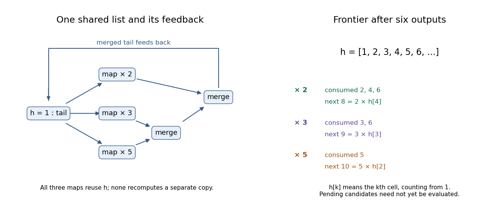
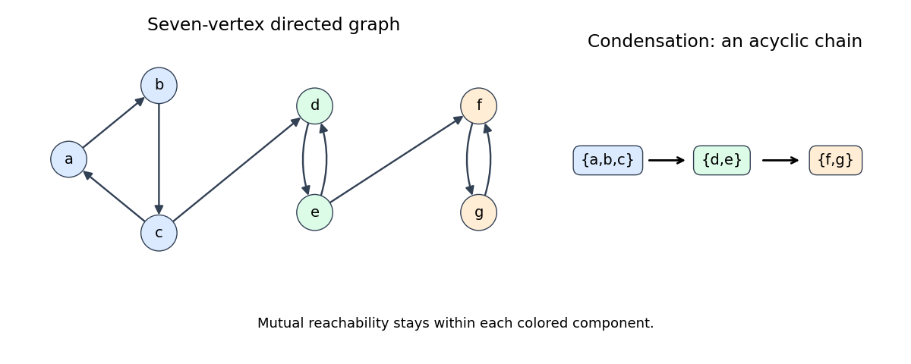
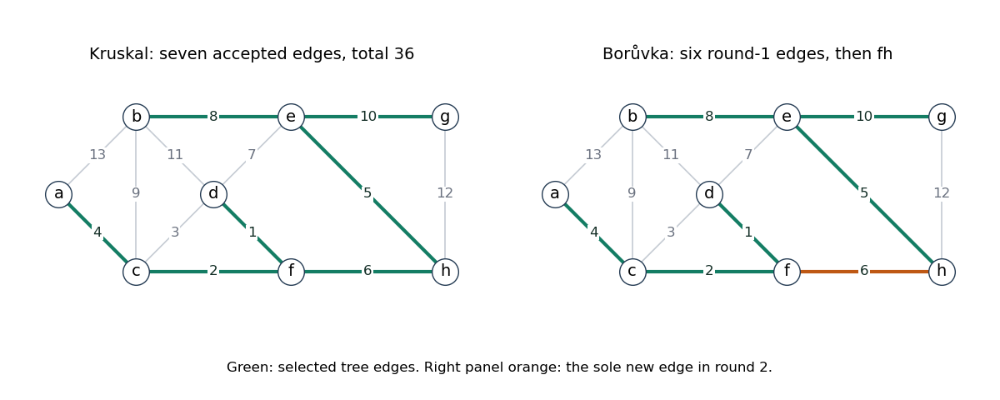

# Functional programming, design and analysis of algorithms

↑ **Parent:** [2017](../2017.md)

This is the 13 June 2017 preliminary examination. Questions 1–4 concern [functional programming](../../programming-language.md#functional-programming); Questions 5–8 concern [algorithm design](../../algorithm.md#algorithm-design) and [analysis of algorithms](../../algorithm.md#analysis-of-algorithms). All 35 printed subparts are answered. Source paper: [released examination archive](https://www.whatdotheyknow.com/request/past_exam_papers_for_1st_year_of/response/1398416/attach/2/Fakour%20Zip%20Final%201.zip?cookie_passthrough=1), member `a10097w1-1.pdf`.

The [Haskell](../../programming-language.md#haskell) definitions use separate question namespaces. For Question 1, hide the locally defined names with `import Prelude hiding ((.), zipWith, uncurry)`; for Question 4 use `import Prelude hiding (scanl)`. Alternative `solve` definitions are alternatives, not simultaneous duplicate declarations. Assume finite total puzzle inputs; infinite streams and partial values are treated explicitly where relevant. Operation counts separate numeric bit costs from list and comparison steps.[§5.6.2, hiding Prelude names; Chapter 9, Standard Prelude](../../computer-science-bibliography.md#haskell-2010-language-report)

**Table of contents**

- [1](#1)
  - [a](#1/a)
    - [Solution](#1/a/solution)
  - [b](#1/b)
    - [Solution](#1/b/solution)
  - [c](#1/c)
    - [Solution](#1/c/solution)
  - [d](#1/d)
    - [Solution](#1/d/solution)
- [2](#2)
  - [a](#2/a)
    - [Solution](#2/a/solution)
  - [b](#2/b)
    - [Solution](#2/b/solution)
  - [c](#2/c)
    - [Solution](#2/c/solution)
  - [d](#2/d)
    - [Solution](#2/d/solution)
  - [e](#2/e)
    - [Solution](#2/e/solution)
- [3](#3)
  - [a](#3/a)
    - [Solution](#3/a/solution)
  - [b](#3/b)
    - [Solution](#3/b/solution)
  - [c](#3/c)
    - [Solution](#3/c/solution)
  - [d](#3/d)
    - [Solution](#3/d/solution)
  - [e](#3/e)
    - [Solution](#3/e/solution)
- [4](#4)
  - [a](#4/a)
    - [Solution](#4/a/solution)
  - [b](#4/b)
    - [Solution](#4/b/solution)
  - [c](#4/c)
    - [Solution](#4/c/solution)
  - [d](#4/d)
    - [Solution](#4/d/solution)
- [5](#5)
  - [a](#5/a)
    - [Solution](#5/a/solution)
  - [b](#5/b)
    - [Solution](#5/b/solution)
  - [c](#5/c)
    - [Solution](#5/c/solution)
- [6](#6)
  - [a](#6/a)
    - [Solution](#6/a/solution)
  - [b](#6/b)
    - [Solution](#6/b/solution)
  - [c](#6/c)
    - [Solution](#6/c/solution)
  - [d](#6/d)
    - [Solution](#6/d/solution)
- [7](#7)
  - [a](#7/a)
    - [Solution](#7/a/solution)
  - [b](#7/b)
    - [Solution](#7/b/solution)
  - [c](#7/c)
    - [Solution](#7/c/solution)
  - [d](#7/d)
    - [Solution](#7/d/solution)
  - [e](#7/e)
    - [Solution](#7/e/solution)
- [8](#8)
  - [a](#8/a)
    - [Solution](#8/a/solution)
  - [b](#8/b)
    - [Solution](#8/b/solution)
  - [c](#8/c)
    - [Solution](#8/c/solution)
  - [d](#8/d)
    - [Solution](#8/d/solution)
  - [e](#8/e)
    - [Solution](#8/e/solution)

## 1

↑ **Parent:** [Functional programming, design and analysis of algorithms](functional-programming-design-and-analysis-of-algorithms.md)

<h3 id="1/a">a</h3>

↑ **Parent:** [1](#1)

<h4 id="1/a/solution">Solution</h4>

↑ **Parent:** [A](#1/a)

The most general [polymorphic](../../programming-language.md#programming-language-polymorphism) [type signatures](../../programming-language.md#type-signature) and definitions are:

```
infixr 9 .

(.) :: (b -> c) -> (a -> b) -> a -> c
(f . g) x = f (g x)

zipWith :: (a -> b -> c) -> [a] -> [b] -> [c]
zipWith f (x:xs) (y:ys) = f x y : zipWith f xs ys
zipWith _ _ _ = []

uncurry :: (a -> b -> c) -> (a,b) -> c
uncurry f (x,y) = f x y
```

[Function composition](../../function.md#function-composition) passes the result of the second function into the first. `zipWith` combines corresponding [list](../../data-structure.md#list-abstract-data-type) elements and stops when either list ends. [Uncurrying](../../category.md#uncurrying) converts a function taking two successive arguments into one taking a pair. None of these operations needs a numeric or ordering constraint.

<h3 id="1/b">b</h3>

↑ **Parent:** [1](#1)

<h4 id="1/b/solution">Solution</h4>

↑ **Parent:** [B](#1/b)

The completed identities are:

```
filter p . map f = map f . filter (p . f)

filter p . concat = concat . map (filter p)

zipWith f = (map (uncurry f) .) . zip
```

The first tests the [predicate](../../analysis-of-boolean-functions.md#predicate) after the mapped function; the second filters each inner [list](../../data-structure.md#list-abstract-data-type). In the third, `zip` is curried: after one argument it still returns a function of a second list. The [operator section](../../programming-language.md#operator-section) `(map (uncurry f) .)` composes with that returned function. Applying both sides to `xs` and `ys` gives `map (uncurry f) (zip xs ys)`. Omitting the section's extra composition level would not type-check.

<h3 id="1/c">c</h3>

↑ **Parent:** [1](#1)

<h4 id="1/c/solution">Solution</h4>

↑ **Parent:** [C](#1/c)

Generate each row of [Pascal's triangle](../../binomial-coefficient.md#pascal-s-triangle) from its predecessor, padding at opposite ends before adding corresponding entries:

```
pascal :: Num a => [[a]]
pascal = iterate next [1]
  where
    next :: Num a => [a] -> [a]
    next row = zipWith (+) (0:row) (row ++ [0])
```

The boundary sums are the old endpoint plus zero, and the interior sums satisfy [Pascal's rule](../../binomial-coefficient.md#pascal-s-rule). [Induction](../../foundations-of-mathematics.md#mathematical-induction) on the iteration number therefore gives the rows of [binomial coefficients](../../binomial-coefficient.md). The outer [lazy list](../../data-structure.md#lazy-list) is infinite, with each finite row available on demand. Instantiate `a` as `Integer` for exact arbitrarily large entries; bounded machine integers eventually overflow.

<h3 id="1/d">d</h3>

↑ **Parent:** [1](#1)

<h4 id="1/d/solution">Solution</h4>

↑ **Parent:** [D](#1/d)

Application binds more tightly than [function composition](../../function.md#function-composition), and `(.)` associates to the right. Let

```
g :: a -> b -> c
```

Then `y :: a` and `g y :: b -> c`. To compose to its left, `h x` must have type `c -> a`, so `x :: d` and `h :: d -> c -> a`. The outer occurrence of `g` receives that `a`, producing a function of type `b -> c`. Consequently `g . h x . g y` has type `b -> b -> c`, and the [principal type](../../programming-language.md#principal-type) is **`f :: (a -> b -> c) -> (d -> c -> a) -> d -> a -> b -> b -> c`**. No [Haskell type class](../../programming-language.md#haskell-type-class) constraint is introduced.

## 2

↑ **Parent:** [Functional programming, design and analysis of algorithms](functional-programming-design-and-analysis-of-algorithms.md)

<h3 id="2/a">a</h3>

↑ **Parent:** [2](#2)

<h4 id="2/a/solution">Solution</h4>

↑ **Parent:** [A](#2/a)

Compare the two heads, emitting one copy of a tie and advancing both inputs in that case:

```
merge :: Ord a => [a] -> [a] -> [a]
merge [] ys = ys
merge xs [] = xs
merge xs@(x:xt) ys@(y:yt)
  | x < y     = x : merge xt ys
  | x > y     = y : merge xs yt
  | otherwise = x : merge xt yt
```

The emitted head is the smallest remaining value, so [induction](../../foundations-of-mathematics.md#mathematical-induction) preserves strict order and removes duplicates. The extra empty-input cases also make the definition useful on finite lists.

There is a mathematical qualification to the unrestricted infinite-input claim: the union must be enumerable in this order. If one input increases to one from below and the other starts at two, no finite output position can contain two. [Locally finite sorted-stream merge](../../algorithm.md#locally-finite-sorted-stream-merge) excludes this obstruction, and applies to the positive [integer](../../integer.md) streams needed below.

<h3 id="2/b">b</h3>

↑ **Parent:** [2](#2)

<h4 id="2/b/solution">Solution</h4>

↑ **Parent:** [B](#2/b)

Tie the three scaled streams back to the same shared [lazy list](../../data-structure.md#lazy-list):

```
hamming :: [Integer]
hamming = 1 : merge (map (2*) hamming)
                    (merge (map (3*) hamming) (map (5*) hamming))
```

The resulting values are precisely the [Hamming numbers](../../number-theory.md#5-smooth-number) $2^i3^j5^k$ for nonnegative [integers](../../integer.md) $i,j,k$. Every noninitial value has a smaller predecessor obtained by removing a factor, so the recursive demand can be supplied from earlier cells. This is the [productivity](../../data-structure.md#stream-productivity) argument for a [sorted multiplicative closure stream](../../programming-language.md#sorted-multiplicative-closure-stream). The [merge algorithm](../../algorithm.md#merge-algorithm) removes duplicate representations such as $2\cdot3=3\cdot2$, retaining strict order and every generated value.

<h3 id="2/c">c</h3>

↑ **Parent:** [2](#2)

<h4 id="2/c/solution">Solution</h4>

↑ **Parent:** [C](#2/c)

The first six shared values are **`[1,2,3,4,5,6]`**. At the logical merge frontier after emitting six, the streams have these consumed prefixes and next candidates:

| Stream | Consumed values | Next candidate | Shared source cell |
| --- | --- | --- | --- |
| $2\times$ | $2,4,6$ | $8$ | fourth cell, value $4$ |
| $3\times$ | $3,6$ | $9$ | third cell, value $3$ |
| $5\times$ | $5$ | $10$ | second cell, value $2$ |

Each row points into the same underlying [lazy list](../../data-structure.md#lazy-list), rather than recomputing an independent copy. The inner merge supplies the union of the last two rows, and the outer merge combines it with the first. Equal candidates at six advance both supplying streams. These next candidates describe the logical frontier: a demand such as `take 6 hamming` need not already have evaluated their numeric values.

<a id="2/c/image-shared-hamming-number-stream-after-six-outputs"></a>


**[Figure 1](#2/c/image-shared-hamming-number-stream-after-six-outputs). Shared Hamming-number stream after six outputs**. The three multiplier streams read earlier cells of one shared list. The pending values 8, 9 and 10 are logical next candidates, not a claim that take 6 forces them.

<h3 id="2/d">d</h3>

↑ **Parent:** [2](#2)

<h4 id="2/d/solution">Solution</h4>

↑ **Parent:** [D](#2/d)

The cost is **$\Theta(n)$ arithmetic and comparison operations** under shared [lazy evaluation](../../programming-language.md#lazy-evaluation) and unit-cost operations on the numeric values. There are only three mapped streams and two merge nodes. Before the first $n$ output cells are produced, each node advances at most $n+O(1)$ input positions; each advance does a bounded number of operations. Producing the $n$ output cells also gives an $\Omega(n)$ lower bound.

This is [stream sharing in Hamming-number construction](../../programming-language.md#stream-sharing-in-hamming-number-construction). It relies on sharing the recursive list cells, and is not a bound on bit operations: multiplying or comparing arbitrarily large `Integer` values costs more as their representations grow.

<h3 id="2/e">e</h3>

↑ **Parent:** [2](#2)

<h4 id="2/e/solution">Solution</h4>

↑ **Parent:** [E](#2/e)

For exact ordered numbers, first discard multipliers equal to one and reject those below one:

```
hamming' :: (Ord a, Num a) => [a] -> [a]
hamming' as
  | any (<1) as = error "multipliers below one violate the ordered contract"
  | otherwise  = hs
  where
    bs = filter (>1) as
    hs = 1 : case bs of
               [] -> []
               _  -> foldr1 merge [map (a*) hs | a <- bs]
```

The [type signature](../../programming-language.md#type-signature) has exactly the numeric and ordering constraints used by the definition. For a finite nonempty collection of multipliers greater than one, this is the same [sorted multiplicative closure stream](../../programming-language.md#sorted-multiplicative-closure-stream) construction as before, merging one scaled copy per multiplier. It is infinite and strictly increasing; local finiteness below any bound and the smaller-predecessor argument prove completeness and [productivity](../../data-structure.md#stream-productivity). In particular, `[2,3,5]` reproduces `hamming`.

**The literal contract for arbitrary positive multipliers is impossible.** A multiplier strictly between zero and one would require a value smaller than the initial one; an empty list or the list `[1]` generates only one value. The definition returns the finite closure `[1]` in those degenerate cases. A multiplier equal to one adds no mathematical values and would introduce an unnecessary circular merge demand if left in the feedback streams. The order and growth proof assumes exact arithmetic with the usual laws; the broad numeric type alone cannot prevent floating-point rounding or bounded overflow.

## 3

↑ **Parent:** [Functional programming, design and analysis of algorithms](functional-programming-design-and-analysis-of-algorithms.md)

<h3 id="3/a">a</h3>

↑ **Parent:** [3](#3)

<h4 id="3/a/solution">Solution</h4>

↑ **Parent:** [A](#3/a)

Using only [list comprehensions](../../programming-language.md#list-comprehension):

```
type Matrix a = [[a]]
type Grid = Matrix Int

choicesComp :: Grid -> Matrix [Int]
choicesComp rows =
  [[[d | d <- [1..9], n == 0 || d == n] | n <- row] | row <- rows]
```

The input contract restricts each cell to zero or a digit from one to nine. A definition using standard list functions is:

```
choicesMap :: Grid -> Matrix [Int]
choicesMap = map (map choice)
  where
    choice :: Int -> [Int]
    choice 0 = [1..9]
    choice n = [n]

choices :: Grid -> Matrix [Int]
choices = choicesMap
```

Both preserve the row structure and construct the initial [constraint domains](../../theoretical-computer-science.md#constraint-domain) of the [Sudoku](../../theoretical-computer-science.md#sudoku) problem. The alternative names let both definitions coexist; either can supply `choices`.

<h3 id="3/b">b</h3>

↑ **Parent:** [3](#3)

<h4 id="3/b/solution">Solution</h4>

↑ **Parent:** [B](#3/b)

The recursive [Cartesian product](../../set-theory.md#cartesian-product) is:

```
cpRec :: [[a]] -> [[a]]
cpRec [] = [[]]
cpRec (xs:xss) = [x:ys | x <- xs, ys <- cpRec xss]
```

The corresponding [right fold](../../programming-language.md#list-fold) is:

```
cpFold :: [[a]] -> [[a]]
cpFold = foldr step [[]]
  where
    step :: [a] -> [[a]] -> [[a]]
    step xs acc = [x:ys | x <- xs, ys <- acc]

cp :: [[a]] -> [[a]]
cp = cpRec
```

The base `[[]]` is essential: there is one way to choose from no factors, namely the empty selection. For a nonempty outer list, choose its first coordinate and prepend it to each selection from the remaining factors. This also proves equality with the [right fold](../../programming-language.md#list-fold) by [structural induction](../../foundations-of-mathematics.md#structural-induction). An empty factor produces no selections.

<h3 id="3/c">c</h3>

↑ **Parent:** [3](#3)

<h4 id="3/c/solution">Solution</h4>

↑ **Parent:** [C](#3/c)

First enumerate each possible row, then choose one row from each row's alternatives:

```
expand :: Matrix [a] -> [Matrix a]
expand = cp . map cp
```

The inner [Cartesian product](../../set-theory.md#cartesian-product) converts one row of cell choices into its possible rows; the outer product combines those rows into whole [matrices](../../vector-space.md#matrix). Every assignment is represented exactly once when each cell's alternatives are distinct. Empty cell domains yield no grids, and an empty matrix yields the singleton list containing the empty matrix.

<h3 id="3/d">d</h3>

↑ **Parent:** [3](#3)

<h4 id="3/d/solution">Solution</h4>

↑ **Parent:** [D](#3/d)

Enumerate assignments and retain exactly the valid completions:

```
solve :: Grid -> [Grid]
solve = filter complete . expand . choices
```

With $x$ blank cells and all other entries fixed, the unpruned [Cartesian product](../../set-theory.md#cartesian-product) has **$9^x$ candidate grids**. Testing `complete` enforces every row, column and box condition. This is the size of the full candidate search; [lazy evaluation](../../programming-language.md#lazy-evaluation) can stop earlier if the caller demands only an initial portion of the solution list.

<h3 id="3/e">e</h3>

↑ **Parent:** [3](#3)

<h4 id="3/e/solution">Solution</h4>

↑ **Parent:** [E](#3/e)

Prune until a [fixed point](../../function.md#fixed-point) before enumerating the surviving domains:

```
stable :: Eq a => (a -> a) -> a -> a
stable f x = let y = f x
             in if y == x then x else stable f y

solve :: Grid -> [Grid]
solve = filter complete . expand . stable prune . choices
```

New singleton cells can make a later pruning pass effective even if one pass has already run. Under the supplied deletion-only, solution-preserving contract, [fixed-point pruning of finite constraint domains](../../theoretical-computer-science.md#fixed-point-pruning-of-finite-constraint-domains) terminates: every changed pass strictly decreases the total number of candidates, initially at most $81\cdot9=729$. No valid solution is removed. An empty domain causes `expand` to return no candidates; a fixed point with unresolved alternatives still needs enumeration and the final `complete` test.

## 4

↑ **Parent:** [Functional programming, design and analysis of algorithms](functional-programming-design-and-analysis-of-algorithms.md)

<h3 id="4/a">a</h3>

↑ **Parent:** [4](#4)

<h4 id="4/a/solution">Solution</h4>

↑ **Parent:** [A](#4/a)

Separate the empty prefix from the prefixes beginning with the first element:

```
inits :: [a] -> [[a]]
inits [] = [[]]
inits (x:xs) = [] : map (x:) (inits xs)
```

Every nonempty [list prefix](../../data-structure.md#prefix-of-a-list) begins with `x` and continues with a prefix of `xs`. Thus the recursive order is increasing prefix length, beginning with length zero. [Lazy evaluation](../../programming-language.md#lazy-evaluation) can also expose every finite prefix of a productive infinite input.

<h3 id="4/b">b</h3>

↑ **Parent:** [4](#4)

<h4 id="4/b/solution">Solution</h4>

↑ **Parent:** [B](#4/b)

The most general [type signature](../../programming-language.md#type-signature) is **`scanl :: (b -> a -> b) -> b -> [a] -> [b]`**. The [left fold](../../programming-language.md#left-fold) step consumes an accumulator of type `b` and an input of type `a`, returning the next accumulator. A [left scan](../../programming-language.md#left-scan) retains all these accumulator values, including the initial one.

<h3 id="4/c">c</h3>

↑ **Parent:** [4](#4)

<h4 id="4/c/solution">Solution</h4>

↑ **Parent:** [C](#4/c)

Use `map k (u:us) = k u : map k us`, list-map fusion, and the [left fold](../../programming-language.md#left-fold) equation

```
foldl f e (x:ys) = foldl f (f e x) ys
```

For the empty list, the prefix definition immediately gives `scanl f e [] = [e]`. For a nonempty list, calculate:

```
scanl f e (x:xs)
  = map (foldl f e) ([] : map (x:) (inits xs))
  = e : map ((foldl f e) . (x:)) (inits xs)
  = e : map (foldl f (f e x)) (inits xs)
  = e : scanl f (f e x) xs
```

The second-to-third line uses the displayed fold equation as an equality of functions of `ys`. Hence the efficient [left scan](../../programming-language.md#left-scan) is:

```
scanl :: (b -> a -> b) -> b -> [a] -> [b]
scanl f e [] = [e]
scanl f e (x:xs) = e : scanl f (f e x) xs
```

On a finite input of length $n$, fully demanding the original prefix-fold results performs $0+1+\cdots+n=n(n+1)/2$ accumulator updates. The recurrence performs $n$. Thus the update count improves from **$\Theta(n^2)$ to $\Theta(n)$**, assuming constant-cost updates. Both return $n+1$ results. This does not assert constant space for arbitrary accumulators or imply that lazy accumulators are evaluated strictly.

<h3 id="4/d">d</h3>

↑ **Parent:** [4](#4)

<h4 id="4/d/solution">Solution</h4>

↑ **Parent:** [D](#4/d)

Prove the [natural-number fold fusion law](../../programming-language.md#natural-number-fold-fusion-law) pointwise. At `Zero`,

```
f (foldNat g a Zero) = f a = b = foldNat h b Zero
```

Assuming the equation at `m`, the `Succ m` calculation is:

```
f (foldNat g a (Succ m))
  = f (g (foldNat g a m))
  = h (f (foldNat g a m))
  = h (foldNat h b m)
  = foldNat h b (Succ m)
```

The compatibility premise `f . g = h . f` justifies the middle rewrite. This proves the theorem for finite total constructor values by [structural induction](../../foundations-of-mathematics.md#structural-induction).

For the full lazy [Haskell](../../programming-language.md#haskell) interpretation, also handle the [bottom value](../../programming-language.md#bottom-value): `foldNat g a` is strict in its outer `Natural` constructor, so its value on bottom is bottom; the assumed [strict function](../../programming-language.md#strict-function) property of `f` makes the left side bottom too. The same zero/successor induction now covers finite partial constructor chains. Pure definable functions preserve the limits of these information approximations, extending equality to infinite `Succ` chains. This explains the strictness premise; finite total induction alone would not use it.[§3.1: bottom values; §6.2: strict evaluation](../../computer-science-bibliography.md#haskell-2010-language-report)

## 5

↑ **Parent:** [Functional programming, design and analysis of algorithms](functional-programming-design-and-analysis-of-algorithms.md)

<h3 id="5/a">a</h3>

↑ **Parent:** [5](#5)

<h4 id="5/a/solution">Solution</h4>

↑ **Parent:** [A](#5/a)

A [divide-and-conquer algorithm](../../algorithm.md#divide-and-conquer-algorithm) handles small base cases directly, divides a larger instance into smaller instances of the same problem, solves them recursively, and combines their answers. The savings come from the number and sizes of recursive calls and the combination cost.

For [Karatsuba multiplication](../../algorithm.md#karatsuba-multiplication), split the $n$-bit inputs as $x=aB+b$, $y=cB+d$, where $B=2^k$ and $k=\lceil n/2\rceil$. Compute only three recursive products:

$$
p=ac,\qquad q=bd,\qquad r=(a-b)(c-d).
$$

Then the [Karatsuba three-product identity](../../algorithm.md#karatsuba-three-product-identity) gives

$$
\boxed{xy=pB^2+(p+q-r)B+q.}
$$

The absolute differences have at most $k$ bits; multiply their magnitudes and restore the sign of $r$. Additions, subtractions and shifts cost $O(n)$ bit operations. With constant-size base cases, the [recurrence relation](../../sequence-and-series.md#recurrence-relation) is $T(n)=3T(\lceil n/2\rceil)+O(n)$, giving **$O(n^{\log_2 3})$** by the [Master theorem](../../sequence-and-series.md#master-theorem). The difference-product version avoids an extra carry bit in the recursive operands.

<h3 id="5/b">b</h3>

↑ **Parent:** [5](#5)

<h4 id="5/b/solution">Solution</h4>

↑ **Parent:** [B](#5/b)

Use [minimum search in a rotated distinct array](../../algorithm.md#minimum-search-in-a-rotated-distinct-array), then return the cyclic predecessor of the minimum:

```
rotatedMaximum(A):
    n = length(A)                 # require n >= 1
    lo = 0
    hi = n - 1
    while lo < hi:
        mid = floor((lo + hi) / 2)
        if A[mid] > A[hi]:
            lo = mid + 1
        else:
            hi = mid
    return A[(lo + n - 1) mod n]
```

The [loop invariant](../../algorithm.md#loop-invariant) says that the minimum index lies in the inclusive interval. If `A[mid] > A[hi]`, the rotation break lies to the right of `mid`; otherwise the segment from `mid` to `hi` is increasing and its indices after `mid` cannot be the minimum. Each update at least halves the interval. Distinct entries make the comparison decisive, including a completely unshifted array. The predecessor of the unique minimum is the maximum, and the one-element case returns that element. The running time is **$O(\log n)$**, with $O(1)$ auxiliary space.

<h3 id="5/c">c</h3>

↑ **Parent:** [5](#5)

<h4 id="5/c/solution">Solution</h4>

↑ **Parent:** [C](#5/c)

For fixed $a\geq1$, $b>1$ and $d\geq0$, a version of the [Master theorem](../../sequence-and-series.md#master-theorem) states that, with bounded positive base costs,

$$
T(n)=aT(n/b)+\Theta(n^d),\quad p=\log_ba
\quad\Longrightarrow\quad
T(n)=\begin{cases}
\Theta(n^p),&d<p,\\
\Theta(n^p\log n),&d=p,\\
\Theta(n^d),&d>p.
\end{cases}
$$

Usual floors and ceilings preserve these bounds when a sufficiently large constant-size base case ensures strict size decrease.

- $A$: $T_A(n)=3T_A(\lceil2n/3\rceil)+\Theta(1)$, hence **$O(n^{\log_{3/2}3})$**, with exponent approximately $2.7095$. Base cases must include $n\leq2$ because the ceiling otherwise need not decrease.
- $B$: $T_B(n)=9T_B(\lceil n/3\rceil)+O(n^2)$, hence **$O(n^2\log n)$** by comparison with the equality recurrence having $\Theta(n^2)$ overhead. If that overhead is actually quadratic this is also tight; the stated upper bound alone does not establish a matching lower bound.
- $C$: $T_C(n)=3T_C(n-1)+\Theta(1)$, whose expansion is a [geometric series](../../sequence-and-series.md#geometric-series), hence **$O(3^n)$**, in fact $\Theta(3^n)$ for nonzero base costs. The divide-by-a-constant Master theorem does not apply to a decrement by one.

**$B$ is asymptotically fastest; $C$ is slowest.** Even the quadratic-logarithmic upper bound for $B$ is smaller than the tight polynomial order of $A$.

## 6

↑ **Parent:** [Functional programming, design and analysis of algorithms](functional-programming-design-and-analysis-of-algorithms.md)

<h3 id="6/a">a</h3>

↑ **Parent:** [6](#6)

<h4 id="6/a/solution">Solution</h4>

↑ **Parent:** [A](#6/a)

A [strongly connected component](../../graph-theory.md#strongly-connected-component) is a maximal set of [vertices](../../graph.md#vertex-graph-theory) that are mutually reachable in a [directed graph](../../graph-theory.md#directed-graph); a vertex reaches itself by a length-zero path. The [condensation graph](../../graph-theory.md#condensation-graph), also called the SCC graph, contracts each such component to one vertex and retains directed edges between different components. It is a [Directed acyclic graph](../../combinatorics.md#directed-acyclic-graph), since a cycle of components would make them mutually reachable and therefore one component.

For an original seven-vertex example, take cycles $a\to b\to c\to a$, $d\to e\to d$, $f\to g\to f$, and add $c\to d$, $e\to f$. The three components are **$\{a,b,c\}$, $\{d,e\}$ and $\{f,g\}$**. Their condensation is the three-vertex directed chain in that order: there is no return edge from a later component to an earlier one.

<a id="6/a/image-seven-vertices-with-three-strongly-connected-components-and-their-condensation"></a>


**[Figure 2](#6/a/image-seven-vertices-with-three-strongly-connected-components-and-their-condensation). Seven vertices with three strongly connected components and their condensation**. An original example. Internal cycles provide mutual reachability; the two forward connecting edges cannot merge distinct components.

<h3 id="6/b">b</h3>

↑ **Parent:** [6](#6)

<h4 id="6/b/solution">Solution</h4>

↑ **Parent:** [B](#6/b)

Apply the [two-pass strongly connected component algorithm](../../graph-theory.md#two-pass-strongly-connected-component-algorithm):

1. Run [depth-first search](../../algorithm.md#depth-first-search) over all vertices of $G$, recording their finish order.  
2. Construct the [graph transpose](../../graph-theory.md#graph-transpose) by reversing every edge.  
3. Mark every vertex unvisited again. In decreasing first-pass finish order, start a transpose search whenever the next vertex is unvisited. The vertices newly reached by each search form one [strongly connected component](../../graph-theory.md#strongly-connected-component).

The finish order prevents a second-pass search from entering a different still-unassigned component, while mutual reachability makes it visit the entire current component. With [adjacency lists](../../data-structure.md#adjacency-list), each traversal and the transposition scan takes $O(|V|+|E|)$ time. Thus the total worst-case time is **$\Theta(|V|+|E|)$**, including isolated vertices.

<h3 id="6/c">c</h3>

↑ **Parent:** [6](#6)

<h4 id="6/c/solution">Solution</h4>

↑ **Parent:** [C](#6/c)

Because the [vertex set](../../graph.md#vertex-set) is finite, at least one vertex occurs infinitely often, so $\operatorname{Inf}(\rho)$ is nonempty. Let $u,v$ belong to this set. After any chosen visit to $u$, a later visit to $v$ exists; the intervening edges give a directed walk from $u$ to $v$. After that visit to $v$, a later visit to $u$ also exists, giving a walk in the other direction. Removing repeated portions gives [directed paths](../../graph-theory.md#directed-path) if desired.

Thus every pair in $\operatorname{Inf}(\rho)$ is mutually reachable and belongs to the same [strongly connected component](../../graph-theory.md#strongly-connected-component). This proves the claimed inclusion, which need not be equality: an infinite walk can repeatedly follow one cycle while omitting other vertices in its component. This is the recurrence-set part of the [infinite walk criterion in a finite directed graph](../../graph-theory.md#infinite-walk-criterion-in-a-finite-directed-graph).

<h3 id="6/d">d</h3>

↑ **Parent:** [6](#6)

<h4 id="6/d/solution">Solution</h4>

↑ **Parent:** [D](#6/d)

An infinite trace exists **exactly when a directed cycle is reachable from $s$**, by the [infinite walk criterion in a finite directed graph](../../graph-theory.md#infinite-walk-criterion-in-a-finite-directed-graph). Compute the reachable set with [depth-first search](../../algorithm.md#depth-first-search), compute its [strongly connected components](../../graph-theory.md#strongly-connected-component), and return true if any component has at least two vertices or contains a self-loop. A singleton without a self-loop does not qualify.

If the test succeeds, follow a path from $s$ to the cycle and traverse the cycle forever. Conversely, an infinite trace in a finite graph repeats a vertex, producing a reachable nonempty closed walk and hence a directed cycle. Reachability, component construction and the self-loop check all scan [adjacency lists](../../data-structure.md#adjacency-list) only a constant number of times. The worst-case time is **$O(|V|+|E|)$**, with $O(|V|+|E|)$ auxiliary space for a straightforward transpose-based implementation.

## 7

↑ **Parent:** [Functional programming, design and analysis of algorithms](functional-programming-design-and-analysis-of-algorithms.md)

<h3 id="7/a">a</h3>

↑ **Parent:** [7](#7)

<h4 id="7/a/solution">Solution</h4>

↑ **Parent:** [A](#7/a)

A [spanning tree](../../tree-graph-theory.md#spanning-tree) is a connected acyclic subgraph containing every vertex of the original undirected graph. For a graph with $|V|$ vertices it has $|V|-1$ edges. A [minimum spanning tree](../../tree-graph-theory.md#minimum-spanning-tree) minimizes the sum of its [edge weights](../../graph.md#edge-weight) over all spanning trees:

$$
\boxed{T\in\underset{\text{spanning trees }S}{\operatorname{argmin}}\sum_{e\in S}w(e).}
$$

Connectedness guarantees existence for a finite graph; equal weights can permit several minimizers.

<h3 id="7/b">b</h3>

↑ **Parent:** [7](#7)

<h4 id="7/b/solution">Solution</h4>

↑ **Parent:** [B](#7/b)

[Kruskal's algorithm](../../tree-graph-theory.md#kruskal-s-algorithm) sorts the edges and accepts an edge precisely when it joins two currently different [connected components of a graph](../../graph.md#component-graph-theory). A [disjoint-set data structure](../../data-structure.md#disjoint-set-data-structure) maintains those components:

```
Kruskal(V, E, w):
    A = empty set
    make one disjoint set for each vertex in V
    for (u,v) in E sorted by nondecreasing w:
        if find(u) != find(v):
            add (u,v) to A
            union(u,v)
            if size(A) == size(V) - 1:
                break
    return A
```

An accepted edge merges two trees of the current [forest](../../tree-graph-theory.md#forest). An edge within one component would complete a [graph cycle](../../graph-theory.md#cycle-in-a-graph) and is skipped. On connected input, after $|V|-1$ acceptances the forest is a spanning tree. For a one-vertex graph the empty set is already the answer.

<h3 id="7/c">c</h3>

↑ **Parent:** [7](#7)

<h4 id="7/c/solution">Solution</h4>

↑ **Parent:** [C](#7/c)

It is a [greedy algorithm](../../algorithm.md#greedy-algorithm) because it commits at every step to the cheapest remaining edge that can be added without creating a [graph cycle](../../graph-theory.md#cycle-in-a-graph), without revising earlier choices. The [minimum spanning tree cut property](../../tree-graph-theory.md#minimum-spanning-tree-cut-property) explains why these locally cheapest admissible choices can be extended to an optimal spanning tree.

<h3 id="7/d">d</h3>

↑ **Parent:** [7](#7)

<h4 id="7/d/solution">Solution</h4>

↑ **Parent:** [D](#7/d)

Processing by increasing weight, [Kruskal's algorithm](../../tree-graph-theory.md#kruskal-s-algorithm) accepts $df$ of weight one and $cf$ of weight two, then rejects $cd$ of weight three because its endpoints are already connected. It accepts $ac$, $eh$, $fh$, skips $de$, accepts $be$, skips $bc$, and accepts $eg$. Seven accepted edges now connect all eight vertices.

The resulting [minimum spanning tree](../../tree-graph-theory.md#minimum-spanning-tree) is

$$
\boxed{\{df,cf,ac,eh,fh,be,eg\},\qquad w(T)=1+2+4+5+6+8+10=36.}
$$

The remaining heavier edges are unnecessary once the tree is complete. Distinct edge weights also imply that this minimum spanning tree is unique.

<a id="7/d/image-minimum-spanning-tree-of-weight-36-and-its-component-merging-construction"></a>


**[Figure 3](#7/d/image-minimum-spanning-tree-of-weight-36-and-its-component-merging-construction). Minimum spanning tree of weight 36 and its component-merging construction**. The solution highlights the seven selected edges. The second panel distinguishes the six distinct first-round choices from the joining edge fh selected in the second round.

<h3 id="7/e">e</h3>

↑ **Parent:** [7](#7)

<h4 id="7/e/solution">Solution</h4>

↑ **Parent:** [E](#7/e)

The procedure is [Borůvka's algorithm](../../tree-graph-theory.md#boruvka-s-algorithm). In the first round, visiting singleton components in the order $a,b,c,d,e,f,g,h$, the chosen edges are respectively

$$
ac,\ be,\ cf,\ df,\ eh,\ df,\ eg,\ eh.
$$

The set of new edges is **$\{ac,be,cf,df,eh,eg\}$**: repeated selections of $df$ and $eh$ insert no extra copy. The resulting two components are $\{a,c,d,f\}$ and $\{b,e,g,h\}$. Each chooses $fh$ in round two, producing the weight-36 tree from part (d). The within-round order of distinct insertions can therefore be $ac,be,cf,df,eh,eg$, followed by $fh$ in the next round; it need not be the globally sorted Kruskal order.

The required [minimum spanning tree cut property](../../tree-graph-theory.md#minimum-spanning-tree-cut-property) says: for every nonempty proper subset $C\subset V$, the unique minimum-weight edge crossing the cut $(C,V\setminus C)$ belongs to every minimum spanning tree. Indeed, add this edge to a tree that lacks it. The resulting cycle contains another edge crossing the cut, which is strictly heavier; replacing that edge decreases the total weight.

For the general proof, assume all edge weights are distinct. Fix the components at the beginning of a round, as the given procedure does. Each selected edge is the unique lightest edge across one of their cuts, so belongs to every minimum spanning tree. Inductively, the entire selected set is contained in such a tree and is therefore acyclic. While there is more than one component, connectedness supplies an outgoing edge for each, so at least two components merge. The finite process terminates connected. A connected subgraph of a spanning tree must be that whole tree, proving that the returned set is a minimum spanning tree.

## 8

↑ **Parent:** [Functional programming, design and analysis of algorithms](functional-programming-design-and-analysis-of-algorithms.md)

<h3 id="8/a">a</h3>

↑ **Parent:** [8](#8)

<h4 id="8/a/solution">Solution</h4>

↑ **Parent:** [A](#8/a)

[Dynamic programming](../../mathematical-optimization.md#dynamic-programming) stores answers to overlapping subproblems so they can be reused. Its [optimal substructure](../../mathematical-optimization.md#optimal-substructure) requirement, the principle of optimality, says that an optimal answer's remaining subproblem solution must itself be optimal once the final decision and state are fixed.

For [global sequence alignment without mismatches](../../molecular-genetics.md#global-sequence-alignment-without-mismatches), use the two prefix lengths as the state. A final column is either a letter of the first string opposite a gap, a gap opposite a letter of the second, or two equal letters. Removing that column leaves one of three smaller prefix problems. If its alignment were suboptimal, replacing it by a better alignment would improve the whole answer. Many different alignments reach the same prefix state, making reuse valuable. Unequal-letter columns and double-gap columns are forbidden, rather than assigned ordinary finite penalties.

<h3 id="8/b">b</h3>

↑ **Parent:** [8](#8)

<h4 id="8/b/solution">Solution</h4>

↑ **Parent:** [B](#8/b)

Let $D_{i,j}$ be the optimal score for aligning the complete prefixes of lengths $i,j$. The boundary values and recurrence are

$$
D_{0,0}=0,\quad D_{i,0}=-gi,\quad D_{0,j}=-gj,
$$


$$
\boxed{D_{i,j}=\max\left\{D_{i-1,j}-g,\ D_{i,j-1}-g,\ D_{i-1,j-1}+1\ \text{only if }x[i-1]=y[j-1]\right\}.}
$$

The last candidate is omitted when the letters differ. Fill rows or columns in increasing index order and return **$D_{m,n}$**. The final-column cases in part (a) exhaust all legal alignments and each can be appended to an optimal smaller alignment, proving the recurrence by [induction](../../foundations-of-mathematics.md#mathematical-induction) on $i+j$.

There are $(m+1)(n+1)$ entries and at most three constant-time candidates per interior entry. Thus the time is **$O(mn)$** for positive $m,n$, or $O(mn+m+n+1)$ including empty-input boundary cases, with the same full-table space bound. Computing only the score can reduce auxiliary storage to $O(\min(m,n)+1)$ by retaining two rows. This is [global sequence alignment without mismatches](../../molecular-genetics.md#global-sequence-alignment-without-mismatches); admitting a diagonal move on unequal letters would solve a different problem.

<h3 id="8/c">c</h3>

↑ **Parent:** [8](#8)

<h4 id="8/c/solution">Solution</h4>

↑ **Parent:** [C](#8/c)

Store one maximizing predecessor together with every table value. For [alignment traceback](../../molecular-genetics.md#alignment-traceback), start at $(m,n)$ and follow these pointers:

- $(i-1,j-1)$ emits `x[i-1]` opposite `y[j-1]`; the letters are equal because that diagonal candidate was allowed only on a match.
- $(i-1,j)$ emits `x[i-1]` opposite a gap.
- $(i,j-1)$ emits a gap opposite `y[j-1]`.

Continue to $(0,0)$, including boundary moves, then reverse the collected columns. Any deterministic choice among tied predecessors gives an optimal alignment. Each step decreases at least one index, so reconstruction costs **$O(m+n)$** additional time and output space. The full score table or predecessor table requires $O(mn)$ storage for positive lengths.

<h3 id="8/d">d</h3>

↑ **Parent:** [8](#8)

<h4 id="8/d/solution">Solution</h4>

↑ **Parent:** [D](#8/d)

Enumerate all pairs of contiguous [substrings](../../foundations-of-mathematics.md#substring), run the global algorithm on each pair, and take the largest score, also allowing the empty alignment of score zero. There are $O(m^2)$ substrings of the first input and $O(n^2)$ of the second. Each call costs at most $O(mn)$ for positive lengths, giving the requested upper bound **$O(m^3n^3)$**. Substrings are contiguous; enumerating arbitrary subsequences would be a different search.

<h3 id="8/e">e</h3>

↑ **Parent:** [8](#8)

<h4 id="8/e/solution">Solution</h4>

↑ **Parent:** [E](#8/e)

For [local sequence alignment without mismatches](../../molecular-genetics.md#local-sequence-alignment-without-mismatches), let $L_{i,j}$ maximize the score of alignments of a suffix of each prefix of lengths $i,j$, allowing both suffixes to be empty. Initialize $L_{i,0}=L_{0,j}=0$ and fill

$$
\boxed{L_{i,j}=\max\left\{0,\ L_{i-1,j}-g,\ L_{i,j-1}-g,\ L_{i-1,j-1}+1\ \text{only if }x[i-1]=y[j-1]\right\}.}
$$

Zero starts a new alignment; the remaining candidates append the possible last columns. The same optimal-substructure argument as before proves the recurrence. Because $g\geq0$, an alignment with a negative-scoring leading portion can be improved by dropping that portion, which is exactly what the zero reset permits.

Return **$\max_{0\leq i\leq m,\,0\leq j\leq n}L_{i,j}$**, since an optimal pair of substrings may finish before either full string ends. The time is **$O(mn)$** for positive input lengths, with $O(mn)$ full-table space or linear rolling-row space for the score alone. If an alignment is wanted, start [alignment traceback](../../molecular-genetics.md#alignment-traceback) at a maximum entry and stop at zero. No mismatching diagonal is introduced.

## ↑ Ancestors (9)

1. [2017](../2017.md)
2. [Past exam of the year 1 of the computer science course of the University of Oxford](../../past-exam-of-the-year-1-of-the-computer-science-course-of-the-university-of-oxford.md)
3. [Year 1 of the computer science course of the University of Oxford](../../university-of-oxford.md#year-1-of-the-computer-science-course-of-the-university-of-oxford)
4. [Computer science course of the University of Oxford](../../university-of-oxford.md#computer-science-course-of-the-university-of-oxford)
5. [Undergraduate course of the University of Oxford](../../university-of-oxford.md#undergraduate-course-of-the-university-of-oxford)
6. [Course of the University of Oxford](../../university-of-oxford.md#course-of-the-university-of-oxford)
7. [University of Oxford](../../university-of-oxford.md)
8. [List of universities](../../README.md#list-of-universities)
9. [Codex Wiki](../../README.md)
