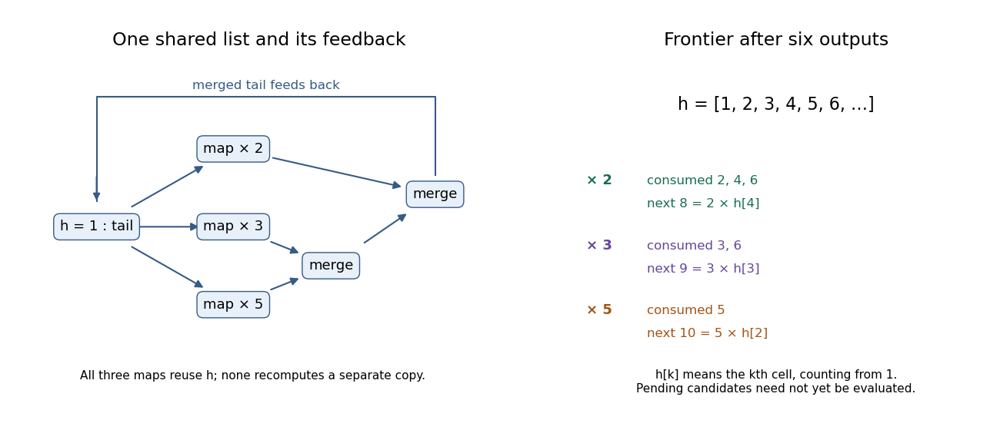

<h1 id="2/c/solution">Solution</h1>

↑ **Parent:** [C](../c.md)

The first six shared values are **`[1,2,3,4,5,6]`**. At the logical merge frontier after emitting six, the streams have these consumed prefixes and next candidates:

| Stream | Consumed values | Next candidate | Shared source cell |
| --- | --- | --- | --- |
| $2\times$ | $2,4,6$ | $8$ | fourth cell, value $4$ |
| $3\times$ | $3,6$ | $9$ | third cell, value $3$ |
| $5\times$ | $5$ | $10$ | second cell, value $2$ |

Each row points into the same underlying [lazy list](../../../../../lazy-list.md), rather than recomputing an independent copy. The inner merge supplies the union of the last two rows, and the outer merge combines it with the first. Equal candidates at six advance both supplying streams. These next candidates describe the logical frontier: a demand such as `take 6 hamming` need not already have evaluated their numeric values.

**[Figure 1](#2/c/image-shared-hamming-number-stream-after-six-outputs). Shared Hamming-number stream after six outputs**. The three multiplier streams read earlier cells of one shared list. The pending values 8, 9 and 10 are logical next candidates, not a claim that take 6 forces them.

## ↑ Ancestors (12)

1. [C](../c.md)
2. [2](../../2.md)
3. [Functional programming, design and analysis of algorithms](../../../functional-programming-design-and-analysis-of-algorithms-split.md)
4. [2017](../../../split.md)
5. [Past exam of the year 1 of the computer science course of the University of Oxford](../../../../split.md)
6. [Year 1 of the computer science course of the University of Oxford](../../../../../year-1-of-the-computer-science-course-of-the-university-of-oxford.md)
7. [Computer science course of the University of Oxford](../../../../../computer-science-course-of-the-university-of-oxford.md)
8. [Undergraduate course of the University of Oxford](../../../../../undergraduate-course-of-the-university-of-oxford.md)
9. [Course of the University of Oxford](../../../../../course-of-the-university-of-oxford.md)
10. [University of Oxford](../../../../../university-of-oxford-split.md)
11. [List of universities](../../../../../list-of-universities.md)
12. [Codex Wiki](../../../../../split.md)
