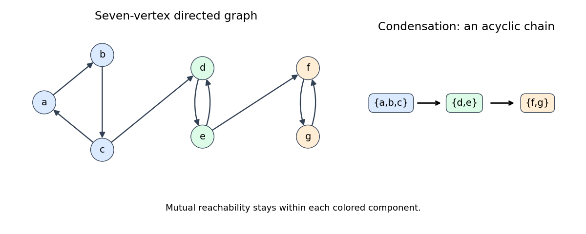

<h1 id="6/a/solution">Solution</h1>

↑ **Parent:** [A](../a.md)

A [strongly connected component](../../../../../strongly-connected-component.md) is a maximal set of [vertices](../../../../../vertex-graph-theory.md) that are mutually reachable in a [directed graph](../../../../../directed-graph.md); a vertex reaches itself by a length-zero path. The [condensation graph](../../../../../condensation-graph.md), also called the SCC graph, contracts each such component to one vertex and retains directed edges between different components. It is a [Directed acyclic graph](../../../../../directed-acyclic-graph.md), since a cycle of components would make them mutually reachable and therefore one component.

For an original seven-vertex example, take cycles $a\to b\to c\to a$, $d\to e\to d$, $f\to g\to f$, and add $c\to d$, $e\to f$. The three components are **$\{a,b,c\}$, $\{d,e\}$ and $\{f,g\}$**. Their condensation is the three-vertex directed chain in that order: there is no return edge from a later component to an earlier one.

**[Figure 2](#6/a/image-seven-vertices-with-three-strongly-connected-components-and-their-condensation). Seven vertices with three strongly connected components and their condensation**. An original example. Internal cycles provide mutual reachability; the two forward connecting edges cannot merge distinct components.

## ↑ Ancestors (12)

1. [A](../a.md)
2. [6](../../6.md)
3. [Functional programming, design and analysis of algorithms](../../../functional-programming-design-and-analysis-of-algorithms-split.md)
4. [2017](../../../split.md)
5. [Past exam of the year 1 of the computer science course of the University of Oxford](../../../../split.md)
6. [Year 1 of the computer science course of the University of Oxford](../../../../../year-1-of-the-computer-science-course-of-the-university-of-oxford.md)
7. [Computer science course of the University of Oxford](../../../../../computer-science-course-of-the-university-of-oxford.md)
8. [Undergraduate course of the University of Oxford](../../../../../undergraduate-course-of-the-university-of-oxford.md)
9. [Course of the University of Oxford](../../../../../course-of-the-university-of-oxford.md)
10. [University of Oxford](../../../../../university-of-oxford-split.md)
11. [List of universities](../../../../../list-of-universities.md)
12. [Codex Wiki](../../../../../split.md)
