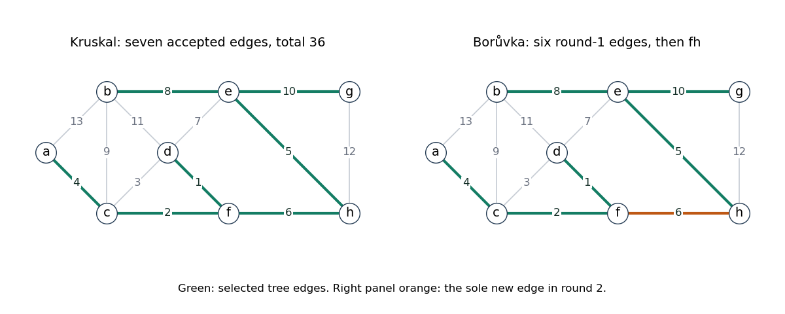

<h1 id="7/d/solution">Solution</h1>

↑ **Parent:** [D](../d.md)

Processing by increasing weight, [Kruskal's algorithm](../../../../../kruskal-s-algorithm.md) accepts $df$ of weight one and $cf$ of weight two, then rejects $cd$ of weight three because its endpoints are already connected. It accepts $ac$, $eh$, $fh$, skips $de$, accepts $be$, skips $bc$, and accepts $eg$. Seven accepted edges now connect all eight vertices.

The resulting [minimum spanning tree](../../../../../minimum-spanning-tree.md) is

$$
\boxed{\{df,cf,ac,eh,fh,be,eg\},\qquad w(T)=1+2+4+5+6+8+10=36.}
$$

The remaining heavier edges are unnecessary once the tree is complete. Distinct edge weights also imply that this minimum spanning tree is unique.

**[Figure 3](#7/d/image-minimum-spanning-tree-of-weight-36-and-its-component-merging-construction). Minimum spanning tree of weight 36 and its component-merging construction**. The solution highlights the seven selected edges. The second panel distinguishes the six distinct first-round choices from the joining edge fh selected in the second round.

## ↑ Ancestors (12)

1. [D](../d.md)
2. [7](../../7.md)
3. [Functional programming, design and analysis of algorithms](../../../functional-programming-design-and-analysis-of-algorithms-split.md)
4. [2017](../../../split.md)
5. [Past exam of the year 1 of the computer science course of the University of Oxford](../../../../split.md)
6. [Year 1 of the computer science course of the University of Oxford](../../../../../year-1-of-the-computer-science-course-of-the-university-of-oxford.md)
7. [Computer science course of the University of Oxford](../../../../../computer-science-course-of-the-university-of-oxford.md)
8. [Undergraduate course of the University of Oxford](../../../../../undergraduate-course-of-the-university-of-oxford.md)
9. [Course of the University of Oxford](../../../../../course-of-the-university-of-oxford.md)
10. [University of Oxford](../../../../../university-of-oxford-split.md)
11. [List of universities](../../../../../list-of-universities.md)
12. [Codex Wiki](../../../../../split.md)
