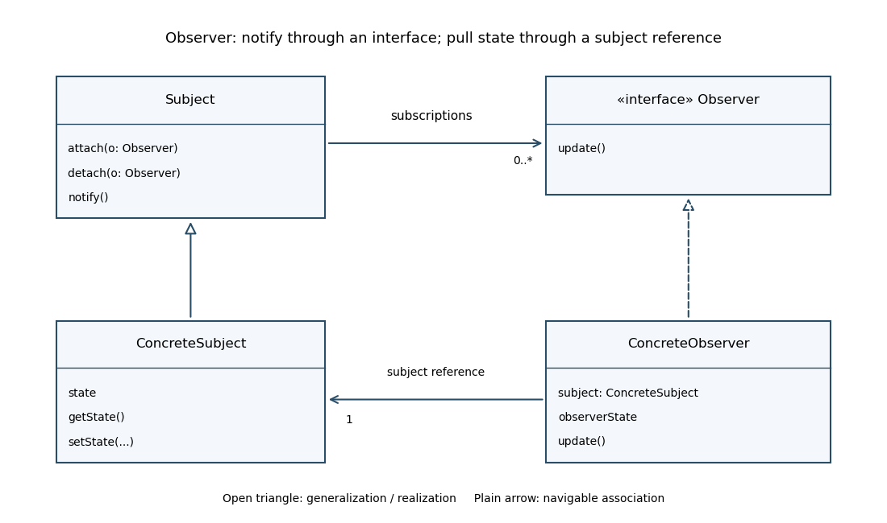

<h1 id="8/c/solution">Solution</h1>

↑ **Parent:** [C](../c.md)

A generic pull-style [UML class diagram](../../../../../class-diagram.md) is shown below. `ConcreteSubject` inherits subscription management from `Subject`; `ConcreteObserver` realizes the `Observer` interface. The subject can have many registered observers, while a concrete observer uses its subject reference to obtain state during `update`.

**[Figure 1](#8/c/image-observer-pattern-roles-subscriptions-and-pull-style-state-access). Observer-pattern roles, subscriptions and pull-style state access**. Open triangles indicate inheritance or interface realization. Ordinary directed associations indicate references and do not assert ownership of observer lifetimes. Subject notification invokes the Observer update interface.

## ↑ Ancestors (12)

1. [C](../c.md)
2. [8](../../8.md)
3. [Imperative programming (resit)](../../../imperative-programming-resit-split.md)
4. [2017](../../../split.md)
5. [Past exam of the year 1 of the computer science course of the University of Oxford](../../../../split.md)
6. [Year 1 of the computer science course of the University of Oxford](../../../../../year-1-of-the-computer-science-course-of-the-university-of-oxford.md)
7. [Computer science course of the University of Oxford](../../../../../computer-science-course-of-the-university-of-oxford.md)
8. [Undergraduate course of the University of Oxford](../../../../../undergraduate-course-of-the-university-of-oxford.md)
9. [Course of the University of Oxford](../../../../../course-of-the-university-of-oxford.md)
10. [University of Oxford](../../../../../university-of-oxford-split.md)
11. [List of universities](../../../../../list-of-universities.md)
12. [Codex Wiki](../../../../../split.md)
