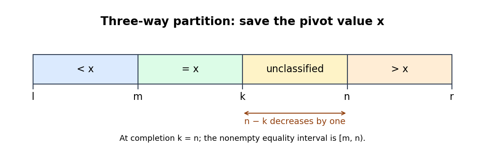

<h1 id="2/a/solution">Solution</h1>

↑ **Parent:** [A](../a.md)

Use [three-way array partitioning](../../../../../three-way-array-partitioning.md) around a saved pivot value:

```
procedure Partition(var a; l, r; var m, n)
    x := a[Pivot(a,l,r)]
    m := l
    k := l
    n := r
    while k < n do
        if a[k] < x then
            swap(a[k], a[m])
            m := m+1
            k := k+1
        else if a[k] > x then
            n := n-1
            swap(a[k], a[n])
        else
            k := k+1
```

Assume a total ordering on the element keys. The [loop invariant](../../../../../loop-invariant.md) partitions the original segment into

$$
a[l..m)<x,\quad a[m..k)=x,\quad a[k..n)\text{ unclassified},\quad a[n..r)>x,
$$

with $l\leq m\leq k\leq n\leq r$ and the segment's [multiset](../../../../../multiset.md) unchanged. A smaller entry exchanges with the first equality position; the displaced equal entry is accounted for when both indices advance. A greater entry exchanges with the last unclassified position, so `k` must stay to inspect the incoming entry. The [loop variant](../../../../../loop-variant.md) $n-k$ decreases by one in every branch.

At termination the equality interval is $[m,n)$. It is nonempty because the pivot value came from the segment and swaps preserve the bag. The stronger strict outer-region conditions therefore imply the requested overlapping inequalities $a[l..n)\leq x\leq a[m..r)$ and $l\leq m<n\leq r$. Storing the pivot value avoids following an array position whose contents may move.

<a id="2/a/image-four-region-invariant-for-duplicate-aware-array-partitioning"></a>


**[Figure 1](#2/a/image-four-region-invariant-for-duplicate-aware-array-partitioning). Four-region invariant for duplicate-aware array partitioning**. The unclassified interval shrinks at every comparison. On completion, the equal interval remains nonempty and both outer intervals can be discarded or searched by rank.

## ↑ Ancestors (12)

1. [A](../a.md)
2. [2](../../2.md)
3. [Imperative programming](../../../imperative-programming-split.md)
4. [2017](../../../split.md)
5. [Past exam of the year 1 of the computer science course of the University of Oxford](../../../../split.md)
6. [Year 1 of the computer science course of the University of Oxford](../../../../../year-1-of-the-computer-science-course-of-the-university-of-oxford.md)
7. [Computer science course of the University of Oxford](../../../../../computer-science-course-of-the-university-of-oxford.md)
8. [Undergraduate course of the University of Oxford](../../../../../undergraduate-course-of-the-university-of-oxford.md)
9. [Course of the University of Oxford](../../../../../course-of-the-university-of-oxford.md)
10. [University of Oxford](../../../../../university-of-oxford-split.md)
11. [List of universities](../../../../../list-of-universities.md)
12. [Codex Wiki](../../../../../split.md)
