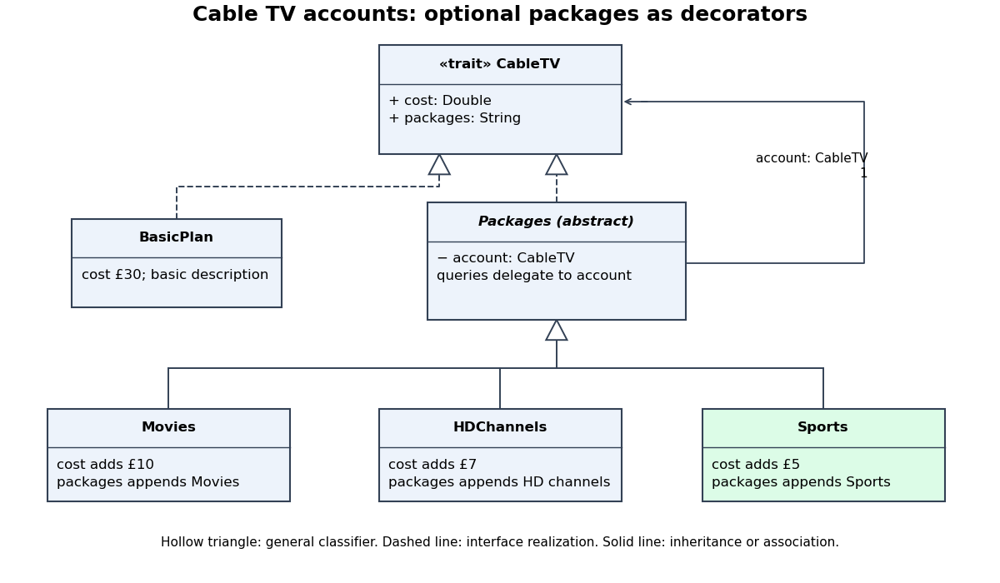

<h1 id="5/d/solution">Solution</h1>

↑ **Parent:** [D](../d.md)

Add one concrete decorator and a small application:

```
class Sports(account: CableTV) extends Packages(account) {
  override def cost: Double = super.cost + 5.0
  override def packages: String = super.packages + ", Sports"
}

object CableTVExample extends App {
  val basic: CableTV = new BasicPlan
  val movies: CableTV = new Movies(basic)
  val hd: CableTV = new HDChannels(movies)
  val sports: CableTV = new Sports(hd)
  Seq(basic, movies, hd, sports).foreach { account =>
    println(account.packages + " = £" + account.cost)
  }
}
```

The output is:

```
Basic plan = £30.0
Basic plan, Movies = £40.0
Basic plan, Movies, HD channels = £47.0
Basic plan, Movies, HD channels, Sports = £52.0
```

The final price is **£52**. Each new wrapper leaves earlier account objects available at their original prices. In the [UML](../../../../../unified-modeling-language.md) [class diagram](../../../../../class-diagram.md), both `BasicPlan` and `Packages` realize `CableTV`; each package class inherits `Packages`. The `account` relationship points from the decorator to another `CableTV` component. It is an association, without asserting exclusive lifetime ownership.

<a id="5/d/image-cable-tv-decorator-classes-extended-with-the-sports-package"></a>


**[Figure 2](#5/d/image-cable-tv-decorator-classes-extended-with-the-sports-package). Cable TV decorator classes extended with the Sports package**. Original UML class diagram. Dashed hollow-triangle arrows denote interface realization; solid hollow-triangle arrows denote class inheritance. The account association permits nested decorators.

## ↑ Ancestors (12)

1. [D](../d.md)
2. [5](../../5.md)
3. [Imperative programming](../../../imperative-programming-split.md)
4. [2017](../../../split.md)
5. [Past exam of the year 1 of the computer science course of the University of Oxford](../../../../split.md)
6. [Year 1 of the computer science course of the University of Oxford](../../../../../year-1-of-the-computer-science-course-of-the-university-of-oxford.md)
7. [Computer science course of the University of Oxford](../../../../../computer-science-course-of-the-university-of-oxford.md)
8. [Undergraduate course of the University of Oxford](../../../../../undergraduate-course-of-the-university-of-oxford.md)
9. [Course of the University of Oxford](../../../../../course-of-the-university-of-oxford.md)
10. [University of Oxford](../../../../../university-of-oxford-split.md)
11. [List of universities](../../../../../list-of-universities.md)
12. [Codex Wiki](../../../../../split.md)
