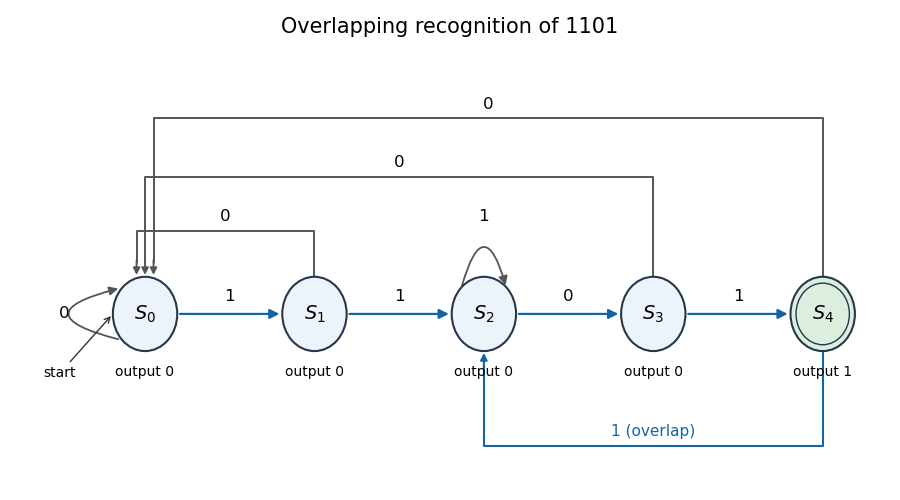
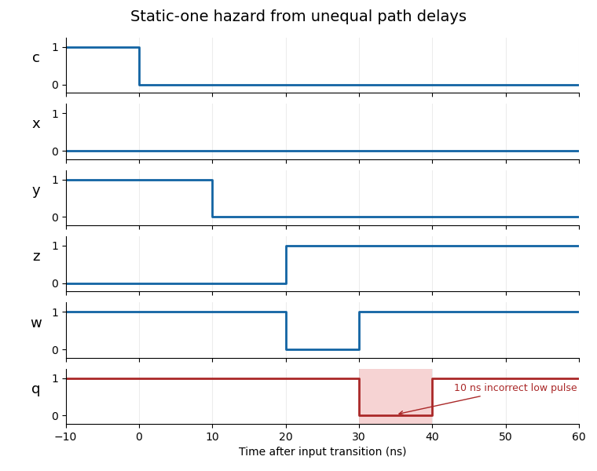
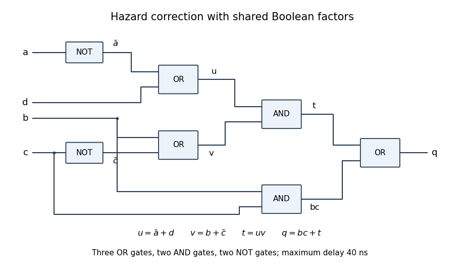

# Digital systems, linear algebra, introduction to formal proof

↑ **Parent:** [2018](../2018.md)

Source release: [Oxford examination archive](https://www.whatdotheyknow.com/request/past_exam_papers_for_1st_year_of/response/1398416/attach/2/Fakour%20Zip%20Final%201.zip?cookie_passthrough=1), member `a10101w1.pdf`. The held cover identifies the regular 14 June 2018 examination. Every printed option is treated below.

**Table of contents**

- [1](#1)
  - [a](#1/a)
    - [Solution](#1/a/solution)
  - [b](#1/b)
    - [Solution](#1/b/solution)
  - [c](#1/c)
    - [Solution](#1/c/solution)
  - [d](#1/d)
    - [Solution](#1/d/solution)
  - [e](#1/e)
    - [Solution](#1/e/solution)
- [2](#2)
  - [a](#2/a)
    - [Solution](#2/a/solution)
  - [b](#2/b)
    - [Solution](#2/b/solution)
  - [c](#2/c)
    - [Solution](#2/c/solution)
  - [d](#2/d)
    - [Solution](#2/d/solution)
- [3](#3)
  - [a](#3/a)
    - [Solution](#3/a/solution)
  - [b](#3/b)
    - [Solution](#3/b/solution)
  - [c](#3/c)
    - [Solution](#3/c/solution)
  - [d](#3/d)
    - [Solution](#3/d/solution)
- [4](#4)
  - [a](#4/a)
    - [Solution](#4/a/solution)
  - [b](#4/b)
    - [i](#4/b/i)
      - [Solution](#4/b/i/solution)
    - [ii](#4/b/ii)
      - [Solution](#4/b/ii/solution)
    - [iii](#4/b/iii)
      - [Solution](#4/b/iii/solution)
  - [c](#4/c)
    - [Solution](#4/c/solution)
  - [d](#4/d)
    - [i](#4/d/i)
      - [Solution](#4/d/i/solution)
    - [ii](#4/d/ii)
      - [Solution](#4/d/ii/solution)
- [5](#5)
  - [a](#5/a)
    - [i](#5/a/i)
      - [Solution](#5/a/i/solution)
    - [ii](#5/a/ii)
      - [Solution](#5/a/ii/solution)
  - [b](#5/b)
    - [i](#5/b/i)
      - [Solution](#5/b/i/solution)
    - [ii](#5/b/ii)
      - [Solution](#5/b/ii/solution)
    - [iii](#5/b/iii)
      - [Solution](#5/b/iii/solution)
  - [c](#5/c)
    - [i](#5/c/i)
      - [Solution](#5/c/i/solution)
    - [ii](#5/c/ii)
      - [Solution](#5/c/ii/solution)
    - [iii](#5/c/iii)
      - [Solution](#5/c/iii/solution)
    - [iv](#5/c/iv)
      - [Solution](#5/c/iv/solution)
- [6](#6)
  - [a](#6/a)
    - [i](#6/a/i)
      - [Solution](#6/a/i/solution)
    - [ii](#6/a/ii)
      - [Solution](#6/a/ii/solution)
  - [b](#6/b)
    - [i](#6/b/i)
      - [Solution](#6/b/i/solution)
    - [ii](#6/b/ii)
      - [Solution](#6/b/ii/solution)
  - [c](#6/c)
    - [i](#6/c/i)
      - [Solution](#6/c/i/solution)
    - [ii](#6/c/ii)
      - [Solution](#6/c/ii/solution)
- [7](#7)
  - [a](#7/a)
    - [Solution](#7/a/solution)
  - [b](#7/b)
    - [Solution](#7/b/solution)
  - [c](#7/c)
    - [Solution](#7/c/solution)
  - [d](#7/d)
    - [i](#7/d/i)
      - [Solution](#7/d/i/solution)
    - [ii](#7/d/ii)
      - [Solution](#7/d/ii/solution)
- [8](#8)
  - [a](#8/a)
    - [Solution](#8/a/solution)
  - [b](#8/b)
    - [i](#8/b/i)
      - [Solution](#8/b/i/solution)
    - [ii](#8/b/ii)
      - [Solution](#8/b/ii/solution)
    - [iii](#8/b/iii)
      - [Solution](#8/b/iii/solution)
  - [c](#8/c)
    - [Solution](#8/c/solution)
  - [d](#8/d)
    - [Solution](#8/d/solution)

## 1

↑ **Parent:** [Digital systems, linear algebra, introduction to formal proof](digital-systems-linear-algebra-introduction-to-formal-proof.md)

<h3 id="1/a">a</h3>

↑ **Parent:** [1](#1)

<h4 id="1/a/solution">Solution</h4>

↑ **Parent:** [A](#1/a)

Use a [Moore machine](../../foundations-of-mathematics.md#moore-machine) whose state records the longest suffix of the received stream that is also a prefix of the target word. The transitions are

$$
\begin{array}{c|cc|c}
\text{state}&x=0&x=1&\text{output}\\\hline
S_0&S_0&S_1&0\\
S_1&S_0&S_2&0\\
S_2&S_3&S_2&0\\
S_3&S_0&S_4&0\\
S_4&S_0&S_2&1
\end{array}.
$$

The last row preserves overlap: after recognition, one more one leaves suffix $11$, giving $S_2$. Initialize to $S_0$ and update the state on each active clock edge; the output after that edge reports whether the word has just ended. This is a [prefix-suffix sequence recognizer](../../foundations-of-mathematics.md#prefix-suffix-sequence-recognizer).

<a id="1/a/image-state-transitions-of-the-overlapping-moore-machine-recognizer"></a>


**[Figure 1](#1/a/image-state-transitions-of-the-overlapping-moore-machine-recognizer). State transitions of the overlapping Moore machine recognizer**. Edge labels are input bits. Only the shaded, double-ring state produces output one.

<h3 id="1/b">b</h3>

↑ **Parent:** [1](#1)

<h4 id="1/b/solution">Solution</h4>

↑ **Parent:** [B](#1/b)

Five distinct states require **three [D flip-flops](../../electrical-engineering.md#d-flip-flop)**, since $2^2<5\leq2^3$. Choose the [state encoding](../../foundations-of-mathematics.md#state-encoding) $S_i$ equal to the three-bit binary expansion of $i$. Write the present bits as $A,B,C$, in decreasing significance. The [state transition table](../../foundations-of-mathematics.md#state-transition-table) is

$$
\begin{array}{c|cc|c}
ABC&x=0:\ A^+B^+C^+&x=1:\ A^+B^+C^+&y\\\hline
000&000&001&0\\001&000&010&0\\010&011&010&0\\011&000&100&0\\100&000&010&1\\101&---&---&-\\110&---&---&-\\111&---&---&-
\end{array}.
$$

The dashes are [don't-care conditions](../../analysis-of-boolean-functions.md#don-t-care-term) for minimizing the logic. They do not prescribe what the actual circuit will do in those unused states; part (e) determines that from the chosen equations.

<h3 id="1/c">c</h3>

↑ **Parent:** [1](#1)

<h4 id="1/c/solution">Solution</h4>

↑ **Parent:** [C](#1/c)

With the encoding in part (b), **$y=A$** is a valid [Moore machine](../../foundations-of-mathematics.md#moore-machine) output equation. Among reachable states, $A=1$ exactly at $S_4$. This uses unused output-table entries as [don't-care conditions](../../analysis-of-boolean-functions.md#don-t-care-term). If one instead wants the output to be zero in every unused state, use $y=A\bar B\bar C$; that extra requirement does not change any output from a valid state.

<h3 id="1/d">d</h3>

↑ **Parent:** [1](#1)

<h4 id="1/d/solution">Solution</h4>

↑ **Parent:** [D](#1/d)

Use four-variable [Karnaugh maps](../../analysis-of-boolean-functions.md#karnaugh-map) with rows $AB=00,01,11,10$ and columns $Cx=00,01,11,10$, both in [Gray code](../../graph.md#gray-code) order. A dash denotes an unused present state. The maps for the three next-state bits are

$$
\begin{array}{c|cccc}
A^+&00&01&11&10\\\hline
00&0&0&0&0\\01&0&0&1&0\\11&-&-&-&-\\10&0&0&-&-
\end{array}\qquad
\begin{array}{c|cccc}
B^+&00&01&11&10\\\hline
00&0&0&1&0\\01&1&1&0&0\\11&-&-&-&-\\10&0&1&-&-
\end{array}\qquad
\begin{array}{c|cccc}
C^+&00&01&11&10\\\hline
00&0&1&0&0\\01&1&0&0&0\\11&-&-&-&-\\10&0&0&-&-
\end{array}.
$$

For $A^+$, join its sole one with the dash directly below it. For $B^+$, use the four-cell groups $Ax$ and $B\bar C$, and the two-cell group $\bar BCx$; the last group wraps between the top and bottom rows. For $C^+$, join the one at row $01$, column $00$ to the dash below it; the one at row $00$, column $01$ is isolated. These [prime implicants](../../analysis-of-boolean-functions.md#prime-implicant) give

$$
\boxed{D_A=BCx,\qquad D_B=Ax+B\bar C+\bar BCx,\qquad D_C=B\bar C\bar x+\bar A\bar B\bar Cx.}
$$

Here products mean [Boolean conjunction](../../mathematical-logic.md#logical-conjunction) and sums mean [Boolean disjunction](../../mathematical-logic.md#logical-disjunction). The $D$ inputs are the desired next-state bits of the three [D flip-flops](../../electrical-engineering.md#d-flip-flop). The equations are independent of the unused values except for the explicitly chosen [Karnaugh map](../../analysis-of-boolean-functions.md#karnaugh-map) groups.

<h3 id="1/e">e</h3>

↑ **Parent:** [1](#1)

<h4 id="1/e/solution">Solution</h4>

↑ **Parent:** [E](#1/e)

Evaluate the implemented equations from part (d), rather than the don't-care entries of the original table:

$$
\begin{array}{c|cc}
\text{unused state}&x=0&x=1\\\hline
101&000&010\\110&011&010\\111&000&110
\end{array}.
$$

States $101$ and $110$ enter a valid state after one edge. State $111$ does so after one edge for zero, or moves to $110$ and enters a valid state on the following edge for either next input. Thus **every unused state recovers within at most two clock edges**, independently of the incoming bits. The machine cannot become trapped there. This [self-starting finite-state machine](../../foundations-of-mathematics.md#self-starting-finite-state-machine) property does not guarantee meaningful recognizer output during recovery; initialization to $S_0$ still establishes the intended stream history.

## 2

↑ **Parent:** [Digital systems, linear algebra, introduction to formal proof](digital-systems-linear-algebra-introduction-to-formal-proof.md)

<h3 id="2/a">a</h3>

↑ **Parent:** [2](#2)

<h4 id="2/a/solution">Solution</h4>

↑ **Parent:** [A](#2/a)

The internal [Boolean functions](../../analysis-of-boolean-functions.md#boolean-function) are $x=\bar a\bar c$, $y=bc$, $z=\bar cd$, $w=y+z$ and $q=x+w$. Put the falling edge of $c$ at $t=0$. Since $a=1$ throughout, **$x=0$ throughout**. The remaining transitions, including every stated [propagation delay](../../theoretical-computer-science.md#propagation-delay), are

$$
\begin{array}{c|c|c}
\text{signal}&t<0&\text{transition after }t=0\\\hline
y&1&1\to0\text{ at }10\text{ ns}\\
z&0&0\to1\text{ at }20\text{ ns}\\
w&1&1\to0\text{ at }20\text{ ns},\quad0\to1\text{ at }30\text{ ns}\\
q&1&1\to0\text{ at }30\text{ ns},\quad0\to1\text{ at }40\text{ ns}
\end{array}.
$$

The inverter delays the rise of $\bar c$ by ten nanoseconds, and the $z$ AND gate adds another ten. Consequently $y$ and $z$ are simultaneously zero for ten nanoseconds. This gap propagates through the two OR gates. The output has a **static-one [logic hazard](../../theoretical-computer-science.md#hazard-logic): a low glitch on $30\leq t<40$ ns**, despite its equal initial and final logical values.

<a id="2/a/image-delayed-transitions-produce-a-ten-nanosecond-static-one-logic-hazard"></a>


**[Figure 2](#2/a/image-delayed-transitions-produce-a-ten-nanosecond-static-one-logic-hazard). Delayed transitions produce a ten-nanosecond static-one logic hazard**. The shaded interval marks the incorrect output pulse. Exact ten-nanosecond gate delays are used, including propagation of the pulse.

<h3 id="2/b">b</h3>

↑ **Parent:** [2](#2)

<h4 id="2/b/solution">Solution</h4>

↑ **Parent:** [B](#2/b)

The steady-state output is $q=\bar a\bar c+bc+\bar cd$. Its [Karnaugh map](../../analysis-of-boolean-functions.md#karnaugh-map), with rows $ab$ and columns $cd$ in [Gray code](../../graph.md#gray-code) order, is

$$
\begin{array}{c|cccc}
ab\backslash cd&00&01&11&10\\\hline
00&1&1&0&0\\01&1&1&1&1\\11&0&1&1&1\\10&0&1&0&0
\end{array}.
$$

The existing [prime implicants](../../analysis-of-boolean-functions.md#prime-implicant) cover adjacent ones except for some transitions in $c$. The [consensus theorem](../../analysis-of-boolean-functions.md#consensus-theorem) supplies the two missing bridging implicants **$\bar ab$ and $bd$**, giving

$$
\boxed{q_{\mathrm{safe}}=\bar a\bar c+bc+\bar cd+\bar ab+bd.}
$$

Both are needed in a hazard-free [sum of products](../../theoretical-computer-science.md#disjunctive-normal-form) retaining the original terms. At $a=0,b=1,d=0$, the two values of $c$ require a common implicant, necessarily covered by $\bar ab$; at $a=1,b=1,d=1$, the corresponding transition requires $bd$. Neither bridge covers the other's critical edge. All other adjacent-one pairs already share a term. Thus two is the least number of additional [prime implicants](../../analysis-of-boolean-functions.md#prime-implicant). This addresses single-input static hazards; simultaneous input changes require separate analysis.

<h3 id="2/c">c</h3>

↑ **Parent:** [2](#2)

<h4 id="2/c/solution">Solution</h4>

↑ **Parent:** [C](#2/c)

To implement the two additional [prime implicants](../../analysis-of-boolean-functions.md#prime-implicant) explicitly, add **two 2-input AND gates and two 2-input OR gates**. Reuse $\bar a$ from the existing inverter. An OR-tree arrangement that keeps the maximum [propagation delay](../../theoretical-computer-science.md#propagation-delay) at **40 ns** is

$$
u=bc+bd,\qquad v=\bar a\bar c+\bar ab,\qquad w=u+\bar cd,\qquad q=v+w.
$$

The five product gates feed four OR gates; the original circuit already supplied three of the product gates and two OR gates. From the primary inputs, $bc$ and $bd$ settle by 10 ns, so $u$ settles by 20 ns. The two products in $v$ and the product $\bar cd$ settle by 20 ns, so $v$ and $w$ settle by 30 ns, and $q$ by 40 ns. In particular, **no increase in worst-case delay is necessary**. Merely appending two OR gates to the old output would unnecessarily lengthen some paths.

If arbitrary rewiring and factoring are allowed, an even smaller added-hardware implementation is

$$
u=\bar a+d,\qquad v=b+\bar c,\qquad t=uv,\qquad q=bc+t.
$$

Expanding this expression gives all five terms from part (b). It needs three OR gates, two AND gates and the existing two inverters: add **one OR gate**, reuse two existing AND gates and leave the third unused. Both $u$ and $v$ settle by 20 ns, $t$ by 30 ns and $q$ by 40 ns. During a potentially hazardous change of $c$, the bridging condition $b=u=1$ holds $v=t=1$ regardless of $c$; zero-to-zero cases keep either both $b,u$ zero or all relevant products steadily zero. The factored circuit therefore retains single-input hazard protection. The four-gate count above is the minimum when the two extra product implicants are required as separate AND outputs; factoring changes that implementation constraint.

<a id="2/c/image-a-factored-logic-hazard-correction-using-three-or-gates-and-two-and-gates"></a>


**[Figure 3](#2/c/image-a-factored-logic-hazard-correction-using-three-or-gates-and-two-and-gates). A factored logic hazard correction using three OR gates and two AND gates**. The extra OR gate and rewiring replace explicit separate consensus-product gates. Labels identify all intermediate signals; the worst-case gate delay remains forty nanoseconds.

<h3 id="2/d">d</h3>

↑ **Parent:** [2](#2)

<h4 id="2/d/solution">Solution</h4>

↑ **Parent:** [D](#2/d)

Removing [logic hazards](../../theoretical-computer-science.md#hazard-logic) prevents transient false control pulses, incorrect triggering of asynchronous state changes and avoidable switching activity. It also makes behavior less sensitive to unequal [propagation delays](../../theoretical-computer-science.md#propagation-delay). These benefits matter especially when an output directly controls another circuit rather than being sampled only after settling.

The usual costs are redundant [logic gates](../../theoretical-computer-science.md#logic-gate), larger area and capacitance, more wiring and possibly a longer [critical path](../../theoretical-computer-science.md#combinational-critical-path). Power can rise from extra hardware even when glitch power falls. A synchronous design may instead sample after a sufficiently long clock period, trading settling time against additional hazard-correction logic. A circuit proved free of single-input static hazards need not be safe under arbitrary simultaneous input changes; [metastability](../../critical-phenomenon.md#metastability) at an asynchronous input is a different problem.

## 3

↑ **Parent:** [Digital systems, linear algebra, introduction to formal proof](digital-systems-linear-algebra-introduction-to-formal-proof.md)

<h3 id="3/a">a</h3>

↑ **Parent:** [3](#3)

<h4 id="3/a/solution">Solution</h4>

↑ **Parent:** [A](#3/a)

Fetch the [MIPS instruction](../../computer-science.md#mips-instruction) at the [program counter](../../computer-science.md#instruction-pointer), and compute $pc+4$. The opcode selects an [MIPS R-type instruction](../../computer-science.md#mips-r-type-instruction); register-file read addresses $rs$ and $rt$ select the two operands. The function field selects ALU addition. The result returns through write-back multiplexer input zero to destination $rd$, and the next [program counter](../../computer-science.md#instruction-pointer) is $pc+4$.

Using the diagram's actual selector encodings, the [control signals](../../control-theory.md#control-input) are

$$
\begin{array}{c|ccccccccc}
&\mathrm{RegDst}&\mathrm{Branch}&\mathrm{Jump}&\mathrm{MemWrite}&\mathrm{MemToReg}&\mathrm{ALUOp}&\mathrm{MemRead}&\mathrm{ALUSrc}&\mathrm{RegWrite}\\\hline
\mathrm{add}&1&00&0&0&0&10&0&0&1
\end{array}.
$$

Here $\mathrm{ALUOp}=10$ means decode the function field; $00$ means add and $01$ means subtract. The source's $\mathrm{Branch}=(Br_1,Br_0)$ is a two-bit control: the branch-taken output is $Br_1\land(Br_0\mathbin{\oplus}\mathrm{Zero})$. With $Br_1=0$, $Br_0$ is immaterial; zero is a convenient concrete setting. No data-memory access occurs.

<h3 id="3/b">b</h3>

↑ **Parent:** [3](#3)

<h4 id="3/b/solution">Solution</h4>

↑ **Parent:** [B](#3/b)

Fetch and decode the [MIPS I-type instruction](../../computer-science.md#mips-i-type-instruction), read $rs$ and $rt$, and subtract their values in the [arithmetic logic unit](../../computer-science.md#arithmetic-logic-unit). The [zero flag](../../computer-science.md#zero-flag) is one exactly when they are equal. The branch target is

$$
\mathrm{BrT}=(pc+4)+\bigl(\operatorname{signextend}(imm)\ll2\bigr).
$$

The branch selector chooses that target when $Br_1=1$ and $Br_0=0$ make the diagram's condition equal to $\mathrm{Zero}$. Otherwise it chooses $pc+4$. Neither registers nor data memory are written. The [control signals](../../control-theory.md#control-input) are

$$
\begin{array}{c|ccccccccc}
&\mathrm{RegDst}&\mathrm{Branch}&\mathrm{Jump}&\mathrm{MemWrite}&\mathrm{MemToReg}&\mathrm{ALUOp}&\mathrm{MemRead}&\mathrm{ALUSrc}&\mathrm{RegWrite}\\\hline
\mathrm{beq}&-&10&0&0&-&01&0&0&0
\end{array}.
$$

Dashes are [don't-care conditions](../../analysis-of-boolean-functions.md#don-t-care-term) because register write enable is zero. The immediate goes to the branch-target adder, while the main ALU's second input remains the value in $rt$.

<h3 id="3/c">c</h3>

↑ **Parent:** [3](#3)

<h4 id="3/c/solution">Solution</h4>

↑ **Parent:** [C](#3/c)

For the semantics stipulated by the question, **write $pc+4$ to register 31 and load the next $pc$ from register $rs$**. Read $rs$ through register-file output $rd_0$. Select input two of the next-PC multiplexer, which is already wired from $rd_0$. Select destination input two, already the constant register number 31, and write-back input two, already $pc+4$.

Thus the printed diagram already contains the necessary three-way [multiplexers](../../theoretical-computer-science.md#multiplexer) and wires. Extend the controller's opcode/function decoding to generate

$$
\begin{array}{c|ccccccccc}
&\mathrm{RegDst}&\mathrm{Branch}&\mathrm{Jump}&\mathrm{MemWrite}&\mathrm{MemToReg}&\mathrm{ALUOp}&\mathrm{MemRead}&\mathrm{ALUSrc}&\mathrm{RegWrite}\\\hline
\mathrm{jalr}&2&00&2&0&2&00&0&0&1
\end{array}.
$$

The displayed $\mathrm{ALUOp}$ and $\mathrm{ALUSrc}$ settings are arbitrary safe choices for an unused result. **No additional datapath hardware or control field is required** beyond decoding this instruction into the existing values. This uses the question's explicitly specified $pc+4$ link convention.

<h3 id="3/d">d</h3>

↑ **Parent:** [3](#3)

<h4 id="3/d/solution">Solution</h4>

↑ **Parent:** [D](#3/d)

Use the stipulated [MIPS I-type instruction](../../computer-science.md#mips-i-type-instruction) encoding, whose unused $rt$ field is zero, so register-file output $rd_1$ supplies the hardwired zero register. With $\mathrm{ALUSrc}=0$ and subtraction selected, the [arithmetic logic unit](../../computer-science.md#arithmetic-logic-unit) computes $R[rs]-0$. Its [zero flag](../../computer-science.md#zero-flag) detects $R[rs]=0$, while bit 31 of $rd_0$ is the sign in [two's complement](../../programming-language.md#two-s-complement). Therefore the required signed test is

$$
R[rs]>0\iff\neg\mathrm{Zero}\land\neg rd_0[31].
$$

Introduce one new control bit $GT$, and replace the zero-flag input to the existing branch XOR by

$$
Z^*=\mathrm{Zero}\lor(GT\land rd_0[31]).
$$

This needs an AND gate, an OR gate and a tap of the sign bit. With $GT=0$, existing branch behavior is unchanged. With $GT=1$ and $\mathrm{Branch}=11$, the existing branch-taken circuit gives $\neg Z^*$, exactly the positive test. Its output still selects between $pc+4$ and the usual sign-extended branch target. The complete control row is

$$
\begin{array}{c|cccccccccc}
&\mathrm{RegDst}&\mathrm{Branch}&\mathrm{Jump}&\mathrm{MemWrite}&\mathrm{MemToReg}&\mathrm{ALUOp}&\mathrm{MemRead}&\mathrm{ALUSrc}&\mathrm{RegWrite}&GT\\\hline
\mathrm{bgtz}&-&11&0&0&-&01&0&0&0&1
\end{array}.
$$

Set $GT=0$ for each instruction in parts (a)–(c). Registers and data memory remain unchanged. The available signed `slt` operation could support a different design; the sign-and-zero design above avoids adding an ALU-input swap and explicitly distinguishes zero from positive values.

## 4

↑ **Parent:** [Digital systems, linear algebra, introduction to formal proof](digital-systems-linear-algebra-introduction-to-formal-proof.md)

<h3 id="4/a">a</h3>

↑ **Parent:** [4](#4)

<h4 id="4/a/solution">Solution</h4>

↑ **Parent:** [A](#4/a)

Over the underlying [field](../../algebra.md#field) $F$, the [row space](../../vector-space.md#row-space) is the [linear span](../../vector-space.md#linear-span) of the row [vectors](../../vector-space.md#vector) of $A$, a [vector subspace](../../vector-space.md#vector-subspace) of $F^n$. The [column space](../../vector-space.md#column-space) is the [linear span](../../vector-space.md#linear-span) of its column [vectors](../../vector-space.md#vector), a [vector subspace](../../vector-space.md#vector-subspace) of $F^m$. The [null space](../../kernel-of-a-linear-map.md) is

$$
\ker A=\{x\in F^n:Ax=0\},
$$

a [vector subspace](../../vector-space.md#vector-subspace) of the domain. The [column space](../../vector-space.md#column-space) is the [image of a linear map](../../vector-space.md#image-of-a-linear-map) represented by $A$; the [null space](../../kernel-of-a-linear-map.md) is its [kernel](../../kernel-of-a-linear-map.md).

<h3 id="4/b">b</h3>

↑ **Parent:** [4](#4)

<h4 id="4/b/i">i</h4>

↑ **Parent:** [B](#4/b)

<h5 id="4/b/i/solution">Solution</h5>

↑ **Parent:** [I](#4/b/i)

[Gaussian elimination](../../numerical-linear-algebra.md#gaussian-elimination) gives

$$
\operatorname{rref}(A)=\begin{pmatrix}1&0&1\\0&1&2\\0&0&0\end{pmatrix}.
$$

Elementary row operations preserve the [row space](../../vector-space.md#row-space), so **$\{(1,0,1),(0,1,2)\}$** is a [basis](../../vector-space.md#basis). The two rows are [linearly independent](../../vector-space.md#linear-independence) because their first two coordinates form the standard basis of $\mathbb R^2$.

<h4 id="4/b/ii">ii</h4>

↑ **Parent:** [B](#4/b)

<h5 id="4/b/ii/solution">Solution</h5>

↑ **Parent:** [Ii](#4/b/ii)

The [pivot columns](../../vector-space.md#pivot-column) of the reduced matrix in part (i) are columns one and two. Select those columns of the original matrix, giving the [column-space basis](../../vector-space.md#column-space-basis)

$$
\boxed{\left\{\begin{pmatrix}-3\\-1\\2\end{pmatrix},\begin{pmatrix}4\\2\\1\end{pmatrix}\right\}.}
$$

They are independent, for example their first two entries have determinant $-2\ne0$. The remaining original column is the first plus twice the second. Taking the reduced matrix's columns instead would generally give the wrong [column space](../../vector-space.md#column-space).

<h4 id="4/b/iii">iii</h4>

↑ **Parent:** [B](#4/b)

<h5 id="4/b/iii/solution">Solution</h5>

↑ **Parent:** [Iii](#4/b/iii)

The reduced equations are $x+z=0$ and $y+2z=0$. Thus the [null space](../../kernel-of-a-linear-map.md) is the line

$$
\boxed{\ker A=\left\{t\begin{pmatrix}-1\\-2\\1\end{pmatrix}:t\in\mathbb R\right\}.}
$$

The nonzero spanning vector gives a one-element [basis](../../vector-space.md#basis), so the [nullity](../../kernel-of-a-linear-map.md#nullity-of-a-linear-map) is one.

<h3 id="4/c">c</h3>

↑ **Parent:** [4](#4)

<h4 id="4/c/solution">Solution</h4>

↑ **Parent:** [C](#4/c)

Reducing the augmented matrix gives

$$
\operatorname{rref}(A\mid b)=\begin{pmatrix}1&0&1&0\\0&1&2&1/2\\0&0&0&0\end{pmatrix}.
$$

There is no contradictory row. Hence the system is **consistent**, with [affine solution space](../../linear-algebra.md#affine-solution-space)

$$
\boxed{(x,y,z)=(0,1/2,0)+t(-1,-2,1),\qquad t\in\mathbb R.}
$$

The three [planes](../../geometry-and-topology.md#plane) intersect in this common line. Their normals span a two-dimensional [row space](../../vector-space.md#row-space), leaving a one-dimensional common direction, the [null space](../../kernel-of-a-linear-map.md). More explicitly, five times the first equation minus eleven times the second plus twice the third is the zero equation, including the right-hand side; the third plane therefore contains the intersection of the first two.

<h3 id="4/d">d</h3>

↑ **Parent:** [4](#4)

<h4 id="4/d/i">i</h4>

↑ **Parent:** [D](#4/d)

<h5 id="4/d/i/solution">Solution</h5>

↑ **Parent:** [I](#4/d/i)

The [rank](../../quadratic-form.md#rank-one-quadratic-form) of $A$ is **the dimension of its [column space](../../vector-space.md#column-space)**, equivalently the dimension of its [row space](../../vector-space.md#row-space) or the number of [pivot columns](../../vector-space.md#pivot-column) in a row-echelon form. For an $n\times n$ matrix it lies between zero and $n$.

<h4 id="4/d/ii">ii</h4>

↑ **Parent:** [D](#4/d)

<h5 id="4/d/ii/solution">Solution</h5>

↑ **Parent:** [Ii](#4/d/ii)

Each [elementary matrix](../../numerical-linear-algebra.md#elementary-matrix) is obtained by applying one invertible elementary row operation to the [identity matrix](../../vector-space.md#identity-matrix). Its inverse is the elementary matrix for the reverse operation. A product of [elementary matrices](../../numerical-linear-algebra.md#elementary-matrix) is therefore invertible and has full [rank](../../quadratic-form.md#rank-one-quadratic-form) $n$.

Conversely, if $\operatorname{rank}A=n$, [Gaussian elimination](../../numerical-linear-algebra.md#gaussian-elimination) has a pivot in every column and reduces $A$ to the identity. Writing the successive row operations as left multiplication gives $E_r\cdots E_1A=I$. Hence $A=E_1^{-1}\cdots E_r^{-1}$, a product of [elementary matrices](../../numerical-linear-algebra.md#elementary-matrix). This proves both directions of the [elementary-matrix factorization theorem](../../numerical-linear-algebra.md#elementary-matrix-factorization-theorem).

## 5

↑ **Parent:** [Digital systems, linear algebra, introduction to formal proof](digital-systems-linear-algebra-introduction-to-formal-proof.md)

<h3 id="5/a">a</h3>

↑ **Parent:** [5](#5)

<h4 id="5/a/i">i</h4>

↑ **Parent:** [A](#5/a)

<h5 id="5/a/i/solution">Solution</h5>

↑ **Parent:** [I](#5/a/i)

**False.** In the real [vector space](../../vector-space.md) $\mathbb R$, both $\{1\}$ and $\{2\}$ are [bases](../../vector-space.md#basis): each is [linearly independent](../../vector-space.md#linear-independence) and spans the whole space. A [basis](../../vector-space.md#basis) need not be a unique set. What is fixed for a finite-dimensional [vector space](../../vector-space.md) is the number of basis elements, its [dimension](../../vector-space.md#dimension-vector-space).

<h4 id="5/a/ii">ii</h4>

↑ **Parent:** [A](#5/a)

<h5 id="5/a/ii/solution">Solution</h5>

↑ **Parent:** [Ii](#5/a/ii)

**True.** Existence follows because the [basis](../../vector-space.md#basis) spans $V$. If $v=\sum_i a_i s_i=\sum_i b_i s_i$, subtract to get $\sum_i(a_i-b_i)s_i=0$. The basis vectors' [linear independence](../../vector-space.md#linear-independence) forces every $a_i-b_i=0$, proving uniqueness. For an infinite [basis](../../vector-space.md#basis), both representations have finite support, so the same argument applies to their finite union. These coefficients are the [coordinates relative to a basis](../../vector-space.md#coordinates-relative-to-a-basis).

<h3 id="5/b">b</h3>

↑ **Parent:** [5](#5)

<h4 id="5/b/i">i</h4>

↑ **Parent:** [B](#5/b)

<h5 id="5/b/i/solution">Solution</h5>

↑ **Parent:** [I](#5/b/i)

Transpose both inverse identities, using reversal of multiplication under [matrix transposition](../../vector-space.md#transpose):

$$
(A^{-1})^TA^T=(AA^{-1})^T=I,\qquad A^T(A^{-1})^T=(A^{-1}A)^T=I.
$$

Thus **$(A^T)^{-1}=(A^{-1})^T$**, by uniqueness of the [matrix inverse](../../matrix-inverse.md).

<h4 id="5/b/ii">ii</h4>

↑ **Parent:** [B](#5/b)

<h5 id="5/b/ii/solution">Solution</h5>

↑ **Parent:** [Ii](#5/b/ii)

Let column $j$ of $A^{-1}$ be $x$, so $Ax=e_j$. Every diagonal entry of the invertible [lower triangular matrix](../../linear-algebra.md#lower-triangular-matrix) $A$ is nonzero, since its [determinant](../../multilinear-algebra.md#determinant) is the product of those entries. In row one through row $j-1$, the right-hand side is zero. [Forward substitution](../../numerical-linear-algebra.md#forward-substitution) first gives $x_1=0$, then $x_2=0$, and successively $x_i=0$ for all $i<j$. These are precisely the entries above the diagonal in column $j$ of $A^{-1}$. Every column satisfies this, proving that **$A^{-1}$ is lower triangular**. This is [triangularity of an inverse matrix](../../linear-algebra.md#triangularity-of-an-inverse-matrix).

<h4 id="5/b/iii">iii</h4>

↑ **Parent:** [B](#5/b)

<h5 id="5/b/iii/solution">Solution</h5>

↑ **Parent:** [Iii](#5/b/iii)

If $B$ is an invertible [upper triangular matrix](../../linear-algebra.md#upper-triangular-matrix), $B^T$ is invertible and lower triangular. Part (ii) makes $(B^T)^{-1}$ lower triangular, while part (i) identifies it with $(B^{-1})^T$. Transposing gives that **$B^{-1}$ is upper triangular**. This deduction uses both the inverse-transpose identity and the lower-triangular result.

<h3 id="5/c">c</h3>

↑ **Parent:** [5](#5)

<h4 id="5/c/i">i</h4>

↑ **Parent:** [C](#5/c)

<h5 id="5/c/i/solution">Solution</h5>

↑ **Parent:** [I](#5/c/i)

[Gaussian elimination](../../numerical-linear-algebra.md#gaussian-elimination) gives

$$
\operatorname{rref}(A)=\begin{pmatrix}1&0&2&1\\0&1&1&2\\0&0&0&0\end{pmatrix}.
$$

The first two original columns form an [image](../../set-theory.md#image-of-a-function) [basis](../../vector-space.md#basis):

$$
\boxed{\left\{\begin{pmatrix}1\\2\\1\end{pmatrix},\begin{pmatrix}-1\\1\\0\end{pmatrix}\right\}.}
$$

Their independence follows already from their third and first coordinates. The third column is twice the first plus the second, and the fourth is the first plus twice the second, so they span every output of $T$.

<h4 id="5/c/ii">ii</h4>

↑ **Parent:** [C](#5/c)

<h5 id="5/c/ii/solution">Solution</h5>

↑ **Parent:** [Ii](#5/c/ii)

The [rank-nullity theorem](../../kernel-of-a-linear-map.md#rank-nullity-theorem) states $\dim V=\dim\ker T+\dim\operatorname{im}T$ for a [linear map](../../vector-space.md#linear-map) from a finite-dimensional [vector space](../../vector-space.md) $V$. Here the domain has dimension four and the [image](../../set-theory.md#image-of-a-function) has dimension two. Thus **$\dim\ker T=4-2=2$**. For example, a [kernel](../../kernel-of-a-linear-map.md) [basis](../../vector-space.md#basis) is $\{(-2,-1,1,0),(-1,-2,0,1)\}$, as follows from the reduced equations.

<h4 id="5/c/iii">iii</h4>

↑ **Parent:** [C](#5/c)

<h5 id="5/c/iii/solution">Solution</h5>

↑ **Parent:** [Iii](#5/c/iii)

A [linear map](../../vector-space.md#linear-map) $T:V\to W$ is onto, or [surjective](../../algebra.md#surjective-function), when every $w\in W$ equals $T(v)$ for some $v\in V$; equivalently its [image](../../set-theory.md#image-of-a-function) is all of $W$. Here **$T$ is not onto**, because its image has dimension two while its declared codomain $\mathbb R^3$ has dimension three. Indeed every image vector satisfies $x+y-3z=0$, so, for example, $(0,0,1)$ is not attained.

<h4 id="5/c/iv">iv</h4>

↑ **Parent:** [C](#5/c)

<h5 id="5/c/iv/solution">Solution</h5>

↑ **Parent:** [Iv](#5/c/iv)

A [linear map](../../vector-space.md#linear-map) is one-to-one, or [injective](../../algebra.md#injective-function), when equal outputs imply equal inputs. Equivalently its [kernel](../../kernel-of-a-linear-map.md) is $\{0\}$: subtracting inputs converts equality of outputs to a zero output. Here **$T$ is not one-to-one**, since its kernel has dimension two. Concretely, $T(-2,-1,1,0)=T(0)=0$ for distinct inputs.

## 6

↑ **Parent:** [Digital systems, linear algebra, introduction to formal proof](digital-systems-linear-algebra-introduction-to-formal-proof.md)

<h3 id="6/a">a</h3>

↑ **Parent:** [6](#6)

<h4 id="6/a/i">i</h4>

↑ **Parent:** [A](#6/a)

<h5 id="6/a/i/solution">Solution</h5>

↑ **Parent:** [I](#6/a/i)

For independent columns $a_1,\ldots,a_k$ in a real [inner product space](../../inner-product.md#inner-product-space), the [Gram-Schmidt process](../../inner-product.md#gram-schmidt-process) recursively forms

$$
u_j=a_j-\sum_{i<j}\langle q_i,a_j\rangle q_i,\qquad q_j=\frac{u_j}{\|u_j\|}.
$$

Each $u_j$ subtracts the [orthogonal projections](../../hilbert-space.md#orthogonal-projection) onto earlier normalized vectors. Their independence ensures $u_j\ne0$. The resulting $q_i$ are [orthonormal](../../inner-product.md#orthonormal-set) and preserve the span of every initial column set. Putting $Q=(q_1\ \cdots\ q_k)$ and $r_{ij}=\langle q_i,a_j\rangle$ for $i\leq j$, with zeros below the diagonal, gives a [QR decomposition](../../inner-product.md#qr-decomposition) $A=QR$ with $Q^TQ=I$. Dependent input columns require omitting a zero residual or treating rank deficiency separately.

<h4 id="6/a/ii">ii</h4>

↑ **Parent:** [A](#6/a)

<h5 id="6/a/ii/solution">Solution</h5>

↑ **Parent:** [Ii](#6/a/ii)

The first column has norm two, giving $q_1=(1,-1,1,-1)^T/2$. Its inner products with the second and third columns are both one. Subtracting $q_1$ from the second column leaves $(3,3,3,3)^T/2$, of norm three, so $q_2=(1,1,1,1)^T/2$. The inner product of $q_2$ with the third column is one. Subtracting $q_1+q_2$ from that column leaves $(1,1,-1,-1)^T$, of norm two. Thus the [Gram-Schmidt process](../../inner-product.md#gram-schmidt-process) gives

$$
\boxed{Q=\frac12\begin{pmatrix}1&1&1\\-1&1&1\\1&1&-1\\-1&1&-1\end{pmatrix},\qquad R=\begin{pmatrix}2&1&1\\0&3&1\\0&0&2\end{pmatrix}.}
$$

The columns of $Q$ have unit norm and pairwise zero [inner products](../../inner-product.md), so $Q^TQ=I_3$. Direct multiplication verifies $QR=A$.

<h3 id="6/b">b</h3>

↑ **Parent:** [6](#6)

<h4 id="6/b/i">i</h4>

↑ **Parent:** [B](#6/b)

<h5 id="6/b/i/solution">Solution</h5>

↑ **Parent:** [I](#6/b/i)

A unit vector along the line is $v=(3,4)^T/5$. Reflection fixes its component parallel to $v$ and negates its perpendicular component, so the [reflection matrix](../../linear-algebra.md#reflection-matrix) is

$$
\boxed{H=2vv^T-I=\frac1{25}\begin{pmatrix}-7&24\\24&7\end{pmatrix}.}
$$

Indeed $H(3,4)^T=(3,4)^T$, $H(-4,3)^T=-(-4,3)^T$ and $H^2=I$. These characterize the [orthogonal reflection](../../linear-algebra.md#reflection-in-a-hyperplane) in that line.

<h4 id="6/b/ii">ii</h4>

↑ **Parent:** [B](#6/b)

<h5 id="6/b/ii/solution">Solution</h5>

↑ **Parent:** [Ii](#6/b/ii)

The line passes through $p=(0,1)^T$ and has the same direction as in part (i). Translate by $-p$, reflect by $H$, then translate back. In [homogeneous coordinates](../../projective-space.md#homogeneous-coordinate) the [affine reflection](../../linear-algebra.md#reflection-in-an-affine-hyperplane) is

$$
\boxed{\begin{pmatrix}1&0&0\\0&1&1\\0&0&1\end{pmatrix}\begin{pmatrix}-7/25&24/25&0\\24/25&7/25&0\\0&0&1\end{pmatrix}\begin{pmatrix}1&0&0\\0&1&-1\\0&0&1\end{pmatrix}=\begin{pmatrix}-7/25&24/25&-24/25\\24/25&7/25&18/25\\0&0&1\end{pmatrix}.}
$$

Act on column $(x,y,1)^T$, reading the product from right to left. Every point with $y=4x/3+1$ is fixed. The translation column is $p-Hp$, as for any [reflection in an affine hyperplane](../../linear-algebra.md#reflection-in-an-affine-hyperplane).

<h3 id="6/c">c</h3>

↑ **Parent:** [6](#6)

<h4 id="6/c/i">i</h4>

↑ **Parent:** [C](#6/c)

<h5 id="6/c/i/solution">Solution</h5>

↑ **Parent:** [I](#6/c/i)

At $u_0=0$, the [linear-system residual](../../gradient-descent.md#linear-system-residual) is $r_0=b=(1,1)^T$. Here $Ar_0=r_0$, so the [steepest-descent step size](../../gradient-descent.md#steepest-descent-step-size) is

$$
\frac{r_0^Tr_0}{r_0^TAr_0}=\frac22=1.
$$

Consequently **$u_1=(1,1)^T$**, and $Au_1=b$ gives residual zero. The stated exact-arithmetic stopping test with $\epsilon=0$ is met after one iteration. Stop there rather than trying to evaluate the next, undefined $0/0$ step. This is the special case where the initial residual is an [eigenvector](../../linear-operator-theory.md#eigenvector).

<h4 id="6/c/ii">ii</h4>

↑ **Parent:** [C](#6/c)

<h5 id="6/c/ii/solution">Solution</h5>

↑ **Parent:** [Ii](#6/c/ii)

**No, except when started at the exact solution.** Merely failing the usual [symmetric positive-definite matrix](../../linear-algebra.md#symmetric-positive-definite-matrix) hypothesis would not by itself prove divergence. For this particular matrix one can prove that every defined nonzero-residual step increases the [linear-system residual norm](../../gradient-descent.md#linear-system-residual-norm).

Write $r=(x,y)^T$, put $D=r^TAr=2x^2-2xy-2y^2$ and $B=5x^2+4xy+3y^2$. For $D\ne0$, direct substitution into the stated iteration gives

$$
r^+=r-\frac{r^Tr}{D}Ar=\frac{B}{D}\begin{pmatrix}-y\\x\end{pmatrix},\qquad \|r^+\|=\frac{B}{|D|}\|r\|.
$$

For $r\ne0$, both

$$
B+D=7x^2+2xy+y^2>0,\qquad B-D=3x^2+6xy+5y^2>0
$$

are strictly positive; completing squares gives $7(x+y/7)^2+6y^2/7$ and $3(x+y)^2+2y^2$. Hence $B>|D|$ and the residual norm strictly increases at every defined step. If $D=0$ before the residual vanishes, the algorithm is instead undefined. Neither behavior converges to residual zero. The matrix is invertible, so this also rules out convergence of the iterates to its unique solution.

For example, from the zero starting guess the first two step sizes are $37/11$ and $-37/11$, giving $r_1=(42,30)^T$ and $r_2=(1380/11)r_0$. This demonstrates the failure without treating a sufficient convergence theorem as a necessary one. The general calculation is [residual growth in an indefinite steepest-descent iteration](../../gradient-descent.md#residual-growth-in-an-indefinite-steepest-descent-iteration).

## 7

↑ **Parent:** [Digital systems, linear algebra, introduction to formal proof](digital-systems-linear-algebra-introduction-to-formal-proof.md)

<h3 id="7/a">a</h3>

↑ **Parent:** [7](#7)

<h4 id="7/a/solution">Solution</h4>

↑ **Parent:** [A](#7/a)

The [reductio ad absurdum](../../foundations-of-mathematics.md#reductio-ad-absurdum) rule discharges an assumption $\neg\phi$ from a derivation of contradiction and concludes $\phi$. It is derivable using [negation introduction](../../mathematical-logic.md#negation-introduction-rule) followed by [double-negation elimination](../../mathematical-logic.md#double-negation-elimination):

$$
\frac{\Gamma,\neg\phi\vdash\bot}{\Gamma\vdash\neg\neg\phi}\ \neg I,\qquad
\frac{\Gamma\vdash\neg\neg\phi}{\Gamma\vdash\phi}\ \neg\neg E.
$$

Conversely, if RAA is supplied, [double-negation elimination](../../mathematical-logic.md#double-negation-elimination) follows from this [natural deduction](../../mathematical-logic.md#natural-deduction) derivation:
```
1. ¬¬φ                  premise
2.   ¬φ                 assumption [i]
3.   ⊥                  ¬E, 1, 2
4. φ                    RAA, 2–3, discharging [i]
```
Thus replacing double-negation elimination by RAA leaves these classical deductions available. RAA is not being assumed as an intuitionistic rule.

<h3 id="7/b">b</h3>

↑ **Parent:** [7](#7)

<h4 id="7/b/solution">Solution</h4>

↑ **Parent:** [B](#7/b)

Use [disjunction introduction](../../mathematical-logic.md#disjunction-introduction-rule), [negation introduction](../../mathematical-logic.md#negation-introduction-rule) and [conjunction introduction](../../mathematical-logic.md#conjunction-introduction-rule) in the following [natural deduction](../../mathematical-logic.md#natural-deduction) proof. Indentation marks the assumptions discharged at their closing lines.
```
1. ¬(φ ∨ ψ)             premise
2.   φ                  assumption [i]
3.   φ ∨ ψ              ∨I-left, 2
4.   ⊥                  ¬E, 1, 3
5. ¬φ                   ¬I, 2–4, discharging [i]
6.   ψ                  assumption [j]
7.   φ ∨ ψ              ∨I-right, 6
8.   ⊥                  ¬E, 1, 7
9. ¬ψ                   ¬I, 6–8, discharging [j]
10. ¬φ ∧ ¬ψ             ∧I, 5, 9
```
The two separate temporary assumptions establish the two required negations; neither is retained in the conclusion.

<h3 id="7/c">c</h3>

↑ **Parent:** [7](#7)

<h4 id="7/c/solution">Solution</h4>

↑ **Parent:** [C](#7/c)

This instance of [Peirce's law](../../mathematical-logic.md#peirce-s-law) uses the supplied classical [double-negation elimination](../../mathematical-logic.md#double-negation-elimination) rule. First derive $P\to Q$ while assuming $\neg P$, using [explosion](../../mathematical-logic.md#logical-falsity-elimination-rule) inside a further temporary assumption.
```
1. (P → Q) → P          premise
2.   ¬P                 assumption [i]
3.     P                assumption [j]
4.     ⊥                ¬E, 2, 3
5.     Q                ⊥E, 4
6.   P → Q              →I, 3–5, discharging [j]
7.   P                  →E, 1, 6
8.   ⊥                  ¬E, 2, 7
9. ¬¬P                  ¬I, 2–8, discharging [i]
10. P                   ¬¬E, 9
```
This is a formal [natural deduction](../../mathematical-logic.md#natural-deduction) proof from exactly the given premise; no unproved excluded-middle lemma is needed.

<h3 id="7/d">d</h3>

↑ **Parent:** [7](#7)

<h4 id="7/d/i">i</h4>

↑ **Parent:** [D](#7/d)

<h5 id="7/d/i/solution">Solution</h5>

↑ **Parent:** [I](#7/d/i)

Write the new [exclusive or](../../theoretical-computer-science.md#exclusive-or) connective as $\oplus$. Give it the two introduction rules

$$
\frac{P\quad\neg Q}{P\oplus Q}\ \oplus I_1,\qquad
\frac{\neg P\quad Q}{P\oplus Q}\ \oplus I_2,
$$

and the elimination rule

$$
\frac{P\oplus Q\qquad\Gamma,P,\neg Q\vdash K\qquad\Gamma,\neg P,Q\vdash K}{\Gamma\vdash K}\ \oplus E.
$$

In elimination, discharge the two pairs of case assumptions; retain the assumptions needed for the major premise and the shared context $\Gamma$. These are [natural deduction](../../mathematical-logic.md#natural-deduction) rules for exactly one of $P,Q$, not merely at least one.

For a syntactic check, derive $(P\land\neg Q)\lor(\neg P\land Q)$ from $P\oplus Q$ by $\oplus E$: in the first case introduce $P\land\neg Q$ and then the left disjunct; in the second case introduce $\neg P\land Q$ and then the right disjunct. Conversely, from that disjunction use [disjunction elimination](../../mathematical-logic.md#disjunction-elimination-rule); [conjunction elimination](../../mathematical-logic.md#conjunction-elimination-rule) extracts $P,\neg Q$ in the first branch and $\neg P,Q$ in the second, so the respective introduction rule yields $P\oplus Q$ in both. This proves equivalence to the ordinary truth-functional specification and explains both the introduction and elimination rules.

<h4 id="7/d/ii">ii</h4>

↑ **Parent:** [D](#7/d)

<h5 id="7/d/ii/solution">Solution</h5>

↑ **Parent:** [Ii](#7/d/ii)

Use the [exclusive-or natural deduction rules](../../mathematical-logic.md#exclusive-or-natural-deduction-rules) defined in part (i). The only extra lemma needed is [double-negation introduction](../../mathematical-logic.md#double-negation-introduction), derived from the given rules by assuming $\neg Q$ under $Q$, obtaining contradiction, and discharging that assumption. The full proof incorporates that derivation:
```
1. ¬P ⊕ Q               premise
2.   ¬P                 first ⊕E case assumption [i]
3.   ¬Q                 first ⊕E case assumption [j]
4.   P ⊕ ¬Q             ⊕I₂, 2, 3
5.   ¬¬P                second ⊕E case assumption [k]
6.   Q                  second ⊕E case assumption [l]
7.   P                  ¬¬E, 5
8.     ¬Q               assumption [m]
9.     ⊥                ¬E, 6, 8
10.  ¬¬Q                ¬I, 8–9, discharging [m]
11.  P ⊕ ¬Q             ⊕I₁, 7, 10
12. P ⊕ ¬Q              ⊕E, 1, 2–4, 5–11,
                        discharging [i], [j], [k], [l]
```
In the first case the second introduction rule is instantiated with right operand $\neg Q$. In the second case the first introduction rule requires $\neg(\neg Q)$, which is exactly the derived line 10.

## 8

↑ **Parent:** [Digital systems, linear algebra, introduction to formal proof](digital-systems-linear-algebra-introduction-to-formal-proof.md)

<h3 id="8/a">a</h3>

↑ **Parent:** [8](#8)

<h4 id="8/a/solution">Solution</h4>

↑ **Parent:** [A](#8/a)

A fresh variable is an arbitrary [eigenvariable](../../mathematical-logic.md#eigenvariable) whose value is not constrained by the undischarged assumptions. For [universal introduction](../../mathematical-logic.md#universal-quantifier-introduction-rule), it must not occur free in those assumptions; otherwise a fact about one constrained object could be incorrectly generalized to all objects. For [existential elimination](../../mathematical-logic.md#existential-quantifier-elimination-rule), its temporary witness must additionally not occur free in the conclusion or in other undischarged assumptions outside the witness subproof. Choosing a completely unused variable is a sufficient convention. These are the [eigenvariable conditions](../../mathematical-logic.md#eigenvariable-condition), and concern free occurrences rather than harmless reuse of bound names.

<h3 id="8/b">b</h3>

↑ **Parent:** [8](#8)

<h4 id="8/b/i">i</h4>

↑ **Parent:** [B](#8/b)

<h5 id="8/b/i/solution">Solution</h5>

↑ **Parent:** [I](#8/b/i)

Use a fresh witness $a$ in the [existential elimination](../../mathematical-logic.md#existential-quantifier-elimination-rule) subproof. The [universal elimination](../../mathematical-logic.md#universal-quantifier-elimination-rule) step gives the opposite of its assumed negated property.
```
1. ∀x R(x)              premise
2.   ∃y ¬R(y)           assumption [i]
3.     ¬R(a)            fresh witness assumption [j]
4.     R(a)             ∀E, 1
5.     ⊥                ¬E, 3, 4
6.   ⊥                  ∃E, 2, 3–5, discharging [j]
7. ¬∃y ¬R(y)            ¬I, 2–6, discharging [i]
```
The witness $a$ is absent from the premise and from the conclusion of the existential-elimination step, so its freshness condition is met.

<h4 id="8/b/ii">ii</h4>

↑ **Parent:** [B](#8/b)

<h5 id="8/b/ii/solution">Solution</h5>

↑ **Parent:** [Ii](#8/b/ii)

Take a fresh arbitrary variable $a$. Assuming $R(a)$ would provide precisely the witness forbidden by the premise; discharge that assumption before [universal introduction](../../mathematical-logic.md#universal-quantifier-introduction-rule).
```
1. ¬∃x R(x)             premise
2.   R(a)               assumption [i], a fresh
3.   ∃x R(x)            ∃I, 2
4.   ⊥                  ¬E, 1, 3
5. ¬R(a)                ¬I, 2–4, discharging [i]
6. ∀y ¬R(y)             ∀I, 5
```
At line 6, $a$ is free in no undischarged assumption: line 2 has already been discharged. The change of bound variable name is part of the universal-introduction instance.

<h4 id="8/b/iii">iii</h4>

↑ **Parent:** [B](#8/b)

<h5 id="8/b/iii/solution">Solution</h5>

↑ **Parent:** [Iii](#8/b/iii)

The result of part (ii), with $R$ replaced by $\neg R$, first yields $\forall y\neg\neg R(y)$. To show every use of the derived rule explicitly, one can instead write:
```
1. ¬∃x ¬R(x)            premise
2.   ¬R(a)              assumption [i], a fresh
3.   ∃x ¬R(x)           ∃I, 2
4.   ⊥                  ¬E, 1, 3
5. ¬¬R(a)               ¬I, 2–4, discharging [i]
6. R(a)                 ¬¬E, 5
7. ∀y R(y)              ∀I, 6
```
The classical step is [double-negation elimination](../../mathematical-logic.md#double-negation-elimination) at line 6. Freshness at line 7 holds after discharging the temporary assumption.

<h3 id="8/c">c</h3>

↑ **Parent:** [8](#8)

<h4 id="8/c/solution">Solution</h4>

↑ **Parent:** [C](#8/c)

Choose distinct fresh variables $a,b$. Instantiate the outer [universal quantifier](../../mathematical-logic.md#universal-quantification) first, then the inner one; generalize them in the opposite order.
```
1. ∀x ∀y P(x,y)         premise
2. ∀y P(a,y)            ∀E, 1
3. P(a,b)               ∀E, 2
4. ∀x P(x,b)            ∀I, 3, generalizing a
5. ∀y ∀x P(x,y)         ∀I, 4, generalizing b
```
Neither $a$ nor $b$ occurs free in the sole undischarged premise. Thus both [universal introduction](../../mathematical-logic.md#universal-quantifier-introduction-rule) steps satisfy the [eigenvariable condition](../../mathematical-logic.md#eigenvariable-condition).

<h3 id="8/d">d</h3>

↑ **Parent:** [8](#8)

<h4 id="8/d/solution">Solution</h4>

↑ **Parent:** [D](#8/d)

Keep the two [existential elimination](../../mathematical-logic.md#existential-quantifier-elimination-rule) scopes nested. Let $b$ witness the outer existential and $a$ the inner one, both fresh. Inside them, [negation introduction](../../mathematical-logic.md#negation-introduction-rule) proves the required counterexample to $P$ without invoking an unproved contraposition lemma.
```
1. ∀x ∀y (P(x,y) → Q(x,y))          premise
2.   ∃y ∃x ¬Q(x,y)                  assumption [i]
3.     ∃x ¬Q(x,b)                   fresh witness assumption [j]
4.       ¬Q(a,b)                    fresh witness assumption [k]
5.       ∀y (P(a,y) → Q(a,y))        ∀E, 1
6.       P(a,b) → Q(a,b)             ∀E, 5
7.         P(a,b)                   assumption [l]
8.         Q(a,b)                   →E, 6, 7
9.         ⊥                        ¬E, 4, 8
10.      ¬P(a,b)                    ¬I, 7–9, discharging [l]
11.      ∃x ¬P(x,b)                 ∃I, 10
12.      ∃y ∃x ¬P(x,y)              ∃I, 11
13.    ∃y ∃x ¬P(x,y)                ∃E, 3, 4–12, discharging [k]
14.  ∃y ∃x ¬P(x,y)                 ∃E, 2, 3–13, discharging [j]
15. (∃y ∃x ¬Q(x,y)) → (∃y ∃x ¬P(x,y))
                                   →I, 2–14, discharging [i]
```
The result at lines 12–14 has no free occurrence of either fresh witness. At the inner discharge, $a$ is absent from the remaining assumptions; at the outer discharge, $b$ is absent from the premise and final conclusion. Hence the [eigenvariable conditions](../../mathematical-logic.md#eigenvariable-condition) hold at both eliminations.

## ↑ Ancestors (9)

1. [2018](../2018.md)
2. [Past exam of the year 1 of the computer science course of the University of Oxford](../../past-exam-of-the-year-1-of-the-computer-science-course-of-the-university-of-oxford.md)
3. [Year 1 of the computer science course of the University of Oxford](../../university-of-oxford.md#year-1-of-the-computer-science-course-of-the-university-of-oxford)
4. [Computer science course of the University of Oxford](../../university-of-oxford.md#computer-science-course-of-the-university-of-oxford)
5. [Undergraduate course of the University of Oxford](../../university-of-oxford.md#undergraduate-course-of-the-university-of-oxford)
6. [Course of the University of Oxford](../../university-of-oxford.md#course-of-the-university-of-oxford)
7. [University of Oxford](../../university-of-oxford.md)
8. [List of universities](../../README.md#list-of-universities)
9. [Codex Wiki](../../README.md)
