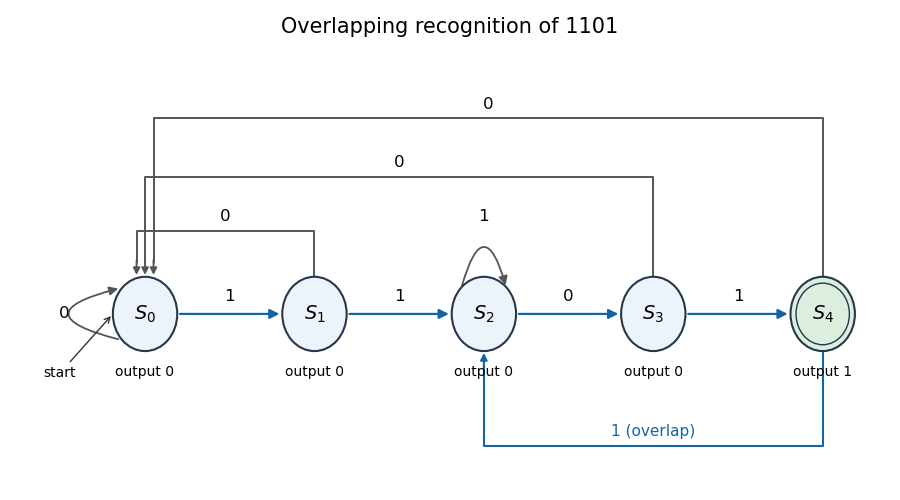

<h1 id="1/a/solution">Solution</h1>

↑ **Parent:** [A](../a.md)

Use a [Moore machine](../../../../../moore-machine.md) whose state records the longest suffix of the received stream that is also a prefix of the target word. The transitions are

$$
\begin{array}{c|cc|c}
\text{state}&x=0&x=1&\text{output}\\\hline
S_0&S_0&S_1&0\\
S_1&S_0&S_2&0\\
S_2&S_3&S_2&0\\
S_3&S_0&S_4&0\\
S_4&S_0&S_2&1
\end{array}.
$$

The last row preserves overlap: after recognition, one more one leaves suffix $11$, giving $S_2$. Initialize to $S_0$ and update the state on each active clock edge; the output after that edge reports whether the word has just ended. This is a [prefix-suffix sequence recognizer](../../../../../prefix-suffix-sequence-recognizer.md).

**[Figure 1](#1/a/image-state-transitions-of-the-overlapping-moore-machine-recognizer). State transitions of the overlapping Moore machine recognizer**. Edge labels are input bits. Only the shaded, double-ring state produces output one.

## ↑ Ancestors (12)

1. [A](../a.md)
2. [1](../../1.md)
3. [Digital systems, linear algebra, introduction to formal proof](../../../digital-systems-linear-algebra-introduction-to-formal-proof-split.md)
4. [2018](../../../split.md)
5. [Past exam of the year 1 of the computer science course of the University of Oxford](../../../../split.md)
6. [Year 1 of the computer science course of the University of Oxford](../../../../../year-1-of-the-computer-science-course-of-the-university-of-oxford.md)
7. [Computer science course of the University of Oxford](../../../../../computer-science-course-of-the-university-of-oxford.md)
8. [Undergraduate course of the University of Oxford](../../../../../undergraduate-course-of-the-university-of-oxford.md)
9. [Course of the University of Oxford](../../../../../course-of-the-university-of-oxford.md)
10. [University of Oxford](../../../../../university-of-oxford-split.md)
11. [List of universities](../../../../../list-of-universities.md)
12. [Codex Wiki](../../../../../split.md)
