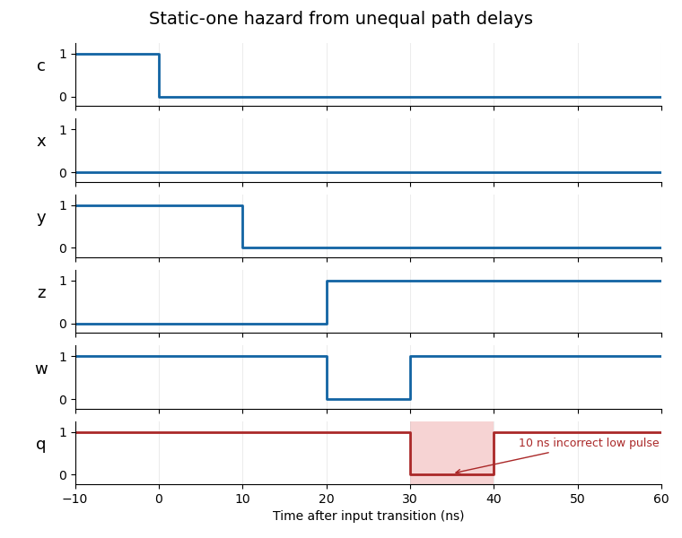

<h1 id="2/a/solution">Solution</h1>

↑ **Parent:** [A](../a.md)

The internal [Boolean functions](../../../../../boolean-function.md) are $x=\bar a\bar c$, $y=bc$, $z=\bar cd$, $w=y+z$ and $q=x+w$. Put the falling edge of $c$ at $t=0$. Since $a=1$ throughout, **$x=0$ throughout**. The remaining transitions, including every stated [propagation delay](../../../../../propagation-delay.md), are

$$
\begin{array}{c|c|c}
\text{signal}&t<0&\text{transition after }t=0\\\hline
y&1&1\to0\text{ at }10\text{ ns}\\
z&0&0\to1\text{ at }20\text{ ns}\\
w&1&1\to0\text{ at }20\text{ ns},\quad0\to1\text{ at }30\text{ ns}\\
q&1&1\to0\text{ at }30\text{ ns},\quad0\to1\text{ at }40\text{ ns}
\end{array}.
$$

The inverter delays the rise of $\bar c$ by ten nanoseconds, and the $z$ AND gate adds another ten. Consequently $y$ and $z$ are simultaneously zero for ten nanoseconds. This gap propagates through the two OR gates. The output has a **static-one [logic hazard](../../../../../hazard-logic.md): a low glitch on $30\leq t<40$ ns**, despite its equal initial and final logical values.

**[Figure 2](#2/a/image-delayed-transitions-produce-a-ten-nanosecond-static-one-logic-hazard). Delayed transitions produce a ten-nanosecond static-one logic hazard**. The shaded interval marks the incorrect output pulse. Exact ten-nanosecond gate delays are used, including propagation of the pulse.

## ↑ Ancestors (12)

1. [A](../a.md)
2. [2](../../2.md)
3. [Digital systems, linear algebra, introduction to formal proof](../../../digital-systems-linear-algebra-introduction-to-formal-proof-split.md)
4. [2018](../../../split.md)
5. [Past exam of the year 1 of the computer science course of the University of Oxford](../../../../split.md)
6. [Year 1 of the computer science course of the University of Oxford](../../../../../year-1-of-the-computer-science-course-of-the-university-of-oxford.md)
7. [Computer science course of the University of Oxford](../../../../../computer-science-course-of-the-university-of-oxford.md)
8. [Undergraduate course of the University of Oxford](../../../../../undergraduate-course-of-the-university-of-oxford.md)
9. [Course of the University of Oxford](../../../../../course-of-the-university-of-oxford.md)
10. [University of Oxford](../../../../../university-of-oxford-split.md)
11. [List of universities](../../../../../list-of-universities.md)
12. [Codex Wiki](../../../../../split.md)
