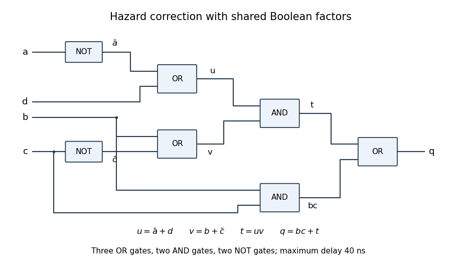

<h1 id="2/c/solution">Solution</h1>

↑ **Parent:** [C](../c.md)

To implement the two additional [prime implicants](../../../../../prime-implicant.md) explicitly, add **two 2-input AND gates and two 2-input OR gates**. Reuse $\bar a$ from the existing inverter. An OR-tree arrangement that keeps the maximum [propagation delay](../../../../../propagation-delay.md) at **40 ns** is

$$
u=bc+bd,\qquad v=\bar a\bar c+\bar ab,\qquad w=u+\bar cd,\qquad q=v+w.
$$

The five product gates feed four OR gates; the original circuit already supplied three of the product gates and two OR gates. From the primary inputs, $bc$ and $bd$ settle by 10 ns, so $u$ settles by 20 ns. The two products in $v$ and the product $\bar cd$ settle by 20 ns, so $v$ and $w$ settle by 30 ns, and $q$ by 40 ns. In particular, **no increase in worst-case delay is necessary**. Merely appending two OR gates to the old output would unnecessarily lengthen some paths.

If arbitrary rewiring and factoring are allowed, an even smaller added-hardware implementation is

$$
u=\bar a+d,\qquad v=b+\bar c,\qquad t=uv,\qquad q=bc+t.
$$

Expanding this expression gives all five terms from part (b). It needs three OR gates, two AND gates and the existing two inverters: add **one OR gate**, reuse two existing AND gates and leave the third unused. Both $u$ and $v$ settle by 20 ns, $t$ by 30 ns and $q$ by 40 ns. During a potentially hazardous change of $c$, the bridging condition $b=u=1$ holds $v=t=1$ regardless of $c$; zero-to-zero cases keep either both $b,u$ zero or all relevant products steadily zero. The factored circuit therefore retains single-input hazard protection. The four-gate count above is the minimum when the two extra product implicants are required as separate AND outputs; factoring changes that implementation constraint.

**[Figure 3](#2/c/image-a-factored-logic-hazard-correction-using-three-or-gates-and-two-and-gates). A factored logic hazard correction using three OR gates and two AND gates**. The extra OR gate and rewiring replace explicit separate consensus-product gates. Labels identify all intermediate signals; the worst-case gate delay remains forty nanoseconds.

## ↑ Ancestors (12)

1. [C](../c.md)
2. [2](../../2.md)
3. [Digital systems, linear algebra, introduction to formal proof](../../../digital-systems-linear-algebra-introduction-to-formal-proof-split.md)
4. [2018](../../../split.md)
5. [Past exam of the year 1 of the computer science course of the University of Oxford](../../../../split.md)
6. [Year 1 of the computer science course of the University of Oxford](../../../../../year-1-of-the-computer-science-course-of-the-university-of-oxford.md)
7. [Computer science course of the University of Oxford](../../../../../computer-science-course-of-the-university-of-oxford.md)
8. [Undergraduate course of the University of Oxford](../../../../../undergraduate-course-of-the-university-of-oxford.md)
9. [Course of the University of Oxford](../../../../../course-of-the-university-of-oxford.md)
10. [University of Oxford](../../../../../university-of-oxford-split.md)
11. [List of universities](../../../../../list-of-universities.md)
12. [Codex Wiki](../../../../../split.md)
