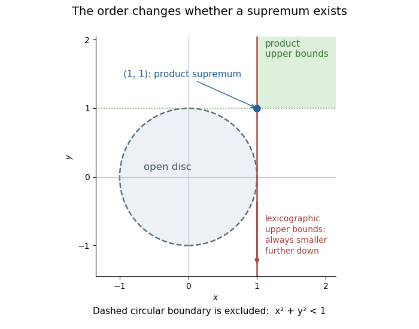

<h1 id="3/d/solution">Solution</h1>

↑ **Parent:** [D](../d.md)

Under the [product order](../../../../../product-order.md), every point of the open [unit disc](../../../../../unit-disc.md) has both coordinates below one, so $(1,1)$ is an [upper bound](../../../../../upper-bound-in-a-partially-ordered-set.md). Any [upper bound](../../../../../upper-bound-in-a-partially-ordered-set.md) $(u,v)$ must have $u\geq1$ and $v\geq1$, since the two coordinate projections of the open [unit disc](../../../../../unit-disc.md) are $(-1,1)$. Therefore $(1,1)\leq_P(u,v)$, proving **$\sup_{\leq_P}S=(1,1)$**.

Under the [lexicographic order](../../../../../lexicographic-order.md), every point $(1,v)$, with arbitrary real $v$, is an [upper bound](../../../../../upper-bound-in-a-partially-ordered-set.md), because every point of $S$ has first coordinate strictly below one. Conversely, an [upper bound](../../../../../upper-bound-in-a-partially-ordered-set.md) cannot have first coordinate $u<1$: a point $(x,0)\in S$ with $x>u$ would exceed it. If an [upper bound](../../../../../upper-bound-in-a-partially-ordered-set.md) has $u>1$, the [upper bound](../../../../../upper-bound-in-a-partially-ordered-set.md) $(1,0)$ is strictly smaller. If it is $(1,v)$, the [upper bound](../../../../../upper-bound-in-a-partially-ordered-set.md) $(1,v-1)$ is strictly smaller. Hence **there is no [least upper bound](../../../../../least-upper-bound-in-a-partially-ordered-set.md) under the [lexicographic order](../../../../../lexicographic-order.md)**. This illustrates the [supremum of an open disc under product and lexicographic orders](../../../../../supremum-of-an-open-disc-under-product-and-lexicographic-orders.md).

**[Figure 1](#3/d/image-the-same-open-unit-disc-has-a-supremum-under-the-product-order-and-none-under-the-lexicographic-order). The same open unit disc has a supremum under the product order and none under the lexicographic order**. The green corner consists of product-order [upper bounds](../../../../../upper-bound-in-a-partially-ordered-set.md). Every point on the red vertical line is a lexicographic [upper bound](../../../../../upper-bound-in-a-partially-ordered-set.md); moving down that line always finds a smaller one.

## ↑ Ancestors (12)

1. [D](../d.md)
2. [3](../../3.md)
3. [Discrete mathematics, continuous mathematics, and probability](../../../discrete-mathematics-continuous-mathematics-and-probability-split.md)
4. [2018](../../../split.md)
5. [Past exam of the year 1 of the computer science course of the University of Oxford](../../../../split.md)
6. [Year 1 of the computer science course of the University of Oxford](../../../../../year-1-of-the-computer-science-course-of-the-university-of-oxford.md)
7. [Computer science course of the University of Oxford](../../../../../computer-science-course-of-the-university-of-oxford.md)
8. [Undergraduate course of the University of Oxford](../../../../../undergraduate-course-of-the-university-of-oxford.md)
9. [Course of the University of Oxford](../../../../../course-of-the-university-of-oxford.md)
10. [University of Oxford](../../../../../university-of-oxford-split.md)
11. [List of universities](../../../../../list-of-universities.md)
12. [Codex Wiki](../../../../../split.md)
