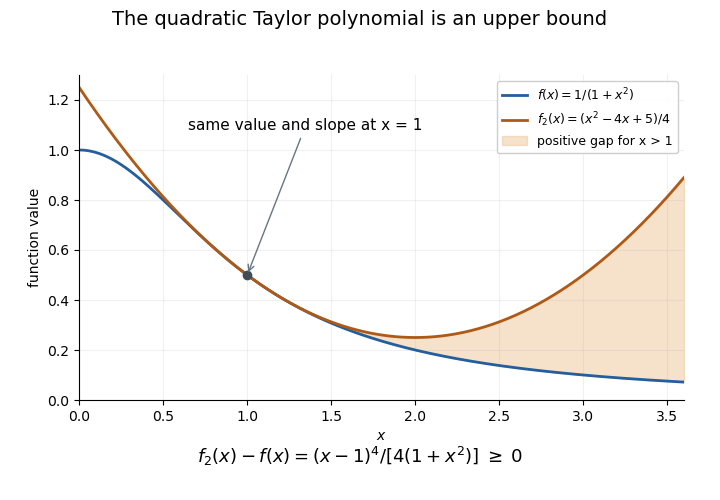

<h1 id="6/d/solution">Solution</h1>

↑ **Parent:** [D](../d.md)

**The printed inequality has its sign reversed: $f(x)<f_2(x)$ for $x>1$.** This is present in the original scan, rather than arising in transcription. For $x>1$, [Taylor's theorem with Lagrange remainder](../../../../../taylor-theorem-with-lagrange-remainder.md) gives

$$
f(x)-f_2(x)=\frac{f'''(\xi)}{3!}(x-1)^3,\qquad1<\xi<x.
$$

Part (a) has $f'''(\xi)<0$, so the remainder is strictly negative. As an independent check, direct algebra gives the [quadratic Taylor majorant of a reciprocal quadratic](../../../../../quadratic-taylor-majorant-of-a-reciprocal-quadratic.md):

$$
\boxed{f_2(x)-f(x)=\frac{(x-1)^4}{4(1+x^2)}>0\quad(x>1).}
$$

For example, $f(2)=1/5<1/4=f_2(2)$ is already a counterexample to the requested direction. The exact identity also shows that this polynomial majorizes $f$ on the entire real line, with equality only at one.

**[Figure 2](#6/d/image-the-quadratic-taylor-polynomial-lies-above-the-reciprocal-quadratic-correcting-the-printed-inequality). The quadratic Taylor polynomial lies above the reciprocal quadratic, correcting the printed inequality**. The shaded gap for $x>1$ is positive and equals $(x-1)^4/(4(1+x^2))$.

## ↑ Ancestors (12)

1. [D](../d.md)
2. [6](../../6.md)
3. [Discrete mathematics, continuous mathematics, and probability](../../../discrete-mathematics-continuous-mathematics-and-probability-split.md)
4. [2018](../../../split.md)
5. [Past exam of the year 1 of the computer science course of the University of Oxford](../../../../split.md)
6. [Year 1 of the computer science course of the University of Oxford](../../../../../year-1-of-the-computer-science-course-of-the-university-of-oxford.md)
7. [Computer science course of the University of Oxford](../../../../../computer-science-course-of-the-university-of-oxford.md)
8. [Undergraduate course of the University of Oxford](../../../../../undergraduate-course-of-the-university-of-oxford.md)
9. [Course of the University of Oxford](../../../../../course-of-the-university-of-oxford.md)
10. [University of Oxford](../../../../../university-of-oxford-split.md)
11. [List of universities](../../../../../list-of-universities.md)
12. [Codex Wiki](../../../../../split.md)
