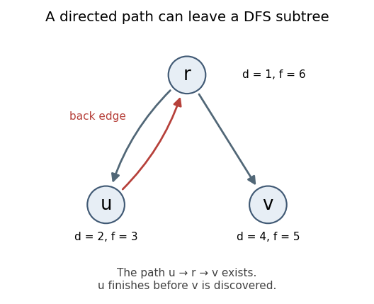

# Functional programming, design and analysis of algorithms

↑ **Parent:** [2018](../2018.md)

This is the 12 June 2018 preliminary examination. Questions 1–4 concern [functional programming](../../programming-language.md#functional-programming); Questions 5–8 concern [algorithm design](../../algorithm.md#algorithm-design) and [analysis of algorithms](../../algorithm.md#analysis-of-algorithms). Every printed option is answered here. The complete nine-page native paper is preserved in the [Oxford examination release](https://www.whatdotheyknow.com/request/past_exam_papers_for_1st_year_of/response/1398416/attach/2/Fakour%20Zip%20Final%201.zip?cookie_passthrough=1), member `a10097w1.pdf`; the damaged duplicate rendition is not the source used here.

The [Haskell](../../programming-language.md#haskell) definitions below use finite total inputs unless [lazy evaluation](../../programming-language.md#lazy-evaluation), [strict functions](../../programming-language.md#strict-function) or infinite [lazy lists](../../data-structure.md#lazy-list) are being discussed. Separate questions use separate namespaces: in particular their `One` constructors are unrelated, and the list-conversion function `abs` in Question 3 is distinct from the numeric [Standard Prelude](../../programming-language.md#standard-prelude) function. Treat alternative definitions of the same function separately. In a module for Question 2, use `import Prelude hiding (zip, zipWith)`; in one for Question 3, use `import Prelude hiding (abs, reverse, (++))`. Other questions retain the [Standard Prelude](../../programming-language.md#standard-prelude) operations they use.[§5.6.2: explicitly hiding redefined Prelude names](../../computer-science-bibliography.md#haskell-2010-language-report) Costs count constructor, comparison and ordinary arithmetic operations; integer bit costs and evaluating arbitrary element values are separate.

**Table of contents**

- [1](#1)
  - [a](#1/a)
    - [Solution](#1/a/solution)
  - [b](#1/b)
    - [Solution](#1/b/solution)
  - [c](#1/c)
    - [Solution](#1/c/solution)
  - [d](#1/d)
    - [Solution](#1/d/solution)
  - [e](#1/e)
    - [Solution](#1/e/solution)
  - [f](#1/f)
    - [Solution](#1/f/solution)
  - [g](#1/g)
    - [Solution](#1/g/solution)
  - [h](#1/h)
    - [Solution](#1/h/solution)
- [2](#2)
  - [a](#2/a)
    - [Solution](#2/a/solution)
  - [b](#2/b)
    - [Solution](#2/b/solution)
  - [c](#2/c)
    - [Solution](#2/c/solution)
  - [d](#2/d)
    - [Solution](#2/d/solution)
  - [e](#2/e)
    - [Solution](#2/e/solution)
  - [f](#2/f)
    - [Solution](#2/f/solution)
  - [g](#2/g)
    - [Solution](#2/g/solution)
  - [h](#2/h)
    - [Solution](#2/h/solution)
- [3](#3)
  - [a](#3/a)
    - [Solution](#3/a/solution)
  - [b](#3/b)
    - [Solution](#3/b/solution)
  - [c](#3/c)
    - [Solution](#3/c/solution)
  - [d](#3/d)
    - [Solution](#3/d/solution)
  - [e](#3/e)
    - [Solution](#3/e/solution)
  - [f](#3/f)
    - [Solution](#3/f/solution)
  - [g](#3/g)
    - [Solution](#3/g/solution)
  - [h](#3/h)
    - [Solution](#3/h/solution)
- [4](#4)
  - [a](#4/a)
    - [Solution](#4/a/solution)
  - [b](#4/b)
    - [Solution](#4/b/solution)
  - [c](#4/c)
    - [Solution](#4/c/solution)
  - [d](#4/d)
    - [Solution](#4/d/solution)
- [5](#5)
  - [a](#5/a)
    - [Solution](#5/a/solution)
  - [b](#5/b)
    - [Solution](#5/b/solution)
  - [c](#5/c)
    - [Solution](#5/c/solution)
  - [d](#5/d)
    - [i](#5/d/i)
      - [Solution](#5/d/i/solution)
    - [ii](#5/d/ii)
      - [Solution](#5/d/ii/solution)
- [6](#6)
  - [a](#6/a)
    - [Solution](#6/a/solution)
  - [b](#6/b)
    - [Solution](#6/b/solution)
  - [c](#6/c)
    - [i](#6/c/i)
      - [Solution](#6/c/i/solution)
    - [ii](#6/c/ii)
      - [Solution](#6/c/ii/solution)
    - [iii](#6/c/iii)
      - [Solution](#6/c/iii/solution)
  - [d](#6/d)
    - [Solution](#6/d/solution)
- [7](#7)
  - [a](#7/a)
    - [Solution](#7/a/solution)
  - [b](#7/b)
    - [i](#7/b/i)
      - [Solution](#7/b/i/solution)
    - [ii](#7/b/ii)
      - [Solution](#7/b/ii/solution)
    - [iii](#7/b/iii)
      - [Solution](#7/b/iii/solution)
    - [iv](#7/b/iv)
      - [Solution](#7/b/iv/solution)
  - [c](#7/c)
    - [i](#7/c/i)
      - [Solution](#7/c/i/solution)
    - [ii](#7/c/ii)
      - [Solution](#7/c/ii/solution)
- [8](#8)
  - [a](#8/a)
    - [i](#8/a/i)
      - [Solution](#8/a/i/solution)
    - [ii](#8/a/ii)
      - [Solution](#8/a/ii/solution)
  - [b](#8/b)
    - [i](#8/b/i)
      - [Solution](#8/b/i/solution)
    - [ii](#8/b/ii)
      - [Solution](#8/b/ii/solution)
  - [c](#8/c)
    - [i](#8/c/i)
      - [Solution](#8/c/i/solution)
    - [ii](#8/c/ii)
      - [Solution](#8/c/ii/solution)

## 1

↑ **Parent:** [Functional programming, design and analysis of algorithms](functional-programming-design-and-analysis-of-algorithms.md)

<h3 id="1/a">a</h3>

↑ **Parent:** [1](#1)

<h4 id="1/a/solution">Solution</h4>

↑ **Parent:** [A](#1/a)

`Tree` is a [type constructor](../../programming-language.md#type-constructor), taking the element [type parameter](../../programming-language.md#type-parameter) `a` to the [algebraic data type](../../programming-language.md#algebraic-data-type) `Tree a`. It is not a value and has no ordinary value-level [function type](../../programming-language.md#function-type); its [kind of a type](../../programming-language.md#kind-type-theory) is `* -> *`. The other names are [data constructors](../../programming-language.md#data-constructor) with [polymorphic](../../programming-language.md#programming-language-polymorphism) [type signatures](../../programming-language.md#type-signature):

```
One :: a -> Tree a
Two :: Tree a -> Tree a -> Tree a
```

`One` constructs a [leaf-labelled binary tree](../../data-structure.md#leaf-labelled-binary-tree) with one leaf; `Two` joins two such [trees](../../tree-graph-theory.md) under a new internal node. Unlike a general [binary tree](../../data-structure.md#binary-tree) representation with empty child slots, this representation has no empty tree.[§4.1.1, kinds; §4.2.1, algebraic datatype declarations](../../computer-science-bibliography.md#haskell-2010-language-report)

<h3 id="1/b">b</h3>

↑ **Parent:** [1](#1)

<h4 id="1/b/solution">Solution</h4>

↑ **Parent:** [B](#1/b)

Count each [data constructor](../../programming-language.md#data-constructor) once, including each `Two`:

```
size :: Tree a -> Int
size (One _)   = 1
size (Two l r) = 1 + size l + size r
```

[Structural induction](../../foundations-of-mathematics.md#structural-induction) verifies the count: a leaf contributes one; an internal node contributes itself and the disjoint occurrences in its two [subtrees](../../data-structure.md#subtree). Fully evaluating the result takes [linear time](../../theoretical-computer-science.md#linear-time) in the number of nodes. This [type signature](../../programming-language.md#type-signature) uses machine `Int` as usual in the examination; `Integer` avoids overflow for arbitrarily large inputs.

<h3 id="1/c">c</h3>

↑ **Parent:** [1](#1)

<h4 id="1/c/solution">Solution</h4>

↑ **Parent:** [C](#1/c)

The natural [tree fold](../../programming-language.md#tree-fold) replaces each [data constructor](../../programming-language.md#data-constructor) by the supplied operation:

```
fold :: (a -> b) -> (b -> b -> b) -> Tree a -> b
fold one two (One x)   = one x
fold one two (Two l r) = two (fold one two l) (fold one two r)
```

Its reconstruction identity is **`fold One Two = id`**. More generally a [function](../../function.md) `h` equals `fold one two` on finite [trees](../../tree-graph-theory.md) exactly when `h (One x) = one x` and `h (Two l r) = two (h l) (h r)`. These equations determine the result by [structural induction](../../foundations-of-mathematics.md#structural-induction), expressing why this is the natural [structural recursion](../../programming-language.md#structural-recursion) for this datatype.

<h3 id="1/d">d</h3>

↑ **Parent:** [1](#1)

<h4 id="1/d/solution">Solution</h4>

↑ **Parent:** [D](#1/d)

Replace the leaf [data constructor](../../programming-language.md#data-constructor) by the constant one and the internal [data constructor](../../programming-language.md#data-constructor) by addition with one extra node:

```
size :: Tree a -> Int
size = fold (const 1) (\m n -> 1 + m + n)
```

The two defining equations of the [tree fold](../../programming-language.md#tree-fold) become exactly the two equations for the recursive node count.

<h3 id="1/e">e</h3>

↑ **Parent:** [1](#1)

<h4 id="1/e/solution">Solution</h4>

↑ **Parent:** [E](#1/e)

Emit the root [subtree](../../data-structure.md#subtree) first, then the occurrences inside its children:

```
subs :: Tree a -> [Tree a]
subs t@(One _)   = [t]
subs t@(Two l r) = t : (subs l ++ subs r)
```

This is a [preorder traversal](../../tree-graph-theory.md#preorder-traversal) of [subtree](../../data-structure.md#subtree) occurrences. Equal-valued occurrences are retained: the answer is a [list](../../data-structure.md#list-abstract-data-type), not a deduplicated [set](../../set.md). Every occurrence is either the root or lies in exactly one child, which proves completeness by [structural induction](../../foundations-of-mathematics.md#structural-induction).

<h3 id="1/f">f</h3>

↑ **Parent:** [1](#1)

<h4 id="1/f/solution">Solution</h4>

↑ **Parent:** [F](#1/f)

The head of each recursively obtained [list](../../data-structure.md#list-abstract-data-type) is the original child. Hence the [tree fold](../../programming-language.md#tree-fold) has retained enough information to reconstruct the parent:

```
subs :: Tree a -> [Tree a]
subs = fold (\x -> [One x]) combine
  where
    combine ls rs = Two (head ls) (head rs) : (ls ++ rs)
```

The invariant is that every folded result is nonempty and begins with the [subtree](../../data-structure.md#subtree) being folded. It holds at `One`; the displayed combining operation preserves it at `Two`. Thus neither use of `head` encounters an empty [list](../../data-structure.md#list-abstract-data-type), and the remaining entries agree with the recursive [preorder traversal](../../tree-graph-theory.md#preorder-traversal).

<h3 id="1/g">g</h3>

↑ **Parent:** [1](#1)

<h4 id="1/g/solution">Solution</h4>

↑ **Parent:** [G](#1/g)

Include each child itself, followed by its proper [subtrees](../../data-structure.md#subtree), while excluding the current root:

```
proper :: Tree a -> [Tree a]
proper (One _)   = []
proper (Two l r) = (l : proper l) ++ (r : proper r)
```

Again, occurrences matter: a child with the same value as another child is not removed. The definition is a [structural recursion](../../programming-language.md#structural-recursion), but its right-hand side uses the original children as well as their recursively computed results.

<h3 id="1/h">h</h3>

↑ **Parent:** [1](#1)

<h4 id="1/h/solution">Solution</h4>

↑ **Parent:** [H](#1/h)

Suppose that a direct [tree fold](../../programming-language.md#tree-fold) with result type `[Tree a]` implements `proper`, so `proper = fold one two`. Every leaf has result `[]`, hence `one x = []` for every label `x`. Consequently `proper (Two (One x) (One y))` would always equal `two [] []`, independently of either label. Taking labels from `Bool`, the inputs `Two (One False) (One False)` and `Two (One True) (One False)` would therefore have equal results. Their correct results are `[One False, One False]` and `[One True, One False]`, which differ. This is a contradiction.

**There is no direct fold with only the proper-subtree list as its recursive summary.** This is the [direct tree-fold information obstruction](../../programming-language.md#direct-tree-fold-information-obstruction): replacing both children by equal summaries prevents the parent operation from recovering their different labels. The claim must not be extended to every expression containing a [tree fold](../../programming-language.md#tree-fold). A fold retaining the original tree alongside its proper-subtree list, followed by projection, does work; alternatively `tail . subs` uses the richer fold from part (f).

## 2

↑ **Parent:** [Functional programming, design and analysis of algorithms](functional-programming-design-and-analysis-of-algorithms.md)

<h3 id="2/a">a</h3>

↑ **Parent:** [2](#2)

<h4 id="2/a/solution">Solution</h4>

↑ **Parent:** [A](#2/a)

Use the usual left-to-right [pattern matching](../../programming-language.md#pattern-matching) order:

```
zip :: [a] -> [b] -> [(a,b)]
zip []     _      = []
zip _      []     = []
zip (x:xs) (y:ys) = (x,y) : zip xs ys
```

The result stops when either [list](../../data-structure.md#list-abstract-data-type) ends, so its length on finite total inputs is the smaller input length. Elements remaining in the longer [list](../../data-structure.md#list-abstract-data-type) are discarded.

Strictness is asymmetric. Writing the [bottom value](../../programming-language.md#bottom-value) as $\bot$, **`zip` is strict in its first list but not uniformly strict in its second**: `zip undefined ys` is undefined, whereas `zip [] undefined = []`. With a nonempty first [list](../../data-structure.md#list-abstract-data-type), an undefined second [list](../../data-structure.md#list-abstract-data-type) does make the result undefined. Neither pair component is forced merely to produce the outer result constructor: `zip [undefined] [undefined]` already has a defined outer cons and pair. This follows from ordered [pattern matching](../../programming-language.md#pattern-matching) and [lazy evaluation](../../programming-language.md#lazy-evaluation), not from the behavior on total [lists](../../data-structure.md#list-abstract-data-type) alone.[§3.17.2, ordered pattern matching; Chapter 9, zip in the Standard Prelude](../../computer-science-bibliography.md#haskell-2010-language-report)

<h3 id="2/b">b</h3>

↑ **Parent:** [2](#2)

<h4 id="2/b/solution">Solution</h4>

↑ **Parent:** [B](#2/b)

Apply the supplied [function](../../function.md) to corresponding elements while preserving the stopping rule:

```
zipWith :: (a -> b -> c) -> [a] -> [b] -> [c]
zipWith f []     _      = []
zipWith f _      []     = []
zipWith f (x:xs) (y:ys) = f x y : zipWith f xs ys
```

Because of [lazy evaluation](../../programming-language.md#lazy-evaluation), constructing a result cons does not by itself evaluate `f x y`.

<h3 id="2/c">c</h3>

↑ **Parent:** [2](#2)

<h4 id="2/c/solution">Solution</h4>

↑ **Parent:** [C](#2/c)

The two required equations are

```
zipWith f xs ys = map (uncurry f) (zip xs ys)
zip xs ys       = zipWith (,) xs ys
```

Either equation defines one operation from an independently defined other operation. They do **not** together supply an effective recursive definition of the intended operations. Substitution makes the first output constructor depend on itself without first emitting anything, so the mutually recursive program has the [bottom value](../../programming-language.md#bottom-value) as its least solution. At the level of equations they also fail to characterize the intended operations uniquely: returning `[]` for every call of either operation satisfies both equations, as does the intended [list zip](../../data-structure.md#list-zip). A constructor-producing base/step definition is essential for [productivity](../../data-structure.md#stream-productivity).

<h3 id="2/d">d</h3>

↑ **Parent:** [2](#2)

<h4 id="2/d/solution">Solution</h4>

↑ **Parent:** [D](#2/d)

Use infinite coefficient [lazy lists](../../data-structure.md#lazy-list):

```
zero, one :: Num a => [a]
zero = 0 : zero
one  = 1 : zero
```

For ordinary numeric coefficients such as `Rational`, **`zero == zero` does not terminate**, while **`zero == one` is `False`**. The former comparison never finds a differing coefficient or reaches two empty [lists](../../data-structure.md#list-abstract-data-type); the latter rejects the unequal first coefficients immediately. Equality of denoted [formal power series](../../commutative-algebra.md#formal-power-series) is mathematical equality of all coefficients, whereas this executable [list](../../data-structure.md#list-abstract-data-type) comparison is a potentially nonterminating procedure.

<h3 id="2/e">e</h3>

↑ **Parent:** [2](#2)

<h4 id="2/e/solution">Solution</h4>

↑ **Parent:** [E](#2/e)

Addition and subtraction of [formal power series](../../commutative-algebra.md#formal-power-series) are coefficientwise:

```
plus, minus :: Num a => [a] -> [a] -> [a]
plus  = zipWith (+)
minus = zipWith (-)
```

Here every valid input is an infinite coefficient [list](../../data-structure.md#list-abstract-data-type). If finite polynomial coefficient [lists](../../data-structure.md#list-abstract-data-type) were admitted, they would need zero-padding before these definitions: ordinary [list zip](../../data-structure.md#list-zip) otherwise truncates to the shorter length.

<h3 id="2/f">f</h3>

↑ **Parent:** [2](#2)

<h4 id="2/f/solution">Solution</h4>

↑ **Parent:** [F](#2/f)

The coefficient index supplies the multiplier for a [formal derivative](../../galois-theory.md#formal-derivative) and the divisor for a zero-constant [formal integral](../../commutative-algebra.md#formal-integral):

```
deriv :: Num a => [a] -> [a]
deriv as = zipWith (*) (map fromInteger [1..]) (tail as)

integral :: Fractional a => [a] -> [a]
integral as = 0 : zipWith (/) as (map fromInteger [1..])
```

Using `fromInteger` makes the index stream unbounded before conversion to the coefficient type. The [formal derivative](../../galois-theory.md#formal-derivative) drops the original constant coefficient; the [formal integral](../../commutative-algebra.md#formal-integral) prepends its chosen zero constant. With exact `Rational` coefficients these are exact algebraic operations. Analytic [convergence](../../calculus.md#convergence) is unnecessary for operations on [formal power series](../../commutative-algebra.md#formal-power-series) over a characteristic-zero field.

<h3 id="2/g">g</h3>

↑ **Parent:** [2](#2)

<h4 id="2/g/solution">Solution</h4>

↑ **Parent:** [G](#2/g)

The derivative fixed-point equation is unsuitable as an executable definition: requesting its first coefficient asks for the second coefficient of the same stream, then the third, indefinitely. It is not [productive](../../data-structure.md#stream-productivity). As an algebraic equation it is also missing the constant coefficient: every scalar multiple of the [formal power series exponential](../../commutative-algebra.md#formal-power-series-exponential), including zero, satisfies it.

The integral equation gives the useful definition:

```
expx :: Fractional a => [a]
expx = plus one (integral expx)
```

The initial coefficient is available as `1 + 0`; each subsequent coefficient needs only a previously determined coefficient. The [recurrence relation](../../sequence-and-series.md#recurrence-relation) is $a_0=1$ and $a_{n+1}=a_n/(n+1)$, so **$a_n=1/n!$**. This proves both uniqueness of the formal solution and [productivity](../../data-structure.md#stream-productivity) of every finite coefficient [list prefix](../../data-structure.md#prefix-of-a-list).

<h3 id="2/h">h</h3>

↑ **Parent:** [2](#2)

<h4 id="2/h/solution">Solution</h4>

↑ **Parent:** [H](#2/h)

The derivative relations and initial values give $S'=C$, $S(0)=0$, $C'=-S$ and $C(0)=1$. Integrating from zero yields $S=\int_0^x C$ and $C=1-\int_0^x S$. Thus use mutually recursive [lazy lists](../../data-structure.md#lazy-list):

```
sinx, cosx :: Fractional a => [a]
sinx = integral cosx
cosx = minus one (integral sinx)
```

Both heads are available immediately, and later coefficients depend on earlier coefficients of the other stream. The resulting [formal power series](../../commutative-algebra.md#formal-power-series) are **$S=x-x^3/3!+x^5/5!-\cdots$** and **$C=1-x^2/2!+x^4/4!-\cdots$**. Their zero coefficients and alternating signs follow directly from the coupled [recurrence relations](../../sequence-and-series.md#recurrence-relation), providing a coefficientwise proof without assumptions about analytic [convergence](../../calculus.md#convergence).

## 3

↑ **Parent:** [Functional programming, design and analysis of algorithms](functional-programming-design-and-analysis-of-algorithms.md)

<h3 id="3/a">a</h3>

↑ **Parent:** [3](#3)

<h4 id="3/a/solution">Solution</h4>

↑ **Parent:** [A](#3/a)

[List concatenation](../../data-structure.md#list-concatenation) copies the spine of its first operand and shares the second:

```
(++) :: [a] -> [a] -> [a]
[]     ++ ys = ys
(x:xs) ++ ys = x : (xs ++ ys)
```

For finite first-operand length $m$, fully producing the copied spine costs **$\Theta(m+1)$**, independently of the second-operand length. With [lazy evaluation](../../programming-language.md#lazy-evaluation), requesting only the first few result constructors can cost less; the bound concerns the complete concatenation spine, without forcing its element values or traversing the already existing second operand.

<h3 id="3/b">b</h3>

↑ **Parent:** [3](#3)

<h4 id="3/b/solution">Solution</h4>

↑ **Parent:** [B](#3/b)

For input length $n$, the successive [list concatenations](../../data-structure.md#list-concatenation) copy prefixes of lengths $0,1,\ldots,n-1$. Thus $T(n)=T(n-1)+\Theta(n)$ and $T(n)=\Theta(1+\sum_{j=0}^{n-1}(j+1))$. **The direct implementation takes $\Theta(n^2)$ time** for a fully produced nonempty reversal. The repeated copying, rather than the number of recursive calls alone, causes the quadratic cost.

<h3 id="3/c">c</h3>

↑ **Parent:** [3](#3)

<h4 id="3/c/solution">Solution</h4>

↑ **Parent:** [C](#3/c)

Three distinct [concatenation tree](../../data-structure.md#concatenation-tree) representations of the empty [list](../../data-structure.md#list-abstract-data-type) are `Nil`, `Cat Nil Nil`, and `Cat (Cat Nil Nil) Nil`. For the singleton `[x]`, use `One x`, `Cat Nil (One x)`, and `Cat (One x) Nil`.

An empty branch changes the [data structure](../../data-structure.md) without changing its denoted [list](../../data-structure.md#list-abstract-data-type). Repeating this padding gives arbitrarily many representations of the same [list](../../data-structure.md#list-abstract-data-type); there is no uniqueness invariant in the stated datatype.

<h3 id="3/d">d</h3>

↑ **Parent:** [3](#3)

<h4 id="3/d/solution">Solution</h4>

↑ **Parent:** [D](#3/d)

One simple right-associated representation is

```
rep :: [a] -> CatList a
rep []     = Nil
rep (x:xs) = Cat (One x) (rep xs)
```

It constructs two [data constructors](../../programming-language.md#data-constructor) per input element and one final `Nil`, so full construction takes **$\Theta(n+1)$ time** and produces $2n+1$ constructors. [Structural induction](../../foundations-of-mathematics.md#structural-induction) shows that its denotation is the original [list](../../data-structure.md#list-abstract-data-type).

<h3 id="3/e">e</h3>

↑ **Parent:** [3](#3)

<h4 id="3/e/solution">Solution</h4>

↑ **Parent:** [E](#3/e)

Carry the eventual output tail as an accumulator, thereby avoiding repeated [list concatenation](../../data-structure.md#list-concatenation):

```
abs :: CatList a -> [a]
abs t = flatten t []
  where
    flatten Nil       zs = zs
    flatten (One x)   zs = x : zs
    flatten (Cat l r) zs = flatten l (flatten r zs)
```

The invariant is `flatten t zs = denotation t ++ zs`. It is immediate for `Nil` and `One`; at `Cat`, applying the two induction hypotheses and [associativity](../../algebraic-operation.md#associative-property) of [list concatenation](../../data-structure.md#list-concatenation) proves it. In particular, the empty accumulator gives the required abstraction.

Each [concatenation tree](../../data-structure.md#concatenation-tree) constructor is processed once, and each `One` emits one result cons. Consequently full production takes **$\Theta(m)$ time**, where $m$ is the input constructor count, on every tree shape. This is a [difference list](../../data-structure.md#difference-list) calculation written with an explicit tail, an instance of [linear flattening of a binary tree](../../data-structure.md#linear-flattening-of-a-binary-tree). The [call stack](../../data-structure.md#call-stack) can have depth $m$ for a badly skewed input; a linear time bound does not imply logarithmic stack space.

<h3 id="3/f">f</h3>

↑ **Parent:** [3](#3)

<h4 id="3/f/solution">Solution</h4>

↑ **Parent:** [F](#3/f)

A [concatenation tree](../../data-structure.md#concatenation-tree) may contain arbitrarily many `Cat` and `Nil` nodes while denoting an empty or singleton [list](../../data-structure.md#list-abstract-data-type). For example, repeatedly wrap `One x` as `Cat Nil previous`. The output length stays one while the input size grows without bound. An arbitrary leaf could hide another `One`, so a correct general conversion cannot disregard unexamined branches. **Output length alone therefore cannot bound the work; input size must be included.**

<h3 id="3/g">g</h3>

↑ **Parent:** [3](#3)

<h4 id="3/g/solution">Solution</h4>

↑ **Parent:** [G](#3/g)

Reverse the children and recursively reverse each child:

```
rev :: CatList a -> CatList a
rev Nil       = Nil
rev (One x)   = One x
rev (Cat l r) = Cat (rev r) (rev l)
```

The proof uses $\operatorname{reverse}(xs\mathbin{++}ys)=\operatorname{reverse}(ys)\mathbin{++}\operatorname{reverse}(xs)$ and [structural induction](../../foundations-of-mathematics.md#structural-induction). The complete representation is processed and reconstructed in **$\Theta(m)$ time**. This is worst-case optimal for fully processing arbitrary explicit input representations with $m$ constructors; the datatype allows output information to be hidden at any leaf. [Lazy evaluation](../../programming-language.md#lazy-evaluation) can expose only an initial part of a result sooner, and this statement does not assert that every partial observation costs $m$.

<h3 id="3/h">h</h3>

↑ **Parent:** [3](#3)

<h4 id="3/h/solution">Solution</h4>

↑ **Parent:** [H](#3/h)

Compose the three [functions](../../function.md):

```
reverse :: [a] -> [a]
reverse = abs . rev . rep
```

The representation built by `rep` has $2n+1$ constructors. `rev` preserves that count, and `abs` traverses it once. Their three linear bounds add to **$\Theta(n+1)$ total time**, improving the direct quadratic reversal. The correctness equations for representation, reversal and abstraction compose to the required reversed [list](../../data-structure.md#list-abstract-data-type).

## 4

↑ **Parent:** [Functional programming, design and analysis of algorithms](functional-programming-design-and-analysis-of-algorithms.md)

<h3 id="4/a">a</h3>

↑ **Parent:** [4](#4)

<h4 id="4/a/solution">Solution</h4>

↑ **Parent:** [A](#4/a)

Use a [type synonym](../../programming-language.md#type-synonym) for names and an [algebraic data type](../../programming-language.md#algebraic-data-type) with the two teams and their goals in the given positional order:

```
type Team = String
data Match = Match Team Int Team Int
```

`Team` is a synonym, not a new runtime wrapper. `Match` on the left is the [type constructor](../../programming-language.md#type-constructor), while the same spelling on the right is a [data constructor](../../programming-language.md#data-constructor) in a different namespace. Its value-level [type signature](../../programming-language.md#type-signature) is `Match :: Team -> Int -> Team -> Int -> Match`.

<h3 id="4/b">b</h3>

↑ **Parent:** [4](#4)

<h4 id="4/b/solution">Solution</h4>

↑ **Parent:** [B](#4/b)

Flatten the days, emit both participants of every match and remove repeated names:

```
teams :: [[Match]] -> [Team]
teams days = unique [t | Match a _ b _ <- concat days, t <- [a,b]]
  where
    unique []     = []
    unique (t:ts) = t : unique (filter (/= t) ts)
```

Every emitted name belongs to some match, and every participating team enters the intermediate [list](../../data-structure.md#list-abstract-data-type). At each recursive step, `unique` emits its first remaining name once and deletes precisely its later occurrences. [Induction](../../foundations-of-mathematics.md#mathematical-induction) therefore proves both coverage and absence of duplicates. The output preserves first appearance; no particular team ordering was required. This simple [list](../../data-structure.md#list-abstract-data-type) implementation can take quadratic time in the number of participant occurrences, which is permissible here; the question imposes no efficiency target.

<h3 id="4/c">c</h3>

↑ **Parent:** [4](#4)

<h4 id="4/c/solution">Solution</h4>

↑ **Parent:** [C](#4/c)

Choose each team once using `teams`, then scan every match with that team as the reference perspective:

```
data Results = Results Team [(Int,Int)]

extract :: [[Match]] -> [Results]
extract days = [Results t (scores t) | t <- teams days]
  where
    games = concat days
    scores t = concatMap (contribution t) games
    contribution t (Match a ga b gb)
      | t == a    = [(ga,gb)]
      | t == b    = [(gb,ga)]
      | otherwise = []
```

In a valid match the teams are distinct. The first guard records the first team's goals-for and goals-against; the second reverses that perspective for the opponent. The common `games` binding preserves day/match order, although the result does not need a chronological ordering condition. Each team receives exactly one record because `teams` has no duplicates. The algorithm makes one scan per team; it deliberately prioritizes a transparent [functional programming](../../programming-language.md#functional-programming) definition over an unrequested performance improvement.

<h3 id="4/d">d</h3>

↑ **Parent:** [4](#4)

<h4 id="4/d/solution">Solution</h4>

↑ **Parent:** [D](#4/d)

Represent the ranking criteria by a [tuple](../../set-theory.md#finite-tuple) in decreasing priority:

```
type Weight = (Int,Int,Int)

weight :: Results -> Weight
weight (Results _ scores) =
  (sum (map points scores),
   sum [gf - ga | (gf,ga) <- scores],
   sum (map fst scores))
  where
    points (gf,ga)
      | gf > ga   = 3
      | gf == ga  = 1
      | otherwise = 0
```

The components are **total points, total goal difference and total goals scored**. The [Haskell Ord class](../../programming-language.md#haskell-ord-class) compares [tuples](../../set-theory.md#finite-tuple) in [lexicographic order](../../extremal-set-theory.md#lexicographic-order), so a greater first component dominates all later components; only ties reach the next criterion. Exactly equal triples remain tied because no further ranking criterion was specified. In the supplied fixture data the descending triples are $(6,13,15)$, $(4,3,5)$, $(3,0,3)$, $(1,0,0)$, $(1,-3,4)$, $(1,-3,0)$ and $(0,-10,0)$, respectively for United, Athletic, City, Albion, Rovers, Corinthians and Thistle.

## 5

↑ **Parent:** [Functional programming, design and analysis of algorithms](functional-programming-design-and-analysis-of-algorithms.md)

<h3 id="5/a">a</h3>

↑ **Parent:** [5](#5)

<h4 id="5/a/solution">Solution</h4>

↑ **Parent:** [A](#5/a)

[Merge sort](../../algorithm.md#merge-sort) splits the [array](../../data-structure.md#array-data-structure) into two halves, recursively sorts both and merges their sorted outputs. During the [merge algorithm](../../algorithm.md#merge-algorithm), compare the first unconsumed entry of each half, emit the smaller and advance that half; append the remainder when one half ends. The emitted prefix is always sorted and contains exactly the already consumed entries, proving the merge step correct. [Induction](../../foundations-of-mathematics.md#mathematical-induction) on input length proves the full [sorting algorithm](../../algorithm.md#sorting-algorithm) correct.

The [recurrence relation](../../sequence-and-series.md#recurrence-relation) is $T(n)=2T(n/2)+\Theta(n)$ for powers of two, with constant base cost. In the [Master theorem](../../sequence-and-series.md#master-theorem), $a=b=2$ and $n^{\log_b a}=n$, matching the merge term. Hence **$T(n)=\Theta(n\log n)$**. Floor/ceiling splits give the same bound for arbitrary $n$; conventional merging uses $O(n)$ auxiliary space.

<h3 id="5/b">b</h3>

↑ **Parent:** [5](#5)

<h4 id="5/b/solution">Solution</h4>

↑ **Parent:** [B](#5/b)

On a worst-case branch, the described sequential quarter-point tests make three equality tests per reduction, giving $Q(n)=Q(n/4)+3$ until constant size. Thus $Q(4^k)=3k+O(1)$. Ordinary [binary search](../../algorithm.md#binary-search) makes one equality test per halving: $B(n)=B(n/2)+1$, so $B(4^k)=2k+O(1)$.

**Both searches take $\Theta(\log n)$ time, but the specified quaternary search uses asymptotically $3/2$ as many equality tests.** A quarter-sized branch does not compensate for the three sequential pivots. The numerical ratio concerns precisely the unit equality-test model in the paper; counting ordering comparisons, array accesses or a differently arranged pivot decision tree requires its own constants.

<h3 id="5/c">c</h3>

↑ **Parent:** [5](#5)

<h4 id="5/c/solution">Solution</h4>

↑ **Parent:** [C](#5/c)

Sort records `(value,original_index)` by value using [merge sort](../../algorithm.md#merge-sort). For each record with value $a$, run [binary search](../../algorithm.md#binary-search) for value $2a$ among the sorted records; return the two retained original indices at the first match, otherwise return `nil` after all records.

If a valid pair exists, its smaller entry is inspected and the matching doubled entry is found by [binary search](../../algorithm.md#binary-search). Conversely every returned pair satisfies the requested equality. Positivity gives $2a>a$, so the returned entries are distinct even if other entries repeat. Sorting costs $O(n\log n)$, and at most $n$ [binary searches](../../algorithm.md#binary-search) cost $O(n\log n)$ altogether. **Total time is $O(n\log n)$**, using the paper's unit-cost arithmetic model; doubling large machine integers would require overflow-safe arithmetic.

<h3 id="5/d">d</h3>

↑ **Parent:** [5](#5)

<h4 id="5/d/i">i</h4>

↑ **Parent:** [D](#5/d)

<h5 id="5/d/i/solution">Solution</h5>

↑ **Parent:** [I](#5/d/i)

Keep each weight attached to its value while sorting, then return the first cumulative weight reaching one half:

```
weightedMedian(A, weights):
    R = records (A[i], weights[i], i), sorted by first component
    cumulative = 0
    for (value, weight, original_index) in R:
        cumulative = cumulative + weight
        if cumulative >= 1/2:
            return original_index
```

All weights are positive, so the cumulative weights strictly increase. At the returned entry the mass strictly to its left is below one half, while the mass strictly to its right is at most one half. This is the **[lower weighted median](../../probability-distribution.md#lower-weighted-median)**, including the exact equality case: stop at the earlier value whose cumulative mass is exactly one half. Sorting takes $O(n\log n)$ and the scan takes $O(n)$, giving **$O(n\log n)$ time**.

<h4 id="5/d/ii">ii</h4>

↑ **Parent:** [D](#5/d)

<h5 id="5/d/ii/solution">Solution</h5>

↑ **Parent:** [Ii](#5/d/ii)

Maintain a residual cumulative-weight target $t$, initially $1/2$, while discarding whole partitions. Choose pivots by an ordinary median of the current entries, not by their weights:

```
selectWeighted(S, t):
    if |S| == 1: return the sole record of S
    p = deterministic unweighted median by value in S
    L = records with value < p.value
    R = records with value > p.value
    ell = sum of weights in L
    if t <= ell:
        return selectWeighted(L, t)
    if t <= ell + p.weight:
        return p
    return selectWeighted(R, t - ell - p.weight)

answer = selectWeighted(all records, 1/2)
```

The invariant is $0<t\leq\sum_{x\in S}w_x$, with the desired answer the first cumulative weight reaching $t$ inside the current ordered subset. The first branch uses `<=`, which is essential: if the target equals the total left mass, the answer is the largest appropriate left-side value, not the pivot. The other branches preserve the residual target by subtracting exactly the mass discarded on the left.

A [median of medians](../../algorithm.md#median-of-medians) routine finds the exact unweighted median in deterministic [linear time](../../theoretical-computer-science.md#linear-time). Partitioning and summing also take [linear time](../../theoretical-computer-science.md#linear-time), and each recursive call retains at most $\lfloor |S|/2\rfloor$ entries. Therefore $T(n)\leq T(\lceil n/2\rceil)+O(n)=O(n)$. **The algorithm is worst-case linear**, not merely expected linear under a random pivot. Exact comparisons to the weight threshold are assumed; floating-point rounding at exactly one half would need explicit treatment.

## 6

↑ **Parent:** [Functional programming, design and analysis of algorithms](functional-programming-design-and-analysis-of-algorithms.md)

<h3 id="6/a">a</h3>

↑ **Parent:** [6](#6)

<h4 id="6/a/solution">Solution</h4>

↑ **Parent:** [A](#6/a)

There are three useful distinctions between [dynamic programming](../../mathematical-optimization.md#dynamic-programming) and a conventional [divide-and-conquer algorithm](../../algorithm.md#divide-and-conquer-algorithm).

- A [divide-and-conquer algorithm](../../algorithm.md#divide-and-conquer-algorithm) typically splits one instance into mostly separate smaller instances; [dynamic programming](../../mathematical-optimization.md#dynamic-programming) deliberately recognizes overlapping subproblems that recur along different decision histories.
- A [dynamic programming state](../../mathematical-optimization.md#dynamic-programming-state) is solved once and its result reused through a table or [memoization](../../algorithm.md#memoization). A direct [divide-and-conquer algorithm](../../algorithm.md#divide-and-conquer-algorithm) normally combines the results of its recursive children without retaining a table indexed by all repeated states.
- The dependency structure of a direct recursive decomposition is a [recursion tree](../../algorithm.md#recursion-tree); [dynamic programming](../../mathematical-optimization.md#dynamic-programming) evaluates a [Directed acyclic graph](../../combinatorics.md#directed-acyclic-graph) of states in dependency order, either bottom-up or by [memoization](../../algorithm.md#memoization). Its cost is the number of distinct states times the work per state, rather than the number of occurrences in the expanded [recursion tree](../../algorithm.md#recursion-tree).

These are paradigm-level distinctions, not mutually exclusive definitions: a recursive algorithm can use [memoization](../../algorithm.md#memoization), and [dynamic programming](../../mathematical-optimization.md#dynamic-programming) need not be implemented iteratively. For optimization, the [dynamic programming state](../../mathematical-optimization.md#dynamic-programming-state) and [optimal substructure](../../mathematical-optimization.md#optimal-substructure) justify combining stored optimum values; storing repeated work alone does not prove the state is sufficient.

<h3 id="6/b">b</h3>

↑ **Parent:** [6](#6)

<h4 id="6/b/solution">Solution</h4>

↑ **Parent:** [B](#6/b)

For the [unbounded knapsack problem](../../mathematical-optimization.md#unbounded-knapsack-problem), let $F(c)$ be the greatest total value obtainable with weight at most capacity $c$. Assume positive integer item weights and nonnegative integer capacity $W$. Set $F(0)=0$, and fill increasing capacities using

$$
F(c)=\max\bigl(\{0\}\cup\{v_i+F(c-w_i):w_i\leq c\}\bigr).
$$

The zero alternative permits unused capacity. If a nonempty optimum includes item $i$, removing one copy leaves a feasible smaller-capacity instance; its remaining value cannot exceed $F(c-w_i)$. Conversely every candidate in the displayed maximum is feasible, proving equality. The smaller-capacity state allows the same type again, implementing repetition.

The answer is **$F(W)$, computed in $O(nW)$ time and $O(W)$ space**. Record an attaining item at each state to reconstruct the multiset. This is [pseudopolynomial time](../../theoretical-computer-science.md#pseudopolynomial-time), because $W$ is a number whose binary representation may have only $O(\log W)$ bits. A positive-value zero-weight type would make the optimum unbounded and must be excluded or detected separately.

<h3 id="6/c">c</h3>

↑ **Parent:** [6](#6)

<h4 id="6/c/i">i</h4>

↑ **Parent:** [C](#6/c)

<h5 id="6/c/i/solution">Solution</h5>

↑ **Parent:** [I](#6/c/i)

Use a Boolean [dynamic programming state](../../mathematical-optimization.md#dynamic-programming-state) $R(a)$ for whether amount $a$ can be made exactly. Initialize $R(0)=\mathrm{True}$ and, for $a=1,\ldots,v$, compute

$$
R(a)=\bigvee_{i:v_i\leq a} R(a-v_i).
$$

An empty disjunction is false. Any nonempty representation ends in some coin; removing it gives one of the displayed predecessor states, and adding it back proves the converse. **Return $R(v)$**. This takes $O(nv)$ time and $O(v)$ space for positive integer denominations and nonnegative integer target $v$, with unlimited coins of each type.

<h4 id="6/c/ii">ii</h4>

↑ **Parent:** [C](#6/c)

<h5 id="6/c/ii/solution">Solution</h5>

↑ **Parent:** [Ii](#6/c/ii)

For the [minimum coin change recurrence](../../mathematical-optimization.md#minimum-coin-change-recurrence), initialize $C(0)=0$ and use

$$
C(a)=1+\min_{i:v_i\leq a} C(a-v_i),
$$

where the minimum over no feasible predecessor is $\infty$ and $1+\infty=\infty$. Removing the last coin of an optimal representation proves the lower bound; appending the corresponding coin to an optimal predecessor proves attainability. **$C(v)$ is the minimum number of coins**, obtained in $O(nv)$ time and $O(v)$ space. Store one minimizing coin per amount if the actual coins are wanted.

<h4 id="6/c/iii">iii</h4>

↑ **Parent:** [C](#6/c)

<h5 id="6/c/iii/solution">Solution</h5>

↑ **Parent:** [Iii](#6/c/iii)

For $c\geq2$, use largest-denomination-first [greedy algorithm](../../algorithm.md#greedy-algorithm) steps: for $i=n,n-1,\ldots,1$, take $q_i=\lfloor r/c^i\rfloor$ coins and replace the residual amount $r$ by $r-q_ic^i$. A target is representable exactly when it is divisible by $c$, because the smallest denomination is $c$, not one.

To prove optimality whenever the target is representable, observe that an optimum can have fewer than $c$ coins of every denomination $c^i$ with $i<n$: replacing $c$ such coins by one $c^{i+1}$ coin preserves value and reduces the count by $c-1$. After all such carrying, the coefficients of $c,c^2,\ldots,c^{n-1}$ are the unique base-$c$ digits of $v/c$, while the coefficient of $c^n$ is the remaining quotient. Largest-first division produces exactly these coefficients. **The greedy coin count is optimal**, and can be computed with $O(n)$ quotient/remainder operations without listing every coin.

For $c=1$, distinct denominations permit only $n=1$; then all coins have value one and the answer is $v$. This handles the printed positive-integer condition without silently assuming $c>1$.

<h3 id="6/d">d</h3>

↑ **Parent:** [6](#6)

<h4 id="6/d/solution">Solution</h4>

↑ **Parent:** [D](#6/d)

Each physical item may enter neither knapsack or exactly one of them. Let $F_i(a,b)$ be the largest combined value using the first $i$ items with remaining capacity limits $a,b$. Initialize $F_0(a,b)=0$ and compute

$$
F_i(a,b)=\max\begin{cases}
F_{i-1}(a,b),\\
v_i+F_{i-1}(a-w_i,b)&\text{if }w_i\leq a,\\
v_i+F_{i-1}(a,b-w_i)&\text{if }w_i\leq b.
\end{cases}
$$

An infeasible alternative is omitted. The three alternatives classify the placement of item $i$ exhaustively. Every reference uses row $i-1$, ensuring that no item is placed in both knapsacks. Removing item $i$ from an optimum and applying [optimal substructure](../../mathematical-optimization.md#optimal-substructure) proves the [recurrence relation](../../sequence-and-series.md#recurrence-relation).

**The optimum is $F_n(W_1,W_2)$**, with time $O(n(W_1+1)(W_2+1))$, conventionally $O(nW_1W_2)$ for positive capacities. Two successive layers require $O((W_1+1)(W_2+1))$ space; keep predecessor decisions or recompute them if the actual allocations are wanted. The stipulated uniqueness of values and weights is unnecessary for correctness. The capacity-indexed algorithm is [pseudopolynomial](../../theoretical-computer-science.md#pseudopolynomial-time).

## 7

↑ **Parent:** [Functional programming, design and analysis of algorithms](functional-programming-design-and-analysis-of-algorithms.md)

The source explicitly labels this question “Corrected”; that label does not imply that the four assertions in part (b) are true.

<h3 id="7/a">a</h3>

↑ **Parent:** [7](#7)

<h4 id="7/a/solution">Solution</h4>

↑ **Parent:** [A](#7/a)

In [depth-first search](../../algorithm.md#depth-first-search), mark every [vertex](../../graph.md#vertex-graph-theory) white initially. At a white start vertex $u$, increment a global clock, record $d[u]$ and color it gray. Scan its outgoing [adjacency list](../../data-structure.md#adjacency-list); recursively visit each still-white neighbor, recording the discovery [edge](../../graph-theory.md#edge-of-a-graph). After all neighbors have been processed, color $u$ black, increment the clock and record $f[u]$. Start again from every remaining white [vertex](../../graph.md#vertex-graph-theory) to obtain a [forest](../../tree-graph-theory.md#forest). Each [vertex](../../graph.md#vertex-graph-theory) is discovered once and each [edge](../../graph-theory.md#edge-of-a-graph) scanned once, so the time is $O(|V|+|E|)$ with [adjacency lists](../../data-structure.md#adjacency-list).

The [DFS parenthesis property](../../algorithm.md#depth-first-search-parenthesis-property) says that for distinct [vertices](../../graph.md#vertex-graph-theory) $u,v$, their intervals $[d[u],f[u]]$ and $[d[v],f[v]]$ are disjoint or one lies strictly inside the other. Moreover $v$ is a proper [descendant in a rooted tree](../../tree-graph-theory.md#descendant-in-a-rooted-tree) of $u$ exactly when $d[u]<d[v]<f[v]<f[u]$. A recursive call finishes before its caller returns, while completed calls from separate branches have disjoint intervals; these two possibilities prove the property.

<h3 id="7/b">b</h3>

↑ **Parent:** [7](#7)

<h4 id="7/b/i">i</h4>

↑ **Parent:** [B](#7/b)

<h5 id="7/b/i/solution">Solution</h5>

↑ **Parent:** [I](#7/b/i)

**False.** Take two [vertices](../../graph.md#vertex-graph-theory) $u,v$ with both directed [edges](../../graph-theory.md#edge-of-a-graph), and start [depth-first search](../../algorithm.md#depth-first-search) at $v$. The timestamps are $d[v]=1$, $d[u]=2$, $f[u]=3$, $f[v]=4$. There is an [edge](../../graph-theory.md#edge-of-a-graph), hence a [directed path](../../graph-theory.md#directed-path), from $u$ to $v$, but $f[u]<f[v]$. Reaching a gray ancestor does not make the ancestor finish first.

<h4 id="7/b/ii">ii</h4>

↑ **Parent:** [B](#7/b)

<h5 id="7/b/ii/solution">Solution</h5>

↑ **Parent:** [Ii](#7/b/ii)

**False.** Use only the directed [edge](../../graph-theory.md#edge-of-a-graph) $u\to v$, but choose $v$ first in the outer loop of [depth-first search](../../algorithm.md#depth-first-search). It finishes before a second discovery tree starts at $u$: $d[v]=1$, $f[v]=2$, $d[u]=3$, $f[u]=4$. The edge supplies the required [directed path](../../graph-theory.md#directed-path) and $f[u]>f[v]$, yet $d[u]>d[v]$. A path to an already black [vertex](../../graph.md#vertex-graph-theory) need not put the two [vertices](../../graph.md#vertex-graph-theory) into one discovery [tree](../../tree-graph-theory.md).

<h4 id="7/b/iii">iii</h4>

↑ **Parent:** [B](#7/b)

<h5 id="7/b/iii/solution">Solution</h5>

↑ **Parent:** [Iii](#7/b/iii)

**False.** Let the [directed edges](../../graph-theory.md#directed-edge) be $r\to u$, $u\to r$, and $r\to v$. Start [depth-first search](../../algorithm.md#depth-first-search) at $r$ and explore its neighbor $u$ before $v$. Then

$$
d[r]=1,\quad d[u]=2,\quad f[u]=3,\quad d[v]=4,\quad f[v]=5,\quad f[r]=6.
$$

The [directed path](../../graph-theory.md#directed-path) $u\to r\to v$ exists and $d[u]<d[v]$, but $u$ and $v$ are siblings in the discovery [tree](../../tree-graph-theory.md). An existing path may leave the current recursive branch via a gray ancestor and only later enter a different branch. The usual white-path condition would need all vertices of a suitable path to be white when $u$ is discovered; that condition is absent here.

<a id="7/b/iii/image-a-directed-path-crosses-from-an-earlier-dfs-branch-to-a-later-branch-through-the-root-node-labels-give-discovery-and-finishing-times"></a>


**[Figure 1](#7/b/iii/image-a-directed-path-crosses-from-an-earlier-dfs-branch-to-a-later-branch-through-the-root-node-labels-give-discovery-and-finishing-times). A directed path crosses from an earlier DFS branch to a later branch through the root; node labels give discovery and finishing times**.

<h4 id="7/b/iv">iv</h4>

↑ **Parent:** [B](#7/b)

<h5 id="7/b/iv/solution">Solution</h5>

↑ **Parent:** [Iv](#7/b/iv)

**False for directed distance.** Take four [vertices](../../graph.md#vertex-graph-theory) $a,b,c,d$. Put both directed [edges](../../graph-theory.md#edge-of-a-graph) between every distinct pair in $\{a,b,c\}$, and add $d\to a$ and $d\to b$. Every [vertex](../../graph.md#vertex-graph-theory) has [out-degree](../../graph-theory.md#outdegree) two, satisfying $|V|/2$, and there are no [self-loops](../../graph.md#loop-graph-theory). Nevertheless no [directed path](../../graph-theory.md#directed-path) leads from any of $a,b,c$ to $d$, so the claimed finite upper bound on [graph distance](../../graph-theory.md#distance-graph-theory) fails.

If “connected” means weakly connected, that portion does follow: a weak component of size $m$ gives each of its vertices [out-degree](../../graph-theory.md#outdegree) at most $m-1$, so each component would have size at least $|V|/2+1$, making two components impossible. It does not imply a [strongly connected directed graph](../../graph-theory.md#strong-connectivity). Thus either the strong-connectivity interpretation fails outright or the weak interpretation leaves the distance assertion false; the complete claim is false in either case.

<h3 id="7/c">c</h3>

↑ **Parent:** [7](#7)

<h4 id="7/c/i">i</h4>

↑ **Parent:** [C](#7/c)

<h5 id="7/c/i/solution">Solution</h5>

↑ **Parent:** [I](#7/c/i)

First run [breadth-first search](../../tree-graph-theory.md#breadth-first-search) from $s$ to compute each distance $D(v)$. All are finite by hypothesis. Next compute the [strongly connected components](../../graph-theory.md#strongly-connected-component) and their [condensation graph](../../graph-theory.md#condensation-graph) $H$. For every component $C$, initialize a representative $b(C)$ minimizing $D(v)$ over $v\in C$. Process components in reverse [topological order](../../combinatorics.md#topological-order), using

$$
b(C)=\operatorname*{arg\,min}_{x\in\{b(C)\}\cup\{b(B):C\to B\text{ in }H\}}D(x).
$$

Break equal-distance ties consistently, for example by fixed vertex index. Return $b(C)$ for every $u\in C$.

Every [vertex](../../graph.md#vertex-graph-theory) of one [strongly connected component](../../graph-theory.md#strongly-connected-component) reaches every other; every reachable different component is reached through some first outgoing [edge](../../graph-theory.md#edge-of-a-graph) of $H$. Since $H$ is a [Directed acyclic graph](../../combinatorics.md#directed-acyclic-graph), reverse [topological order](../../combinatorics.md#topological-order) has already solved every successor. [Induction](../../foundations-of-mathematics.md#mathematical-induction) over that order proves that the representative minimizes $D$ over all reachable [vertices](../../graph.md#vertex-graph-theory). This is [minimum reachable label propagation](../../graph-theory.md#minimum-reachable-label-propagation).

All stages take **$O(|V|+|E|)$ time** and $O(|V|+|E|)$ space with explicit [adjacency lists](../../data-structure.md#adjacency-list). Retaining parallel component edges is harmless: they can be scanned once each without sorting or deduplication. Reachability here includes the length-zero path, so $u\in P(u)$; this standard convention also makes the requested answer meaningful at a sink.

<h4 id="7/c/ii">ii</h4>

↑ **Parent:** [C](#7/c)

<h5 id="7/c/ii/solution">Solution</h5>

↑ **Parent:** [Ii](#7/c/ii)

Replace [breadth-first search](../../tree-graph-theory.md#breadth-first-search) by [Dijkstra's algorithm](../../shortest-path-problem.md#dijkstra-algorithm) from $s$, using the positive [edge weights](../../graph.md#edge-weight) to compute $D(v)$. The [strongly connected components](../../graph-theory.md#strongly-connected-component), the [condensation graph](../../graph-theory.md#condensation-graph) and the reverse-[topological order](../../combinatorics.md#topological-order) propagation are unchanged, because reachability ignores weights. Only the label assigned to a reachable [vertex](../../graph.md#vertex-graph-theory) changes.

With a [binary heap](../../data-structure.md#binary-heap), the total time is **$O((|V|+|E|)\log |V|)$**, including the linear component-processing stages. More specialized priority queues give their corresponding shortest-path bounds. The proof still compares the precomputed distances from $s$; it must not add the weight of a path from $u$ to the candidate, which would optimize a different quantity.

## 8

↑ **Parent:** [Functional programming, design and analysis of algorithms](functional-programming-design-and-analysis-of-algorithms.md)

<h3 id="8/a">a</h3>

↑ **Parent:** [8](#8)

<h4 id="8/a/i">i</h4>

↑ **Parent:** [A](#8/a)

<h5 id="8/a/i/solution">Solution</h5>

↑ **Parent:** [I](#8/a/i)

A [cut of a graph](../../graph-theory.md#cut-graph-theory) is a partition $(S,V\setminus S)$ into two nonempty vertex sets. An [edge](../../graph-theory.md#edge-of-a-graph) crosses it when its endpoints lie on opposite sides. An [edge set respecting a cut](../../graph-theory.md#edge-set-respecting-a-cut) contains no crossing edge. A [light edge crossing a cut](../../graph-theory.md#light-edge-crossing-a-cut) has minimum weight among all crossing [edges](../../graph-theory.md#edge-of-a-graph); there can be several tied light edges. These definitions concern the graph's weighted edges, independently of any particular spanning tree.

<h4 id="8/a/ii">ii</h4>

↑ **Parent:** [A](#8/a)

<h5 id="8/a/ii/solution">Solution</h5>

↑ **Parent:** [Ii](#8/a/ii)

The [minimum spanning tree cut property](../../tree-graph-theory.md#minimum-spanning-tree-cut-property), in its safe-edge form, says: if an edge set $A$ is contained in some [minimum spanning tree](../../tree-graph-theory.md#minimum-spanning-tree), a [cut of a graph](../../graph-theory.md#cut-graph-theory) respects $A$, and $e$ is a [light edge crossing a cut](../../graph-theory.md#light-edge-crossing-a-cut), then $A\cup\{e\}$ is contained in some [minimum spanning tree](../../tree-graph-theory.md#minimum-spanning-tree).

Choose an [MST](../../tree-graph-theory.md#minimum-spanning-tree) $T$ containing $A$. If $e\in T$, nothing changes. Otherwise adding $e$ creates its unique [fundamental cycle](../../tree-graph-theory.md#fundamental-cycle). The path in $T$ between the endpoints of $e$ must cross the chosen cut; take such an edge $f$. Since the cut respects $A$, $f\notin A$. Since $e$ is light, $w(e)\leq w(f)$. The exchange $T-f+e$ is a [spanning tree](../../tree-graph-theory.md#spanning-tree) containing $A\cup\{e\}$, with total weight no greater than that of $T$. Minimality of $T$ forces equal optimum weight, proving the claim. Equal edge weights cause no difficulty: “safe” means belonging to some compatible optimum, not to every optimum.

<h3 id="8/b">b</h3>

↑ **Parent:** [8](#8)

<h4 id="8/b/i">i</h4>

↑ **Parent:** [B](#8/b)

<h5 id="8/b/i/solution">Solution</h5>

↑ **Parent:** [I](#8/b/i)

**True.** A [tree](../../tree-graph-theory.md) has exactly one path between any two [vertices](../../graph.md#vertex-graph-theory). For $e\notin T$, that path between the endpoints of $e$, together with $e$, is a [fundamental cycle](../../tree-graph-theory.md#fundamental-cycle). Every cycle in $T\cup\{e\}$ must contain $e$, since $T$ itself is [acyclic](../../tree-graph-theory.md#forest); deleting $e$ from such a cycle leaves that same unique path. Therefore the cycle is unique. Minimality of the spanning tree's weight is not needed for this assertion.

<h4 id="8/b/ii">ii</h4>

↑ **Parent:** [B](#8/b)

<h5 id="8/b/ii/solution">Solution</h5>

↑ **Parent:** [Ii](#8/b/ii)

**True.** Delete $e\in T$; the resulting two [connected components](../../geometry-and-topology.md#connected-component) define a [cut of a graph](../../graph-theory.md#cut-graph-theory). If a crossing edge $f$ had $w(f)<w(e)$, the exchange $T-e+f$ would be a [spanning tree](../../tree-graph-theory.md#spanning-tree) of smaller total weight, contradicting the [minimum spanning tree](../../tree-graph-theory.md#minimum-spanning-tree) assumption. Thus $e$ is a [light edge crossing a cut](../../graph-theory.md#light-edge-crossing-a-cut) for this fundamental cut. It need not be uniquely light.

<h3 id="8/c">c</h3>

↑ **Parent:** [8](#8)

<h4 id="8/c/i">i</h4>

↑ **Parent:** [C](#8/c)

<h5 id="8/c/i/solution">Solution</h5>

↑ **Parent:** [I](#8/c/i)

The displayed reference to index $n+1$ makes the nontrivial case $0\leq n<k$; at $n=k$ the trees already agree and no further edge exists. Write $F=\{e_1,\ldots,e_n\}$ and $e=e_{n+1}$. If $e\in T'$, its weight is at least the first nonprefix weight $w(e'_{n+1})$ and at most that weight by hypothesis. Thus it ties for the next position, and simply ordering this tie with $e$ first gives the result.

Otherwise add $e$ to $T'$. The resulting [fundamental cycle](../../tree-graph-theory.md#fundamental-cycle) contains an edge $f\notin F$: if its whole path lay in $F$, then $F\cup\{e\}\subseteq T$ would already contain a cycle. Every edge of $T'\setminus F$, including $f$, has weight at least $w(e'_{n+1})\geq w(e)$. Set $\widetilde T=T'-f+e$.

This is a [spanning tree](../../tree-graph-theory.md#spanning-tree) and still contains $F$. Its sorted order can begin with the specified prefix and then $e$, because all remaining edges have weight at least $w(e)$ and each prefix weight is at most $w(e)$. Replacing one entry of a multiset by a no-larger entry cannot increase any sorted [order statistic](../../probability-theory.md#order-statistic): for every threshold, the number of entries below or equal to it cannot decrease. Hence **$w(\widetilde e_j)\leq w(e'_j)$ for every $j$**. Ties may be ordered as needed; the paper prescribes nondecreasing weights, not an immutable global tie-break rule. This is [spanning-tree prefix exchange](../../tree-graph-theory.md#spanning-tree-prefix-exchange).

<h4 id="8/c/ii">ii</h4>

↑ **Parent:** [C](#8/c)

<h5 id="8/c/ii/solution">Solution</h5>

↑ **Parent:** [Ii](#8/c/ii)

Maintain two [spanning trees](../../tree-graph-theory.md#spanning-tree) $U,U'$ whose sorted edge sequences share a prefix, initially of length zero. At the next position, select whichever next edge has smaller weight, breaking equal-weight ties arbitrarily. Keep that tree unchanged and apply [spanning-tree prefix exchange](../../tree-graph-theory.md#spanning-tree-prefix-exchange) from part (i) to the other tree. Both trees now have a common prefix one edge longer; one tree's sorted weight vector is unchanged and the other's cannot increase coordinatewise.

Repeat for $k$ positions. The final trees have all their edges in common, so they are one tree $\widetilde T$. Throughout, the sorted weight vector of $U$ never exceeds its original vector from $T$, and that of $U'$ never exceeds its original vector from $T'$. Consequently their common final vector satisfies **$w(\widetilde e_i)\leq\min\{w(e_i),w(e'_i)\}$ at every position**.

This proves the required existence without assuming either original tree was minimum. More generally, a [minimum spanning tree](../../tree-graph-theory.md#minimum-spanning-tree) has a [coordinatewise minimum spanning-tree weight vector](../../tree-graph-theory.md#coordinatewise-minimum-spanning-tree-weight-vector): after restricting the graph to edges of weight at most any threshold, a maximum forest contains at least as many edges as the corresponding portion of every other spanning tree. This threshold viewpoint explains why an optimum can simultaneously dominate every sorted coordinate, rather than merely having a smaller total weight.

## ↑ Ancestors (9)

1. [2018](../2018.md)
2. [Past exam of the year 1 of the computer science course of the University of Oxford](../../past-exam-of-the-year-1-of-the-computer-science-course-of-the-university-of-oxford.md)
3. [Year 1 of the computer science course of the University of Oxford](../../university-of-oxford.md#year-1-of-the-computer-science-course-of-the-university-of-oxford)
4. [Computer science course of the University of Oxford](../../university-of-oxford.md#computer-science-course-of-the-university-of-oxford)
5. [Undergraduate course of the University of Oxford](../../university-of-oxford.md#undergraduate-course-of-the-university-of-oxford)
6. [Course of the University of Oxford](../../university-of-oxford.md#course-of-the-university-of-oxford)
7. [University of Oxford](../../university-of-oxford.md)
8. [List of universities](../../README.md#list-of-universities)
9. [Codex Wiki](../../README.md)
