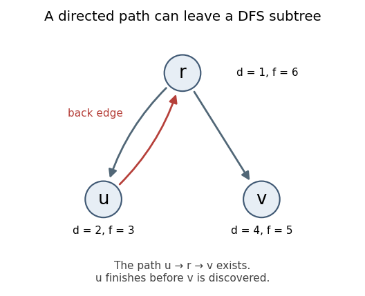

<h1 id="7/b/iii/solution">Solution</h1>

↑ **Parent:** [Iii](../iii.md)

**False.** Let the [directed edges](../../../../../../directed-edge.md) be $r\to u$, $u\to r$, and $r\to v$. Start [depth-first search](../../../../../../depth-first-search.md) at $r$ and explore its neighbor $u$ before $v$. Then

$$
d[r]=1,\quad d[u]=2,\quad f[u]=3,\quad d[v]=4,\quad f[v]=5,\quad f[r]=6.
$$

The [directed path](../../../../../../directed-path.md) $u\to r\to v$ exists and $d[u]<d[v]$, but $u$ and $v$ are siblings in the discovery [tree](../../../../../../tree-graph-theory-split.md). An existing path may leave the current recursive branch via a gray ancestor and only later enter a different branch. The usual white-path condition would need all vertices of a suitable path to be white when $u$ is discovered; that condition is absent here.

**[Figure 1](#7/b/iii/image-a-directed-path-crosses-from-an-earlier-dfs-branch-to-a-later-branch-through-the-root-node-labels-give-discovery-and-finishing-times). A directed path crosses from an earlier DFS branch to a later branch through the root; node labels give discovery and finishing times**.

## ↑ Ancestors (13)

1. [Iii](../iii.md)
2. [B](../../b.md)
3. [7](../../../7.md)
4. [Functional programming, design and analysis of algorithms](../../../../functional-programming-design-and-analysis-of-algorithms-split.md)
5. [2018](../../../../split.md)
6. [Past exam of the year 1 of the computer science course of the University of Oxford](../../../../../split.md)
7. [Year 1 of the computer science course of the University of Oxford](../../../../../../year-1-of-the-computer-science-course-of-the-university-of-oxford.md)
8. [Computer science course of the University of Oxford](../../../../../../computer-science-course-of-the-university-of-oxford.md)
9. [Undergraduate course of the University of Oxford](../../../../../../undergraduate-course-of-the-university-of-oxford.md)
10. [Course of the University of Oxford](../../../../../../course-of-the-university-of-oxford.md)
11. [University of Oxford](../../../../../../university-of-oxford-split.md)
12. [List of universities](../../../../../../list-of-universities.md)
13. [Codex Wiki](../../../../../../split.md)
