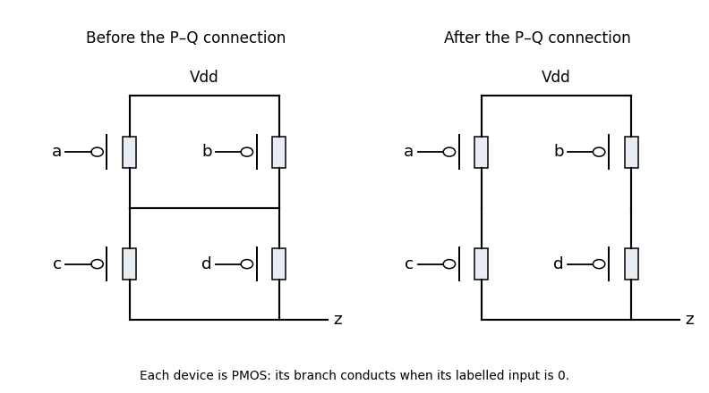
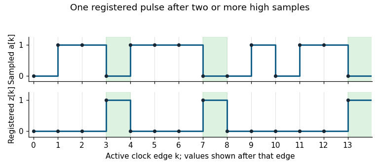

# Digital systems, linear algebra, introduction to formal proof resit

↑ **Parent:** [2019](../2019.md)

Source release: [Oxford examination archive](https://www.whatdotheyknow.com/request/ba_computer_science_past_papers/response/2577745/attach/2/202402%20183%20CS%20Papers.zip?cookie_passthrough=1), member `2018/L/a10101w1.pdf`. The dated cover identifies 3 September 2019 despite the archive directory. All eight questions are covered. The supplied Thumb references and [proof](../../foundations-of-mathematics.md#mathematical-proof) rules are inputs to the solutions, rather than additional questions.

**Table of contents**

- [1](#1)
  - [a](#1/a)
    - [Solution](#1/a/solution)
  - [b](#1/b)
    - [Solution](#1/b/solution)
  - [c](#1/c)
    - [Solution](#1/c/solution)
  - [d](#1/d)
    - [Solution](#1/d/solution)
- [2](#2)
  - [a](#2/a)
    - [Solution](#2/a/solution)
  - [b](#2/b)
    - [Solution](#2/b/solution)
  - [c](#2/c)
    - [Solution](#2/c/solution)
- [3](#3)
  - [a](#3/a)
    - [Solution](#3/a/solution)
  - [b](#3/b)
    - [Solution](#3/b/solution)
  - [c](#3/c)
    - [Solution](#3/c/solution)
  - [d](#3/d)
    - [Solution](#3/d/solution)
  - [e](#3/e)
    - [Solution](#3/e/solution)
- [4](#4)
  - [a](#4/a)
    - [Solution](#4/a/solution)
  - [b](#4/b)
    - [i](#4/b/i)
      - [Solution](#4/b/i/solution)
    - [ii](#4/b/ii)
      - [Solution](#4/b/ii/solution)
  - [c](#4/c)
    - [i](#4/c/i)
      - [Solution](#4/c/i/solution)
    - [ii](#4/c/ii)
      - [Solution](#4/c/ii/solution)
  - [d](#4/d)
    - [i](#4/d/i)
      - [Solution](#4/d/i/solution)
    - [ii](#4/d/ii)
      - [Solution](#4/d/ii/solution)
  - [e](#4/e)
    - [Solution](#4/e/solution)
- [5](#5)
  - [a](#5/a)
    - [i](#5/a/i)
      - [Solution](#5/a/i/solution)
    - [ii](#5/a/ii)
      - [Solution](#5/a/ii/solution)
    - [iii](#5/a/iii)
      - [Solution](#5/a/iii/solution)
    - [iv](#5/a/iv)
      - [Solution](#5/a/iv/solution)
  - [b](#5/b)
    - [i](#5/b/i)
      - [Solution](#5/b/i/solution)
    - [ii](#5/b/ii)
      - [Solution](#5/b/ii/solution)
  - [c](#5/c)
    - [Solution](#5/c/solution)
  - [d](#5/d)
    - [Solution](#5/d/solution)
  - [e](#5/e)
    - [Solution](#5/e/solution)
- [6](#6)
  - [a](#6/a)
    - [i](#6/a/i)
      - [Solution](#6/a/i/solution)
    - [ii](#6/a/ii)
      - [Solution](#6/a/ii/solution)
    - [iii](#6/a/iii)
      - [Solution](#6/a/iii/solution)
    - [iv](#6/a/iv)
      - [Solution](#6/a/iv/solution)
  - [b](#6/b)
    - [i](#6/b/i)
      - [Solution](#6/b/i/solution)
    - [ii](#6/b/ii)
      - [Solution](#6/b/ii/solution)
    - [iii](#6/b/iii)
      - [Solution](#6/b/iii/solution)
- [7](#7)
  - [a](#7/a)
    - [Solution](#7/a/solution)
  - [b](#7/b)
    - [Solution](#7/b/solution)
  - [c](#7/c)
    - [Solution](#7/c/solution)
  - [d](#7/d)
    - [Solution](#7/d/solution)
  - [e](#7/e)
    - [Solution](#7/e/solution)
- [8](#8)
  - [a](#8/a)
    - [Solution](#8/a/solution)
  - [b](#8/b)
    - [Solution](#8/b/solution)
  - [c](#8/c)
    - [Solution](#8/c/solution)
  - [d](#8/d)
    - [Solution](#8/d/solution)

## 1

↑ **Parent:** [Digital systems, linear algebra, introduction to formal proof resit](digital-systems-linear-algebra-introduction-to-formal-proof-resit.md)

<h3 id="1/a">a</h3>

↑ **Parent:** [1](#1)

<h4 id="1/a/solution">Solution</h4>

↑ **Parent:** [A](#1/a)

Use a [logical right shift](../../programming-language.md#logical-right-shift) to discard one inspected bit at a time. The following [Thumb instruction set](../../computer-science.md#thumb-instruction-set) subroutine accepts the word in `r0`, returns its [population count](../../coding-theory.md#hamming-weight) in `r0`, preserves `r4`, and otherwise uses caller-saved [processor registers](../../computer-science.md#processor-register).

```
popcount_loop:
    push {r4}
    movs r1, #0
    movs r2, #1
    movs r3, #32
pop_loop:
    movs r4, r0
    ands r4, r4, r2
    adds r1, r1, r4
    lsrs r0, r0, #1
    subs r3, r3, #1
    bne pop_loop
    movs r0, r1
    pop {r4}
    bx lr
```

`ands` extracts the current least significant bit; `adds` includes it in the count. `lsrs` fills the newly vacant high position with zero. `subs` immediately precedes `bne`, so the branch tests the [zero flag](../../computer-science.md#zero-flag) from decrementing the loop counter, not a flag left by the shift.

After $k$ iterations, the accumulator contains the number of one bits in the original word's $k$ lowest positions, and the remaining word is the original [unsigned interpretation](../../arithmetic.md#unsigned-interpretation-of-a-bit-string) shifted right by $k$. This [loop invariant](../../algorithm.md#loop-invariant) holds initially and is preserved by each iteration. At $k=32$ every position has been inspected, proving the result. The given example therefore returns **10**, and the all-zero and all-one words return **0** and **32**. The accumulator cannot overflow: it never exceeds 32.

<h3 id="1/b">b</h3>

↑ **Parent:** [1](#1)

<h4 id="1/b/solution">Solution</h4>

↑ **Parent:** [B](#1/b)

Extract successive bytes into indices of the [byte-table population count](../../coding-theory.md#byte-table-population-count) table. The last shift leaves only the original high byte, so that index needs no final mask.

```
popcount_table:
    push {r4}
    adr r2, popbyte
    movs r3, #255
    movs r1, r0
    ands r1, r1, r3
    ldrb r4, [r2, r1]
    lsrs r0, r0, #8
    movs r1, r0
    ands r1, r1, r3
    ldrb r1, [r2, r1]
    adds r4, r4, r1
    lsrs r0, r0, #8
    movs r1, r0
    ands r1, r1, r3
    ldrb r1, [r2, r1]
    adds r4, r4, r1
    lsrs r0, r0, #8
    ldrb r1, [r2, r0]
    adds r0, r4, r1
    pop {r4}
    bx lr
```

Place the byte table at an aligned nearby label in the instruction-address range of `adr`. That instruction forms the table's address relative to the [program counter](../../computer-science.md#instruction-pointer); it does not load a table entry. Each `ldrb` uses [register-offset addressing](../../computer-memory.md#register-offset-addressing): the base is `r2`, the byte offset is the index register, and the loaded byte is zero-extended. Because entries occupy one byte, the index needs no scaling. `ldrb r1, [r2, r1]` uses the old `r1` to form the address before overwriting it with the result.

Every bit belongs to exactly one extracted byte, so adding the four table counts gives **the whole word's [population count](../../coding-theory.md#hamming-weight)**, independently of [endianness](../../computer-memory.md#endianness). The calculation reads four bytes from the table and contains no loop.

<h3 id="1/c">c</h3>

↑ **Parent:** [1](#1)

<h4 id="1/c/solution">Solution</h4>

↑ **Parent:** [C](#1/c)

Count executed instructions, excluding the caller's branch-with-link and assuming the register-return and stack instructions shown above. The shift loop executes six instructions per iteration, plus four entry instructions and three exit instructions: **$6\cdot32+7=199$ instructions**. The unrolled table subroutine executes **21 instructions**, including four byte loads.

If every instruction, including a table load and a branch, costs one time unit, the ratio is **$199/21\approx9.48$** in favour of the table version. A more informative simple model assigns cost $L$ to each table load and unit cost to the other displayed instructions: its cost is $17+4L$, versus 199 for the loop under the same unit branch assumption. Thus this model favours lookup when $L<45.5$.

Real [running time](../../algorithm.md#running-time) depends on the processor and memory system. Taken branches can incur extra instruction-fetch or pipeline costs, favouring the unrolled version; slow flash or [cache miss](../../computer-memory.md#cache-miss) events on the 256-byte table can erode that advantage. Instruction and table placement also matter. These assumptions prevent instruction counts from becoming an unsupported universal cycle claim. For a fixed 32-bit argument both implementations have constant worst-case work; the gain is a constant factor, not a different asymptotic class.

<h3 id="1/d">d</h3>

↑ **Parent:** [1](#1)

<h4 id="1/d/solution">Solution</h4>

↑ **Parent:** [D](#1/d)

Let the new byte table store $L[0]=8$ and, for $1\le b\le255$, $L[b]=7-\lfloor\log_2 b\rfloor$. Thus it stores the number of leading zeros in an eight-bit argument: $L[1]=7$, $L[2]=L[3]=6$, and $L[128],\ldots,L[255]=0$. All entries fit in one byte.

```
countlz:
    adr r3, lzbyte
    movs r1, #0
    lsrs r2, r0, #24
    bne lz_found
    movs r1, #8
    lsrs r2, r0, #16
    bne lz_found
    movs r1, #16
    lsrs r2, r0, #8
    bne lz_found
    movs r1, #24
    movs r2, r0
lz_found:
    ldrb r2, [r3, r2]
    adds r0, r1, r2
    bx lr
```

The high byte is tried first. A failed test proves that byte was zero, so the next right-shifted value is again a byte-sized index without masking: all higher bytes have already been proved zero. The offset in `r1` counts those skipped zero bytes in bits. Adding the table result for the first nonzero byte gives the [leading-zero count](../../theoretical-computer-science.md#count-leading-zeros). If every byte is zero, the last lookup contributes eight to the offset 24, giving **32**. The example with high byte one gives **7**. At most three conditional branches and one table read are needed; no per-bit loop is used.

## 2

↑ **Parent:** [Digital systems, linear algebra, introduction to formal proof resit](digital-systems-linear-algebra-introduction-to-formal-proof-resit.md)

<h3 id="2/a">a</h3>

↑ **Parent:** [2](#2)

<h4 id="2/a/solution">Solution</h4>

↑ **Parent:** [A](#2/a)

Give the hardware to a single [device driver](../../operating-system.md#device-driver) process. Other processes request a conversion through [message passing](../../operating-system.md#message-passing) and never touch its [memory-mapped input-output](../../computer-science.md#memory-mapped-input-output) registers. The following is protocol pseudocode for [Phōs](../../operating-system.md#phos): its operation names specify their required semantics, rather than asserting an unverified spelling of a particular 2019 C interface. The hardware actions and the request/reply design are fully specified.

Use a [FIFO queue](../../data-structure.md#fifo-queue) of accepted requests, each containing its sender and a per-call token. Bind the device's interrupt to a persistent notification addressed to the driver before any conversion is started. A notification must remain pending if it arrives before the driver next waits; this is the [lost-wakeup avoidance](../../operating-system.md#lost-wakeup-avoidance) requirement. The driver receives both client requests and interrupt notifications in its event loop.

```
configure sensor and connect its interrupt notification to this process
TEMP_DATARDY := 0
clear stale pending interrupt notification
enable sensor interrupt and interrupt-controller delivery
pending := empty FIFO
active := none

forever:
    if active is none and pending is not empty:
        active := remove oldest request from pending
        TEMP_DATARDY := 0
        clear stale pending interrupt notification
        TEMP_START := 1

    event := wait for a request or persistent interrupt notification

    if event is REQUEST(sender, token):
        append (sender, token) to pending

    if event is sensor interrupt and active is not none:
        if TEMP_DATARDY != 0:
            value := TEMP_TEMP
            TEMP_DATARDY := 0
            acknowledge the interrupt through the OS interrupt mechanism
            send RESULT(active.token, value) to active.sender
            active := none
```

After receiving an idle-time request, the next loop iteration starts its conversion before waiting again. While a conversion is in progress, additional requests join the queue without starting another conversion. A completed reading is copied before its ready flag is cleared, and the next request cannot start until the current result has been delivered. Spurious or stale notifications do not complete a request unless the device's ready register confirms completion.

Clearing old status and notification precedes `TEMP_START`; doing so afterwards could erase a very fast completion. The [operating system](../../operating-system.md) interrupt binding and persistent notification cover completion in the interval between starting the device and entering the wait. Register accesses must use the platform's device-access semantics, including required [volatile-qualified objects in C](../../programming-language.md#volatile-qualified-objects-in-c) or ordering primitives. Exact initialization and interrupt-connection call names remain an implementation binding, not invented [Phōs](../../operating-system.md#phos) API calls. The later teaching site's named system is documented separately; it is not used as [proof](../../foundations-of-mathematics.md#mathematical-proof) of an identical historical API.[2018–2019 course record and linked teaching-site description of process/message-based device drivers](../../computer-science-bibliography.md#digital-systems-course-archive-of-the-university-of-oxford)

<h3 id="2/b">b</h3>

↑ **Parent:** [2](#2)

<h4 id="2/b/solution">Solution</h4>

↑ **Parent:** [B](#2/b)

Provide a blocking [request-reply sensor conversion](../../operating-system.md#request-reply-sensor-conversion) operation, using [synchronous send-and-receive](../../operating-system.md#synchronous-send-and-receive) when the system supplies it:

```
get_temp():
    token := a new token for this process's call
    reply := request-and-wait(
        destination = temperature_driver,
        message = REQUEST(self, token),
        expected_reply = RESULT(token, value))
    return reply.value
```

Here `request-and-wait` means sending the request and remaining ready to accept its matching response; it denotes a protocol action, not a claimed library symbol. Separate blocking send and receive operations are also adequate if they preserve the sender identity and the reply cannot be lost between them. With a synchronous reply, the driver simply waits until this client's receive is ready.

The call returns only after the driver has selected this request, issued `TEMP_START`, observed completion, read the new value and replied with the matching token. **Each call therefore starts its own fresh conversion and returns its own result.** It never returns a cached sample or another caller's reply. Local request and response storage belong to the calling process and are not a shared global message buffer.

<h3 id="2/c">c</h3>

↑ **Parent:** [2](#2)

<h4 id="2/c/solution">Solution</h4>

↑ **Parent:** [C](#2/c)

**Safety:** only the driver accesses the sensor, and `active` identifies at most one conversion. Accepted requests are serialized by the [FIFO queue](../../data-structure.md#fifo-queue). The reply destination and token identify the owner of the resulting sample; no caller can clear another conversion's ready flag or consume another result. Receiving new requests while busy only changes the queue, not the active measurement. These are [mutual exclusion](../../operating-system.md#mutual-exclusion) and request/result association properties, not timing guesses.

**Progress:** assume each started conversion completes in finite time, the corresponding notification is eventually delivered, the driver and compliant clients are eventually scheduled, and pending message acceptance is fair. A caller remains ready to receive its reply. Every accepted request has finitely many earlier requests in the queue, and later arrivals cannot overtake it. Each earlier request is completed and removed in finite time, so the caller eventually becomes active and receives its own reading. Fair acceptance extends this argument from accepted requests to callers waiting to submit one.

These assumptions are necessary for [starvation freedom](../../operating-system.md#starvation-freedom). A failed sensor, a client that disappears before accepting a synchronous reply, or an unfair scheduler can prevent progress; serialization alone cannot prove otherwise. Under the stated operating model, simultaneous calls are safe and every call completes. A single shared “latest temperature” variable would not establish either a fresh conversion per call or correct reply ownership.

## 3

↑ **Parent:** [Digital systems, linear algebra, introduction to formal proof resit](digital-systems-linear-algebra-introduction-to-formal-proof-resit.md)

<h3 id="3/a">a</h3>

↑ **Parent:** [3](#3)

<h4 id="3/a/solution">Solution</h4>

↑ **Parent:** [A](#3/a)

The two lower conducting branches are the series pairs controlled by $a,b$ and by $c,d$. Their overall [NMOS transistor](../../semiconductor.md#nmos-transistor) conduction condition is $ab\lor cd$. Apply [complementary CMOS network duality](../../semiconductor.md#complementary-cmos-network-duality): the upper network has **the parallel pair of [PMOS transistors](../../semiconductor.md#pmos-transistor) controlled by $a,b$, in series with the parallel pair controlled by $c,d$**. Its first end connects to the high rail, its last end connects to $z$, and the junction between the two pairs is internal to the upper network.

<a id="3/a/image-original-completed-pull-up-networks-derived-by-complementary-cmos-network-duality"></a>


**[Figure 1](#3/a/image-original-completed-pull-up-networks-derived-by-complementary-cmos-network-duality). Original completed pull-up networks derived by complementary CMOS network duality**.

The left panel gives that completion. Every upper transistor uses its correspondingly named input and conducts when that input is low. Its conducting condition is $(\neg a\lor\neg b)\land(\neg c\lor\neg d)$, exactly the complement of the lower condition. Thus the ideal static circuit connects the output to one supply rail for every stable binary input.

<h3 id="3/b">b</h3>

↑ **Parent:** [3](#3)

<h4 id="3/b/solution">Solution</h4>

↑ **Parent:** [B](#3/b)

The lower network pulls the output low exactly when either series branch conducts. Therefore the [Boolean function](../../analysis-of-boolean-functions.md#boolean-function) is

$$
\boxed{z=\neg(ab\lor cd)=(\neg a\lor\neg b)\land(\neg c\lor\neg d).}
$$

The inversion is important: $ab\lor cd$ describes connection to the low rail, not a high output. The [pull-up network](../../semiconductor.md#pull-up-network) found in part a implements the complementary high condition.

<h3 id="3/c">c</h3>

↑ **Parent:** [3](#3)

<h4 id="3/c/solution">Solution</h4>

↑ **Parent:** [C](#3/c)

Joining the two middle nodes makes the upper lower-network transistors, controlled by $a,c$, parallel with each other. The lower transistors, controlled by $b,d$, are also parallel. These two parallel groups are in series, so the lower conducting condition becomes $(a\lor c)\land(b\lor d)$.

Its dual upper network must be **two parallel branches, one containing the series [PMOS transistor](../../semiconductor.md#pmos-transistor) pair $a,c$, the other the series pair $b,d$**. This is the right panel of the original drawing. Its condition is $(\neg a\land\neg c)\lor(\neg b\land\neg d)$. Merely leaving the old upper network unchanged would break [CMOS](../../semiconductor.md#cmos) complementarity for some inputs, allowing a supply short rather than defining the required logic.

<h3 id="3/d">d</h3>

↑ **Parent:** [3](#3)

<h4 id="3/d/solution">Solution</h4>

↑ **Parent:** [D](#3/d)

The modified output is

$$
\boxed{z'=\neg((a\lor c)\land(b\lor d))
=(\neg a\land\neg c)\lor(\neg b\land\neg d).}
$$

For example, **$(a,b,c,d)=(1,0,0,1)$ gives $z=1$ and $z'=0$**. Neither original series branch is complete, but the new connection supplies the cross-route through the transistors controlled by $a,d$. Interchanging those roles gives the other cross-route example. In fact $(a\lor c)(b\lor d)=ab\lor ad\lor bc\lor cd$, so the modified circuit has added exactly those two possible lower conduction routes.

<h3 id="3/e">e</h3>

↑ **Parent:** [3](#3)

<h4 id="3/e/solution">Solution</h4>

↑ **Parent:** [E](#3/e)

Let $a_k$ be the input sampled at clock edge $k$. The desired registered output after that edge is **$z_k=a_{k-2}a_{k-1}(1-a_k)$**. Only the last two high samples matter: a longer high run still has two high samples immediately before its first low sample.

A direct [synchronous 110 detector](../../foundations-of-mathematics.md#synchronous-110-detector) uses three [D flip-flops](../../electrical-engineering.md#d-flip-flop), holding $q_1,q_2,z$, with a common clock and initial state zero. Use the following next-state equations, all evaluated from the old state and the input at the active clock edge:

$$
q_1^+=a,\qquad q_2^+=q_1\land a,\qquad z^+=q_2\land\neg a.
$$

After an edge, $q_1$ records the latest sample and $q_2$ records whether the latest two samples were high. The final equation consequently produces the required pulse from the preceding two-high state and the new low sample. A synchronous reset sets all three state bits to zero. The output is the stored `z` flip-flop value, so it changes only after clock edges; exposing the unregistered expression $q_2\land\neg a$ would let input transitions between edges alter the output.

<a id="3/e/image-original-sampled-input-and-registered-output-trace-for-a-synchronous-110-detector"></a>


**[Figure 2](#3/e/image-original-sampled-input-and-registered-output-trace-for-a-synchronous-110-detector). Original sampled-input and registered-output trace for a synchronous 110 detector**.

An equivalent [finite-state machine](../../foundations-of-mathematics.md#finite-state-machine) has states `R` (no current high run), `H` (one high), `HH` (at least two highs), and `P` (the pulse state). Its output is one only in `P`:

| State | Next on 0 | Next on 1 | Output |
| --- | --- | --- | --- |
| `R` | `R` | `H` | 0 |
| `H` | `R` | `HH` | 0 |
| `HH` | `P` | `HH` | 0 |
| `P` | `R` | `H` | 1 |

The pulse cannot last two cycles: after the low input that creates it, $q_2$ is zero, so the next output is zero regardless of the next input. The detector rearms without a global stop and handles repeated patterns indefinitely. The three-flip-flop construction is deliberately direct; minimum storage was not required.

## 4

↑ **Parent:** [Digital systems, linear algebra, introduction to formal proof resit](digital-systems-linear-algebra-introduction-to-formal-proof-resit.md)

<h3 id="4/a">a</h3>

↑ **Parent:** [4](#4)

<h4 id="4/a/solution">Solution</h4>

↑ **Parent:** [A](#4/a)

Subtract the first vertex from the other two, giving side [vectors](../../vector-space.md#vector) $(2,1)$ and $(3,4)$. Their [determinant](../../multilinear-algebra.md#determinant) is $2\cdot4-3\cdot1=5$, the signed area of the corresponding [parallelogram](../../euclidean-geometry.md#parallelogram). The [triangle](../../euclidean-geometry.md#triangle) occupies half that area, hence **its area is $5/2$**. Taking the absolute value would remove any sign change caused by reversing the vertex order. This is the [determinant formula for triangle area](../../multilinear-algebra.md#determinant-formula-for-triangle-area).

<h3 id="4/b">b</h3>

↑ **Parent:** [4](#4)

<h4 id="4/b/i">i</h4>

↑ **Parent:** [B](#4/b)

<h5 id="4/b/i/solution">Solution</h5>

↑ **Parent:** [I](#4/b/i)

Let $c_1=(1,1,1)^T$ and $c_2=(2,-2,6)^T$. The remaining columns are $3c_1$ and $2c_2$, so these two [vectors](../../vector-space.md#vector) span the [column space](../../vector-space.md#column-space). They are [linearly independent](../../vector-space.md#linear-independence): the [determinant](../../multilinear-algebra.md#determinant) of their first two coordinates is $-4\ne0$. Therefore **$\{(1,1,1)^T,(2,-2,6)^T\}$ is a [basis](../../vector-space.md#basis) of the range**, and the [matrix rank](../../vector-space.md#matrix-rank) is two.

Equivalently the range is the plane $y_3=2y_1-y_2$: both displayed basis [vectors](../../vector-space.md#vector) satisfy this equation, and their two-dimensional span fills that plane.

<h4 id="4/b/ii">ii</h4>

↑ **Parent:** [B](#4/b)

<h5 id="4/b/ii/solution">Solution</h5>

↑ **Parent:** [Ii](#4/b/ii)

The independent-column representation gives $T(x)=c_1(x_1+3x_3)+c_2(x_2+2x_4)$. Thus a [vector](../../vector-space.md#vector) lies in the [kernel of a linear map](../../kernel-of-a-linear-map.md) represented by this [matrix](../../vector-space.md#matrix) precisely when $x_1=-3x_3$ and $x_2=-2x_4$. Writing the two free coordinates separately gives

$$
x=x_3\begin{pmatrix}-3\\0\\1\\0\end{pmatrix}
+x_4\begin{pmatrix}0\\-2\\0\\1\end{pmatrix}.
$$

The two displayed [vectors](../../vector-space.md#vector) are [linearly independent](../../vector-space.md#linear-independence), so **they form a [basis](../../vector-space.md#basis) of the kernel**. Its dimension two also agrees with the [rank-nullity theorem](../../kernel-of-a-linear-map.md#rank-nullity-theorem), $4=2+2$.

<h3 id="4/c">c</h3>

↑ **Parent:** [4](#4)

<h4 id="4/c/i">i</h4>

↑ **Parent:** [C](#4/c)

<h5 id="4/c/i/solution">Solution</h5>

↑ **Parent:** [I](#4/c/i)

If $A$ is $m\times n$, then $Y$ is $n\times m$. The equation $AY=I_m$ makes every standard basis [vector](../../vector-space.md#vector) of $\mathbb R^m$ a linear combination of the columns of $A$: take the corresponding column of $Y$ as coefficients. Hence the [column space](../../vector-space.md#column-space) is all of $\mathbb R^m$, giving **$\operatorname{rank}(A)=m$**. In particular, $n\ge m$ and $A$ has [full row rank](../../vector-space.md#full-row-rank).

<h4 id="4/c/ii">ii</h4>

↑ **Parent:** [C](#4/c)

<h5 id="4/c/ii/solution">Solution</h5>

↑ **Parent:** [Ii](#4/c/ii)

**The system is consistent for every $b\in\mathbb R^m$:** take $x=Yb$, since $A(Yb)=(AY)b=b$. Thus $Y$ is a [right inverse](../../function.md#right-inverse) giving an explicit solution for every right-hand side.

All solutions are $Yb+u$ with $u$ in the [kernel of a linear map](../../kernel-of-a-linear-map.md) represented by $A$. The [rank-nullity theorem](../../kernel-of-a-linear-map.md#rank-nullity-theorem) gives kernel dimension $n-m$; the solution is unique when $n=m$, and is nonunique when $n>m$.

<h3 id="4/d">d</h3>

↑ **Parent:** [4](#4)

<h4 id="4/d/i">i</h4>

↑ **Parent:** [D](#4/d)

<h5 id="4/d/i/solution">Solution</h5>

↑ **Parent:** [I](#4/d/i)

**True.** Transposing the inverse identities shows $(X^{-1})^T=(X^T)^{-1}$. If $X^T=X$, this becomes $(X^{-1})^T=X^{-1}$, exactly the [symmetric matrix](../../linear-algebra.md#symmetric-matrix) condition. The reasoning uses the [matrix inverse](../../matrix-inverse.md) and [transpose](../../vector-space.md#transpose) identities, without assuming that different [matrix](../../vector-space.md#matrix) factors commute.

<h4 id="4/d/ii">ii</h4>

↑ **Parent:** [D](#4/d)

<h5 id="4/d/ii/solution">Solution</h5>

↑ **Parent:** [Ii](#4/d/ii)

**True.** Using the same [transpose](../../vector-space.md#transpose) identity and $X^T=-X$ gives

$$
(X^{-1})^T=(X^T)^{-1}=(-X)^{-1}=-X^{-1}.
$$

The final equality follows by multiplying $-X$ and $-X^{-1}$ in either order and obtaining the identity. Thus the inverse is a [skew-symmetric matrix](../../linear-algebra.md#skew-symmetric-matrix) as well. The invertibility hypothesis is retained throughout.

<h3 id="4/e">e</h3>

↑ **Parent:** [4](#4)

<h4 id="4/e/solution">Solution</h4>

↑ **Parent:** [E](#4/e)

**True for these square [matrices](../../vector-space.md#matrix).** The [determinant](../../multilinear-algebra.md#determinant) multiplication identity gives $\det(XY)=\det X\det Y$. Since $XY$ is invertible, its [determinant](../../multilinear-algebra.md#determinant) is nonzero; both factors are therefore nonzero, so both [matrices](../../vector-space.md#matrix) have [matrix inverses](../../matrix-inverse.md).

Equivalently, $Y$ must be injective and $X$ must be surjective, and either property implies invertibility for an endomorphism of a finite-dimensional [vector](../../vector-space.md#vector) space. The equal square dimensions matter: a rectangular [matrix](../../vector-space.md#matrix) and a right inverse can have identity product without being mutually invertible square [matrices](../../vector-space.md#matrix).

## 5

↑ **Parent:** [Digital systems, linear algebra, introduction to formal proof resit](digital-systems-linear-algebra-introduction-to-formal-proof-resit.md)

<h3 id="5/a">a</h3>

↑ **Parent:** [5](#5)

<h4 id="5/a/i">i</h4>

↑ **Parent:** [A](#5/a)

<h5 id="5/a/i/solution">Solution</h5>

↑ **Parent:** [I](#5/a/i)

**True.** The [rank-nullity theorem](../../kernel-of-a-linear-map.md#rank-nullity-theorem) gives $\dim\mathcal N(A)=n-r=0$. The only [vector](../../vector-space.md#vector) in this zero-dimensional [kernel of a linear map](../../kernel-of-a-linear-map.md) is the zero [vector](../../vector-space.md#vector).

<h4 id="5/a/ii">ii</h4>

↑ **Parent:** [A](#5/a)

<h5 id="5/a/ii/solution">Solution</h5>

↑ **Parent:** [Ii](#5/a/ii)

**False.** Take $A=(1,0)^T$, an $m=2$, $n=1$ [matrix](../../vector-space.md#matrix) of [matrix rank](../../vector-space.md#matrix-rank) one, and $b=(0,1)^T$. Then $Ax=(x,0)^T$ never equals $b$. [Full column rank](../../vector-space.md#full-column-rank) implies injectivity, not surjectivity onto a larger codomain.

<h4 id="5/a/iii">iii</h4>

↑ **Parent:** [A](#5/a)

<h5 id="5/a/iii/solution">Solution</h5>

↑ **Parent:** [Iii](#5/a/iii)

**True.** A square [matrix](../../vector-space.md#matrix) with [matrix rank](../../vector-space.md#matrix-rank) $n$ is invertible, and its [transpose](../../vector-space.md#transpose) has the same rank. Applying the [rank-nullity theorem](../../kernel-of-a-linear-map.md#rank-nullity-theorem) to both $A$ and $A^T$ gives nullity zero in each case, so both kernels are $\{0\}$.

<h4 id="5/a/iv">iv</h4>

↑ **Parent:** [A](#5/a)

<h5 id="5/a/iv/solution">Solution</h5>

↑ **Parent:** [Iv](#5/a/iv)

**False.** Triviality of $\mathcal N(A)$ gives $r=n$, while triviality of $\mathcal N(A^T)$ gives $r=m$ because [transpose](../../vector-space.md#transpose) preserves [matrix rank](../../vector-space.md#matrix-rank). Both conditions therefore force $m=n$, contradicting the stated unequal dimensions.

<h3 id="5/b">b</h3>

↑ **Parent:** [5](#5)

<h4 id="5/b/i">i</h4>

↑ **Parent:** [B](#5/b)

<h5 id="5/b/i/solution">Solution</h5>

↑ **Parent:** [I](#5/b/i)

Choose $r$ independent columns of $A$ that form a [basis](../../vector-space.md#basis) of its [column space](../../vector-space.md#column-space), and put them in $B\in\mathbb R^{m\times r}$. For each column $a_j$ of $A$, let $c_j$ be its coordinate [vector](../../vector-space.md#vector) in that basis; put these coordinate [vectors](../../vector-space.md#vector) in $C\in\mathbb R^{r\times n}$. The column equations $a_j=Bc_j$ give **$A=BC$**.

By construction $B$ has [full column rank](../../vector-space.md#full-column-rank) $r$. The columns of $C$ corresponding to the selected basis columns are the standard [vectors](../../vector-space.md#vector) of $\mathbb R^r$, so $C$ has [full row rank](../../vector-space.md#full-row-rank) $r$. This proves the requested [rank factorization](../../vector-space.md#rank-factorization). When $r=0$, $A=0$ and the corresponding empty-column and empty-row factors have the required shapes and rank zero.

<h4 id="5/b/ii">ii</h4>

↑ **Parent:** [B](#5/b)

<h5 id="5/b/ii/solution">Solution</h5>

↑ **Parent:** [Ii](#5/b/ii)

**Not unique in general.** For any invertible $r\times r$ [matrix](../../vector-space.md#matrix) $S$,

$$
A=(BS)(S^{-1}C)
$$

is another [rank factorization](../../vector-space.md#rank-factorization), with the same full ranks. This is a [change of basis](../../linear-algebra.md#change-of-basis) in the intermediate $r$-dimensional space. For example, even $[1]=[1][1]=[2][1/2]$ has different full-rank factors. Once a particular ordered basis $B$ is fixed, its coordinate [matrix](../../vector-space.md#matrix) $C$ is unique; it is the basis choice that creates the freedom.

<h3 id="5/c">c</h3>

↑ **Parent:** [5](#5)

<h4 id="5/c/solution">Solution</h4>

↑ **Parent:** [C](#5/c)

For the first [matrix](../../vector-space.md#matrix) choose its single independent column:

$$
\boxed{B_1=\begin{pmatrix}1\\1\\1\end{pmatrix},\qquad
C_1=\begin{pmatrix}1&1&1\end{pmatrix}.}
$$

Their product has every column equal to $B_1$, and both factors have rank one.

For the second [matrix](../../vector-space.md#matrix), the first and third columns are independent and the second equals the first, giving

$$
\boxed{B_2=\begin{pmatrix}1&0\\2&0\\0&1\end{pmatrix},\qquad
C_2=\begin{pmatrix}1&1&0\\0&0&1\end{pmatrix}.}
$$

Multiplication reconstructs the stated [matrix](../../vector-space.md#matrix). The first factor has independent columns and the second has independent rows, so both have [matrix rank](../../vector-space.md#matrix-rank) two, as required for a [rank factorization](../../vector-space.md#rank-factorization).

<h3 id="5/d">d</h3>

↑ **Parent:** [5](#5)

<h4 id="5/d/solution">Solution</h4>

↑ **Parent:** [D](#5/d)

The two square products can have different sizes, but their [matrix traces](../../linear-algebra.md#matrix-trace) are both the same finite double sum:

$$
\operatorname{tr}(XY)=\sum_{i=1}^{l}(XY)_{ii}
=\sum_{i=1}^{l}\sum_{j=1}^{k}X_{ij}Y_{ji}
=\sum_{j=1}^{k}\sum_{i=1}^{l}Y_{ji}X_{ij}
=\operatorname{tr}(YX).
$$

Interchanging two finite sums and commuting their scalar factors is valid over the real numbers. No commutation of the [matrix](../../vector-space.md#matrix) products themselves is asserted. This proves the [cyclic property of the trace](../../linear-algebra.md#cyclic-property-of-the-trace) in the rectangular-factor case.

<h3 id="5/e">e</h3>

↑ **Parent:** [5](#5)

<h4 id="5/e/solution">Solution</h4>

↑ **Parent:** [E](#5/e)

Let $r=\operatorname{rank}(A)$. If $r=0$, the [matrix](../../vector-space.md#matrix) is zero and the identity is immediate. Otherwise choose the [rank factorization](../../vector-space.md#rank-factorization) $A=BC$ from part b. The [column space](../../vector-space.md#column-space) of $B$ is the image of $A$.

An [idempotent matrix](../../function.md#idempotent-matrix) acts as the identity on its image: if $u=Av$, then $Au=A^2v=Av=u$. Applying this to each column of $B$ gives $AB=B$. Substituting $A=BC$ yields $B(CB-I_r)=0$. Since $B$ has [full column rank](../../vector-space.md#full-column-rank), the represented map is injective, so each column of $CB-I_r$ is zero. Thus $CB=I_r$.

Now the rectangular [cyclic property of the trace](../../linear-algebra.md#cyclic-property-of-the-trace) gives

$$
\operatorname{tr}(A)=\operatorname{tr}(BC)=\operatorname{tr}(CB)
=\operatorname{tr}(I_r)=r=\operatorname{rank}(A).
$$

This proves that the [trace of an idempotent equals its rank](../../vector-space.md#trace-of-an-idempotent-equals-its-rank) using the supplied factorization method. Orthogonality of the projection is unnecessary: the argument applies to every real idempotent [matrix](../../vector-space.md#matrix).

## 6

↑ **Parent:** [Digital systems, linear algebra, introduction to formal proof resit](digital-systems-linear-algebra-introduction-to-formal-proof-resit.md)

<h3 id="6/a">a</h3>

↑ **Parent:** [6](#6)

<h4 id="6/a/i">i</h4>

↑ **Parent:** [A](#6/a)

<h5 id="6/a/i/solution">Solution</h5>

↑ **Parent:** [I](#6/a/i)

The [characteristic polynomial](../../linear-operator-theory.md#characteristic-polynomial) is

$$
\det(A-\lambda I)=(2-\lambda)(10-\lambda)-9
=\lambda^2-12\lambda+11=(\lambda-1)(\lambda-11).
$$

Thus the [eigenvalues](../../linear-operator-theory.md#eigenvalue) are 1 and 11. Corresponding [eigenvectors](../../linear-operator-theory.md#eigenvector) are $(3,-1)^T$ and $(1,3)^T$. Their dot product is zero and each has [Euclidean norm](../../normed-vector-space.md#euclidean-norm) $\sqrt{10}$. Normalizing gives

$$
\boxed{P=\frac1{\sqrt{10}}\begin{pmatrix}3&1\\-1&3\end{pmatrix},\qquad
D=\begin{pmatrix}1&0\\0&11\end{pmatrix}.}
$$

The columns are [orthonormal](../../inner-product.md#orthonormal-set), so $P^TP=I$. The [eigenvector](../../linear-operator-theory.md#eigenvector) equations give $AP=PD$ and hence $P^TAP=D$, proving the claimed [orthogonal diagonalization of a real symmetric matrix](../../linear-algebra.md#orthogonal-diagonalization-of-a-real-symmetric-matrix).

<h4 id="6/a/ii">ii</h4>

↑ **Parent:** [A](#6/a)

<h5 id="6/a/ii/solution">Solution</h5>

↑ **Parent:** [Ii](#6/a/ii)

Set $y=P^Tx$. Because $P$ is an [orthogonal matrix](../../linear-algebra.md#orthogonal-matrix), $x=Py$ and $x=0$ exactly when $y=0$. The preceding diagonalization gives

$$
x^TAx=y^TDy=y_1^2+11y_2^2\ge y_1^2+y_2^2=\|x\|_2^2.
$$

Consequently **$x^TAx\ge0$, with equality only when $x=0$**. The [matrix](../../vector-space.md#matrix) is a [symmetric positive-definite matrix](../../linear-algebra.md#symmetric-positive-definite-matrix), not merely positive semidefinite. In the original coordinates the same identity is

$$
x^TAx=\frac{(3x_1-x_2)^2+11(x_1+3x_2)^2}{10},
$$

which also makes positivity transparent.

<h4 id="6/a/iii">iii</h4>

↑ **Parent:** [A](#6/a)

<h5 id="6/a/iii/solution">Solution</h5>

↑ **Parent:** [Iii](#6/a/iii)

**Real symmetry and positive definiteness are sufficient**, and the preceding parts establish both properties for this [matrix](../../vector-space.md#matrix). If a residual becomes zero, stop: the solution has been reached and the displayed step quotient should not be evaluated as $0/0$.

For a convergence justification, let $x_*$ solve $Ax_*=b$, let $e=x_*-x$, and let $r=Ae$. The quadratic energy error is $E=e^TAe/2$. Moving by $\alpha r$, with $\alpha=(r^Tr)/(r^TAr)$, is [exact line search for a positive-definite quadratic](../../gradient-descent.md#exact-line-search-for-a-positive-definite-quadratic) and gives

$$
E_{\rm new}=E-\frac{(r^Tr)^2}{2r^TAr}.
$$

Writing $\lambda_{\min},\lambda_{\max}>0$ for the extreme [eigenvalues](../../linear-operator-theory.md#eigenvalue), one has $r^TAr\le\lambda_{\max}r^Tr$ and $r^Tr=e^TA^2e\ge\lambda_{\min}e^TAe$. Therefore

$$
E_{\rm new}\le\left(1-\frac{\lambda_{\min}}{\lambda_{\max}}\right)E.
$$

The factor lies below one, so the energy tends to zero and positive definiteness forces $x\to x_*$. Here the bound is $E_{\rm new}\le(10/11)E$, since the [eigenvalues](../../linear-operator-theory.md#eigenvalue) are 1 and 11. This proves convergence for every initial [vector](../../vector-space.md#vector), rather than merely checking one numerical iteration.

<h4 id="6/a/iv">iv</h4>

↑ **Parent:** [A](#6/a)

<h5 id="6/a/iv/solution">Solution</h5>

↑ **Parent:** [Iv](#6/a/iv)

From the zero initial [vector](../../vector-space.md#vector), the [linear-system residual](../../gradient-descent.md#linear-system-residual) is $r_0=(1,1)^T$. Then $r_0^Tr_0=2$, $Ar_0=(5,13)^T$, and $r_0^TAr_0=18$. The step is $\alpha_0=1/9$, giving

$$
\boxed{x_1=\begin{pmatrix}1/9\\1/9\end{pmatrix}.}
$$

As a check, the new residual is $(4/9,-4/9)^T$, orthogonal to the preceding residual as expected after this exact line search. It is nonzero, so one iteration has not already solved the system.

<h3 id="6/b">b</h3>

↑ **Parent:** [6](#6)

<h4 id="6/b/i">i</h4>

↑ **Parent:** [B](#6/b)

<h5 id="6/b/i/solution">Solution</h5>

↑ **Parent:** [I](#6/b/i)

The [normal equations for linear least squares](../../linear-regression.md#normal-equations-for-linear-least-squares) are

$$
\boxed{A^TAx=A^Tb.}
$$

The supplied [QR decomposition](../../inner-product.md#qr-decomposition) gives [full column rank](../../vector-space.md#full-column-rank) because $R$ is invertible and $Q^TQ=I$. Hence, for every nonzero $u$, $u^TA^TAu=\|Au\|_2^2>0$. Thus $A^TA$ is a [symmetric positive-definite matrix](../../linear-algebra.md#symmetric-positive-definite-matrix) and the displayed square system is nonsingular.

<h4 id="6/b/ii">ii</h4>

↑ **Parent:** [B](#6/b)

<h5 id="6/b/ii/solution">Solution</h5>

↑ **Parent:** [Ii](#6/b/ii)

Substitution gives $R^TRx=R^TQ^Tb$. Since $R^T$ is invertible, cancel it on the left to obtain the nonsingular triangular system

$$
\boxed{Rx=Q^Tb.}
$$

This is the [reduced QR least-squares solution](../../inner-product.md#reduced-qr-least-squares-solution). Its geometric justification is the orthogonal decomposition

$$
\|Ax-b\|_2^2=\|Rx-Q^Tb\|_2^2+\|(I-QQ^T)b\|_2^2.
$$

The second term is independent of $x$, while invertibility of $R$ lets the first term be zero at exactly one point. Although $Q^TQ=I_M$, one must not replace $QQ^T$ by $I_N$: $Q$ is tall and its product $QQ^T$ is the [orthogonal projection](../../hilbert-space.md#orthogonal-projection) onto its column space.

<h4 id="6/b/iii">iii</h4>

↑ **Parent:** [B](#6/b)

<h5 id="6/b/iii/solution">Solution</h5>

↑ **Parent:** [Iii](#6/b/iii)

The supplied factors give $Q^Tb=(0,2)^T$. [Back substitution](../../linear-algebra.md#back-substitution) in $Rx=Q^Tb$ yields $2y=2$ and $10x+4y=0$, so

$$
\boxed{x=-2/5,\qquad y=1.}
$$

Multiplying by the original [matrix](../../vector-space.md#matrix) gives $(1,1,1,1)^T$, so this least-squares minimizer has residual zero: this particular overdetermined system is exactly consistent. [Full column rank](../../vector-space.md#full-column-rank) still guarantees uniqueness of the minimizer.

## 7

↑ **Parent:** [Digital systems, linear algebra, introduction to formal proof resit](digital-systems-linear-algebra-introduction-to-formal-proof-resit.md)

<h3 id="7/a">a</h3>

↑ **Parent:** [7](#7)

<h4 id="7/a/solution">Solution</h4>

↑ **Parent:** [A](#7/a)

- The [implication introduction rule](../../mathematical-logic.md#implication-introduction-rule) assumes $\phi$ locally, derives $\psi$ under that assumption, then concludes $\phi\to\psi$ while discharging the temporary assumption.
- The [disjunction elimination rule](../../mathematical-logic.md#disjunction-elimination-rule) uses $\phi\lor\psi$ and two local cases: one derives a common conclusion $\kappa$ from $\phi$, and the other derives that same $\kappa$ from $\psi$. It concludes $\kappa$ and discharges both case assumptions.
- The [negation introduction rule](../../mathematical-logic.md#negation-introduction-rule) assumes $\phi$ locally and derives [logical falsity](../../mathematical-logic.md#logical-falsity). Discharging that assumption gives $\neg\phi$.

The boxes delimit a [subproof](../../mathematical-logic.md#subproof) and identify the lifetime of its temporary assumptions. A result depending on a boxed assumption is available inside that box and its nested boxes; it cannot simply be exported outside. The enclosing rule specifies what may be exported and which assumptions are discharged. Other premises on which the derivation depends remain undischarged. This [assumption discharge](../../mathematical-logic.md#assumption-discharge) discipline distinguishes a conditional argument from an unconditional [proof](../../foundations-of-mathematics.md#mathematical-proof).

<h3 id="7/b">b</h3>

↑ **Parent:** [7](#7)

<h4 id="7/b/solution">Solution</h4>

↑ **Parent:** [B](#7/b)

Derive each negated component in its own [subproof](../../mathematical-logic.md#subproof), then combine them. Assumption lines below begin local scopes; the listed discharge ranges close those scopes.

| Line | Formula | Justification |
| --- | --- | --- |
| 1 | $\neg(\phi\lor\psi)$ | Premise |
| 2 | $\phi$ | Assume locally |
| 3 | $\phi\lor\psi$ | [Disjunction introduction rule](../../mathematical-logic.md#disjunction-introduction-rule), left, 2 |
| 4 | $\bot$ | [Negation elimination rule](../../mathematical-logic.md#negation-elimination-rule), 1 and 3 |
| 5 | $\neg\phi$ | [Negation introduction rule](../../mathematical-logic.md#negation-introduction-rule), discharging 2–4 |
| 6 | $\psi$ | Assume locally |
| 7 | $\phi\lor\psi$ | [Disjunction introduction rule](../../mathematical-logic.md#disjunction-introduction-rule), right, 6 |
| 8 | $\bot$ | [Negation elimination rule](../../mathematical-logic.md#negation-elimination-rule), 1 and 7 |
| 9 | $\neg\psi$ | [Negation introduction rule](../../mathematical-logic.md#negation-introduction-rule), discharging 6–8 |
| 10 | $\neg\phi\land\neg\psi$ | [Conjunction introduction rule](../../mathematical-logic.md#conjunction-introduction-rule), 5 and 9 |

Only the original premise remains open. No classical principle is needed for this direction of [De Morgan's laws](../../theoretical-computer-science.md#de-morgan-s-laws).

<h3 id="7/c">c</h3>

↑ **Parent:** [7](#7)

<h4 id="7/c/solution">Solution</h4>

↑ **Parent:** [C](#7/c)

Assume the conjunction and obtain a contradiction in each of the two cases supplied by the premise:

| Line | Formula | Justification |
| --- | --- | --- |
| 1 | $\neg\phi\lor\neg\psi$ | Premise |
| 2 | $\phi\land\psi$ | Assume locally |
| 3 | $\phi$ | [Conjunction elimination rule](../../mathematical-logic.md#conjunction-elimination-rule), left, 2 |
| 4 | $\psi$ | [Conjunction elimination rule](../../mathematical-logic.md#conjunction-elimination-rule), right, 2 |
| 5 | $\neg\phi$ | Assume first case |
| 6 | $\bot$ | [Negation elimination rule](../../mathematical-logic.md#negation-elimination-rule), 3 and 5 |
| 7 | $\neg\psi$ | Assume second case |
| 8 | $\bot$ | [Negation elimination rule](../../mathematical-logic.md#negation-elimination-rule), 4 and 7 |
| 9 | $\bot$ | [Disjunction elimination rule](../../mathematical-logic.md#disjunction-elimination-rule), 1, 5–6 and 7–8 |
| 10 | $\neg(\phi\land\psi)$ | [Negation introduction rule](../../mathematical-logic.md#negation-introduction-rule), discharging 2–9 |

The two case assumptions disappear at line 9, while the conjunction assumption remains available until line 10. The [proof](../../foundations-of-mathematics.md#mathematical-proof) uses only the primitive rules printed in the paper.

<h3 id="7/d">d</h3>

↑ **Parent:** [7](#7)

<h4 id="7/d/solution">Solution</h4>

↑ **Parent:** [D](#7/d)

The supplied [double-negation elimination](../../mathematical-logic.md#double-negation-elimination) rule provides the classical step needed to recover each positive component:

| Line | Formula | Justification |
| --- | --- | --- |
| 1 | $\neg(\neg\phi\lor\neg\psi)$ | Premise |
| 2 | $\neg\phi$ | Assume locally |
| 3 | $\neg\phi\lor\neg\psi$ | [Disjunction introduction rule](../../mathematical-logic.md#disjunction-introduction-rule), left, 2 |
| 4 | $\bot$ | [Negation elimination rule](../../mathematical-logic.md#negation-elimination-rule), 1 and 3 |
| 5 | $\neg\neg\phi$ | [Negation introduction rule](../../mathematical-logic.md#negation-introduction-rule), discharging 2–4 |
| 6 | $\phi$ | [Double-negation elimination](../../mathematical-logic.md#double-negation-elimination), 5 |
| 7 | $\neg\psi$ | Assume locally |
| 8 | $\neg\phi\lor\neg\psi$ | [Disjunction introduction rule](../../mathematical-logic.md#disjunction-introduction-rule), right, 7 |
| 9 | $\bot$ | [Negation elimination rule](../../mathematical-logic.md#negation-elimination-rule), 1 and 8 |
| 10 | $\neg\neg\psi$ | [Negation introduction rule](../../mathematical-logic.md#negation-introduction-rule), discharging 7–9 |
| 11 | $\psi$ | [Double-negation elimination](../../mathematical-logic.md#double-negation-elimination), 10 |
| 12 | $\phi\land\psi$ | [Conjunction introduction rule](../../mathematical-logic.md#conjunction-introduction-rule), 6 and 11 |

Both local negated assumptions have been discharged. The [proof](../../foundations-of-mathematics.md#mathematical-proof) establishes the positive conjunction without assuming an unproved derived version of [De Morgan's laws](../../theoretical-computer-science.md#de-morgan-s-laws).

<h3 id="7/e">e</h3>

↑ **Parent:** [7](#7)

<h4 id="7/e/solution">Solution</h4>

↑ **Parent:** [E](#7/e)

Write $H$ for $(\phi\to\psi)\to\phi$. The following derives [Peirce's law](../../mathematical-logic.md#peirce-s-law) directly from the printed primitive rules, including [double-negation elimination](../../mathematical-logic.md#double-negation-elimination):

| Line | Formula | Justification |
| --- | --- | --- |
| 1 | $H$ | Assume for the final implication |
| 2 | $\neg\phi$ | Assume locally |
| 3 | $\phi$ | Assume inside the scope of 2 |
| 4 | $\bot$ | [Negation elimination rule](../../mathematical-logic.md#negation-elimination-rule), 2 and 3 |
| 5 | $\psi$ | [Logical falsity elimination rule](../../mathematical-logic.md#logical-falsity-elimination-rule), 4 |
| 6 | $\phi\to\psi$ | [Implication introduction rule](../../mathematical-logic.md#implication-introduction-rule), discharging 3–5 |
| 7 | $\phi$ | [Implication elimination rule](../../mathematical-logic.md#implication-elimination-rule), 1 and 6 |
| 8 | $\bot$ | [Negation elimination rule](../../mathematical-logic.md#negation-elimination-rule), 2 and 7 |
| 9 | $\neg\neg\phi$ | [Negation introduction rule](../../mathematical-logic.md#negation-introduction-rule), discharging 2–8 |
| 10 | $\phi$ | [Double-negation elimination](../../mathematical-logic.md#double-negation-elimination), 9 |
| 11 | $((\phi\to\psi)\to\phi)\to\phi$ | [Implication introduction rule](../../mathematical-logic.md#implication-introduction-rule), discharging 1–10 |

Every assumption is discharged, so the last formula is a theorem. In particular, no unproved appeal to the derived `RAA` rule is hidden in the argument.

## 8

↑ **Parent:** [Digital systems, linear algebra, introduction to formal proof resit](digital-systems-linear-algebra-introduction-to-formal-proof-resit.md)

<h3 id="8/a">a</h3>

↑ **Parent:** [8](#8)

<h4 id="8/a/solution">Solution</h4>

↑ **Parent:** [A](#8/a)

In a finite domain $\{d_1,\ldots,d_n\}$, a true existential premise says that at least one $d_j$ satisfies $\phi$. The [subproof](../../mathematical-logic.md#subproof) treats its witness as an unknown object named $v$, derives $\kappa$ without relying on which object was chosen, and can therefore be applied to the actual witness. Thus $\kappa$ follows whenever the existential premise is true. This argument does not require knowing the domain's size or selecting a particular named element in advance.

The [existential quantifier elimination rule](../../mathematical-logic.md#existential-quantifier-elimination-rule) in sequent form records the same [assumption discharge](../../mathematical-logic.md#assumption-discharge): a derivation of $\Gamma,\phi(v)\vdash\kappa$ yields $\Gamma,\exists x\,\phi(x)\vdash\kappa$. The natural-deduction box represents the temporary witness assumption that the sequent rule replaces by the existential premise.

The [eigenvariable condition](../../mathematical-logic.md#eigenvariable-condition) requires that $v$ have no free occurrence in the other undischarged assumptions, the existential premise or the exported conclusion $\kappa$. Bound occurrences can be renamed harmlessly. This freshness condition keeps $v$ from denoting a previously special object and prevents [witness escape](../../mathematical-logic.md#witness-escape). Without it, one could export $S(v)$ from $\exists x\,S(x)$, falsely asserting that an arbitrarily named object has the witness property. A two-element domain with only one element satisfying $S$ supplies an immediate counterexample.

<h3 id="8/b">b</h3>

↑ **Parent:** [8](#8)

<h4 id="8/b/solution">Solution</h4>

↑ **Parent:** [B](#8/b)

**The displayed derivation is invalid, although its final conjecture is valid.** Its existential-elimination step exports $T(x_0)$ with the local witness name still free, violating the [eigenvariable condition](../../mathematical-logic.md#eigenvariable-condition). Introducing an existential quantifier afterwards does not repair that earlier invalid rule application.

Move the [existential quantifier introduction rule](../../mathematical-logic.md#existential-quantifier-introduction-rule) inside the witness scope:

| Line | Formula | Justification |
| --- | --- | --- |
| 1 | $\forall x\,(S(x)\to T(x))$ | Premise |
| 2 | $\exists x\,S(x)$ | Premise |
| 3 | $S(u)$ | Assume with fresh $u$ |
| 4 | $S(u)\to T(u)$ | [Universal quantifier elimination rule](../../mathematical-logic.md#universal-quantifier-elimination-rule), 1 |
| 5 | $T(u)$ | [Implication elimination rule](../../mathematical-logic.md#implication-elimination-rule), 3 and 4 |
| 6 | $\exists x\,T(x)$ | [Existential quantifier introduction rule](../../mathematical-logic.md#existential-quantifier-introduction-rule), 5 |
| 7 | $\exists x\,T(x)$ | [Existential quantifier elimination rule](../../mathematical-logic.md#existential-quantifier-elimination-rule), 2 and 3–6 |

The exported formula contains no free $u$, and neither original premise contains that name. The witness assumption is now discharged legally.

<h3 id="8/c">c</h3>

↑ **Parent:** [8](#8)

<h4 id="8/c/solution">Solution</h4>

↑ **Parent:** [C](#8/c)

For readability write $R(s,t)$ for the uninterpreted relation $s\ni t$. In the first [proof](../../foundations-of-mathematics.md#mathematical-proof), introduce the universal quantifier _inside_ the existential witness scope:

| Line | Formula | Justification |
| --- | --- | --- |
| 1 | $\exists y\,\forall x\,R(x,y)$ | Premise |
| 2 | $\forall x\,R(x,w)$ | Assume with fresh witness name $w$ |
| 3 | $R(u,w)$ | [Universal quantifier elimination rule](../../mathematical-logic.md#universal-quantifier-elimination-rule), 2; choose fresh arbitrary $u$ |
| 4 | $\exists y\,R(u,y)$ | [Existential quantifier introduction rule](../../mathematical-logic.md#existential-quantifier-introduction-rule), 3 |
| 5 | $\forall x\,\exists y\,R(x,y)$ | [Universal quantifier introduction rule](../../mathematical-logic.md#universal-quantifier-introduction-rule), 4; $u$ is absent from open assumptions |
| 6 | $\forall x\,\exists y\,R(x,y)$ | [Existential quantifier elimination rule](../../mathematical-logic.md#existential-quantifier-elimination-rule), 1 and 2–5 |

In the second [proof](../../foundations-of-mathematics.md#mathematical-proof), first close the witness scope and _then_ generalize the arbitrary object:

| Line | Formula | Justification |
| --- | --- | --- |
| 1 | $\exists y\,\forall x\,R(x,y)$ | Premise; choose $u$ arbitrary and fresh for this premise |
| 2 | $\forall x\,R(x,w)$ | Assume with fresh $w$, also different from $u$ |
| 3 | $R(u,w)$ | [Universal quantifier elimination rule](../../mathematical-logic.md#universal-quantifier-elimination-rule), 2 |
| 4 | $\exists y\,R(u,y)$ | [Existential quantifier introduction rule](../../mathematical-logic.md#existential-quantifier-introduction-rule), 3 |
| 5 | $\exists y\,R(u,y)$ | [Existential quantifier elimination rule](../../mathematical-logic.md#existential-quantifier-elimination-rule), 1 and 2–4 |
| 6 | $\forall x\,\exists y\,R(x,y)$ | [Universal quantifier introduction rule](../../mathematical-logic.md#universal-quantifier-introduction-rule), 5 |

These are distinct [proof](../../foundations-of-mathematics.md#mathematical-proof) trees: the final two rule applications are interchanged, and their freshness conditions have been checked in their respective contexts. They express the [quantifier order and uniform witness](../../mathematical-logic.md#quantifier-order-and-uniform-witness) principle: a single witness working for every object also supplies a witness for each object individually.

**The converse is not valid.** In a domain $\{0,1\}$ interpret $R(s,t)$ as equality of its arguments. Every object has a witness, namely itself, but no one object equals both 0 and 1. The premise of the converse is true and its conclusion false. The symbol $\ni$ is an arbitrary binary relation here; no set-membership axioms may be imposed on it without an additional premise.

<h3 id="8/d">d</h3>

↑ **Parent:** [8](#8)

<h4 id="8/d/solution">Solution</h4>

↑ **Parent:** [D](#8/d)

Let $K$ abbreviate $Q(c_1)\lor Q(c_2)$, and group the three equality alternatives on the left. The [proof](../../foundations-of-mathematics.md#mathematical-proof) uses the binary [disjunction elimination rule](../../mathematical-logic.md#disjunction-elimination-rule) twice, so no unproved three-way derived rule is needed.

| Line | Formula | Justification |
| --- | --- | --- |
| 1 | $\forall x\,((x=c_0\lor x=c_1)\lor x=c_2)$ | Premise |
| 2 | $\neg Q(c_0)$ | Assume for the first implication |
| 3 | $\exists x\,Q(x)$ | Assume for the second implication |
| 4 | $Q(u)$ | Assume with fresh witness name $u$ |
| 5 | $(u=c_0\lor u=c_1)\lor u=c_2$ | [Universal quantifier elimination rule](../../mathematical-logic.md#universal-quantifier-elimination-rule), 1 |
| 6 | $u=c_0\lor u=c_1$ | Assume the first outer case |
| 7 | $u=c_0$ | Assume the first inner case |
| 8 | $Q(c_0)$ | [Equality elimination rule](../../mathematical-logic.md#equality-elimination-rule), 7 and 4 |
| 9 | $\bot$ | [Negation elimination rule](../../mathematical-logic.md#negation-elimination-rule), 2 and 8 |
| 10 | $K$ | [Logical falsity elimination rule](../../mathematical-logic.md#logical-falsity-elimination-rule), 9 |
| 11 | $u=c_1$ | Assume the second inner case |
| 12 | $Q(c_1)$ | [Equality elimination rule](../../mathematical-logic.md#equality-elimination-rule), 11 and 4 |
| 13 | $K$ | [Disjunction introduction rule](../../mathematical-logic.md#disjunction-introduction-rule), left, 12 |
| 14 | $K$ | [Disjunction elimination rule](../../mathematical-logic.md#disjunction-elimination-rule), 6, 7–10 and 11–13 |
| 15 | $u=c_2$ | Assume the second outer case |
| 16 | $Q(c_2)$ | [Equality elimination rule](../../mathematical-logic.md#equality-elimination-rule), 15 and 4 |
| 17 | $K$ | [Disjunction introduction rule](../../mathematical-logic.md#disjunction-introduction-rule), right, 16 |
| 18 | $K$ | [Disjunction elimination rule](../../mathematical-logic.md#disjunction-elimination-rule), 5, 6–14 and 15–17 |
| 19 | $K$ | [Existential quantifier elimination rule](../../mathematical-logic.md#existential-quantifier-elimination-rule), 3 and 4–18 |
| 20 | $(\exists x\,Q(x))\to K$ | [Implication introduction rule](../../mathematical-logic.md#implication-introduction-rule), discharging 3–19 |
| 21 | $\neg Q(c_0)\to(\exists x\,Q(x))\to K$ | [Implication introduction rule](../../mathematical-logic.md#implication-introduction-rule), discharging 2–20 |

The witness name is absent from $K$ and from every assumption remaining after line 19, so the existential elimination is legal. Each equality is used in the forward direction supplied by the printed equality rule. The three named constants need not denote distinct objects: the case [proof](../../foundations-of-mathematics.md#mathematical-proof) requires only that they exhaust the domain. This is [existential quantification over a finitely named domain](../../mathematical-logic.md#existential-quantification-over-a-finitely-named-domain) followed by exclusion of the first case.

## ↑ Ancestors (9)

1. [2019](../2019.md)
2. [Past exam of the year 1 of the computer science course of the University of Oxford](../../past-exam-of-the-year-1-of-the-computer-science-course-of-the-university-of-oxford.md)
3. [Year 1 of the computer science course of the University of Oxford](../../university-of-oxford.md#year-1-of-the-computer-science-course-of-the-university-of-oxford)
4. [Computer science course of the University of Oxford](../../university-of-oxford.md#computer-science-course-of-the-university-of-oxford)
5. [Undergraduate course of the University of Oxford](../../university-of-oxford.md#undergraduate-course-of-the-university-of-oxford)
6. [Course of the University of Oxford](../../university-of-oxford.md#course-of-the-university-of-oxford)
7. [University of Oxford](../../university-of-oxford.md)
8. [List of universities](../../README.md#list-of-universities)
9. [Codex Wiki](../../README.md)
