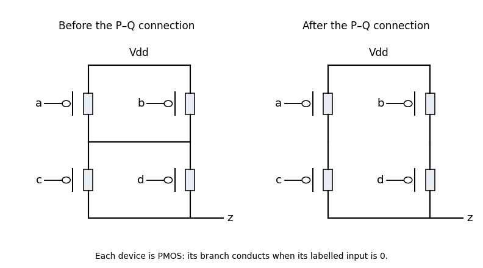

<h1 id="3/a/solution">Solution</h1>

↑ **Parent:** [A](../a.md)

The two lower conducting branches are the series pairs controlled by $a,b$ and by $c,d$. Their overall [NMOS transistor](../../../../../nmos-transistor.md) conduction condition is $ab\lor cd$. Apply [complementary CMOS network duality](../../../../../complementary-cmos-network-duality.md): the upper network has **the parallel pair of [PMOS transistors](../../../../../pmos-transistor.md) controlled by $a,b$, in series with the parallel pair controlled by $c,d$**. Its first end connects to the high rail, its last end connects to $z$, and the junction between the two pairs is internal to the upper network.

**[Figure 1](#3/a/image-original-completed-pull-up-networks-derived-by-complementary-cmos-network-duality). Original completed pull-up networks derived by complementary CMOS network duality**.

The left panel gives that completion. Every upper transistor uses its correspondingly named input and conducts when that input is low. Its conducting condition is $(\neg a\lor\neg b)\land(\neg c\lor\neg d)$, exactly the complement of the lower condition. Thus the ideal static circuit connects the output to one supply rail for every stable binary input.

## ↑ Ancestors (12)

1. [A](../a.md)
2. [3](../../3.md)
3. [Digital systems, linear algebra, introduction to formal proof resit](../../../digital-systems-linear-algebra-introduction-to-formal-proof-resit-split.md)
4. [2019](../../../split.md)
5. [Past exam of the year 1 of the computer science course of the University of Oxford](../../../../split.md)
6. [Year 1 of the computer science course of the University of Oxford](../../../../../year-1-of-the-computer-science-course-of-the-university-of-oxford.md)
7. [Computer science course of the University of Oxford](../../../../../computer-science-course-of-the-university-of-oxford.md)
8. [Undergraduate course of the University of Oxford](../../../../../undergraduate-course-of-the-university-of-oxford.md)
9. [Course of the University of Oxford](../../../../../course-of-the-university-of-oxford.md)
10. [University of Oxford](../../../../../university-of-oxford-split.md)
11. [List of universities](../../../../../list-of-universities.md)
12. [Codex Wiki](../../../../../split.md)
