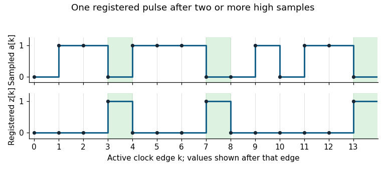

<h1 id="3/e/solution">Solution</h1>

↑ **Parent:** [E](../e.md)

Let $a_k$ be the input sampled at clock edge $k$. The desired registered output after that edge is **$z_k=a_{k-2}a_{k-1}(1-a_k)$**. Only the last two high samples matter: a longer high run still has two high samples immediately before its first low sample.

A direct [synchronous 110 detector](../../../../../synchronous-110-detector.md) uses three [D flip-flops](../../../../../d-flip-flop.md), holding $q_1,q_2,z$, with a common clock and initial state zero. Use the following next-state equations, all evaluated from the old state and the input at the active clock edge:

$$
q_1^+=a,\qquad q_2^+=q_1\land a,\qquad z^+=q_2\land\neg a.
$$

After an edge, $q_1$ records the latest sample and $q_2$ records whether the latest two samples were high. The final equation consequently produces the required pulse from the preceding two-high state and the new low sample. A synchronous reset sets all three state bits to zero. The output is the stored `z` flip-flop value, so it changes only after clock edges; exposing the unregistered expression $q_2\land\neg a$ would let input transitions between edges alter the output.

**[Figure 2](#3/e/image-original-sampled-input-and-registered-output-trace-for-a-synchronous-110-detector). Original sampled-input and registered-output trace for a synchronous 110 detector**.

An equivalent [finite-state machine](../../../../../finite-state-machine.md) has states `R` (no current high run), `H` (one high), `HH` (at least two highs), and `P` (the pulse state). Its output is one only in `P`:

| State | Next on 0 | Next on 1 | Output |
| --- | --- | --- | --- |
| `R` | `R` | `H` | 0 |
| `H` | `R` | `HH` | 0 |
| `HH` | `P` | `HH` | 0 |
| `P` | `R` | `H` | 1 |

The pulse cannot last two cycles: after the low input that creates it, $q_2$ is zero, so the next output is zero regardless of the next input. The detector rearms without a global stop and handles repeated patterns indefinitely. The three-flip-flop construction is deliberately direct; minimum storage was not required.

## ↑ Ancestors (12)

1. [E](../e.md)
2. [3](../../3.md)
3. [Digital systems, linear algebra, introduction to formal proof resit](../../../digital-systems-linear-algebra-introduction-to-formal-proof-resit-split.md)
4. [2019](../../../split.md)
5. [Past exam of the year 1 of the computer science course of the University of Oxford](../../../../split.md)
6. [Year 1 of the computer science course of the University of Oxford](../../../../../year-1-of-the-computer-science-course-of-the-university-of-oxford.md)
7. [Computer science course of the University of Oxford](../../../../../computer-science-course-of-the-university-of-oxford.md)
8. [Undergraduate course of the University of Oxford](../../../../../undergraduate-course-of-the-university-of-oxford.md)
9. [Course of the University of Oxford](../../../../../course-of-the-university-of-oxford.md)
10. [University of Oxford](../../../../../university-of-oxford-split.md)
11. [List of universities](../../../../../list-of-universities.md)
12. [Codex Wiki](../../../../../split.md)
