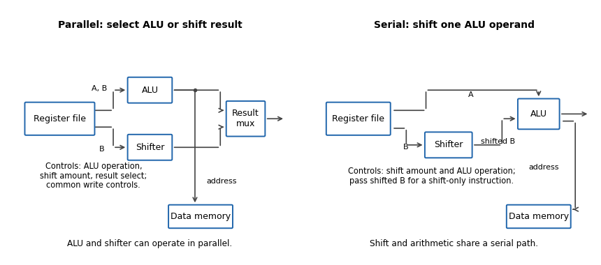
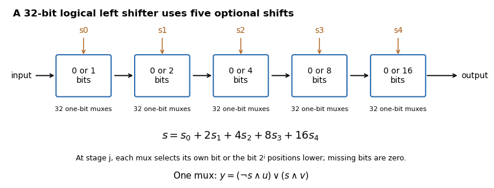
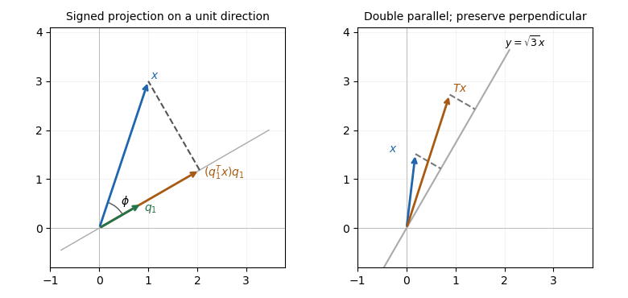

# Digital systems, linear algebra, introduction to formal proof

↑ **Parent:** [2019](../2019.md)

The regular [University of Oxford](../../university-of-oxford.md) preliminary examination was held on 20 June 2019, from 14:30 to 17:30. These solutions cover every marked part of all eight questions: digital systems in Questions 1–3, [linear algebra](../../linear-algebra.md) in Questions 4–6, and [natural deduction](../../mathematical-logic.md#natural-deduction) in Questions 7–8, including questions beyond the examination's permitted choice. The supplied [Thumb instruction set](../../computer-science.md#thumb-instruction-set) reference and primitive proof rules are part of the held paper.

Source release: [Oxford Computer Science examination archive](https://www.whatdotheyknow.com/request/ba_computer_science_past_papers/response/2577745/attach/2/202402%20183%20CS%20Papers.zip?cookie_passthrough=1), member `2018/T/a10101w1.pdf`. The native cover establishes the 2019 regular sitting despite the archive's `2018/T` directory. The printed code is `A10101W1`. A correction to a printed invariant bound is explained in Question 1(e); all inputs needed for the remaining solutions are present.

**Table of contents**

- [1](#1)
  - [a](#1/a)
    - [Solution](#1/a/solution)
  - [b](#1/b)
    - [Solution](#1/b/solution)
  - [c](#1/c)
    - [Solution](#1/c/solution)
  - [d](#1/d)
    - [Solution](#1/d/solution)
  - [e](#1/e)
    - [Solution](#1/e/solution)
- [2](#2)
  - [a](#2/a)
    - [Solution](#2/a/solution)
  - [b](#2/b)
    - [Solution](#2/b/solution)
- [3](#3)
  - [a](#3/a)
    - [Solution](#3/a/solution)
  - [b](#3/b)
    - [Solution](#3/b/solution)
  - [c](#3/c)
    - [Solution](#3/c/solution)
  - [d](#3/d)
    - [Solution](#3/d/solution)
  - [e](#3/e)
    - [Solution](#3/e/solution)
- [4](#4)
  - [a](#4/a)
    - [i](#4/a/i)
      - [Solution](#4/a/i/solution)
    - [ii](#4/a/ii)
      - [Solution](#4/a/ii/solution)
  - [b](#4/b)
    - [i](#4/b/i)
      - [Solution](#4/b/i/solution)
    - [ii](#4/b/ii)
      - [Solution](#4/b/ii/solution)
  - [c](#4/c)
    - [i](#4/c/i)
      - [Solution](#4/c/i/solution)
    - [ii](#4/c/ii)
      - [Solution](#4/c/ii/solution)
    - [iii](#4/c/iii)
      - [Solution](#4/c/iii/solution)
- [5](#5)
  - [a](#5/a)
    - [Solution](#5/a/solution)
  - [b](#5/b)
    - [Solution](#5/b/solution)
  - [c](#5/c)
    - [Solution](#5/c/solution)
  - [d](#5/d)
    - [Solution](#5/d/solution)
  - [e](#5/e)
    - [i](#5/e/i)
      - [Solution](#5/e/i/solution)
    - [ii](#5/e/ii)
      - [Solution](#5/e/ii/solution)
  - [f](#5/f)
    - [i](#5/f/i)
      - [Solution](#5/f/i/solution)
    - [ii](#5/f/ii)
      - [Solution](#5/f/ii/solution)
- [6](#6)
  - [a](#6/a)
    - [i](#6/a/i)
      - [Solution](#6/a/i/solution)
    - [ii](#6/a/ii)
      - [Solution](#6/a/ii/solution)
    - [iii](#6/a/iii)
      - [Solution](#6/a/iii/solution)
    - [iv](#6/a/iv)
      - [Solution](#6/a/iv/solution)
    - [v](#6/a/v)
      - [Solution](#6/a/v/solution)
  - [b](#6/b)
    - [Solution](#6/b/solution)
- [7](#7)
  - [a](#7/a)
    - [Solution](#7/a/solution)
  - [b](#7/b)
    - [Solution](#7/b/solution)
  - [c](#7/c)
    - [i](#7/c/i)
      - [Solution](#7/c/i/solution)
    - [ii](#7/c/ii)
      - [Solution](#7/c/ii/solution)
  - [d](#7/d)
    - [Solution](#7/d/solution)
  - [e](#7/e)
    - [Solution](#7/e/solution)
- [8](#8)
  - [a](#8/a)
    - [Solution](#8/a/solution)
  - [b](#8/b)
    - [Solution](#8/b/solution)
  - [c](#8/c)
    - [Solution](#8/c/solution)
  - [d](#8/d)
    - [i](#8/d/i)
      - [Solution](#8/d/i/solution)
    - [ii](#8/d/ii)
      - [Solution](#8/d/ii/solution)

## 1

↑ **Parent:** [Digital systems, linear algebra, introduction to formal proof](digital-systems-linear-algebra-introduction-to-formal-proof.md)

<h3 id="1/a">a</h3>

↑ **Parent:** [1](#1)

<h4 id="1/a/solution">Solution</h4>

↑ **Parent:** [A](#1/a)

Write the [bit vector](../../information-theory.md#bit-vector) as $a=(a_{n-1},\ldots,a_0)$, with $a_0$ the [least significant bit](../../integer.md#least-significant-bit). Its [unsigned interpretation of a bit string](../../arithmetic.md#unsigned-interpretation-of-a-bit-string) is **$\operatorname{bin}(a)=\sum_{i=0}^{n-1}a_i2^i$**, where each $a_i\in\{0,1\}$. The range is the [integers](../../integer.md) from $0$ through $2^n-1$; a leading one contributes positive weight $2^{n-1}$, not a sign.

<h3 id="1/b">b</h3>

↑ **Parent:** [1](#1)

<h4 id="1/b/solution">Solution</h4>

↑ **Parent:** [B](#1/b)

Put $M=2^n$ for an $n$-bit [processor register](../../computer-science.md#processor-register). The [carry flag](../../computer-science.md#carry-flag) for addition satisfies **$\operatorname{bin}(x)+\operatorname{bin}(y)=\operatorname{bin}(z)+MC$**: the result retains the low $n$ [bits](../../information-theory.md#bit) and $C=1$ records an [arithmetic carry](../../arithmetic.md#carry-arithmetic) beyond them.

For the [ARM architecture family](../../computer-science.md#arm-architecture-family) subtraction convention, **$\operatorname{bin}(x)-\operatorname{bin}(y)=\operatorname{bin}(z)-M(1-C)$**. Thus $C=1$ means _no borrow_, equivalently the unsigned minuend is at least the subtrahend. This flag is different from signed overflow: an [arithmetic carry](../../arithmetic.md#carry-arithmetic) decision is not a test of the signed result.

<h3 id="1/c">c</h3>

↑ **Parent:** [1](#1)

<h4 id="1/c/solution">Solution</h4>

↑ **Parent:** [C](#1/c)

Let `r1:r0` hold the first operand, high limb first, and `r3:r2` the second. In [assembly language](../../programming-language.md#assembly-language) the addition can be written:

```
adds r0, r0, r2
adcs r1, r1, r3
```

The first instruction produces the low result and its [arithmetic carry](../../arithmetic.md#carry-arithmetic); the second immediately consumes that [arithmetic carry](../../arithmetic.md#carry-arithmetic) while adding the high limbs. No intervening flag-setting instruction is permitted.

For a [proof](../../foundations-of-mathematics.md#mathematical-proof), put $M=2^{32}$ and denote the input limbs by $X_1,X_0,Y_1,Y_0$. If the low addition gives $Z_0$ and [arithmetic carry](../../arithmetic.md#carry-arithmetic) $c$, then $X_0+Y_0=Z_0+Mc$. The high addition gives $Z_1$ and final [arithmetic carry](../../arithmetic.md#carry-arithmetic) $d$, so $X_1+Y_1+c=Z_1+Md$. Multiplying the second identity by $M$ and combining yields

$$
(MX_1+X_0)+(MY_1+Y_0)=MZ_1+Z_0+M^2d.
$$

**The [processor register](../../computer-science.md#processor-register) pair is the correct result [modulo](../../modular-arithmetic.md#modulo-operation) $2^{64}$**, and the final [arithmetic carry](../../arithmetic.md#carry-arithmetic) records overflow beyond that unsigned width. If the mathematical sum fits in 64 [bits](../../information-theory.md#bit), no reduction changes it.

<h3 id="1/d">d</h3>

↑ **Parent:** [1](#1)

<h4 id="1/d/solution">Solution</h4>

↑ **Parent:** [D](#1/d)

A [subtract with carry](../../computer-science.md#subtract-with-carry) instruction consumes the _no-borrow_ [carry flag](../../computer-science.md#carry-flag). Its arithmetic is **$Z=X-Y-(1-C_{\mathrm{in}})\pmod{2^{32}}$**. Hence a low-limb `subs` followed immediately by a high-limb `sbcs` propagates exactly the low subtraction's borrow.

For example, with the same limb assignment as in (c):

```
subs r0, r0, r2
sbcs r1, r1, r3
```

It uses an ordinary 32-bit [adder](../../theoretical-computer-science.md#adder) by complementing every [bit](../../information-theory.md#bit) of the subtrahend and adding the incoming [arithmetic carry](../../arithmetic.md#carry-arithmetic). For $M=2^{32}$, the unreduced [adder](../../theoretical-computer-science.md#adder) sum is

$$
X+(M-1-Y)+C_{\mathrm{in}}.
$$

If this is $Z+MC_{\mathrm{out}}$, rearrangement gives $X-Y-(1-C_{\mathrm{in}})=Z-M(1-C_{\mathrm{out}})$. Thus both the result and outgoing no-borrow flag have the required meanings. With incoming [arithmetic carry](../../arithmetic.md#carry-arithmetic) one this becomes ordinary subtraction.[Page 1, Add with carry and Subtract with carry: subtraction subtracts NOT C-bit](../../computer-science-bibliography.md#thumb-16-bit-instruction-set-quick-reference-by-arm)

<h3 id="1/e">e</h3>

↑ **Parent:** [1](#1)

<h4 id="1/e/solution">Solution</h4>

↑ **Parent:** [E](#1/e)

**Use four working [processor registers](../../computer-science.md#processor-register) by packing the growing [quotient](../../arithmetic.md#quotient) into the vacated low [bits](../../information-theory.md#bit) of the shifting dividend.** The following is A32 [assembly language](../../programming-language.md#assembly-language) with conditional execution, an allowed instance of the question's general 32-bit [Reduced instruction set computer](../../computer-science.md#reduced-instruction-set-computer). It is not restricted to the sixteen-bit encodings in the supplied [Thumb instruction set](../../computer-science.md#thumb-instruction-set) table. On entry `r0` is the dividend and `r1` the positive divisor; `r2` becomes the high [remainder](../../integer.md#remainder) [machine word](../../computer-science.md#machine-word) and `r3` counts iterations. The [quotient](../../arithmetic.md#quotient) is returned in `r0` and the ordinary [remainder](../../integer.md#remainder) remains in `r2`.

```
mov   r2, #0
mov   r3, #32
loop:
adds  r0, r0, r0
adcs  r2, r2, r2
cmp   r2, r1
subcs r2, r2, r1
adc   r0, r0, #0
subs  r3, r3, #1
bne   loop
bx    lr
```

Here `subcs` means conditional `sub` when [arithmetic carry](../../arithmetic.md#carry-arithmetic) is set, **without** the flag-setting suffix. `adc` also preserves flags. Consequently the [arithmetic carry](../../arithmetic.md#carry-arithmetic) from `cmp` survives until it is inserted as the next [quotient](../../arithmetic.md#quotient) [bit](../../information-theory.md#bit). The loop has seven instructions, one of them conditional, and no data-dependent branch. Its sole branch is the backwards loop branch, taken 31 times. It uses no separate [quotient](../../arithmetic.md#quotient) [processor register](../../computer-science.md#processor-register), zero [processor register](../../computer-science.md#processor-register), temporary comparison [processor register](../../computer-science.md#processor-register) or saved [arithmetic carry](../../arithmetic.md#carry-arithmetic) [processor register](../../computer-science.md#processor-register). A [Thumb instruction set](../../computer-science.md#thumb-instruction-set) rendering using conditional execution would need an explicit conditional-execution encoding such as `it cs`; that is an additional encoded instruction, not an unexplained free operation.

The [packed restoring division](../../arithmetic.md#packed-restoring-division) [loop invariant](../../algorithm.md#loop-invariant) relates it to the displayed algorithm. Specifically, let $M=2^{32}$, let $a$ retain its original mathematical value, and let $k$ be the number of completed iterations. Define the processed prefix $p_k=\lfloor a/2^{32-k}\rfloor$, its [quotient](../../arithmetic.md#quotient) $Q_k=\lfloor p_k/b\rfloor$ and [remainder](../../integer.md#remainder) $R_k=p_k-bQ_k$. The [processor register](../../computer-science.md#processor-register) [loop invariant](../../algorithm.md#loop-invariant) is

$$
\text{high}=R_k,\qquad \text{low}=(a2^k\bmod M)+Q_k,\qquad 0\le Q_k<2^k.
$$

The two terms in the low [machine word](../../computer-science.md#machine-word) occupy disjoint [bit](../../information-theory.md#bit) positions. Its next outgoing [arithmetic carry](../../arithmetic.md#carry-arithmetic) is therefore the next _original dividend [bit](../../information-theory.md#bit)_, not a [quotient](../../arithmetic.md#quotient) [bit](../../information-theory.md#bit). `adds` shifts the low [machine word](../../computer-science.md#machine-word); `adcs` doubles the high [remainder](../../integer.md#remainder) and incorporates that dividend [bit](../../information-theory.md#bit). `cmp` decides whether this trial [remainder](../../integer.md#remainder) is at least the divisor; `subcs` performs the conditional subtraction, and `adc` appends its decision to the shifted [quotient](../../arithmetic.md#quotient). This is exactly the doubling, compare/subtract and quotient-bit update, with the counter maintained separately. Before processing [bit](../../information-theory.md#bit) $k\le32$, the trial [remainder](../../integer.md#remainder) is at most $p_k<2^k\le M$, so the high-word addition does not require a hidden 33rd [remainder](../../integer.md#remainder) [bit](../../information-theory.md#bit) for this 32-bit dividend problem. After 32 iterations the residual dividend portion is zero, giving the stated outputs.

There is a **printed source error** in the auxiliary bound. At the initial state, choosing valid inputs $a=b=1$ makes the printed strict inequality $r2^j<b2^{32}$ false. The algorithm instead preserves $0\le r<b2^{32}$ for its _unpacked 64-bit_ variable, together with its printed equality [loop invariant](../../algorithm.md#loop-invariant). Doubling and subtracting $b2^{32}$ when necessary preserves that corrected bound. At termination the equality becomes $a2^{32}=qb2^{32}+r$; since $r$ is then divisible by $2^{32}$, it gives $0\le a-qb<b$. This source error does not invalidate the algorithm or the packed implementation. The figure is mathematical pseudocode: its `2^32` denotes exponentiation, rather than C's XOR operator.

The displayed A32 routine assembled successfully with Clang and was disassembled to check the conditional and non-flag-setting forms. Its [carry flag](../../computer-science.md#carry-flag) model was checked exhaustively at an eight-bit [machine word](../../computer-science.md#machine-word) size and against boundary and randomized 32-bit divisions. No native [ARM architecture family](../../computer-science.md#arm-architecture-family) execution is claimed.

## 2

↑ **Parent:** [Digital systems, linear algebra, introduction to formal proof](digital-systems-linear-algebra-introduction-to-formal-proof.md)

<h3 id="2/a">a</h3>

↑ **Parent:** [2](#2)

<h4 id="2/a/solution">Solution</h4>

↑ **Parent:** [A](#2/a)

**A short [interrupt handler](../../operating-system.md#interrupt-handler) should acknowledge the detector and count work; a timed [finite-state machine](../../foundations-of-mathematics.md#finite-state-machine) should generate the flashes. A [Boolean](../../programming-language.md#boolean-data-type) “someone arrived” variable cannot preserve several queued detections.** This is an [interrupt-driven pulse sequencer](../../foundations-of-mathematics.md#interrupt-driven-pulse-sequencer). Initialise the light off, the pending-event counter to zero and the sequencer to `IDLE` before enabling [interrupts](../../operating-system.md#interrupt).

In the following pseudocode, [interrupt](../../operating-system.md#interrupt) acknowledgement uses the source-specified operation of writing zero. The [atomic operation](../../operating-system.md#atomic-operation) and timer calls name abstract services, not undocumented [device registers](../../computer-science.md#device-register) of a particular microcontroller.

```
eye_handler():
    if EYE_DETECTED != 0:
        EYE_DETECTED = 0
        pending = pending + 1

try_take_event():
    briefly mask the detector interrupt
    if pending == 0: taken = false
    else: pending = pending - 1; taken = true
    restore the previous interrupt mask
    return taken

service(now):
    if state == ON and elapsed(now, started) >= one_second:
        LIGHT = 0
        state = GAP
        started = now
    if state == GAP and elapsed(now, started) >= one_second:
        state = IDLE
    if state == IDLE and try_take_event():
        LIGHT = 1
        state = ON
        started = now
```

The main program repeatedly handles a new event or the next timer deadline and calls `service`. The `ON` state lasts one second; **every completed flash enters `GAP`, even if the queue is empty at that instant**. An arrival during that gap must wait for it to expire. Otherwise turning the light off and immediately treating the device as idle could allow a new flash too soon. Once a gap has expired, a queued event starts a new flash; if no work is pending the device remains idle. Removing a pending event only when a flash starts gives one completed flash per consumed event.

An [interrupt](../../operating-system.md#interrupt) can arrive during the main program's decrement. Without a [critical section](../../operating-system.md#critical-section), its increment can be overwritten by a [race condition](../../operating-system.md#race-condition). Merely declaring the counter `volatile`, as in [volatile-qualified objects in C](../../programming-language.md#volatile-qualified-objects-in-c), does not make the decrement an [atomic operation](../../operating-system.md#atomic-operation). Short [interrupt masking](../../operating-system.md#interrupt-masking), or an appropriate [atomic operation](../../operating-system.md#atomic-operation), protects it; [interrupts](../../operating-system.md#interrupt) must remain enabled during the one-second intervals so that detections continue to be recorded.

A calibrated [busy-wait](../../computer-science.md#busy-waiting) loop is simple, but occupies the [CPU](../../computer-science.md#central-processing-unit) and its duration depends on instruction timing, compiler transformations and time spent in [interrupts](../../operating-system.md#interrupt). Polling a [hardware timer](../../foundations-of-mathematics.md#hardware-timer) avoids calibration dependence but still consumes [CPU](../../computer-science.md#central-processing-unit) while polling. A [timer interrupt](../../operating-system.md#timer-interrupt) or timer comparison deadline permits useful work or safe sleeping between transitions and is preferable for precise timing. If sleeping, the test for queued work and entry into sleep must avoid a [lost wake-up](../../operating-system.md#lost-wake-up). By the [modulo-counter elapsed-time identity](../../modular-arithmetic.md#modulo-counter-elapsed-time-identity), a wrapping [digital counter](../../foundations-of-mathematics.md#digital-counter) is usable if elapsed-time subtraction is unsigned and the real observation interval is less than its modulus; a wide enough counter or suitable bounded intervals make this explicit. Software dispatch adds bounded latency, so the specification is achieved to timer/interrupt-service resolution; stricter physical pulse-width requirements call for hardware output comparison or a suitably prioritised timer handler.

Finally, the [device register](../../computer-science.md#device-register) is only a [single-bit event latch](../../operating-system.md#single-bit-event-latch). Two physical detections before acknowledgement may coalesce, so no software can recover their multiplicity from that [bit](../../information-theory.md#bit) alone. The [event counter](../../operating-system.md#event-counter) must also have enough capacity for the allowed backlog; indefinitely many arrivals faster than one flash every two seconds cannot be guaranteed with finite storage. These are explicit hardware/rate assumptions, not missing input files. Keeping the handler short minimises the rearming interval but cannot abolish those limitations.

<h3 id="2/b">b</h3>

↑ **Parent:** [2](#2)

<h4 id="2/b/solution">Solution</h4>

↑ **Parent:** [B](#2/b)

**Maintain a counter and independent timed [finite-state machine](../../foundations-of-mathematics.md#finite-state-machine) for each detector–light pair, while sharing the [interrupt](../../operating-system.md#interrupt) scan and timer infrastructure.** Blocking for one channel's flash would unnecessarily delay every other channel.

```
eye_handler():
    for i in all_channels:
        if EYE_DETECTED[i] != 0:
            EYE_DETECTED[i] = 0
            pending[i] = pending[i] + 1

main_event_loop():
    initialise each LIGHT[i] = 0
    initialise pending[i] = 0, state[i] = IDLE
    enable detector interrupts
    forever:
        now = monotonic_timer_snapshot()
        for i in all_channels:
            service_channel(i, now)
        arrange the next wake-up for new work or the earliest deadline
```

`service_channel` is the three-state sequencer from (a), with its own `started[i]` and an interrupt-safe `try_take_event(i)`. [Shared interrupt demultiplexing](../../operating-system.md#shared-interrupt-demultiplexing) uses separate `if` tests, not an `else if` chain: simultaneous pending detectors must all be acknowledged and counted. If a new detector becomes pending during the scan, the controller must retrigger while a flag remains set or the handler must rescan appropriately; the exact [interrupt controller](../../operating-system.md#interrupt-controller) semantics must be checked rather than assuming a single scan can never miss an edge.

One [hardware timer](../../foundations-of-mathematics.md#hardware-timer) can schedule the earliest active channel deadline. On its expiry, service every due channel and rearm for the next deadline; a periodic tick with adequate resolution is a simpler alternative. Detectors and the timer can then interleave without serial one-second waits. The handler/main-program counter accesses need the same short [critical section](../../operating-system.md#critical-section) protection as in (a). Keep timing state in one execution context, or protect it too if both a timer handler and the main program modify it.

The [loop invariants](../../algorithm.md#loop-invariant) are per channel: the pending count equals recorded but unstarted events, `ON` means that channel's light is on, and `GAP` prevents a new flash until one second after its preceding light-off transition. Different channels may flash simultaneously. The [event latch](../../operating-system.md#single-bit-event-latch) rearming limitation, finite backlog capacity and timer-resolution qualifications apply independently to each channel. These cannot be solved by replacing several [event counters](../../operating-system.md#event-counter) with one global [Boolean variable](../../theoretical-computer-science.md#boolean-variable).

## 3

↑ **Parent:** [Digital systems, linear algebra, introduction to formal proof](digital-systems-linear-algebra-introduction-to-formal-proof.md)

<h3 id="3/a">a</h3>

↑ **Parent:** [3](#3)

<h4 id="3/a/solution">Solution</h4>

↑ **Parent:** [A](#3/a)

The following original schematic shows the two data organisations. Register-address, write-enable and memory controls are common background; the diagram highlights the changed [combinational logic](../../theoretical-computer-science.md#combinational-logic) paths.

<a id="3/a/image-parallel-alu-shifter-selection-versus-a-shifter-feeding-one-alu-operand"></a>


**[Figure 1](#3/a/image-parallel-alu-shifter-selection-versus-a-shifter-feeding-one-alu-operand). Parallel ALU/shifter selection versus a shifter feeding one ALU operand**.

In the parallel design the result-source [multiplexer](../../theoretical-computer-science.md#multiplexer) selects either the [arithmetic logic unit](../../computer-science.md#arithmetic-logic-unit) or [barrel shifter](../../theoretical-computer-science.md#barrel-shifter). Its control is additional to the [ALU](../../computer-science.md#arithmetic-logic-unit) function and shift amount. **(i) Addition:** read the two operands, select [ALU](../../computer-science.md#arithmetic-logic-unit) addition and select the [ALU](../../computer-science.md#arithmetic-logic-unit) result; the shift amount is irrelevant. **(ii) Constant [left bit shift](../../programming-language.md#left-bit-shift):** read the operand to be shifted, set the shift amount from the [immediate operand](../../computer-science.md#immediate-operand) and select the [barrel shifter](../../theoretical-computer-science.md#barrel-shifter) result; the [ALU](../../computer-science.md#arithmetic-logic-unit) operation is irrelevant.

In the serial design the result comes through the [ALU](../../computer-science.md#arithmetic-logic-unit), so that result-source selection disappears. Its shift-amount control is now relevant to arithmetic as well. **(i) Addition:** set the [barrel shifter](../../theoretical-computer-science.md#barrel-shifter) to zero shift and select [ALU](../../computer-science.md#arithmetic-logic-unit) addition, so its inputs are the unshifted [processor register](../../computer-science.md#processor-register) values. **(ii) Constant [left bit shift](../../programming-language.md#left-bit-shift):** set the requested shift and select an [ALU](../../computer-science.md#arithmetic-logic-unit) operation that passes the shifted operand through. If the [ALU](../../computer-science.md#arithmetic-logic-unit) lacks that operation, implement it or provide a selectable zero on its other input and add zero. This requirement should be stated, rather than assuming that an ordinary two-input add automatically performs a shift alone.

The [ALU](../../computer-science.md#arithmetic-logic-unit) result can still supply the memory address. For a register-result instruction, enable [processor register](../../computer-science.md#processor-register) writeback and leave memory writes disabled. If the ISA requires shift [carry flags](../../computer-science.md#carry-flag), the flag-generation control must retain the [barrel shifter](../../theoretical-computer-science.md#barrel-shifter)'s outgoing-bit information; blindly using a pass-through [ALU](../../computer-science.md#arithmetic-logic-unit)'s [arithmetic carry](../../arithmetic.md#carry-arithmetic) is insufficient.

<h3 id="3/b">b</h3>

↑ **Parent:** [3](#3)

<h4 id="3/b/solution">Solution</h4>

↑ **Parent:** [B](#3/b)

**Use five cascaded banks of 32 two-input [multiplexers](../../theoretical-computer-science.md#multiplexer), for optional shifts of $1,2,4,8,16$ [bits](../../information-theory.md#bit).** The original circuit schematic below shows one bank per shift-amount [bit](../../information-theory.md#bit); this is a [left bit shift](../../programming-language.md#left-bit-shift) with zero fill, not a [bit rotation](../../programming-language.md#bit-rotation).

<a id="3/b/image-five-optional-power-of-two-shifts-implement-every-32-bit-logical-left-shift-distance"></a>


**[Figure 2](#3/b/image-five-optional-power-of-two-shifts-implement-every-32-bit-logical-left-shift-distance). Five optional power-of-two shifts implement every 32-bit logical left-shift distance**.

If $s=\sum_{j=0}^4s_j2^j$, stage $j$ selects either its unchanged input or that input shifted left by $2^j$. For [bit](../../information-theory.md#bit) position $i$, the shifted candidate comes from position $i-2^j$ when it exists, and otherwise from zero. Composing the chosen stages shifts by the sum of their distances, so each amount from $0$ to $31$ is represented exactly by its five binary control [bits](../../information-theory.md#bit). There are $5\times32=160$ one-bit [multiplexers](../../theoretical-computer-science.md#multiplexer), with five [multiplexer](../../theoretical-computer-science.md#multiplexer) delays along a [bit](../../information-theory.md#bit) path.

A one-bit [multiplexer](../../theoretical-computer-science.md#multiplexer) with selector $s$, unselected input $u$ and selected input $v$ has output **$(\neg s\land u)\lor(s\land v)$**. It can be made from one [NOT gate](../../theoretical-computer-science.md#not-gate), two [AND gates](../../mathematical-logic.md#and-gate) and an [OR gate](../../mathematical-logic.md#or-gate); a bank can share the selector inversion. The two possible selector values directly verify its behaviour.

<h3 id="3/c">c</h3>

↑ **Parent:** [3](#3)

<h4 id="3/c/solution">Solution</h4>

↑ **Parent:** [C](#3/c)

[SP-relative addressing](../../computer-science.md#sp-relative-addressing) forms an effective memory address by adding an offset to the [stack pointer](../../computer-science.md#stack-pointer). It accesses local variables, saved [processor registers](../../computer-science.md#processor-register) or other stack-frame data without dedicating a separate base [processor register](../../computer-science.md#processor-register) for each object. The supplied reference gives word-aligned SP-relative offsets from $0$ to $1020$, which corresponds to an eight-bit nonnegative field scaled by four.

In the modified [datapath](../../computer-science.md#datapath), select the [stack pointer](../../computer-science.md#stack-pointer) for the unshifted [ALU](../../computer-science.md#arithmetic-logic-unit) input, the instruction [immediate operand](../../computer-science.md#immediate-operand) for the [barrel shifter](../../theoretical-computer-science.md#barrel-shifter) input, and [ALU](../../computer-science.md#arithmetic-logic-unit) addition. The effective address can then be **$\mathrm{SP}+(\mathrm{imm}\ll s)$**. Scaling the [immediate operand](../../computer-science.md#immediate-operand) changes the reachable displacement range without storing a larger [immediate operand](../../computer-science.md#immediate-operand). For example, an eight-bit field shifted by two reaches offsets through $255\times4=1020$; shifting it by four reaches through $4080$, but only on a sixteen-byte grid. Larger range and finer address granularity are different properties, so the extra reach is not free arbitrary-byte addressing.

The parallel layout cannot feed a shifted [immediate operand](../../computer-science.md#immediate-operand) directly into its address-producing [ALU](../../computer-science.md#arithmetic-logic-unit) in the same pass. The serial layout can. The actual [immediate operand](../../computer-science.md#immediate-operand) width and permitted shift encodings of a new instruction must be specified; the question does not fix them, so no particular enlarged instruction encoding is implied.

<h3 id="3/d">d</h3>

↑ **Parent:** [3](#3)

<h4 id="3/d/solution">Solution</h4>

↑ **Parent:** [D](#3/d)

A useful additional mode is **base plus [scaled register indexing](../../computer-science.md#scaled-index-addressing)**, with effective address $B+(I\ll s)$. For an [array](../../data-structure.md#array-data-structure) of four-byte elements choose $s=2$, use its base address on the unshifted [ALU](../../computer-science.md#arithmetic-logic-unit) input and its index [processor register](../../computer-science.md#processor-register) on the [barrel shifter](../../theoretical-computer-science.md#barrel-shifter) input, then add. This forms an indexed [machine word](../../computer-science.md#machine-word) address in one [datapath](../../computer-science.md#datapath) pass. An eight-byte element uses $s=3$.

With parallel [ALU](../../computer-science.md#arithmetic-logic-unit) and [barrel shifter](../../theoretical-computer-science.md#barrel-shifter) outputs, shifting and adding require either separate instructions/cycles or another route from the [barrel shifter](../../theoretical-computer-science.md#barrel-shifter) to the [ALU](../../computer-science.md#arithmetic-logic-unit). The new serial connection supplies that route. This is an [addressing mode](../../computer-science.md#addressing-mode) capability, not a claim that the old instruction encoding already contains the new mode.

<h3 id="3/e">e</h3>

↑ **Parent:** [3](#3)

<h4 id="3/e/solution">Solution</h4>

↑ **Parent:** [E](#3/e)

The likely effect in a single-cycle or unchanged pipeline-stage implementation is a **longer [combinational critical path](../../theoretical-computer-science.md#combinational-critical-path) and hence a lower maximum [processor clock frequency](../../electrical-engineering.md#processor-clock-frequency)**. Previously the [barrel shifter](../../theoretical-computer-science.md#barrel-shifter) and [ALU](../../computer-science.md#arithmetic-logic-unit) could work in parallel before result selection; the modified path can require both shift and addition before address or result use.

Ignoring common [processor register](../../computer-science.md#processor-register) and wiring delays, the relevant [combinational logic](../../theoretical-computer-science.md#combinational-logic) contribution changes roughly from $\max(t_{\mathrm{ALU}},t_{\mathrm{shift}})+t_{\mathrm{mux}}$ to $t_{\mathrm{shift}}+t_{\mathrm{ALU}}$, with any additional input selection included as needed. The [processor clock period](../../electrical-engineering.md#processor-clock-period) must also cover [processor register](../../computer-science.md#processor-register) timing and the rest of the instruction path, potentially including memory access. Removing a [multiplexer](../../theoretical-computer-science.md#multiplexer) offsets some delay, so a numerical frequency change cannot be inferred without component timings. Pipelining, a faster implementation or another pre-existing bottleneck can alter the outcome; the changed serial dependence is the reason for the likely reduction.

## 4

↑ **Parent:** [Digital systems, linear algebra, introduction to formal proof](digital-systems-linear-algebra-introduction-to-formal-proof.md)

<h3 id="4/a">a</h3>

↑ **Parent:** [4](#4)

<h4 id="4/a/i">i</h4>

↑ **Parent:** [A](#4/a)

<h5 id="4/a/i/solution">Solution</h5>

↑ **Parent:** [I](#4/a/i)

For the [equal-cardinality basis criterion](../../vector-space.md#equal-cardinality-basis-criterion), because $S$ [spans](../../vector-space.md#linear-span) $V$, repeatedly remove a [vector](../../vector-space.md#vector) whenever it is a [linear combination](../../vector-space.md#linear-combination) of the others. Such a removal does not change the [span](../../vector-space.md#linear-span). The finite process ends with a [linearly independent](../../vector-space.md#linear-independence) spanning subset $T$, hence a [basis](../../vector-space.md#basis) of $V$.

If the original $S$ were [linearly dependent](../../vector-space.md#linear-dependence), at least one removal would occur and $|T|<n$. But a [basis](../../vector-space.md#basis) of an $n$-dimensional [vector space](../../vector-space.md) has $n$ [vectors](../../vector-space.md#vector). Equivalently, apply the allowed claim to the [basis](../../vector-space.md#basis) $T$ and any fixed $n$-vector [basis](../../vector-space.md#basis) of $V$: the latter would wrongly be [linearly dependent](../../vector-space.md#linear-dependence). Thus no removal was possible. **The original [spanning set](../../vector-space.md#spanning-set) is [linearly independent](../../vector-space.md#linear-independence) and therefore a [basis](../../vector-space.md#basis).**

<h4 id="4/a/ii">ii</h4>

↑ **Parent:** [A](#4/a)

<h5 id="4/a/ii/solution">Solution</h5>

↑ **Parent:** [Ii](#4/a/ii)

Suppose a [vector](../../vector-space.md#vector) $v$ lies outside the [span](../../vector-space.md#linear-span) of $S$. Then $S\cup\{v\}$ is [linearly independent](../../vector-space.md#linear-independence): in an equation $\alpha v+\sum_i\beta_i s_i=0$, a nonzero $\alpha$ would express $v$ in that [span](../../vector-space.md#linear-span), and with $\alpha=0$ the independence of $S$ forces every $\beta_i=0$.

This would give $n+1$ [linearly independent](../../vector-space.md#linear-independence) [vectors](../../vector-space.md#vector) in a space with an $n$-vector [basis](../../vector-space.md#basis), contrary to the supplied claim. Therefore $S$ [spans](../../vector-space.md#linear-span) $V$. **Independence plus spanning makes $S$ a [basis](../../vector-space.md#basis).**

<h3 id="4/b">b</h3>

↑ **Parent:** [4](#4)

<h4 id="4/b/i">i</h4>

↑ **Parent:** [B](#4/b)

<h5 id="4/b/i/solution">Solution</h5>

↑ **Parent:** [I](#4/b/i)

The product $AB$ is $m\times p$, so multiplying it by the $p\times q$ [matrix](../../vector-space.md#matrix) $C$ gives an **$m\times q$ [matrix](../../vector-space.md#matrix)**. The product $BC$ is $n\times q$, so multiplying it on the left by the $m\times n$ [matrix](../../vector-space.md#matrix) $A$ also gives an **$m\times q$ [matrix](../../vector-space.md#matrix)**. Both multiplications have matching inner [dimensions](../../vector-space.md#dimension-vector-space).

<h4 id="4/b/ii">ii</h4>

↑ **Parent:** [B](#4/b)

<h5 id="4/b/ii/solution">Solution</h5>

↑ **Parent:** [Ii](#4/b/ii)

For the specified row and column, expand the two [matrix products](../../vector-space.md#matrix-product) and reorder only [finite sums](../../arithmetic.md#finite-sum):

$$
\begin{aligned}
((AB)C)_{ij}
&=\sum_{k=1}^{p}\left(\sum_{\ell=1}^{n}A_{i\ell}B_{\ell k}\right)C_{kj}\\
&=\sum_{\ell=1}^{n}A_{i\ell}\left(\sum_{k=1}^{p}B_{\ell k}C_{kj}\right)
=(A(BC))_{ij}.
\end{aligned}
$$

The middle equality uses [scalar](../../vector-space.md#scalar) [associativity](../../algebraic-operation.md#associative-property) and [distributivity](../../algebraic-operation.md#distributive-property), and the interchange of two [finite sums](../../arithmetic.md#finite-sum). Together with their equal [dimensions](../../vector-space.md#dimension-vector-space), equality of every entry proves **$(AB)C=A(BC)$**.

<h3 id="4/c">c</h3>

↑ **Parent:** [4](#4)

<h4 id="4/c/i">i</h4>

↑ **Parent:** [C](#4/c)

<h5 id="4/c/i/solution">Solution</h5>

↑ **Parent:** [I](#4/c/i)

Eliminate the first column using multipliers $3$ and $2$. The two residual rows have second entries zero and four, so interchange their order for the next [pivot](../../probability-and-statistics.md#pivotal-quantity). One resulting [Pivoted LU decomposition](../../numerical-linear-algebra.md#pivoted-lu-decomposition) is

$$
\boxed{P=\begin{pmatrix}1&0&0\\0&0&1\\0&1&0\end{pmatrix},\quad
L=\begin{pmatrix}1&0&0\\2&1&0\\3&0&1\end{pmatrix},\quad
U=\begin{pmatrix}3&1&4\\0&4&-2\\0&0&-11\end{pmatrix}.}
$$

The factors below the first [pivot](../../probability-and-statistics.md#pivotal-quantity) must follow the permuted row order, which is why $L$ contains $2$ before $3$. Direct multiplication gives rows $(3,1,4)$, $(6,6,6)$ and $(9,3,1)$ in both $PA$ and $LU$. This checks the permutation convention rather than confusing $PA=LU$ with a different placement of $P$.

<h4 id="4/c/ii">ii</h4>

↑ **Parent:** [C](#4/c)

<h5 id="4/c/ii/solution">Solution</h5>

↑ **Parent:** [Ii](#4/c/ii)

Apply the same permutation to the right-hand side and solve two [triangular systems](../../linear-algebra.md#triangular-system). [Forward substitution](../../numerical-linear-algebra.md#forward-substitution) in $Ly=Pb$ gives

$$
y_1=3,\qquad 2y_1+y_2=0,\qquad3y_1+y_3=-2,
$$

so $y=(3,-6,-11)^T$. [Back substitution](../../linear-algebra.md#back-substitution) in $Ux=y$ gives $-11x_3=-11$, $4x_2-2x_3=-6$, and $3x_1+x_2+4x_3=3$. Therefore **$x=(0,-1,1)^T$**. Substitution in the original system returns $(3,-2,0)^T$, as required.

<h4 id="4/c/iii">iii</h4>

↑ **Parent:** [C](#4/c)

<h5 id="4/c/iii/solution">Solution</h5>

↑ **Parent:** [Iii](#4/c/iii)

A [triangular matrix](../../linear-algebra.md#triangular-matrix) has [determinant](../../multilinear-algebra.md#determinant) equal to the product of its diagonal entries, so $\det L=1$ and $\det U=3\cdot4\cdot(-11)=-132$. A [permutation matrix](../../vector-space.md#permutation-matrix) exchanging two rows has [determinant](../../multilinear-algebra.md#determinant) $-1$. Using multiplicativity of the [determinant](../../multilinear-algebra.md#determinant) in $PA=LU$ yields $(-1)\det A=-132$. Hence **$\det A=132$**.

## 5

↑ **Parent:** [Digital systems, linear algebra, introduction to formal proof](digital-systems-linear-algebra-introduction-to-formal-proof.md)

<h3 id="5/a">a</h3>

↑ **Parent:** [5](#5)

<h4 id="5/a/solution">Solution</h4>

↑ **Parent:** [A](#5/a)

For nonzero $x$, let $\phi$ be its [angle](../../geometry-and-topology.md#angle) to the [unit vector](../../vector-space.md#unit-vector) $q_1$. The [scalar projection](../../inner-product.md#scalar-projection) on the oriented $q_1$ axis is $\|x\|\cos\phi$. Since $\|q_1\|=1$, the [dot product](../../inner-product.md#dot-product) identity gives $q_1^Tx=\|x\|\cos\phi$. Multiplying that signed [scalar](../../vector-space.md#scalar) by $q_1$ places the foot at **$p=(q_1^Tx)q_1$**.

The residual is perpendicular to the axis, because $q_1^T(x-p)=q_1^Tx-(q_1^Tx)(q_1^Tq_1)=0$. An obtuse [angle](../../geometry-and-topology.md#angle) gives a negative [scalar](../../vector-space.md#scalar) and a foot on the negative side of the line; $x=0$ has projection zero without needing an [angle](../../geometry-and-topology.md#angle).

<a id="5/a/image-projection-drops-a-perpendicular-to-a-unit-direction-directional-stretching-doubles-only-the-parallel-component"></a>


**[Figure 3](#5/a/image-projection-drops-a-perpendicular-to-a-unit-direction-directional-stretching-doubles-only-the-parallel-component). Projection drops a perpendicular to a unit direction; directional stretching doubles only the parallel component**.

The first panel is a constructed geometric illustration. The second illustrates the [directional stretch](../../vector-space.md#directional-stretch) used later in Question 6.

<h3 id="5/b">b</h3>

↑ **Parent:** [5](#5)

<h4 id="5/b/solution">Solution</h4>

↑ **Parent:** [B](#5/b)

[Associativity](../../algebraic-operation.md#associative-property) of [matrix multiplication](../../vector-space.md#matrix-multiplication) identifies $(q_i^Tx)q_i=q_i(q_i^Tx)=(q_iq_i^T)x$. Thus each [matrix](../../vector-space.md#matrix) **$P_i=q_iq_i^T$** has the required action and $x=\sum_iP_ix$.

Consequently $(\sum_iP_i-I_n)x=0$ for every $x$. Taking $x$ successively as the [standard basis](../../vector-space.md#standard-basis) [vectors](../../vector-space.md#vector) shows that every column of this difference is zero. Hence **$\sum_{i=1}^nP_i=I_n$**. Equality on one selected [vector](../../vector-space.md#vector) would not suffice; here it holds on all [vectors](../../vector-space.md#vector).

<h3 id="5/c">c</h3>

↑ **Parent:** [5](#5)

<h4 id="5/c/solution">Solution</h4>

↑ **Parent:** [C](#5/c)

Using the unit length of $q_i$,

$$
P_i^2=q_iq_i^Tq_iq_i^T=q_i(q_i^Tq_i)q_i^T=q_iq_i^T=P_i.
$$

Then ordinary [matrix](../../vector-space.md#matrix) expansion gives $(I_n-P_i)^2=I_n-2P_i+P_i^2=I_n-P_i$. **Both $P_i$ and its complementary [matrix](../../vector-space.md#matrix) are [projectors](../../vector-space.md#projection-linear-algebra).** The second calculation in fact holds for every [idempotent matrix](../../function.md#idempotent-matrix), without requiring the [matrix](../../vector-space.md#matrix) to equal its [transpose](../../vector-space.md#transpose).

<h3 id="5/d">d</h3>

↑ **Parent:** [5](#5)

<h4 id="5/d/solution">Solution</h4>

↑ **Parent:** [D](#5/d)

Take **$A=\begin{pmatrix}0&1\\1&0\end{pmatrix}$**. It has exactly two nonzero entries, both one, but $A^2=I_2\ne A$. Thus it is not an [idempotent matrix](../../function.md#idempotent-matrix). Its being an [orthogonal matrix](../../linear-algebra.md#orthogonal-matrix) does not make it an [orthogonal projector](../../hilbert-space.md#orthogonal-projection).

<h3 id="5/e">e</h3>

↑ **Parent:** [5](#5)

<h4 id="5/e/i">i</h4>

↑ **Parent:** [E](#5/e)

<h5 id="5/e/i/solution">Solution</h5>

↑ **Parent:** [I](#5/e/i)

Prove both inclusions. If $v$ belongs to the [column space](../../vector-space.md#column-space) of $I-P$, then $v=(I-P)u$ for some $u$ and $Pv=(P-P^2)u=0$. Thus $v\in\mathcal N(P)$.

Conversely, if $Pv=0$, then $v=(I-P)v$, which explicitly writes $v$ as an [image of a linear map](../../vector-space.md#image-of-a-linear-map) under $I-P$. Hence $v\in\mathcal C(I-P)$. The two inclusions prove **$\mathcal N(P)=\mathcal C(I-P)$**. No [orthogonality](../../inner-product.md#orthogonal-vectors) assumption was used.

<h4 id="5/e/ii">ii</h4>

↑ **Parent:** [E](#5/e)

<h5 id="5/e/ii/solution">Solution</h5>

↑ **Parent:** [Ii](#5/e/ii)

Set $Q=I-P$. Since $Q^2=I-2P+P^2=I-P=Q$, the previous result applies to this [projector](../../vector-space.md#projection-linear-algebra) and gives $\mathcal N(Q)=\mathcal C(I-Q)$. Substituting $Q=I-P$ proves **$\mathcal N(I-P)=\mathcal C(P)$**. These are the [kernel-image identities for complementary projectors](../../vector-space.md#kernel-image-identities-for-complementary-projectors).

<h3 id="5/f">f</h3>

↑ **Parent:** [5](#5)

<h4 id="5/f/i">i</h4>

↑ **Parent:** [F](#5/f)

<h5 id="5/f/i/solution">Solution</h5>

↑ **Parent:** [I](#5/f/i)

For a [sum of mutually orthogonal projectors](../../hilbert-space.md#sum-of-mutually-orthogonal-projectors), [orthonormality](../../inner-product.md#orthonormal-set) gives $q_i^Tq_j=0$ for $i\ne j$ and one for $i=j$. Therefore $P_iP_j=q_i(q_i^Tq_j)q_j^T$ equals zero for different indices and $P_i$ for equal indices. Expanding the [finite sum](../../arithmetic.md#finite-sum) yields

$$
\overline P_k^2=\sum_{i=1}^k\sum_{j=1}^kP_iP_j=\sum_{i=1}^kP_i=\overline P_k.
$$

Thus **every stated partial sum is a [projector](../../vector-space.md#projection-linear-algebra)**. Its [image of a linear map](../../vector-space.md#image-of-a-linear-map) is the [span](../../vector-space.md#linear-span) of the first $k$ [orthonormal set](../../inner-product.md#orthonormal-set) of [vectors](../../vector-space.md#vector); arbitrary sums of [idempotent](../../commutative-algebra.md#idempotent) [matrices](../../vector-space.md#matrix) would not have this conclusion.

<h4 id="5/f/ii">ii</h4>

↑ **Parent:** [F](#5/f)

<h5 id="5/f/ii/solution">Solution</h5>

↑ **Parent:** [Ii](#5/f/ii)

The [image of a linear map](../../vector-space.md#image-of-a-linear-map) of $P_1$ is exactly the one-dimensional [span](../../vector-space.md#linear-span) of $q_1$: its formula always returns a multiple of $q_1$, and $P_1q_1=q_1\ne0$. Hence **$\operatorname{rank}(P_1)=1$**.

The [rank-nullity theorem](../../kernel-of-a-linear-map.md#rank-nullity-theorem) gives $\dim\mathcal N(P_1)=n-1$. Since $\mathcal C(I_n-P_1)=\mathcal N(P_1)$ by (e)(i), **$\operatorname{rank}(I_n-P_1)=n-1$**. This includes the case $n=1$, where the complementary [projector](../../vector-space.md#projection-linear-algebra) is zero.

## 6

↑ **Parent:** [Digital systems, linear algebra, introduction to formal proof](digital-systems-linear-algebra-introduction-to-formal-proof.md)

<h3 id="6/a">a</h3>

↑ **Parent:** [6](#6)

<h4 id="6/a/i">i</h4>

↑ **Parent:** [A](#6/a)

<h5 id="6/a/i/solution">Solution</h5>

↑ **Parent:** [I](#6/a/i)

Update the unknowns in row order, immediately using newly computed components. The component equations are

$$
\begin{aligned}
x_1^{(n)}&=-1+x_2^{(n-1)}-x_3^{(n-1)},\\
x_2^{(n)}&=\tfrac12(2-x_1^{(n)}-x_3^{(n-1)})=\tfrac32-\tfrac12x_2^{(n-1)},\\
x_3^{(n)}&=\tfrac12(-2-x_1^{(n)}+x_2^{(n)})=\tfrac14-\tfrac34x_2^{(n-1)}+\tfrac12x_3^{(n-1)}.
\end{aligned}
$$

Thus **$G=\begin{pmatrix}0&1&-1\\0&-1/2&0\\0&-3/4&1/2\end{pmatrix}$** and **$c=(-1,3/2,1/4)^T$**. Using only old values in all three row equations would instead describe the [Jacobi method](../../numerical-linear-algebra.md#jacobi-method), not the [Gauss-Seidel method](../../numerical-linear-algebra.md#gauss-seidel-method).

<h4 id="6/a/ii">ii</h4>

↑ **Parent:** [A](#6/a)

<h5 id="6/a/ii/solution">Solution</h5>

↑ **Parent:** [Ii](#6/a/ii)

From zero, the first update is **$x_1=(-1,3/2,1/4)^T$**. For the next update, the first component is $-1+3/2-1/4=1/4$, the second is $3/2-(1/2)(3/2)=3/4$, and the third is $1/4-(3/4)(3/2)+(1/2)(1/4)=-3/4$. Therefore **$x_2=(1/4,3/4,-3/4)^T$**.

<h4 id="6/a/iii">iii</h4>

↑ **Parent:** [A](#6/a)

<h5 id="6/a/iii/solution">Solution</h5>

↑ **Parent:** [Iii](#6/a/iii)

For the [spectral error bound for a diagonalizable fixed-point iteration](../../numerical-linear-algebra.md#spectral-error-bound-for-a-diagonalizable-fixed-point-iteration), the exact solution $x$ is a [fixed point](../../function.md#fixed-point): $x=Gx+c$. Subtracting it from the iteration gives the error recurrence $e_n=Ge_{n-1}$, with $e_n=x_n-x$. Multiplying by $S^{-1}$ and using $G=SDS^{-1}$ gives

$$
f_n=S^{-1}GSf_{n-1}=Df_{n-1}.
$$

Iterating proves **$f_n=D^nf_0$**, including $n=0$ because $D^0=I$. This argument does not assume $S$ is [orthogonal](../../inner-product.md#orthogonal-vectors); it simply expresses the error in an [eigenbasis](../../linear-operator-theory.md#eigenbasis).

<h4 id="6/a/iv">iv</h4>

↑ **Parent:** [A](#6/a)

<h5 id="6/a/iv/solution">Solution</h5>

↑ **Parent:** [Iv](#6/a/iv)

Write $D=\operatorname{diag}(\lambda_1,\ldots,\lambda_m)$ and let $|\Lambda|=\max_i|\lambda_i|$. The stated [Euclidean norm](../../normed-vector-space.md#euclidean-norm) gives

$$
\|f_n\|^2=\sum_i|\lambda_i|^{2n}|(f_0)_i|^2
\le |\Lambda|^{2n}\sum_i|(f_0)_i|^2=|\Lambda|^{2n}\|f_0\|^2.
$$

Taking nonnegative square roots proves **$\|f_n\|\le|\Lambda|^n\|f_0\|$**. At $n=0$ this is equality. This is a contraction bound in the transformed coordinates; an arbitrary nonorthogonal $S$ does not give the same unit-constant bound for the original error [norm](../../normed-vector-space.md#norm).

<h4 id="6/a/v">v</h4>

↑ **Parent:** [A](#6/a)

<h5 id="6/a/v/solution">Solution</h5>

↑ **Parent:** [V](#6/a/v)

The [iteration matrix](../../numerical-linear-algebra.md#iteration-matrix) has [eigenvalues](../../linear-operator-theory.md#eigenvalue) **$0,-1/2,1/2$**: expanding its [characteristic polynomial](../../linear-operator-theory.md#characteristic-polynomial) down the first column leaves the triangular two-by-two block with diagonal entries $-1/2,1/2$. The distinct [eigenvalues](../../linear-operator-theory.md#eigenvalue) ensure [diagonalizability](../../linear-operator-theory.md#diagonalizable-matrix). Thus its [spectral radius](../../analysis.md#spectral-radius) is $1/2<1$.

The previous bound gives $\|f_n\|\le2^{-n}\|f_0\|\to0$, so **the [Gauss-Seidel iteration](../../numerical-linear-algebra.md#gauss-seidel-method) converges for every initial guess** under the stated [diagonalization](../../linear-operator-theory.md#diagonalization-of-a-matrix). Its [limit](../../calculus.md#limit-of-a-function) is the exact solution $(1,1,-1)^T$. Since $e_n=Sf_n$, a fixed [matrix](../../vector-space.md#matrix) also sends this transformed error to zero; its [operator norm](../../continuous-dual-space.md#operator-norm) can account for any amplification in the original coordinates.

<h3 id="6/b">b</h3>

↑ **Parent:** [6](#6)

<h4 id="6/b/solution">Solution</h4>

↑ **Parent:** [B](#6/b)

Rotate the specified line onto the horizontal axis, stretch horizontally by two while leaving the [orthogonal](../../inner-product.md#orthogonal-vectors) component unchanged, then rotate back. With $\theta=\pi/3$ and counterclockwise [rotation matrix](../../linear-algebra.md#rotation-matrix) $R(\theta)$, the requested product is

$$
\boxed{T=R(\theta)\begin{pmatrix}2&0\\0&1\end{pmatrix}R(-\theta)
=\begin{pmatrix}5/4&\sqrt3/4\\\sqrt3/4&7/4\end{pmatrix}.}
$$

The rightmost [rotation](../../riemannian-geometry.md#rotation-mathematics) acts first. In particular, $R(\theta)=\begin{pmatrix}1/2&-\sqrt3/2\\\sqrt3/2&1/2\end{pmatrix}$ and $R(-\theta)=R(\theta)^T$. For the unit direction $u=(1/2,\sqrt3/2)^T$, the same transformation is $T=I+uu^T$. It sends $u$ to $2u$ and fixes every [orthogonal](../../inner-product.md#orthogonal-vectors) [vector](../../vector-space.md#vector), verifying that the product is a [directional stretch](../../vector-space.md#directional-stretch) rather than a [shear mapping](../../vector-space.md#shear-mapping) or scaling in every direction. The constructed second panel in the geometric figure in Question 5 illustrates this separation.

## 7

↑ **Parent:** [Digital systems, linear algebra, introduction to formal proof](digital-systems-linear-algebra-introduction-to-formal-proof.md)

<h3 id="7/a">a</h3>

↑ **Parent:** [7](#7)

<h4 id="7/a/solution">Solution</h4>

↑ **Parent:** [A](#7/a)

Use only the displayed [natural deduction](../../mathematical-logic.md#natural-deduction) rules. Let $A$ abbreviate $\phi\lor\neg\phi$. Indentation below marks [temporary assumptions](../../mathematical-logic.md#temporary-assumption); the closing rule names the assumption discharged.

```
1  | ¬A                         assume
2  | | φ                        assume
3  | | A                        ∨-intro-L, 2
4  | | ⊥                        ¬-elim, 3 and 1
5  | ¬φ                         ¬-intro, discharge 2–4
6  | A                          ∨-intro-R, 5
7  | ⊥                          ¬-elim, 6 and 1
8  ¬¬A                          ¬-intro, discharge 1–7
9  A                            ¬¬-elim, 8
```

There are no undischarged assumptions at line 9, so this proves the [law of excluded middle](../../mathematical-logic.md#law-of-excluded-middle). The use of [double-negation elimination](../../mathematical-logic.md#double-negation-elimination) is explicit; an unproved appeal to the derived RAA rule is unnecessary.

<h3 id="7/b">b</h3>

↑ **Parent:** [7](#7)

<h4 id="7/b/solution">Solution</h4>

↑ **Parent:** [B](#7/b)

Apply the complete [logical derivation](../../mathematical-logic.md#logical-derivation) of the [law of excluded middle](../../mathematical-logic.md#law-of-excluded-middle) in (a) to $Q$, obtaining $Q\lor\neg Q$. Then use the [disjunction elimination rule](../../mathematical-logic.md#disjunction-elimination-rule), constructing each [logical implication](../../mathematical-logic.md#logical-implication) by an explicit hypothetical subproof:

```
1  Q ∨ ¬Q                              result of (a), φ := Q
2  | Q                                 first case
3  | | P                               assume
4  | | Q                               available from 2
5  | P → Q                             →-intro, discharge 3–4
6  | (P → Q) ∨ (P → ¬Q)                ∨-intro-L, 5
7  | ¬Q                                second case
8  | | P                               assume
9  | | ¬Q                              available from 7
10 | P → ¬Q                            →-intro, discharge 8–9
11 | (P → Q) ∨ (P → ¬Q)                ∨-intro-R, 10
12 (P → Q) ∨ (P → ¬Q)                  ∨-elim, 1, cases 2–6 and 7–11
```

Both case assumptions and both hypothetical $P$ assumptions have been discharged. Thus the conclusion is a theorem, not a [logical implication](../../mathematical-logic.md#logical-implication) that depends on assuming $P$.

<h3 id="7/c">c</h3>

↑ **Parent:** [7](#7)

<h4 id="7/c/i">i</h4>

↑ **Parent:** [C](#7/c)

<h5 id="7/c/i/solution">Solution</h5>

↑ **Parent:** [I](#7/c/i)

Retain the two given [logical implications](../../mathematical-logic.md#logical-implication) and temporarily assume their common starting [proposition](../../mathematical-logic.md#proposition).

```
1  P → Q                    premise
2  Q → R                    premise
3  | P                      assume
4  | Q                      →-elim, 3 and 1
5  | R                      →-elim, 4 and 2
6  P → R                    →-intro, discharge 3–5
```

Only the original premises remain undischarged, giving the required composition of [logical implications](../../mathematical-logic.md#logical-implication).

<h4 id="7/c/ii">ii</h4>

↑ **Parent:** [C](#7/c)

<h5 id="7/c/ii/solution">Solution</h5>

↑ **Parent:** [Ii](#7/c/ii)

The [logical implication](../../mathematical-logic.md#logical-implication) associates to the right. Assume its two antecedents, then use nested applications of the [disjunction elimination rule](../../mathematical-logic.md#disjunction-elimination-rule).

```
1  | P ∨ Q                              assume
2  | | P ∨ ¬Q                           assume
3  | | | P                              first case of 1
4  | | | P                              available from 3
5  | | | Q                              second case of 1
6  | | | | P                            first case of 2
7  | | | | P                            available from 6
8  | | | | ¬Q                           second case of 2
9  | | | | ⊥                            ¬-elim, 5 and 8
10 | | | | P                            ⊥-elim, 9
11 | | | P                              ∨-elim, 2, cases 6–7 and 8–10
12 | | P                                ∨-elim, 1, cases 3–4 and 5–11
13 | (P ∨ ¬Q) → P                       →-intro, discharge 2–12
14 (P ∨ Q) → ((P ∨ ¬Q) → P)             →-intro, discharge 1–13
```

This [proof](../../foundations-of-mathematics.md#mathematical-proof) uses [logical falsity elimination rule](../../mathematical-logic.md#logical-falsity-elimination-rule), but does not need [law of excluded middle](../../mathematical-logic.md#law-of-excluded-middle) or [double-negation elimination](../../mathematical-logic.md#double-negation-elimination).

<h3 id="7/d">d</h3>

↑ **Parent:** [7](#7)

<h4 id="7/d/solution">Solution</h4>

↑ **Parent:** [D](#7/d)

For [implication creation rule](../../mathematical-logic.md#implication-creation-rule), keep $\psi$ available and discharge an otherwise unused antecedent:

```
1  ψ                         given
2  | φ                       assume
3  | ψ                       available from 1
4  φ → ψ                     →-intro, discharge 2–3
```

For [implication distribution rule](../../mathematical-logic.md#implication-distribution-rule), write $H=\phi\to(\psi\to\rho)$. The [logical derivation](../../mathematical-logic.md#logical-derivation) below keeps $H$ available and discharges exactly the two [temporary assumptions](../../mathematical-logic.md#temporary-assumption):

```
1  φ → (ψ → ρ)                          given
2  | φ → ψ                              assume
3  | | φ                                assume
4  | | ψ                                →-elim, 3 and 2
5  | | ψ → ρ                            →-elim, 3 and 1
6  | | ρ                                →-elim, 4 and 5
7  | φ → ρ                              →-intro, discharge 3–6
8  (φ → ψ) → (φ → ρ)                    →-intro, discharge 2–7
```

These justify both [derived inference rules](../../mathematical-logic.md#derived-inference-rule) using Figure 2 primitives. Their rule forms retain any other surrounding assumptions; they are not unconditionally asserted conclusions after the displayed numerator is forgotten.

<h3 id="7/e">e</h3>

↑ **Parent:** [7](#7)

<h4 id="7/e/solution">Solution</h4>

↑ **Parent:** [E](#7/e)

Use the two [derived inference rules](../../mathematical-logic.md#derived-inference-rule) whose complete [proofs](../../foundations-of-mathematics.md#mathematical-proof) were supplied in (d). The following [logical derivation](../../mathematical-logic.md#logical-derivation) has **no nested hypothetical subproofs**:

```
1  P → Q                           premise
2  Q → R                           premise
3  P → (Q → R)                     → creation from 2
4  (P → Q) → (P → R)               → distribution from 3
5  P → R                           →-elim, 1 and 4
```

The creation instance takes $\phi=P$ and $\psi=(Q\to R)$. The distribution instance takes $(\phi,\psi,\rho)=(P,Q,R)$. The metarules are justified in (d); this requested flat use does not secretly invoke [implication introduction rule](../../mathematical-logic.md#implication-introduction-rule) in one of its own lines.

## 8

↑ **Parent:** [Digital systems, linear algebra, introduction to formal proof](digital-systems-linear-algebra-introduction-to-formal-proof.md)

<h3 id="8/a">a</h3>

↑ **Parent:** [8](#8)

<h4 id="8/a/solution">Solution</h4>

↑ **Parent:** [A](#8/a)

Let $N$ abbreviate the given negated existential statement, and choose a fresh variable $u$ that is not free in the undischarged premise. Work from an assumed $P(u)$ to $Q(u)$:

```
1  ¬∃x (Q(x) → P(x))                  premise N
2  | P(u)                             assume
3  | | Q(u)                           assume
4  | | P(u)                           available from 2
5  | Q(u) → P(u)                      →-intro, discharge 3–4
6  | ∃x (Q(x) → P(x))                 ∃-intro, witness u in 5
7  | ⊥                                ¬-elim, 6 and 1
8  | Q(u)                             ⊥-elim, 7
9  P(u) → Q(u)                        →-intro, discharge 2–8
10 ∀x (P(x) → Q(x))                   ∀-intro, 9, u fresh
```

The occurrence of $u$ in the [temporary assumption](../../mathematical-logic.md#temporary-assumption) at line 2 is harmless because that assumption is discharged before [universal quantifier introduction rule](../../mathematical-logic.md#universal-quantifier-introduction-rule). No unproved implication-creation rule or quantifier-negation equivalence is needed.

<h3 id="8/b">b</h3>

↑ **Parent:** [8](#8)

<h4 id="8/b/solution">Solution</h4>

↑ **Parent:** [B](#8/b)

Use the already proved inference in (a) on the negated existential premise. Eliminate the remaining existential with a fresh witness $u$, which must not appear in the final conclusion or the other undischarged assumptions.

```
1  ∃x P(x)                              premise
2  ¬∃x (Q(x) → P(x))                    premise
3  ∀x (P(x) → Q(x))                     derivation in (a), from 2
4  | P(u)                               fresh-witness assumption for 1
5  | P(u) → Q(u)                        ∀-elim, 3
6  | Q(u)                               →-elim, 4 and 5
7  | P(u) ∧ Q(u)                        ∧-intro, 4 and 6
8  | ∃x (P(x) ∧ Q(x))                   ∃-intro, witness u
9  ∃x (P(x) ∧ Q(x))                     ∃-elim, 1, subproof 4–8
```

The result in (a) is a proved dependency, not an additional [axiom](../../mathematical-logic.md#axiom). The witness introduced at line 4 does not escape its subproof.

<h3 id="8/c">c</h3>

↑ **Parent:** [8](#8)

<h4 id="8/c/solution">Solution</h4>

↑ **Parent:** [C](#8/c)

Assume the existential statement and eliminate it using a fresh witness $u$. Let $A$ abbreviate $R(u,u)$. Instantiating its [universal quantification](../../mathematical-logic.md#universal-quantification) at the witness itself gives two incompatible conditional requirements.

```
1  | ∃x ∀y ((R(x,y) → ¬R(y,y)) ∧ (¬R(y,y) → R(y,y)))     assume
2  | | ∀y ((R(u,y) → ¬R(y,y)) ∧ (¬R(y,y) → R(y,y)))        fresh witness
3  | | (A → ¬A) ∧ (¬A → A)                                 ∀-elim, 2, y := u
4  | | A → ¬A                                               ∧-elim-L, 3
5  | | ¬A → A                                               ∧-elim-R, 3
6  | | | A                                                  assume
7  | | | ¬A                                                 →-elim, 6 and 4
8  | | | ⊥                                                  ¬-elim, 6 and 7
9  | | ¬A                                                   ¬-intro, discharge 6–8
10 | | A                                                    →-elim, 9 and 5
11 | | ⊥                                                    ¬-elim, 10 and 9
12 | ⊥                                                      ∃-elim, 1, subproof 2–11
13 ¬∃x ∀y ((R(x,y) → ¬R(y,y)) ∧ (¬R(y,y) → R(y,y)))        ¬-intro, discharge 1–12
```

The [contradiction](../../mathematical-logic.md#contradiction) at line 12 contains no free witness variable, so the [existential quantifier elimination rule](../../mathematical-logic.md#existential-quantifier-elimination-rule) meets its [eigenvariable condition](../../mathematical-logic.md#eigenvariable-condition). This argument is already valid without [classical first-order logic](../../mathematical-logic.md#classical-first-order-logic) [double-negation elimination](../../mathematical-logic.md#double-negation-elimination).

<h3 id="8/d">d</h3>

↑ **Parent:** [8](#8)

<h4 id="8/d/i">i</h4>

↑ **Parent:** [D](#8/d)

<h5 id="8/d/i/solution">Solution</h5>

↑ **Parent:** [I](#8/d/i)

Expand three cases as two applications of [disjunction elimination rule](../../mathematical-logic.md#disjunction-elimination-rule). For the association $(\phi\lor\psi)\lor\rho$, the first outer branch assumes $\phi\lor\psi$ and applies the given $\phi$ and $\psi$ subproofs to obtain $\kappa$. The other outer branch is the given $\rho$ subproof. In schematic [natural deduction](../../mathematical-logic.md#natural-deduction) form:

```
1  (φ ∨ ψ) ∨ ρ                         given
2  | φ ∨ ψ                             first outer case
3  | | φ                               first inner case
4  | | κ                               given φ-subproof
5  | | ψ                               second inner case
6  | | κ                               given ψ-subproof
7  | κ                                 ∨-elim, 2, cases 3–4 and 5–6
8  | ρ                                 second outer case
9  | κ                                 given ρ-subproof
10 κ                                   ∨-elim, 1, cases 2–7 and 8–9
```

All three case assumptions are discharged and common surrounding assumptions remain. If the original three-way [logical disjunction](../../mathematical-logic.md#logical-disjunction) is parsed as $\phi\lor(\psi\lor\rho)$, use the $\phi$ subproof as the first outer branch and eliminate $\psi\lor\rho$ inside the second. Thus either binary association has the asserted [three-case disjunction elimination](../../mathematical-logic.md#three-case-disjunction-elimination), without presupposing an unproved [associativity](../../algebraic-operation.md#associative-property).

<h4 id="8/d/ii">ii</h4>

↑ **Parent:** [D](#8/d)

<h5 id="8/d/ii/solution">Solution</h5>

↑ **Parent:** [Ii](#8/d/ii)

Let $H$ abbreviate the universal premise, and put $K=Q(c_1)\lor Q(c_2)$. The constants need not denote distinct elements. Use a fresh witness $u$ for the existential, then the justified [three-case disjunction elimination](../../mathematical-logic.md#three-case-disjunction-elimination) from (i):

```
1  ∀x (x=c0 ∨ x=c1 ∨ x=c2)              premise H
2  | ¬Q(c0)                            assume
3  | | ∃x Q(x)                         assume
4  | | | Q(u)                          fresh witness for 3
5  | | | u=c0 ∨ u=c1 ∨ u=c2            ∀-elim, 1
6  | | | | u=c0                        first case
7  | | | | Q(c0)                       =-elim, 6 and 4
8  | | | | ⊥                           ¬-elim, 7 and 2
9  | | | | K                           ⊥-elim, 8
10 | | | | u=c1                        second case
11 | | | | Q(c1)                       =-elim, 10 and 4
12 | | | | K                           ∨-intro-L, 11
13 | | | | u=c2                        third case
14 | | | | Q(c2)                       =-elim, 13 and 4
15 | | | | K                           ∨-intro-R, 14
16 | | | K                             3-cases, 5, subproofs 6–9, 10–12, 13–15
17 | | K                               ∃-elim, 3, subproof 4–16
18 | (∃x Q(x)) → K                     →-intro, discharge 3–17
19 ¬Q(c0) → ((∃x Q(x)) → K)             →-intro, discharge 2–18
```

[Equality elimination rule](../../mathematical-logic.md#equality-elimination-rule) has exactly the forward orientation displayed in Figure 4: substitute the equal constant for $u$ in $Q(u)$. At line 17 the fresh witness is absent from $K$, $H$ and the remaining assumption. This proves the required [sequent](../../mathematical-logic.md#sequent) without assuming that the universe has exactly three distinct objects.

## ↑ Ancestors (9)

1. [2019](../2019.md)
2. [Past exam of the year 1 of the computer science course of the University of Oxford](../../past-exam-of-the-year-1-of-the-computer-science-course-of-the-university-of-oxford.md)
3. [Year 1 of the computer science course of the University of Oxford](../../university-of-oxford.md#year-1-of-the-computer-science-course-of-the-university-of-oxford)
4. [Computer science course of the University of Oxford](../../university-of-oxford.md#computer-science-course-of-the-university-of-oxford)
5. [Undergraduate course of the University of Oxford](../../university-of-oxford.md#undergraduate-course-of-the-university-of-oxford)
6. [Course of the University of Oxford](../../university-of-oxford.md#course-of-the-university-of-oxford)
7. [University of Oxford](../../university-of-oxford.md)
8. [List of universities](../../README.md#list-of-universities)
9. [Codex Wiki](../../README.md)
