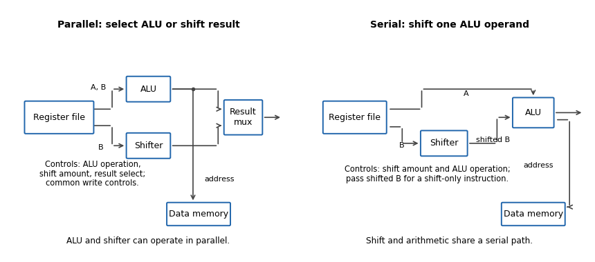

<h1 id="3/a/solution">Solution</h1>

↑ **Parent:** [A](../a.md)

The following original schematic shows the two data organisations. Register-address, write-enable and memory controls are common background; the diagram highlights the changed [combinational logic](../../../../../combinational-logic.md) paths.

**[Figure 1](#3/a/image-parallel-alu-shifter-selection-versus-a-shifter-feeding-one-alu-operand). Parallel ALU/shifter selection versus a shifter feeding one ALU operand**.

In the parallel design the result-source [multiplexer](../../../../../multiplexer.md) selects either the [arithmetic logic unit](../../../../../arithmetic-logic-unit.md) or [barrel shifter](../../../../../barrel-shifter.md). Its control is additional to the [ALU](../../../../../arithmetic-logic-unit.md) function and shift amount. **(i) Addition:** read the two operands, select [ALU](../../../../../arithmetic-logic-unit.md) addition and select the [ALU](../../../../../arithmetic-logic-unit.md) result; the shift amount is irrelevant. **(ii) Constant [left bit shift](../../../../../left-bit-shift.md):** read the operand to be shifted, set the shift amount from the [immediate operand](../../../../../immediate-operand.md) and select the [barrel shifter](../../../../../barrel-shifter.md) result; the [ALU](../../../../../arithmetic-logic-unit.md) operation is irrelevant.

In the serial design the result comes through the [ALU](../../../../../arithmetic-logic-unit.md), so that result-source selection disappears. Its shift-amount control is now relevant to arithmetic as well. **(i) Addition:** set the [barrel shifter](../../../../../barrel-shifter.md) to zero shift and select [ALU](../../../../../arithmetic-logic-unit.md) addition, so its inputs are the unshifted [processor register](../../../../../processor-register.md) values. **(ii) Constant [left bit shift](../../../../../left-bit-shift.md):** set the requested shift and select an [ALU](../../../../../arithmetic-logic-unit.md) operation that passes the shifted operand through. If the [ALU](../../../../../arithmetic-logic-unit.md) lacks that operation, implement it or provide a selectable zero on its other input and add zero. This requirement should be stated, rather than assuming that an ordinary two-input add automatically performs a shift alone.

The [ALU](../../../../../arithmetic-logic-unit.md) result can still supply the memory address. For a register-result instruction, enable [processor register](../../../../../processor-register.md) writeback and leave memory writes disabled. If the ISA requires shift [carry flags](../../../../../carry-flag.md), the flag-generation control must retain the [barrel shifter](../../../../../barrel-shifter.md)'s outgoing-bit information; blindly using a pass-through [ALU](../../../../../arithmetic-logic-unit.md)'s [arithmetic carry](../../../../../carry-arithmetic.md) is insufficient.

## ↑ Ancestors (12)

1. [A](../a.md)
2. [3](../../3.md)
3. [Digital systems, linear algebra, introduction to formal proof](../../../digital-systems-linear-algebra-introduction-to-formal-proof-split.md)
4. [2019](../../../split.md)
5. [Past exam of the year 1 of the computer science course of the University of Oxford](../../../../split.md)
6. [Year 1 of the computer science course of the University of Oxford](../../../../../year-1-of-the-computer-science-course-of-the-university-of-oxford.md)
7. [Computer science course of the University of Oxford](../../../../../computer-science-course-of-the-university-of-oxford.md)
8. [Undergraduate course of the University of Oxford](../../../../../undergraduate-course-of-the-university-of-oxford.md)
9. [Course of the University of Oxford](../../../../../course-of-the-university-of-oxford.md)
10. [University of Oxford](../../../../../university-of-oxford-split.md)
11. [List of universities](../../../../../list-of-universities.md)
12. [Codex Wiki](../../../../../split.md)
