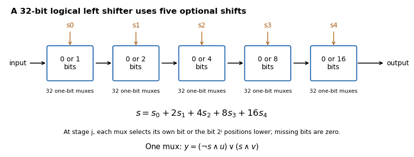

<h1 id="3/b/solution">Solution</h1>

↑ **Parent:** [B](../b.md)

**Use five cascaded banks of 32 two-input [multiplexers](../../../../../multiplexer.md), for optional shifts of $1,2,4,8,16$ [bits](../../../../../bit.md).** The original circuit schematic below shows one bank per shift-amount [bit](../../../../../bit.md); this is a [left bit shift](../../../../../left-bit-shift.md) with zero fill, not a [bit rotation](../../../../../bit-rotation.md).

**[Figure 2](#3/b/image-five-optional-power-of-two-shifts-implement-every-32-bit-logical-left-shift-distance). Five optional power-of-two shifts implement every 32-bit logical left-shift distance**.

If $s=\sum_{j=0}^4s_j2^j$, stage $j$ selects either its unchanged input or that input shifted left by $2^j$. For [bit](../../../../../bit.md) position $i$, the shifted candidate comes from position $i-2^j$ when it exists, and otherwise from zero. Composing the chosen stages shifts by the sum of their distances, so each amount from $0$ to $31$ is represented exactly by its five binary control [bits](../../../../../bit.md). There are $5\times32=160$ one-bit [multiplexers](../../../../../multiplexer.md), with five [multiplexer](../../../../../multiplexer.md) delays along a [bit](../../../../../bit.md) path.

A one-bit [multiplexer](../../../../../multiplexer.md) with selector $s$, unselected input $u$ and selected input $v$ has output **$(\neg s\land u)\lor(s\land v)$**. It can be made from one [NOT gate](../../../../../not-gate.md), two [AND gates](../../../../../and-gate.md) and an [OR gate](../../../../../or-gate.md); a bank can share the selector inversion. The two possible selector values directly verify its behaviour.

## ↑ Ancestors (12)

1. [B](../b.md)
2. [3](../../3.md)
3. [Digital systems, linear algebra, introduction to formal proof](../../../digital-systems-linear-algebra-introduction-to-formal-proof-split.md)
4. [2019](../../../split.md)
5. [Past exam of the year 1 of the computer science course of the University of Oxford](../../../../split.md)
6. [Year 1 of the computer science course of the University of Oxford](../../../../../year-1-of-the-computer-science-course-of-the-university-of-oxford.md)
7. [Computer science course of the University of Oxford](../../../../../computer-science-course-of-the-university-of-oxford.md)
8. [Undergraduate course of the University of Oxford](../../../../../undergraduate-course-of-the-university-of-oxford.md)
9. [Course of the University of Oxford](../../../../../course-of-the-university-of-oxford.md)
10. [University of Oxford](../../../../../university-of-oxford-split.md)
11. [List of universities](../../../../../list-of-universities.md)
12. [Codex Wiki](../../../../../split.md)
