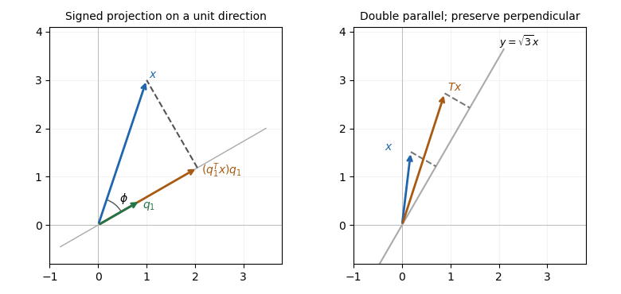

<h1 id="5/a/solution">Solution</h1>

↑ **Parent:** [A](../a.md)

For nonzero $x$, let $\phi$ be its [angle](../../../../../angle.md) to the [unit vector](../../../../../unit-vector.md) $q_1$. The [scalar projection](../../../../../scalar-projection.md) on the oriented $q_1$ axis is $\|x\|\cos\phi$. Since $\|q_1\|=1$, the [dot product](../../../../../dot-product.md) identity gives $q_1^Tx=\|x\|\cos\phi$. Multiplying that signed [scalar](../../../../../scalar.md) by $q_1$ places the foot at **$p=(q_1^Tx)q_1$**.

The residual is perpendicular to the axis, because $q_1^T(x-p)=q_1^Tx-(q_1^Tx)(q_1^Tq_1)=0$. An obtuse [angle](../../../../../angle.md) gives a negative [scalar](../../../../../scalar.md) and a foot on the negative side of the line; $x=0$ has projection zero without needing an [angle](../../../../../angle.md).

**[Figure 3](#5/a/image-projection-drops-a-perpendicular-to-a-unit-direction-directional-stretching-doubles-only-the-parallel-component). Projection drops a perpendicular to a unit direction; directional stretching doubles only the parallel component**.

The first panel is a constructed geometric illustration. The second illustrates the [directional stretch](../../../../../directional-stretch.md) used later in Question 6.

## ↑ Ancestors (12)

1. [A](../a.md)
2. [5](../../5.md)
3. [Digital systems, linear algebra, introduction to formal proof](../../../digital-systems-linear-algebra-introduction-to-formal-proof-split.md)
4. [2019](../../../split.md)
5. [Past exam of the year 1 of the computer science course of the University of Oxford](../../../../split.md)
6. [Year 1 of the computer science course of the University of Oxford](../../../../../year-1-of-the-computer-science-course-of-the-university-of-oxford.md)
7. [Computer science course of the University of Oxford](../../../../../computer-science-course-of-the-university-of-oxford.md)
8. [Undergraduate course of the University of Oxford](../../../../../undergraduate-course-of-the-university-of-oxford.md)
9. [Course of the University of Oxford](../../../../../course-of-the-university-of-oxford.md)
10. [University of Oxford](../../../../../university-of-oxford-split.md)
11. [List of universities](../../../../../list-of-universities.md)
12. [Codex Wiki](../../../../../split.md)
