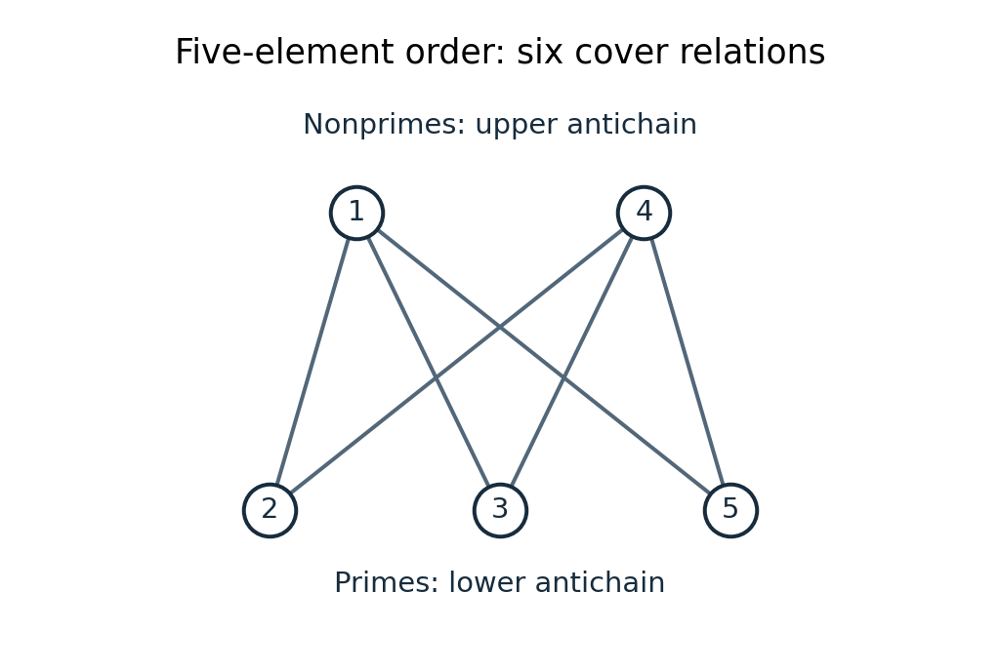

# Discrete mathematics, continuous mathematics, and probability resit

↑ **Parent:** [2019](../2019.md)

Solutions to all nine questions of the [University of Oxford](../../university-of-oxford.md) [computer science](../../computer-science.md) preliminary examination, Long Vacation 2019, held on 4 September 2019. The printed groups are Discrete Mathematics (1–3), Continuous Maths (4–6), and Probability (7–9). All options are treated.

Source: [Public examination-paper archive](https://www.whatdotheyknow.com/request/ba_computer_science_past_papers/response/2577745/attach/2/202402%20183%20CS%20Papers.zip?cookie_passthrough=1), member `2018/L/a10100w1.pdf`, nine scanned pages, paper A10100W1. The dated cover establishes 2019 despite the archive member’s directory name.

**Table of contents**

- [1](#1)
  - [a](#1/a)
    - [i](#1/a/i)
      - [Solution](#1/a/i/solution)
    - [ii](#1/a/ii)
      - [Solution](#1/a/ii/solution)
    - [iii](#1/a/iii)
      - [Solution](#1/a/iii/solution)
  - [b](#1/b)
    - [i](#1/b/i)
      - [Solution](#1/b/i/solution)
    - [ii](#1/b/ii)
      - [Solution](#1/b/ii/solution)
    - [iii](#1/b/iii)
      - [Solution](#1/b/iii/solution)
    - [iv](#1/b/iv)
      - [Solution](#1/b/iv/solution)
  - [c](#1/c)
    - [i](#1/c/i)
      - [Solution](#1/c/i/solution)
    - [ii](#1/c/ii)
      - [Solution](#1/c/ii/solution)
  - [d](#1/d)
    - [Solution](#1/d/solution)
- [2](#2)
  - [a](#2/a)
    - [Solution](#2/a/solution)
  - [b](#2/b)
    - [Solution](#2/b/solution)
  - [c](#2/c)
    - [i](#2/c/i)
      - [Solution](#2/c/i/solution)
    - [ii](#2/c/ii)
      - [Solution](#2/c/ii/solution)
  - [d](#2/d)
    - [Solution](#2/d/solution)
- [3](#3)
  - [a](#3/a)
    - [i](#3/a/i)
      - [Solution](#3/a/i/solution)
    - [ii](#3/a/ii)
      - [Solution](#3/a/ii/solution)
    - [iii](#3/a/iii)
      - [Solution](#3/a/iii/solution)
    - [iv](#3/a/iv)
      - [Solution](#3/a/iv/solution)
    - [v](#3/a/v)
      - [Solution](#3/a/v/solution)
  - [b](#3/b)
    - [i](#3/b/i)
      - [Solution](#3/b/i/solution)
    - [ii](#3/b/ii)
      - [Solution](#3/b/ii/solution)
- [4](#4)
  - [a](#4/a)
    - [Solution](#4/a/solution)
  - [b](#4/b)
    - [Solution](#4/b/solution)
  - [c](#4/c)
    - [Solution](#4/c/solution)
  - [d](#4/d)
    - [Solution](#4/d/solution)
- [5](#5)
  - [a](#5/a)
    - [i](#5/a/i)
      - [Solution](#5/a/i/solution)
    - [ii](#5/a/ii)
      - [Solution](#5/a/ii/solution)
    - [iii](#5/a/iii)
      - [Solution](#5/a/iii/solution)
  - [b](#5/b)
    - [Solution](#5/b/solution)
  - [c](#5/c)
    - [Solution](#5/c/solution)
- [6](#6)
  - [a](#6/a)
    - [Solution](#6/a/solution)
  - [b](#6/b)
    - [Solution](#6/b/solution)
  - [c](#6/c)
    - [Solution](#6/c/solution)
  - [d](#6/d)
    - [Solution](#6/d/solution)
  - [e](#6/e)
    - [Solution](#6/e/solution)
- [7](#7)
  - [a](#7/a)
    - [i](#7/a/i)
      - [Solution](#7/a/i/solution)
    - [ii](#7/a/ii)
      - [Solution](#7/a/ii/solution)
    - [iii](#7/a/iii)
      - [Solution](#7/a/iii/solution)
  - [b](#7/b)
    - [i](#7/b/i)
      - [Solution](#7/b/i/solution)
    - [ii](#7/b/ii)
      - [Solution](#7/b/ii/solution)
    - [iii](#7/b/iii)
      - [Solution](#7/b/iii/solution)
- [8](#8)
  - [a](#8/a)
    - [i](#8/a/i)
      - [Solution](#8/a/i/solution)
    - [ii](#8/a/ii)
      - [Solution](#8/a/ii/solution)
    - [iii](#8/a/iii)
      - [Solution](#8/a/iii/solution)
  - [b](#8/b)
    - [Solution](#8/b/solution)
  - [c](#8/c)
    - [i](#8/c/i)
      - [Solution](#8/c/i/solution)
    - [ii](#8/c/ii)
      - [Solution](#8/c/ii/solution)
    - [iii](#8/c/iii)
      - [Solution](#8/c/iii/solution)
- [9](#9)
  - [a](#9/a)
    - [i](#9/a/i)
      - [Solution](#9/a/i/solution)
    - [ii](#9/a/ii)
      - [Solution](#9/a/ii/solution)
    - [iii](#9/a/iii)
      - [Solution](#9/a/iii/solution)
    - [iv](#9/a/iv)
      - [Solution](#9/a/iv/solution)
    - [v](#9/a/v)
      - [Solution](#9/a/v/solution)
  - [b](#9/b)
    - [i](#9/b/i)
      - [Solution](#9/b/i/solution)
    - [ii](#9/b/ii)
      - [Solution](#9/b/ii/solution)
    - [iii](#9/b/iii)
      - [Solution](#9/b/iii/solution)

## 1

↑ **Parent:** [Discrete mathematics, continuous mathematics, and probability resit](discrete-mathematics-continuous-mathematics-and-probability-resit.md)

<h3 id="1/a">a</h3>

↑ **Parent:** [1](#1)

<h4 id="1/a/i">i</h4>

↑ **Parent:** [A](#1/a)

<h5 id="1/a/i/solution">Solution</h5>

↑ **Parent:** [I](#1/a/i)

A [function](../../function.md) $f:X\to Y$ is **[injective](../../algebra.md#injective-function)** if, for all $x,x'\in X$, $f(x)=f(x')$ implies $x=x'$. Thus distinct elements of the [domain of a function](../../function.md#domain-of-a-function) have distinct images.

<h4 id="1/a/ii">ii</h4>

↑ **Parent:** [A](#1/a)

<h5 id="1/a/ii/solution">Solution</h5>

↑ **Parent:** [Ii](#1/a/ii)

A [function](../../function.md) $f:X\to Y$ is **[surjective](../../algebra.md#surjective-function)** if every element of its [codomain](../../function.md#codomain) has a [preimage](../../set-theory.md#preimage): for every $y\in Y$, there is some $x\in X$ such that $f(x)=y$.

<h4 id="1/a/iii">iii</h4>

↑ **Parent:** [A](#1/a)

<h5 id="1/a/iii/solution">Solution</h5>

↑ **Parent:** [Iii](#1/a/iii)

A [function](../../function.md) is **[bijective](../../function.md#bijection)** if it is both [injective](../../algebra.md#injective-function) and [surjective](../../algebra.md#surjective-function). Equivalently, each element of the [codomain](../../function.md#codomain) has exactly one [preimage](../../set-theory.md#preimage).

<h3 id="1/b">b</h3>

↑ **Parent:** [1](#1)

<h4 id="1/b/i">i</h4>

↑ **Parent:** [B](#1/b)

<h5 id="1/b/i/solution">Solution</h5>

↑ **Parent:** [I](#1/b/i)

**Not [injective](../../algebra.md#injective-function); [surjective](../../algebra.md#surjective-function).** Indeed, $f(0)=f(-1)=-9$ although $0\ne-1$. This [polynomial](../../polynomial.md) is [continuous](../../calculus.md#continuous-function), with $f(x)\to-\infty$ as $x\to-\infty$ and $f(x)\to\infty$ as $x\to\infty$. For any prescribed real $y$, choose $a<b$ with $f(a)<y<f(b)$; the [intermediate value theorem](../../calculus.md#intermediate-value-theorem) supplies a [preimage](../../set-theory.md#preimage) between $a$ and $b$.

<h4 id="1/b/ii">ii</h4>

↑ **Parent:** [B](#1/b)

<h5 id="1/b/ii/solution">Solution</h5>

↑ **Parent:** [Ii](#1/b/ii)

**Both [injective](../../algebra.md#injective-function) and [surjective](../../algebra.md#surjective-function).** The [natural logarithm](../../calculus.md#natural-logarithm) is strictly increasing on the [positive real numbers](../../arithmetic.md#positive-real-number), so it is [injective](../../algebra.md#injective-function). For every $y\in\mathbb R$, $x=e^y>0$ satisfies $\ln x=y$; hence the [function](../../function.md) is [surjective](../../algebra.md#surjective-function), with the [exponential function](../../calculus.md#exponential-function) as its [inverse function](../../function.md#inverse-function).

<h4 id="1/b/iii">iii</h4>

↑ **Parent:** [B](#1/b)

<h5 id="1/b/iii/solution">Solution</h5>

↑ **Parent:** [Iii](#1/b/iii)

**Not [injective](../../algebra.md#injective-function); its [image of a function](../../set-theory.md#image-of-a-function) is exactly $\{1,2,3,\ldots\}$.** For example, both $x=e^{-1}$ and $x=e^{-1/2}$ give the [ceiling function](../../calculus.md#ceiling-function) value $1$. Since $0<x<1$, $(\ln x)^2>0$, so the value $0$ is never attained. For every positive [integer](../../integer.md) $j$,

$$
f(x)=j\quad\Longleftrightarrow\quad e^{-\sqrt j}\leq x<e^{-\sqrt{j-1}}.
$$

Each such [interval](../../real-analysis.md#interval-mathematics) is nonempty and contained in $(0,1)$, with the upper endpoint $1$ excluded when $j=1$. Thus the answer concerning [surjectivity](../../algebra.md#surjective-function) depends on the convention for the [natural numbers](../../arithmetic.md#natural-number): **onto if $\mathbb N=\{1,2,\ldots\}$, and not onto if $0\in\mathbb N$**. The source does not settle that convention.

<h4 id="1/b/iv">iv</h4>

↑ **Parent:** [B](#1/b)

<h5 id="1/b/iv/solution">Solution</h5>

↑ **Parent:** [Iv](#1/b/iv)

**Not [injective](../../algebra.md#injective-function); [surjective](../../algebra.md#surjective-function).** The equal values $f(0)=f(2)=1$ disprove [injectivity](../../algebra.md#injective-function). For any $y>0$, take $x=1+y^{-1/2}>1$. This lies in the stated [domain of a function](../../function.md#domain-of-a-function), and

$$
\frac1{(1-|x|)^2}=\frac1{(-y^{-1/2})^2}=y.
$$

Consequently every member of the [codomain](../../function.md#codomain) has a [preimage](../../set-theory.md#preimage).

<h3 id="1/c">c</h3>

↑ **Parent:** [1](#1)

<h4 id="1/c/i">i</h4>

↑ **Parent:** [C](#1/c)

<h5 id="1/c/i/solution">Solution</h5>

↑ **Parent:** [I](#1/c/i)

Suppose $g(y)=g(y')$. Applying $f$ and using the [right inverse](../../function.md#right-inverse) identity gives

$$
y=(f\circ g)(y)=(f\circ g)(y')=y'.
$$

This is exactly [injectivity](../../algebra.md#injective-function), so **every [right inverse](../../function.md#right-inverse) is [injective](../../algebra.md#injective-function)**.

<h4 id="1/c/ii">ii</h4>

↑ **Parent:** [C](#1/c)

<h5 id="1/c/ii/solution">Solution</h5>

↑ **Parent:** [Ii](#1/c/ii)

For each $y\in Y$, [surjectivity](../../algebra.md#surjective-function) makes the [fiber of a function](../../function.md#fiber-of-a-function) $f^{-1}(\{y\})$ nonempty. Choose one element $x_y$ of each such [fiber of a function](../../function.md#fiber-of-a-function) and define $g(y)=x_y$. Then $f(g(y))=y$ for every $y$, proving **$f\circ g=I_Y$**. For arbitrary [sets](../../set.md), the simultaneous selection invokes the usual [axiom of choice](../../set-theory.md#axiom-of-choice); this is the [right-inverse characterization of the axiom of choice](../../function.md#right-inverse-characterization-of-the-axiom-of-choice). For finite $Y$ only finitely many choices are needed. If $Y$ is empty, the unique empty [function](../../function.md) gives the same conclusion.

<h3 id="1/d">d</h3>

↑ **Parent:** [1](#1)

<h4 id="1/d/solution">Solution</h4>

↑ **Parent:** [D](#1/d)

Put $B=T\cap S$. By [distributivity](../../algebraic-operation.md#distributive-property), $g(A)=B\cup(T\cap A)$ and $B\subseteq T$. Consequently,

$$
\begin{aligned}
g(g(A))&=B\cup\bigl(T\cap(B\cup(T\cap A))\bigr)\\
&=B\cup(T\cap B)\cup(T\cap A)\\
&=B\cup(T\cap A)=g(A).
\end{aligned}
$$

Here we used [associativity](../../algebraic-operation.md#associative-property), [distributivity](../../algebraic-operation.md#distributive-property), and [idempotence](../../algebraic-operation.md#idempotence) of [set intersection](../../set.md#set-intersection) and [set union](../../set.md#set-union). The equality holds for every $A\in\mathcal P(U)$, so **$g\circ g=g$**: $g$ is an [idempotent function](../../function.md#idempotent-function).

## 2

↑ **Parent:** [Discrete mathematics, continuous mathematics, and probability resit](discrete-mathematics-continuous-mathematics-and-probability-resit.md)

<h3 id="2/a">a</h3>

↑ **Parent:** [2](#2)

<h4 id="2/a/solution">Solution</h4>

↑ **Parent:** [A](#2/a)

There are $n$ choices for the first position, then $n-1$ choices for the second, and so on down to one choice. The [multiplication principle](../../combinatorics.md#rule-of-product) therefore gives **$n!$ [permutations](../../combinatorics.md#permutation)**. This also agrees with the empty [permutation](../../combinatorics.md#permutation) convention $0!=1$.

<h3 id="2/b">b</h3>

↑ **Parent:** [2](#2)

<h4 id="2/b/solution">Solution</h4>

↑ **Parent:** [B](#2/b)

Let $E_i$ be the [set](../../set.md) of [permutations](../../combinatorics.md#permutation) fixing object $i$. If a specified collection of $k$ objects is fixed, the remaining $n-k$ objects can be arranged in $(n-k)!$ ways. There are $\binom nk$ such collections. Applying the [inclusion-exclusion principle](../../combinatorics.md#inclusion-exclusion-principle) to exclude all fixed objects gives

$$
d_n=\sum_{k=0}^n(-1)^k\binom nk(n-k)!=n!\sum_{k=0}^n\frac{(-1)^k}{k!}.
$$

For $n\geq1$, the terms $k=0$ and $k=1$ cancel. Thus the number of [derangements](../../combinatorics.md#derangement-of-a-permutation) is **$\displaystyle d_n=\frac{n!}{2!}-\frac{n!}{3!}+\cdots+(-1)^n\frac{n!}{n!}$**, interpreting the remaining [sum](../../arithmetic.md#sum) as empty when $n=1$. The full [inclusion-exclusion](../../combinatorics.md#inclusion-exclusion-principle) formula also gives $d_0=1$.

<h3 id="2/c">c</h3>

↑ **Parent:** [2](#2)

<h4 id="2/c/i">i</h4>

↑ **Parent:** [C](#2/c)

<h5 id="2/c/i/solution">Solution</h5>

↑ **Parent:** [I](#2/c/i)

The [base case](../../algorithm.md#base-case) $n=3$ is

$$
\frac1{3(3-2)}=\frac13=\frac34-\frac5{12}.
$$

Assume the displayed formula holds at some $n\geq3$. Adding the next term yields

$$
\begin{aligned}
\sum_{i=3}^{n+1}\frac1{i(i-2)}
&=\frac34-\frac{2n-1}{2n(n-1)}+\frac1{(n+1)(n-1)}\\
&=\frac34-\frac{(2n-1)(n+1)-2n}{2n(n-1)(n+1)}\\
&=\frac34-\frac{2n+1}{2n(n+1)}.
\end{aligned}
$$

The last step uses $(2n-1)(n+1)-2n=(2n+1)(n-1)$. This is the required formula at $n+1$, completing the proof by [mathematical induction](../../foundations-of-mathematics.md#mathematical-induction). **The identity holds for all $n\geq3$.**

<h4 id="2/c/ii">ii</h4>

↑ **Parent:** [C](#2/c)

<h5 id="2/c/ii/solution">Solution</h5>

↑ **Parent:** [Ii](#2/c/ii)

Use [mathematical induction](../../foundations-of-mathematics.md#mathematical-induction) with two consecutive [base cases](../../algorithm.md#base-case): $F_2=1=(3/2)^0$ and $F_3=2\geq(3/2)^1$. Suppose the bounds hold for exponents $n$ and $n+1$. The [Fibonacci recurrence](../../sequence-and-series.md#fibonacci-recurrence) gives

$$
F_{n+4}=F_{n+3}+F_{n+2}\geq(3/2)^{n+1}+(3/2)^n=\frac52(3/2)^n\geq\frac94(3/2)^n=(3/2)^{n+2}.
$$

Thus the consecutive pair of bounds advances one step. **$F_{n+2}\geq(3/2)^n$ for every $n\geq0$.**

<h3 id="2/d">d</h3>

↑ **Parent:** [2](#2)

<h4 id="2/d/solution">Solution</h4>

↑ **Parent:** [D](#2/d)

Pad every number with leading zeros to obtain exactly $n$ decimal digits. Its digits are a solution of $d_1+\cdots+d_n=9$ in nonnegative [integers](../../integer.md). Conversely every such solution is a valid digit string, since no individual digit can exceed $9$; its digit sum also excludes the number zero. The [stars and bars](../../combinatorics.md#stars-and-bars-combinatorics) count therefore gives

$$
f(n)=\binom{n+8}{9}=\frac1{9!}\prod_{j=0}^8(n+j).
$$

For $n\geq1$, $n+j\leq n(j+1)$, so $f(n)\leq n^9\prod_{j=0}^8(j+1)/9!=n^9$. Thus **$f(n)=O(n^9)$**, with an explicit [Big O notation](../../real-analysis.md#big-o-notation) constant $C=1$ and threshold $n=1$.

## 3

↑ **Parent:** [Discrete mathematics, continuous mathematics, and probability resit](discrete-mathematics-continuous-mathematics-and-probability-resit.md)

<h3 id="3/a">a</h3>

↑ **Parent:** [3](#3)

<h4 id="3/a/i">i</h4>

↑ **Parent:** [A](#3/a)

<h5 id="3/a/i/solution">Solution</h5>

↑ **Parent:** [I](#3/a/i)

**True.** For every $n\geq1$,

$$
0\leq n^2+99n+43\leq(1+99+43)n^2=143n^2.
$$

These constants satisfy the definition of [Big O notation](../../real-analysis.md#big-o-notation).

<h4 id="3/a/ii">ii</h4>

↑ **Parent:** [A](#3/a)

<h5 id="3/a/ii/solution">Solution</h5>

↑ **Parent:** [Ii](#3/a/ii)

**False.** Set $a_n=4^n/n^4$. For $n\geq4$,

$$
\frac{a_{n+1}}{a_n}=4\left(\frac n{n+1}\right)^4\geq4\left(\frac45\right)^4=\frac{1024}{625}>1.
$$

Iteration gives a growing [geometric sequence](../../sequence-and-series.md#geometric-progression) as a lower bound for $a_n$. Hence $a_n\to\infty$ and no eventual constant can bound $4^n/n^4$, as [Big O notation](../../real-analysis.md#big-o-notation) would require.

<h4 id="3/a/iii">iii</h4>

↑ **Parent:** [A](#3/a)

<h5 id="3/a/iii/solution">Solution</h5>

↑ **Parent:** [Iii](#3/a/iii)

**True.** Rationalizing the [square root](../../algebra.md#square-root) gives, for $n\geq1$,

$$
0\leq\sqrt{n^2+n}-n=\frac n{\sqrt{n^2+n}+n}=\frac1{\sqrt{1+1/n}+1}\leq\frac12.
$$

The uniform bound is exactly the assertion $O(1)$ in [Big O notation](../../real-analysis.md#big-o-notation).

<h4 id="3/a/iv">iv</h4>

↑ **Parent:** [A](#3/a)

<h5 id="3/a/iv/solution">Solution</h5>

↑ **Parent:** [Iv](#3/a/iv)

**True.** The [logarithm](../../calculus.md#logarithm) identity gives

$$
\ln(e^n+n)-n=\ln(1+ne^{-n}).
$$

For $n\geq1$, $e^n\geq n$, so $0\leq ne^{-n}\leq1$. By [monotonicity](../../calculus.md#monotonic-function) of the [natural logarithm](../../calculus.md#natural-logarithm), the expression lies between $0$ and $\ln2$. It is therefore $O(1)$ in [Big O notation](../../real-analysis.md#big-o-notation).

<h4 id="3/a/v">v</h4>

↑ **Parent:** [A](#3/a)

<h5 id="3/a/v/solution">Solution</h5>

↑ **Parent:** [V](#3/a/v)

**False.** On every odd positive [integer](../../integer.md) $n$, $f(n)/g(n)=n$. Given any proposed [Big O notation](../../real-analysis.md#big-o-notation) constant $C$ and threshold $N$, choose an odd $n>\max(C,N)$. Then $f(n)>Cg(n)$, contradicting the required bound. The behavior on even [integers](../../integer.md) cannot repair this failure on an unbounded [subsequence](../../sequence-and-series.md#subsequence).

<h3 id="3/b">b</h3>

↑ **Parent:** [3](#3)

<h4 id="3/b/i">i</h4>

↑ **Parent:** [B](#3/b)

<h5 id="3/b/i/solution">Solution</h5>

↑ **Parent:** [I](#3/b/i)

The [prime numbers](../../prime-number.md) $2,3,5$ form the lower [antichain](../../extremal-set-theory.md#antichain); the nonprime elements $1,4$ form the upper [antichain](../../extremal-set-theory.md#antichain). In particular, $1$ is not a [prime number](../../prime-number.md). Each lower element is below each upper element, and no third element can lie strictly between them. Therefore **the six [cover relations](../../set.md#covering-relation) are $2,3,5\prec1,4$**, represented by the following [Hasse diagram](../../set.md#hasse-diagram). Upward movement represents increasing order; crossing lines do not add elements.

**[Figure 1](#3/b/i/image-the-six-cover-relations-for-the-five-element-partial-order). The six cover relations for the five-element partial order**.

<h4 id="3/b/ii">ii</h4>

↑ **Parent:** [B](#3/b)

<h5 id="3/b/ii/solution">Solution</h5>

↑ **Parent:** [Ii](#3/b/ii)

Write $P$ for the [prime numbers](../../prime-number.md) in $A$ and $C=A\setminus P$ for its nonprime elements. Since $n\geq4$, both [antichains](../../extremal-set-theory.md#antichain) have at least two elements: $2,3\in P$ and $1,4\in C$. Every element of $P$ is below every element of $C$. We can classify a [subset](../../set.md#subset) $S$ by its intersection with these two levels of the [two-level partial order](../../set.md#two-level-partial-order).

- If $S=\varnothing$, every element of $A$ is an [upper bound](../../set.md#upper-bound-in-a-partially-ordered-set). There is no [maximum](../../set.md#maximum-of-a-subset-of-a-total-order), because $S$ has no elements, and no [least upper bound](../../set.md#least-upper-bound-in-a-partially-ordered-set), because the distinct elements $2,3$ are incomparable minimal elements of $A$.
- If $S=\{p\}$ with $p\in P$, its [upper bounds](../../set.md#upper-bound-in-a-partially-ordered-set) are $\{p\}\cup C$; its [maximum](../../set.md#maximum-of-a-subset-of-a-total-order) and [least upper bound](../../set.md#least-upper-bound-in-a-partially-ordered-set) are both $p$.
- If $S\subseteq P$ has at least two elements, its [upper bounds](../../set.md#upper-bound-in-a-partially-ordered-set) are exactly $C$. There is no [maximum](../../set.md#maximum-of-a-subset-of-a-total-order) in $S$ and no [least upper bound](../../set.md#least-upper-bound-in-a-partially-ordered-set), because $C$ has at least two incomparable elements.
- If $S\cap C=\{c\}$, its only [upper bound](../../set.md#upper-bound-in-a-partially-ordered-set) is $c$: no different element is above this nonprime element. Since every remaining element of $S$ is a [prime number](../../prime-number.md), $c$ belongs to $S$ and dominates all of it. Thus $c$ is both its [maximum](../../set.md#maximum-of-a-subset-of-a-total-order) and its [least upper bound](../../set.md#least-upper-bound-in-a-partially-ordered-set).
- If $S$ contains at least two elements of $C$, these distinct nonprime elements have no common [upper bound](../../set.md#upper-bound-in-a-partially-ordered-set), and $S$ has neither a [maximum](../../set.md#maximum-of-a-subset-of-a-total-order) nor a [least upper bound](../../set.md#least-upper-bound-in-a-partially-ordered-set).

Consequently **an [upper bound](../../set.md#upper-bound-in-a-partially-ordered-set) exists exactly when $|S\cap C|\leq1$; a [maximum](../../set.md#maximum-of-a-subset-of-a-total-order) or [least upper bound](../../set.md#least-upper-bound-in-a-partially-ordered-set) exists exactly when $|S\cap C|=1$ or $S$ is a singleton [subset](../../set.md#subset) of $P$**. The exhaustive cases also justify why the last two existence criteria coincide here.

## 4

↑ **Parent:** [Discrete mathematics, continuous mathematics, and probability resit](discrete-mathematics-continuous-mathematics-and-probability-resit.md)

<h3 id="4/a">a</h3>

↑ **Parent:** [4](#4)

<h4 id="4/a/solution">Solution</h4>

↑ **Parent:** [A](#4/a)

One standard finite form of [Taylor's theorem](../../calculus.md#taylor-s-theorem) is the following. Suppose $f$ has continuous [derivatives](../../calculus.md#derivative) through order $m+1$ on an [interval](../../real-analysis.md#interval-mathematics) containing $a$ and $x$. Then, if $x\ne a$, there is some $\xi$ strictly between them such that

$$
\boxed{f(x)=\sum_{k=0}^m\frac{f^{(k)}(a)}{k!}(x-a)^k+\frac{f^{(m+1)}(\xi)}{(m+1)!}(x-a)^{m+1}.}
$$

The final term is the [Lagrange remainder](../../calculus.md#lagrange-remainder). At $x=a$ the identity holds directly with zero [remainder](../../integer.md#remainder). The finite expansion requires no assumption that an infinite [Taylor series](../../calculus.md#taylor-series) converges to $f$.

<h3 id="4/b">b</h3>

↑ **Parent:** [4](#4)

<h4 id="4/b/solution">Solution</h4>

↑ **Parent:** [B](#4/b)

For $0<x<\pi$, apply [Taylor's theorem](../../calculus.md#taylor-s-theorem) to the [sine](../../geometry-and-topology.md#sine) about zero, retaining terms through degree four. Its fourth-order coefficient is zero, and its fifth [derivative](../../calculus.md#derivative) is the [cosine function](../../geometry-and-topology.md#cosine), giving

$$
\sin x=x-\frac{x^3}{6}+\frac{x^5}{120}\cos\xi,\qquad 0<\xi<x.
$$

The [cosine function](../../geometry-and-topology.md#cosine) is decreasing on $[0,\pi]$, so $\cos x\leq\cos\xi\leq1$. Multiplying by the nonnegative factor $x^5/120$ and adding $x-x^3/6$ proves **both required bounds**. At $x=0$ both are equalities.

<h3 id="4/c">c</h3>

↑ **Parent:** [4](#4)

<h4 id="4/c/solution">Solution</h4>

↑ **Parent:** [C](#4/c)

Let $h(x,y)=2y^3+xy^2-y^2-4x$, so $g=e^h>0$. Its [gradient](../../multivariable-calculus.md#gradient) is $\nabla g=g\nabla h$, and

$$
\nabla h=\begin{pmatrix}y^2-4\\2y(3y+x-1)\end{pmatrix}.
$$

Thus a [stationary point](../../calculus-of-variations.md#stationary-point) must have $y=\pm2$ and $x=1-3y$, giving **$(-5,2)$ and $(7,-2)$**. To classify them, use

$$
H_g=g\bigl(H_h+\nabla h\nabla h^T\bigr),\qquad
H_h=\begin{pmatrix}0&2y\\2y&12y+2x-2\end{pmatrix}.
$$

At either [stationary point](../../calculus-of-variations.md#stationary-point), $\nabla h=0$ and $12y+2x-2=6y$. Hence $\det H_g=g^2(-4y^2)=-16g^2<0$. The [Hessian](../../multivariable-calculus.md#hessian-matrix) has one positive and one negative [eigenvalue](../../linear-operator-theory.md#eigenvalue), so **both are [saddle points](../../analysis.md#saddle-point)**. There are no other [stationary points](../../calculus-of-variations.md#stationary-point).

<h3 id="4/d">d</h3>

↑ **Parent:** [4](#4)

<h4 id="4/d/solution">Solution</h4>

↑ **Parent:** [D](#4/d)

Let $q=x^2+4y^2$. The objective has the exact [sum of squares](../../arithmetic.md#sum-of-squares) decomposition

$$
x^2+6xy+4y^2+3=3-\frac12q+\frac32(x+2y)^2.
$$

For every feasible point, $q\leq8$, so this is at least $3-8/2=-1$. Equality requires simultaneously $q=8$ and $x+2y=0$. Substitution gives $y^2=1$ and $x=-2y$. Both resulting points are feasible. Therefore **the global [minimum](../../set.md#minimum-of-a-subset-of-a-total-order) is $-1$, attained exactly at $(2,-1)$ and $(-2,1)$**. The lower bound and its equality conditions prove global attainment of the [minimum](../../set.md#minimum-of-a-subset-of-a-total-order), rather than merely identifying [stationary points](../../calculus-of-variations.md#stationary-point) on the boundary.

## 5

↑ **Parent:** [Discrete mathematics, continuous mathematics, and probability resit](discrete-mathematics-continuous-mathematics-and-probability-resit.md)

<h3 id="5/a">a</h3>

↑ **Parent:** [5](#5)

<h4 id="5/a/i">i</h4>

↑ **Parent:** [A](#5/a)

<h5 id="5/a/i/solution">Solution</h5>

↑ **Parent:** [I](#5/a/i)

The [secant method](../../numerical-analysis.md#secant-method) starts from two approximations $x_0,x_1$. Replace the [function](../../function.md) near its [zero of a function](../../polynomial.md#zero-of-a-function) by the [secant line](../../euclidean-geometry.md#secant-line) through $(x_{k-1},f(x_{k-1}))$ and $(x_k,f(x_k))$; the zero of that line is the next approximation:

$$
\boxed{x_{k+1}=x_k-f(x_k)\frac{x_k-x_{k-1}}{f(x_k)-f(x_{k-1})}.}
$$

Stop immediately if $f(x_k)=0$; otherwise the denominator must be nonzero. Each further step needs one new [function](../../function.md) evaluation and no [derivative](../../calculus.md#derivative). There is no automatic bracketing or global [convergence](../../calculus.md#convergence) guarantee.[§3.8(iii), Secant Method and equation 3.8.6](../../mathematics-bibliography.md#nist-digital-library-of-mathematical-functions/3-8-nonlinear-equations)

<h4 id="5/a/ii">ii</h4>

↑ **Parent:** [A](#5/a)

<h5 id="5/a/ii/solution">Solution</h5>

↑ **Parent:** [Ii](#5/a/ii)

Use $f(x)=x\log_2x-4$. Then $f(1)=-4$, $f(2)=-2$, and the [secant method](../../numerical-analysis.md#secant-method) gives

$$
x_2=2-(-2)\frac{2-1}{-2-(-4)}=3.
$$

Writing $L=\log_2 3$, the next step is

$$
x_3=3-\frac{(3L-4)(3-2)}{(3L-4)-(-2)}=3-\frac{3L-4}{3L-2}=2.725982457878719\ldots.
$$

Thus the requested approximation is **$x_3=2.73$ to three [significant figures](../../numerical-analysis.md#significant-figures)**. All intermediate [logarithms](../../calculus.md#logarithm) should be retained at higher precision before this final rounding.

<h4 id="5/a/iii">iii</h4>

↑ **Parent:** [A](#5/a)

<h5 id="5/a/iii/solution">Solution</h5>

↑ **Parent:** [Iii](#5/a/iii)

A small difference between successive [secant method](../../numerical-analysis.md#secant-method) iterates alone does not certify a small absolute error. Instead use a [residual root error bound](../../numerical-analysis.md#residual-root-error-bound). On $[2,3]$,

$$
f'(x)=\frac{\ln x+1}{\ln2}\geq m:=1+\frac1{\ln2}>0,
$$

and $f(2)<0<f(3)$, so there is a unique [root](../../semisimple-lie-algebra.md#root-of-a-root-system) $r\in(2,3)$. For an iterate $x\in[2,3]$, the [mean value theorem](../../calculus.md#mean-value-theorem) gives

$$
|x-r|=\frac{|f(x)|}{|f'(\xi)|}\leq\frac{|f(x)|}{m}.
$$

Therefore **stop when $x\in[2,3]$ and $|x\log_2x-4|\leq(1+1/\ln2)10^{-10}$**. This guarantees the desired absolute error in exact arithmetic; the evaluated [residual of a root equation](../../numerical-analysis.md#residual-of-a-root-equation) should include an allowance for its much smaller [roundoff error](../../numerical-analysis.md#round-off-error). A safeguarded implementation can retain the bracket $[2,3]$ and use [bisection](../../numerical-analysis.md#bisection-method) if a proposed [secant method](../../numerical-analysis.md#secant-method) step leaves it.

<h3 id="5/b">b</h3>

↑ **Parent:** [5](#5)

<h4 id="5/b/solution">Solution</h4>

↑ **Parent:** [B](#5/b)

With the gap-at-one convention, [machine epsilon](../../floating-point-arithmetic.md#machine-epsilon) is the difference between $1$ and the next larger representable [floating-point number](../../floating-point-arithmetic.md#floating-point-number). The [double-precision floating-point format](../../floating-point-arithmetic.md#double-precision-floating-point-format) has 53 significant binary digits, including the implicit leading digit, so

$$
\boxed{\varepsilon_{\rm mach}=2^{-52}\approx2.22\times10^{-16}.}
$$

A related convention uses [unit roundoff](../../floating-point-arithmetic.md#unit-roundoff), the worst relative rounding scale for round-to-nearest: $u=2^{-53}\approx1.11\times10^{-16}$. Stating the convention distinguishes these two common values.[Chapter 2, IEEE Arithmetic Model; Double Format and Table 2-5](../../mathematics-bibliography.md#ieee-arithmetic-in-oracle-s-numerical-computation-guide)

<h3 id="5/c">c</h3>

↑ **Parent:** [5](#5)

<h4 id="5/c/solution">Solution</h4>

↑ **Parent:** [C](#5/c)

**Choose equation (1), evaluated by refined composite [Simpson's rule](../../numerical-integration.md#simpson-s-rule).** It gives $y$ directly as a one-dimensional [definite integral](../../integral.md#definite-integral) with fixed endpoints and a smooth integrand. It therefore avoids [root finding](../../numerical-analysis.md#root-finding) altogether. Before evaluating, use the [trigonometric identity](../../geometry-and-topology.md#trigonometric-identity)

$$
\sin(x-a\cos x)+\sin(x+a\cos x)=2\sin x\cos(a\cos x),\qquad a=\pi/4.
$$

This equivalent integrand is nonnegative throughout $[0,\pi/2]$, avoiding cancellation between the original two terms. Equation (2) instead subtracts two potentially large [exponential functions](../../calculus.md#exponential-function), while equation (3) would ordinarily put a [numerical integration](../../numerical-integration.md) inside a [root finding](../../numerical-analysis.md#root-finding) loop.

For even $n$, let $h=(\pi/2)/n$, $\phi(x)=2\sin x\cos((\pi/4)\cos x)$, and compute

$$
Y_n=\frac\pi4\frac h3\left[\phi(0)+\phi(\pi/2)+4\sum_{\substack{1\leq j<n\\j\text{ odd}}}\phi(jh)+2\sum_{\substack{2\leq j<n\\j\text{ even}}}\phi(jh)\right].
$$

Then double $n$. The integrand has bounded [derivatives](../../calculus.md#derivative) of every fixed order on the integration [interval](../../real-analysis.md#interval-mathematics); in the fourth-order error regime, the estimated remaining [truncation error](../../numerical-analysis.md#truncation-error) in $Y_{2n}$ is $|Y_{2n}-Y_n|/15$. The factor $15$ follows by eliminating the leading term $Ch^4$ between the two mesh widths.[§3.5(ii), composite rule and error, equations 3.5.6–3.5.8](../../mathematics-bibliography.md#nist-digital-library-of-mathematical-functions/3-5-quadrature-subsection-ii-simpson’s-rule)

**Stop when this estimate is comparable to $\varepsilon_{\rm mach}\max(1,|Y_{2n}|)$ and further refinement shows stagnation at the [roundoff error](../../numerical-analysis.md#round-off-error) scale.** Check that the differences previously decreased consistently with fourth-order [convergence](../../calculus.md#convergence); differences alone are not a rigorous error certificate if cancellation or [roundoff error](../../numerical-analysis.md#round-off-error) dominates. [Compensated summation](../../floating-point-arithmetic.md#compensated-summation) helps keep the summation error near the precision limit. Refining indefinitely after this point increases work without reliably adding meaningful digits. This answers the requested choice and termination strategy without requiring an explicit value of $y$.

## 6

↑ **Parent:** [Discrete mathematics, continuous mathematics, and probability resit](discrete-mathematics-continuous-mathematics-and-probability-resit.md)

<h3 id="6/a">a</h3>

↑ **Parent:** [6](#6)

<h4 id="6/a/solution">Solution</h4>

↑ **Parent:** [A](#6/a)

For a differentiable scalar [function](../../function.md) of $n$ real variables, its [derivative](../../calculus.md#derivative) is the linear map

$$
Df(\mathbf x)[\mathbf h]=\sum_{i=1}^n\frac{\partial f}{\partial x_i}(\mathbf x)h_i=\nabla f(\mathbf x)^T\mathbf h,
$$

where the column [gradient](../../multivariable-calculus.md#gradient) is $\nabla f=(\partial f/\partial x_1,\ldots,\partial f/\partial x_n)^T$. Its **[Hessian](../../multivariable-calculus.md#hessian-matrix)** is the $n\times n$ [matrix](../../vector-space.md#matrix) $H_f=(\partial^2 f/\partial x_i\partial x_j)_{i,j}$. For a $C^2$ [function](../../function.md), equality of mixed [partial derivatives](../../multivariable-calculus.md#partial-derivative) makes this [matrix](../../vector-space.md#matrix) symmetric.

<h3 id="6/b">b</h3>

↑ **Parent:** [6](#6)

<h4 id="6/b/solution">Solution</h4>

↑ **Parent:** [B](#6/b)

Put $\mathbf z=(x,y)^T$, $r^2=\mathbf z^T\mathbf z$ and $f=\sqrt{1+r^2}$. The [chain rule](../../calculus.md#chain-rule) yields

$$
\boxed{\nabla f=\frac{\mathbf z}{f},\qquad H_f=\frac I f-\frac{\mathbf z\mathbf z^T}{f^3}=\frac1{f^3}\begin{pmatrix}1+y^2&-xy\\-xy&1+x^2\end{pmatrix}.}
$$

For every nonzero [vector](../../vector-space.md#vector) $\mathbf v$, the [Cauchy-Schwarz inequality](../../probability-and-statistics.md#cauchy-schwarz-inequality) gives

$$
\mathbf v^TH_f\mathbf v=\frac{(1+r^2)\|\mathbf v\|^2-(\mathbf z^T\mathbf v)^2}{f^3}\geq\frac{\|\mathbf v\|^2}{f^3}>0.
$$

Thus the [Hessian](../../multivariable-calculus.md#hessian-matrix) is a [positive-definite matrix](../../quadratic-form.md#positive-definite-matrix) everywhere. The [Hessian criterion for convexity](../../real-analysis.md#hessian-criterion-for-convexity) implies that **$f$ is strictly [convex](../../real-analysis.md#convex-function) on $\mathbb R^2$**. Its unique global [minimum](../../set.md#minimum-of-a-subset-of-a-total-order) is at $\mathbf z=0$, where $f=1$.

<h3 id="6/c">c</h3>

↑ **Parent:** [6](#6)

<h4 id="6/c/solution">Solution</h4>

↑ **Parent:** [C](#6/c)

Let $P=\mathbf z\mathbf z^T$, so $P^2=r^2P$ and $f^2=1+r^2$. Multiplying the proposed [inverse matrix](../../matrix-inverse.md) by the [Hessian](../../multivariable-calculus.md#hessian-matrix) gives

$$
\left(\frac I f-\frac P{f^3}\right)f(I+P)=I+P-\frac{P+P^2}{f^2}=I.
$$

Hence **$\displaystyle H_f^{-1}=f(I+\mathbf z\mathbf z^T)=f\begin{pmatrix}1+x^2&xy\\xy&1+y^2\end{pmatrix}$**, as required. Its existence also follows from the [Hessian](../../multivariable-calculus.md#hessian-matrix) being a [positive-definite matrix](../../quadratic-form.md#positive-definite-matrix).

<h3 id="6/d">d</h3>

↑ **Parent:** [6](#6)

<h4 id="6/d/solution">Solution</h4>

↑ **Parent:** [D](#6/d)

For iterates approaching $\mathbf x_*$, write $e_k=\|\mathbf x_k-\mathbf x_*\|$. Exact [order of convergence](../../numerical-analysis.md#order-of-convergence) $p$ means $e_{k+1}/e_k^p\to C$ for a finite constant $C>0$, with nonzero errors. Thus **[quadratic convergence](../../numerical-analysis.md#quadratic-convergence) has $p=2$, and [cubic convergence](../../numerical-analysis.md#cubic-convergence) has $p=3$**. The weaker eventual bound $e_{k+1}\leq Ce_k^p$ means at least order $p$. Finite termination is a separate case.[§3.8(i), equation 3.8.3 and its order-of-convergence discussion](../../mathematics-bibliography.md#nist-digital-library-of-mathematical-functions/3-8-nonlinear-equations)

The assertion about being always faster is **false**. For example, the [fixed-point iterations](../../numerical-analysis.md#fixed-point-iteration) with errors $e_{k+1}=e_k^2$ and $d_{k+1}=50d_k^3$ have exact [quadratic convergence](../../numerical-analysis.md#quadratic-convergence) and [cubic convergence](../../numerical-analysis.md#cubic-convergence), respectively. Starting both at $0.1$, their next errors are $0.01$ and $0.05$: the [cubic convergence](../../numerical-analysis.md#cubic-convergence) method is worse on that step, although both converge. Error constants, starting points, and work per step all matter. The higher [order of convergence](../../numerical-analysis.md#order-of-convergence) describes asymptotic behavior within a convergence region, not a uniform comparison of all computations.

<h3 id="6/e">e</h3>

↑ **Parent:** [6](#6)

<h4 id="6/e/solution">Solution</h4>

↑ **Parent:** [E](#6/e)

The update in [Newton's method in optimization](../../mathematical-optimization.md#newton-s-method-in-optimization) is $\mathbf z_{k+1}=\mathbf z_k-H_f(\mathbf z_k)^{-1}\nabla f(\mathbf z_k)$. Substituting the previous formulas gives

$$
\mathbf z_{k+1}=\mathbf z_k-(I+\mathbf z_k\mathbf z_k^T)\mathbf z_k=-\|\mathbf z_k\|^2\mathbf z_k.
$$

Thus the distance from the unique [minimum](../../set.md#minimum-of-a-subset-of-a-total-order) obeys **$r_{k+1}=r_k^3$**, where $r_k=\|\mathbf z_k\|$. In particular,

$$
r_k=r_0^{3^k}\longrightarrow0\qquad(0\leq r_0<1).
$$

For $0<r_0<1$, the error ratio $r_{k+1}/r_k^3$ is exactly $1$, proving exact [cubic convergence](../../numerical-analysis.md#cubic-convergence). If $r_0=0$, the initial point already attains the [minimum](../../set.md#minimum-of-a-subset-of-a-total-order). All updates are defined because the [Hessian](../../multivariable-calculus.md#hessian-matrix) is invertible everywhere. This is [Newton minimization of the square-root norm](../../mathematical-optimization.md#newton-minimization-of-the-square-root-norm); its special update also shows why the given initial condition matters: $r_0=1$ produces an alternating two-cycle, and $r_0>1$ diverges.

## 7

↑ **Parent:** [Discrete mathematics, continuous mathematics, and probability resit](discrete-mathematics-continuous-mathematics-and-probability-resit.md)

<h3 id="7/a">a</h3>

↑ **Parent:** [7](#7)

<h4 id="7/a/i">i</h4>

↑ **Parent:** [A](#7/a)

<h5 id="7/a/i/solution">Solution</h5>

↑ **Parent:** [I](#7/a/i)

Call the normalization constant $K$ to distinguish it from the moment index used later. A [probability density function](../../continuous-probability-distribution.md#probability-density-function) must have total [integral](../../integral.md) one, so

$$
1=K\int_c^\infty x^{-\theta-1}\,dx=\frac{Kc^{-\theta}}\theta.
$$

Therefore **$K=\theta c^\theta$**, the value denoted $k$ in the density. This is the [Pareto distribution](../../continuous-probability-distribution.md#pareto-distribution) with scale $c$ and shape $\theta$.

<h4 id="7/a/ii">ii</h4>

↑ **Parent:** [A](#7/a)

<h5 id="7/a/ii/solution">Solution</h5>

↑ **Parent:** [Ii](#7/a/ii)

For $x\leq c$, the [cumulative distribution function](../../probability-distribution.md#cumulative-distribution-function) is zero. For $x>c$, integrate the normalized [probability density function](../../continuous-probability-distribution.md#probability-density-function):

$$
\boxed{F_X(x)=\begin{cases}0,&x\leq c,\\\displaystyle\int_c^x\theta c^\theta t^{-\theta-1}\,dt=1-\left(\frac cx\right)^\theta,&x>c.\end{cases}}
$$

It is continuous at $c$, increases to one, and is the [cumulative distribution function](../../probability-distribution.md#cumulative-distribution-function) of the stated [Pareto distribution](../../continuous-probability-distribution.md#pareto-distribution).

<h4 id="7/a/iii">iii</h4>

↑ **Parent:** [A](#7/a)

<h5 id="7/a/iii/solution">Solution</h5>

↑ **Parent:** [Iii](#7/a/iii)

Write $r$ for a positive [integer](../../integer.md) moment index. The [moment](../../expected-value.md#moment) is

$$
\mathbb E[X^r]=\theta c^\theta\int_c^\infty x^{r-\theta-1}\,dx.
$$

This [improper integral](../../real-analysis.md#improper-integral) converges exactly when $r-\theta-1<-1$, namely $r<\theta$. For those indices,

$$
\boxed{\mathbb E[X^r]=\frac{\theta c^r}{\theta-r},\qquad r\in\mathbb Z_{>0},\ r<\theta.}
$$

At $r=\theta$ the divergence is logarithmic; for $r>\theta$ it is a power divergence. Thus, in the source's moment notation, the positive [integers](../../integer.md) $k$ allowed are exactly $k<\theta$. If $\theta\leq1$, no positive integer [moment](../../expected-value.md#moment) is finite.

<h3 id="7/b">b</h3>

↑ **Parent:** [7](#7)

<h4 id="7/b/i">i</h4>

↑ **Parent:** [B](#7/b)

<h5 id="7/b/i/solution">Solution</h5>

↑ **Parent:** [I](#7/b/i)

Let $E_0$ be the expected additional flips when there is no immediately preceding tail, and $E_1$ the expectation when the preceding flip is a tail. A one-step [first-step analysis](../../analysis.md#first-step-analysis) gives

$$
E_0=1+\tfrac12E_0+\tfrac12E_1,\qquad E_1=1+\tfrac12E_0.
$$

Solving gives $E_1=4$ and **$\mathbb E[F]=E_0=6$**. To justify finiteness before manipulating these expectations, split the flips into independent two-flip blocks. Each block has probability $1/4$ of being $TT$; hence $\mathbb P(F>2m)\leq(3/4)^m$. This [geometric tail bound from a uniform escape probability](../../martingale.md#geometric-tail-bound-from-a-uniform-escape-probability) makes the [expectation](../../expected-value.md) finite. The state $E_1$ is essential because successive possible pairs overlap: the waiting time is not itself a [geometric distribution](../../discrete-probability-distribution.md#geometric-distribution) with parameter $1/4$.

<h4 id="7/b/ii">ii</h4>

↑ **Parent:** [B](#7/b)

<h5 id="7/b/ii/solution">Solution</h5>

↑ **Parent:** [Ii](#7/b/ii)

Write $G(s)=\mathbb E[s^F]$. The initial possibilities are $H$ with probability $1/2$, after which a fresh wait begins; $TH$ with probability $1/4$, after which a fresh wait begins; or $TT$ with probability $1/4$, which ends the experiment. Accounting for the flips already made in each case gives the [probability generating function](../../probability-distribution.md#probability-generating-function) equation

$$
G(s)=\frac s2G(s)+\frac{s^2}4G(s)+\frac{s^2}4=\frac{(2s+s^2)G(s)+s^2}{4}.
$$

Therefore **$\displaystyle G_F(s)=\frac{s^2}{4-2s-s^2}$** for $0\leq s\leq1$. In particular, $G_F(1)=1$ and there is no mass below two flips, as required.

<h4 id="7/b/iii">iii</h4>

↑ **Parent:** [B](#7/b)

<h5 id="7/b/iii/solution">Solution</h5>

↑ **Parent:** [Iii](#7/b/iii)

Set $D(s)=4-2s-s^2$, so $D(s)G(s)=s^2$. Differentiate once and evaluate at $s=1$, using $D(1)=1$, $D'(1)=-4$, $G(1)=1$:

$$
-4+G'(1)=2,\qquad G'(1)=6.
$$

A second differentiation gives $D''G+2D'G'+DG''=2$, hence

$$
-2-8\cdot6+G''(1)=2,\qquad G''(1)=52.
$$

The derivatives of a [probability generating function](../../probability-distribution.md#probability-generating-function) give $G'(1)=\mathbb E[F]$ and $G''(1)=\mathbb E[F(F-1)]$. Consequently **$\operatorname{Var}(F)=52+6-6^2=22$**. The earlier [geometric tail bound from a uniform escape probability](../../martingale.md#geometric-tail-bound-from-a-uniform-escape-probability) ensures the needed [moments](../../expected-value.md#moment) are finite.

## 8

↑ **Parent:** [Discrete mathematics, continuous mathematics, and probability resit](discrete-mathematics-continuous-mathematics-and-probability-resit.md)

<h3 id="8/a">a</h3>

↑ **Parent:** [8](#8)

<h4 id="8/a/i">i</h4>

↑ **Parent:** [A](#8/a)

<h5 id="8/a/i/solution">Solution</h5>

↑ **Parent:** [I](#8/a/i)

For an integrable [discrete random variable](../../random-variable.md#discrete-random-variable), the **[conditional expectation](../../measure-theory.md#conditional-expectation) given an [event](../../probability-space.md#event)** $B$ of positive [probability](../../probability-theory.md#probability) is

$$
\boxed{\mathbb E[X\mid B]=\sum_x x\,\mathbb P(X=x\mid B)=\sum_x x\,\frac{\mathbb P(\{X=x\}\cap B)}{\mathbb P(B)}.}
$$

The [sum](../../arithmetic.md#sum) ranges over the possible values of $X$; integrability ensures absolute convergence.

<h4 id="8/a/ii">ii</h4>

↑ **Parent:** [A](#8/a)

<h5 id="8/a/ii/solution">Solution</h5>

↑ **Parent:** [Ii](#8/a/ii)

Using the [indicator random variable](../../expected-value.md#indicator-random-variable), sum over the values of the [discrete random variable](../../random-variable.md#discrete-random-variable) $X$:

$$
\mathbb E[X\mathbf1_B]=\sum_x x\,\mathbb P(\{X=x\}\cap B)=\mathbb P(B)\sum_x x\,\mathbb P(X=x\mid B).
$$

Dividing by the positive [probability](../../probability-theory.md#probability) $\mathbb P(B)$ proves **$\mathbb E[X\mid B]=\mathbb E[X\mathbf1_B]/\mathbb P(B)$**. On $B^c$ the product vanishes, so no additional contribution is omitted.

<h4 id="8/a/iii">iii</h4>

↑ **Parent:** [A](#8/a)

<h5 id="8/a/iii/solution">Solution</h5>

↑ **Parent:** [Iii](#8/a/iii)

The finite-partition form of the [law of total expectation](../../measure-theory.md#law-of-total-expectation) states

$$
\boxed{\mathbb E[X]=\sum_{j:\,\mathbb P(B_j)>0}\mathbb P(B_j)\,\mathbb E[X\mid B_j].}
$$

Because the [events](../../probability-space.md#event) form a [partition of a sample space](../../probability-space.md#partition-of-a-sample-space) of the [sample space](../../probability-space.md#sample-space), $\sum_j\mathbf1_{B_j}=1$ pointwise. Multiply by $X$ and use [linearity of expectation](../../expected-value.md#linearity-of-expectation) to obtain

$$
\mathbb E[X]=\sum_j\mathbb E[X\mathbf1_{B_j}]=\sum_{j:\,\mathbb P(B_j)>0}\mathbb P(B_j)\mathbb E[X\mid B_j].
$$

An [event](../../probability-space.md#event) of zero [probability](../../probability-theory.md#probability) contributes zero to the middle expression and is omitted from the final expression, so no undefined [conditional expectation](../../measure-theory.md#conditional-expectation) is multiplied by zero.

<h3 id="8/b">b</h3>

↑ **Parent:** [8](#8)

<h4 id="8/b/solution">Solution</h4>

↑ **Parent:** [B](#8/b)

Complete the square in the [joint probability density function](../../continuous-probability-distribution.md#joint-probability-density):

$$
x^2-2\rho xy+y^2=(x-\rho y)^2+(1-\rho^2)y^2.
$$

The density therefore factors as the standard [normal distribution](../../probability-distribution.md#normal-distribution) density for $Y$ times a [normal distribution](../../probability-distribution.md#normal-distribution) density in $x$ with mean $\rho y$ and variance $1-\rho^2$. It follows that $\mathbb E[Y]=0$, $\mathbb E[Y^2]=1$, and $\mathbb E[X\mid Y]=\rho Y$. Symmetry gives $\mathbb E[X]=0$. By the [law of total expectation](../../measure-theory.md#law-of-total-expectation),

$$
\mathbb E[XY]=\mathbb E\bigl[Y\mathbb E[X\mid Y]\bigr]=\rho\mathbb E[Y^2]=\rho.
$$

Consequently the [covariance](../../variance.md#covariance) of this [bivariate normal distribution](../../probability-and-statistics.md#bivariate-normal-distribution) is **$\operatorname{Cov}(X,Y)=\rho$**. This calculation derives the result from the given density.

<h3 id="8/c">c</h3>

↑ **Parent:** [8](#8)

<h4 id="8/c/i">i</h4>

↑ **Parent:** [C](#8/c)

<h5 id="8/c/i/solution">Solution</h5>

↑ **Parent:** [I](#8/c/i)

The two captures form a uniform ordered sample of distinct birds, that is, [sampling without replacement](../../statistical-inference.md#sampling-without-replacement). By [exchangeability](../../probability-distribution.md#exchangeable-random-variables), each of the ten birds has the same chance of occupying the second position, so **the [probability](../../probability-theory.md#probability) is $4/10=2/5$**. Equivalently, conditioning on the first capture gives $(4/10)(3/9)+(6/10)(4/9)=2/5$.

<h4 id="8/c/ii">ii</h4>

↑ **Parent:** [C](#8/c)

<h5 id="8/c/ii/solution">Solution</h5>

↑ **Parent:** [Ii](#8/c/ii)

Let $R_1,R_2$ be the [events](../../probability-space.md#event) that the first and second birds are ringed. Under [sampling without replacement](../../statistical-inference.md#sampling-without-replacement),

$$
\mathbb P(R_1\cap R_2)=\frac4{10}\frac39=\frac2{15}.
$$

Thus the [conditional probability](../../probability-theory.md#conditional-probability) is **$\displaystyle\mathbb P(R_1\mid R_2)=\frac{2/15}{2/5}=\frac13$**. Alternatively, once a particular ringed second bird is specified, three of the nine possible first birds are ringed.

<h4 id="8/c/iii">iii</h4>

↑ **Parent:** [C](#8/c)

<h5 id="8/c/iii/solution">Solution</h5>

↑ **Parent:** [Iii](#8/c/iii)

Let $M$ count the ringed birds among the two captures, and let $D$ be the [event](../../probability-space.md#event) that the detector records at least one ring. The [hypergeometric distribution](../../discrete-probability-distribution.md#hypergeometric-distribution) gives the [prior probabilities](../../bayesian-statistics.md#prior-probability)

$$
\mathbb P(M=0)=\frac{\binom62}{\binom{10}2}=\frac13,\quad
\mathbb P(M=1)=\frac{4\cdot6}{\binom{10}2}=\frac8{15},\quad
\mathbb P(M=2)=\frac{\binom42}{\binom{10}2}=\frac2{15}.
$$

Under the usual additional assumption of [independent](../../random-variable.md#independent-random-variables) per-ring detection, with no false records, the [likelihoods](../../maximum-likelihood-estimation.md#likelihood-function) $\mathbb P(D\mid M=m)$ are $0$, $9/10$, and $1-(1/10)^2=99/100$. Therefore $\mathbb P(D)=12/25+33/250=153/250$. Applying [Bayes' theorem](../../probability-theory.md#bayes-theorem) yields **$\displaystyle\mathbb P(M=0\mid D)=0,\quad\mathbb P(M=1\mid D)=\frac{40}{51},\quad\mathbb P(M=2\mid D)=\frac{11}{51}$**. Storing only the last detected number means that a stored record does not identify how many rings were present. By label symmetry, the identity of that stored ring does not further alter this distribution.

The text specifies each ring's marginal detection [probability](../../probability-theory.md#probability), but does not explicitly specify [independence](../../random-variable.md#independent-random-variables) of the detection errors. To keep this modelling qualification visible, let $\ell=\mathbb P(D\mid M=2)$. The marginal detection rate only implies $9/10\leq\ell\leq1$. Without the extra [independence](../../random-variable.md#independent-random-variables) assumption, the full family of possible [posterior distributions](../../bayesian-statistics.md#bayesian-posterior) is

$$
\mathbb P(M=0\mid D)=0,\qquad
\mathbb P(M=1\mid D)=\frac{18/5}{18/5+\ell},\qquad
\mathbb P(M=2\mid D)=\frac{\ell}{18/5+\ell}.
$$

In particular $1/5\leq\mathbb P(M=2\mid D)\leq5/23$. The displayed numerical answer corresponds to $\ell=99/100$; the general answer exposes exactly what the detector's marginal specification alone establishes.

## 9

↑ **Parent:** [Discrete mathematics, continuous mathematics, and probability resit](discrete-mathematics-continuous-mathematics-and-probability-resit.md)

<h3 id="9/a">a</h3>

↑ **Parent:** [9](#9)

<h4 id="9/a/i">i</h4>

↑ **Parent:** [A](#9/a)

<h5 id="9/a/i/solution">Solution</h5>

↑ **Parent:** [I](#9/a/i)

For a [Poisson distribution](../../discrete-probability-distribution.md#poisson-distribution) with parameter $\lambda>0$, the **[probability mass function](../../probability-distribution.md#probability-mass-function)** is

$$
\boxed{\mathbb P(X=k)=e^{-\lambda}\frac{\lambda^k}{k!},\qquad k=0,1,2,\ldots,}
$$

and is zero at all other values. Its normalization follows from the [exponential series](../../calculus.md#exponential-series) $\sum_{k\geq0}\lambda^k/k!=e^\lambda$.

<h4 id="9/a/ii">ii</h4>

↑ **Parent:** [A](#9/a)

<h5 id="9/a/ii/solution">Solution</h5>

↑ **Parent:** [Ii](#9/a/ii)

Subtract the first three values of the [probability mass function](../../probability-distribution.md#probability-mass-function) of the [Poisson distribution](../../discrete-probability-distribution.md#poisson-distribution) from one:

$$
\boxed{\mathbb P(X\geq3)=1-e^{-2}\left(1+2+\frac{2^2}{2!}\right)=1-5e^{-2}\approx0.323324.}
$$

<h4 id="9/a/iii">iii</h4>

↑ **Parent:** [A](#9/a)

<h5 id="9/a/iii/solution">Solution</h5>

↑ **Parent:** [Iii](#9/a/iii)

Let $X_1,X_2$ be the two [independent](../../random-variable.md#independent-random-variables) [Poisson random variables](../../discrete-probability-distribution.md#poisson-distribution). For $k\geq0$, their discrete [convolution](../../fourier-analysis.md#convolution) is

$$
\begin{aligned}
\mathbb P(X_1+X_2=k)&=\sum_{j=0}^k\mathbb P(X_1=j)\mathbb P(X_2=k-j)\\
&=\frac{e^{-(\lambda+\mu)}}{k!}\sum_{j=0}^k\binom kj\lambda^j\mu^{k-j}\\
&=e^{-(\lambda+\mu)}\frac{(\lambda+\mu)^k}{k!},
\end{aligned}
$$

where the last equality is the [binomial theorem](../../binomial-coefficient.md#binomial-theorem). Thus **$X_1+X_2\sim\operatorname{Poisson}(\lambda+\mu)$**.

<h4 id="9/a/iv">iv</h4>

↑ **Parent:** [A](#9/a)

<h5 id="9/a/iv/solution">Solution</h5>

↑ **Parent:** [Iv](#9/a/iv)

By the preceding [convolution](../../fourier-analysis.md#convolution), $Z=X_1+X_2$ has a [Poisson distribution](../../discrete-probability-distribution.md#poisson-distribution) with parameter $\nu=\lambda+\mu$. Directly from its [probability mass function](../../probability-distribution.md#probability-mass-function), shifting the index in the absolutely convergent [sums](../../arithmetic.md#sum) gives $\mathbb E[Z]=\nu$ and $\mathbb E[Z(Z-1)]=\nu^2$. Since $Z^2=Z(Z-1)+Z$, **$\mathbb E[(X_1+X_2)^2]=(\lambda+\mu)^2+(\lambda+\mu)$**. This is also the identity $\mathbb E[Z^2]=\operatorname{Var}(Z)+(\mathbb E[Z])^2$.

<h4 id="9/a/v">v</h4>

↑ **Parent:** [A](#9/a)

<h5 id="9/a/v/solution">Solution</h5>

↑ **Parent:** [V](#9/a/v)

This is the ordinary [factorial](../../combinatorics.md#factorial) of $X$, rather than a falling-factorial [moment](../../expected-value.md#moment). Substituting the [probability mass function](../../probability-distribution.md#probability-mass-function) of the [Poisson distribution](../../discrete-probability-distribution.md#poisson-distribution) gives the nonnegative [series](../../sequence-and-series.md#series-mathematics)

$$
\mathbb E[X!]=\sum_{k=0}^\infty k!e^{-\lambda}\frac{\lambda^k}{k!}=e^{-\lambda}\sum_{k=0}^\infty\lambda^k.
$$

The [geometric series](../../sequence-and-series.md#geometric-series) converges exactly when $0<\lambda<1$. Therefore **$\displaystyle\mathbb E[X!]=\frac{e^{-\lambda}}{1-\lambda}$ for $0<\lambda<1$**. For $\lambda\geq1$, its terms fail to tend to zero and the [expectation](../../expected-value.md) is infinite. This is the [factorial of a Poisson random variable](../../discrete-probability-distribution.md#factorial-of-a-poisson-random-variable).

<h3 id="9/b">b</h3>

↑ **Parent:** [9](#9)

<h4 id="9/b/i">i</h4>

↑ **Parent:** [B](#9/b)

<h5 id="9/b/i/solution">Solution</h5>

↑ **Parent:** [I](#9/b/i)

**$\Omega$ is the [sample space](../../probability-space.md#sample-space); its elements are [elementary outcomes](../../probability-space.md#elementary-outcome), also called sample points.** An [event](../../probability-space.md#event) is a measurable [subset](../../set.md#subset) of $\Omega$, belonging to the [sigma-algebra](../../measure-theory.md#sigma-algebra) $\mathcal F$, rather than necessarily a single outcome.

<h4 id="9/b/ii">ii</h4>

↑ **Parent:** [B](#9/b)

<h5 id="9/b/ii/solution">Solution</h5>

↑ **Parent:** [Ii](#9/b/ii)

The missing axiom is **normalization: $\mathbb P(\Omega)=1$**. The zero [set function](../../function.md#set-function) satisfies both displayed requirements but is not a [probability measure](../../probability-space.md#probability-measure), showing why this condition is essential.

The incomplete axiom needs **[countable additivity](../../measure.md#countable-additivity)**: for every sequence of pairwise disjoint [events](../../probability-space.md#event) $A_1,A_2,\ldots\in\mathcal F$,

$$
\boxed{\mathbb P\!\left(\bigcup_{j=1}^\infty A_j\right)=\sum_{j=1}^\infty\mathbb P(A_j).}
$$

The stated two-event version implies [finite additivity](../../function.md#finite-additivity-of-a-set-function), but does not supply this requirement for a countably infinite collection. Together with nonnegativity and normalization, this gives the usual [probability measure](../../probability-space.md#probability-measure) axioms on the [sigma-algebra](../../measure-theory.md#sigma-algebra) $\mathcal F$.

<h4 id="9/b/iii">iii</h4>

↑ **Parent:** [B](#9/b)

<h5 id="9/b/iii/solution">Solution</h5>

↑ **Parent:** [Iii](#9/b/iii)

The disjoint decomposition into [sets](../../set.md) $A=(A\cap B)\cup(A\setminus B)$ uses only [events](../../probability-space.md#event) in $\mathcal F$. [Finite additivity](../../function.md#finite-additivity-of-a-set-function) and nonnegativity give

$$
\mathbb P(A)=\mathbb P(A\cap B)+\mathbb P(A\setminus B)\geq\mathbb P(A\cap B).
$$

Thus **$\mathbb P(A\cap B)\leq\mathbb P(A)$** already follows from the two stated requirements. Equality is attained, for example, by choosing $B=A$, since then $A\cap B=A$. More generally it holds whenever $\mathbb P(A\setminus B)=0$. Neither normalization nor [countable additivity](../../measure.md#countable-additivity) is needed for this particular inequality.

## ↑ Ancestors (9)

1. [2019](../2019.md)
2. [Past exam of the year 1 of the computer science course of the University of Oxford](../../past-exam-of-the-year-1-of-the-computer-science-course-of-the-university-of-oxford.md)
3. [Year 1 of the computer science course of the University of Oxford](../../university-of-oxford.md#year-1-of-the-computer-science-course-of-the-university-of-oxford)
4. [Computer science course of the University of Oxford](../../university-of-oxford.md#computer-science-course-of-the-university-of-oxford)
5. [Undergraduate course of the University of Oxford](../../university-of-oxford.md#undergraduate-course-of-the-university-of-oxford)
6. [Course of the University of Oxford](../../university-of-oxford.md#course-of-the-university-of-oxford)
7. [University of Oxford](../../university-of-oxford.md)
8. [List of universities](../../README.md#list-of-universities)
9. [Codex Wiki](../../README.md)
