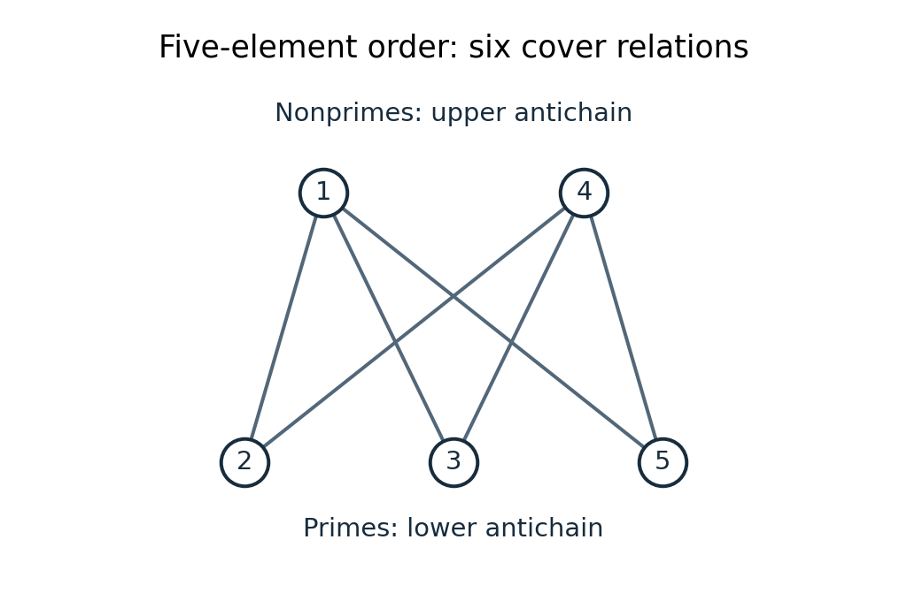

<h1 id="3/b/i/solution">Solution</h1>

↑ **Parent:** [I](../i.md)

The [prime numbers](../../../../../../prime-number-split.md) $2,3,5$ form the lower [antichain](../../../../../../antichain.md); the nonprime elements $1,4$ form the upper [antichain](../../../../../../antichain.md). In particular, $1$ is not a [prime number](../../../../../../prime-number-split.md). Each lower element is below each upper element, and no third element can lie strictly between them. Therefore **the six [cover relations](../../../../../../covering-relation.md) are $2,3,5\prec1,4$**, represented by the following [Hasse diagram](../../../../../../hasse-diagram.md). Upward movement represents increasing order; crossing lines do not add elements.

**[Figure 1](#3/b/i/image-the-six-cover-relations-for-the-five-element-partial-order). The six cover relations for the five-element partial order**.

## ↑ Ancestors (13)

1. [I](../i.md)
2. [B](../../b.md)
3. [3](../../../3.md)
4. [Discrete mathematics, continuous mathematics, and probability resit](../../../../discrete-mathematics-continuous-mathematics-and-probability-resit-split.md)
5. [2019](../../../../split.md)
6. [Past exam of the year 1 of the computer science course of the University of Oxford](../../../../../split.md)
7. [Year 1 of the computer science course of the University of Oxford](../../../../../../year-1-of-the-computer-science-course-of-the-university-of-oxford.md)
8. [Computer science course of the University of Oxford](../../../../../../computer-science-course-of-the-university-of-oxford.md)
9. [Undergraduate course of the University of Oxford](../../../../../../undergraduate-course-of-the-university-of-oxford.md)
10. [Course of the University of Oxford](../../../../../../course-of-the-university-of-oxford.md)
11. [University of Oxford](../../../../../../university-of-oxford-split.md)
12. [List of universities](../../../../../../list-of-universities.md)
13. [Codex Wiki](../../../../../../split.md)
