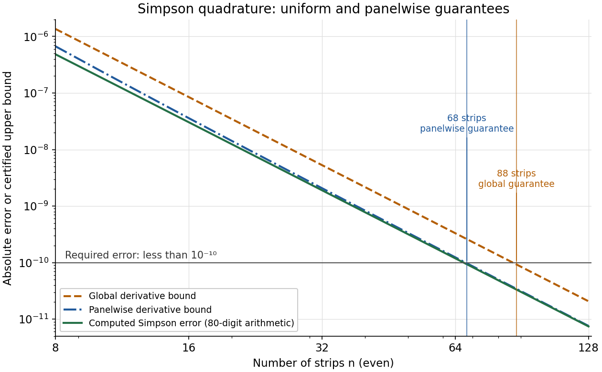

# Discrete mathematics, continuous mathematics, and probability

↑ **Parent:** [2019](../2019.md)

Source paper: [released examination archive](https://www.whatdotheyknow.com/request/ba_computer_science_past_papers/response/2577745/attach/2/202402%20183%20CS%20Papers.zip?cookie_passthrough=1), member `2018/T/a10100w1.pdf`. The cover identifies the regular Preliminary Examination in Computer Science, Trinity Term 2019, Thursday 27 June, 14:30–17:30. The archive directory does not determine the sitting. All nine questions are covered, including every printed Roman subpart.

Questions 1–3 form Discrete Mathematics, 4–6 Continuous Maths, and 7–9 [Probability](../../probability-theory.md#probability). The printed relation in 3(c)(ii) fails to be a [partial order](../../set.md#partially-ordered-set); that issue is treated explicitly rather than silently changing the source.

**Table of contents**

- [1](#1)
  - [a](#1/a)
    - [Solution](#1/a/solution)
  - [b](#1/b)
    - [i](#1/b/i)
      - [Solution](#1/b/i/solution)
    - [ii](#1/b/ii)
      - [Solution](#1/b/ii/solution)
  - [c](#1/c)
    - [i](#1/c/i)
      - [Solution](#1/c/i/solution)
    - [ii](#1/c/ii)
      - [Solution](#1/c/ii/solution)
    - [iii](#1/c/iii)
      - [Solution](#1/c/iii/solution)
  - [d](#1/d)
    - [Solution](#1/d/solution)
  - [e](#1/e)
    - [Solution](#1/e/solution)
- [2](#2)
  - [a](#2/a)
    - [Solution](#2/a/solution)
  - [b](#2/b)
    - [i](#2/b/i)
      - [Solution](#2/b/i/solution)
    - [ii](#2/b/ii)
      - [Solution](#2/b/ii/solution)
  - [c](#2/c)
    - [i](#2/c/i)
      - [Solution](#2/c/i/solution)
    - [ii](#2/c/ii)
      - [Solution](#2/c/ii/solution)
  - [d](#2/d)
    - [i](#2/d/i)
      - [Solution](#2/d/i/solution)
    - [ii](#2/d/ii)
      - [Solution](#2/d/ii/solution)
- [3](#3)
  - [a](#3/a)
    - [i](#3/a/i)
      - [Solution](#3/a/i/solution)
    - [ii](#3/a/ii)
      - [Solution](#3/a/ii/solution)
  - [b](#3/b)
    - [Solution](#3/b/solution)
  - [c](#3/c)
    - [i](#3/c/i)
      - [Solution](#3/c/i/solution)
    - [ii](#3/c/ii)
      - [Solution](#3/c/ii/solution)
  - [d](#3/d)
    - [i](#3/d/i)
      - [Solution](#3/d/i/solution)
    - [ii](#3/d/ii)
      - [Solution](#3/d/ii/solution)
    - [iii](#3/d/iii)
      - [Solution](#3/d/iii/solution)
- [4](#4)
  - [a](#4/a)
    - [Solution](#4/a/solution)
  - [b](#4/b)
    - [Solution](#4/b/solution)
  - [c](#4/c)
    - [i](#4/c/i)
      - [Solution](#4/c/i/solution)
    - [ii](#4/c/ii)
      - [Solution](#4/c/ii/solution)
  - [d](#4/d)
    - [Solution](#4/d/solution)
  - [e](#4/e)
    - [Solution](#4/e/solution)
- [5](#5)
  - [a](#5/a)
    - [i](#5/a/i)
      - [Solution](#5/a/i/solution)
    - [ii](#5/a/ii)
      - [Solution](#5/a/ii/solution)
  - [b](#5/b)
    - [i](#5/b/i)
      - [Solution](#5/b/i/solution)
    - [ii](#5/b/ii)
      - [Solution](#5/b/ii/solution)
    - [iii](#5/b/iii)
      - [Solution](#5/b/iii/solution)
  - [c](#5/c)
    - [Solution](#5/c/solution)
- [6](#6)
  - [a](#6/a)
    - [Solution](#6/a/solution)
  - [b](#6/b)
    - [Solution](#6/b/solution)
  - [c](#6/c)
    - [i](#6/c/i)
      - [Solution](#6/c/i/solution)
    - [ii](#6/c/ii)
      - [Solution](#6/c/ii/solution)
    - [iii](#6/c/iii)
      - [Solution](#6/c/iii/solution)
    - [iv](#6/c/iv)
      - [Solution](#6/c/iv/solution)
- [7](#7)
  - [a](#7/a)
    - [i](#7/a/i)
      - [Solution](#7/a/i/solution)
    - [ii](#7/a/ii)
      - [Solution](#7/a/ii/solution)
  - [b](#7/b)
    - [i](#7/b/i)
      - [Solution](#7/b/i/solution)
    - [ii](#7/b/ii)
      - [Solution](#7/b/ii/solution)
    - [iii](#7/b/iii)
      - [Solution](#7/b/iii/solution)
  - [c](#7/c)
    - [i](#7/c/i)
      - [Solution](#7/c/i/solution)
    - [ii](#7/c/ii)
      - [Solution](#7/c/ii/solution)
- [8](#8)
  - [a](#8/a)
    - [i](#8/a/i)
      - [Solution](#8/a/i/solution)
    - [ii](#8/a/ii)
      - [Solution](#8/a/ii/solution)
  - [b](#8/b)
    - [i](#8/b/i)
      - [Solution](#8/b/i/solution)
    - [ii](#8/b/ii)
      - [Solution](#8/b/ii/solution)
    - [iii](#8/b/iii)
      - [Solution](#8/b/iii/solution)
- [9](#9)
  - [a](#9/a)
    - [i](#9/a/i)
      - [Solution](#9/a/i/solution)
    - [ii](#9/a/ii)
      - [Solution](#9/a/ii/solution)
  - [b](#9/b)
    - [Solution](#9/b/solution)
  - [c](#9/c)
    - [i](#9/c/i)
      - [Solution](#9/c/i/solution)
    - [ii](#9/c/ii)
      - [Solution](#9/c/ii/solution)
    - [iii](#9/c/iii)
      - [Solution](#9/c/iii/solution)

## 1

↑ **Parent:** [Discrete mathematics, continuous mathematics, and probability](discrete-mathematics-continuous-mathematics-and-probability.md)

<h3 id="1/a">a</h3>

↑ **Parent:** [1](#1)

<h4 id="1/a/solution">Solution</h4>

↑ **Parent:** [A](#1/a)

For the first [set inclusion](../../set.md#set-inclusion), take $x\in(A\cap B)\setminus C$. By the definitions of [set intersection](../../set.md#set-intersection) and [set difference](../../set.md#set-difference), $x\in A$, $x\in B$ and $x\notin C$. Consequently $x\in A\setminus C$ and $x\in B\setminus C$, so $x\in(A\setminus C)\cap(B\setminus C)$.

For the reverse [set inclusion](../../set.md#set-inclusion), take $x\in(A\setminus C)\cap(B\setminus C)$. Membership in the first [set difference](../../set.md#set-difference) gives $x\in A$ and $x\notin C$, while membership in the second gives $x\in B$ and $x\notin C$. Thus $x\in A\cap B$ and $x\notin C$, proving $x\in(A\cap B)\setminus C$. The two inclusions establish **the required equality**.

<h3 id="1/b">b</h3>

↑ **Parent:** [1](#1)

<h4 id="1/b/i">i</h4>

↑ **Parent:** [B](#1/b)

<h5 id="1/b/i/solution">Solution</h5>

↑ **Parent:** [I](#1/b/i)

The [set difference](../../set.md#set-difference) $\varnothing\setminus\varnothing$ is the [empty set](../../set.md#empty-set). Its [power set](../../set.md#power-set) contains exactly one element, the [empty set](../../set.md#empty-set) itself. Therefore **the [cardinality](../../cardinal-number.md#cardinality) is $1$**, not zero.

<h4 id="1/b/ii">ii</h4>

↑ **Parent:** [B](#1/b)

<h5 id="1/b/ii/solution">Solution</h5>

↑ **Parent:** [Ii](#1/b/ii)

A [binary relation](../../set-theory.md#binary-relation) on $A$ is any [subset](../../set.md#subset) of the [Cartesian product](../../set-theory.md#cartesian-product) $A\times A$. There are $n^2$ ordered pairs, and each can independently be included or omitted. Hence **the number of [binary relations](../../set-theory.md#binary-relation) is $2^{n^2}$**. This also gives one relation when $n=0$, namely the [empty set](../../set.md#empty-set).

<h3 id="1/c">c</h3>

↑ **Parent:** [1](#1)

<h4 id="1/c/i">i</h4>

↑ **Parent:** [C](#1/c)

<h5 id="1/c/i/solution">Solution</h5>

↑ **Parent:** [I](#1/c/i)

**The [function](../../function.md) is [injective](../../algebra.md#injective-function) and [surjective](../../algebra.md#surjective-function), with [inverse function](../../function.md#inverse-function) $f^{-1}(y)=1-y$.** Equality $1-x=1-x'$ forces $x=x'$. For any $y\in(0,1)$, the input $x=1-y$ also lies in $(0,1)$ and satisfies $f(x)=y$. Applying the [function](../../function.md) twice returns the original input.

<h4 id="1/c/ii">ii</h4>

↑ **Parent:** [C](#1/c)

<h5 id="1/c/ii/solution">Solution</h5>

↑ **Parent:** [Ii](#1/c/ii)

**It is neither [injective](../../algebra.md#injective-function) nor [surjective](../../algebra.md#surjective-function) onto $\mathbb R$, so it has no [inverse function](../../function.md#inverse-function) on the stated domain and codomain.** The distinct inputs $0$ and $\pi/3$ both lie in the domain and both give zero. All values lie in $[-1,1]$, so, for example, the real number $2$ has no preimage.

<h4 id="1/c/iii">iii</h4>

↑ **Parent:** [C](#1/c)

<h5 id="1/c/iii/solution">Solution</h5>

↑ **Parent:** [Iii](#1/c/iii)

**It is [surjective](../../algebra.md#surjective-function) but not [injective](../../algebra.md#injective-function); there is no global [inverse function](../../function.md#inverse-function).** Noninjectivity follows from

$$
f(3/2)=\frac3{\sqrt2}=f(3).
$$

For surjectivity, restrict to $x<1$, where

$$
f(x)=\frac{x}{\sqrt{1-x}},\qquad
f'(x)=\frac{1-x/2}{(1-x)^{3/2}}>0.
$$

This restriction is a [continuous function](../../calculus.md#continuous-function), tends to $-\infty$ as $x\to-\infty$ and to $+\infty$ as $x\to1^-$. The [intermediate value theorem](../../calculus.md#intermediate-value-theorem) therefore supplies a preimage for every real number. The additional branch $x>1$ destroys global injectivity but cannot destroy surjectivity.

<h3 id="1/d">d</h3>

↑ **Parent:** [1](#1)

<h4 id="1/d/solution">Solution</h4>

↑ **Parent:** [D](#1/d)

**The [iterated function](../../discrete-dynamical-system.md#iterated-function) is $f^{(n)}(x)=\sqrt{x^2+n}$ for every positive integer $n$.** The exponent here denotes repeated [function composition](../../function.md#function-composition), not an ordinary power or a [derivative](../../calculus.md#derivative).

For the base case $n=1$, the formula is the definition. If it holds at $n$, then

$$
f^{(n+1)}(x)=f(f^{(n)}(x))
=\sqrt{\left(\sqrt{x^2+n}\right)^2+1}
=\sqrt{x^2+n+1}.
$$

This proves the claim by [mathematical induction](../../foundations-of-mathematics.md#mathematical-induction), for every real input $x$.

<h3 id="1/e">e</h3>

↑ **Parent:** [1](#1)

<h4 id="1/e/solution">Solution</h4>

↑ **Parent:** [E](#1/e)

**There are six [functions](../../function.md): the four power maps $x\mapsto x^k$ for $k=1,2,3,4$, and the two constant maps $0,1$.** All calculations in this part are in the [finite field](../../algebra.md#finite-field) $\mathbb Z_5$.

Put $e=f(1)$. Multiplicativity gives $e^2=e$, so the absence of [zero divisors](../../mathematics.md#zero-divisor) forces $e=0$ or $e=1$. If $e=0$, then $f(x)=f(x)f(1)=0$ for every $x$, giving only the constant-zero map.

Suppose $e=1$. For nonzero $x$, the equality $f(x)f(x^{-1})=1$ shows $f(x)\ne0$. The nonzero elements form a [cyclic group](../../group.md#cyclic-group) generated by $2$, in the order $1,2,4,3$. Choosing $a=f(2)$ determines every value on this group by $f(2^j)=a^j$. Each $a\in\{1,2,3,4\}$ satisfies $a^4=1$, so all four choices give consistent [group homomorphisms](../../group-theory.md#group-homomorphism).

Finally, $z=f(0)$ satisfies $z^2=z$ and $z=zf(x)$ for every $x$. The choice $z=0$ works for all four group maps. The choice $z=1$ forces every nonzero value to be $1$, giving one extra map, the constant-one map. Thus the count is $1+4+1=6$. The four zero-preserving possibilities are exactly the four displayed power maps. This is the special case with five elements of [multiplicative self-maps of a finite field](../../algebra.md#multiplicative-self-maps-of-a-finite-field).

## 2

↑ **Parent:** [Discrete mathematics, continuous mathematics, and probability](discrete-mathematics-continuous-mathematics-and-probability.md)

<h3 id="2/a">a</h3>

↑ **Parent:** [2](#2)

<h4 id="2/a/solution">Solution</h4>

↑ **Parent:** [A](#2/a)

Use the [inclusion-exclusion principle](../../combinatorics.md#inclusion-exclusion-principle) on the multiples of $6,8,11$ in $\{1,\ldots,527\}$. The pairwise [least common multiples](../../divisibility.md#least-common-multiple) are $24,66,88$, and the triple [least common multiple](../../divisibility.md#least-common-multiple) is $264$. Therefore the count is

$$
\begin{aligned}
&\left\lfloor\frac{527}6\right\rfloor+
\left\lfloor\frac{527}8\right\rfloor+
\left\lfloor\frac{527}{11}\right\rfloor-
\left\lfloor\frac{527}{24}\right\rfloor-
\left\lfloor\frac{527}{66}\right\rfloor-
\left\lfloor\frac{527}{88}\right\rfloor+
\left\lfloor\frac{527}{264}\right\rfloor\\
&=87+65+47-21-7-5+2=\boxed{167}.
\end{aligned}
$$

The endpoint $528$ is excluded, which is why the numerators are $527$ rather than $528$.

<h3 id="2/b">b</h3>

↑ **Parent:** [2](#2)

<h4 id="2/b/i">i</h4>

↑ **Parent:** [B](#2/b)

<h5 id="2/b/i/solution">Solution</h5>

↑ **Parent:** [I](#2/b/i)

The [Fibonacci recurrence](../../sequence-and-series.md#fibonacci-recurrence), with the supplied initial values, is **$F_{n+2}=F_{n+1}+F_n$ for $n\ge0$**, with $F_0=0,F_1=1$. Two initial values are needed for this second-order [linear recurrence relation](../../algebra.md#linear-recurrence-relation).

<h4 id="2/b/ii">ii</h4>

↑ **Parent:** [B](#2/b)

<h5 id="2/b/ii/solution">Solution</h5>

↑ **Parent:** [Ii](#2/b/ii)

**Use $G_1=0$ and $G_{n+1}=nG_n+n-1$ for $n\ge1$.** Indeed,

$$
G_{n+1}=n!-1=n\big((n-1)!-1\big)+n-1=nG_n+n-1.
$$

The initial value is $0!-1=0$, so the [recurrence relation](../../sequence-and-series.md#recurrence-relation) produces the specified [factorial](../../combinatorics.md#factorial) sequence.

<h3 id="2/c">c</h3>

↑ **Parent:** [2](#2)

<h4 id="2/c/i">i</h4>

↑ **Parent:** [C](#2/c)

<h5 id="2/c/i/solution">Solution</h5>

↑ **Parent:** [I](#2/c/i)

Adding the [Fibonacci recurrence](../../sequence-and-series.md#fibonacci-recurrence) and the identical [recurrence relation](../../sequence-and-series.md#recurrence-relation) for the [Lucas numbers](../../sequence-and-series.md#lucas-number) gives

$$
\boxed{A_{n+2}=A_{n+1}+A_n,\qquad A_0=2,\quad A_1=2.}
$$

Linearity preserves this [linear recurrence relation](../../algebra.md#linear-recurrence-relation); the initial values come from $0+2$ and $1+1$.

<h4 id="2/c/ii">ii</h4>

↑ **Parent:** [C](#2/c)

<h5 id="2/c/ii/solution">Solution</h5>

↑ **Parent:** [Ii](#2/c/ii)

Let $\phi=(1+\sqrt5)/2$, the [golden ratio](../../algebra.md#golden-ratio). Since $\phi^2=\phi+1$, multiplication by $\phi^n$ gives $\phi^{n+2}=\phi^{n+1}+\phi^n$. Adding this [recurrence relation](../../sequence-and-series.md#recurrence-relation) to the one for $A_n$ yields

$$
\boxed{B_{n+2}=B_{n+1}+B_n,\qquad B_0=3,\quad B_1=2+\phi.}
$$

Thus the extra exponential term changes the initial values, but not the [linear recurrence relation](../../algebra.md#linear-recurrence-relation).

<h3 id="2/d">d</h3>

↑ **Parent:** [2](#2)

<h4 id="2/d/i">i</h4>

↑ **Parent:** [D](#2/d)

<h5 id="2/d/i/solution">Solution</h5>

↑ **Parent:** [I](#2/d/i)

For $n=0$, the difference is $F_1^2-F_0F_2=1=(-1)^0$. Define $D_n=F_{n+1}^2-F_nF_{n+2}$. The [Fibonacci recurrence](../../sequence-and-series.md#fibonacci-recurrence) gives

$$
\begin{aligned}
D_{n+1}
&=F_{n+2}^2-F_{n+1}F_{n+3}\\
&=F_{n+2}(F_{n+2}-F_{n+1})-F_{n+1}^2\\
&=F_nF_{n+2}-F_{n+1}^2=-D_n.
\end{aligned}
$$

The [inductive step](../../foundations-of-mathematics.md#inductive-step) therefore changes $(-1)^n$ into $(-1)^{n+1}$. By [mathematical induction](../../foundations-of-mathematics.md#mathematical-induction), **$D_n=(-1)^n$ for all $n\ge0$**, the requested form of [Cassini's identity](../../sequence-and-series.md#cassini-s-identity).

<h4 id="2/d/ii">ii</h4>

↑ **Parent:** [D](#2/d)

<h5 id="2/d/ii/solution">Solution</h5>

↑ **Parent:** [Ii](#2/d/ii)

Induct on $n$, with the claim quantified over every $m\ge n$. At $n=0$,

$$
F_mF_1-F_0F_{m+1}=F_m=(-1)^0F_m.
$$

Suppose the identity holds for a fixed $n$ and every $m\ge n$. For $m\ge n+1$, the [Fibonacci recurrence](../../sequence-and-series.md#fibonacci-recurrence) gives

$$
\begin{aligned}
F_mF_{n+2}-F_{n+1}F_{m+1}
&=F_m(F_{n+1}+F_n)-F_{n+1}(F_m+F_{m-1})\\
&=-\big(F_{m-1}F_{n+1}-F_nF_m\big)\\
&=-(-1)^nF_{m-1-n}=(-1)^{n+1}F_{m-(n+1)}.
\end{aligned}
$$

Applying the [induction hypothesis](../../foundations-of-mathematics.md#induction-hypothesis) with $m-1\ge n$ is legitimate. This proves **$F_mF_{n+1}-F_nF_{m+1}=(-1)^nF_{m-n}$** throughout its domain, a case of the [Fibonacci determinant identity](../../sequence-and-series.md#fibonacci-determinant-identity).

## 3

↑ **Parent:** [Discrete mathematics, continuous mathematics, and probability](discrete-mathematics-continuous-mathematics-and-probability.md)

<h3 id="3/a">a</h3>

↑ **Parent:** [3](#3)

<h4 id="3/a/i">i</h4>

↑ **Parent:** [A](#3/a)

<h5 id="3/a/i/solution">Solution</h5>

↑ **Parent:** [I](#3/a/i)

A [derangement](../../combinatorics.md#derangement-of-a-permutation) of a finite [set](../../set.md) $A$ is a [permutation](../../combinatorics.md#permutation) $\sigma:A\to A$ with **no fixed point**: $\sigma(a)\ne a$ for every $a\in A$. Thus every element is moved, although the [permutation](../../combinatorics.md#permutation) remains a [bijection](../../function.md#bijection).

<h4 id="3/a/ii">ii</h4>

↑ **Parent:** [A](#3/a)

<h5 id="3/a/ii/solution">Solution</h5>

↑ **Parent:** [Ii](#3/a/ii)

The initial values are **$d_1=0$ and $d_2=1$**: one element cannot move, while two elements must be swapped.

For $n\ge3$, fix one distinguished element, called $n$, and choose its image $j\ne n$, in $n-1$ ways. If $n,j$ form a two-cycle, deleting them leaves an arbitrary [derangement](../../combinatorics.md#derangement-of-a-permutation) on the other $n-2$ elements, giving $d_{n-2}$ choices.

Otherwise the [permutation cycle](../../finite-group-theory.md#permutation-cycle) containing $n$ has length at least three. Remove $n$ from that cycle, joining its predecessor directly to $j$. No fixed point is created because the predecessor is not $j$. This gives a [derangement](../../combinatorics.md#derangement-of-a-permutation) on $n-1$ elements. Conversely, any such [derangement](../../combinatorics.md#derangement-of-a-permutation) uniquely recovers the original one by inserting $n$ immediately before $j$ in its cycle. This case contributes $d_{n-1}$ choices for each $j$.

The two cases are disjoint and exhaustive, so the [derangement recurrence](../../combinatorics.md#derangement-recurrence) is

$$
\boxed{d_n=(n-1)(d_{n-1}+d_{n-2}).}
$$

<h3 id="3/b">b</h3>

↑ **Parent:** [3](#3)

<h4 id="3/b/solution">Solution</h4>

↑ **Parent:** [B](#3/b)

An [upper bound](../../set.md#upper-bound-in-a-partially-ordered-set) of $S$ is an element $u\in A$ with $s\preceq u$ for every $s\in S$. It need not belong to $S$. A maximum, or [greatest element](../../set.md#greatest-element), is an $m\in S$ with that same property. A [least upper bound](../../set.md#least-upper-bound-in-a-partially-ordered-set) is an [upper bound](../../set.md#upper-bound-in-a-partially-ordered-set) $\ell\in A$ satisfying $\ell\preceq u$ for every [upper bound](../../set.md#upper-bound-in-a-partially-ordered-set) $u$.

**A maximum belongs to $S$; a [least upper bound](../../set.md#least-upper-bound-in-a-partially-ordered-set) need not.** In a [partially ordered set](../../set.md#partially-ordered-set), an existing maximum is automatically the [least upper bound](../../set.md#least-upper-bound-in-a-partially-ordered-set), and the [antisymmetric relation](../../set-theory.md#antisymmetric-relation) condition makes each unique.

<h3 id="3/c">c</h3>

↑ **Parent:** [3](#3)

<h4 id="3/c/i">i</h4>

↑ **Parent:** [C](#3/c)

<h5 id="3/c/i/solution">Solution</h5>

↑ **Parent:** [I](#3/c/i)

Put $J=\{k\in\mathbb N:k\le100\}$, avoiding any dependence on whether the convention includes $0$ among the [natural numbers](../../arithmetic.md#natural-number). Under [set inclusion](../../set.md#set-inclusion), the results are

| Family | Maximum | [Least upper bound](../../set.md#least-upper-bound-in-a-partially-ordered-set) in $A$ |
| --- | --- | --- |
| $S_1$ | None | None |
| $S_2$ | $J$ | $J$ |
| $S_1\cap S_2$ | None | $J$ |

The [set union](../../set.md#set-union) of all three-element [subsets](../../set.md#subset) of $\mathbb N$ is $\mathbb N$. An [upper bound](../../set.md#upper-bound-in-a-partially-ordered-set) for $S_1$ under [set inclusion](../../set.md#set-inclusion) would have to contain this entire infinite [set](../../set.md), whereas members of $A$ are finite. Thus $S_1$ has no [upper bound](../../set.md#upper-bound-in-a-partially-ordered-set) and hence no maximum or [least upper bound](../../set.md#least-upper-bound-in-a-partially-ordered-set).

For $S_2$, every member is a [subset](../../set.md#subset) of the finite [set](../../set.md) $J$, and $J$ itself belongs to $S_2$, making it both maximum and [least upper bound](../../set.md#least-upper-bound-in-a-partially-ordered-set). The union of the three-element [subsets](../../set.md#subset) of $J$ is again $J$, so $J$ is the [least upper bound](../../set.md#least-upper-bound-in-a-partially-ordered-set) of $S_1\cap S_2$. It is not a member of that family, and no three-element member contains all the others, so there is no maximum.

<h4 id="3/c/ii">ii</h4>

↑ **Parent:** [C](#3/c)

<h5 id="3/c/ii/solution">Solution</h5>

↑ **Parent:** [Ii](#3/c/ii)

**The displayed relation is not a [partial order](../../set.md#partially-ordered-set) on the printed $A$.** Since the [empty set](../../set.md#empty-set) belongs to $A$, [vacuous truth](../../mathematical-logic.md#vacuous-truth) makes

$$
\varnothing\preceq_2 T,\qquad T\preceq_2\varnothing
$$

hold for every finite $T$, including nonempty $T$. This violates the defining condition of an [antisymmetric relation](../../set-theory.md#antisymmetric-relation). It also violates [transitivity](../../set-theory.md#transitive-relation): $\{2\}\preceq_2\varnothing\preceq_2\{1\}$ holds, but $\{2\}\npreceq_2\{1\}$. Consequently the usual unique-maximum and unique-[least upper bound](../../set.md#least-upper-bound-in-a-partially-ordered-set) terminology for a [partially ordered set](../../set.md#partially-ordered-set) does not apply as claimed.

The available inputs still determine what happens if one applies the formulas in (b) literally to this relation:

| Family | Elements satisfying the maximum formula | Elements satisfying the least-upper-bound formula |
| --- | --- | --- |
| $S_1$ | None | $\varnothing$ |
| $S_2$ | $\varnothing$ and $\{100\}$ | $\varnothing$ and $\{100\}$ |
| $S_1\cap S_2$ | None | $\varnothing$ and $\{100\}$ |

For $S_1$, no nonempty finite [set](../../set.md) can lie above all triples of arbitrarily large numbers, while $\varnothing$ does so vacuously. Thus $\varnothing$ is its sole literal [upper bound](../../set.md#upper-bound-in-a-partially-ordered-set), but is not a member of $S_1$. For each of the two bounded families, the literal [upper bounds](../../set.md#upper-bound-in-a-partially-ordered-set) are $\varnothing$ and all nonempty finite [sets](../../set.md) whose elements are at least $100$. Among these, exactly $\varnothing$ and $\{100\}$ lie below every such [upper bound](../../set.md#upper-bound-in-a-partially-ordered-set). Both belong to $S_2$, but neither belongs to its three-element subfamily.

For comparison, a natural correction is to retain the given rule for nonempty [sets](../../set.md) and declare $\varnothing$ to be a bottom element: no nonempty [set](../../set.md) is then below $\varnothing$. Under this explicitly corrected [partial order](../../set.md#partially-ordered-set), **$S_1$ has neither a maximum nor a [least upper bound](../../set.md#least-upper-bound-in-a-partially-ordered-set); $S_2$ has maximum and [least upper bound](../../set.md#least-upper-bound-in-a-partially-ordered-set) $\{100\}$; and $S_1\cap S_2$ has no maximum but has [least upper bound](../../set.md#least-upper-bound-in-a-partially-ordered-set) $\{100\}$.** A nonempty [upper bound](../../set.md#upper-bound-in-a-partially-ordered-set) must have every element at least as large as every element of the bounded family. These corrected answers are conditional on the stated repair, not answers obtained by silently excluding the [empty set](../../set.md#empty-set) from the source.

<h3 id="3/d">d</h3>

↑ **Parent:** [3](#3)

<h4 id="3/d/i">i</h4>

↑ **Parent:** [D](#3/d)

<h5 id="3/d/i/solution">Solution</h5>

↑ **Parent:** [I](#3/d/i)

**False.** For $n\ge3$, every factor from $3$ through $n$ is at least $3$, so

$$
n!\ge2\cdot3^{n-2},\qquad
\frac{n!}{2^n}\ge\frac29\left(\frac32\right)^n\longrightarrow\infty.
$$

No fixed multiple of $2^n$ eventually bounds the [factorial](../../combinatorics.md#factorial), contradicting the definition of [Big O notation](../../real-analysis.md#big-o-notation). No use of [Stirling's approximation](../../real-analysis.md#stirling-formula) is required.

<h4 id="3/d/ii">ii</h4>

↑ **Parent:** [D](#3/d)

<h5 id="3/d/ii/solution">Solution</h5>

↑ **Parent:** [Ii](#3/d/ii)

**True.** For every $n\ge4$, $2\le\sqrt n$, and raising both nonnegative sides to the $n$th power gives

$$
2^n\le n^{n/2}.
$$

Thus the [Big O notation](../../real-analysis.md#big-o-notation) condition holds with constant $C=1$ and threshold $n_0=4$.

<h4 id="3/d/iii">iii</h4>

↑ **Parent:** [D](#3/d)

<h5 id="3/d/iii/solution">Solution</h5>

↑ **Parent:** [Iii](#3/d/iii)

**False.** It suffices to find a subsequence along which the ratio is unbounded. Set $n=4m$. The last $3m$ factors of $(4m)!$ are at least $m$, while the first $m$ factors have product at least one. Hence

$$
\frac{(4m)!}{(4m)^{2m}}
\ge\frac{m^{3m}}{16^m m^{2m}}
=\left(\frac m{16}\right)^m\longrightarrow\infty.
$$

This contradicts the eventual uniform bound required by [Big O notation](../../real-analysis.md#big-o-notation). The proof is an elementary [factorial](../../combinatorics.md#factorial) comparison, [independent](../../random-variable.md#independent-random-variables) of [Stirling's approximation](../../real-analysis.md#stirling-formula).

## 4

↑ **Parent:** [Discrete mathematics, continuous mathematics, and probability](discrete-mathematics-continuous-mathematics-and-probability.md)

<h3 id="4/a">a</h3>

↑ **Parent:** [4](#4)

<h4 id="4/a/solution">Solution</h4>

↑ **Parent:** [A](#4/a)

Let $h=(b-a)/n$, $x_j=a+jh$, and $m_j=a+(j+\tfrac12)h$. The [composite midpoint rule](../../numerical-analysis.md#composite-midpoint-quadrature-rule) and [composite trapezoidal rule](../../runge-kutta-method.md#composite-trapezoidal-rule) are

$$
M_n=h\sum_{j=0}^{n-1}f(m_j),\qquad
T_n=h\left[\frac{f(a)+f(b)}2+\sum_{j=1}^{n-1}f(x_j)\right].
$$

For [composite Simpson's rule](../../numerical-integration.md#composite-simpson-s-rule) with $2n$ strips, the spacing is $h/2$. Its odd-indexed nodes are the $m_j$ and its even interior nodes are the $x_j$. Consequently

$$
\begin{aligned}
S_{2n}
&=\frac h6\left[f(a)+f(b)+4\sum_{j=0}^{n-1}f(m_j)+2\sum_{j=1}^{n-1}f(x_j)\right]\\
&=\boxed{\frac23M_n+\frac13T_n}.
\end{aligned}
$$

This is an identity between the [quadrature rules](../../numerical-integration.md#quadrature-rule), not an approximation involving an omitted [quadrature error](../../real-analysis.md#quadrature-error).

<h3 id="4/b">b</h3>

↑ **Parent:** [4](#4)

<h4 id="4/b/solution">Solution</h4>

↑ **Parent:** [B](#4/b)

Four differentiations give

$$
f^{(4)}(x)=e^x-ex,\qquad f^{(5)}(x)=e^x-e.
$$

For $0<x<1$, the fifth [derivative](../../calculus.md#derivative) is negative, so the fourth [derivative](../../calculus.md#derivative) is strictly decreasing. Since $f^{(4)}(1)=0$, strict decrease towards that endpoint implies $f^{(4)}(x)>0$ for $x<1$. On the closed [interval](../../real-analysis.md#interval-mathematics), **$0\le f^{(4)}(x)\le1$**, with the maximum at $0$ and minimum at $1$.

<h3 id="4/c">c</h3>

↑ **Parent:** [4](#4)

<h4 id="4/c/i">i</h4>

↑ **Parent:** [C](#4/c)

<h5 id="4/c/i/solution">Solution</h5>

↑ **Parent:** [I](#4/c/i)

Take $n$ to be a positive even integer, as required by [composite Simpson's rule](../../numerical-integration.md#composite-simpson-s-rule). There are $n/2$ two-strip panels, each of width $2/n$. Applying the supplied panel bound with the global fourth-[derivative](../../calculus.md#derivative) minimum $0$ and maximum $1$, and summing, gives

$$
\boxed{0\le E_n\le\frac{n}{2}\frac{(2/n)^5}{2880}
=\frac1{180n^4}.}
$$

Here $E_n$ is the nonnegative [absolute error](../../numerical-analysis.md#absolute-error). In this example [Simpson's rule](../../numerical-integration.md#simpson-s-rule) overestimates the [integral](../../integral.md), so $E_n=S_n-I$. Each panel has that same sign because its fourth [derivative](../../calculus.md#derivative) is nonnegative; cancellation is not being assumed.[§3.5(ii), equations 3.5.6–3.5.8: elementary and composite fourth-[derivative](../../calculus.md#derivative) remainders](../../mathematics-bibliography.md#nist-digital-library-of-mathematical-functions/3-5-quadrature-subsection-ii-simpson’s-rule)

<h4 id="4/c/ii">ii</h4>

↑ **Parent:** [C](#4/c)

<h5 id="4/c/ii/solution">Solution</h5>

↑ **Parent:** [Ii](#4/c/ii)

On the panel $[2j/n,2(j+1)/n]$, the maximum fourth [derivative](../../calculus.md#derivative) is at the left endpoint because it is decreasing. Thus

$$
E_n\le\frac1{90n^5}\sum_{j=0}^{n/2-1}
\left(e^{2j/n}-\frac{2ej}{n}\right).
$$

The [geometric series](../../sequence-and-series.md#geometric-series) and the sum of consecutive integers give

$$
\sum_{j=0}^{n/2-1}e^{2j/n}=\frac{e-1}{e^{2/n}-1},\qquad
\frac{2e}{n}\sum_{j=0}^{n/2-1}j=\frac{en}{4}-\frac e2.
$$

Substitution proves

$$
\boxed{E_n\le B(n):=\frac1{90n^5}
\left(\frac{e-1}{e^{2/n}-1}-\frac{en}{4}+\frac e2\right).}
$$

For $n>2$, at least one panel's maximum is smaller than the global maximum $1$, so this bound is strictly tighter than the global bound. For $n=2$, the two bounds coincide.

<h3 id="4/d">d</h3>

↑ **Parent:** [4](#4)

<h4 id="4/d/solution">Solution</h4>

↑ **Parent:** [D](#4/d)

The global bound requires

$$
\frac1{180n^4}<10^{-10}
\quad\Longleftrightarrow\quad
n>\left(\frac{10^{10}}{180}\right)^{1/4}\approx86.3340.
$$

Since the strip count must be even, **the smallest count certified by this bound is $n=88$**.

For the tighter bound, use the [bisection method](../../numerical-analysis.md#bisection-method) on the continuous extension $B(x)-10^{-10}$ for $x\ge2$. The initial [root bracket](../../numerical-analysis.md#root-bracket) $[2,88]$ is valid: $B(2)=1/2880>10^{-10}$, while $B(88)$ is below the global bound and hence below $10^{-10}$. To identify the smallest admissible even count, the monotonicity of $B$ can also be justified.

Put $h=2/x$ and

$$
C(h)=(e-1)\frac h{e^h-1}-\frac e2+\frac{eh}{2},
\qquad B(x)=\frac{h^4C(h)}{2880}.
$$

For $h>0$, differentiation shows

$$
\left(\frac h{e^h-1}\right)'+\frac12
=\frac{e^{2h}-1-2he^h}{2(e^h-1)^2}\ge0.
$$

The numerator is nonnegative because $e^h-e^{-h}\ge2h$: its difference from $2h$ starts at zero and has nonnegative [derivative](../../calculus.md#derivative) $e^h+e^{-h}-2$, by the [arithmetic-geometric mean inequality](../../mathematical-optimization.md#arithmetic-geometric-mean-inequality). Thus $C'(h)\ge1/2$, and $C(0^+)=e/2-1>0$. Therefore $h^4C(h)$ increases with $h$, so $B(x)$ is strictly decreasing with $x$. [Bisection](../../numerical-analysis.md#bisection-method) locates its unique threshold crossing; then check the neighboring even integers, retaining the strict error inequality.

For example, $B(66)\approx1.09626\times10^{-10}$ and $B(68)\approx9.71694\times10^{-11}$, so **the tighter bound certifies $68$ strips**. These are evaluations of the bound, not an assumption that it equals the actual [quadrature error](../../real-analysis.md#quadrature-error).

**[Figure 1](#4/d/image-computed-simpson-errors-and-the-two-certified-bounds-with-the-required-error-level). Computed Simpson errors and the two certified bounds, with the required error level**.

<h3 id="4/e">e</h3>

↑ **Parent:** [4](#4)

<h4 id="4/e/solution">Solution</h4>

↑ **Parent:** [E](#4/e)

**No: [Monte Carlo integration](../../monte-carlo-method.md#monte-carlo-integration) is poorly suited to this smooth one-dimensional problem at such a tight tolerance.** A sample-average [Monte Carlo estimator](../../monte-carlo-method.md#monte-carlo-estimator) has a standard error proportional to $N^{-1/2}$, whereas the deterministic [composite Simpson's rule](../../numerical-integration.md#composite-simpson-s-rule) bound decreases as $n^{-4}$ here and already certifies the target with tens of strips. Random sampling would require vastly more [function evaluations](../../function.md#function-evaluation) and supplies a probabilistic error statement rather than the displayed deterministic guarantee.

## 5

↑ **Parent:** [Discrete mathematics, continuous mathematics, and probability](discrete-mathematics-continuous-mathematics-and-probability.md)

<h3 id="5/a">a</h3>

↑ **Parent:** [5](#5)

<h4 id="5/a/i">i</h4>

↑ **Parent:** [A](#5/a)

<h5 id="5/a/i/solution">Solution</h5>

↑ **Parent:** [I](#5/a/i)

The first three [derivatives](../../calculus.md#derivative) factor as

$$
\boxed{
f'(x)=2x^3(3x^2-10),\quad
f''(x)=30x^2(x^2-2),\quad
f'''(x)=120x(x^2-1).
}
$$

Let $a=\sqrt{10/3}$. Sign analysis of the factors gives

$$
\begin{aligned}
f'(x)>0&\iff x\in(-a,0)\cup(a,\infty),\\
f''(x)>0&\iff x\in(-\infty,-\sqrt2)\cup(\sqrt2,\infty),\\
f'''(x)>0&\iff x\in(-1,0)\cup(1,\infty).
\end{aligned}
$$

All displayed endpoints are excluded because a factor vanishes there; the extra zero of $f''$ at $0$ does not create a positive [interval](../../real-analysis.md#interval-mathematics).

<h4 id="5/a/ii">ii</h4>

↑ **Parent:** [A](#5/a)

<h5 id="5/a/ii/solution">Solution</h5>

↑ **Parent:** [Ii](#5/a/ii)

The [extreme value theorem](../../real-analysis.md#extreme-value-theorem) guarantees extrema on the closed [interval](../../real-analysis.md#interval-mathematics). Compare its endpoints and the [stationary points](../../calculus-of-variations.md#stationary-point) $0,\pm\sqrt{10/3}$:

$$
f(\pm3)=330,\qquad f(0)=6,\qquad
f\!\left(\pm\sqrt{10/3}\right)=-\frac{338}{27}.
$$

Thus

$$
\boxed{\operatorname*{arg\,max}_{[-3,3]}f=\{-3,3\},\qquad
\operatorname*{arg\,min}_{[-3,3]}f=
\left\{-\sqrt{\frac{10}{3}},\sqrt{\frac{10}{3}}\right\}.}
$$

The two-point answer in each case also follows from the [even function](../../calculus.md#even-function) symmetry.

<h3 id="5/b">b</h3>

↑ **Parent:** [5](#5)

<h4 id="5/b/i">i</h4>

↑ **Parent:** [B](#5/b)

<h5 id="5/b/i/solution">Solution</h5>

↑ **Parent:** [I](#5/b/i)

The [Newton root-finding iteration](../../numerical-analysis.md#newton-root-finding-iteration) is

$$
\boxed{x_{k+1}=x_k-\frac{x_k^6-5x_k^4+6}{6x_k^5-20x_k^3}.}
$$

It is defined when $x_k\notin\{0,\pm\sqrt{10/3}\}$. Finding an exact [zero of a function](../../polynomial.md#zero-of-a-function) is a stopping condition, rather than a reason to continue dividing.

<h4 id="5/b/ii">ii</h4>

↑ **Parent:** [B](#5/b)

<h5 id="5/b/ii/solution">Solution</h5>

↑ **Parent:** [Ii](#5/b/ii)

On $I=[1,7/5]$, $f'<0$ and $f''<0$, since $x^2<2$. Hence $|f'|$ increases and has minimum $|f'(1)|=14$. Also

$$
|f''(x)|=30x^2(2-x^2)
=30\bigl(1-(x^2-1)^2\bigr)\le30,
$$

with equality at $x=1$. Therefore

$$
\boxed{\frac{\max_I|f''|}{\min_I|f'|}=\frac{30}{14}=\frac{15}{7}.}
$$

There is a unique root $r$ in $I$: $f(1)=2>0$, $f(7/5)=-5.678464<0$, and the [function](../../function.md) is strictly decreasing. Moreover $f(6/5)=-1.382016<0$, so $r<6/5=x_0$.

It remains to justify that the iteration stays where the error estimate applies. Because $f$ is a [concave function](../../real-analysis.md#concave-function), its graph lies below each [tangent line](../../calculus.md#tangent-line). At any $x\in[r,6/5]$, the tangent has nonpositive value $f(x)$ at $x$, negative slope, and nonnegative value at $r$. Its zero $N(x)=x-f(x)/f'(x)$ therefore satisfies

$$
r\le N(x)\le x.
$$

By [mathematical induction](../../foundations-of-mathematics.md#mathematical-induction), the [Newton root-finding iteration](../../numerical-analysis.md#newton-root-finding-iteration) stays in $[r,6/5]$ and decreases to some limit $L\ge r$. Continuity in $x_{k+1}-x_k=-f(x_k)/f'(x_k)$ implies $f(L)=0$, so uniqueness gives $L=r$.

Now the supplied error bound applies at every step:

$$
\boxed{|x_{k+1}-r|\le\frac{15}{14}|x_k-r|^2.}
$$

This proves at least [quadratic convergence](../../numerical-analysis.md#quadratic-convergence), with an invariant [interval](../../real-analysis.md#interval-mathematics) and a nonvanishing [derivative](../../calculus.md#derivative) explicitly established.

<h4 id="5/b/iii">iii</h4>

↑ **Parent:** [B](#5/b)

<h5 id="5/b/iii/solution">Solution</h5>

↑ **Parent:** [Iii](#5/b/iii)

**About five steps are certified by the uniform worst-case estimate; the actual iteration reaches double-precision accuracy in about four.** Put $K=15/14$. The initial enclosure gives $e_0=|x_0-r|<1/5$, and repeated squaring yields

$$
e_k\le\frac1K(Ke_0)^{2^k}
<\frac{14}{15}\left(\frac3{14}\right)^{2^k}.
$$

For $k=4$ this is about $1.84\times10^{-11}$, while for $k=5$ it is below $4\times10^{-22}$. Thus five ideal-arithmetic steps push this bound well below the approximately $10^{-16}$ relative resolution of [double-precision floating-point format](../../floating-point-arithmetic.md#double-precision-floating-point-format).

The bound is conservative. Factoring $f(x)=(x^2+1)(x^4-6x^2+6)$ identifies

$$
r=\sqrt{3-\sqrt3}\approx1.126032500610494238.
$$

High-precision evaluation of the actual successive errors gives approximately $7.40\times10^{-2}$, $3.56\times10^{-3}$, $9.91\times10^{-6}$, $7.73\times10^{-11}$ and $4.70\times10^{-21}$. Thus the fourth step would already exceed double-precision accuracy in exact arithmetic. In floating-point evaluation, cancellation in the residual and other [roundoff errors](../../numerical-analysis.md#round-off-error) prevent the subsequent theoretical digits from being realized.

<h3 id="5/c">c</h3>

↑ **Parent:** [5](#5)

<h4 id="5/c/solution">Solution</h4>

↑ **Parent:** [C](#5/c)

For the [vector](../../vector-space.md#vector) equation, the [Jacobian matrix](../../multivariable-calculus.md#jacobian-matrix) is

$$
J(x,y)=
\begin{pmatrix}
6x^5&-20y^3\\1&-1
\end{pmatrix}.
$$

Write the updated coordinates as $(X,Y)$. The second equation of the [multivariable Newton iteration](../../numerical-analysis.md#multivariable-newton-iteration) gives $X-Y=0$. Substituting $X=Y$ into its first linearized equation gives

$$
(6x^5-20y^3)X=5x^6-15y^4-6.
$$

Hence **$h(x,y)=6x^5-20y^3$**, and, whenever $h\ne0$,

$$
\boxed{
(x_{k+1},y_{k+1})
=\frac{5x_k^6-15y_k^4-6}{6x_k^5-20y_k^3}(1,1).
}
$$

Starting from $(0,1)$ gives $(x_1,y_1)=(21/20,21/20)$. Every subsequent iterate remains on the diagonal, where this is exactly the scalar [Newton root-finding iteration](../../numerical-analysis.md#newton-root-finding-iteration) from (b). The value $f(21/20)>0$, so $21/20<r$.

For $1\le x<r$, concavity again puts the tangent's zero at or above $r$. Also

$$
N'(x)=\frac{f(x)f''(x)}{f'(x)^2}<0,
$$

so $r\le N(21/20)\le N(1)=8/7<6/5$. After one scalar step the sequence therefore enters the invariant [interval](../../real-analysis.md#interval-mathematics) proved in (b). It converges to **$(r,r)$ at least quadratically**. If the [vector](../../vector-space.md#vector) error is measured in the [Euclidean norm](../../normed-vector-space.md#euclidean-norm), then $\|(x_k,y_k)-(r,r)\|=\sqrt2\,|x_k-r|$, so the scalar quadratic estimate also gives a quadratic [vector](../../vector-space.md#vector) estimate. The initial off-diagonal step causes no difficulty because its [Jacobian matrix](../../multivariable-calculus.md#jacobian-matrix) is invertible and lands exactly on the diagonal.

## 6

↑ **Parent:** [Discrete mathematics, continuous mathematics, and probability](discrete-mathematics-continuous-mathematics-and-probability.md)

<h3 id="6/a">a</h3>

↑ **Parent:** [6](#6)

<h4 id="6/a/solution">Solution</h4>

↑ **Parent:** [A](#6/a)

Use the [Lagrangian](../../calculus-of-variations.md#lagrangian)

$$
\mathcal L=x^4+4y^4-\lambda(x^2-y^2-1).
$$

The [Lagrange multiplier](../../mathematical-optimization.md#lagrange-multiplier) equations are

$$
4x^3-2\lambda x=0,\qquad
16y^3+2\lambda y=0,\qquad x^2-y^2=1.
$$

Feasibility makes $x\ne0$, so $\lambda=2x^2>0$. The second equation becomes $2y(8y^2+\lambda)=0$, forcing $y=0$ and then $x=\pm1$. The constraint [gradient](../../multivariable-calculus.md#gradient) $(2x,-2y)$ is nonzero on the feasible set, so the multiplier calculation has no missing singular feasible point.

To verify the global minimum rather than just stationarity, eliminate $x^2=1+y^2$:

$$
x^4+4y^4=1+2y^2+5y^4\ge1.
$$

Equality holds exactly at **$(x,y)=(1,0)$ or $(-1,0)$, with minimum value $1$**.

<h3 id="6/b">b</h3>

↑ **Parent:** [6](#6)

<h4 id="6/b/solution">Solution</h4>

↑ **Parent:** [B](#6/b)

If $\mathbf b=0$, the objective is zero at every feasible point, so **every point of the ellipsoid is a minimizer**. Suppose now $\mathbf b\ne0$. A minimum cannot be interior: a sufficiently small step in direction $-\mathbf b$ would remain feasible and decrease the objective. The boundary is active.

For

$$
\mathcal L(\mathbf x,\lambda)=\mathbf b^{\mathsf T}\mathbf x+
\lambda(\mathbf x^{\mathsf T}A\mathbf x-1),
$$

stationarity gives $\mathbf b+2\lambda A\mathbf x=0$. A [positive-definite symmetric matrix](../../linear-algebra.md#symmetric-positive-definite-matrix) is invertible, and the minimizing sign has $\lambda>0$. Enforcing the boundary gives

$$
\lambda=\frac12\sqrt{\mathbf b^{\mathsf T}A^{-1}\mathbf b},\qquad
\boxed{\mathbf x_*=
-\frac{A^{-1}\mathbf b}{\sqrt{\mathbf b^{\mathsf T}A^{-1}\mathbf b}}.}
$$

For global optimality, use the [inner product](../../inner-product.md) $\langle u,v\rangle_A=u^{\mathsf T}Av$. The [Cauchy-Schwarz inequality](../../probability-and-statistics.md#cauchy-schwarz-inequality) gives

$$
|\mathbf b^{\mathsf T}\mathbf x|
=|\langle A^{-1}\mathbf b,\mathbf x\rangle_A|
\le\sqrt{\mathbf b^{\mathsf T}A^{-1}\mathbf b}
\sqrt{\mathbf x^{\mathsf T}A\mathbf x}
\le\sqrt{\mathbf b^{\mathsf T}A^{-1}\mathbf b}.
$$

The proposed point attains the negative of this bound. Thus **the minimum is $-\sqrt{\mathbf b^{\mathsf T}A^{-1}\mathbf b}$**, and equality in the [Cauchy-Schwarz inequality](../../probability-and-statistics.md#cauchy-schwarz-inequality), together with the sign and boundary conditions, makes this minimizer unique when $\mathbf b\ne0$.

<h3 id="6/c">c</h3>

↑ **Parent:** [6](#6)

<h4 id="6/c/i">i</h4>

↑ **Parent:** [C](#6/c)

<h5 id="6/c/i/solution">Solution</h5>

↑ **Parent:** [I](#6/c/i)

Use a column [gradient](../../multivariable-calculus.md#gradient). By the multivariable [chain rule](../../calculus.md#chain-rule),

$$
\boxed{\nabla l(\mathbf x)=
\sum_{i=1}^n y_i f'(\mathbf a_i^{\mathsf T}\mathbf x)\,\mathbf a_i.}
$$

The scalar coefficients multiply the constant [vectors](../../vector-space.md#vector) $\mathbf a_i$. In particular $f'(t)=-te^{-t^2/2}$, although explicit differentiation of $f$ is not required.

<h4 id="6/c/ii">ii</h4>

↑ **Parent:** [C](#6/c)

<h5 id="6/c/ii/solution">Solution</h5>

↑ **Parent:** [Ii](#6/c/ii)

Differentiating the [gradient](../../multivariable-calculus.md#gradient) term by term gives the [Hessian matrix](../../multivariable-calculus.md#hessian-matrix)

$$
\nabla^2l(\mathbf x)=
\sum_{i=1}^n y_i f''(\mathbf a_i^{\mathsf T}\mathbf x)\,
\mathbf a_i\mathbf a_i^{\mathsf T}.
$$

Take row $i$ of $A$ to be $\mathbf a_i^{\mathsf T}$. Then

$$
\boxed{\nabla^2l=A^{\mathsf T}\Delta A,\qquad
\Delta_{ii}=y_i f''(\mathbf a_i^{\mathsf T}\mathbf x),\quad
\Delta_{ij}=0\ (i\ne j).}
$$

Indeed, entry $(j,k)$ of this product is $\sum_i\Delta_{ii}a_{ij}a_{ik}$, exactly the entry of the displayed sum of [outer products](../../vector-space.md#outer-product). Explicitly,

$$
\Delta_{ii}=y_i\bigl((\mathbf a_i^{\mathsf T}\mathbf x)^2-1\bigr)
e^{-(\mathbf a_i^{\mathsf T}\mathbf x)^2/2}.
$$

These coefficients may have either sign, so a [positive-definite](../../bilinear-form.md#positive-definite-bilinear-form) [Hessian matrix](../../multivariable-calculus.md#hessian-matrix) cannot be assumed. This is an instance of the [Hessian of a sum of functions of linear forms](../../multivariable-calculus.md#hessian-of-a-sum-of-functions-of-linear-forms).

<h4 id="6/c/iii">iii</h4>

↑ **Parent:** [C](#6/c)

<h5 id="6/c/iii/solution">Solution</h5>

↑ **Parent:** [Iii](#6/c/iii)

**At $d=1000$, [gradient descent](../../gradient-descent.md) and full [BFGS](../../mathematical-optimization.md#bfgs-method) are practical candidates; a dense [Newton method](../../mathematical-optimization.md#newton-s-method-in-optimization) can also be feasible, but its extra work and indefinite curvature need attention.** The number of examples $n$, data sparsity and conditioning still matter.

For dense $A$, a [gradient](../../multivariable-calculus.md#gradient) evaluation costs $O(nd)$ arithmetic, with $O(d)$ working storage beyond the data and accumulation buffers. [Gradient descent](../../gradient-descent.md) is inexpensive per iteration and, with an appropriate [line search](../../mathematical-optimization.md#line-search), follows a [descent direction](../../mathematical-optimization.md#descent-direction), but poor conditioning can make it slow.

Forming the [Hessian matrix](../../multivariable-calculus.md#hessian-matrix) explicitly costs $O(nd^2)$ arithmetic, and a dense [Newton method](../../mathematical-optimization.md#newton-s-method-in-optimization) solve costs $O(d^3)$. A $1000$-square double-precision [matrix](../../vector-space.md#matrix) uses about $8$ MB, so storage alone is manageable, but repeated factorization may be expensive. Because the [Hessian matrix](../../multivariable-calculus.md#hessian-matrix) can be indefinite or singular, an unmodified [Newton step](../../mathematical-optimization.md#newton-step) need not decrease the loss; a modified Hessian, damping or a [trust region](../../mathematical-optimization.md#trust-region) is appropriate.

Full [BFGS](../../mathematical-optimization.md#bfgs-method) uses [gradients](../../multivariable-calculus.md#gradient) and an $O(d^2)$ curvature approximation, avoiding explicit second [derivatives](../../calculus.md#derivative). Its rank-two updates and direction calculation cost $O(d^2)$ per step and require roughly the same [matrix](../../vector-space.md#matrix) storage. A positive-definite initial approximation with safeguarded curvature updates and a suitable [line search](../../mathematical-optimization.md#line-search) preserves [descent directions](../../mathematical-optimization.md#descent-direction). For this scale it is often a good compromise, without guaranteeing a global minimum.[Secant condition, positive-definite updating, and quadratic per-step operation/storage costs](../../mathematics-bibliography.md#quasi-newton-methods-by-neos-guide)

<h4 id="6/c/iv">iv</h4>

↑ **Parent:** [C](#6/c)

<h5 id="6/c/iv/solution">Solution</h5>

↑ **Parent:** [Iv](#6/c/iv)

**At $d=10^6$, [gradient descent](../../gradient-descent.md) remains a plausible large-scale choice; dense [Newton method](../../mathematical-optimization.md#newton-s-method-in-optimization) and full-memory [BFGS](../../mathematical-optimization.md#bfgs-method) are generally impractical.** A dense $d\times d$ double-precision [matrix](../../vector-space.md#matrix) alone contains $10^{12}$ entries, about $8$ TB. Dense factorization also has order $10^{18}$ arithmetic work. Full [BFGS](../../mathematical-optimization.md#bfgs-method) avoids factorization but retains quadratic storage and update work, so it does not solve that scaling problem.

[Gradient descent](../../gradient-descent.md) uses linear working storage in $d$, though the cost of reading the data and evaluating the [gradient](../../multivariable-calculus.md#gradient) is still $O(nd)$ for dense $A$. Sparsity or streaming can be important. [Limited-memory BFGS](../../mathematical-optimization.md#limited-memory-bfgs), a distinct limited-memory variant, stores only a fixed number $m$ of recent update pairs and uses $O(md)$ storage and update work, making it a realistic alternative to full [BFGS](../../mathematical-optimization.md#bfgs-method).[Final paragraphs: implicit inverse-Hessian products and stored-pair limited-memory methods](../../mathematics-bibliography.md#quasi-newton-methods-by-neos-guide)

The available [Hessian matrix](../../multivariable-calculus.md#hessian-matrix) factorization also permits a [matrix-free Hessian-vector product](../../multivariable-calculus.md#matrix-free-hessian-vector-product):

$$
Hv=A^{\mathsf T}\bigl(\Delta(Av)\bigr).
$$

It costs $O(nd)$ for dense data without forming $H$. A suitable iterative, safeguarded [Newton method](../../mathematical-optimization.md#newton-s-method-in-optimization) can exploit this structure, so the conclusion rules out the dense implementation rather than every possible second-order algorithm.

These methods seek a local solution and require convergence checks appropriate to nonconvex [optimization](../../mathematical-optimization.md). The formula does not even ensure a finite minimizer exists: with one positive coefficient and nonzero $\mathbf a$, the positive exponential loss approaches zero along an unbounded direction without attaining it. Dimension alone cannot supply a convergence guarantee.

## 7

↑ **Parent:** [Discrete mathematics, continuous mathematics, and probability](discrete-mathematics-continuous-mathematics-and-probability.md)

<h3 id="7/a">a</h3>

↑ **Parent:** [7](#7)

<h4 id="7/a/i">i</h4>

↑ **Parent:** [A](#7/a)

<h5 id="7/a/i/solution">Solution</h5>

↑ **Parent:** [I](#7/a/i)

Multiplying the [beta distribution](../../probability-distribution.md#beta-distribution) density by $x$ gives a constant multiple of the normalized density with parameters $(p+1,q)$:

$$
x f_{p,q}(x)=\frac p{p+q}f_{p+1,q}(x).
$$

Integrating and using the fact that the latter [probability density function](../../continuous-probability-distribution.md#probability-density-function) integrates to one gives

$$
\boxed{\mathbb E[X]=\frac p{p+q}.}
$$

This is a normalization-ratio argument, requiring no explicit integration of the polynomial density.

<h4 id="7/a/ii">ii</h4>

↑ **Parent:** [A](#7/a)

<h5 id="7/a/ii/solution">Solution</h5>

↑ **Parent:** [Ii](#7/a/ii)

For $q>1$, decreasing the second parameter by one gives another valid [beta distribution](../../probability-distribution.md#beta-distribution) density and

$$
\frac{f_{p,q}(x)}{1-x}
=\frac{p+q-1}{q-1}f_{p,q-1}(x).
$$

Normalization therefore gives

$$
\boxed{\mathbb E\!\left[\frac1{1-X}\right]=\frac{p+q-1}{q-1}.}
$$

The restriction $q>1$ is essential for this finite [expected value](../../expected-value.md); when $q=1$, the singularity near $1$ instead makes the expectation infinite.

<h3 id="7/b">b</h3>

↑ **Parent:** [7](#7)

<h4 id="7/b/i">i</h4>

↑ **Parent:** [B](#7/b)

<h5 id="7/b/i/solution">Solution</h5>

↑ **Parent:** [I](#7/b/i)

By [independence](../../random-variable.md#independent-random-variables), the [joint probability density](../../continuous-probability-distribution.md#joint-probability-density) is the product of the two [uniform distribution](../../continuous-probability-distribution.md#continuous-uniform-distribution) densities:

$$
\boxed{f_{U,V}(u,v)=\mathbf1_{\{0\le u\le1,\ 0\le v\le1\}}.}
$$

Changing its values on the boundary does not affect any [probability](../../probability-theory.md#probability) or [expected value](../../expected-value.md).

<h4 id="7/b/ii">ii</h4>

↑ **Parent:** [B](#7/b)

<h5 id="7/b/ii/solution">Solution</h5>

↑ **Parent:** [Ii](#7/b/ii)

Split the unit square into $v\le u$ and $v>u$. The maximum is $u$ on the first triangle and $v$ on the second, so

$$
\begin{aligned}
\mathbb E[U\max\{U,V\}]
&=\int_0^1\left[\int_0^u u^2\,dv+\int_u^1 uv\,dv\right]du\\
&=\int_0^1\left[u^3+\frac u2(1-u^2)\right]du\\
&=\frac18+\frac14=\boxed{\frac38}.
\end{aligned}
$$

The shared boundary has zero [probability](../../probability-theory.md#probability), so it is not counted twice in this [joint density](../../continuous-probability-distribution.md#joint-probability-density) calculation.

<h4 id="7/b/iii">iii</h4>

↑ **Parent:** [B](#7/b)

<h5 id="7/b/iii/solution">Solution</h5>

↑ **Parent:** [Iii](#7/b/iii)

For $W=\max\{U,V\}$ and $0\le w\le1$, [independence](../../random-variable.md#independent-random-variables) gives the [cumulative distribution function](../../probability-distribution.md#cumulative-distribution-function)

$$
F_W(w)=\mathbb P(U\le w,V\le w)=w^2.
$$

The [cumulative distribution function](../../probability-distribution.md#cumulative-distribution-function) is zero below $0$ and one above $1$. Differentiating on the interior gives

$$
\boxed{f_W(w)=2w\quad(0<w<1),\qquad f_W(w)=0\quad\text{otherwise},}
$$

up to irrelevant endpoint values. There are no endpoint atoms. This maximum is an [order statistic](../../probability-theory.md#order-statistic).

<h3 id="7/c">c</h3>

↑ **Parent:** [7](#7)

<h4 id="7/c/i">i</h4>

↑ **Parent:** [C](#7/c)

<h5 id="7/c/i/solution">Solution</h5>

↑ **Parent:** [I](#7/c/i)

View the necklace as a [cycle graph](../../graph-theory.md#cycle-graph). Between the white bead and $B$ there are two [edge-disjoint paths](../../graph-theory.md#edge-disjoint-paths), containing $k$ and $n-k$ links. The beads remain connected if and only if at least one of these paths is uncut.

There are $\binom n3$ equally likely cut [sets](../../set.md). Keeping the $k$-link path uncut requires all three cuts to be among its $n-k$ complementary links, giving $\binom{n-k}{3}$ choices. Keeping the other path uncut gives $\binom k3$ choices. These two events are disjoint because three links are cut and they cannot all lie in both complementary paths. Therefore

$$
\boxed{\mathbb P(B\text{ shares the white component})
=\frac{\binom{n-k}{3}+\binom k3}{\binom n3}.}
$$

Use $\binom a3=0$ for $0\le a<3$. The answer is unchanged by exchanging $k$ and $n-k$, so either orientation around the necklace gives the same value. This is the connectivity calculation for [random cuts of a cycle](../../graph-theory.md#random-cuts-of-a-cycle).

<h4 id="7/c/ii">ii</h4>

↑ **Parent:** [C](#7/c)

<h5 id="7/c/ii/solution">Solution</h5>

↑ **Parent:** [Ii](#7/c/ii)

Let $I_B$ be the [indicator](../../measure-theory.md#indicator-function) that black bead $B$ belongs to the white bead's [connected component](../../geometry-and-topology.md#connected-component). The number of such black beads is $\sum_B I_B$. By [linearity of expectation](../../expected-value.md#linearity-of-expectation), no [independence](../../random-variable.md#independent-random-variables) between these [indicators](../../measure-theory.md#indicator-function) is needed.

For $n=7$, the six oriented distances $1,\ldots,6$ give respective [probabilities](../../probability-theory.md#probability)

$$
\frac47,\ \frac27,\ \frac17,\ \frac17,\ \frac27,\ \frac47.
$$

Their sum is **$2$**, the expected number of black beads in the white component. As a check, summing the formula from (i) and using $\sum_{k=1}^{n-1}\binom k3=\binom n4$ gives the general value $2\binom n4/\binom n3=(n-3)/2$, again equal to $2$ when $n=7$.

## 8

↑ **Parent:** [Discrete mathematics, continuous mathematics, and probability](discrete-mathematics-continuous-mathematics-and-probability.md)

<h3 id="8/a">a</h3>

↑ **Parent:** [8](#8)

<h4 id="8/a/i">i</h4>

↑ **Parent:** [A](#8/a)

<h5 id="8/a/i/solution">Solution</h5>

↑ **Parent:** [I](#8/a/i)

**The two outcomes are not [independent](../../random-variable.md#independent-random-variables).** Conditional on the selected die, the rolls are [independent](../../random-variable.md#independent-random-variables), but sharing the unknown die creates [statistical dependence](../../random-variable.md#statistical-dependence). Each nonfavored face has [probability](../../probability-theory.md#probability) $(1-1/2)/5=1/10$.

The unconditional [marginal distribution](../../probability-distribution.md#marginal-distribution) assigns the following [probability](../../probability-theory.md#probability) to a $1$ on either roll:

$$
\mathbb P(X=1)=\mathbb P(Y=1)=
\frac16\left(\frac12+5\cdot\frac1{10}\right)=\frac16.
$$

However, by the [law of total probability](../../probability-space.md#law-of-total-probability),

$$
\mathbb P(X=1,Y=1)=
\frac16\left[\left(\frac12\right)^2+
5\left(\frac1{10}\right)^2\right]=\frac1{20}\ne\frac1{36}.
$$

Thus the joint [probability](../../probability-theory.md#probability) does not factor into the two marginals. [Conditional independence](../../random-variable.md#conditional-independence) given a shared latent choice does not imply unconditional [independence](../../random-variable.md#independent-random-variables).

<h4 id="8/a/ii">ii</h4>

↑ **Parent:** [A](#8/a)

<h5 id="8/a/ii/solution">Solution</h5>

↑ **Parent:** [Ii](#8/a/ii)

Let $D$ denote the selected die. [Bayes' theorem](../../probability-theory.md#bayes-theorem) gives

$$
\boxed{\mathbb P(D=1\mid X=1)
=\frac{\mathbb P(X=1\mid D=1)\mathbb P(D=1)}
{\mathbb P(X=1)}
=\frac{(1/2)(1/6)}{1/6}=\frac12.}
$$

Only the first roll is conditioned on here; the second outcome has not been observed.

<h3 id="8/b">b</h3>

↑ **Parent:** [8](#8)

<h4 id="8/b/i">i</h4>

↑ **Parent:** [B](#8/b)

<h5 id="8/b/i/solution">Solution</h5>

↑ **Parent:** [I](#8/b/i)

This is a [Galton-Watson process](../../galton-watson-process.md) with offspring count $0$ with [probability](../../probability-theory.md#probability) $q=1-p$ and $2$ with [probability](../../probability-theory.md#probability) $p$. The descendants of distinct initial individuals evolve independently, so

$$
\alpha_i=\alpha_1^i
$$

for every finite initial size $i$. Conditioning on the first individual's outcome and applying the [law of total probability](../../probability-space.md#law-of-total-probability) gives

$$
\alpha_1=q+p\alpha_2=q+p\alpha_1^2.
$$

The equation factors as

$$
(\alpha_1-1)(p\alpha_1-q)=0.
$$

Its roots are $1$ and $q/p$. Since $p<1/2$, the second root exceeds one and cannot be a [probability](../../probability-theory.md#probability). Therefore **$\alpha_1=1$ and $\alpha_i=1$ for every finite initial size**. The population reaches the absorbing state zero almost surely; no choice between two admissible fixed-point [probabilities](../../probability-theory.md#probability) remains in this subcritical case.

<h4 id="8/b/ii">ii</h4>

↑ **Parent:** [B](#8/b)

<h5 id="8/b/ii/solution">Solution</h5>

↑ **Parent:** [Ii](#8/b/ii)

If the initial individual has no offspring, $N=0$. If it splits, count that one event and the splitting events in its two [independent](../../random-variable.md#independent-random-variables) descendant trees. Thus

$$
N=
\begin{cases}
0,&\text{with probability }q,\\
1+N_1+N_2,&\text{with probability }p,
\end{cases}
$$

where $N_1,N_2$ are [independent](../../random-variable.md#independent-random-variables) copies of $N$. Taking the [probability generating function](../../probability-distribution.md#probability-generating-function) gives

$$
G_N(s)=q+psG_N(s)^2.
$$

For $0<s\le1$, the quadratic equation has two algebraic branches. A [probability generating function](../../probability-distribution.md#probability-generating-function) must remain finite at $s=0$, where it equals $\mathbb P(N=0)=q$, so the admissible branch is

$$
\boxed{G_N(s)=\frac{1-\sqrt{1-4pqs}}{2ps}
=\frac{2q}{1+\sqrt{1-4pqs}},\qquad G_N(0)=q.}
$$

The rationalized formula is also defined directly at zero. At $s=1$, $\sqrt{1-4pq}=q-p$, so $G_N(1)=1$, consistent with almost-sure finiteness. Extinction occurs after a finite number of generations almost surely, and each generation is finite, which justifies that finiteness claim for the [number of splitting events in a binary branching process](../../galton-watson-process.md#number-of-splitting-events-in-a-binary-branching-process).

<h4 id="8/b/iii">iii</h4>

↑ **Parent:** [B](#8/b)

<h5 id="8/b/iii/solution">Solution</h5>

↑ **Parent:** [Iii](#8/b/iii)

Differentiate the [probability generating function](../../probability-distribution.md#probability-generating-function) equation:

$$
G_N'(s)=pG_N(s)^2+2psG_N(s)G_N'(s).
$$

At $s=1$, $G_N(1)=1$, giving

$$
\boxed{\mathbb E[N]=G_N'(1)=\frac p{1-2p}.}
$$

The [derivative](../../calculus.md#derivative) is finite because $p<1/2$ and the explicit square root has no singularity at $s=1$. Alternatively, the expected population in generation $t$ is $(2p)^t$, so the expected number of splits in that generation is $p(2p)^t$. Summing this nonnegative [geometric series](../../sequence-and-series.md#geometric-series) gives the same answer without initially assuming a finite [expected value](../../expected-value.md).

## 9

↑ **Parent:** [Discrete mathematics, continuous mathematics, and probability](discrete-mathematics-continuous-mathematics-and-probability.md)

<h3 id="9/a">a</h3>

↑ **Parent:** [9](#9)

<h4 id="9/a/i">i</h4>

↑ **Parent:** [A](#9/a)

<h5 id="9/a/i/solution">Solution</h5>

↑ **Parent:** [I](#9/a/i)

**[Markov's inequality](../../probability-inequality.md#markov-s-inequality): if $X\ge0$ and $a>0$, then $\mathbb P(X\ge a)\le\mathbb E[X]/a$.** Pointwise,

$$
X\ge a\,\mathbf1_{\{X\ge a\}}.
$$

Taking [expected values](../../expected-value.md), using their monotonicity and the identity $\mathbb E[\mathbf1_E]=\mathbb P(E)$, gives $\mathbb E[X]\ge a\mathbb P(X\ge a)$. Division by the positive threshold proves the inequality. If the expectation is infinite, the extended-valued bound remains true but uninformative.

<h4 id="9/a/ii">ii</h4>

↑ **Parent:** [A](#9/a)

<h5 id="9/a/ii/solution">Solution</h5>

↑ **Parent:** [Ii](#9/a/ii)

\*\*[Chebyshev's inequality](../../probability-inequality.md#chebyshev-s-inequality): if $X$ has finite mean $\mu$ and [variance](../../variance.md) $\sigma^2$, then for $a>0$,

$$
\boxed{\mathbb P(|X-\mu|\ge a)\le\frac{\sigma^2}{a^2}.}
$$

Apply [Markov's inequality](../../probability-inequality.md#markov-s-inequality) to the nonnegative [random variable](../../random-variable.md) $Y=(X-\mu)^2$ with threshold $a^2$. Since $\mathbb E[Y]=\sigma^2$ and $\{|X-\mu|\ge a\}=\{Y\ge a^2\}$, the desired statement follows immediately.

<h3 id="9/b">b</h3>

↑ **Parent:** [9](#9)

<h4 id="9/b/solution">Solution</h4>

↑ **Parent:** [B](#9/b)

By [linearity of expectation](../../expected-value.md#linearity-of-expectation), **$\mathbb E[Z]=\sum_i\mathbb E[X_i]=0$**. Expanding the square and again using [linearity of expectation](../../expected-value.md#linearity-of-expectation) gives

$$
\begin{aligned}
\operatorname{Var}(Z)
&=\mathbb E[Z^2]
=\sum_i\mathbb E[X_i^2]+2\sum_{i<j}\mathbb E[X_iX_j]\\
&=\boxed{\sum_i\sigma_i^2+2\sum_{i<j}\operatorname{Cov}(X_i,X_j)}.
\end{aligned}
$$

Here the zero means imply $\mathbb E[X_i^2]=\sigma_i^2$ and $\mathbb E[X_iX_j]=\operatorname{Cov}(X_i,X_j)$. The [covariance](../../variance.md#covariance) expansion itself does not require [independence](../../random-variable.md#independent-random-variables). Under the additional [independence](../../random-variable.md#independent-random-variables) stated here, $\mathbb E[X_iX_j]=\mathbb E[X_i]\mathbb E[X_j]=0$, so it simplifies further to **$\operatorname{Var}(Z)=\sum_i\sigma_i^2$**.

<h3 id="9/c">c</h3>

↑ **Parent:** [9](#9)

<h4 id="9/c/i">i</h4>

↑ **Parent:** [C](#9/c)

<h5 id="9/c/i/solution">Solution</h5>

↑ **Parent:** [I](#9/c/i)

Write the card values as $a_1,\ldots,a_{1000}$. Uniform selection gives

$$
\mathbb E[X]=\frac1{1000}\sum_i a_i=0,\qquad
\mathbb E[X^2]=\frac1{1000}\sum_i a_i^2=1.
$$

Thus **$\mathbb E[X]=0$ and $\operatorname{Var}(X)=1$**, by the [variance](../../variance.md) identity $\operatorname{Var}(X)=\mathbb E[X^2]-\mathbb E[X]^2$.

<h4 id="9/c/ii">ii</h4>

↑ **Parent:** [C](#9/c)

<h5 id="9/c/ii/solution">Solution</h5>

↑ **Parent:** [Ii](#9/c/ii)

Every particular card is second with [probability](../../probability-theory.md#probability)

$$
\sum_{\text{999 other first cards}}\frac1{1000}\frac1{999}
=\frac1{1000}.
$$

Hence **$X$ and $Y$ have the same distribution**, with means zero and variances one. They are not [independent](../../random-variable.md#independent-random-variables), since a card cannot be drawn twice.

Every ordered pair of distinct cards has [probability](../../probability-theory.md#probability) $1/(1000\cdot999)$. Therefore

$$
\begin{aligned}
\operatorname{Cov}(X,Y)=\mathbb E[XY]
&=\frac{\sum_{i\ne j}a_i a_j}{1000\cdot999}\\
&=\frac{(\sum_i a_i)^2-\sum_i a_i^2}{1000\cdot999}
=\boxed{-\frac1{999}}.
\end{aligned}
$$

This negative [covariance](../../variance.md#covariance) is the effect of [sampling without replacement](../../statistical-inference.md#sampling-without-replacement), not a contradiction of their identical marginals.

<h4 id="9/c/iii">iii</h4>

↑ **Parent:** [C](#9/c)

<h5 id="9/c/iii/solution">Solution</h5>

↑ **Parent:** [Iii](#9/c/iii)

Represent the removed half as the first $m=500$ cards in a uniformly random ordering. Every unordered half is then equally likely. Let $X_1,\ldots,X_{500}$ be their values. Each has mean zero and [variance](../../variance.md) one, and every distinct pair has [covariance](../../variance.md#covariance) $-1/999$ by the same ordered-pair argument as in (ii).

The general [covariance](../../variance.md#covariance) expansion from (b), applied without imposing [independence](../../random-variable.md#independent-random-variables), gives

$$
\boxed{\mathbb E[Z]=0,\qquad
\operatorname{Var}(Z)=500-\frac{500\cdot499}{999}
=\frac{250000}{999}.}
$$

This is the [finite population correction](../../discrete-probability-distribution.md#finite-population-correction) for a half-sample; treating the draws as [independent](../../random-variable.md#independent-random-variables) would give the wrong [variance](../../variance.md).

Finally $\{Z\ge50\}\subseteq\{|Z|\ge50\}$, so [Chebyshev's inequality](../../probability-inequality.md#chebyshev-s-inequality) yields

$$
\boxed{\mathbb P(Z\ge50)\le
\frac{\operatorname{Var}(Z)}{50^2}
=\frac{250000}{999\cdot2500}
=\frac{100}{999}.}
$$

The cards returned before this sampling step restore the original population; no conditioning on the earlier two observed values is imposed.

## ↑ Ancestors (9)

1. [2019](../2019.md)
2. [Past exam of the year 1 of the computer science course of the University of Oxford](../../past-exam-of-the-year-1-of-the-computer-science-course-of-the-university-of-oxford.md)
3. [Year 1 of the computer science course of the University of Oxford](../../university-of-oxford.md#year-1-of-the-computer-science-course-of-the-university-of-oxford)
4. [Computer science course of the University of Oxford](../../university-of-oxford.md#computer-science-course-of-the-university-of-oxford)
5. [Undergraduate course of the University of Oxford](../../university-of-oxford.md#undergraduate-course-of-the-university-of-oxford)
6. [Course of the University of Oxford](../../university-of-oxford.md#course-of-the-university-of-oxford)
7. [University of Oxford](../../university-of-oxford.md)
8. [List of universities](../../README.md#list-of-universities)
9. [Codex Wiki](../../README.md)
